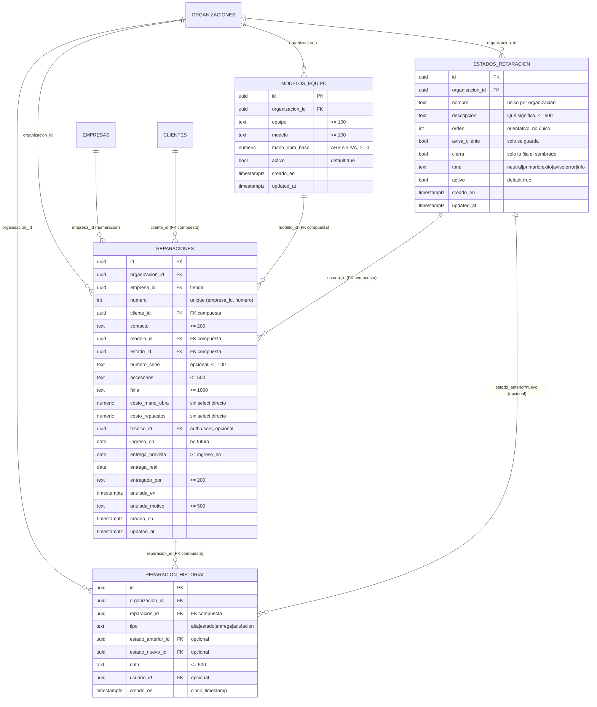

# Service técnico: alta, estados y permisos (MSF-182)

Épica **MSF-182** (F-SVC-01/MSF-254, F-SVC-02/MSF-283, F-SVC-03/MSF-303 y F-SVC-05/MSF-324). Spec, plan y
tareas: `specs/20261020-100000-service-alta-estados-y-permisos/`. Implementación en la rama
`epic/MSF-182-service-tecnico-service-alta-estados-y-p` (release a STG `00f43e21`, PR #205), **pendiente de
merge a `main`** al momento de esta página. Resumen de producto y límites:
[Service técnico: alta, estados y permisos](../producto/service-tecnico-alta-estados-permisos.md).

Alcance de entrega: **`refine`** (`apps/web`) y **`supabase`** (migraciones, RPC y pgTAP). Sin `kestra`,
`superset` ni `workers`. La épica siguiente, MSF-199, extiende aditivamente `obtener_reparacion` con ítems y
totales; ver [Service técnico: listado, ítems e impresión](service-listado-items-impresion.md).

## Modelo de datos (DER)

Cuatro tablas nuevas, todas en **`dominio`** (Principio VII: son entidades de negocio del taller, no de la
plataforma). Las RPC viven en `public` y las ayudas en `private`. Roles y actividad son datos/eventos en
`public`; no se crean tablas de plataforma.

| Tabla | Estado | Cambio |
|---|---|---|
| `dominio.modelos_equipo` | nueva | Catálogo de equipos/modelos por organización, con mano de obra base y activo. |
| `dominio.estados_reparacion` | nueva | Etapas configurables por organización, con orden, aviso y cierre. |
| `dominio.reparaciones` | nueva | Reparación: tienda, número por empresa, cliente, modelo, estado, costos, técnico y fechas. |
| `dominio.reparacion_historial` | nueva | Bitácora de alta, estados, entrega y anulación. Solo lectura para la app. |
| `public.organizaciones` | existente | Solo FK (`organizacion_id`) y disparador de sembrado. |
| `dominio.empresas` | existente | Solo se lee/valida la tienda; sin cambios. |
| `public.clientes` | existente | FK compuesta `(id, organizacion_id)`; sin cambios. |
| `public.usuarios_organizacion` | existente | Se lee para validar al técnico y listar técnicos elegibles. |
| `public.roles_organizacion`, `permisos_rol`, `permisos_rol_accion` | existentes | Solo filas nuevas del rol `tecnico`; sin cambio de esquema. |
| `public.registro_actividad` | existente | Recibe los eventos `modelo.*`, `estado.*` y `reparacion.*`; sin cambio de esquema. |

### `dominio.modelos_equipo` (migración `20261020100100_modelos_equipo.sql`)

| Columna | Regla |
|---|---|
| `id` | uuid, PK. |
| `organizacion_id` | uuid, default `private.organizacion_id()`; FK a `organizaciones` con `on delete cascade`. El llamador no la fija. |
| `equipo` / `modelo` | Texto obligatorio, recortado, máximo 100. |
| `mano_obra_base` | `numeric(12,2)` ARS sin IVA, `>= 0`, redondeado a dos decimales. |
| `activo` | Booleano, default `true`; se desactiva, no se borra. |
| `creado_en` / `updated_at` | Fecha del servidor; `updated_at` avanza solo ante un cambio real. |

Equipo + modelo son únicos por organización **sin distinguir mayúsculas ni tildes**, incluidos los
inactivos, con el índice `modelos_equipo_org_equipo_modelo_key`. La clave se calcula con
`private.clave_texto(text)` (minúsculas, sin espacios de los bordes, sin tildes; no hay `unaccent` en el
stack). `unique (id, organizacion_id)` habilita la FK compuesta de `reparaciones`.

### `dominio.estados_reparacion` (migración `20261020100200_estados_reparacion.sql`)

| Columna | Regla |
|---|---|
| `nombre` | Obligatorio, máximo 80; único por organización sin distinguir mayúsculas ni tildes (`estados_reparacion_org_nombre_key`), incluidos los inactivos. |
| `descripcion` | «Qué significa», máximo 500, default `''`. |
| `orden` | Entero `> 0`; **no es único** a propósito, para que el intercambio atómico de dos filas no choque con una restricción intermedia. |
| `avisa_cliente` | Booleano; se guarda y se muestra, pero esta épica **no envía avisos**. |
| `cierra` / `tono` | Los fija el sembrado; la API no los escribe (el `grant insert` no los incluye). |
| `activo` | Booleano, default `true`; se desactiva, no se borra. |

`orden` es **orientativo**: el `grant insert`/`update` lo incluye porque las RPC de catálogo son `security
invoker`. Un insert o update directo por la API puede duplicar o mover `orden` sin pasar por el bloqueo de la
RPC; queda acotado a la organización por RLS y es un límite conocido (la UI siempre pasa por las RPC).

### `dominio.reparaciones` (migración `20261020110100_reparaciones.sql`)

| Columna | Regla |
|---|---|
| `organizacion_id` | Default `private.organizacion_id()`; no la fija el llamador. |
| `empresa_id` | Tienda; el disparador valida que sea de la organización. |
| `numero` | Entero `> 0`; `unique (empresa_id, numero)`: **la serie es por empresa**. Se presenta como `R-0001`. |
| `cliente_id` | FK compuesta `(cliente_id, organizacion_id)` a `public.clientes`; no se puede cruzar organización. |
| `modelo_id` / `estado_id` | FK compuestas `(…, organizacion_id)` a modelos y estados. |
| `contacto`, `accesorios`, `falla`, `numero_serie` | Textos normalizados; serie opcional (un equipo puede reingresar con la misma serie). |
| `costo_mano_obra`, `costo_repuestos` | `numeric(12,2)` ARS sin IVA, `>= 0`; **sin `select` directo**. |
| `tecnico_id` | FK opcional a `auth.users`; el disparador valida la membresía al insertar o si cambia. |
| `ingreso_en` | Fecha; no puede ser futura. |
| `entrega_prevista` | Opcional; `>= ingreso_en`. |
| `entrega_real`, `entregado_por` | Los completa la RPC de entrega; quién entregó hasta 200. |
| `anulada_en`, `anulada_motivo` | Se guardan juntos o ninguno (`check`); anulación irreversible. |
| `creado_en`, `updated_at` | `updated_at` para el bloqueo optimista. |

No hay `delete`: la reparación se anula. `unique (id, organizacion_id)` habilita la FK compuesta del
historial. Los costos internos **no tienen `select` directo**: el grant es por columna y los excluye; solo los
devuelve `public.obtener_reparacion`, enmascarados en `null` sin la acción `ver_costos`.

Disparadores `before insert or update`:

- `private.validar_reparacion()`: tienda de la organización; técnico de la organización solo al insertar o si
  `tecnico_id` cambia (así una baja del técnico no traba la edición); `ingreso_en` no futuro.
- `private.normalizar_reparacion()`: recorta textos, redondea importes, mantiene `updated_at` solo ante un
  cambio real y rechaza cargar costos sin `ver_costos` (`42501`). Sin sesión (migraciones, sembrados) el
  control de costos no aplica.

### `dominio.reparacion_historial` (migración `20261020110300_reparacion_historial_crear.sql`)

| Columna | Regla |
|---|---|
| `tipo` | `alta`, `estado`, `entrega` o `anulacion`. |
| `estado_anterior_id` / `estado_nuevo_id` | FK compuestas opcionales a `dominio.estados_reparacion`. |
| `nota` | Máximo 500; en la entrega lleva «Entregó: …» y en la anulación el motivo. |
| `usuario_id` | `auth.users`, `on delete set null`; la RPC usa `auth.uid()`. |
| `creado_en` | `clock_timestamp()` para que el orden sea estable dentro de una transacción. |

La tabla es **solo lectura para la app**: no hay políticas ni grants de `insert`/`update`/`delete`. La
escriben las RPC `security definer` en la misma transacción que la operación. Las FK compuestas por
organización impiden apuntar a una reparación o a un estado ajenos.

### RLS y privilegios

- Las cuatro tablas filtran por `organizacion_id = private.organizacion_id()` y por nivel de
  `service_tecnico` (`private.nivel_seccion`) en `lectura`/`edicion` para `select`.
- `modelos_equipo` y `estados_reparacion`: `insert`/`update` solo con `edicion`; **sin `delete`**. `anon` sin
  privilegios.
- `reparaciones` y `reparacion_historial`: **sin políticas ni grants de escritura**; escriben solo las RPC.
- La lectura de `reparaciones` y del historial exige además que la tienda esté en
  `private.empresas_accesibles()` (migración `20261020140000_reparaciones_lectura_por_tienda.sql`), igual que
  el alta y la edición. Una reparación de una tienda inaccesible se trata como inexistente (`P0002`).
- `rls_en_toda_tabla` (pgTAP, recorre `public` + `dominio`) sigue verde.

### Sembrado (migración `20261020100300_service_sembrado.sql`)

`private.sembrar_service(organizacion)` es idempotente: corre por disparador `after insert` en
`public.organizaciones` y por relleno de las existentes. No pisa lo que la organización editó.

- **Modelos (7):** Nintendo Switch Estándar / Lite / OLED; Joystick Pro Controller / Joy-Con (par);
  PlayStation 4 Slim (**inactivo**) y PlayStation 5 Estándar.
- **Estados (7):** Recibido, En diagnóstico, Esperando repuesto, En reparación, Listo para entregar,
  Entregado y Sin reparación. Cierran «Entregado» y «Sin reparación»; avisan «Recibido», «Esperando repuesto»,
  «Listo para entregar» y «Sin reparación».
- El **octavo estado** que menciona la épica se define con el cliente y se agrega desde la pantalla, sin
  migración.
- La migración `20261020100800_service_sembrado_sin_actividad.sql` marca `app.sembrando` para que el sembrado
  no registre 14 eventos falsos cuando la organización la crea una persona con sesión.

## RPC

### Catálogos (F-SVC-01)

Todas son `security invoker` (rige la RLS), exigen `edicion` en `service_tecnico`, fijan
`search_path = ''`, hacen `revoke … from public, anon` y `grant execute … to authenticated`.

| RPC | Qué hace |
|---|---|
| `public.crear_modelo_equipo(p_equipo text, p_modelo text, p_mano_obra_base numeric)` | Alta. Duplicado → `23505`. |
| `public.actualizar_modelo_equipo(p_id uuid, p_actualizado_en timestamptz, p_equipo text, p_modelo text, p_mano_obra_base numeric)` | Edición con bloqueo optimista (`40001` si cambió). |
| `public.cambiar_estado_modelo_equipo(p_id uuid, p_activo boolean)` | Activa/desactiva; idempotente. |
| `public.crear_estado_reparacion(p_nombre text, p_descripcion text, p_avisa_cliente boolean)` | Alta al final del orden, serializada por organización. |
| `public.actualizar_estado_reparacion(p_id uuid, p_actualizado_en timestamptz, p_nombre text, p_descripcion text, p_avisa_cliente boolean)` | Edición con bloqueo optimista. |
| `public.mover_estado_reparacion(p_id uuid, p_direccion text)` | `subir` o `bajar`: intercambia `orden` con el vecino en una sola sentencia; en un extremo no hace nada. |
| `public.cambiar_estado_estado_reparacion(p_id uuid, p_activo boolean)` | Activa/desactiva; idempotente. |

`avisa_cliente` y `cierra` solo se guardan y se muestran; no hay envío de avisos en esta épica. En las
pantallas, «Editar» abre el mismo diálogo precargado y guarda con `actualizar_*` y bloqueo optimista por
`updated_at`.

### Reparaciones (F-SVC-02)

Todas son `security definer` (la tabla no admite escritura directa), con `search_path = ''`, organización y
actor tomados de la sesión, y `revoke … from public, anon` + `grant execute … to authenticated`. Las
mutaciones exigen `edicion`; las lecturas aceptan `lectura` o `edicion`. Errores: `22023` validación (campo en
`hint`), `42501` sin permiso, `40001` conflicto, `55000` anulada/cerrada, `P0002` inexistente o tienda no
accesible.

| RPC | Qué hace |
|---|---|
| `public.crear_reparacion(p_empresa_id, p_cliente_id, p_modelo_id, p_contacto, p_numero_serie, p_accesorios, p_falla, p_costo_mano_obra, p_costo_repuestos, p_tecnico_id, p_entrega_prevista)` | Valida tienda accesible, cliente no archivado, modelo activo y técnico elegible. Asigna el próximo número de la empresa, el primer estado activo por `orden` y el ingreso de hoy (zona Argentina). Escribe el evento `alta` del historial y la actividad. Devuelve la reparación como JSON con `codigo` `R-0001`. |
| `public.actualizar_reparacion(p_id, p_actualizado_en, p_cliente_id, p_modelo_id, …)` | Bloqueo optimista por `updated_at` (`40001`) y `for update`; no cambia número, tienda ni estado; rechaza anuladas (`55000`). `null` en un costo = sin cambio; un valor exige `ver_costos`. |
| `public.obtener_reparacion(p_id uuid)` | Devuelve la reparación con cliente, modelo, estado y tienda. Solo de tiendas accesibles; los costos llegan `null` sin `ver_costos` y `puede_ver_costos` le dice a la UI qué mostrar. |
| `public.tecnicos_de_service()` | Usuarios activos de la organización con `edicion` en Service técnico: solo `user_id` y nombre visible (sin nombre: «Técnico sin nombre», nunca el email). |
| `public.uso_modelo_equipo(p_id uuid default null)` / `public.uso_estado_reparacion(p_id uuid default null)` | Cantidad de reparaciones por modelo/estado; `security invoker` (rige la RLS). Sin id devuelven todos los que tienen uso. |

La numeración la resuelve `private.siguiente_numero_reparacion(empresa)` con
`pg_advisory_xact_lock(hashtextextended('reparaciones:' || empresa, 0))` y `max(numero) + 1`: dos altas
simultáneas se serializan, no hay repetidos ni saltos y el número no se consume si la transacción falla.
`private.codigo_reparacion(numero)` arma `R-0001` solo para presentar; la base guarda el entero.

`obtener_reparacion` es `security definer` porque `public.clientes` tiene RLS por la sección *Clientes*: un
rol de Service sin esa sección vería el detalle vacío. La función reaplica a mano organización, nivel
`lectura`/`edicion` y tienda accesible, y enmascara los costos. MSF-199 extiende esta misma función con ítems
y totales.

### Estado, historial, entrega y anulación (F-SVC-03)

| RPC (`security definer`, `search_path = ''`) | Qué hace |
|---|---|
| `public.cambiar_estado_reparacion(p_id uuid, p_estado_id uuid)` | Exige `edicion` y tienda accesible; bloquea la fila (`for update`); el estado debe ser activo y de la organización (`22023`, hint `estado_id`); rechaza anuladas y cerradas por entrega (`55000`); un estado que cierra se rechaza (va por la entrega). **Idempotente**: elegir el estado actual devuelve la reparación sin historial ni actividad nuevos. |
| `public.registrar_entrega_reparacion(p_id uuid, p_estado_id uuid, p_entrega_real date, p_entregado_por text)` | El estado debe tener `cierra = true`; la fecha no puede ser anterior al ingreso ni futura (hora de Argentina); quién entregó es obligatorio (hasta 200). Guarda la entrega, cambia el estado y escribe el evento `entrega` en la misma transacción. |
| `public.anular_reparacion(p_id uuid, p_motivo text)` | Motivo obligatorio (hasta 500). Guarda `anulada_en`/`anulada_motivo` y escribe el evento `anulacion`. **Irreversible**: no hay RPC inversa y repetirla da `55000`. |
| `public.historial_reparacion(p_id uuid)` | Devuelve `(id, tipo, estado_anterior, estado_nuevo, nota, usuario, creado_en)`, más reciente primero. Estados **por nombre**; usuario «Nombre Apellido» o «Usuario sin nombre», **nunca el email**. |

Todas hacen `revoke … from public, anon` y `grant execute … to authenticated`. Las RPC de estado, entrega y
anulación fijan `creado_en` con `clock_timestamp()` para que el orden sea estable dentro de una transacción; el
alta usa el default de la tabla.

Secuencia interactiva del cambio de estado y la entrega:
[MSF-303 · secuencia](../diagrams/msf-303-sequence.html).

### Transiciones admitidas

No hay tabla de transiciones: el orden de los estados define el flujo inicial, pero se puede pasar a cualquier
estado **activo** de la organización desde otro, también hacia atrás para corregir. Las reglas fijas son:

- un estado que **cierra** solo se alcanza con la entrega (diálogo de fecha y quién entregó);
- después de entregar o anular no hay más cambios de estado;
- desactivar un estado no altera las reparaciones que ya lo tienen (se muestra como desactivado).

## Rol Técnico

Migración `20261020130100_rol_tecnico.sql` (aditiva). Es **solo datos** en `public`: no crea ni altera tablas.

- Inserta `tecnico` en `public.roles_organizacion`.
- Redefine `private.matriz_inicial()` agregando la columna `tecnico`; `private.matriz_acciones_iniciales()`
  deriva las acciones de esa matriz y el Técnico queda sin `eliminar`, `exportar` ni `ver_costos`.
- Hace backfill con `private.sembrar_permisos` sobre las organizaciones existentes; el disparador de
  organización nueva ya lee la matriz redefinida. `on conflict do nothing` no pisa los otros roles.
- `public.guardar_matriz_permisos` rechaza cambios sobre `tecnico` con `22023` (matriz fija); en la UI la
  columna Técnico de `/roles` queda deshabilitada.
- `cambiar_rol_miembro` ya valida contra `roles_organizacion`, así que «Técnico» es asignable desde Usuarios
  sin cambios en la RPC.

| Sección | Técnico |
|---|---|
| `service_tecnico` | `edicion` |
| `inicio`, `clientes`, `productos`, `stock` | `lectura` |
| Resto | `ninguno` |

`public.tecnicos_de_service()` resuelve el nivel con `private.nivel_de_rol(organizacion_id, rol_id,
'service_tecnico')`, no con la empresa activa: el Técnico es de la organización y ve todas las reparaciones
de las tiendas accesibles. No ve los costos internos.

## Interfaz

| Ruta / archivo | Qué hace |
|---|---|
| `/service-tecnico` y `/service-tecnico/*` | Redirigen a `/service-tecnico/reparaciones`. |
| `/service-tecnico/reparaciones` | Pestaña Reparaciones: «Nueva reparación» con `edicion`; sin listado (MSF-199). |
| `/service-tecnico/reparaciones/nueva` y `/:id` | Alta y detalle/edición; estado, historial, entrega y anulación. |
| `/service-tecnico/modelos` | Catálogo de modelos, con columna Reparaciones y aviso al desactivar en uso. |
| `/service-tecnico/estados` | Catálogo de estados, con orden, avisos, cierre y activo. |
| `apps/web/src/lib/serviceTecnico.ts` | Tipos, listados, RPC de catálogos, validación de importes y mapeo de errores. |
| `apps/web/src/lib/reparaciones.ts` | Tipos, RPC de reparación, validaciones, historial y mapeo de errores. |
| `apps/web/src/components/service/` | `ClienteSelector`, `AltaRapidaClienteDialog`, `ModeloFormDialog`, `EstadoFormDialog`, `ConfirmarDesactivarDialog`, `EntregaDialog`, `AnularDialog`, `HistorialEstados`, `PestanasService` y `RequiereServiceTecnico`. |
| `apps/web/src/pages/service-tecnico/` | `modelos.tsx`, `estados.tsx`, `reparaciones.tsx` y `reparacion.tsx`. |

- El menú agrega el grupo **Service → Service técnico** (icono de herramienta) con
  `seccionPermiso: 'service_tecnico'` y la funcionalidad `service-tecnico`; sin nivel o sin funcionalidad
  habilitada, la ruta muestra «Acceso restringido».
- `RequiereServiceTecnico` combina `RequiereAccesoSeccion` con `useFeatureHabilitada('service-tecnico')` y
  falla cerrada.
- `SECCION_POR_RECURSO` mapea `service-tecnico-reparaciones`, `service-tecnico-modelos` y
  `service-tecnico-estados` a `service_tecnico`.
- La funcionalidad se registra en `20261020100700_service_funcionalidad.sql` (y, en la rama de la épica, en
  `supabase/seed.sql` para un reset desde cero), pero **registrarla no la habilita**: un superadmin la activa
  por organización.
- El alta rápida de cliente usa el mismo camino que la pantalla Clientes (recurso `clientes` de Refine,
  `validarCliente`/`aValores` y `guardar_empresas_de_cliente`): no duplica validaciones y respeta la RLS de
  Clientes. No hay una RPC de alta mínima separada.

### Empresa activa

- La Tienda del alta arranca con la **empresa activa** (`useEmpresasAccesibles`), pero se puede elegir otra
  tienda accesible; en la edición no se cambia.
- `obtener_reparacion`, el historial y la RLS solo devuelven reparaciones de tiendas accesibles.
- Al cambiar la empresa activa, `ContenidoPorEmpresa` remonta la pantalla: se recargan datos, se reencuadra la
  paginación y se descartan selecciones/diálogos de la empresa anterior. La sección y el rol del Técnico no
  cambian porque `service_tecnico` es por organización.

## Actividad

Los eventos se registran con `private.registrar_actividad` en la misma transacción que la operación, con el
nombre o el código visible (nunca ids), solo con sesión:

| Evento | Origen |
|---|---|
| `modelo.creado`, `modelo.editado`, `modelo.desactivado`, `modelo.reactivado` | Disparadores de `20261020100600_service_catalogo_actividad.sql`. |
| `estado.creado`, `estado.editado`, `estado.desactivado`, `estado.reactivado`, `estado.reordenado` | Ídem; el reorden indica el lugar anterior y el nuevo. |
| `reparacion.creada`, `reparacion.editada` | Disparadores de `20261020110700_reparaciones_actividad.sql`; editar registra solo si cambió un dato editable, con el código `R-000N`. |
| `reparacion.estado_cambiado`, `reparacion.entregada`, `reparacion.anulada` | Disparador de `20261020120400_reparaciones_estado_actividad.sql`; la entrega nombra el estado y quién entregó, y la anulación lleva el motivo. |

Sin sesión (migraciones, sembrados) no se registra nada; el sembrado de una organización nueva tampoco
(`app.sembrando`). Los ítems de mano de obra y repuestos agregan `reparacion.item_agregado` y
`reparacion.item_quitado` en MSF-199. Catálogo completo en [Actividad](../actividad.md).

## Pruebas

- **pgTAP** (`supabase/tests/database/`): `service_catalogos.test.sql` (aislamiento, siembra idempotente,
  unicidad, reorden atómico, permisos por nivel, `anon`, sin delete), `service_reparaciones.test.sql`
  (numeración concurrente por empresa, cliente/modelo/tienda ajenos, conflicto de edición, máscara de costos,
  anuladas, uso), `service_estado_entrega.test.sql` (estado idempotente y serializado, historial íntegro y
  ordenado, entrega con validaciones, anulación solo lectura, sin email en el historial) y
  `rol_tecnico.test.sql` (matriz del Técnico, regresión de los seis roles, backfill y organización nueva).
  `rls_en_toda_tabla` recorre `public` + `dominio`.
- **Vitest**: `lib/serviceTecnico.test.ts`, `lib/reparaciones.test.ts`,
  `pages/service-tecnico/{modelos,estados,reparaciones,reparacion,reparacion-estado}.test.tsx`,
  `components/service/*.test.tsx`, `components/service/RequiereServiceTecnico.test.tsx`,
  `components/navegacion/SiderPanel.test.tsx`, `pages/roles/list.test.tsx` y
  `pages/usuarios/list.test.tsx`.
- **E2E**: `apps/web/e2e/service-tecnico.e2e.ts` recorre alta → tres estados → entrega. Se omite sin
  `SUPABASE_URL`/`SUPABASE_SERVICE_ROLE_KEY` (ver [E2E de la app](../e2e-app.md)).
- Comandos de cierre: `pnpm lint`, `pnpm build`, `pnpm test`, `pnpm docs:check`, `pnpm matriz:check`,
  `pnpm prototipo:check` y `rls_en_toda_tabla`.

## Migraciones y reversión

Todas son **aditivas** y llevan su camino de reversión en el encabezado. La reversión se hace en una migración
posterior, no en el mismo PR, y se exportan los datos antes; no se destruyen columnas ni tablas en el mismo PR
que las crea.

| Migración | Contenido |
|---|---|
| `20261020100100_modelos_equipo.sql` | Tabla, índice único, disparador, RLS y grants. |
| `20261020100200_estados_reparacion.sql` | Tabla, índices, disparador, RLS y grants. |
| `20261020100300_service_sembrado.sql` | `private.sembrar_service`, disparador y backfill. |
| `20261020100400_modelos_equipo_rpc.sql` | RPC de modelos. |
| `20261020100500_estados_reparacion_rpc.sql` | RPC de estados y reorden. |
| `20261020100600_service_catalogo_actividad.sql` | Disparadores `modelo.*` y `estado.*`. |
| `20261020100700_service_funcionalidad.sql` | Registro de la funcionalidad `service-tecnico`. |
| `20261020100800_service_sembrado_sin_actividad.sql` | El sembrado no registra actividad. |
| `20261020110100_reparaciones.sql` | Tabla, índices, disparadores, RLS y grants por columna. |
| `20261020110200_reparaciones_numeracion.sql` | `siguiente_numero_reparacion` y `codigo_reparacion`. |
| `20261020110300_reparacion_historial_crear.sql` | Historial, `crear_reparacion` y `reparacion_json`. |
| `20261020110400_reparaciones_actualizar.sql` | `actualizar_reparacion`. |
| `20261020110500_reparaciones_leer.sql` | `obtener_reparacion` y `tecnicos_de_service`. |
| `20261020110600_service_uso.sql` | `uso_modelo_equipo` y `uso_estado_reparacion`. |
| `20261020110700_reparaciones_actividad.sql` | Eventos `reparacion.creada|editada`. |
| `20261020120100_reparaciones_estado.sql` | `cambiar_estado_reparacion` y `historial_reparacion`. |
| `20261020120200_reparaciones_entrega.sql` | `registrar_entrega_reparacion`. |
| `20261020120300_reparaciones_anular.sql` | `anular_reparacion`. |
| `20261020120400_reparaciones_estado_actividad.sql` | Eventos de estado, entrega y anulación. |
| `20261020130100_rol_tecnico.sql` | Rol `tecnico`, matriz inicial y guard de la matriz. |
| `20261020130200_tecnicos_sin_email.sql` | `tecnicos_de_service` sin email de respaldo. |
| `20261020140000_reparaciones_lectura_por_tienda.sql` | Lectura acotada a tiendas accesibles y revalidación del técnico. |
| `20261020150000_historial_reparacion_sin_email.sql` | `historial_reparacion` sin email de respaldo. |

Orden inverso orientativo: historial sin email → lectura por tienda → técnicos sin email → rol Técnico →
actividad de estado → anular → entrega → estado → actividad de reparaciones → uso → lectura → edición →
historial/alta → numeración → tabla `reparaciones` → sembrado sin actividad → funcionalidad → actividad de
catálogo → RPC de estados → RPC de modelos → sembrado → tablas de estados y modelos → `private.clave_texto`.
Para deshacer el PR completo: `git revert -m 1 <merge>`. La migración `20261020120000_evidencias_e2e.sql`
del mismo rango es de la spec 022, no de esta épica.

## Límites conocidos y desvíos

- **Ocho estados vs siete:** se siembran siete; el octavo se define con el cliente y se carga desde la
  pantalla, sin migración.
- **Transiciones:** no hay tabla de transiciones; se admite cualquier estado activo, también hacia atrás.
  Entregadas y anuladas quedan cerradas.
- **RPC de catálogo `security invoker`:** el `grant` incluye `orden` y columnas editables; un llamador con
  `edicion` puede escribir directo por la API dentro de su organización, salteando el bloqueo y el
  `updated_at` de las RPC. La UI siempre pasa por las RPC; es un límite conocido.
- **`cierra` y `tono`** no se editan desde la API; los fija el sembrado. Desactivar un estado que cierra no
  tiene guarda específica en esta épica.
- **Costos internos:** no tienen `select` directo y no son el Total al cliente de MSF-199. Se enmascaran sin
  `ver_costos`; en la matriz fija la acción la tienen Administrador y Administración. La ganancia estimada de
  MSF-199 también exige `ver_costos`.
- **Técnico:** ve todas las reparaciones de las tiendas accesibles, no solo las asignadas; no ve costos ni
  tiene acciones. La matriz es fija (no editable) en el lanzamiento.
- **Datos personales:** `tecnicos_de_service` e `historial_reparacion` no devuelven el email; usan «Técnico
  sin nombre» / «Usuario sin nombre».
- **Fuera de alcance de esta épica:** listado/KPIs/filtros, ítems, totales e impresión (MSF-199); avisos
  reales (MSF-232); stock (MSF-217); `ServicioCatalogo`; «Disponible en» por tienda; migración de reparaciones
  históricas; reabrir entregadas o anuladas.

> **Revisión de fuentes:** 2026-10-26 — verificado contra las migraciones `20261020100100`–`20261020150000`,
> la UI de `apps/web/src/pages/service-tecnico/` y `apps/web/src/components/service/`, y las pruebas pgTAP y
> Vitest de la rama `epic/MSF-182-service-tecnico-service-alta-estados-y-p`.
