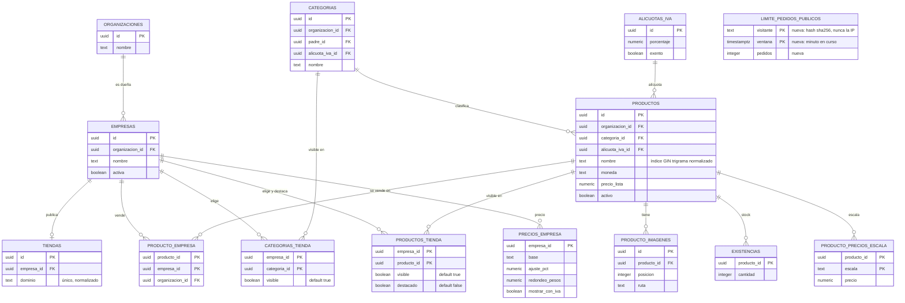

# Tienda pública: inicio, búsqueda y versión móvil (MSF-191)

Spec: `specs/20261024-120000-tienda-inicio-busqueda-movil/spec.md` · plan, tareas y contratos en la misma
carpeta. Épica **MSF-191** (F-TDA-10/MSF-399, F-TDA-15/MSF-413 y F-TDA-17/MSF-421), PR #349, merge
`a2b439e`; cierre documental MSF-558 (`4f3f0b97`). Depende de [MSF-147 (dominio, identidad y catálogo
visible)](tienda-dominio-e-identidad.md) y [MSF-167 (catálogo y ficha)](tienda-catalogo-y-ficha.md).
Resumen de producto y límites: [Tiendas online](../producto/tiendas-online.md).

## Alcance de entrega

- **`supabase`:** cinco migraciones **aditivas** para la home y la búsqueda; una tabla nueva de control de
  abuso, una extensión y funciones de lectura. La versión móvil no toca la base.
- **`refine`:** front público en `apps/web/src/pages/tienda-publica/`; no hay pantallas nuevas en el panel.
- **Sin** `workers`, `kestra`, `superset` ni Compose nuevo.

| Historia | Migración | Contenido | Reversión |
|---|---|---|---|
| F-TDA-10 | `supabase/migrations/20261203100000_tienda_destacados_publicos.sql` | `publico.destacados_por_dominio(host)` | `drop function publico.destacados_por_dominio(text)` |
| F-TDA-15 | `supabase/migrations/20261203110000_tienda_busqueda_base.sql` | `unaccent`, `pg_trgm`, `private.normalizar_busqueda`, índice GIN `productos_nombre_busqueda_trgm`, tabla `public.limite_pedidos_publicos`, `private.registrar_pedido_publico`, `private.visitante_publico` y constantes | `drop` de las funciones, la tabla y el índice; `unaccent`/`pg_trgm` se conservan |
| F-TDA-15 | `supabase/migrations/20261203110100_tienda_busqueda_sugerencias.sql` | `publico.sugerencias_busqueda_por_dominio(host, q)` | `drop function publico.sugerencias_busqueda_por_dominio(text, text)` |
| F-TDA-15 | `supabase/migrations/20261203110200_tienda_busqueda_resultados.sql` | `publico.busqueda_pagina_por_dominio(host, q, …)` | `drop function publico.busqueda_pagina_por_dominio(text, text, uuid, boolean, numeric, text, integer)` |
| F-TDA-15 | `supabase/migrations/20261203110300_tienda_busqueda_visitante_saltos.sql` | `private.saltos_proxy_confiables`, nueva versión de `private.visitante_publico` e índice `limite_pedidos_publicos_ventana_idx` | `drop index public.limite_pedidos_publicos_ventana_idx`; restaurar `visitante_publico` anterior; `drop function private.saltos_proxy_confiables()` |
| F-TDA-17 | — | Sin migración (solo front) | — |

Todas se pueden revertir en una migración posterior. La extensión `unaccent` no se baja porque es inocua y
puede reutilizarse.

## Modelo de datos (DER)

La única tabla nueva es `public.limite_pedidos_publicos`: control de abuso **transversal**, no una entidad
del negocio de la tienda. Va en `public`, no en `dominio`, y **no guarda la IP**: solo un hash `sha256` del
visitante y la ventana del minuto. `publico` sigue siendo un esquema **solo de funciones** (sin tablas).

| Tabla | Estado | Cambio |
|---|---|---|
| `public.limite_pedidos_publicos` | **nueva** | `(visitante, ventana)` PK, `pedidos`; RLS activada, sin políticas y sin privilegios para `anon`/`authenticated`; solo la escriben funciones `SECURITY DEFINER`. |
| `dominio.productos` | existente | Solo gana el índice GIN `productos_nombre_busqueda_trgm` sobre `private.normalizar_busqueda(nombre)`; no cambian columnas. |
| `dominio.empresas` | existente | Se lee para resolver la tienda activa del `host`; no cambia. |
| `dominio.tiendas` | existente | Resuelve el dominio de la tienda; no cambia. |
| `dominio.productos_tienda` | existente | Aporta `visible` y `destacado` de la tienda; no cambia. |
| `dominio.categorias_tienda` | existente | Aporta la visibilidad de la categoría y su padre; no cambia. |
| `dominio.categorias` | existente | Nombre y jerarquía de categorías; no cambia. |
| `dominio.producto_empresa` | existente | Determina qué productos vende la empresa; no cambia. |
| `dominio.producto_imagenes` | existente | Primera imagen de la tarjeta y de la sugerencia; no cambia. |
| `dominio.existencias` | existente | `private.disponible_publico` lee `cantidad`; no cambia. |
| `dominio.precios_empresa` | existente | Regla de precio e interruptor de IVA de la empresa; no cambia. |
| `dominio.producto_precios_escala` | existente | Precio x1 del producto; no cambia. |
| `dominio.alicuotas_iva` | existente | Alícuota propia o de la categoría; no cambia. |



El detalle del modelo del catálogo y de la tienda está en [Datos y DER](datos.md#inicio-busqueda-y-movil-msf-191).

## Página de inicio (F-TDA-10)

`publico.destacados_por_dominio(host)` es ejecutable por `anon`, `stable` y `security definer`. Resuelve la
empresa por `dominio.tiendas.dominio` normalizado y `dominio.empresas.activa`, y devuelve:

```ts
publico.destacados_por_dominio(host: string): {
  hay_productos: boolean   // hay al menos un producto efectivamente visible
  productos: Array<{ id: string; nombre: string; precio: number | null; disponible: boolean; imagen: string | null; categoria_id: string | null }>
} | null
```

- Hasta **8** destacados efectivamente visibles, en orden ascendente por nombre e `id`. `precio` es
  el final de la empresa (`private.precio_final_publico`, `null` si no es calculable); `disponible` es el
  booleano de `private.disponible_publico`; `imagen` es la ruta de la primera imagen.
- Host desconocido y empresa desactivada devuelven el mismo `null`. Lista blanca: nunca costos, existencias,
  proveedor ni `organizacion_id`.
- La home compone por `orden`: banner (20, `BannerHome` de MSF-147) → `EstadoPreparacion` (30) →
  `CategoriasInicio` (40) → `DestacadosInicio` (50). `DestacadosInicio` reemplaza la lista mínima
  `ProductosTienda` que leía `precio_lista`.
- `EstadoPreparacion`, `DestacadosInicio` y el dato de preparación que usa `CategoriasInicio` comparten una
  sola llamada por host (`lib/tiendaInicio.ts`, con deduplicación de pedidos simultáneos); las categorías
  se leen además con `useCategoriasTienda`. Un bloque que falla muestra `ErrorConReintento` sin romper el
  resto.
- «Catálogo en preparación» aparece solo con la tienda activa y **cero** productos visibles; reemplaza a
  «Categorías» y «Destacados». Con productos visibles y sin destacados solo se oculta «Destacados».
- Las imágenes se firman en lote (`lib/imagenProducto.ts`); sin imagen o con error se muestra «Sin imagen».

## Búsqueda de productos (F-TDA-15)

### Normalización e índice

`20261203110000_tienda_busqueda_base.sql` habilita `unaccent` y `pg_trgm` en `extensions` y crea
`private.normalizar_busqueda(text)`: minúsculas, sin tildes (con el diccionario `extensions.unaccent`
explícito) y espacios colapsados. Es `immutable` para poder indexarla. El índice
`productos_nombre_busqueda_trgm` es GIN trigrama sobre `private.normalizar_busqueda(nombre)` en
`dominio.productos`.

La coincidencia usa **contiene** (`strpos`) **o** similitud `word_similarity`/`similarity` con umbral único
`private.umbral_similitud_busqueda()` = **0,4**. El puntaje suma un bonus si el nombre empieza (0,5) o
contiene (0,25) el texto; desempata por nombre e `id`. El texto se recorta a **100** caracteres y se trata
como literal (parámetros; `%`, `_` y comillas no tienen significado).

### Contratos públicos

| Función | Devuelve |
|---|---|
| `publico.sugerencias_busqueda_por_dominio(host, q)` | `{ limitado, espera_segundos, productos[] }` o `null`. Hasta **6** productos visibles con `id`, `nombre`, `precio` final, `disponible`, `imagen` y `categoria_id`. Texto vacío o de menos de **2** caracteres → lista vacía sin consultar ni contar. |
| `publico.busqueda_pagina_por_dominio(host, q, categoria, solo_con_stock, precio_max, orden, pagina)` | Misma forma que `catalogo_pagina_por_dominio` de MSF-167 (total, página, tamaño 24, categorías y productos) restringida a `q`; `orden = 'relevancia'` ordena por similitud. Cuenta para el mismo límite. |

Ambas son `security definer`, `volatile` (escriben el contador), `set search_path = ''`, normalizan el
`host`, filtran por empresa activa y por `private.catalogo_tienda_efectivo` y devuelven lista blanca. Host
desconocido y empresa desactivada devuelven `null`. No modifican `catalogo_pagina_por_dominio`.

### Límite de pedidos por visitante y minuto

- **Tabla:** `public.limite_pedidos_publicos (visitante, ventana, pedidos)`, PK `(visitante, ventana)`, RLS
  activada, sin políticas y con `revoke all` a `public`, `anon` y `authenticated`. Solo la toca
  `private.registrar_pedido_publico` (`security definer`, sin `execute` para roles de API).
- **Atomicidad:** `insert … on conflict do update set pedidos = pedidos + 1`; devuelve
  `{limitado, espera_segundos}`. Supera el límite en el pedido `limite + 1`. Purga ventanas de más de
  **10 minutos** (índice `limite_pedidos_publicos_ventana_idx`).
- **Número:** `private.limite_busquedas_por_minuto()` = **30** (supuesto D1; Nicolás fija el definitivo).
  Cada sugerencia y cada página de resultados cuenta uno; el texto vacío o corto no cuenta.
- **Visitante:** `private.visitante_publico(host)` es el hash `sha256` de la IP del cliente en
  `x-forwarded-for` más el host. Nunca se guarda la IP. El valor se toma
  `private.saltos_proxy_confiables()` lugares antes del último (hoy **0** = el último); si la cadena real
  agrega un proxy más, se cambia esa función en una migración nueva. Sin cabecera, todos caen en el grupo
  «desconocido» y comparten el límite.

### Front

- `lib/tiendaBusqueda.ts`: constantes del front (`MINIMO_CARACTERES_BUSQUEDA = 2`,
  `MAXIMO_CARACTERES_BUSQUEDA = 100`, `ESPERA_ENTRE_TECLAS_MS = 400`, `TOPE_SUGERENCIAS = 6`), cliente de
  las RPC, normalización de `q`, descarte de respuestas viejas y `urlResultados(q)`.
- `layout/BuscadorTienda.tsx` se monta en `LayoutTienda` con carga diferida. Es un *combobox* accesible
  (`aria-expanded`, `aria-controls`, `aria-activedescendant`): flechas, Enter, Esc y clic afuera; muestra
  hasta 6 sugerencias con imagen o «Sin imagen», nombre, precio y disponibilidad, y la opción «Ver todos
  los resultados →».
- Estados: «Buscando…», «No encontramos productos con ese nombre.», aviso de espera por límite
  (`role="status"`, se repite sola al vencer) y error con «Reintentar». El texto va como nodo de React, sin
  `dangerouslySetInnerHTML`.
- `/catalogo?q=…`: `rutas/catalogo.tsx` usa el título «Resultados para “<texto>”» y la miga «Resultados»;
  `secciones-catalogo/ListadoProductos.tsx` lee `q`, llama a `busqueda_pagina_por_dominio` y reutiliza
  filtros, orden, paginación y tarjetas. `q` viaja primero en la URL y se conserva al cambiar un filtro,
  orden o página; en `/categoria/:id` se ignora.

## Versión móvil (F-TDA-17)

No hay migración. El corte es `md` (**900 px**, `useCelular` en `useAnchoCelular.ts`); bajo `sm` (600 px) la
ampliación de imagen ocupa toda la pantalla.

| Pieza | Qué hace |
|---|---|
| `layout/MenuMovil.tsx` (carga diferida) | Botón de menú y `Drawer` con «Inicio», «Contacto» (agregado por MSF-212, D10) y la sección «Categorías» (la actual con `aria-current`). Cierra con botón, Esc, tocar afuera o navegar; foco atrapado y devuelto. |
| `catalogo/PanelFiltrosMovil.tsx` (carga diferida) | Botón «Filtrar · N», panel «Filtros» con «Limpiar», Categoría, «Solo con stock», «Precio máximo» (D5) y Ordenar; «Ver N productos» cierra sobre el resultado ya aplicado. El estado vive en la URL, igual que en escritorio. |
| `ErrorConReintento.tsx` | «No pudimos cargar esta página.» + «Reintentar»; repite el pedido sin tocar URL ni filtros. Lo usan home, catálogo, categoría, resultados, ficha y los menús. |
| Ficha | Una columna, «← Todos los productos», miniaturas táctiles y ampliación usable en pantalla chica; con MSF-212, botón «Consultar por WhatsApp» a ancho completo. |

Los tamaños verificados por el E2E son **360, 390, 412 y 430 px** y tabletas de **768 y 1024 px**: sin
scroll horizontal en home, catálogo, categoría, resultados, ficha, 404 y «Volvemos pronto». El buscador y
su desplegable se adaptan al ancho y conviven con el menú. El peso nuevo (menú, panel de filtros) se carga
diferido; las imágenes de tarjetas y miniaturas usan `loading="lazy"`.

## Seguridad y aislamiento

- `anon` ejecuta solo las funciones nuevas de `publico`; todas filtran por `host` y `empresa.activa` y
  devuelven lista blanca. Las funciones `private.*` nuevas no son ejecutables por `anon`/`authenticated`.
- `private.normalizar_busqueda` es la excepción documentada: `authenticated` y `service_role` necesitan
  `EXECUTE` porque el índice de expresión la ejecuta al escribir productos; es una función pura de texto.
- La tabla nueva no tiene `organizacion_id` a propósito: el visitante es anónimo y el control es
  transversal. No guarda IP, solo el hash; las ventanas se purgan a los 10 minutos.
- Host desconocido, host inválido y empresa desactivada devuelven el mismo `null` (anti-enumeración).
- Texto escapado en pantalla y literal en la base; los comodines `%`/`_` y las comillas no se interpretan.

## Operación y verificación

- **pgTAP:** `supabase/tests/database/tienda_destacados_publicos.test.sql` y
  `tienda_busqueda_publica.test.sql` (SC-001, SC-004). Cubre tildes, mayúsculas, errores de tipeo, tope de
  6, orden, comodines, aislamiento, lista blanca, límite por visitante y RLS de la tabla nueva.
- **Vitest + axe:** home en `rutas/inicio/*.test.tsx`; buscador y resultados en `layout/BuscadorTienda.test.tsx`,
  `ListadoProductos.test.tsx` y `RutaCatalogo.test.tsx`; móvil en `MenuMovil.test.tsx`,
  `PanelFiltrosMovil.test.tsx`, `FichaProducto.test.tsx` y `ErrorConReintento.test.tsx`.
- **E2E:** `apps/web/e2e/tienda-inicio.e2e.ts`, `tienda-busqueda.e2e.ts` y `tienda-movil.e2e.ts` con las dos
  tiendas del seed. Se corren con `pnpm dev:supabase` y `pnpm --filter @platform/web test:e2e`.
- **Reversión:** ver la tabla de migraciones. Para el código completo, `git revert -m 1` del merge del PR.
- **Pendiente de evidencia (no se inventa):**
  - Confirmar en DEV la cadena real de `x-forwarded-for` y ajustar `private.saltos_proxy_confiables()` si
    hace falta. Dueño: Operación / despliegue.
  - Medir el LCP de home, catálogo y ficha en emulación móvil «4G lento» (objetivo < 3 s). Dueño:
    seguimiento **MSF-560**.
  - Fijar el número definitivo del límite de búsquedas (hoy 30/min como supuesto). Dueño: Nicolás.

## Contradicciones prototipo ↔ épica

1. **Resultados de búsqueda sin artboard:** la página de resultados es el catálogo con el término
   (`/catalogo?q=…`), sin pantalla propia.
2. **Panel de filtros móvil sin «Precio máximo»:** manda el comportamiento; el panel móvil lo incluye (D5).
3. **Sin artboards de tableta:** se reutiliza el layout responsivo de escritorio/celular.
4. **Estados no dibujados** (sugerencias, aviso de espera, «Catálogo en preparación», error con reintento):
   se construyen con el kit y los textos de los requisitos (D8).
5. **«Últimas unidades · quedan N»:** sigue fuera de alcance; solo «Disponible» y «Sin stock».

«Contacto» en el menú móvil lo agrega **MSF-212** junto con la página `/contacto`: el enlace ya está en
`layout/MenuMovil.tsx`. Queda pendiente **verificarlo a 360 px** en un navegador real (Dueño: MSF-212 /
Tiendas online). Detalle: [Tienda pública: WhatsApp y contacto](tienda-whatsapp-y-contacto.md).
