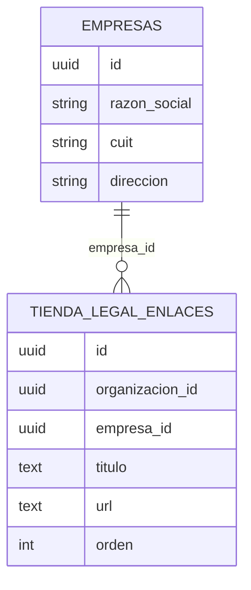

# Tienda online: estados, relacionados, SEO y legal (MSF-149)

Épica **MSF-149** — Tiendas online · Tienda SEO, legal y estados. Spec:
`specs/20270125-100000-tienda-seo-legal-y-estados/` (`spec.md`, `plan.md`, `tasks.md` y contrato en
`contracts/tienda-seo-legal-estados.md`). Historias: **F-TDA-19** estados (`MSF-247`), **F-TDA-20** relacionados
(`MSF-263`), **F-TDA-21** SEO (`MSF-279`), **F-TDA-22** legal (`MSF-289`); cierre de la épica: `MSF-798`.
Resumen para quien administra la tienda: [Páginas de estado, relacionados, Google y legales](../producto/tienda-seo-legal-y-estados.md).

> **Estado del código:** la implementación vive en la rama `feat/story-MSF-798` (commit `b72a8e59`) y todavía no
> está en `main` al escribir esta página. Las rutas citadas se verificaron contra esa rama. La guía consolidada
> de la épica está en `docs/tiendas-online.md` (sección «Estados, relacionados, SEO y legal», misma rama).

Depende de **MSF-191** (el 404 reutiliza `BuscadorTienda`). Bloquea a **MSF-164** (F-TDA-24 usa el contrato de
cookies de F-TDA-22). El «no indexar» de borrador y vista previa lo agrega **MSF-133**: `indexable` queda como
punto de extensión.

## Alcance de entrega

`refine` y `supabase`. Sin `kestra`, `superset` ni `workers`. Todas las migraciones son **aditivas**.

| Historia | Migración | Contenido | Reversión |
|---|---|---|---|
| F-TDA-22 | `supabase/migrations/20270125120000_tienda_legal.sql` | tabla `dominio.tienda_legal_enlaces` y `publico.legal_por_dominio` | `drop function publico.legal_por_dominio(text); drop table dominio.tienda_legal_enlaces;` |
| F-TDA-19 | `supabase/migrations/20270205120000_tienda_estado_pausada.sql` | `publico.estado_tienda_por_dominio` | `drop function publico.estado_tienda_por_dominio(text);` |
| F-TDA-20 | `supabase/migrations/20270205120001_tienda_relacionados.sql` | `publico.relacionados_por_dominio` | `drop function publico.relacionados_por_dominio(text, uuid);` |
| F-TDA-21 | `supabase/migrations/20270205120002_tienda_seo.sql` | `publico.seo_tienda_por_dominio` y `publico.sitemap_por_dominio` | `drop function publico.seo_tienda_por_dominio(text); drop function publico.sitemap_por_dominio(text);` |

Orden de reversión: el inverso al de aplicación, en una migración posterior (no en el PR que las crea). Deshacer
la épica entera: `git revert -m 1 <merge>`.

## Datos (esquemas, Principio VII)

Única tabla nueva: `dominio.tienda_legal_enlaces` (`id`, `organizacion_id`, `empresa_id`, `titulo` ≤ 80,
`url` con check `^https://` ≤ 500, `orden`, `created_at`). Va en **`dominio`** porque es un dato del producto atado a
una empresa; `publico` sigue **sin tablas** (solo funciones). RLS por organización con solo `select` a
`authenticated`; **sin privilegios para `anon`**. Razón social, CUIT y dirección salen de `dominio.empresas`.

## API (funciones de `publico` y Edge Function)

Todas son `security definer`, `stable`, con lista blanca de campos, `revoke … from public, anon` y
`grant execute … to anon, authenticated`. Host desconocido o inválido y empresa desactivada devuelven el mismo
`null`; la excepción es `estado_tienda_por_dominio` (D1), que devuelve la marca solo de una empresa **desactivada**.
Nunca devuelven `organizacion_id`, costos ni existencias. Firmas completas en
`specs/20270125-100000-tienda-seo-legal-y-estados/contracts/tienda-seo-legal-estados.md`.

| Función | Devuelve |
|---|---|
| `publico.estado_tienda_por_dominio(host)` | `{ estado: 'pausada', nombre, colores, tipografías, logo_ruta }` o `null` |
| `publico.relacionados_por_dominio(host, producto)` | `{ productos: [{ id, nombre, precio, disponible, imagen, categoria_id }] }` (hasta 4, misma categoría, sin el actual, destacados primero y luego `lower(nombre), id`) o `null` |
| `publico.seo_tienda_por_dominio(host)` | `{ dominio, nombre, descripcion, logo_ruta, indexable }` o `null` |
| `publico.sitemap_por_dominio(host)` | `{ dominio, urls: [{ ruta, modificado }] }` (hasta 50 000) o `null` |
| `publico.legal_por_dominio(host)` | `{ razon_social, cuit, direccion, enlaces: [{ titulo, url }] }` o `null` |

**Edge Function `tienda-seo`** (`supabase/functions/tienda-seo/handler.ts`, `verify_jwt = false`, contrato en
`openapi/tienda-seo.json`): `GET /tienda-seo/robots.txt` y `/tienda-seo/sitemap.xml` con la cabecera `X-Tienda-Host`.
Tienda activa: `Allow: /` + `Sitemap:` del dominio canónico. Host desconocido, inválido o tienda desactivada:
misma respuesta, `Disallow: /` y sitemap válido sin URLs. Error: `500` genérico.

**nginx** (`apps/web/nginx.conf`): `location ~ ^/(robots\.txt|sitemap\.xml)$` hace proxy a la función mandando el
host original en `X-Tienda-Host`; los marcadores `__SUPABASE_URL__` y `__SUPABASE_ANON_KEY__` se reemplazan al
construir la imagen (`apps/web/Dockerfile`). Despliegue: `docs/deployment.md` (Producción › `apps/web`).

## Front (`apps/web/src`)

| Pieza | Archivo |
|---|---|
| «Volvemos pronto» con marca / genérica | `pages/tienda-publica/VolvemosPronto.tsx`, `lib/tiendaEstado.ts` |
| 404 con buscador | `pages/tienda-publica/PaginaNoEncontrada.tsx` |
| Pantalla de error con reintento | `pages/tienda-publica/PantallaError.tsx` (usada en `index.tsx` y en `ErrorDeRuta` de `EnrutadorTienda.tsx`) |
| Relacionados | `pages/tienda-publica/ficha/Relacionados.tsx`, `lib/tiendaRelacionados.ts` (integrada en `rutas/producto.tsx`) |
| Metadatos (título ≤ 60, descripción ≤ 160, canónica, Open Graph, JSON-LD, `noindex`) | `pages/tienda-publica/seo/CabeceraSeo.tsx`, `lib/tiendaSeo.ts` |
| Pie legal | `pages/tienda-publica/layout/PieLegal.tsx`, `lib/tiendaLegal.ts` |
| Aviso de cookies | `pages/tienda-publica/layout/AvisoCookies.tsx`, `lib/consentimientoCookies.ts` |

La tienda es una SPA: los metadatos se escriben en el cliente, sin prerender (D4). `noindex` va en 404, error,
«Volvemos pronto», resultados de búsqueda del catálogo, ingresar, recuperar y definir contraseña.

**Contrato de cookies para F-TDA-24:** `leerConsentimiento()` (`'aceptadas' | 'rechazadas' | null`, `null` cuenta
como rechazadas), `guardarConsentimiento(valor)` (persiste en `localStorage`), `useConsentimientoCookies()` y el
evento de ventana `tienda:consentimiento-cookies`. Ninguna analítica puede cargarse sin `'aceptadas'`.

**Carga de enlaces legales (D5):** el equipo técnico inserta filas en `dominio.tienda_legal_enlaces` por SQL; no hay
pantalla ni RPC de escritura.

## Decisiones y supuestos

D1 la marca de una tienda desactivada es pública · D2 relacionados: 4 de la misma categoría · D3 SEO básico sin
campos por producto ni hreflang · D4 sin prerender · D5 enlaces legales por SQL · D6 qué legal lleva cada marca
se confirma con el cliente · D7 cookies mínimas (Aceptar / Rechazar) · D8 Lighthouse SEO sin fallas, sin puntaje
inventado. Detalle en `docs/tiendas-online.md`.

## Guía de prueba técnica

pgTAP (`supabase/tests/database/`): `tienda_estado_pausada.test.sql`, `tienda_relacionados.test.sql`,
`tienda_seo.test.sql`, `tienda_legal.test.sql` — cada uno cubre lista blanca, `null` idéntico, aislamiento entre dos
tiendas y ejecución por `anon`. Vitest: `tiendaEstado`, `tiendaRelacionados`, `tiendaLegal`,
`consentimientoCookies`, `CabeceraSeo`, `Relacionados`, `PieLegal`, `AvisoCookies`, `VolvemosPronto`,
`PaginaNoEncontrada`, `PantallaError`, `handler.test.ts` de la función.

| Qué se prueba | Rótulo | Archivo |
|---|---|---|
| Pausar y reactivar: «Volvemos pronto» con marca y luego la tienda | `[MSF-247:T008]` (SC-003) | `apps/web/e2e/tienda-estados.e2e.ts` |
| Dominio desconocido, 404 con buscador, conexión caída con «Reintentar», sin scroll horizontal 320 / 768 / 1440 px | `[MSF-247:T008]` (SC-002, FR-005) | idem |
| Relacionados de la misma categoría, solo de la tienda, ausencia sin relacionados, 2 / 4 columnas | `[MSF-263:T025]` | `apps/web/e2e/tienda-relacionados.e2e.ts` |
| Metadatos, canónica y JSON-LD por página; `noindex`; `robots.txt` y `sitemap.xml` (también de una pausada) | `[MSF-279:T068]` | `apps/web/e2e/tienda-seo.e2e.ts` |
| Pie legal por tienda, bloque oculto sin datos, aviso de cookies que no vuelve | `[MSF-289:T047]` | `apps/web/e2e/tienda-legal.e2e.ts` |

A mano en base: `select publico.estado_tienda_por_dominio('<host>')` devuelve la marca solo con la empresa
desactivada y `null` con ella activa; `select publico.legal_por_dominio('<host>')` con un `insert` previo en
`dominio.tienda_legal_enlaces`. Revisión con una herramienta de SEO (Lighthouse, categoría SEO) sobre home,
catálogo, categoría, ficha y contacto de ambas tiendas.

## Fuera de alcance

Campos SEO por producto, hreflang, prerender, analítica (F-TDA-24, **MSF-164**), pantalla para cargar enlaces
legales (otra historia dentro de Empresas) y el «no indexar» de borrador y vista previa (**MSF-133**).

## TODO

- **Capturas** de «Volvemos pronto» (con marca y genérica), 404 con buscador, pantalla de error, «Productos
  relacionados», pie legal y aviso de cookies. **Dueño:** agente Documentador, con el stack local y la rama
  `feat/story-MSF-798` (el código no está en `main`). Van en `docs/producto/img/tienda-seo-legal-y-estados/` y se
  referencian desde la página de producto. **Sin video.**
- **Datos legales reales** de cada marca (razones sociales, CUIT, políticas y botones). **Dueño:** cliente /
  responsable de producto (D6).
