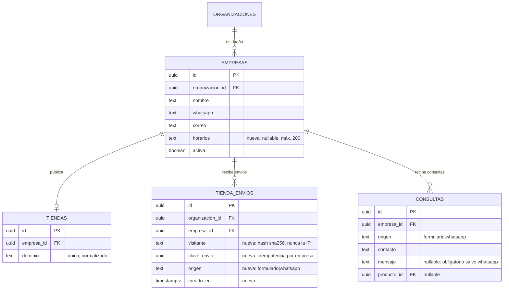

# Tienda pública: WhatsApp y contacto (MSF-212)

Spec: `specs/20261202-100000-tienda-whatsapp-y-contacto/spec.md` · plan, tareas y contrato
(`contracts/tienda-contacto.md`) en la misma carpeta, en la rama
`epic/MSF-212-tiendas-online-tienda-whatsapp-y-contact`.
Épica **MSF-212**, historias **F-TDA-16** (contacto con formulario, PR #360, merge `3dfa2313`) y
**F-TDA-14** (consulta por WhatsApp desde la ficha, PR #445, merge `3136275b`); cierre documental
MSF-557 (PR #453, merge `49092029`).

Depende de [MSF-147 (dominio e identidad)](tienda-dominio-e-identidad.md),
[MSF-167 (catálogo y ficha)](tienda-catalogo-y-ficha.md) y **MSF-122** (la interfaz de entrada
F-CON-01 que recibe las consultas: [Consultas: modelo, RPC y aviso](consultas.md)).
Resumen de producto y límites: [Tiendas online](../producto/tiendas-online.md).

## Alcance de entrega

- **`supabase`:** tres migraciones **aditivas**: una tabla de control nueva, una columna nueva y tres
  funciones públicas de `publico` (más las internas de `private`).
- **`refine`:** front público en `apps/web/src/pages/tienda-publica/` (una ruta nueva `/contacto`, un
  diálogo nuevo sobre la ficha existente) y un campo nuevo en la pantalla de Empresas.
- **Sin** `workers`, `kestra`, `superset` ni Compose nuevo. **No emite eventos de analítica** (los
  deja para MSF-164).

| Historia | Migración | Contenido | Reversión (en una migración posterior) |
|---|---|---|---|
| F-TDA-16 | `supabase/migrations/20261212100000_tienda_contacto.sql` | columna `dominio.empresas.horarios` (+ check ≤ 200 y `grant update`); tabla `dominio.tienda_envios` + RLS + índices + `unique (empresa_id, clave_envio)`; `private.visitante_hash`, `private.limite_envios_tienda`, `private.registrar_envio_tienda`, `private.validar_contacto_tienda`, `private.entregar_a_bandeja`; `publico.contacto_por_dominio` y `publico.enviar_consulta_contacto` con sus `grant`s | `drop function` de las siete funciones; `drop table dominio.tienda_envios` y `alter table dominio.empresas drop column horarios` |
| F-TDA-16 | `supabase/migrations/20261212100100_crear_consulta_publica_solo_interna.sql` | solo privilegios: `publico.crear_consulta_publica` deja de ser ejecutable por `anon` y `authenticated` (queda en `service_role` y el propietario) y `grant usage on schema publico to service_role` | `grant execute on function publico.crear_consulta_publica(text, text, text, text, text, uuid) to anon, authenticated` |
| F-TDA-14 | `supabase/migrations/20261212121000_tienda_whatsapp.sql` | `publico.registrar_consulta_whatsapp` + `grant`s; no crea ni altera tablas | `drop function publico.registrar_consulta_whatsapp(text, uuid, uuid)` |

**Orden de despliegue:** F-TDA-16 antes que F-TDA-14, que reutiliza
`private.registrar_envio_tienda`, `private.entregar_a_bandeja` y `publico.contacto_por_dominio`. Las
tres son aditivas y la reversión va en el encabezado de cada archivo: nada se destruye en el mismo PR
que lo crea.

## Modelo de datos (DER)

| Tabla | Estado | Cambio |
|---|---|---|
| `dominio.tienda_envios` | **nueva** | Registro mínimo de envíos de visitantes de una tienda (límite e idempotencia). RLS habilitada por organización (`organizacion_id = private.organizacion_id()`), `unique (empresa_id, clave_envio)`, índice `(empresa_id, visitante, creado_en)`. **Sin privilegios para `anon`**: la escribe solo `private.registrar_envio_tienda` (`security definer`). Guarda el **hash** del visitante, nunca la IP. |
| `dominio.empresas` | **alterada** | Una columna nueva `horarios text` (nullable, check ≤ 200) con `grant update (horarios)` a `authenticated`. No cambia ninguna columna existente. |
| `dominio.tiendas` | existente | Resuelve la empresa del `host`; no cambia. |
| `dominio.consultas` | existente | Recibe la consulta entregada por `private.entregar_a_bandeja` (MSF-122); no cambia. |



`publico` sigue siendo un esquema **solo de funciones**: esta épica no agrega ninguna tabla en
`public`. Detalle del modelo en [Datos y DER](datos.md#contacto-y-whatsapp-msf-212).

## Contratos públicos

Las tres funciones de `publico` son `security definer`, `set search_path = ''`, normalizan el `host`
con `private.normalizar_host` y filtran por `dominio.empresas.activa`. Devuelven una **lista blanca**:
nunca `organizacion_id`, IP, hash del visitante ni columnas internas. Cada una hace
`revoke execute … from public, anon` y después `grant execute … to anon, authenticated`.

| Función | Devuelve |
|---|---|
| `publico.contacto_por_dominio(host text)` | `{ nombre, whatsapp, correo, horarios }` o `null`. Host desconocido y empresa desactivada devuelven **el mismo `null`**; los campos vacíos salen como `null`. |
| `publico.enviar_consulta_contacto(host text, nombre text, contacto text, mensaje text, clave_envio uuid)` | `{ estado: 'ok' \| 'invalido' \| 'limite' \| 'error', campos?, espera_segundos? }`. `invalido` lista los campos con error; `limite` trae los segundos de espera; `error` es genérico (host inexistente, empresa desactivada o falla de entrega). |
| `publico.registrar_consulta_whatsapp(host text, producto uuid, clave_envio uuid)` | `{ estado: 'ok' \| 'limite' \| 'error' }`. Exige que el producto sea **efectivamente visible** en la tienda del host (`private.catalogo_tienda_efectivo`); host inexistente, empresa desactivada y producto ajeno u oculto responden **lo mismo** y no registran nada. |

### Validación (espejo cliente/servidor)

`private.validar_contacto_tienda` (migración `20261212100000`) y
`apps/web/src/pages/tienda-publica/contacto/validacion.ts` aplican **las mismas reglas**; el servidor
vuelve a validar siempre:

| Campo | Regla | Mensaje en pantalla (cliente) |
|---|---|---|
| Nombre | obligatorio, ≤ 100 caracteres | «Escribí tu nombre.» |
| Correo o WhatsApp | obligatorio, ≤ 120; formato de correo o teléfono de **8 a 15 dígitos** | «Dejanos un correo o un WhatsApp para responderte.» / «Ingresá un correo válido o un teléfono de entre 8 y 15 dígitos.» |
| Mensaje | obligatorio, ≤ 2000 caracteres | «Escribí tu mensaje.» |

Todos los textos se recortan (`trim`) antes de validar y de enviar. El tope de 8 a 15 dígitos se elige
para no superar el tope de 7 a 15 dígitos de la bandeja (F-CON-01).

### Límite e idempotencia

- **Límite:** `private.limite_envios_tienda()` = **5 envíos por hora por visitante y empresa**
  (constante única, adjustable). `private.registrar_envio_tienda` toma
  `pg_advisory_xact_lock` por (empresa, visitante) antes de contar, así que dos envíos simultáneos no
  superan el cupo; las filas de más de 24 h se podan en la misma función (sin worker ni cron).
  Formulario y WhatsApp **comparten** el mismo cupo (D3).
- **Idempotencia:** `unique (empresa_id, clave_envio)`. Una clave repetida devuelve `ok` sin entregar
  de nuevo ni gastar cupo. El cliente genera una clave por intento: «Reintentar» la reutiliza y
  «Enviar otra» pide una nueva (`nuevaClaveEnvio` en `apps/web/src/lib/tiendaContacto.ts`,
  `nuevaClaveEnvioWhatsapp` en `apps/web/src/lib/registroWhatsapp.ts`).
- **Falla de entrega:** el registro y la entrega van en una sub-transacción; si la bandeja falla se
  revierte el registro (no se gasta cupo) y el visitante ve el error genérico con «Reintentar».

### Identidad del visitante (D6)

El visitante es anónimo: se identifica por el hash `sha256` de la **IP** del cliente (tomada según
`private.saltos_proxy_confiables()`, de MSF-191) **más la empresa**
(`private.visitante_hash`, `20261212100000_tienda_contacto.sql`). **La IP nunca se guarda**: en la
tabla queda solo el hash. Si la cadena `x-forwarded-for` no llega a PostgREST, todos los visitantes
caen en un único cupo «sin-ip»: **falla cerrada, no abierta**. El mismo patrón de saltos de proxy es
el que usa la búsqueda (MSF-191); ver su documentación para el pendiente de confirmarlo en DEV.

### Entrega a la bandeja (D4)

`private.entregar_a_bandeja(empresa, origen, nombre, contacto, mensaje, producto)` es el **único**
punto que conoce la interfaz de entrada de MSF-122. Firma real confirmada en la primera tarea de la
historia: `publico.crear_consulta_publica(host, origen, nombre, contacto, mensaje, producto_id)`
(migración `20261205100100` de MSF-122). El adaptador recibe la empresa y resuelve su dominio en
`dominio.tiendas`; si la entrega falla, la excepción revierte el registro del envío.

Como el visitante de WhatsApp **no deja sus datos en la plataforma** (la conversación ocurre en
WhatsApp) y F-CON-01 exige nombre y contacto no vacíos, la consulta se registra con las marcas
explícitas `Visitante de WhatsApp` y `visitante@sin-datos.invalid` (TLD reservado por RFC 2606) y con
el mensaje `null`. **No se inventa un nombre ni un teléfono.**

### Privilegios de la RPC de la bandeja

`20261212100100_crear_consulta_publica_solo_interna.sql` revoca la ejecución de
`publico.crear_consulta_publica` a `public`, `anon` y `authenticated` y la deja en `service_role` y el
propietario: mientras estuvo abierta, `anon` podía llamarla por PostgREST y saltearse el límite de 5
por hora. El único camino público del alta es ahora `publico.enviar_consulta_contacto`. Es el único
cambio de privilegios de la épica y afecta a
[Consultas: modelo, RPC y aviso](consultas.md).

## Front público

Rutas registradas por archivo en `apps/web/src/pages/tienda-publica/rutas/*.tsx` (contrato en
`rutas/LEEME.md`); `EnrutadorTienda.tsx` las carga con `import.meta.glob` y `lazy`.

| Ruta | Pantalla | Archivos |
|---|---|---|
| `/contacto` | Datos de contacto de la tienda y formulario «Escribinos» | `rutas/contacto.tsx`, `contacto/DatosContacto.tsx`, `contacto/FormularioContacto.tsx`, `contacto/validacion.ts` |
| `/contacto/<algo>` | La misma 404 amable | `PaginaNoEncontrada.tsx` |
| `/producto/:productoId` | La ficha de MSF-167 suma el botón «Consultar por WhatsApp» y su diálogo | `ficha/DatosProducto.tsx`, `whatsapp/BotonWhatsApp.tsx`, `whatsapp/DialogoWhatsApp.tsx`, `whatsapp/useContactoWhatsapp.ts`, `whatsapp/IconoWhatsapp.tsx` |

- **Datos de contacto:** `hooks/useContactoTienda.ts` + `lib/tiendaContacto.ts` leen
  `publico.contacto_por_dominio`. Los bloques «WhatsApp» (número y horarios) y «Correo» se omiten
  cuando el dato falta: sin hueco ni texto inventado.
- **Formulario:** `contacto/FormularioContacto.tsx` (título «Escribinos», campos «Nombre» / «Correo o
  WhatsApp» / «Mensaje» con los placeholders del prototipo, botón «Enviar consulta» deshabilitado
  mientras envía), `lib/tiendaContacto.ts` traduce la respuesta a los estados `enviando | exito |
  invalido | espera | falla` y calcula los minutos de espera (`minutosDeEspera`). En éxito muestra
  «¡Gracias! Recibimos tu consulta» / «Te respondemos por el medio que dejaste.» y «Enviar otra»
  (formulario vacío con clave nueva).
- **WhatsApp:** `lib/whatsapp.ts` normaliza el número a dígitos (mínimo 8), arma el mensaje
  `Hola <empresa>, quiero consultar por <producto> (<precio>). ¿Está disponible?` (sin paréntesis si el
  producto no tiene precio) y arma la URL `https://wa.me/<dígitos>?text=<mensaje codificado>`.
  `BotonWhatsApp.tsx` carga el **diálogo con `lazy`** (solo entra al bundle cuando la empresa tiene un
  número válido) y el botón **no se muestra** —ni deja hueco— si no hay número válido. Se monta en la
  fila de acciones de la ficha (`ficha/DatosProducto.tsx`), junto a «Ver más productos».
- **Diálogo:** `whatsapp/DialogoWhatsApp.tsx` muestra el título «Consultar por WhatsApp», la línea
  `<empresa> · <número>` y el mensaje **solo lectura**; «Cancelar» cierra sin efectos y «Abrir
  WhatsApp» abre la URL en una pestaña nueva con `noopener`, cierra el diálogo y avisa «Se abrió
  WhatsApp con el mensaje listo.».
- **Registro sin bloquear:** `lib/registroWhatsapp.ts` llama `publico.registrar_consulta_whatsapp`
  con una clave por apertura del diálogo. La llamada **no bloquea** la apertura y sus fallas o el
  límite **no se le muestran al visitante** (D3): si algo falla, queda en la consola y el visitante
  sigue con su WhatsApp abierto. El doble clic sobre «Abrir WhatsApp» no registra dos veces.
- **Enlaces:** «Contacto» en el menú de escritorio (`layout/MenuCategorias.tsx`) y en el **menú móvil**
  (`layout/MenuMovil.tsx`), y «Escribinos» en el pie (`layout/PieCategorias.tsx`) apuntan a
  `/contacto`.
- **Empresas:** `apps/web/src/pages/empresas/edit.tsx` suma el campo «Horarios de atención» (≤ 200,
  el mismo tope que el check de la base), con la ayuda «Se muestran en la página de Contacto de la
  tienda». Opera sobre la **empresa activa**, como el resto del formulario.

## Seguridad y aislamiento

- `anon` ejecuta **solo** funciones de `publico`; la tabla nueva no tiene privilegios para `anon` ni
  para `authenticated` más allá del `select` con RLS por organización.
- La empresa sale **siempre del `Host`**: un host desconocido, una empresa desactivada y un producto
  ajeno u oculto devuelven la misma respuesta y no registran nada (anti-enumeración).
- **Texto literal:** lo que escribe el visitante se guarda y se muestra literal (nodos de React; en
  `apps/web/src/pages/tienda-publica/` no hay `dangerouslySetInnerHTML`). Un `<script>` escrito en el
  formulario no se interpreta.
- **IP no persistida:** la tabla guarda el hash (`visitante`), nunca la IP.
- **Sin datos internos en las respuestas:** `ok | invalido | limite | error` en el formulario y
  `ok | limite | error` en WhatsApp, sin ids de organización, costos, existencias, IP ni hash. Las
  fallas internas se registran en el log del servidor solo con `sqlstate` (el `sqlerrm` puede traer
  datos del visitante); al anónimo le llega el error genérico.
- **Accesibilidad:** el formulario etiqueta sus campos, asocia los errores con `aria-describedby`
  (MUI con `helperText`), lleva el foco al primer error y al mensaje de éxito; el diálogo tiene
  `role="dialog"` con título asociado, foco inicial dentro, foco atrapado y devuelto al botón al
  cerrar. Verificado a 320 / 768 / 1440 px.

## Operación

- **Migraciones:** aplicar en orden (`20261212100000`, `20261212100100`, `20261212121000`). La de
  F-TDA-14 tiene que ir después de las de F-TDA-16 porque reutiliza sus funciones.
- **Host:** el front decide por `Host`; la empresa se resuelve en `dominio.tiendas` con
  `private.normalizar_host`. Es la misma operación de MSF-147.
- **E2E:** `apps/web/e2e/tienda-contacto.e2e.ts` y `tienda-whatsapp.e2e.ts` se omiten sin
  `SUPABASE_URL`/`SUPABASE_SERVICE_ROLE_KEY` (ver [E2E en la app](../e2e-app.md)).

## Verificación

| Qué | Archivos |
|---|---|
| pgTAP del contacto (40 aserciones) | `supabase/tests/database/tienda_contacto.test.sql` — lista blanca, `null` idéntico, normalización del host, validación, límite de 5 por hora y ventana de una hora, límite independiente por empresa y por visitante, idempotencia, reversión ante una falla de entrega, HTML literal, cupo «sin-ip», RLS y privilegios de `dominio.tienda_envios`, `grant update (horarios)` |
| pgTAP de WhatsApp (35 aserciones) | `supabase/tests/database/tienda_whatsapp.test.sql` — producto visible, rechazo idéntico de oculto / inactivo / de otra empresa, límite compartido con el formulario, idempotencia, origen `whatsapp`, respuestas sin datos internos |
| Vitest + axe | `apps/web/src/pages/tienda-publica/contacto/` (`validacion.test.ts`, `contacto.test.tsx`, `contacto.a11y.test.tsx`, `enlaces-contacto.test.tsx`, `FormularioContacto.test.tsx`), `apps/web/src/pages/tienda-publica/whatsapp/` (`BotonWhatsApp.test.tsx`, `DialogoWhatsApp.test.tsx`, `useContactoWhatsapp.test.tsx`), `apps/web/src/pages/tienda-publica/FichaWhatsapp.test.tsx`, `apps/web/src/lib/` (`tiendaContacto.test.ts`, `whatsapp.test.ts`, `registroWhatsapp.test.ts`) y `apps/web/src/pages/empresas/edit.test.tsx` (campo de horarios y cambio de empresa) |
| E2E | `apps/web/e2e/tienda-contacto.e2e.ts` (datos de cada tienda, consulta que llega a **su** bandeja, ráfaga de 6 envíos con la espera en el sexto, HTML literal) y `apps/web/e2e/tienda-whatsapp.e2e.ts` (ficha → diálogo → WhatsApp → bandeja de su empresa, y ficha sin botón para la empresa sin número) |

```bash
pnpm dev:supabase
pnpm --filter @platform/web test:e2e tienda-contacto
pnpm --filter @platform/web test:e2e tienda-whatsapp
```

## Decisiones y supuestos

| Decisión | Supuesto adoptado | Si cambia |
|---|---|---|
| **D1** · registro de la consulta por WhatsApp | Al abrir WhatsApp se registra la consulta con `origen = whatsapp` por la misma interfaz de entrada del formulario (F-CON-01), sin esperar al seguimiento de MSF-130 (F-CON-02) | Se saca la llamada del front (`lib/registroWhatsapp.ts`) y la RPC de F-TDA-14 |
| **D2** · fuente de los horarios | `dominio.empresas` no tenía la columna: F-TDA-16 agrega `horarios text` (aditiva, nullable, ≤ 200) y el campo «Horarios de atención» en Empresas | Si F-EMP-02 la trae antes, se descarta esa parte |
| **D3** · alcance del límite | Formulario y WhatsApp cuentan juntos (5 por hora por visitante y empresa). Superado el cupo, el formulario muestra la espera y el botón de WhatsApp **igual abre WhatsApp**: solo se omite el registro | `private.limite_envios_tienda()` y el comportamiento de la UI |
| **D4** · interfaz de entrada de MSF-122 | `private.entregar_a_bandeja` es el único adaptador; firma real confirmada (`publico.crear_consulta_publica`) | Solo cambia el adaptador |
| **D5** · antispam adicional | Sin captcha ni campo trampa: la defensa es el límite por visitante y empresa, la validación con topes de longitud y el texto siempre literal | Otra historia |
| **D6** · identidad del visitante | Hash `sha256` de la IP del cliente más la empresa; sin IP disponible, un único cupo «sin-ip» | `private.visitante_hash` |
| **D7** · reglas de validación | Nombre ≤ 100, «Correo o WhatsApp» ≤ 120 con formato de correo o teléfono de 8 a 15 dígitos, mensaje ≤ 2000; recortados, con los mismos topes en cliente y servidor | `private.validar_contacto_tienda` + `contacto/validacion.ts` |
| **D8** · horas | No cambia el alcance: el recorte de horas del roadmap queda pendiente de decisión | Planificación |

## Contradicciones con el prototipo

1. **«Se abrió WhatsApp con el mensaje listo (simulado en el prototipo)»:** el «simulado» es un
   artefacto del prototipo. En producción el botón abre WhatsApp de verdad y el aviso dice «Se abrió
   WhatsApp con el mensaje listo.» (FR-023).
2. **«Respondemos dentro de las 24 h» y el bloque «Retiro y envíos / No hay compra online en esta
   versión»:** la épica no los pide (prometen un plazo y un estado de la compra que cambia con MSF-176)
   y quedan fuera de alcance.
3. **El prototipo de Empresas no dibuja «Horarios de atención»:** el campo se agrega por FR-014 (D2).
4. **La bajada de «Contacto»** sale del texto del pie que la tienda ya configura (F-TDA-03 de MSF-147);
   sin texto, no se muestra.
5. **El menú de escritorio** suma «Contacto» al final de la lista de categorías (el prototipo lo
   muestra en otra barra).

## Límites y deuda

- **Sin captcha ni campo trampa:** la defensa antispam es el límite por visitante y empresa (D5). Con
  pruebas reales puede no alcanzar.
- **La IP real de la cadena de proxy no está confirmada en DEV:** si `x-forwarded-for` no llega,
  el límite es global («sin-ip»). Dueño: Operación / despliegue (mismo pendiente que MSF-191).
- **El límite de 5 por hora es un supuesto** (D3 de la épica): se ajusta con pruebas reales.
- **Sin seguimiento de la consulta por WhatsApp** (F-CON-02, MSF-130) y **sin eventos de analítica**
  del clic y del envío (MSF-164).
- **Las versiones de las dos migraciones de F-TDA-16** (`20261212100000` y `20261212100100`) están
  **por debajo** de la máxima de `dokploy` (`20261212120600`): hay que devolverlas a números libres y
  mayores **antes de aplicar la épica**, si no la segunda pisa la de `solicitar_documento_presupuesto`.
  Dueño: release de la épica.
- **Fuera de alcance:** captcha, compra y cuentas (MSF-176/237), «Productos relacionados», plazo de
  respuesta y bloque «Retiro y envíos», y la adaptación móvil de las pantallas (MSF-191), que solo
  aporta el enlace «Contacto» del menú móvil.
