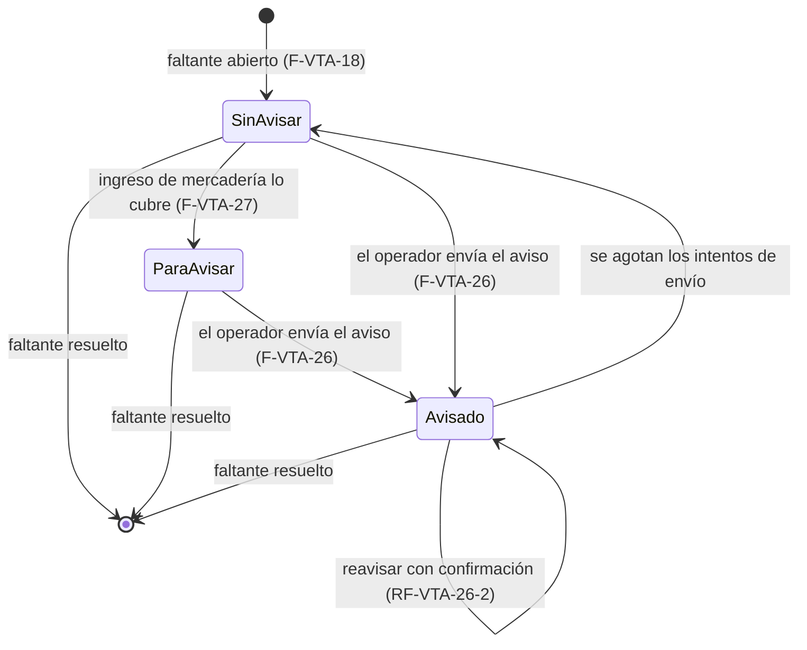

# Ventas · avisos de faltantes (técnico, MSF-161)

Épica **MSF-161** — Ventas y despacho · Ventas avisos de faltantes. Spec, plan, tareas y contratos en
`specs/20261110-100000-ventas-avisos-de-faltantes/` (`spec.md`, `plan.md`, `tasks.md`,
`contracts/ventas-avisos-de-faltantes.md`). Rama
`epic/MSF-161-ventas-y-despacho-ventas-avisos-de-falta`, PR #834 a `dokploy`, merge commit `adf01e76`
(2026-11-11). Historias: **F-VTA-26** (MSF-257, avisar a clientes con faltantes) y **F-VTA-27** (MSF-270,
«Para avisar» al ingresar mercadería).

> **Estado:** implementada y mergeada en `dokploy`; todavía **no está en `main`** (esta rama sale de `main`).
> Explicación de producto: [Ventas · avisos de faltantes (producto)](../producto/ventas-avisos-de-faltantes.md).
> Base: [Ventas · despacho y faltantes (técnico)](ventas-despacho-y-faltantes.md) (MSF-135) y
> [Stock · carga inicial, exportación y avisos (técnico)](stock-carga-exportacion-y-avisos.md) (F-STK-17).

**Delivery scope:** `refine` y `supabase`. Sin `kestra` nuevo (el flow `avisos-faltantes` ya existe y **no
cambia**), sin `superset` ni `workers`.

## Qué resuelve

Se avisa a los clientes con un faltante de despacho cuando la mercadería vuelve a haber, **a mano** (el operador
elige los faltantes y edita el texto del correo) o **con ayuda del sistema** (al ingresar mercadería, los
faltantes que el ingreso cubre quedan marcados «Para avisar»).

## Relación con F-STK-17 y F-VTA-18 (la decisión de fondo)

En la base conviven **dos conceptos de «faltante»** y la épica se escribió antes de que existieran:

| | F-STK-17 (MSF-405) | F-VTA-18 (MSF-201) |
|---|---|---|
| Qué es un faltante | Línea de una factura confirmada «A pedido» con **reserva de stock activa** (se cierra sola al descontarse la reserva). No tiene tabla: es la vista `public.faltantes_listado`. | Línea de una factura que **no se pudo despachar por falta de stock**; la registra el despacho (`registrar_faltantes_despacho`) y la deja Incompleta. Tabla `dominio.faltantes_venta` (una fila por línea, `estado` `abierto`/`resuelto`, `cantidad_faltante`). Se resuelve al reanudar el armado. |
| Pantalla | `/stock/faltantes` (pestaña de Stock) | `/ventas/faltantes` (grupo Ventas) |
| Aviso al cliente | **Sí**: `avisar_faltantes(uuid[])` → cola `dominio.faltantes_avisos` → Edge Function `enviar-aviso-faltante` → flow `avisos-faltantes`. | **No** (esta épica) |

La épica habla de «la tabla `faltantes` (F-VTA-18) y la pantalla Faltantes» de Ventas: por lo tanto **F-VTA-26 y
F-VTA-27 se construyen sobre `dominio.faltantes_venta` y `/ventas/faltantes`**. La pantalla de Stock no se toca.

**Qué se reutiliza, sin duplicar:**

- La **cola `dominio.faltantes_avisos`**: una fila por línea de factura (`linea_id` → `comprobantes_venta_lineas`).
  Un faltante de `faltantes_venta` se identifica con `(comprobante_id, linea_orden)`, que es exactamente
  `(comprobante_id, orden)` de la línea: hay **correspondencia 1 a 1** con `linea_id`. El aviso de F-VTA-26 se
  encola ahí. **No se crea otra tabla de avisos.**
- La **Edge Function `enviar-aviso-faltante`** y su secreto `AVISOS_FALTANTES_TOKEN`, el correo SMTP
  (`_shared/correo.ts`), el reintento (tope 5, reserva de 2 minutos), «un correo por cliente», el saneamiento de
  errores y las tres RPC de `service_role` (`faltantes_avisos_pendientes`, `tomar_aviso_faltante`,
  `cerrar_aviso_faltante`).
- El **flow `infra/kestra/flows/avisos-faltantes.yml`**: sin cambios (barrido cada minuto).
- `private.nivel_ventas_en_empresa`, `private.puede_leer_faltantes_empresa`, `private.registrar_actividad`,
  `FiltroEmpresa`, `useFiltroPorEmpresaActiva`, `useListadoAcumulado`, `CargaInfinita`, `ContenidoAdaptable`,
  `EtiquetaEstado` y el patrón de diálogo de `pages/stock/faltantes.tsx`.
- La **semántica «Avisado» de F-STK-17**: avisada = fila en la cola con estado `pendiente` o `enviado`; si se
  agotan los intentos (`agotado`) la línea vuelve a «Sin avisar» y el error queda registrado.

## Decisiones

| # | Decisión | Dónde se ve |
|---|---|---|
| D-1 | **«Avisado» no es un valor de `estado`.** La épica suponía `estado ∈ {abierto, avisado, resuelto}` + `avisado_at`; el código real tiene `estado ∈ {abierto, resuelto}` con `check ((estado = 'abierto') = (resuelto_en is null))` y un índice único parcial `where estado = 'abierto'`. Agregar `avisado` obligaría a reescribir las cuatro piezas y a romper el índice. Se representa con **dos marcas ortogonales al ciclo de vida**: `avisado` ⇔ hay fila en `dominio.faltantes_avisos` de esa línea en `pendiente`/`enviado` (fecha `coalesce(enviado_en, created_at)`); `para_avisar` ⇔ `faltantes_venta.para_avisar_en is not null` y no está avisado; `sin_avisar` ⇔ ninguna de las dos. **OK pendiente de Nicolás.** | `listar_faltantes` (`aviso`, `aviso_en`) |
| D-2 | **Reavisar con confirmación (RF-VTA-26-2).** El servidor no reavisa una línea ya avisada salvo `p_reavisar = true` (resultado `ya_avisado`); la pantalla pide la confirmación explícita («Volver a avisar a los N ya avisados»). Al reavisar, la fila de la cola se reinicia (`pendiente`, `intentos = 0`, `created_at = now()`). El rastro de cada aviso queda en `registro_actividad`. Una línea con un envío en curso (`pendiente`) **nunca** se reavisa (resultado `en_cola`). | `avisar_faltantes_venta`, diálogo |
| D-3 | **Texto editable (RF-VTA-26-1).** El diálogo precarga un texto por defecto y la persona lo edita; viaja a la RPC como `p_mensaje` y se guarda en `faltantes_avisos.mensaje` (≤ 1.000). El correo es **texto plano**: `Hola <cliente>,` + el texto editable + la lista de productos. Se sanea en el servidor (sin caracteres de control ni HTML). Sin `mensaje`, el correo es el de F-STK-17 sin cambios. | `contenido.ts`, columna `mensaje` |
| D-4 | **«Ingreso de mercadería confirmado» en el código real.** No existe un paso de confirmación: `dominio.ingresos_mercaderia.estado ∈ {registrado, anulado}` y `public.registrar_ingreso_mercaderia` crea la cabecera `registrado`, mueve el stock y crea la fila en `dominio.ingresos_mercaderia_lineas` **en la misma transacción**. «Confirmar el ingreso» = registrarlo, y el enganche es un disparador `AFTER INSERT` sobre `ingresos_mercaderia_lineas`: no se redefine la RPC grande de Stock y se atomiza la marca con el ingreso. Las demás entradas de stock (carga en lote, toma de inventario, traslados, devoluciones de nota de crédito, RMA) **no** marcan. **OK pendiente.** | `private.marcar_faltantes_para_avisar` |
| D-5 | **Cobertura por antigüedad «hasta agotar la cantidad» (RF-VTA-27-2, CA-VTA-27-2).** Para cada línea del ingreso (producto + cantidad), entre los faltantes **abiertos** de ese producto en toda la organización (el stock es único: no se distingue tienda ni depósito) que aún no están ni «Para avisar» ni «Avisados», se recorren del **más antiguo** al más nuevo (`creado_en`, `id`) con un saldo inicial igual a la cantidad ingresada; se marca cada faltante **completo** mientras su `cantidad_faltante` entre en el saldo y el que **no entra se salta** (un faltante grande no bloquea a los demás del producto; QA 2026-11-10). Ejemplo: ingreso 10, faltantes 4 (hace 3 días), 4 (2 días), 4 (1 día) → se marcan los dos primeros; el tercero espera el próximo ingreso. Solo cuenta la cantidad **del ingreso**, no el stock que ya hubiera. **OK pendiente (cobertura de faltantes completos vs. parcial).** | disparador de ingresos |
| D-6 | **Anular el ingreso no desmarca.** «Para avisar» es una sugerencia para el operador (no envía nada); la pantalla muestra el «Stock hoy» real al lado. **OK pendiente.** | disparador de ingresos |
| D-7 | **No se exige stock disponible para avisar a mano.** A diferencia de F-STK-17 (`omitidos_sin_stock`), la historia no lo pide: el operador puede estar avisando algo ya recibido y se avisa lo que el operador elige. | `avisar_faltantes_venta` |
| D-8 | **Línea compartida con F-STK-17.** Si una misma línea fuera a la vez «A pedido» con reserva (F-STK-17) y faltante de despacho (F-VTA-18), comparte **una sola fila de cola**: avisar desde cualquiera de las dos pantallas la deja «Avisada» en ambas (no se manda dos veces). No requiere código extra. | `dominio.faltantes_avisos` |
| D-9 | **El envío ya no depende de MSF-189.** El SMTP de F-CON-03 y la Edge Function de F-STK-17 ya están en `dokploy`: MSF-189 deja de ser bloqueante de F-VTA-26. | flow `avisos-faltantes` |
| D-10 | **Listado.** `/ventas/faltantes` ya carga por tandas (carga infinita); no se agrega paginación. «Para avisar» se ve como **chip en la columna Aviso** y como **filtro** (Todos · Para avisar); con el filtro activo la lista va **del más antiguo al más nuevo** (`desde` ascendente, RF-VTA-27-2); sin filtro mantiene el orden actual (más reciente primero). | `pages/ventas/faltantes.tsx` |
| D-11 | **Hito y alcance.** El roadmap manda (diciembre, P1); el documento del componente decía Etapa 2. Etiqueta `revisar-roadmap` hasta que el cliente confirme. | épica MSF-161 |

## Migraciones

Todas **aditivas** e idempotentes, con la reversión escrita en el encabezado de cada una. Ninguna crea tablas.

| Migración | Qué hace |
|---|---|
| `20270226100100_faltantes_aviso_cola.sql` | Columna `mensaje text` en `dominio.faltantes_avisos` (`check (mensaje is null or length(mensaje) <= 1000)`); `create or replace` de `private.faltante_abierta(uuid)` (misma firma) para que también sea abierto el faltante de venta; `create or replace` de `public.tomar_aviso_faltante(uuid, integer)` (misma firma y mismo `returns table`) para que cada elemento de `lineas` sume `mensaje` y la `cantidad` sea la **faltante** si la línea tiene un faltante de venta abierto (FR-006, FR-007). |
| `20270226100200_avisar_faltantes_venta.sql` | RPC **nueva** `public.avisar_faltantes_venta(p_ids uuid[], p_mensaje text default null, p_reavisar boolean default false) returns jsonb` (FR-001, FR-003, FR-004, FR-005). |
| `20270226100300_listar_faltantes_aviso.sql` | `drop function public.listar_faltantes(uuid, integer, integer)` y alta de `listar_faltantes(p_empresa_id, p_pagina, p_tamano, p_aviso text default null)`: suma `aviso` y `aviso_en` y acepta `p_aviso` (FR-008). |
| `20270226110100_faltantes_para_avisar_columnas.sql` | `dominio.faltantes_venta`: columnas `para_avisar_en timestamptz` y `para_avisar_ingreso_id uuid` (FK a `dominio.ingresos_mercaderia (id)`, `on delete set null`), índice parcial `faltantes_venta_cobertura_idx` e índice de la FK (FR-101, FR-102). |
| `20270226110200_faltantes_para_avisar_ingreso.sql` | Función **nueva** `private.marcar_faltantes_para_avisar()` (`security definer`, `search_path = ''`) y disparador `ingresos_mercaderia_lineas_marcar_faltantes` (`AFTER INSERT FOR EACH ROW` sobre `dominio.ingresos_mercaderia_lineas`) (FR-101, FR-102, FR-105). |
| `20270226110300_listar_faltantes_para_avisar.sql` | `create or replace public.listar_faltantes(uuid, integer, integer, text)`: reconoce `aviso = 'para_avisar'`, acepta `p_aviso = 'para_avisar'` y, con ese filtro, ordena del más antiguo al más nuevo (FR-103). |

`registrar_ingreso_mercaderia`, `registrar_faltantes_despacho` y `avisar_faltantes` (F-STK-17) **no se tocan**.

## Modelo de datos

No se crea ninguna tabla: se **alteran** dos de `dominio` y se **leen** varias más.

| Tabla | Estado | Cambio |
|---|---|---|
| `dominio.faltantes_avisos` | **alterada** | Columna nueva `mensaje text` (`check`: nulo o ≤ 1.000). El texto que la persona editó en el diálogo; nulo = texto por defecto de F-STK-17. |
| `dominio.faltantes_venta` | **alterada** | Columnas nuevas `para_avisar_en timestamptz` (momento de la marca) y `para_avisar_ingreso_id uuid` (FK a `dominio.ingresos_mercaderia (id)`, `on delete set null`); índice parcial `faltantes_venta_cobertura_idx (organizacion_id, producto_id, creado_en, id) where estado = 'abierto' and para_avisar_en is null` e índice de la FK. |
| `dominio.ingresos_mercaderia_lineas` | existente | Solo se le agrega un disparador de lectura de la línea nueva; no se altera la tabla. |
| `dominio.ingresos_mercaderia` | existente | Sin cambio: solo se referencia (FK). |
| `dominio.comprobantes_venta`, `dominio.comprobantes_venta_lineas` | existentes | Sin cambio: solo se leen (el enlace línea ↔ faltante). |
| `dominio.productos`, `dominio.empresas`, `public.clientes`, `public.stock_estados` | existentes | Sin cambio: solo se leen (nombre de producto, tienda, correo del cliente, stock de hoy). |
| `public.registro_actividad` | existente | Sin cambio: auditoría transversal de `private.registrar_actividad`. |

- Detalle del DER en [Datos y DER](datos.md#ventas-avisos-de-faltantes-msf-161).
- La exportación total no cambia: `faltantes_venta` ya se exporta completa y `faltantes_avisos` sigue siendo cola
  interna.

### «Avisado» y «Para avisar» no son estados

| Marca | De dónde sale | Fecha (`aviso_en`) | Se cae cuando |
|---|---|---|---|
| **Avisado** | Fila en `dominio.faltantes_avisos` de la línea con estado `pendiente` o `enviado` | `coalesce(enviado_en, created_at)` | El envío se agota (`agotado`) → vuelve a «Sin avisar» con el error registrado |
| **Para avisar** | `faltantes_venta.para_avisar_en is not null` y sin aviso en curso | `para_avisar_en` | El faltante se resuelve (reanudar el armado) |
| **Sin avisar** | Ninguna de las dos | `null` | — |



Nada de F-VTA-27 envía correos: solo marca.

## RPC

Todas en `public`, `security definer`, `search_path = ''`, `revoke execute … from public, anon` y
`grant execute … to authenticated`. La organización y el actor salen de la **sesión**, nunca de un argumento.

| Función | Qué hace |
|---|---|
| `avisar_faltantes_venta(p_ids uuid[], p_mensaje text default null, p_reavisar boolean default false)` | Encola el aviso de los faltantes elegidos (una fila por línea, un correo por cliente). Exige `ventas` en `edicion` global y por tienda. 1 a 200 ids; `p_mensaje` se recorta y no puede pasar de 1.000. Devuelve `encolados`, `lineas_avisadas`, `omitidos_ya_avisados`, `omitidos_en_cola`, `omitidos_sin_correo`, `omitidos_sin_permiso`, `omitidos_no_abiertos` y un `detalle` por faltante (`encolado` \| `ya_avisado` \| `en_cola` \| `sin_correo` \| `sin_permiso` \| `no_abierto`). Registra la actividad `ventas.faltantes_avisados`. |
| `listar_faltantes(p_empresa_id uuid default null, p_pagina integer default 1, p_tamano integer default 10, p_aviso text default null)` | Faltantes **abiertos** de las empresas donde la persona tiene Ventas al menos en lectura, con cliente, producto, SKU, cantidad, comprobante, fecha del pedido, «desde», stock de hoy y ahora `aviso` + `aviso_en`; `filas` con el total del filtro. `p_aviso` ∈ {`null`, `sin_avisar`, `avisado`, `para_avisar`}; con `para_avisar` ordena del más antiguo al más nuevo. Tope de 200 por página. |

Cambio de firma: `listar_faltantes(uuid, integer, integer)` **se reemplaza** por
`listar_faltantes(uuid, integer, integer, text)` (un `drop` + `create`); las llamadas por nombre con tres
parámetros siguen resolviendo.

### Reglas de `avisar_faltantes_venta`

| Situación | Resultado |
|---|---|
| Cliente con correo válido | `encolado`: se inserta o se reinicia la fila de la cola (`pendiente`, `intentos = 0`, `ultimo_error` y `enviado_en` nulos, `created_at = updated_at = now()`, `mensaje` nuevo) |
| Cliente **sin** correo | `sin_correo`: **se omite sin marcar** (FR-005) |
| Ya avisado y `p_reavisar = false` | `ya_avisado` (no se vuelve a avisar) |
| Ya avisado y `p_reavisar = true` | `encolado`: la fila de la cola se reinicia |
| Con un envío en curso (`pendiente`) | `en_cola`: **nunca** se reenvía |
| Faltante de una tienda donde no hay `ventas` en `edicion` (pero sí en `lectura`) | `sin_permiso` |
| Faltante inexistente, de otra organización, ya resuelto o de una tienda que ni se puede leer | `no_abierto`: **la misma respuesta para todos**, no delata que el faltante existe |
| Sin sesión, sin organización o sin `ventas` en `edicion` (el rol Consulta incluido) | Excepción `42501` («No tenés permiso para avisar faltantes») |
| Lista vacía o de más de 200 ids, o `p_mensaje` de más de 1.000 | Excepción `22023` («Elegí entre 1 y 200 faltantes» / «El texto del aviso no puede pasar de 1.000 caracteres») |

El envío de verdad lo hace la Edge Function `enviar-aviso-faltante` (una corrida del flow `avisos-faltantes` por
minuto): **un correo por cliente** con todos sus productos. Si el faltante se cerró antes de que salga el correo,
`private.faltante_abierta` lo reconoce y la línea vuelve a «Sin avisar» con el motivo «El faltante se cerró antes
de enviar el aviso» (FR-007).

### Cola y correo (cambios sobre F-STK-17, mismas firmas)

- `private.faltante_abierta(p_linea_id uuid)`: además del criterio de F-STK-17 (factura «A pedido» confirmada con
  reserva activa), es abierto el faltante cuya línea tiene una fila **abierta** en `dominio.faltantes_venta`.
- `public.tomar_aviso_faltante(p_cliente uuid, p_tope integer default 5)` (solo `service_role`): cada elemento de
  `lineas` suma `mensaje`; la `cantidad` es la **faltante** si la línea tiene un faltante de venta abierto (si no,
  la de la línea); la tanda de un cliente agrupa **solo las líneas con el mismo `mensaje`** que la pendiente más
  antigua (nunca un correo con textos mezclados: las demás salen en el barrido siguiente).
- `supabase/functions/enviar-aviso-faltante/contenido.ts`: `LineaFaltante` suma `mensaje?: string | null`; el cuerpo
  usa el mensaje saneado en lugar de las frases fijas (la lista de productos siempre se incluye). Sin `mensaje`, el
  correo es el de F-STK-17 sin cambios. Asunto: «Ya tenemos stock de lo que pediste». Saneamiento: sin caracteres de
  control salvo `\n`, a lo sumo dos saltos seguidos, máximo 1.000.

### Disparador de «Para avisar» (F-VTA-27)

`private.marcar_faltantes_para_avisar()` (`security definer`, `search_path = ''`, sin grant a
`authenticated`/`anon`) sobre `AFTER INSERT` de `dominio.ingresos_mercaderia_lineas`:

- Saldo inicial = `new.cantidad` (la cantidad de la línea del ingreso).
- Recorre los faltantes **abiertos** del mismo `producto_id` en la organización, sin `para_avisar_en` y sin aviso
  `pendiente`/`enviado` en la cola, ordenados por `(creado_en, id)`, con `for update`.
- Marca cada faltante **completo** mientras entre en el saldo (`saldo -= cantidad_faltante`); el que **no entra se
  salta** y se sigue con el siguiente más antiguo.
- **No escribe** en `dominio.faltantes_avisos` ni envía nada.
- El cuerpo va en un bloque `exception when others`: un fallo deja un `WARNING` en el log del servidor y **el
  ingreso no se rompe** (FR-105). La actividad `ventas.faltantes_para_avisar` va en su propio bloque: si falla, las
  marcas se conservan.
- `registrar_ingreso_mercaderia` **no se modifica**.

Ejemplos de cobertura (de los contratos de la spec): ingreso de 10 → faltantes `[3, 3, 3]` marca los 3;
`[4, 4, 4]` marca los dos más antiguos; `[9, 2, 1]` marca el de 9 y el de 1 (el de 2 no entra y se salta);
`[12, 1]` marca solo el de 1.

## Frontend (`apps/web/src/`)

| Archivo | Qué aporta |
|---|---|
| `lib/ventasFaltantes.ts` | Tipo `AvisoFaltante` (`sin_avisar` \| `para_avisar` \| `avisado`), campos `aviso`/`aviso_en` en `FaltanteVenta`, `etiquetaAviso()` (chip «Sin avisar» / «Para avisar» / «Avisado · dd/mm/aaaa»), `fechaDeAviso()`, `TEXTO_AVISO_POR_DEFECTO` («Volvió a haber stock de los productos que tenías pedidos:»), `MAXIMO_AVISO_FALTANTES` (200), `MAXIMO_MENSAJE_AVISO` (1.000), `avisarFaltantesVenta(ids, mensaje, reavisar)`, `mensajeResultadoAvisoVenta(resultado, clientePorId)` y el envoltorio de `listar_faltantes` con el parámetro `aviso`. |
| `hooks/useListarFaltantes.ts` | Lectura atada a su **ámbito** (organización + tienda) y a su filtro de aviso; **selección** atada al ámbito (`alternar`, `alternarTodos`, `limpiar`) y `avisar()` que descarta la selección y recarga con los filtros vigentes. |
| `pages/ventas/faltantes.tsx` | Columna de casillas (solo con `ventas` en `edicion`), columna **Aviso**, botón «Avisar a los seleccionados (N)», pie «N seleccionados de M faltantes», filtro **Todos · Para avisar** con el orden por antigüedad, diálogo «Avisar a los clientes» (texto editable con contador, casilla «Volver a avisar a los N ya avisados», **Cancelar** / **Enviar avisos**) y el aviso emergente «Avisos enviados» con lo omitido y por qué. |

### Reglas de la interfaz

- **Solo con `ventas` en `edicion`** aparecen las casillas y el botón; con `lectura` la pantalla se ve igual, sin
  casillas ni botón (`useNivelSeccion`).
- **Empresa activa (Principio VIII, FR-009):** al cambiar de tienda, la selección se descarta sola (vive atada al
  ámbito en el hook), el diálogo abierto **se cierra con aviso** («Cambiaste de empresa: se cerró el aviso a los
  clientes.»), la paginación vuelve a la primera página y **no se dibuja ni una fila de la empresa anterior**.
- **Tope de 200:** con más de 200 seleccionados, el pie avisa «Se avisa de a 200 por vez: desmarcá N para poder
  enviar» y el botón queda deshabilitado.
- **Doble clic:** «Enviar avisos» queda deshabilitado mientras la petición está en vuelo.
- **Faltante resuelto antes del envío:** la línea vuelve a «Sin avisar» con «El faltante se cerró antes de enviar el
  aviso».
- **Sin UUID visible** y sin desborde horizontal a 320, 768 y 1440 px (axe en los E2E).

## Permisos

- **Avisar** exige `ventas` en `edicion` **en la tienda del faltante** (no en la empresa activa):
  `private.nivel_ventas_en_empresa(empresa_id)`. El rol Consulta es rechazado por el servidor (`42501`).
- **Ver la pantalla** (y la lista) exige Ventas al menos en `lectura` en la tienda del faltante
  (`private.puede_leer_faltantes_empresa`), igual que en F-VTA-18.
- **Marcar «Para avisar»** no lo decide ningún permiso del usuario: lo hace el disparador del ingreso
  (`security definer`), que puede marcar faltantes de tiendas que quien registra el ingreso quizá no ve. No expone
  datos: solo escribe la marca; la lectura sigue por RLS.
- `dominio.faltantes_venta` y `dominio.faltantes_avisos` siguen **sin escritura directa** para `authenticated`:
  las columnas nuevas heredan la política de su tabla y `anon` no tiene privilegios.

Detalle de la matriz: [Permisos por rol](../permisos-por-rol.md).

## Actividad

| Evento | Qué registra |
|---|---|
| `ventas.faltantes_avisados` | «Aviso de faltantes encolado para N faltantes de M clientes» (cantidades; **sin correos**). |
| `ventas.faltantes_para_avisar` | «Ingreso de mercadería: N faltantes de <producto> quedaron Para avisar» (solo si marcó algo). |

## Guía de prueba técnica

### Prerrequisitos

- Stack local (`pnpm dev:supabase`) con el panel servido (`pnpm dev:refine:host`), o **DEV**.
- Migraciones `20270226100100`–`20270226110300` aplicadas (vienen con la promoción de `dokploy`).
- Una organización con **dos empresas** y al menos un **depósito**, con facturas confirmadas **Incompleto** (para
  tener faltantes de despacho) y usuarios con rol **Administrador** (ventas en edición) y **Consulta**.
- Clientes **con correo** y al menos uno **sin correo**.
- El correo saliente llega a un SMTP de pruebas: los secretos `SMTP_*` y `AVISOS_FALTANTES_TOKEN` tienen que estar
  declarados en `supabase/config.toml` (ver el PR #911, abierto al cierre de esta documentación); sin ellos la Edge
  Function `enviar-aviso-faltante` responde 503.

### Pasos a mano

1. **Preparar un faltante.** En **Ventas → Comprobantes**, abrí una factura confirmada, ponela en **Incompleto** y
   registrale un faltante de un producto (así lo hace el despacho; ver
   [Ventas · despacho y faltantes](ventas-despacho-y-faltantes.md)).
2. **Ver la columna Aviso.** En **Ventas → Faltantes**, la fila del faltante muestra **Sin avisar**. Rótulo
   `[MSF-161:T003]`.
3. **Avisar a mano.** Marcá la fila, hacé clic en **Avisar a los seleccionados (1)**, editá el **Texto del aviso** y
   confirmá con **Enviar avisos**: aparece «Avisos enviados.» y la fila pasa a **Avisado · dd/mm/aaaa**. En SQL, la
   fila de la cola (`dominio.faltantes_avisos`) está en `pendiente` con el `mensaje` que escribiste. Rótulo
   `[MSF-161:T002]` y `[MSF-161:T010]`.
4. **Cliente sin correo.** Marcá un faltante de un cliente sin correo y avisá: aparece «No se enviaron avisos. El
   cliente no tiene correo.» y la fila **no** se marca (en SQL, no hay fila en la cola). Rótulo `[MSF-161:T010]`.
5. **Reaviso.** Marcá un faltante ya avisado: el diálogo ofrece **Volver a avisar a los N ya avisados**. Sin marcar
   esa casilla, el aviso omite la línea («faltante ya estaba avisado»); con la casilla, se vuelve a encolar. Rótulo
   `[MSF-161:T002]`.
6. **Tope y texto.** Marcá más de 200 filas: el pie avisa el tope y el botón queda deshabilitado. Escribí más de
   1.000 caracteres: el campo no lo admite. Rótulo `[MSF-161:T002]`.
7. **Permiso.** Entrá con un rol **Consulta**: no hay casillas ni botón. Llamá la RPC a mano:
   `select public.avisar_faltantes_venta(array[…], null, false)` → `42501`. Rótulo `[MSF-161:T005]`.
8. **Empresa activa.** Con el diálogo abierto, cambiá la empresa en la barra superior: el diálogo se cierra con
   aviso y la selección se descarta; no queda ninguna fila de la tienda anterior. Rótulo `[MSF-161:T008]` y
   `[MSF-161:T009]`.
9. **«Para avisar».** Registrá un ingreso de mercadería de 10 unidades del producto de dos faltantes abiertos de 4
   unidades cada uno: los dos más antiguos pasan a **Para avisar** y el tercero sigue **Sin avisar**. En SQL, las
   filas tienen `para_avisar_en` y `para_avisar_ingreso_id`; **no** hay filas nuevas en `dominio.faltantes_avisos`.
   Rótulo `[MSF-161:T012]` y `[MSF-161:T018]`.
10. **Filtro y orden.** En **Ventas → Faltantes**, elegí **Para avisar**: la lista va del más antiguo al más nuevo y
    aparece el aviso «Son faltantes de productos que ya ingresaron mercadería…». Rótulo `[MSF-161:T013]` y
    `[MSF-161:T016]`.
11. **Un ingreso que no rompe.** Con el disparador de ingresos, el ingreso nunca falla: si la marca falla, queda un
    `WARNING` en el log del servidor y el ingreso sigue registrado. Rótulo `[MSF-161:T012]`.
12. **Faltante cerrado antes del envío.** Resolvé el faltante (reanudá el armado) con el aviso en cola: no sale
    ningún correo y la línea vuelve a **Sin avisar** con «El faltante se cerró antes de enviar el aviso». Rótulo
    `[MSF-161:T001]`.

```bash
pnpm dev:supabase
pnpm --filter @platform/web test
pnpm test:db
node --test supabase/functions/enviar-aviso-faltante/handler.test.ts
pnpm --filter @platform/web test:e2e ventas-faltantes
```

### Resultado esperado

- Dado un operador con ventas en edición, cuando selecciona faltantes abiertos con clientes que tienen correo y
  envía el aviso, entonces cada faltante queda «Avisado» con fecha y el cliente recibe **un** correo con el producto
  y el texto que editó.
- Dado un cliente sin correo, cuando el operador intenta avisarlo, entonces se informa «El cliente no tiene
  correo» y el faltante **no** queda marcado.
- Dado un rol sin ventas en edición, cuando llama a la RPC, entonces el servidor la rechaza (`42501`) y la pantalla
  no ofrece casillas ni botón.
- Dado un ingreso de mercadería, cuando se registra, entonces los faltantes abiertos del producto que cubre quedan
  «Para avisar» (del más antiguo al más nuevo, hasta agotar la cantidad) y **no se envía ningún correo**.
- Dado un faltante ya avisado, cuando el operador lo incluye en la selección, entonces no se vuelve a avisar salvo
  que confirme «Volver a avisar».

### Cómo automatizarlo

| Rótulo | Cobertura actual | Automatización pendiente |
|---|---|---|
| `[MSF-161:T001]` | pgTAP `supabase/tests/database/faltantes_avisos_venta.test.sql` (el faltante resuelto antes del envío no se manda y vuelve a «Sin avisar») | — |
| `[MSF-161:T002]` | pgTAP `faltantes_avisos_venta.test.sql` (encola con mensaje, un correo por cliente, idempotente, conteos y detalle, ya avisado omitido sin `p_reavisar`, reavisa con él, en cola nunca se reenvía, tienda sin `edicion` omitida, sin correo no marca) + Vitest `apps/web/src/pages/ventas/faltantes.test.tsx` (confirmación de reaviso, «Avisos enviados» con lo omitido, «El cliente no tiene correo») | — |
| `[MSF-161:T003]` | pgTAP `supabase/tests/database/faltantes.test.sql` (columnas `aviso`/`aviso_en`, filtro `p_aviso`, firma nueva) | — |
| `[MSF-161:T004]` | `node --test supabase/functions/enviar-aviso-faltante/handler.test.ts` (mensaje saneado, texto por defecto intacto) + `pnpm infra:config` (el flow no cambia) | — |
| `[MSF-161:T005]` | pgTAP `faltantes_avisos_venta.test.sql` (Consulta `42501`, `anon` sin ejecución, otra organización → `no_abierto`) | — |
| `[MSF-161:T008]` | Vitest `apps/web/src/pages/ventas/faltantes.test.tsx` (casillas y «seleccionar todo», pie, botón deshabilitado con 0, diálogo con texto editable y reaviso, «Avisos enviados» con lo omitido, «El cliente no tiene correo», `lectura` sin casillas ni botón, doble clic) | — |
| `[MSF-161:T009]` | Vitest `apps/web/src/pages/ventas/faltantes.empresa.test.tsx` (selección descartada, diálogo cerrado con aviso, sin filas de la empresa anterior) | — |
| `[MSF-161:T010]` | E2E `apps/web/e2e/ventas-faltantes-avisos.e2e.ts` — rótulos del E2E `[MSF-257:CA-VTA-26-1]` (dos faltantes con correo, texto editado, ambos «Avisado» con fecha), `[MSF-257:CA-VTA-26-2]` (cliente sin correo) y `[MSF-257:SC-001]` (axe sin violaciones y sin desborde a 320/768/1440 px, operable con teclado, sin identificadores técnicos) | — |
| `[MSF-161:T012]` | pgTAP `supabase/tests/database/faltantes_para_avisar.test.sql` (marca y **no** encola nada en `faltantes_avisos`; atomicidad; el fallo del disparador no rompe el ingreso; actividad; `registrar_ingreso_mercaderia` intacta) | — |
| `[MSF-161:T013]` | pgTAP `faltantes_para_avisar.test.sql` (`aviso = 'para_avisar'`, filtro y orden ascendente) | — |
| `[MSF-161:T014]` | pgTAP `faltantes_para_avisar.test.sql` (orden, tope por cantidad, salto del que no entra, no remarca) | — |
| `[MSF-161:T016]` | Vitest `pages/ventas/faltantes.test.tsx` (chip, filtro, orden por antigüedad, estado vacío «No hay faltantes para avisar») | — |
| `[MSF-161:T018]` | E2E `apps/web/e2e/ventas-faltantes-para-avisar.e2e.ts` — rótulo del E2E `[MSF-270:CA-VTA-27-1]` (ingreso de 10 → los 3 «Para avisar», sin avisos enviados, axe sin violaciones a 320/768/1440 px) | — |
| `[MSF-161:T021]` | Cierre: `pnpm test:db`, `pnpm lint`, `pnpm build`, `pnpm test`, `pnpm docs:check`, `pnpm infra:config`, `pnpm matriz:check` | — |

Los dos E2E necesitan el stack local de Supabase (`SUPABASE_URL` y `SUPABASE_SERVICE_ROLE_KEY`): se saltan si no
está. El soporte de siembra es `apps/web/e2e/ventas-faltantes-soporte.ts`.

## Revisión de seguridad del cierre (T021, SC-900)

- **`anon`**: ninguna RPC nueva es ejecutable por `anon` (`revoke execute … from public, anon` +
  `grant execute … to authenticated`); las ayudas internas (`private.marcar_faltantes_para_avisar`,
  `private.faltante_abierta`) se revocan también a `authenticated`.
- **`security definer`**: las funciones nuevas llevan `set search_path = ''` y objetos calificados.
- **RLS y escritura:** `dominio.faltantes_venta` y `dominio.faltantes_avisos` no ganan escritura directa; las
  columnas nuevas heredan la política de su tabla.
- **BOLA entre tiendas:** el permiso se resuelve **en la empresa del faltante**
  (`private.nivel_ventas_en_empresa`); un faltante de una tienda que ni se puede leer responde `no_abierto`, igual
  que uno inexistente o de otra organización: no delata nada.
- **Organización y actor**: salen de la sesión (`private.organizacion_id()`, `auth.uid()`), nunca de un argumento.
- **Saneamiento del mensaje**: sin HTML ni caracteres de control, máximo 1.000, texto plano; el correo no lleva
  nombres de clientes ni correos en los logs ni en la actividad (`ventas.faltantes_avisados` registra cantidades).
- **El disparador de ingresos** marca faltantes de tiendas que quien registra el ingreso quizá no ve: no expone
  datos (solo escribe la marca) y su fallo no rompe el ingreso.

## Desvíos y pendientes

| Tema | Estado / dueño |
|---|---|
| Decisiones D-1, D-4, D-5 y D-6 («Avisado» derivado de la cola en lugar de `estado`, qué es «ingreso confirmado», cobertura de faltantes completos con corte en el primero que no entra, y que anular el ingreso no desmarca) | **OK pendiente de Nicolás** (marcadas en la spec y en las decisiones de arriba) |
| **Capturas del manual de usuario** | TODO (dueño: Documentador / equipo de diseño): no se pudieron generar con `pnpm docs:capturas` (la herramienta no existe en este repo) y el código de la épica todavía no está en `main`. Cuando exista, guardar las capturas en `docs/producto/img/ventas-avisos-de-faltantes/`: la pantalla de Faltantes con la columna **Aviso** y las casillas, el diálogo **Avisar a los clientes** con el texto editable y la casilla de reaviso, el aviso «Avisos enviados», y la vista **Para avisar** con el filtro y el aviso informativo. |
| El PR #911 (`fix/msf-161-secretos-correo-edge`) declara en `supabase/config.toml` los secretos de correo y avisos del runtime de dev (`SMTP_*`, `PANEL_URL`, `AVISOS_*`); estaba **abierto** al cierre de esta documentación: sin esas declaraciones la Edge Function `enviar-aviso-faltante` responde 503 en el stack local y en dev | **MSF-161** (PR #911) |
| La fecha del aviso puede diferir hasta ~1 minuto de la del envío: mientras el correo está en cola, `aviso_en` es la fecha de encolado | Comportamiento documentado (decisión de la spec) |
| El historial de los avisos no está en la tabla: al reavisar, la fila de la cola se reinicia y el rastro queda en la actividad | Comportamiento documentado (decisión de la spec) |
| El disparador de ingresos corre sobre una tabla de Stock: un fallo se aísla con un bloque de excepción, pero un error silenciado necesita monitoreo en el log del servidor | Monitoreo en dev |

## Reversión

Migraciones **aditivas** (no se destruye nada que esta historia cree en el mismo PR). Para volver atrás, en una
migración posterior:

1. `drop function if exists public.avisar_faltantes_venta(uuid[], text, boolean)`.
2. `drop function if exists public.listar_faltantes(uuid, integer, integer, text)` y restaurar
   `public.listar_faltantes(uuid, integer, integer)` con su `grant execute … to authenticated` (definición de
   `20270112130300_faltantes_listar.sql`).
3. `drop trigger if exists ingresos_mercaderia_lineas_marcar_faltantes on dominio.ingresos_mercaderia_lineas` y
   `drop function if exists private.marcar_faltantes_para_avisar()`.
4. `alter table dominio.faltantes_venta drop column if exists para_avisar_ingreso_id, drop column if exists
   para_avisar_en` (con sus índices `faltantes_venta_cobertura_idx` y `faltantes_venta_para_avisar_ingreso_idx`).
5. `alter table dominio.faltantes_avisos drop column if exists mensaje` (exportar antes si hay avisos con texto: con
   el cuerpo viejo de `tomar_aviso_faltante` la columna ya no se lee, se puede quitar después).
6. `create or replace` de `private.faltante_abierta(uuid)` y `public.tomar_aviso_faltante(uuid, integer)` con la
   definición de `20261213100200_faltantes_avisos.sql`.

Los avisos ya enviados **no se deshacen**: los correos salen, no se pueden borrar. Los faltantes marcados «Para
avisar» se desmarcan con el paso 4.

El cierre de la épica es un merge commit: `git revert -m 1 adf01e76` deshace la épica completa.

## Ver también

- **[Ventas · avisos de faltantes (producto)](../producto/ventas-avisos-de-faltantes.md)** — qué resuelve, para
  quién y sus límites.
- **[Ventas · despacho y faltantes (técnico)](ventas-despacho-y-faltantes.md)** — el despacho, el registro de
  faltantes y la pantalla `/ventas/faltantes` (F-VTA-18).
- **[Stock · carga inicial, exportación y avisos (técnico)](stock-carga-exportacion-y-avisos.md)** — la cola de
  avisos, la Edge Function y el flow (F-STK-17).
- **[Ingreso de mercadería (técnico)](ingreso-de-mercaderia.md)** — la RPC que dispara la marca «Para avisar».
- **[Datos y DER](datos.md)** — el grafo completo de tablas.
- **[API y RPC](api.md)** — el catálogo de RPC del producto.
