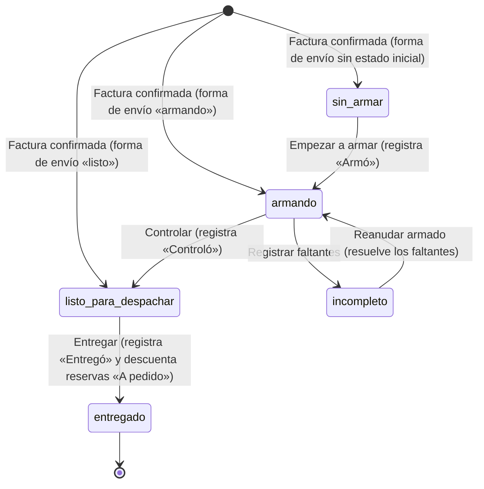

# Ventas · despacho y faltantes (técnico, MSF-135)

Contratos, datos y operación de la épica MSF-135: F-VTA-15 (armado, control y entrega con responsables),
F-VTA-16 (transporte y guía), F-VTA-17 (tablero de despacho) y F-VTA-18 (registro de faltantes). Spec:
`specs/20261024-130000-ventas-despacho-y-faltantes/` (FR-001…FR-012, FR-020…FR-023, FR-030…FR-033, FR-040…FR-047).
Rama: `epic/MSF-135-ventas-y-despacho-ventas-despacho-y-falt`, **pendiente de merge a `main`**.
Explicación de producto: [Ventas · despacho y faltantes (producto)](../producto/ventas-despacho-y-faltantes.md).

**Delivery scope:** `refine` y `supabase`. Sin `kestra`, `superset` ni `workers`.

## Migraciones

Todas **aditivas**, con la reversión escrita en el encabezado de cada una. Cada historia trae las suyas, con
timestamp propio (no se encadenan entre historias).

| Migración | Qué hace |
|---|---|
| `20270112100100_despacho_columnas.sql` | `estado_despacho`, `armo_id`, `controlo_id`, `entrego_id`, `entregado_en` e índice en `dominio.comprobantes_venta` (FR-001). |
| `20270112100200_despacho_accion_permiso.sql` | Acción `despachar` en `ventas` (dato en `public.permisos_rol_accion`) (FR-008). |
| `20270112100300_despacho_estado_inicial.sql` | Disparador `AFTER UPDATE OF estado` que fija el estado inicial al confirmar (FR-002). |
| `20270112100400_despacho_responsables.sql` | `listar_responsables_despacho` (FR-009). |
| `20270112100500_despacho_cambiar_estado.sql` | `cambiar_estado_despacho` y `obtener_despacho_comprobante` (FR-003…FR-007, FR-011). |
| `20270112100600_despacho_responsables_acceso_ventas.sql` | El responsable además necesita Ventas al menos en `lectura` en la empresa del comprobante. |
| `20270112100700_despacho_permiso_por_empresa.sql` | `private.puede_despachar_en_empresa`: el permiso se resuelve en la empresa del comprobante, no en la activa. |
| `20270112130100_faltantes_tabla.sql` | Tabla `dominio.faltantes_venta` (FR-040). |
| `20270112130200_faltantes_registrar.sql` | `registrar_faltantes_despacho` y el disparador que resuelve los faltantes al reanudar (FR-041, FR-042). |
| `20270112130300_faltantes_listar.sql` | `listar_faltantes` (FR-043). |
| `20270112140100_envio_columnas.sql` | `transporte_id`, `guia` y `fecha_envio` en `dominio.comprobantes_venta` (FR-020). |
| `20270112140200_envio_guardar.sql` | `guardar_envio_comprobante` (FR-021). |
| `20270112140300_envio_exige_al_entregar.sql` | Disparador que rechaza entregar sin transporte ni guía cuando la forma los exige (FR-022). |
| `20270112140400_envio_leer.sql` | `obtener_envio_comprobante`: la única lectura del envío (FR-023). |
| `20270112140500_envio_aislamiento.sql` | El privilegio de lectura de `dominio.comprobantes_venta` pasa a ser **por columna**: las tres del envío quedan sin privilegio para `authenticated`. |
| `20270112150000_despacho_listar.sql` | `listar_despacho` e índice parcial de listado (FR-030). |

## Modelo de datos

El despacho es un **campo propio de la factura**, separado del estado documental de MSF-159/MSF-177 (decisión
abierta 1 de la spec): `estado` sigue siendo el estado del documento (`borrador`, `confirmada`, `anulada`, …) y
`estado_despacho` es la máquina del despacho. Los dos comparten los nombres `armando` e `incompleto`, pero viven
en **columnas distintas** y los mueve historias distintas.

| Tabla | Estado | Cambio |
|---|---|---|
| `dominio.comprobantes_venta` | **alterada** | `estado_despacho` (`sin_armar` \| `armando` \| `incompleto` \| `listo_para_despachar` \| `entregado`, nulable, solo para `tipo = 'factura'`), `armo_id` / `controlo_id` / `entrego_id` (→ `auth.users`, `on delete set null`), `entregado_en`, `transporte_id` (FK compuesta a `dominio.transportes (id, organizacion_id)`), `guia` (≤ 100) y `fecha_envio` (date). Índice `(organizacion_id, empresa_id, estado_despacho)`. |
| `dominio.faltantes_venta` | **nueva** | Una fila por **línea de factura** que no se pudo despachar: `organizacion_id`, `empresa_id`, `comprobante_id`, `linea_orden`, `producto_id`, `deposito_id`, `cantidad_faltante > 0`, `estado` (`abierto` \| `resuelto`), `registrado_por`, `creado_en`, `resuelto_en`. FK compuestas a comprobante (con `on delete cascade`), producto, depósito y empresa; índice único parcial `(comprobante_id, linea_orden) where estado = 'abierto'`; `check ((estado = 'abierto') = (resuelto_en is null))`. |
| `public.permisos_rol_accion` | existente | Sin cambio de esquema: `despachar` es un **dato** nuevo de la matriz de acciones de Ventas (Administrador y Depósito). |
| `dominio.formas_envio` | existente | Sin cambio: se leen `tipo`, `exige_transporte_guia` y `estado_despacho_inicial` (MSF-139). |
| `dominio.transportes`, `dominio.transportes_empresas` | existentes | Sin cambio: catálogo de MSF-139; se leen para validar el transporte elegido. |
| `dominio.reservas_stock`, `dominio.existencias_deposito`, `dominio.movimientos_stock` | existentes | Sin cambio: el motor de stock descuenta las reservas «A pedido» al entregar. |
| `public.registro_actividad` | existente | Sin cambio: la auditoría transversal de `private.registrar_actividad`. |

- **[ERD interactivo (Archify)](../diagrams/msf-135-erd.html)** — el documento de venta con el despacho, el envío y la
  tabla de faltantes, con PK/FK y cardinalidad.
- Detalle del DER en [Datos y DER](datos.md#ventas-despacho-y-faltantes-msf-135).

### Estados y transiciones (FR-001, FR-002, FR-003)

- **Inicial (FR-002):** el disparador `comprobantes_venta_estado_despacho_inicial` (`AFTER UPDATE OF estado` sobre
  `dominio.comprobantes_venta`) fija el `estado_despacho_inicial` de la forma de envío (`envio_id`, misma organización
  y empresa) o `sin_armar` si no resuelve. Corre **una sola vez** (si ya hay estado no lo pisa), no toca
  `confirmar_comprobante` ni `updated_at`. Como corre después del `RETURNING`, la pantalla recarga el comprobante tras
  confirmar. No es ejecutable por `authenticated`.
- **Transiciones (FR-003):** `cambiar_estado_despacho` solo admite las del diagrama. Un presupuesto, un borrador o una
  factura anulada se rechazan (`22023` / `55000`). Es **idempotente**: pedir el estado que ya tiene devuelve la fila
  sin tocar responsables ni stock. Usa **bloqueo optimista** por `p_actualizado_en` (`40001`) y toma la fila
  `for update`, así dos cambios simultáneos no se pisan.
- `entregado` es **terminal**. La anulación de una factura entregada es de MSF-177.

### Responsables (FR-004, FR-005, FR-006, FR-009)

| Paso | Quién puede | Regla |
|---|---|---|
| Armó (`armando`) | Depósito o Administrador de la empresa | — |
| Controló (`listo_para_despachar`) | Depósito o Administrador de la empresa | **Distinto de quien armó**, salvo que sea Administrador |
| Entregó (`entregado`) | Rol con la acción `despachar` | Fija `entregado_en` |

`listar_responsables_despacho(p_empresa_id, p_funcion)` devuelve los usuarios **activos** de la organización
elegibles para `armar`, `controlar` o `entregar` (nombre, rol y `user_id`), incluidos los Administradores de la
organización y los miembros con rol en esa empresa. Exige **ver Ventas en la tienda**: la regla vive en
`private.responsable_despacho_habilitado` y la usan las dos puertas (el desplegable y la autoridad de
`cambiar_estado_despacho`), así que quien no accede a Ventas en esa tienda no se ofrece ni se acepta.

### Entrega y reservas «A pedido» (FR-007)

Al pasar a `entregado` se descuentan, **en la misma transacción**, las reservas activas de las líneas «A pedido»
(referencia `comprobante:<id>:linea:<orden>`): todo o nada. Las líneas de stock normal **no** se vuelven a tocar
(ya se descontaron al confirmar, MSF-159).

El descuento lo hace `private.descontar_reservas_entrega`, no `public.descontar_reserva`: la RPC pública de Stock
exige `stock` en `edicion` y la autoridad de la entrega es la acción `despachar` de Ventas (un rol con `despachar`
puede no tener Stock en edición). `private.descontar_reservas_entrega` aplica el mismo movimiento de stock sin
exigir ese nivel. Si una línea falla, la entrega entera no se aplica.

### Acción `despachar` (FR-008)

Acción nueva de la sección `ventas` en `public.permisos_rol_accion`:

- Amplía el `check` `permisos_rol_accion_accion_check` y la siembra de `private.matriz_acciones_iniciales()`:
  **Administrador y Depósito en `true`**, el resto en `false`. Las organizaciones existentes reciben sus filas en la
  migración.
- `private.puede_accion` la exige **con Ventas al menos en `lectura`**: Depósito despacha aunque no tenga `edicion`
  (decisión abierta 7 de la spec).
- El permiso se resuelve **en la empresa del comprobante**, no en la empresa activa:
  `private.puede_despachar_en_empresa` usa el rol que la persona tiene en esa tienda. Tener `despachar` en la tienda
  activa no habilita facturas de otra tienda, y el `puede_despachar` de la tarjeta usa la misma regla.
- Editar `despachar` desde la pantalla de Roles queda fuera de esta historia (mismo criterio que `editar_precio`): si
  otro rol debe entregar, se le da la acción en la matriz, sin migración.

### Transporte y guía (FR-020, FR-021, FR-022)

Los datos del envío viven en la propia factura (`dominio`), no en una tabla nueva.

- `transporte_id` es FK **compuesta** a `dominio.transportes (id, organizacion_id)`: el transporte tiene que ser de la
  misma organización. `guia` es texto de hasta 100 caracteres. `fecha_envio` es fecha.
- La RLS vigente no cambia (select por organización y sección `ventas`). Como las secciones por empresa se resuelven
  contra la **empresa activa**, la lectura del envío **no va contra la tabla**: va por la RPC `security definer`
  `obtener_envio_comprobante`, que resuelve el permiso en la **empresa del comprobante**. Sin eso, una persona con
  Ventas en lectura en la tienda A podía leer el envío de un comprobante de la tienda B de la misma organización con
  solo pasarle el id (BOLA entre tiendas).
- La tabla tampoco deja leer el envío directo: el privilegio de lectura de `dominio.comprobantes_venta` es **por
  columna**, no de tabla. `transporte_id`, `guia` y `fecha_envio` quedan **sin privilegio** para `authenticated`:
  ni la app ni una llamada directa a PostgREST las leen. Es el mismo patrón del repo para esconder columnas
  sensibles (`public.cola_eventos`, `public.conexiones_oauth`).
  - **Consecuencia:** una columna nueva de `dominio.comprobantes_venta` no es legible por `authenticated` hasta que
    una migración la conceda. El pgTAP de F-VTA-16 avisa si queda alguna sin conceder.

Reglas de `guardar_envio_comprobante(p_id, p_transporte_id, p_guia, p_fecha_envio, p_actualizado_en)`:

| Regla | Qué pasa |
|---|---|
| Factura confirmada no entregada | Un presupuesto, un borrador o una factura ya entregada no registran envío (`22023` / `55000`) |
| Transporte activo y de la tienda | Inactivo, de otra organización o de otra tienda → se rechaza (`22023`) |
| Permiso | La acción `despachar` **o** Ventas en `edicion`, resueltos en la **empresa del comprobante** (`42501`) |
| Bloqueo optimista | `p_actualizado_en` desactualizado → `40001` |
| Idempotencia | Guardar lo mismo no escribe otra vez ni rompe el bloqueo de quien lo está mirando |
| Guía | Texto de hasta 100 caracteres; en blanco = sin guía (`22023`) |
| Fecha de envío | Si no viene, se toma la de hoy: el día de **Argentina** (`private.hoy_argentina()`), no el del servidor |
| Auditoría | Actividad `despacho.envio_guardado` («Envío: transporte X, guía Y, fecha Z en la factura N») |

**Dónde se exige el transporte y la guía:** al **entregar**, no al guardar. La comprobación vive en el cambio de
estado a `entregado` (FR-022), en el disparador `comprobantes_venta_exige_envio_al_entregar`
(`before update of estado_despacho`, función `private.exigir_envio_al_entregar`):

| Regla | Qué pasa |
|---|---|
| Forma que exige transporte y guía | Al pasar a `entregado` sin transporte o sin guía, la escritura se rechaza (`22023`) y el mensaje dice **qué falta**: «Una factura con la forma de envío «Expreso» no se puede entregar: falta el transporte» |
| Forma «Retiro en local» | Se entrega sin transporte ni guía: **manda el tipo de la forma**, no la casilla de exigencia |
| Forma que NO lo exige | Se entrega sin transporte ni guía |
| Sin forma de envío | No hay exigencia (mismo criterio que el estado inicial) |
| Guía en blanco | Es una guía ausente |

El mensaje arranca con **«Una factura»** a propósito: el panel muestra el mensaje de la base tal cual y solo
reconoce los prefijos de su lista blanca (`apps/web/src/lib/ventasDespacho.ts`).

La regla vive en la **base**, no en la RPC: cualquier camino que marque `entregado` pasa por el disparador. Como
`cambiar_estado_despacho` descuenta las reservas «A pedido» en la misma transacción, el rechazo deja la entrega
entera sin aplicar (todo o nada).

**Elegibilidad por tipo** (decisión abierta 8 de la spec: correo → transportes `correo`, expreso → `expreso`, moto →
`moto_propia`, terminal → cualquiera de la empresa): la lista la arma el frontend
(`apps/web/src/lib/ventasEnvio.ts`) y es una regla de la pantalla, no una frontera de seguridad; la base exige
**activo + usado en la empresa del comprobante** (FR-021).

### Faltantes (FR-040, FR-041, FR-042)

- **Acceso (RLS):** RLS activada. El navegador **solo lee**: `revoke all on dominio.faltantes_venta from public,
  anon, authenticated` y `grant select … to authenticated`. **Sin `insert`, `update` ni `delete`** y sin políticas de
  escritura: la escritura es de la RPC `security definer` y del disparador de cierre. La política de select exige las
  tres cosas: organización de la sesión, empresa accesible y **Ventas al menos en `lectura` en la empresa DEL
  FALTANTE** (`private.puede_leer_faltantes_empresa`, que mira el rol en esa tienda y no en la empresa activa).
  `anon` no tiene ningún privilegio.
- `registrar_faltantes_despacho(p_id, p_faltantes, p_actualizado_en)` registra una o más líneas faltantes de una
  factura y la deja en `incompleto`, **todo o nada**:
  - Solo **facturas confirmadas** con `estado_despacho` en `armando` o `incompleto`.
  - Cada cantidad va **entre 1 y lo pedido** en esa línea, y la línea tiene que ser de esa factura. La misma línea dos
    veces en la misma llamada se rechaza.
  - **Un faltante por línea**: si la línea ya tiene un faltante abierto, se **actualiza** con la cantidad nueva (no se
    duplica).
  - **Permiso:** la acción `despachar` de Ventas en la **empresa del comprobante**.
  - **Bloqueo optimista** por `p_actualizado_en` (`40001`) y fila `for update`.
  - Registra la actividad `despacho.faltante_registrado` con las líneas y las cantidades.
- **Cierre (FR-042):** el disparador `comprobantes_venta_resolver_faltantes` pasa a `resuelto` los faltantes
  **abiertos** de la factura cuando `estado_despacho` va de `incompleto` a `armando`, y deja `resuelto_en`. Va en un
  disparador y no dentro de `cambiar_estado_despacho` para que valga desde cualquier camino. El cierre automático por
  ingreso de mercadería queda **fuera de alcance** (decisión abierta 3).
- `listar_faltantes(p_empresa_id, p_pagina, p_tamano)` devuelve los faltantes **abiertos** de las empresas donde la
  persona tiene Ventas al menos en lectura (el mismo predicado que la RLS, así que el listado no puede mostrar más que
  la tabla), con cliente, producto y SKU, cantidad faltante, línea, comprobante, fecha del pedido, «desde»
  (`creado_en`) y el **stock de hoy** (estado y disponible) con la lectura de Stock que ya existe
  (`public.stock_estados`, leída por organización). Paginación en el servidor (tope de 200 por página) y total del
  filtro en `filas`. Una tienda ajena devuelve **cero filas**, no un error: el error delataría que esa tienda existe.

### Listado del tablero (FR-030)

`listar_despacho(p_busqueda, p_estado, p_empresa_id, p_pagina, p_tamano)` (`security definer`, `stable`,
`search_path = ''`; `revoke … from public, anon` y `grant execute … to authenticated`). Sin tablas nuevas: solo se
agrega el índice parcial `comprobantes_venta_despacho_listado_idx`.

- Entran las **facturas** con `estado_despacho` (confirmadas) y `estado <> 'anulada'`: los borradores, presupuestos,
  notas de crédito y anuladas quedan fuera.
- Solo de las empresas donde la persona tiene Ventas en `lectura` o `edicion` **en esa empresa**
  (`private.nivel_ventas_en_empresa`); una tienda ajena o sin Ventas (`ninguno`) devuelve cero filas, no un error. La
  organización y el actor salen de la sesión.
- Búsqueda sin mayúsculas ni tildes y con el texto literal (se escapan `\ % _`), como `listar_comprobantes`.
- `puede_despachar` por fila: la acción `despachar` resuelta en la empresa de la factura.
- `conteos` (jsonb `{estado: cantidad}`) cuenta dentro de la tienda y la búsqueda **sin** el filtro de estado. Si la
  página queda sin filas, devuelve **una** fila con `id` nulo que lleva `filas = 0` y los `conteos`: la pantalla
  conserva las píldoras y muestra «Sin resultados». `lib/ventasDespachoLista.ts` descarta esa fila.
- Errores: `42501` sin sesión con organización · `22023` estado desconocido. Orden: fecha, número e id descendente.

## RPC

Todas en el esquema `public`, con `search_path = ''`, `revoke … from public, anon` y `grant execute … to
authenticated`. Las ayudas internas viven en `private` y **no** tienen grant a `authenticated`.

| Función | Qué hace |
|---|---|
| `obtener_despacho_comprobante(p_id uuid)` | Estado de despacho, ids y nombres de Armó/Controló/Entregó, `entregado_en`, `updated_at` y `puede_despachar` (resuelto en la empresa del comprobante). Exige ver Ventas en la tienda. Es la lectura de la tarjeta «Responsables». |
| `listar_responsables_despacho(p_empresa_id uuid, p_funcion text)` | Elegibles para un paso (`armar`/`controlar`/`entregar`) en una tienda. Exige ver Ventas. |
| `cambiar_estado_despacho(p_id uuid, p_estado text, p_responsable_id uuid, p_actualizado_en timestamptz)` | Avanza el despacho con las reglas de arriba y registra la actividad `despacho.estado_cambiado` («Despacho: *anterior* → *nuevo* en la factura *N* (*responsable*)»). Exige `despachar` en la empresa del comprobante. |
| `guardar_envio_comprobante(p_id uuid, p_transporte_id uuid, p_guia text, p_fecha_envio date, p_actualizado_en timestamptz)` | Guarda transporte, guía y fecha de envío de una factura confirmada no entregada (FR-021). Exige `despachar` o Ventas en `edicion` en la empresa del comprobante; el transporte tiene que estar activo y usarse en esa tienda; bloqueo optimista; registra la actividad `despacho.envio_guardado`. Devuelve el comprobante actualizado. |
| `obtener_envio_comprobante(p_id uuid)` | Lee el transporte, la guía, la fecha de envío y el `updated_at` (el bloqueo optimista del guardado). Exige Ventas en `lectura` o `edicion` en la **empresa del comprobante** (`42501`). Es la **única** lectura del envío. |
| `registrar_faltantes_despacho(p_id uuid, p_faltantes jsonb, p_actualizado_en timestamptz)` | Registra los faltantes de una factura en `armando` o `incompleto` y la deja en `incompleto`, todo o nada. Exige la acción `despachar` en la empresa del comprobante. Devuelve el comprobante actualizado. |
| `listar_faltantes(p_empresa_id uuid default null, p_pagina integer default 1, p_tamano integer default 10)` | Faltantes abiertos de las empresas accesibles, paginados, con cliente, producto, SKU, cantidad, comprobante, fecha del pedido, «desde» y el stock de hoy. |
| `listar_despacho(p_busqueda text default null, p_estado text default null, p_empresa_id uuid default null, p_pagina integer default 1, p_tamano integer default 10)` | Tablero de despacho: facturas confirmadas no anuladas con estado, responsables, transporte y guía; filtros, conteos y paginación. |

Ayudas internas (`private`, sin grant): `descontar_reservas_entrega(uuid)`, `etiqueta_estado_despacho(text)`,
`asignar_estado_despacho_inicial()`, `exigir_envio_al_entregar()`, `resolver_faltantes_al_reanudar()`,
`responsable_despacho_habilitado(uuid, text)`, `rol_usuario_en_empresa(uuid, uuid)`,
`puede_despachar_en_empresa(uuid, uuid)`, `puede_leer_faltantes_empresa(uuid)` y `nivel_ventas_en_empresa(uuid)`.

Errores: `42501` sin sesión u organización, sin `despachar` o responsable no elegible · `22023` estado o dato inválido
· `55000` transición no permitida o factura sin estado de despacho · `P0002` comprobante inexistente · `40001`
conflicto de edición. Los mensajes llegan en castellano y la pantalla los muestra tal cual (los técnicos se traducen a
un texto claro).

## Pantalla y rutas

| Ruta | Pantalla | Componentes |
|---|---|---|
| `/ventas/comprobantes/:id` | Detalle de la factura | `components/ventas/EnvioTransporte.tsx`, `components/ventas/ResponsablesDespacho.tsx`, `components/ventas/RegistrarFaltantesDialog.tsx` |
| `/ventas/despacho` | Tablero de despacho | `pages/ventas/despacho.tsx` (solo lectura con `ventas`) |
| `/ventas/faltantes` | Faltantes abiertos | `pages/ventas/faltantes.tsx` (solo lectura con `ventas`) |

Entradas de menú en `components/navegacion/destinosPanel.ts`: **Despacho** (`LocalShippingIcon`, sección `ventas`) y
**Faltantes** (`ProductionQuantityLimitsIcon`, sección `ventas`).

Librerías: `apps/web/src/lib/ventasDespacho.ts` (estados, etiquetas, ayudas, próximo paso y envoltorios de las RPC),
`apps/web/src/lib/ventasDespachoLista.ts` (tipos y envoltorio de `listar_despacho`), `apps/web/src/lib/ventasEnvio.ts`
(rótulos por tipo de forma de envío, transportes elegibles y envoltorios del envío) y
`apps/web/src/lib/ventasFaltantes.ts` (tipos, etiquetas de «Stock hoy» y envoltorios de las RPC de faltantes).

### Reglas de la interfaz

- **Empresa activa (Principio VIII):** al cambiar de tienda, la tarjeta de responsables y el bloque de envío sueltan
  lo elegido, muestran el aviso y releen el despacho o el envío; el diálogo «Registrar faltantes» se cierra con aviso
  y la pantalla del comprobante se cierra si la nueva tienda no es la del comprobante. Nunca se guarda un dato de una
  tienda bajo otra.
- **Doble clic:** la acción de avance y el guardado de envío quedan deshabilitados mientras la petición está en
  vuelo.
- **Conflicto `40001`:** la tarjeta suelta lo elegido, vuelve a leer el despacho y pide elegir de nuevo al
  responsable; el diálogo de faltantes avisa el conflicto y **recarga el comprobante** para que el reintento mande el
  `updated_at` vigente.
- **Solo lectura:** sin la acción `despachar` se ve el estado y los responsables, pero no hay acciones de avance
  (`puede_despachar`).
- **Factura sin despacho:** una factura confirmada antes de esta migración muestra «Esta factura todavía no entró al
  despacho.» y no ofrece acciones.
- **`p_actualizado_en` se manda como texto** (el `updated_at` que devuelve la RPC, con sus microsegundos), igual que
  en `guardar_comprobante`: si se manda un `Date` de JavaScript se pierden los microsegundos y la base responde
  siempre `40001`.

## Permisos

- La acción `despachar` es la que habilita a **armar, controlar, entregar y registrar faltantes**. Exige Ventas al
  menos en `lectura` y se resuelve **en la empresa del comprobante**, no en la empresa activa.
- Armar y controlar exigen además rol **Depósito o Administrador** en esa empresa; el responsable tiene que ser
  **distinto de quien armó**, salvo el Administrador.
- El tablero y la pantalla de Faltantes exigen solo **ver Ventas** en la tienda.
- Guardar el envío admite la acción `despachar` **o** Ventas en `edicion`.
- La lectura del envío (`obtener_envio_comprobante`) exige Ventas en `lectura` o `edicion` **en la empresa del
  comprobante**: las secciones por empresa se resuelven contra la empresa activa, así que sin esa RPC una persona con
  Ventas en lectura en la tienda A leería el envío de una factura de la tienda B de la misma organización.

Detalle de la matriz: [Permisos por rol](../permisos-por-rol.md).

## Actividad

Cada transición queda en `public.registro_actividad`:

| Evento | Qué registra |
|---|---|
| `despacho.estado_cambiado` | Estado anterior, nuevo y responsable («Despacho: *anterior* → *nuevo* en la factura *N* (*responsable*)»). |
| `despacho.envio_guardado` | Transporte, guía y fecha en la factura N. |
| `despacho.faltante_registrado` | Las líneas y las cantidades del faltante. |

## Pruebas

- **pgTAP** (`pnpm test:db`):
  - `supabase/tests/database/despacho_columnas_estado.test.sql` — FR-001 (las cinco columnas, el `check` de los cinco
    estados, que solo las facturas tengan estado de despacho, el índice y `anon` sin acceso), FR-002 (estado inicial
    según la forma de envío y `sin_armar` cuando no resuelve) y FR-008 (la acción `despachar` sembrada para
    Administrador y Depósito).
  - `supabase/tests/database/despacho_estados.test.sql` — SC-001: estado inicial, transiciones, roles, excepción del
    Administrador, `40001`, `lectura` sin `despachar`, `anon`, otra organización; el permiso resuelto en la empresa del
    comprobante; la lectura con `obtener_despacho_comprobante`; y los permisos de ejecución (las RPC son de
    `authenticated` y las ayudas de `private` no las ejecuta nadie del navegador).
  - `supabase/tests/database/despacho_entrega.test.sql` — SC-002: reservas «A pedido» descontadas, todo o nada,
    reintento idempotente, stock normal intacto, presupuesto rechazado.
  - `supabase/tests/database/envio_transporte.test.sql` — SC-004: FR-020 (columnas, FK compuesta a
    `dominio.transportes`, límite de 100 caracteres de la guía), FR-021 (transporte inactivo, de otra tienda o de otra
    organización rechazados; permiso `despachar` o Ventas en `edicion`; bloqueo optimista; idempotencia; presupuesto,
    borrador y factura entregada rechazados; aislamiento por organización y por empresa; `anon` sin acceso; la fecha
    de envío que no viene es el día de Argentina) y FR-022 (el disparador de entrega: qué falta, «Retiro en local» sin
    exigencia, el rechazo no descuenta la reserva, sin `despachar` no se entrega, ni una escritura directa entrega sin
    envío), más la lectura con `obtener_envio_comprobante` y el aislamiento por columna.
  - `supabase/tests/database/faltantes.test.sql` — SC-008: columnas y `cantidad_faltante > 0`, un solo faltante
    abierto por línea, RLS activada y sin escritura directa, `anon` sin acceso, otra organización sin filas, cantidad
    inválida, línea repetida, factura fuera de `armando`, todo o nada, upsert sin duplicar, paso a `incompleto`,
    actividad `despacho.faltante_registrado`, resolución al reanudar y el listado con filtro por tienda, total,
    paginación y stock de hoy. El aislamiento se prueba con **dos tiendas de la misma organización**.
  - `supabase/tests/database/despacho_listar.test.sql` — SC-006: filtros, conteos, anuladas y presupuestos excluidos,
    aislamiento por organización y empresa, `ninguno` sin acceso.
  - `supabase/tests/database/rls_en_toda_tabla.test.sql` — recorre `public` y `dominio`: la tabla nueva entra sola en
    ese recorrido.
- **Vitest** (`pnpm --filter @platform/web test`):
  - `apps/web/src/components/ventas/ResponsablesDespacho.test.tsx` — SC-003: carga, selectores, acciones por estado,
    errores del servidor (incluidos `40001` y `P0002`), `lectura`, doble clic, cambio de empresa.
  - `apps/web/src/pages/ventas/comprobante.despacho.test.tsx` — integración en el comprobante y cierre con aviso.
  - `apps/web/src/lib/ventasEnvio.test.ts` — rótulos por tipo, transportes elegibles, lectura del envío por la RPC,
    lectura del transporte cargado por id, parámetros del guardado, límite de la guía y mensajes de error.
  - `apps/web/src/components/ventas/EnvioTransporte.test.tsx` — SC-005: rótulos por forma de envío, «Retiro en local»
    sin selector, transportes que se pueden elegir, el desactivado que ya está cargado, el aviso de qué falta, el
    guardado con bloqueo optimista, la guía de más de 100 caracteres, el doble clic, los errores de la base, el rol en
    `lectura`, la factura entregada y el cambio de empresa activa.
  - `apps/web/src/pages/ventas/comprobante.envio.test.tsx` — la compuerta del bloque (aparece en una factura
    confirmada y no en un borrador o presupuesto) y el mensaje de la base que dice qué falta.
  - `apps/web/src/pages/ventas/despacho.test.tsx` — SC-007: columnas, filtros, conteos, vacío/error, `lectura`, ruta
    protegida y **cambio de empresa**.
  - `apps/web/src/pages/ventas/faltantes.test.tsx` — SC-009: título, filtro de tienda y su texto, columnas, rótulos de
    «Stock hoy», paginación, «Sin resultados», error con reintento, solo lectura, **cambio de empresa** y la pantalla
    angosta con las mismas filas en tarjetas.
  - `apps/web/src/hooks/useListarFaltantes.test.tsx` — la respuesta de una tienda no se dibuja bajo otra.
  - `apps/web/src/components/ventas/RegistrarFaltantesDialog.test.tsx` — SC-009: el diálogo al elegir «Incompleto»,
    validaciones, un doble clic registra **una sola vez**, los errores de la base traducidos, el rol en `lectura` y el
    cierre con aviso al cambiar de empresa.
  - `apps/web/src/pages/ventas/comprobante.faltantes.test.tsx` — FR-047 en la página real: elegir «Incompleto» abre el
    diálogo, el conflicto `40001` recarga el comprobante y cambiar de tienda con el diálogo abierto cierra el detalle
    con aviso sin registrar nada.
  - `apps/web/src/components/navegacion/destinosPanel.permisos.test.ts` — las entradas de menú «Despacho» y
    «Faltantes» y su sección.
- **E2E:** **no hay ninguno de esta épica**. Queda pendiente de automatizar; los rótulos previstos son
  `[MSF-135:T011]`, `[MSF-135:T019]`, `[MSF-135:T026]` y `[MSF-135:T037]` (ver
  [Cómo probarlo](../producto/ventas-despacho-y-faltantes.md#como-automatizarlo)).

## Revisión de seguridad del cierre (T039, SC-010)

Revisadas las migraciones `20270112100100`…`20270112150000`:

- **`anon`**: ninguna RPC de despacho, faltantes o envío es ejecutable por `anon` (todas `revoke … from public, anon`
  y `grant execute … to authenticated`); las funciones `private.*` internas se revocan también a `authenticated`.
  `dominio.faltantes_venta` se crea con `revoke all … from public, anon, authenticated` y `grant select` solo a
  `authenticated`.
- **`security definer`**: todas las funciones llevan `set search_path = ''` y objetos calificados.
- **RLS y escritura:** `dominio.faltantes_venta` tiene RLS por empresa; sin políticas ni grants de
  INSERT/UPDATE/DELETE: se escribe solo por RPC. `dominio.comprobantes_venta` no gana escritura directa (estado,
  responsables y envío solo por RPC).
- **Acción `despachar`:** se resuelve en la empresa del comprobante (`private.puede_despachar_en_empresa`), no en la
  empresa activa.
- **BOLA entre tiendas:** la lectura del envío no va por la tabla sino por `obtener_envio_comprobante`, que resuelve
  el permiso en la empresa del comprobante; además las tres columnas del envío no tienen privilegio de lectura
  directo.
- **Secretos y criptografía:** no aplica (sin claves, tokens ni cifrado nuevos).

## Reversión

Migraciones **aditivas** (no se destruye nada que esta historia cree en el mismo PR). Para volver atrás, en una
migración posterior:

1. `drop trigger comprobantes_venta_estado_despacho_inicial` y
   `drop function private.asignar_estado_despacho_inicial()`.
2. `drop function public.cambiar_estado_despacho(uuid, text, uuid, timestamptz)`,
   `public.obtener_despacho_comprobante(uuid)`, `private.descontar_reservas_entrega(uuid)`,
   `private.etiqueta_estado_despacho(text)`, `public.listar_responsables_despacho(uuid, text)` y las ayudas
   `private.responsable_despacho_habilitado`, `private.rol_usuario_en_empresa` y `private.puede_despachar_en_empresa`.
   Para revertir solo la regla de acceso sin borrar el despacho, reaplicar la definición de
   `private.responsable_despacho_habilitado` de `20270112100400_despacho_responsables.sql` (sin el nivel de Ventas).
3. `delete from public.permisos_rol_accion where accion = 'despachar'`, restaurar el `check` de acciones y las
   definiciones previas de `private.matriz_acciones_iniciales()` y `private.puede_accion`.
4. `drop index comprobantes_venta_despacho_idx` y las columnas `estado_despacho`, `armo_id`, `controlo_id`,
   `entrego_id`, `entregado_en` (con sus checks).
5. `drop function public.guardar_envio_comprobante(uuid, uuid, text, date, timestamptz)` y las columnas
   `transporte_id`, `guia`, `fecha_envio` con su check y su FK compuesta a `dominio.transportes`.
6. `drop trigger comprobantes_venta_exige_envio_al_entregar` y
   `drop function private.exigir_envio_al_entregar()`: sin este disparador se puede entregar sin transporte ni guía.
7. `drop function public.obtener_envio_comprobante(uuid)`: sin esta RPC la lectura del envío vuelve a depender de la
   RLS de la tabla, que resuelve las secciones contra la empresa activa.
8. `grant select on table dominio.comprobantes_venta to authenticated`: vuelve el privilegio de lectura de la
   factura a nivel de tabla (y con él, la lectura directa de las columnas del envío).
9. `drop trigger comprobantes_venta_resolver_faltantes` y
   `drop function private.resolver_faltantes_al_reanudar()`.
10. `drop function public.registrar_faltantes_despacho(uuid, jsonb, timestamptz)` y
    `public.listar_faltantes(uuid, integer, integer)`.
11. `drop function private.puede_leer_faltantes_empresa(uuid)` y `drop table if exists dominio.faltantes_venta` (con
    sus índices `faltantes_venta_abierto_uq`, `faltantes_venta_empresa_idx` y `faltantes_venta_abiertos_fecha_idx`).
12. `drop function public.listar_despacho(text, text, uuid, integer, integer)` y
    `drop index if exists dominio.comprobantes_venta_despacho_listado_idx`.

Los despachos y los faltantes ya hechos **no se deshacen solos**: exportar los responsables y los envíos
(transporte, guía y fecha) antes de borrar las columnas, y los faltantes registrados antes de borrar la tabla. Si
hubo entregas, corregir el stock desde Stock (la entrega ya descontó las reservas «A pedido»).

## Ver también

- **[Ventas · despacho y faltantes (producto)](../producto/ventas-despacho-y-faltantes.md)** — qué resuelve, para
  quién y cómo se prueba.
- **[Ventas · comprobantes (técnico)](ventas-comprobantes.md)** — la factura, su numeración y la confirmación.
- **[Ventas · listado, estados y anulación (técnico)](ventas-listado-estados-y-anulacion.md)** — el estado documental
  y la anulación.
- **[Datos y DER](datos.md)** — el grafo completo de tablas.
- **[API y RPC](api.md)** — el catálogo de RPC del producto.
