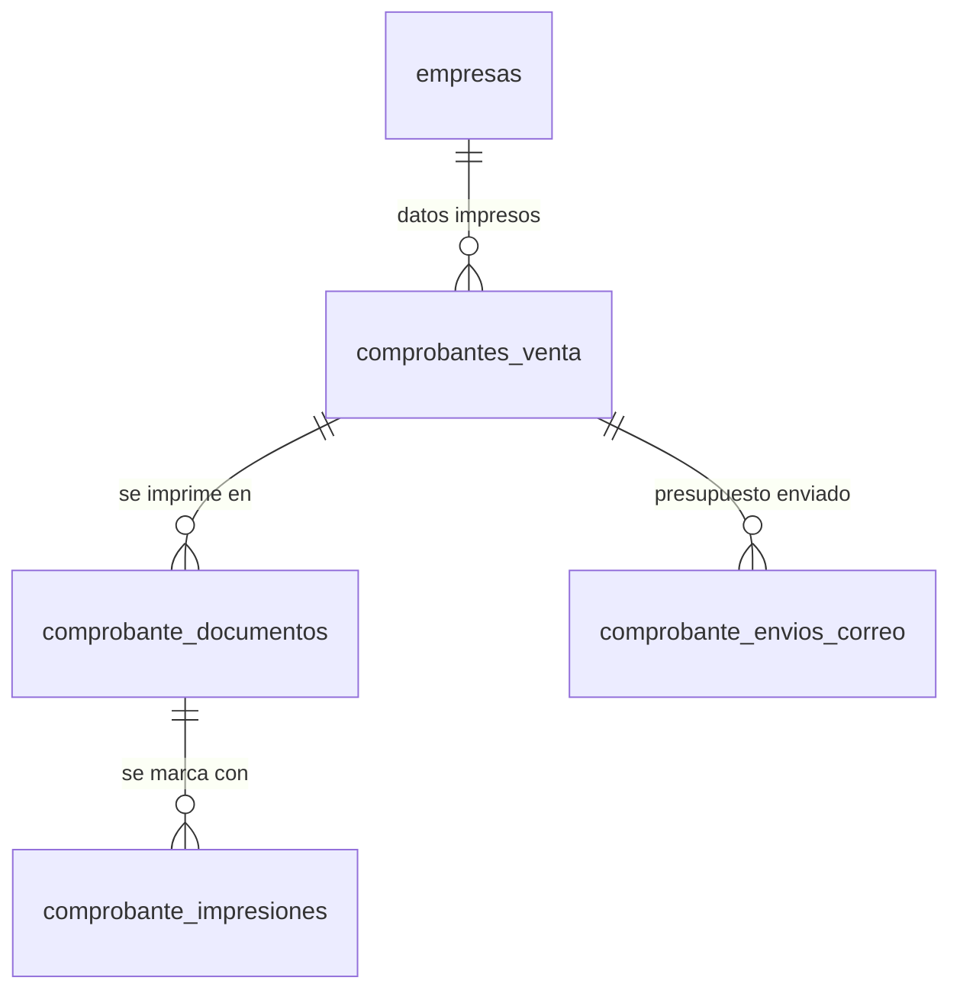

# Ventas impresión: datos, worker y flujos (MSF-213)

Épica MSF-213 (F-VTA-19/20/21, cierre MSF-565). Spec: `specs/20261024-100000-ventas-impresion/`
(`spec.md`, `plan.md`, `tasks.md`, `contracts/ventas-impresion.md`). Mergeada por la PR #380 (commit
`58452852`); documento de la épica: `docs/ventas-impresion.md` en ese commit. Producto:
[Ventas impresión](../producto/ventas-impresion.md).

## Datos (Principio VII)

| Objeto | Esquema | Migración |
|---|---|---|
| `dominio.empresas` + `razon_social`, `cuit` (11 dígitos) | `dominio` | `20261211120000_empresas_razon_social_cuit.sql` |
| `public.clientes.condicion_iva` (texto, tope 60) | `public` | `20261211120050_clientes_condicion_iva.sql` |
| `dominio.comprobante_documentos` (`pendiente`/`generado`/`fallido`) + bucket privado `comprobantes-documentos` | `dominio` / Storage | `20261211120100_comprobante_documentos.sql` |
| Funciones `private.*` del worker | `private` | `20261211120200_documento_funciones_worker.sql` |
| RPC de documentos | `public` | `20261211120300_documento_rpc.sql` |
| `dominio.comprobante_impresiones` (append-only, trigger) | `dominio` | `20261211130100_comprobante_impresiones.sql` |
| `registrar_impresion`, `ultimas_impresiones_comprobante` | `public` | `20261211130200_registrar_impresion.sql` |
| `solicitar_documento_comprobante` con `presupuesto` | `public` | `20261212100100_solicitar_documento_presupuesto.sql` |
| `dominio.comprobante_envios_correo` | `dominio` | `20261212100200_comprobante_envios_correo.sql` |
| `enviar_presupuesto_correo`, `listar_envios_correo_presupuesto` | `public` | `20261212100300_enviar_presupuesto_correo.sql` |

Todas las tablas tienen RLS por organización y `ventas` en la empresa del documento, sin escritura directa
para `authenticated` ni acceso para `anon`. Todas son aditivas; la reversión está en el encabezado de cada
migración y en `docs/ventas-impresion.md` (commit `58452852`).

## API

RPC `security definer`, `search_path = ''`, `revoke … from public, anon`, `grant execute … to authenticated`:
`solicitar_documento_comprobante(comprobante, tipo)` (`factura`/`remito`/`presupuesto`, idempotente),
`obtener_documento_comprobante`, `listar_documentos_comprobante`, `registrar_impresion`,
`ultimas_impresiones_comprobante`, `enviar_presupuesto_correo` (exige `edicion`) y
`listar_envios_correo_presupuesto`. Las funciones del worker y de Kestra viven en `private` y solo las
ejecutan `workers_orquestacion` / `kestra_orquestacion`.

## Flujo

1. La RPC crea el pedido, una ejecución `manual` y su orden en la outbox
   (`generar-documento-venta-<tipo>-<documento>`).
2. El flow `infra/kestra/flows/comprobantes-documentos.yml` corre cada minuto, reclama hasta 5 órdenes y
   lanza `workers/comprobantes-pdf` por SSH (plantillas `factura.ts`, `remito.ts`, `presupuesto.ts`; PDF A4;
   sube a Storage y cierra el pedido). Falla no reintentable: código de salida 78.
3. La pantalla consulta cada 1,5 s hasta 90 s; luego ofrece «Reintentar». El navegador abre el PDF con una URL
   firmada de 5 minutos y la impresión se registra antes de abrirlo.
4. Correo: `infra/kestra/flows/comprobantes-correo.yml` reclama `enviar-presupuesto-correo-*`, baja el PDF y lo
   envía por el SMTP de Kestra (entrega «al menos una vez»); un pendiente pasa a `fallido` a los 15 min.

## Configuración y operación

- Por organización: servidor SSH, conexión `comprobantes-pdf` (`public.crear_conexion`), `worker.env` y red
  `worker-egress-comprobantes-pdf`.
- Variables en `infra/kestra/.env.example`: `COMPROBANTES_STORAGE_URL`, `SECRET_COMPROBANTES_STORAGE_KEY`
  (clave de servicio, solo servidor), `COMPROBANTES_PDF_IMAGEN`; remitente global `KESTRA_SMTP_FROM`.
- Front: `apps/web/src/lib/ventasImpresion.ts`, `ventasImpresiones.ts`, `ventasPresupuestoCorreo.ts`,
  `components/ventas/ImprimirComprobanteDialog.tsx`, `DocumentosComprobante.tsx`, `pages/ventas/comprobante.tsx`
  y `presupuestos.tsx`.

## Verificación

`pnpm test:db` (`ventas_impresion_documentos|marcas|presupuesto.test.sql`), `pnpm --filter @workers/comprobantes-pdf test`,
`pnpm test:kestra:comprobantes`, `pnpm --filter @platform/web test` y el E2E
`apps/web/e2e/ventas-impresion.e2e.ts`.

## Deuda y riesgos abiertos

- Riesgo residual aceptado: worker y flow de correo usan la clave de servicio de Supabase para Storage; una
  credencial acotada al bucket la reemplazaría sin cambiar el contrato. TODO (dueño: plataforma).
- `public.capacidades_ejecucion` crece una fila por documento sin limpieza (deuda de retención del ciclo de
  workers). TODO (dueño: plataforma).
- `condicion_iva` es texto libre: cerrar valores al agregar su edición. TODO (dueño: ventas).
- Formato de documentos, asunto y cuerpo del correo: provisorios hasta confirmar con el cliente.
