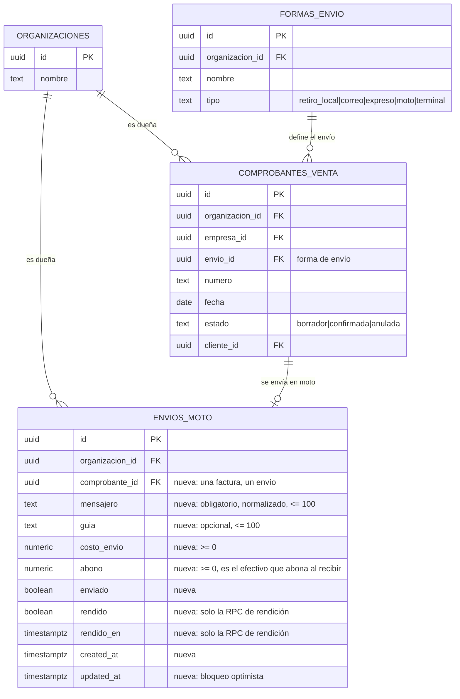

# Ventas · envíos en moto y su rendición (técnico, MSF-145)

Implementación de la épica **MSF-145 · Ventas y despacho · Ventas motos** (spec
`specs/20261024-130000-ventas-motos/`: `spec.md`, `plan.md`, `tasks.md` y
`contracts/ventas-motos.md`). Historias: **F-VTA-24** (registro de envíos en moto) y **F-VTA-25** (rendición de
motos).

**Rama:** `epic/MSF-145-ventas-y-despacho-ventas-motos` (PR #825; su merge `1a70e946` quedó encadenado sobre el
merge de MSF-450, así que **la épica todavía no llega a `main`**). Commits de la épica: `42e78eb0` (feat de F-VTA-24
y F-VTA-25), `76a3362a` (guía y cierre de tareas), `6c6f9ee9` (renumeración de las migraciones a `20270222*` al
integrar `dokploy`), `a0134d06` (contexto vigente del superadmin y exportación total) y `bddf381d` (merge de
`dokploy`).

!!! note "Estado"
    Implementada en la rama de la épica y **pendiente de merge a `main`**. Las tareas de las dos historias y del
    cierre quedaron `[x]`. **No hay E2E automatizado** de esta pantalla: la cobertura es de pgTAP y Vitest.

**Alcance de entrega:** `refine` (`apps/web`) y `supabase` (migraciones, RPC y pgTAP). Sin `kestra`, `superset` ni
`workers`. La épica **no altera** tablas existentes: crea una en `dominio` y usa los helpers de permisos de MSF-121.

Resumen de producto: [Mensajería propia: registrar los envíos en moto y su rendición](../producto/ventas-motos.md).

## Modelo de datos (Principio VII)

Una tabla nueva en `dominio`: **ninguna tabla existente cambia de esquema**. Lo único que se altera fuera de
`dominio` es la lista de la exportación total (MSF-224), que es una función.

| Tabla | Estado | Cambio |
|---|---|---|
| `dominio.envios_moto` | **nueva** | Un envío en moto por comprobante de venta: `mensajero` (texto libre, obligatorio, normalizado), `guia` (opcional), `costo_envio` y `abono` (`numeric(14,2)`, no nulos, `>= 0`), `enviado`, `rendido`, `rendido_en`, `created_at` y `updated_at`. FK compuesta `(comprobante_id, organizacion_id)` a `dominio.comprobantes_venta`, `unique (organizacion_id, comprobante_id)`, `check` de coherencia de `rendido`/`rendido_en` e índices por `(organizacion_id, lower(mensajero))` y `(organizacion_id, rendido, created_at desc)` |
| `dominio.comprobantes_venta` | existente | Solo se referencia con FK compuesta; sin cambios de esquema |
| `dominio.formas_envio` | existente | Solo se lee: `tipo = 'moto'` define la elegibilidad del comprobante |
| `public.registro_actividad` | existente | Recibe `envio_moto.registrado`, `envio_moto.actualizado` y `envio_moto.rendido`; sin cambios de esquema |
| `private.normalizar_mensajero(text)` | **nueva** | `immutable`, `security definer`, `search_path = ''`: recorta los espacios sobrantes y colapsa los repetidos. Solo la llaman las RPC |
| `private.puede_registrar_envio_moto_en_empresa(uuid)` | **nueva** | Permiso de escritura por empresa: sección `ventas` en `edicion` **y** rol efectivo `operador` o `administrador` (o superadmin con contexto vigente) |
| `private.puede_rendir_envio_moto_en_empresa(uuid)` | **nueva** | Permiso de rendición por empresa: sección `ventas` en `edicion` **y** rol efectivo `administrador` (o superadmin con contexto vigente) |

- **La empresa del envío es la de su comprobante**: `envios_moto` no repite `empresa_id`.
- **`rendido` y `rendido_en` solo los escribe `public.rendir_envios_moto`.** Ninguna otra RPC ni una actualización
  directa los tocan.
- **Sin escritura directa ni `delete`**: la tabla nace con `revoke all … from public, anon, authenticated` y
  `grant select … to authenticated`. Escriben solo las RPC `security definer`.
- **RLS de lectura** (`envios_moto_select`): organización de la sesión, empresa del comprobante dentro de
  `private.empresas_accesibles()` y sección `ventas` en `lectura` o `edicion`. `anon` sin privilegios.
- **Sin migración de histórico:** la tabla nace vacía; no se backfillean comprobantes ni envíos.

Migraciones (en la rama de la épica; los números `20261205…` de `tasks.md` se renumeraron al integrar `dokploy`,
commit `6c6f9ee9`):

| Migración | Qué hace |
|---|---|
| `supabase/migrations/20270222200100_envios_moto.sql` | Tabla, `private.normalizar_mensajero`, índices, RLS y grants |
| `supabase/migrations/20270222200200_envios_moto_rpc.sql` | RPC de F-VTA-24 y helpers de permisos por empresa |
| `supabase/migrations/20270222300100_rendir_envios_moto.sql` | RPC de F-VTA-25 |
| `supabase/migrations/20270222300200_exportacion_total_envios_moto.sql` | Agrega `dominio.envios_moto` a `private.conjuntos_exportacion_total()` (MSF-224): es dato de negocio de la organización y se exporta |

## Permisos

- **Ver la pestaña y listar:** sección `ventas` en `lectura` o `edicion`. Sin ella, «Acceso restringido».
- **Registrar, editar y marcar «Enviado»:** sección `ventas` en `edicion` **y** rol efectivo **Operador** o
  **Administrador** en la empresa del envío. La base responde `42501` si falta.
- **Rendir:** solo **Administrador** (o superadmin con organización activa). `42501` para Operador y Consulta.
- **Consulta** es solo lectura: el servidor rechaza la escritura aunque la interfaz la muestre.
- El permiso se resuelve con el **rol efectivo de la empresa** (no con la suma de los roles del usuario): quien es
  Operador en la tienda A no hereda el permiso en la B.

## RPC

Todas en `public`, `security definer`, `set search_path = ''`, con `revoke execute … from public, anon` y
`grant execute … to authenticated`. La organización sale de `private.organizacion_id()` y el actor de `auth.uid()`:
**nunca de un argumento**.

| RPC | Devuelve / hace |
|---|---|
| `registrar_envio_moto(p_comprobante_id uuid, p_mensajero text, p_guia text, p_costo_envio numeric, p_abono numeric, p_enviado boolean)` | Alta del envío de una factura elegible. Solo facturas no anuladas con forma de envío de tipo `moto` de la misma empresa; un envío por comprobante; `mensajero` no vacío; `costo_envio`/`abono >= 0`. **Nunca** escribe `rendido` ni `rendido_en` |
| `actualizar_envio_moto(p_id uuid, p_mensajero text, p_guia text, p_costo_envio numeric, p_abono numeric, p_enviado boolean, p_actualizado_en timestamptz)` | Edición con **bloqueo optimista** (`40001` ante conflicto). Un envío rendido es de solo lectura (`55000`). Nunca escribe `rendido` ni `rendido_en` |
| `comprobantes_para_envio_moto(p_empresa_id uuid, p_busqueda text)` | Facturas elegibles sin envío registrado (búsqueda por número o cliente, hasta 50 filas) |
| `listar_envios_moto(p_empresa_id uuid, p_pagina integer, p_tamano integer)` | Listado de más reciente a más antigua, con `puede_editar` y `puede_rendir` por fila y el total (`filas`) para la paginación en servidor |
| `rendir_envios_moto(p_ids uuid[])` | Rinde uno o varios envíos **enviados y no rendidos**, de un **mismo mensajero**. Todo o nada, idempotente. Devuelve `{ cantidad, mensajero, total_abono, total_costo, neto }` |
| `resumen_motos_sin_rendir(p_empresa_id uuid)` | `monto` (suma del `abono` de lo no rendido con abono > 0) y `entregas` (la cantidad), con filtro opcional de tienda |

**Errores** (con mensaje en castellano): `42501` permiso · `22023` dato inválido · `23505` duplicado · `40001`
conflicto de edición · `55000` envío rendido (solo lectura) · `P0002` no existe.

**Reglas de la rendición (decisiones de producto 2 y 4):**

- El **total a rendir es la suma del `abono`** (el efectivo cobrado). El `costo_envio` se muestra aparte y el neto
  (`abono − costo`) es informativo: **nada se resta del total**.
- La comparación de mensajeros **ignora mayúsculas y espacios sobrantes**: «Juan» y «juan » son el mismo mensajero.
- El lote es **todo o nada**: un id inexistente, de otra organización, no enviado o de un mensajero distinto aborta
  todo (`22023`/`42501`).
- Es **idempotente**: los ids ya rendidos se ignoran (no cambian, no cuentan para la regla de un solo mensajero y no
  duplican el evento). Si todos ya estaban rendidos, devuelve `cantidad` 0 y totales 0.
- **La reversión queda fuera de alcance:** una entrega rendida es de solo lectura.

## Pantalla

Ruta `/ventas/transportes`, pestaña **Motos** (`?pestana=motos`), entre **Contrarreembolsos** (la que abre por
defecto) y **Terminales de retiro**. El título de la pantalla («Transportes y contrarreembolsos») y su subtítulo
**no son de esta épica** (los define la historia de contrarreembolsos): MSF-145 solo suma la pestaña Motos y su
texto de ayuda.

- **Control segmentado** (`PESTANAS` en `list.tsx`) con la ayuda «Mensajería propia: se rinde el efectivo cobrado y
  el costo del envío.».
- **Filtro Tienda** (`FiltroEmpresa`): comparte el de Contrarreembolsos, que sigue a la empresa activa de la barra
  superior. «Terminales de retiro» conserva su filtro propio.
- **Tarjeta «Motos sin rendir»** arriba de la tabla: el monto y la cantidad de entregas sin rendir (con abono > 0).
- **Tabla** (`TransportesMotos.tsx`): Fecha (dd/mm), Tienda, Comprobante (enlace), Cliente, Mensajero, Guía,
  Costo de envío, Abona al recibir («—» si es 0), Enviado (etiqueta «Enviado» / «Por enviar») y Rendido (llave
  `role="switch"`). Carga infinita de a 25 (`useListadoAcumulado` + `CargaInfinita`).
- **Acciones:** «Registrar envío» (si `ventas` está en edición), «Editar» por fila (según `puede_editar`) y «Rendir
  seleccionados» con casillas solo en las filas que `puede_rendir`.
- **Diálogos:** `EnvioMotoDialog` (registro y edición) y `RendicionMotosDialog` (confirmación del lote con
  cantidad, efectivo cobrado, costo de envíos, total a rendir y neto). Los dos usan los componentes del kit; **no
  están dibujados en el prototipo** (decisión abierta de detalle 1 de la spec).

**Empresa activa (Principio VIII, FR-007 y FR-025):** al cambiar la empresa activa la pestaña invalida y recarga
**todas** sus consultas (listado y tarjeta), vuelve a la primera tanda, descarta la selección y cierra con aviso
cualquier diálogo abierto: «Cambió la empresa activa: cerramos el diálogo y descartamos la selección para no
mezclar datos de dos tiendas.». El cambio de tienda en el filtro también descarta la selección.

Archivos: `apps/web/src/pages/ventas/transportes/list.tsx` (pestañas y filtro),
`apps/web/src/pages/ventas/transportes/TransportesMotos.tsx` (tabla, tarjeta y acciones),
`apps/web/src/components/ventas/EnvioMotoDialog.tsx`, `apps/web/src/components/ventas/RendicionMotosDialog.tsx`,
`apps/web/src/lib/ventas/enviosMoto.ts` (contrato y validación de F-VTA-24) y
`apps/web/src/lib/ventas/enviosMotoRendicion.ts` (totales y rendición de F-VTA-25).

## Guía de prueba

### Prerrequisitos

- **Local:** `pnpm dev:supabase` (aplica `supabase/seed.sql`) y la web servida (`pnpm dev:refine:host`).
- **Base:** hace falta una **forma de envío de tipo «moto»** activa (`dominio.formas_envio.tipo = 'moto'`, MSF-139) y
  **facturas** (no presupuestos) de la misma empresa con esa forma de envío. Sin esa forma, la pestaña queda vacía y
  el selector de comprobantes no ofrece nada.
- **Persona:** hace falta un **Administrador** (para registrar y para rendir) y, para comprobar los límites, un
  **Operador** (registra y marca enviado, pero no rinde) y un **Consulta** (solo mira).
- **Dataset:** `pnpm demo:dataset` no existe en este repo; el `supabase/seed.sql` de la rama de la épica es la
  fuente de datos de desarrollo.

### Pasos (a mano)

1. Entrá a **Ventas → Transportes** y abrí la pestaña **Motos**. **Se ve** la tarjeta **«Motos sin rendir»** (con
   «—» o $ 0 si no hay nada pendiente), el filtro **Tienda** y la tabla de envíos.
2. Hacé clic en **Registrar envío**. **Se ve** la ventana con **Comprobante** (con el texto «Solo facturas con forma
   de envío «Moto» que todavía no tienen envío.»), **Mensajero**, **Guía** (con «Opcional.»), **Costo de envío**,
   **Abona al recibir** (con «Lo que el cliente paga en efectivo al recibir.») e **Enviado**.
3. Elegí una factura elegible y completá **Mensajero** = `Juan Perez`, **Costo de envío** = `3500`, **Abona al
   recibir** = `15000`, activá **Enviado** y confirmá. **Se ve** el aviso **«Envío registrado»** y la fila aparece en
   la tabla con «Enviado» y los importes.
4. Registrá un segundo envío del **mismo** mensajero, con **Costo de envío** = `0` y **Abona al recibir** = `20000`, y
   marcá **Enviado**. **Se ve** la etiqueta «Enviado» en esa fila.
5. Registrá un tercer envío del mismo mensajero con **Abona al recibir** = `5000` y **dejalo sin** marcar como
   enviado. **Se ve** la etiqueta «Por enviar» en esa fila.
6. Abrí **Registrar envío**, poné **Mensajero** vacío y confirmá. **Se ve** «Escribí el nombre del mensajero.» y
   **no** se crea nada.
7. Poné **Costo de envío** = `-100` y confirmá. **Se ve** «El costo de envío debe ser un importe de 0 en adelante,
   con hasta dos decimales.» y **no** se crea nada.
8. Volvé a registrar un envío para la misma factura del paso 3. **Se ve** «Ese comprobante ya tiene un envío en moto
   registrado.» y **no** se crea nada.
9. Con el envío del paso 5 (sin marcar como enviado), activá la llave de **Rendido** de esa fila. **Se ve** que la
   llave está deshabilitada y, si se fuerza, el aviso «Solo se rinden los envíos ya enviados: hay 1 sin marcar como
   enviado, no se rindió ninguno».
10. Entrá con un usuario **Operador**. **Se ve** el botón **Registrar envío** y **Editar** en las filas, pero **no**
    aparecen las casillas de selección ni el botón **Rendir seleccionados**, y la llave de **Rendido** está
    deshabilitada.
11. Entrá con un usuario **Consulta**. **Se ve** la lista, **sin** **Registrar envío**, **sin** **Editar**, **sin**
    casillas ni **Rendir seleccionados**, y con la llave de **Rendido** deshabilitada.
12. Como Administrador, marcá la casilla del envío del paso 3 y la del paso 4 (los dos enviados) y dejá fuera el del
    paso 5. Hacé clic en **Rendir seleccionados**. **Se ve** la ventana **Rendir entregas** con **Mensajero** =
    «Juan Perez», **Entregas** = 2, **Efectivo cobrado** = $ 35.000,00, **Costo de envíos** = $ 3.500,00, **Total a
    rendir** = $ 35.000,00 y **Neto** = $ 31.500,00.
13. Confirmá. **Se ve** el aviso **«Entrega rendida»** con la cantidad y el total; las dos filas quedan con la llave
    encendida y la tarjeta **«Motos sin rendir»** se recalcula.
14. Volvé a intentar rendir las mismas entregas. **Se ve** el aviso «Esas entregas ya estaban rendidas.» y nada
    cambia.
15. Editá una entrega rendida. **Se ve** que el botón **Editar** está deshabilitado y, si se fuerza, el aviso «El
    envío ya está rendido: es de solo lectura y no se puede modificar.»
16. Cambiá la empresa activa en la barra superior con el diálogo abierto. **Se ve** el aviso «Cambió la empresa
    activa: cerramos el diálogo y descartamos la selección para no mezclar datos de dos tiendas.»; el diálogo se
    cierra, la lista vuelve a la primera tanda y no quedan filas de la tienda anterior.

### Resultado esperado

- **Given** una factura con forma de envío «Moto» sin envío registrado, **When** el Operador o el Administrador
  completa **Registrar envío** con mensajero no vacío y importes `>= 0`, **Then** aparece en la tabla con «Por enviar»
  (o «Enviado») y sus importes.
- **Given** un comprobante que no es una factura, o cuya forma de envío no es «moto», o que ya tiene envío,
  **When** se intenta registrar, **Then** la base lo rechaza (`22023`/`23505`) y no se crea nada.
- **Given** un mensajero vacío o solo espacios, **Then** la interfaz lo marca y la base responde `22023`.
- **Given** un envío cargado, **When** se edita, **Then** se guarda con bloqueo optimista: dos ediciones simultáneas
  devuelven `40001` y no se pisan.
- **Given** un usuario con `ventas` solo en lectura, **Then** ve la lista pero no registra ni edita; la base rechaza
  la escritura (`42501`).
- **Given** un envío enviado y no rendido, **When** el Administrador activa la llave «Rendido», **Then** queda
  rendido con su fecha y el aviso «Entrega rendida»; la llave ya no se apaga y **no** existe «Rendición revertida».
- **Given** varios envíos del mismo mensajero, enviados y no rendidos, **When** se confirma «Rendir seleccionados»,
  **Then** el total a rendir es la **suma del abono**, el costo va aparte, el neto es informativo y **todos** quedan
  rendidos o **ninguno**.
- **Given** una selección con mensajeros distintos (aunque difieran en mayúsculas o espacios), **Then** la
  confirmación se bloquea, la base responde `22023` y no se rinde ninguno.
- **Given** que se rinde dos veces el mismo envío, **Then** la segunda no cambia nada (idempotente, sin evento
  duplicado).
- **Given** la tarjeta «Motos sin rendir», **When** se rinde un envío, **Then** el monto y la cantidad de entregas
  se recalculan.
- **Given** que cambia la empresa activa con un diálogo abierto, **Then** se recarga todo, vuelve a la primera tanda,
  se descarta la selección y el diálogo se cierra con aviso.

### Cómo automatizarlo

| Recorrido | Rótulo | Prueba |
|---|---|---|
| Tabla `dominio.envios_moto` (columnas, `check`s, FK compuesta, único por comprobante, índices), RLS por organización y empresa accesible, sin escritura directa ni `delete`, `anon` sin privilegios, `registrar_envio_moto` (alta válida, presupuesto, forma de envío distinta, anulada, empresa ajena, duplicado, mensajero vacío, importes negativos), `actualizar_envio_moto` (edición, `40001`, `55000`, `rendido`/`rendido_en` intactos), `comprobantes_para_envio_moto`, `listar_envios_moto`, permisos (`42501` para Mostrador, Consulta, sin `ventas` y `anon`) y eventos `envio_moto.registrado`/`actualizado` | `[MSF-145:T003]` | pgTAP `supabase/tests/database/ventas_motos_registro.test.sql` (`no_plan()`) |
| Pantalla de F-VTA-24: pestañas, `?pestana=motos`, columnas y formatos (dd/mm, dos decimales, «—»), chips «Enviado»/«Por enviar», estados de carga/vacío/error, botones por rol, **cambio de empresa activa** y accesibilidad a 320/768/1440 px | `[MSF-145:T009]` | Vitest `apps/web/src/pages/ventas/transportes/TransportesMotos.test.tsx` y `apps/web/src/components/ventas/EnvioMotoDialog.test.tsx` |
| `rendir_envios_moto` (rendir, no enviado rechazado, idempotencia sin evento nuevo, `42501` para Operador y Consulta, lote todo o nada con id ajeno, inexistente o mezcla de mensajeros, totales = suma del abono, `rendido_en` escrito solo por la RPC), `resumen_motos_sin_rendir` (suma, cantidad, filtro por empresa) y el evento `envio_moto.rendido` | `[MSF-145:T012]` | pgTAP `supabase/tests/database/ventas_motos_rendicion.test.sql` |
| Llave de rendición y aviso «Entrega rendida», casillas y «seleccionar todo», totales del diálogo, bloqueo por mensajeros mezclados, tarjeta «Motos sin rendir» y descarte de la selección al cambiar de empresa | `[MSF-145:T017]` | Vitest `apps/web/src/components/ventas/RendicionMotosDialog.test.tsx` y `apps/web/src/pages/ventas/transportes/TransportesMotos.test.tsx` |
| Inventario del prototipo y matriz pantalla↔criterios al día | `[MSF-145:T010]` y `[MSF-145:T018]` | `pnpm prototipo:check` y `pnpm matriz:check` |
| Recorrido completo en el navegador (registrar, editar, marcar enviado, rindir de a una y en lote, y los tres límites de rol) | `[MSF-145:E2E]` | **Pendiente**: no existe `apps/web/e2e/ventas-motos.e2e.ts`. Es el E2E que falta para cerrar la épica |

Los rótulos siguen la numeración de `tasks.md` de la spec (`T001`–`T021`). `[MSF-145:E2E]` es un rótulo nuevo, propuesto
para el E2E que la épica todavía no tiene.

## Pruebas

| Tipo | Archivos |
|---|---|
| pgTAP | `supabase/tests/database/ventas_motos_registro.test.sql`, `supabase/tests/database/ventas_motos_rendicion.test.sql` |
| Vitest | `apps/web/src/pages/ventas/transportes/TransportesMotos.test.tsx`, `apps/web/src/components/ventas/EnvioMotoDialog.test.tsx`, `apps/web/src/components/ventas/RendicionMotosDialog.test.tsx` |
| E2E | **No hay** (ver la guía de prueba) |
| Prototipo | `design/pantallas/VentasTransportes.dc.html` y `VentasTransportes.inventory.json` (solo lectura: la épica usa la pestaña Motos y la tarjeta «Motos sin rendir») |

## Seguridad

Revisada por un agente independiente (técnica + seguridad) sobre el commit final de la épica:

- **RLS por organización y empresa accesible**, sección `ventas` en `lectura`/`edicion`; `anon` sin privilegios.
- **Sin escritura directa ni `delete`**: la tabla solo tiene `grant select` para `authenticated`.
- **RPC `security definer` con `search_path = ''`**, `revoke execute … from public, anon` y
  `grant execute … to authenticated`.
- **El actor y la organización salen de la sesión** (`auth.uid()`, `private.organizacion_id()`), nunca de un
  argumento: no hay paso de organización por parámetro.
- **El permiso se resuelve por empresa** con el rol efectivo (`private.rol_en_empresa`), no con la suma de roles.
- **`rendido`/`rendido_en` solo los escribe `rendir_envios_moto`**: ninguna otra ruta los toca.

## Reversión

Las migraciones son **aditivas** y llevan su reversión en el encabezado (`drop function …` y
`drop table if exists dominio.envios_moto`). **No se ejecuta en este PR**: antes de revertir hay que **exportar los
envíos ya cargados** (la tabla entra en la exportación total de MSF-224). A nivel de épica, el cierre es un merge
commit: `git revert -m 1 <hash>` deshace la épica completa.

## Fuera de alcance y pendientes

- **La reversión de una rendición no entra** (decisiones de producto 4): una entrega rendida es de solo lectura y no
  hay «Rendición revertida».
- **La visibilidad en el tablero de Despacho no entra**: la pertenencia de la épica (decisión de producto 3) es que
  el envío «queda registrado y consultable en la pestaña Motos». La pantalla de Despacho es de MSF-135.
- **La carga del costo y la rendición en lote no están dibujadas en el prototipo**: se implementaron con los
  componentes del kit («Registrar envío» + diálogo, casillas + «Rendir seleccionados» + diálogo de totales).
  Diferencia anotada en el PR de la épica.
- **El prototipo redondea a pesos enteros**; la pantalla usa **dos decimales** como el resto de Ventas.
- **La tarjeta del prototipo suma sobre todas las tiendas**; la pantalla respeta el filtro **Tienda** activo.
- **Desactivar la llave «Rendido»** (revertir) es visible en el prototipo y **queda fuera de alcance**.
- **Sin E2E**: falta `apps/web/e2e/ventas-motos.e2e.ts` (rótulo propuesto `[MSF-145:E2E]`).
- **TODO (dueño: Documentador, tras el merge de la épica en `main`):** generar las capturas del manual para la
  pestaña Motos (tarjeta «Motos sin rendir», tabla con la columna Rendido, ventana «Registrar envío en moto» y
  ventana «Rendir entregas») en `docs/producto/img/ventas-motos/`. La herramienta de capturas del manual
  (`pnpm docs:capturas`, `apps/web/e2e/capturas/` y `pnpm demo:dataset`) **no existe en este repo**: lo más cercano
  es `pnpm --filter @platform/web pantallas:capturar`. Hasta entonces la página de producto describe el
  comportamiento **sin imágenes nuevas**: no se inventó ninguna. La captura actual
  `docs/producto/img/ventas-transportes/01-transportes.png` es anterior a la pestaña Motos y hay que regenerarla.
- **TODO (dueño: responsable de la épica):** la guía de la propia épica (`docs/ventas-motos.md`) y la nota de
  `docs/ventas-transportes.md` viven en la rama de la épica y usar el layout viejo de `docs/` (sin `owner` ni
  `sources` en el frontmatter). Cuando la épica se promueva a `main` hay que migrarlas al layout `docs/producto/` +
  `docs/tecnico/` o, al menos, darles el frontmatter que exige `pnpm docs:manifest`.

## Ver también

- [Ventas · envíos en moto y su rendición (manual de usuario)](../producto/ventas-motos.md) — el paso a paso.
- [API y RPC](api.md) — el contrato de las seis RPC de la épica.
- [Datos y DER](datos.md) — el modelo completo del esquema `dominio`.
- [Ventas · despacho y faltantes](ventas-despacho-y-faltantes.md) — la pantalla de Despacho (MSF-135).
- [Ventas · comprobantes](ventas-comprobantes.md) — las facturas a las que se les registra el envío (MSF-159).
- [Ventas · catálogos de cobro y envío](ventas-catalogos.md) — las formas de envío de tipo «moto» (MSF-139).
- [Permisos por empresa](permisos-por-empresa.md) — el rol efectivo que decide qué puede hacer cada persona.
