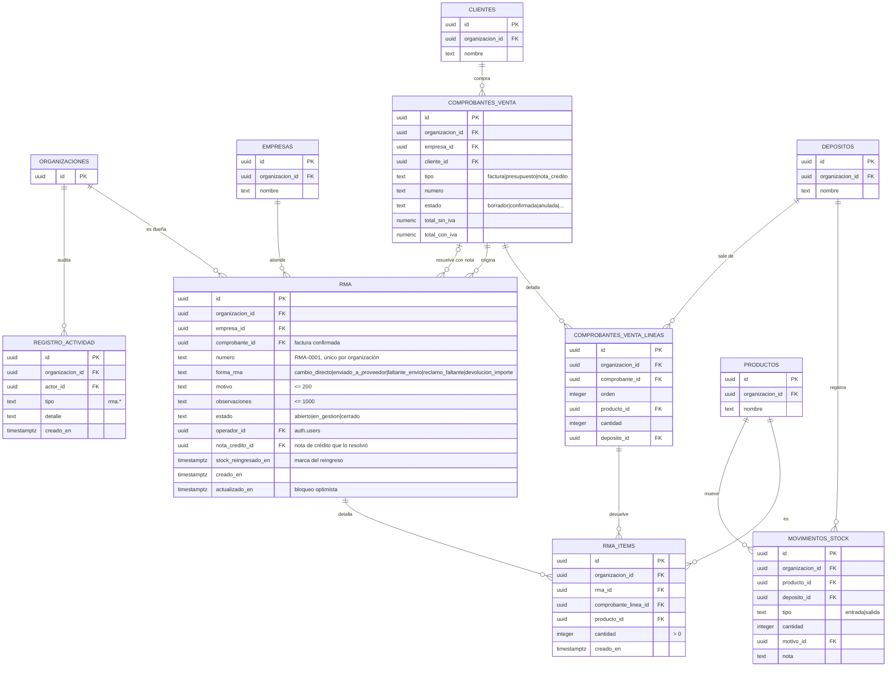
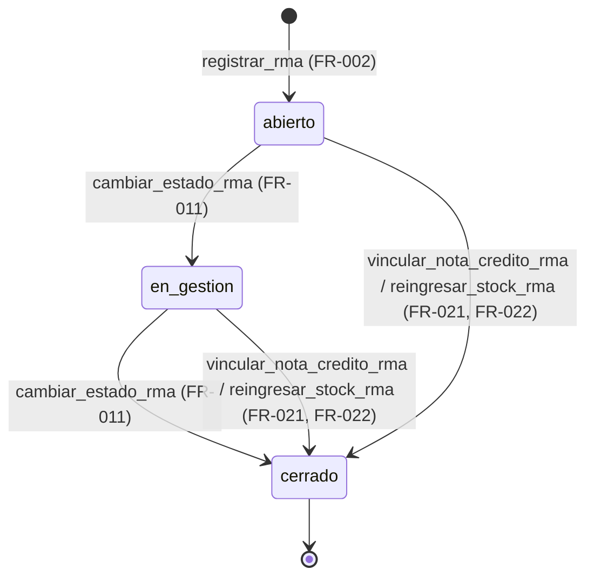

# Ventas · devoluciones (RMA), técnico (MSF-178)

Contratos, datos y operación de la épica MSF-178: F-VTA-28 (alta de RMA por ítem, MSF-288), F-VTA-29
(formas de resolución y seguimiento, MSF-304) y F-VTA-30 (RMA con nota de crédito y stock, MSF-320). Spec:
`specs/20261027-100000-ventas-rma-devoluciones/`. Rama:
`epic/MSF-178-ventas-y-despacho-ventas-rma-devolucione`, **pendiente de merge a `main`**.
Explicación de producto: [Ventas · devoluciones (RMA)](../producto/ventas-rma-devoluciones.md).

**Delivery scope:** `refine` (`apps/web`) y `supabase` (migraciones, RPC y pgTAP). Sin `kestra`, `superset`
ni `workers`: la nota de crédito y el reingreso son síncronos.

## Migraciones

Todas **aditivas** y con la reversión en el encabezado. Las versiones son `20270113100000`…
`20270113120300`: la numeración propuesta por la spec (`20261213100000`…) ya estaba usada por otras
historias y el guard de migraciones exige una versión libre **mayor** que la máxima aplicada
(`20270112150000`); el motivo está en el encabezado de `20270113100000_rma_tablas.sql`.

| Migración | Qué hace |
|---|---|
| `20270113100000_rma_tablas.sql` | Crea `dominio.rma` y `dominio.rma_items`, sus `check`, FKs compuestas, índices, RLS y grants de solo lectura; agrega el índice único `comprobantes_venta_lineas_id_org_uq` para la FK compuesta a la línea (FR-001). |
| `20270113100100_registrar_rma.sql` | `public.registrar_rma`: alta transaccional, numeración `RMA-####`, tope por línea y evento `rma.registrada` (FR-002). |
| `20270113100200_listar_rma.sql` | `public.listar_rma` (`security invoker`) y el puente `private.listar_rma_sesion` (`security definer`) (FR-006). |
| `20270113110000_cambiar_estado_rma.sql` | `public.cambiar_estado_rma`: transición lineal, bloqueo optimista, idempotencia y evento `rma.estado_cambiado` (FR-011). |
| `20270113110100_listar_rma_actualizado_en.sql` | Recrea `listar_rma` para devolver `actualizado_en`, el sello del bloqueo optimista (FR-010, FR-012). |
| `20270113120000_rma_nota_credito_id.sql` | Agrega `rma.nota_credito_id` (FK compuesta a la nota) y `rma.stock_reingresado_en` (marcador del reingreso) (FR-020). |
| `20270113120100_vincular_nota_credito_rma.sql` | `public.vincular_nota_credito_rma`: emite y vincula la nota reutilizando `emitir_nota_credito`, cierra el RMA y deja `rma.nota_credito_vinculada` (FR-021). |
| `20270113120200_reingresar_stock_rma.sql` | `public.reingresar_stock_rma`: una entrada por ítem con `registrar_movimiento_stock`, cierra el RMA y deja `rma.stock_reingresado` (FR-022). |
| `20270113120300_listar_rma_vinculo.sql` | Recrea `listar_rma` para devolver `nota_credito_id`, `nota_credito_numero` y `stock_reingresado` (FR-023). |

## Modelo de datos (DER)

Dos tablas **nuevas** en `dominio` y ninguna columna nueva en las tablas existentes. `comprobantes_venta`
y `comprobantes_venta_lineas` solo se leen; la línea recibe un **índice** único para la FK compuesta, sin
cambio de estructura. `movimientos_stock` y `registro_actividad` se escriben por las funciones que ya
existen.

| Tabla | Estado | Cambio |
|---|---|---|
| `dominio.rma` | **nueva** | Cabecera del RMA: organización, empresa, comprobante, `numero` (`RMA-####`, único por organización), `forma_rma`, `motivo` (≤ 200), `observaciones` (≤ 1000), `estado` (`abierto` \| `en_gestion` \| `cerrado`, por defecto `abierto`), `operador_id`, `creado_en`, `actualizado_en`; desde F-VTA-30, `nota_credito_id` (FK compuesta a `comprobantes_venta`, nullable) y `stock_reingresado_en` (nullable). FK compuestas a organización, empresa y comprobante. |
| `dominio.rma_items` | **nueva** | Ítem del RMA: `organizacion_id`, `rma_id`, `comprobante_linea_id`, `producto_id`, `cantidad > 0`, `creado_en`; único `(rma_id, comprobante_linea_id)` y FK compuestas a `rma` (`on delete cascade`), línea y producto. |
| `dominio.comprobantes_venta` | existente | Sin cambio de esquema: se lee la factura y, por `rma.nota_credito_id`, la nota de crédito. |
| `dominio.comprobantes_venta_lineas` | existente | Sin cambio de columnas: recibe el índice único `comprobantes_venta_lineas_id_org_uq (id, organizacion_id)` para la FK compuesta. |
| `dominio.productos`, `dominio.empresas`, `public.organizaciones` | existentes | Sin cambio: se referencian por FK compuesta. |
| `dominio.movimientos_stock` / `dominio.existencias` | existentes | Sin cambio: el reingreso escribe una entrada con `public.registrar_movimiento_stock` (MSF-136). |
| `public.registro_actividad` | existente | Sin cambio: recibe `rma.registrada`, `rma.estado_cambiado`, `rma.nota_credito_vinculada` y `rma.stock_reingresado` por `private.registrar_actividad`. |
| `public.permisos_rol_accion` | existente | Sin cambio: la épica **no** agrega acciones; reutiliza `emitir_nota_credito` y el nivel de `ventas`/`stock`. |

- **[ERD interactivo (Archify)](../diagrams/msf-178-erd.html)** — el RMA, sus ítems, la factura, la nota de
  crédito y el movimiento de stock, con PK/FK y cardinalidad.
- Formas y estados son **valores fijos** (`check`), no tablas: *Decisiones abiertas* 5 de la spec.
- `rma_items` tiene un único ítem por línea y RMA (`unique (rma_id, comprobante_linea_id)`); la cantidad ya
  devuelta se cuenta sumando los ítems de RMA previos de esa línea.
- `rma.nota_credito_id` es la FK compuesta a `dominio.comprobantes_venta (id, organizacion_id)`. La spec
  nombra solo esa columna; `stock_reingresado_en` se agregó como marcador del reingreso y el desvío está
  anotado en el encabezado de `20270113120000_rma_nota_credito_id.sql`.
- **RLS:** `rma` y `rma_items` la tienen activada. La política de `select` exige la organización de la
  sesión y `private.nivel_seccion('ventas')` en `lectura` o `edicion`. No hay políticas ni privilegios de
  `insert`, `update` ni `delete`: solo escriben las RPC `security definer`. `anon` no tiene ningún
  privilegio.

### Estados y transiciones

- La transición manual es **lineal** (`abierto → en_gestion → cerrado`); saltos y retrocesos dan `22023`.
- La resolución cierra el RMA desde cualquier estado no resuelto, incluido uno cerrado a mano: la RPC no
  exige que esté abierto.
- `cerrado` no es inmutable para la resolución: si no tiene vínculo, todavía se puede resolver.

## Alta de un RMA (FR-001, FR-002)

`public.registrar_rma(p_comprobante_id uuid, p_lineas jsonb, p_forma_rma text, p_motivo text,
p_observaciones text default null) returns dominio.rma`. `security definer`, `search_path = ''`; la
organización y el actor salen de la sesión.

| Regla | Qué pasa |
|---|---|
| Permiso | `private.nivel_ventas_en_empresa(empresa del comprobante)` tiene que ser `edicion` (`42501`). |
| Comprobante | Tiene que existir en la organización (`P0002`) y ser una **factura** (`22023`) **confirmada** y no anulada (`55000` para borrador/anulada). Presupuestos y notas no admiten RMA. |
| Líneas | `p_lineas` es un arreglo de `{linea_id, cantidad}` (1 a 200 elementos); los repetidos se **suman**. Cada línea tiene que ser de ese comprobante. |
| Cantidad | Entre 1 y lo vendido **menos lo ya devuelto** en esa línea (`P0001`). Lo devuelto se suma sobre todos los `rma_items` previos de la línea. |
| Concurrencia | El comprobante se toma `for update`: dos altas simultáneas se serializan y la segunda ve lo que dejó la primera. |
| Numeración | `RMA-####` correlativo por organización; el máximo se calcula bajo `pg_advisory_xact_lock(hashtextextended('rma:' || organizacion, 0))`. Si el alta falla, el número no se consume. |
| Transacción | `rma` + `rma_items` + evento `rma.registrada` en una sola transacción. |
| Motivo y observaciones | Motivo obligatorio (≤ 200 caracteres); observaciones opcionales (≤ 1000). |

La UI manda **una** línea (`apps/web/src/lib/rma.ts` → `registrarRma`), aunque la RPC acepta varias.

## Listado y seguimiento (FR-006, FR-007, FR-010, FR-011, FR-012)

### `listar_rma`

`public.listar_rma(p_busqueda text default null, p_forma_rma text default null, p_estado text default null,
p_empresa_id uuid default null, p_pagina integer default 1, p_tamano integer default 10)` es
`security invoker` y delega en `private.listar_rma_sesion` (`security definer`), que **no recibe**
organización ni empresas: las deriva del JWT. Esto permite leer el nombre del operador sin exponer
`public.perfiles_usuario`, y una tienda ajena devuelve **cero filas**, no un error.

- Columnas: `id`, `numero`, `creado_en`, `actualizado_en`, `nota_credito_id`, `nota_credito_numero`,
  `stock_reingresado`, `empresa_id`, `empresa`, `comprobante_id`, `comprobante_numero`, `cliente`,
  `producto`, `cantidad`, `forma_rma`, `motivo`, `operador`, `estado` y `filas` (total del filtro).
- Entran solo las empresas donde la persona tiene **Ventas en lectura o edición**.
- Filtros de forma, estado y tienda validados (`22023` si no existen). La búsqueda no distingue mayúsculas
  ni tildes, escapa `\ % _` y busca por RMA, comprobante, cliente o producto.
- Con varios ítems, `producto` muestra el primero y «+N más»; `cantidad` los suma.
- Orden estable: `creado_en desc, numero desc, id`. `p_tamano` se acota a 1–200 y `p_pagina` a 1–100.000.

La pantalla usa `tamano = 8` (`TAMANO_PAGINA_RMA` en `apps/web/src/lib/rma.ts`) y **no** expone búsqueda ni
filtro de estado: solo Tienda y Forma de RMA.

### `cambiar_estado_rma`

`public.cambiar_estado_rma(p_id uuid, p_estado text, p_actualizado_en timestamptz) returns dominio.rma`.
`security definer`, `search_path = ''`; exige **Ventas en edición en la empresa del RMA**.

| Regla | Qué pasa |
|---|---|
| Estado válido | `abierto`, `en_gestion` o `cerrado` (`22023`). |
| Idempotencia | Si el RMA ya está en ese estado, devuelve la fila **sin** tocar `actualizado_en` ni registrar evento, aunque `p_actualizado_en` esté vencido. |
| Bloqueo optimista | Toma la fila `for update` y compara `p_actualizado_en`; si no coincide, `40001`. |
| Transición | Solo `abierto → en_gestion` y `en_gestion → cerrado`; el resto es `22023`. |
| Sello | `actualizado_en = clock_timestamp()` en cada cambio. |
| Evento | `rma.estado_cambiado` («Pasó la devolución RMA-#### de Abierta a En gestión») con actor y tienda. |

La pantalla manda el `actualizado_en` que devolvió el listado; si otra persona cambió el RMA, la UI avisa,
recarga y no pisa el cambio ajeno (`apps/web/src/lib/rma.ts` → `cambiarEstadoRma`).

## Resolución: nota de crédito y stock (FR-020, FR-021, FR-022, FR-023)

### Nota de crédito

`public.vincular_nota_credito_rma(p_rma_id uuid, p_tipo text, p_lineas jsonb default null, p_concepto text
default null) returns dominio.rma`. `security definer`, `search_path = ''`.

| Regla | Qué pasa |
|---|---|
| Permiso | `private.puede_accion_comprobante(empresa del RMA, 'emitir_nota_credito')` (`42501`). |
| Tipo | `devolucion_importe` (una línea `{importe_sin_iva}` y concepto) o `devolucion_productos` (líneas `{linea_id, cantidad}`; si vienen vacías se usan los ítems del RMA). |
| Reutilización | Llama a `public.emitir_nota_credito` (F-VTA-11): topes de lo acreditable, numeración, evento propio y, en «Devolución de productos», el stock de la nota. |
| Idempotencia | Si `rma.nota_credito_id` ya existe, devuelve el RMA **sin emitir otra nota**. |
| Exclusión | Si `rma.stock_reingresado_en` no es nulo, `55000`: no se resuelve dos veces la mercadería. |
| Transacción | Nota + `nota_credito_id` + `estado = 'cerrado'` + `actualizado_en` + evento `rma.nota_credito_vinculada`, todo o nada. El RMA se toma `for update`. |

La UI (`apps/web/src/lib/rma.ts` → `vincularNotaCreditoRma`) solo emite `devolucion_importe`: pide importe
sin IVA y concepto, y **no** ofrece `devolucion_productos` desde el RMA.

### Reingreso de stock

`public.reingresar_stock_rma(p_rma_id uuid, p_deposito_id uuid default null) returns dominio.rma`.
`security definer`, `search_path = ''`.

| Regla | Qué pasa |
|---|---|
| Permiso | **Ventas en edición** en la empresa del RMA (`42501`); el movimiento lo valida además `public.registrar_movimiento_stock`, que exige **Stock en edición**. Sin ese permiso falla todo y no queda nada a medias. |
| Entradas | Una **entrada por ítem** del RMA, al **depósito de origen** de su línea o al `p_deposito_id` si viene. |
| Motivo y nota | Motivo de sistema **«Devolución»** (`private.motivo_sistema_movimiento(org, 'Devolución', 'entrada')`) y nota igual al número del RMA (`RMA-0001`, que ya trae el prefijo). |
| Fecha | `current_date` del servidor. |
| Idempotencia | Si `rma.stock_reingresado_en` no es nulo, devuelve el RMA **sin duplicar movimientos**. |
| Exclusión | Si `rma.nota_credito_id` no es nulo, `55000`: no se resuelve dos veces. |
| Transacción | Movimientos + `stock_reingresado_en` + `estado = 'cerrado'` + `actualizado_en` + evento `rma.stock_reingresado`. |
| Stock | Una entrada solo suma: nunca deja stock negativo. |

La UI (`reingresarStockRma`) manda `p_deposito_id = null` y confirma el reingreso; no deja elegir otro
depósito.

### Vínculo visible

`listar_rma` devuelve `nota_credito_id`, `nota_credito_numero` y `stock_reingresado`. La columna **Forma de
RMA** de la pantalla muestra «Nota de crédito {número}» (enlace al comprobante de la nota) o «Stock
reingresado» cuando el RMA está resuelto.

## RPC

Todas en `public`, con `search_path = ''`, `revoke … from public, anon` y `grant execute … to authenticated`.
Las ayudas internas viven en `private` y no tienen grant para `authenticated`.

| Función | Qué hace |
|---|---|
| `registrar_rma(uuid, jsonb, text, text, text)` | Alta transaccional de un RMA por ítem; valida factura confirmada, líneas, tope y permiso; numera y deja evento. |
| `listar_rma(text, text, text, uuid, integer, integer)` | Listado paginado con búsqueda, filtros y vínculo de resolución. `security invoker` + puente `private.listar_rma_sesion`. |
| `cambiar_estado_rma(uuid, text, timestamptz)` | Avance lineal del estado con bloqueo optimista, idempotencia y evento. |
| `vincular_nota_credito_rma(uuid, text, jsonb, text)` | Emite y vincula la nota de crédito, cierra el RMA y deja evento; idempotente y excluyente con el reingreso. |
| `reingresar_stock_rma(uuid, uuid)` | Reingresa los ítems al stock con motivo «Devolución», cierra el RMA y deja evento; idempotente y excluyente con la nota. |

Ayudas internas (`private`, sin grant): `listar_rma_sesion(text, text, text, uuid, integer, integer)` y las
funciones de permiso y stock que ya existían (`nivel_ventas_en_empresa`, `puede_accion_comprobante`,
`motivo_sistema_movimiento`).

Errores: `42501` sin sesión/organización o sin permiso · `P0002` RMA o comprobante inexistente · `22023`
dato, forma, estado o transición inválidos · `55000` comprobante no válido o resolución ya hecha por la
otra vía · `P0001` tope de lo vendido/acreditable · `40001` conflicto de edición. Los mensajes llegan en
castellano y la pantalla muestra los que empiezan con un prefijo de su lista blanca
(`apps/web/src/lib/rma.ts`).

## Pantalla y rutas

| Ruta | Pantalla | Componentes |
|---|---|---|
| `/ventas/devoluciones` | Devoluciones (RMA) | `pages/ventas/devoluciones.tsx`, `components/ventas/DialogoNuevaDevolucion.tsx`, `components/ventas/DialogoResolverRma.tsx` |

Entrada de menú **Devoluciones** (`AssignmentReturnIcon`, sección `ventas`) en
`apps/web/src/components/navegacion/destinosPanel.ts`.

Librerías: `apps/web/src/lib/formasRma.ts` (cinco formas con etiqueta, descripción y tono),
`apps/web/src/lib/estadoRma.ts` (tres estados, etiqueta, tono y próximo paso), `apps/web/src/lib/rma.ts`
(tipos, paginación de 8, límites, envoltorios de las RPC y traducción de errores) y
`apps/web/src/hooks/useRma.ts` (carga, «última petición gana», cambio de tienda y de forma a página 1).

### Reglas de la interfaz

- **Empresa activa (Principio VIII):** `ListadoDevoluciones` se remonta con `key={claveTienda}`; al cambiar
  de empresa vuelve a la página 1, el filtro de forma vuelve a «Todas» y no quedan filas ni totales de la
  empresa anterior. El diálogo vive en el componente padre y se cierra con aviso (`AVISO_CAMBIO_DE_TIENDA`)
  si cambia la empresa.
- **Solo lectura:** sin `ventas` en edición no se ofrece «Nueva devolución», ni avance, ni resolución
  (`puedeCrear`).
- **Doble clic:** el registro, el avance y la resolución se deshabilitan mientras la petición está en
  vuelo (`registrando`, `pendienteId`, `enviando`).
- **Conflicto `40001`:** la pantalla avisa, recarga el listado y pide reintentar con el sello nuevo.
- **Un ítem por alta:** el diálogo manda una línea; la RPC acepta varias.
- **Sin buscador:** la RPC admite `p_busqueda`; la pantalla no tiene campo.

## Permisos

- **Ver** el listado: **Ventas en lectura o edición** en la empresa. La RLS de `rma`/`rma_items` usa
  `private.nivel_seccion('ventas')`; el listado, el nivel por empresa.
- **Registrar**: **Ventas en edición** en la empresa del comprobante.
- **Avanzar el estado**: **Ventas en edición** en la empresa del RMA.
- **Emitir la nota**: acción **`emitir_nota_credito`** de Ventas en la empresa del RMA. La UI, además,
  exige edición para mostrar la acción.
- **Reingresar stock**: **Ventas en edición** en la empresa del RMA **y** **Stock en edición** (lo exige
  `registrar_movimiento_stock`).
- La épica **no** agrega acciones nuevas a `permisos_rol_accion`.

Detalle de la matriz: [Permisos por rol](../permisos-por-rol.md).

## Actividad

| Evento | Qué registra |
|---|---|
| `rma.registrada` | Número, forma y factura del RMA. |
| `rma.estado_cambiado` | Desde, hasta, actor y tienda. |
| `rma.nota_credito_vinculada` | Número de la nota y del RMA. |
| `rma.stock_reingresado` | Número del RMA. |

## Pruebas

- **pgTAP** (`pnpm test:db`):
  - `supabase/tests/database/rma_alta.test.sql` — FR-001/FR-002/FR-006: RLS, `check` de formas y
    estados, sin escritura directa, `anon` sin acceso, cantidad excedida, comprobante presupuesto/borrador/
    anulado, numeración correlativa, filtros y paginación, aislamiento por organización/empresa/sección y
    `rls_en_toda_tabla` verde.
  - `supabase/tests/database/rma_seguimiento.test.sql` — FR-010/FR-011: transición válida e inválida,
    idempotencia, bloqueo optimista, evento, permisos, aislamiento y `anon`; filtro `p_forma_rma`.
  - `supabase/tests/database/rma_nota_stock.test.sql` — FR-020…FR-023: FK y nulidad, nota emitida y
    vinculada, reingreso por depósito con motivo «Devolución», idempotencia, exclusión, permisos,
    aislamiento, `anon` y listado con el vínculo.
- **Vitest** (`pnpm --filter @platform/web test`):
  - `apps/web/src/pages/ventas/devoluciones.test.tsx` — diálogo (éxito, error, sin permiso), listado
    (columnas, paginación, vacío), tienda con empresa activa y cambio de empresa, acceso restringido,
    teclado y anchos.
  - `apps/web/src/pages/ventas/devoluciones.seguimiento.test.tsx` — filtro por forma, contador, chip y
    tono de cada forma y estado, avance de estado y teclado.
  - `apps/web/src/pages/ventas/devoluciones.nota.test.tsx` — vínculo visible, acciones con y sin permiso,
    errores y cambio de empresa.
- **E2E** (`apps/web/e2e/ventas-rma.e2e.ts`): `[MSF-288:T009]` (factura confirmada → alta → número, ítem y
  listado) y `[MSF-304:T014]` (filtro por forma → Abierta → En gestión → Cerrada). Usan
  `abrirContextoGrabado` para el video y se **omiten** sin `SUPABASE_URL`/`SUPABASE_SERVICE_ROLE_KEY`; solo
  corren contra un Supabase local. **No hay E2E de F-VTA-30** (nota y reingreso): se validó con pgTAP y
  Vitest; el rótulo propuesto es `[MSF-320:T020]`.

## Revisión de seguridad del cierre (MSF-573)

Revisadas `registrar_rma`, `listar_rma`, `cambiar_estado_rma`, `vincular_nota_credito_rma` y
`reingresar_stock_rma` (migraciones `20270113100000`…`20270113120300`), sin hallazgos abiertos:

- **`security definer`:** todas las escrituras llevan `set search_path = ''` y objetos calificados.
  Organización y actor salen de la sesión (`private.organizacion_id()`, `auth.uid()`), nunca de parámetros.
- **Permisos por empresa:** cada función filtra el RMA por organización y valida el permiso en la **empresa
  del RMA** (`nivel_ventas_en_empresa` o `puede_accion_comprobante`), no en la empresa activa.
- **`anon`:** ninguna RPC de RMA es ejecutable por `anon`; todas tienen `revoke … from public, anon` y
  `grant execute … to authenticated`.
- **RLS y escritura:** `rma` y `rma_items` tienen RLS por organización y sección, `select` para
  `authenticated` y **sin** políticas ni grants de escritura directa.
- **Reutilización:** la nota y el stock pasan por `emitir_nota_credito` y `registrar_movimiento_stock`, que
  validan sus propios permisos; si fallan, no queda nada a medias.
- **Concurrencia:** el RMA y el comprobante se toman `for update`; las resoluciones son idempotentes y
  mutuamente excluyentes (`55000`).
- **Secretos y criptografía:** no aplica (sin claves, tokens ni cifrado nuevos).

## Reversión

Migraciones **aditivas**. Para volver atrás, en migraciones posteriores y en este orden:

1. `drop function public.listar_rma(...)` y `private.listar_rma_sesion(...)` y recrearlas con la definición
   de `20270113110100_listar_rma_actualizado_en.sql` (sin las tres columnas del vínculo).
2. `drop function public.reingresar_stock_rma(uuid, uuid)`.
3. `drop function public.vincular_nota_credito_rma(uuid, text, jsonb, text)`.
4. `alter table dominio.rma drop column stock_reingresado_en;` y
   `alter table dominio.rma drop column nota_credito_id;` (con su FK e índice `rma_nota_credito_idx`).
5. `drop function public.cambiar_estado_rma(uuid, text, timestamptz)`.
6. Recrear `public.listar_rma` y `private.listar_rma_sesion` con la definición de
   `20270113100200_listar_rma.sql` (sin `actualizado_en`).
7. `drop function public.registrar_rma(uuid, jsonb, text, text, text)`.
8. `drop table dominio.rma_items;` y `drop table dominio.rma;`.
9. `drop index dominio.comprobantes_venta_lineas_id_org_uq;` **solo** si ninguna otra FK lo usa.

Los RMA, las notas emitidas y los movimientos de stock **no se deshacen solos**: exportar los RMA y sus
vínculos antes de borrar las columnas/tablas, y corregir el stock desde Stock si hubo reingresos. El PR
completo se revierte con `git revert -m 1`.

## Trazabilidad

| Historia | Commits de implementación |
|---|---|
| F-VTA-28 (MSF-288) | `48b40885` (tablas y RPC), `323f86c7` (pgTAP), `4fc4d64f` (pantalla y diálogo), `290731ff` (Vitest), `58f25405` (guía); merge `08ac1d32`. |
| F-VTA-29 (MSF-304) | `5e130063` (RPC), `9d7b3bf9` (filtro y avance), `ae59985b` (E2E), `0581cc45` (pgTAP); merge `ed8838b5`. |
| F-VTA-30 (MSF-320) | `51ba75ce` (migraciones y pgTAP), `76deca78` (UI de resolución); merge `6bd8187b`. |
| Cierre (MSF-573) | `95a78a7f` (seguridad y roadmap); merge `0ce5c9e6`. |

## Ver también

- **[Ventas · devoluciones (RMA), producto](../producto/ventas-rma-devoluciones.md)** — qué resuelve, para
  quién y cómo se prueba.
- **[Ventas · comprobantes (técnico)](ventas-comprobantes.md)** — la factura, su numeración y la confirmación.
- **[Ventas · listado, estados y anulación (técnico)](ventas-listado-estados-y-anulacion.md)** — `emitir_nota_credito`
  y el estado documental.
- **[Stock: movimientos (técnico)](stock-movimientos.md)** — `registrar_movimiento_stock` y el motivo
  «Devolución».
- **[Datos y DER](datos.md#ventas-rma-y-devoluciones-msf-178)** — el grafo completo de tablas.
- **[API y RPC](api.md#ventas-rma-y-devoluciones-msf-178)** — el catálogo de RPC del producto.
