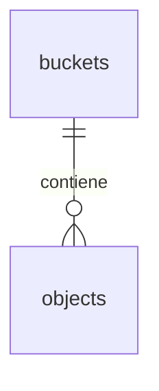

# Feature Specification: Visor de cobertura E2E por historia con video

**Feature Branch**: `feat/022-visor-cobertura-e2e-historias`

**Created**: 2026-10-20

**Status**: Draft

**Input**: Un video por historia para verificar que cada ítem está realmente cubierto por E2E; navegable por épica → historia/tarea/bug desde una ruta del panel. La épica es vista de agregación (playlist), no un video compilado.

**Alcance de entrega**: `refine`, `supabase`, `ci` (workflow Validate).

## User Scenarios & Testing

### User Story 1 - Ver el video y el checklist de una historia (Priority: P1)

Quien revisa una historia abre su ficha en el panel y ve la lista de ítems (Txxx de su `tasks.md`) con estado cubierto/no cubierto por E2E, más el video del recorrido que los cubre.

**Why this priority**: Es el valor central: responder "¿cada ítem de esta historia está realmente cubierto?" con evidencia en video, sin bajar artefactos de CI.

**Independent Test**: Con la convención aplicada y un manifiesto generado localmente, la ficha de MSF-136 muestra T021 cubierto y reproduce su video.

**Acceptance Scenarios**:

1. **Given** una historia con E2E que cita `[MSF-136:T021]`, **When** abro su ficha, **Then** veo T021 marcado cubierto con enlace al video.
2. **Given** un ítem sin E2E que lo cite, **When** abro su ficha, **Then** aparece como no cubierto (sin falso verde).
3. **Given** un video inexistente o un manifiesto ilegible, **When** abro la ficha, **Then** veo estado vacío/error explícito, nunca un reproductor roto.

### User Story 2 - Navegar por épica, historia, tarea o bug (Priority: P2)

Desde el visor filtro por épica (clave MSF), entro a una historia y salto a una tarea o bug concreto para ver su evidencia.

**Why this priority**: Es la navegación pedida (épica → historia/tarea/bug); sin ella el P1 no escala más allá de 2–3 historias.

**Independent Test**: El visor lista las épicas con E2E (MSF-119, MSF-121, MSF-136) y filtrar por MSF-121 muestra solo su historia y su video.

**Acceptance Scenarios**:

1. **Given** varias épicas con E2E, **When** selecciono MSF-121, **Then** solo veo `permisos-por-empresa`, T022 y su video.
2. **Given** un bug con E2E de cierre, **When** lo busco por su clave, **Then** llego a su evidencia igual que a una tarea.

### User Story 3 - Vista agregada por épica (Priority: P3)

Cada épica muestra el agregado de sus historias: cuántos ítems cubiertos de cuántos, con la playlist de videos.

**Why this priority**: Da la lectura "¿esta épica está cubierta?" sin compilar un video único (los videos cruzan muchos runs; el stitch aporta poco y pesa mucho).

**Independent Test**: La ficha de MSF-119 agrega sus historias y enlaza cada video sin unir archivos.

**Acceptance Scenarios**:

1. **Given** una épica con historias cubiertas y sin cubrir, **When** abro su ficha, **Then** veo el conteo por historia y la lista de videos.

### Edge Cases

- Un test cita un ítem inexistente (typo en la clave): el manifiesto lo reporta como huérfano visible en vez de ignorarlo.
- Un mismo ítem citado por varios tests: se muestra cubierto con todos sus videos.
- Videos de `retain-on-failure` (solo fallos) vs `E2E_VIDEO=on` (todo): el manifiesto indica el modo de la corrida para no confundir "sin video" con "no cubierto".
- Retención: los artefactos de CI expiran (14 días); el bucket es la copia duradera y el visor indica la fecha de la corrida.

## Requirements

### Functional

- FR-001: Todo test E2E declara su cobertura en el título con `[EPICA:TASK[,TASK...]]` (ej. `[MSF-136:T021]`); un test puede citar varios ítems.
- FR-002: Un script genera `cobertura-e2e.json` cruzando títulos de tests (reporte JSON de Playwright) × ítems de `tasks.md` × videos de `test-results/`.
- FR-003: El CI sube videos + manifiesto al bucket privado `evidencias-e2e` en cada corrida con E2E grabado.
- FR-004: La ruta del panel lista épicas → historias → ítems con estado y reproduce el video vía URL firmada (nunca service-role en el navegador).
- FR-005: Solo lectura para quien puede ver el panel; la subida la hace el CI con service-role desde el runner.

### Non-Functional

- NFR-001: La ruta carga diferida (los videos pesan): la ficha no descarga ningún video hasta pedirlo (principio VI).
- NFR-002: Sin identificadores técnicos como identidad visible: se muestran nombres de historia/épica, las claves MSF como referencia secundaria.
- NFR-003: Accesible por teclado y lector de pantalla; patrones compartidos de carga/vacío/error.

### Key Entities

- **Evidencia E2E**: terna (épica MSF, ítem Txxx, video .webm + resultado) por corrida.
- **Manifiesto**: `cobertura-e2e.json` con fecha de corrida, modo de grabación y lista de evidencias + huérfanos.

## Modelo de datos (DER)

Sin cambios de esquema en `public` ni `dominio`. La migración inserta el bucket y sus políticas:

| Tabla | Estado | Cambio |
|---|---|---|
| `storage.buckets` | existente | `insert` del bucket `evidencias-e2e` (privado) |
| `storage.objects` | existente | políticas `select`/`insert` acotadas al bucket (lectura: rol autenticado con organización; escritura: service-role del CI) |

## Success Criteria

- SC-001: Las 7 pruebas E2E existentes citan su historia e ítem en el título y `playwright --list` lo confirma.
- SC-002: El manifiesto generado localmente marca T020 (MSF-119), T022 (MSF-121) y T021 (MSF-136) como cubiertos, con video cuando la corrida grabó.
- SC-003: La ficha de una historia muestra checklist + video funcionando desde el panel contra el bucket.
- SC-004: `pnpm lint && pnpm build && pnpm test && pnpm docs:check` en verde.
