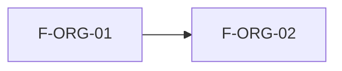

# Implementation Plan: Organizaciones nuevas (MSF-162)

**Spec**: `specs/20261016-130000-organizaciones-nuevas/spec.md` · **Status**: borrador condicionado a las respuestas Q1–Q5 de la spec.

## Summary

Habilitar el alta de organizaciones nuevas (cada una con su administrador y empresas) sobre el modelo multi-tenant existente, y construir lo que el template no trae: multi-pertenencia de usuarios, selector de organización y facturación propia. No se redacta diseño detallado de lo que la épica deja abierto.

## Technical Context

- Refine (`apps/web`) + Supabase self-hosted (migraciones en `supabase/migrations`, Edge Function `crear-organizacion`, pgTAP). Sin Cloud.
- Ya existe: `crear-organizacion`, `pages/organizaciones/{list,create}`, `entrar_a_organizacion`, `ContextoPanel`, `OrganizacionActivaBanner`, `usuarios_organizacion` (PK `user_id`), `dominio.empresas` (`20261013120000_empresas.sql`), pgTAP de aislamiento.

## Constitution Check

- I Aislamiento: RLS por organización en toda tabla nueva/alterada; pgTAP con dos organizaciones y con un usuario en ambas. ✔ planificado.
- II Spec primero: spec con requisitos provisionales; sin implementar hasta cerrar Q1–Q5. ✔
- VII Esquemas: tabla de la spec; se re-verifica en tareas, implementación y revisión de PR. ✔
- Migraciones aditivas con reversión: cambio de clave de `usuarios_organizacion` como nueva restricción/tabla puente, sin destruir columnas en el mismo PR. ✔
- VIII Documentación: `docs/` actualizado en el mismo cambio (`pnpm docs:check`). ✔
- VI Panel: el selector de organización y la pantalla de alta declaran ubicación, audiencia, rutas, estados carga/vacío/error/éxito, teclado y 320/768/1440 px; sin UUID visible. ✔ a detallar al planificar.

## División propuesta del XL (a aprobar en Q4)

| Parte | Contenido | Talla orientativa |
|-------|-----------|-------------------|
| A | Alta de organización con primer administrador y empresas (FR-001) | ≤ 8 h |
| B | Multi-pertenencia + selector + cambio de clave (FR-002, FR-003, FR-006) — condicionada a Q1/Q2 | ≤ 8 h |
| C | Facturación propia (FR-004) — condicionada a Q3 | ≤ 8 h |

Las horas son referencia; manda la estimación al entrar en el plan. La épica conserva un único código de historia (F-ORG-02); si Nicolás aprueba la división, los códigos de las partes los define él.

## Diseño (provisional)

- **Datos**: `usuarios_organizacion` pasa a clave compuesta `(user_id, organizacion_id)` solo si Q1 = sí; revisar políticas, `private.organizacion_id()` (hoy `select … where user_id = auth.uid()` asume una fila), `private.nivel_seccion` y tablas de empresas por usuario. La "organización activa" de un usuario normal necesita un lugar donde vivir (análogo a `superadmin_organizacion_activa`); decidir al planificar.
- **Alta**: extender `crear-organizacion` (service-role solo en la función) para crear también las empresas iniciales; atómico con reversión si falla la invitación.
- **Frontend**: reutilizar `pages/organizaciones/create` y absorber el selector en `ContextoPanel` antes de crear pantalla nueva (regla «una pantalla de gestión de personas por producto»).
- **Seguridad**: revisión `authz-security` (cambio de clave + RLS); concurrencia al cambiar de organización activa; `revoke … from public, anon` / `grant … to authenticated` en toda RPC nueva (`docs/acceso-ingreso.md`).

## Pruebas

pgTAP: aislamiento con organizaciones nuevas, usuario en dos organizaciones, RLS en todas las tablas de `public` + `dominio`, `anon` sin ejecución. Vitest: selector y alta. E2E si hay suite (MSF-499); si no, `[x]` + `Desvío:` con seguimiento trazado.

## Documentación

`docs/` (alta de organizaciones, selector, facturación si aplica), `docs/roadmap-template.md` al cierre (paso manual).

## Plan de ejecución (historias)

| Historia | Depende de | Grupo |
|----------|------------|-------|
| F-ORG-02 | MSF-119 (F-ORG-01, ya en `main`) | 1 |

Una sola historia: sin paralelismo entre historias. Dentro de ella, [P] marca tareas de archivos distintos.
