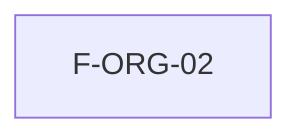

# Implementation Plan: Organizaciones nuevas (MSF-162)

**Spec**: `specs/20261016-130000-organizaciones-nuevas/spec.md`

## Summary

El alta de organizaciones nuevas ya está resuelta por el template (decisión de Nicolás: se usa lo que hay, no se rehace). Esta épica verifica ese flujo con pruebas que ejerzan los escenarios de la spec, cierra los huecos de cobertura si los hay y lo documenta. No hay migraciones ni cambios de modelo.

## Technical Context

- Refine (`apps/web`) + Supabase self-hosted. Sin Cloud.
- Existente y reutilizado tal cual: Edge Function `supabase/functions/crear-organizacion/index.ts` (solo superadmin; crea organización, invita al fundador, lo vincula como `administrador`, revierte si falla), `apps/web/src/pages/organizaciones/{list,create}.tsx`, `entrar_a_organizacion`, `ContextoPanel`, `OrganizacionActivaBanner`, pgTAP `aislamiento_organizaciones.test.sql`.

## Constitution Check

- I Aislamiento: se verifica con pgTAP sobre una organización nueva. ✔
- II Spec primero: spec con escenarios y FR/SC. ✔
- VII Esquemas: sin tablas nuevas/alteradas; `organizaciones`, `usuarios_organizacion`, `superadmins` en `public`. Re-verificar en tareas y PR. ✔
- Migraciones: ninguna. ✔
- VI Panel: sin pantallas nuevas ni cambios. ✔
- VIII Documentación: guía en `docs/` en el mismo cambio (`pnpm docs:check`). ✔

## Diseño

Sin diseño nuevo. Pasos: (1) confirmar el comportamiento actual contra los escenarios; (2) agregar solo las pruebas que falten (pgTAP del aislamiento de una organización recién creada y del rechazo a no-superadmin; Vitest de `create.tsx` si no existe); (3) documentar. Si una verificación revelara un defecto, se registra como seguimiento trazado, sin rediseñar.

## Pruebas

pgTAP (aislamiento, `anon` sin ejecución, RLS en `public` + `dominio`) y Vitest para el formulario de alta. E2E solo si la suite existe; si no, `[x]` + `Desvío:` con seguimiento.

## Documentación

`docs/` (alta de organizaciones y su límite un-usuario-una-organización), `docs/roadmap-template.md` al cierre (paso manual).

## Plan de ejecución (historias)

| Historia | Depende de | Grupo |
|----------|------------|-------|
| F-ORG-02 | — (MSF-119 ya en `main`) | 1 |

Una sola historia; dentro de ella [P] marca tareas de archivos distintos.

## Verificación de cobertura (T001, F-ORG-02)

Esquemas re-verificados: `organizaciones`, `usuarios_organizacion`, `superadmins` en `public`; sin tablas nuevas ni migraciones.

| Escenario | Cobertura previa | Cobertura agregada |
|-----------|------------------|--------------------|
| 1 Alta + fundador `administrador` | ninguna sobre la función | `crear-organizacion/handler.test.ts` (handler extraído de `index.ts` sin cambio de comportamiento) y `organizaciones/create.test.tsx` |
| 2 No-superadmin → 403 | ninguna | `handler.test.ts` (sin header, token inválido, no superadmin) y aviso en `create.test.tsx` |
| 3 Invitación falla → reversión | ninguna | `handler.test.ts` (422, 502, fallo de membresía) y error visible en `create.test.tsx` |
| 4 Aislamiento de la org nueva | `aislamiento_organizaciones.test.sql` (2 orgs, roles) | `alta_organizacion_nueva.test.sql`: org recién creada, sin `INSERT` por API, un usuario una organización |
