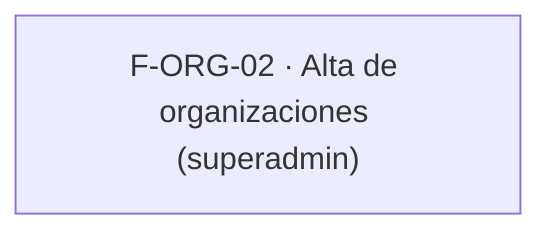

# Tasks: Acceso, organización y permisos · Organizaciones nuevas

**Input**: `specs/20261016-130000-organizaciones-nuevas/` (spec.md, plan.md)

**Formato**: `- [ ] T### [P] [STORY-x][USy] descripción`. **[P]** = paralelizable (archivos distintos, sin dependencia); sin [P] = secuencial.

**Delivery scope**: `refine`, `supabase` (solo pruebas; sin migraciones)

**Regla**: ninguna tarea queda `[ ]` al cierre: se hace con evidencia o se cierra con `[x]` + `Desvío:` y seguimiento trazado.

## Matriz de trazabilidad Jira ↔ US ↔ tasks

| Jira | Historia | Requisitos | Tasks |
|------|----------|------------|-------|
| F-ORG-02 | US1 Alta de nuevas organizaciones | FR-001, FR-002, FR-003, SC-001 | T001–T004 |
| Tarea de cierre (label cierre) | Docs, validación, roadmap | SC-002 | T005–T007 |

## Phase 1: Verificación y cobertura — F-ORG-02

**Goal**: comprobar que el alta del template cumple los escenarios 1–4 y cubrirlos con pruebas, sin cambiar comportamiento.

- [ ] T001 [F-ORG-02][US1] Verificar esquema de cada tabla involucrada (`organizaciones`, `usuarios_organizacion`, `superadmins` en `public`; Principio VII), leer `crear-organizacion`, `pages/organizaciones/create.tsx` y `aislamiento_organizaciones.test.sql`, y anotar en plan.md qué escenarios ya están cubiertos y cuáles no (FR-001, FR-002, FR-003)
- [ ] T002 [P] [F-ORG-02][US1] pgTAP: una organización recién dada de alta queda aislada de las demás, `anon` sin ejecución, RLS en `public` + `dominio`; ampliar el test existente solo si falta (FR-003)
- [ ] T003 [P] [F-ORG-02][US1] Vitest de `pages/organizaciones/create.tsx` (éxito, error de invitación, estados carga/error/éxito) si no existe (FR-001, FR-002)
- [ ] T004 [P] [F-ORG-02][US1] Cubrir el rechazo a no-superadmin (403) y la reversión por invitación fallida de `crear-organizacion` con la prueba que corresponda; si no es automatizable, `[x]` + `Desvío:` con seguimiento (FR-001, FR-002)

**Checkpoint**: `pnpm lint`, `pnpm build`, `pnpm test` verdes.

## Phase 2: Cierre

- [ ] T005 [P] [CIERRE] `docs/`: guía del alta de organizaciones por superadmin y su límite (un usuario, una organización); `pnpm docs:check`
- [ ] T006 [CIERRE] Validación final: `pnpm lint && pnpm build && pnpm test && pnpm docs:check`
- [ ] T007 [CIERRE] Al merge del PR (merge commit `--no-ff`): actualizar la fila de `docs/roadmap-template.md` (paso manual) y comprobar que ninguna tarea queda `[ ]`

## Plan de ejecución (historias)

| Historia | Depende de | Grupo |
|----------|------------|-------|
| F-ORG-02 | — (MSF-119 ya en `main`) | 1 |

Una sola historia (por eso el grafo es de un nodo); dentro de ella el `[P]` marca tareas de archivos distintos.
