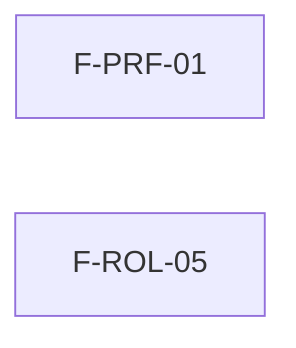

# Tasks: Acceso, organización y permisos · Perfil y permisos avanzados

**Input**: `specs/20261016-130000-perfil-y-permisos-avanzados/` (spec.md, plan.md)

**Formato**: `- [ ] T### [P] [STORY-x][USy] descripción`. `F-XXX-NN` es el marcador de la historia Jira por crear; reemplazar por la clave real (MSF-N). Épica: MSF-148. `[P]` = paralelizable (archivos distintos, sin dependencia dentro del grupo).

**Delivery scope**: `refine`, `supabase`

**Orden**: las dos historias son independientes. `/speckit-implement` historia por historia con `/clear` entre ellas.

## Phase 1: US1 — Perfil propio (F-PRF-01, P2)

**Goal**: verificar que perfil y cambio de contraseña cumplen la aceptación y ajustar textos.

**Independent Test**: Vitest de `perfil` y `cambiar-contrasena`.

- [ ] T001 [P] [F-PRF-01][US1] Verificar con test que editar nombre, apellido y foto persiste y se refleja; completar `perfil.test.tsx` en lo que falte (FR-001)
- [ ] T002 [P] [F-PRF-01][US1] Verificar con test que el cambio de contraseña exige la contraseña actual (vacía o incorrecta se rechaza sin cambiar la contraseña); completar `cambiar-contrasena.test.tsx` (FR-002)
- [ ] T003 [P] [F-PRF-01][US1] Verificar con test la regla de ≥ 12 caracteres con mayúscula, minúscula, número y símbolo en `passwordPolicy.ts`; dejarla centralizada y anotar «a confirmar con el cliente» (FR-003)
- [ ] T004 [F-PRF-01][US1] Ajustar los textos de `perfil.tsx` y `cambiar-contrasena.tsx` (claridad y consistencia) y actualizar sus tests (FR-004)

**Checkpoint**: `pnpm lint`, `pnpm build`, `pnpm test` verdes.

## Phase 2: US2 — Solicitar acceso desde la pantalla restringida (F-ROL-05, P2)

**Goal**: botón «Solicitar acceso» que registra el pedido del día y avisa por correo al administrador.

**Independent Test**: pgTAP de tabla/RPC + Vitest del botón + Edge Function con transporte simulado.

- [ ] T005 [F-ROL-05][US2] Migración aditiva: tabla `public.solicitudes_acceso` con `unique (organizacion_id, usuario_id, seccion, dia)`, RLS por organización y sin privilegios para `anon`; reversión documentada en la migración (FR-007, FR-009)
- [ ] T006 [F-ROL-05][US2] Migración: RPC `public.solicitar_acceso(p_seccion)` `security definer`, valida sesión, membresía y sección, `on conflict do nothing`; `revoke … from public, anon` + `grant … to authenticated` (FR-007, FR-009)
- [ ] T007 [F-ROL-05][US2] pgTAP `solicitudes_acceso.test.sql`: un pedido por persona/sección/día, aislamiento entre organizaciones, rechazo sin sesión/sin membresía/sección inválida, `anon` sin ejecución y el test de RLS recorre la tabla (FR-007, FR-009)
- [ ] T008 [F-ROL-05][US2] Spike de correo (FR-008, FR-012a): confirmar cómo expone Supabase su SMTP en local (Mailpit) y en el servidor self-hosted, y elegir el cliente SMTP de Deno; anotar el hallazgo en `docs/solicitar-acceso.md`
- [ ] T009 [F-ROL-05][US2] `supabase/functions/_shared/correo.ts`: envío por el SMTP de Supabase con variables de entorno; actualizar solo `.env.example` (FR-008)
- [ ] T010 [F-ROL-05][US2] Edge Function `solicitar-acceso`: valida JWT, llama a la RPC, envía el correo a los administradores activos de la organización una sola vez por registro del día, marca `correo_enviado_en` y permite reintento si falló el envío (FR-008)
- [ ] T011 [P] [F-ROL-05][US2] `AccesoRestringido.tsx`: botón «Solicitar acceso» junto a «Volver al inicio», confirmación «Solicitud enviada al administrador», estados de carga/error con reintento del sistema de diseño, accesible por teclado y lector (FR-005, FR-006, FR-010)
- [ ] T012 [F-ROL-05][US2] Tests Vitest de `AccesoRestringido` (botón visible, envío, confirmación, doble clic sin duplicar, error con reintento) y de la Edge Function con transporte simulado; prueba local contra la API de Mailpit (FR-006, FR-008, FR-012a)
- [ ] T013 [F-ROL-05][US2] Guion opt-in de verificación de salida: envía por el flujo real a `CORREO_PRUEBA` (`nicolas.m.jones@gmail.com`) desde el servidor self-hosted; fuera de `pnpm test`/CI; dejar evidencia en el PR o documentar el hallazgo y trazar seguimiento si el relay SMTP no sale (FR-012b, SC-004)
- [ ] T014 [F-ROL-05][US2] Documentar el flujo y el mecanismo de correo en `docs/solicitar-acceso.md` (qué usa Supabase, variables, cómo verificar la salida) (FR-011)

**Checkpoint**: `pnpm lint`, `pnpm build`, `pnpm test` (con `pnpm dev:supabase`) verdes.

## Phase 3: Cierre

- [ ] T015 [CIERRE] Ejecutar `pnpm lint && pnpm build && pnpm test` y `pnpm docs:check`; dejar evidencia de verificación local en el PR (SC-003)
- [ ] T016 [CIERRE] Verificación de esquemas de punta a punta (Principio VII): `solicitudes_acceso` en `public`, con RLS y recorrida por el pgTAP de aislamiento
- [ ] T017 [CIERRE] Al mergear el PR (merge commit, sin squash), actualizar la fila de la spec en `docs/roadmap-template.md` (paso manual)

> Notas de desvío: agregar aquí, cortas y con `ver commit <hash>`.

## Matriz de trazabilidad Jira ↔ US ↔ tareas

| Jira | US | Tareas | FR / SC |
|---|---|---|---|
| F-PRF-01 (MSF-N por crear) | US1 | T001–T004 | FR-001…FR-004, SC-001 |
| F-ROL-05 (MSF-N por crear) | US2 | T005–T014 | FR-005…FR-012, SC-002, SC-004 |
| Tarea de cierre (label cierre) | — | T015–T017 | SC-003 |

## Plan de ejecución (historias)

| Historia | Depende de | Grupo |
|---|---|---|
| F-PRF-01 | — | 1 |
| F-ROL-05 | — | 1 |

Ambas son independientes (archivos, tablas y migraciones distintos): van en paralelo. La dependencia con MSF-125 es externa y ya está integrada.

