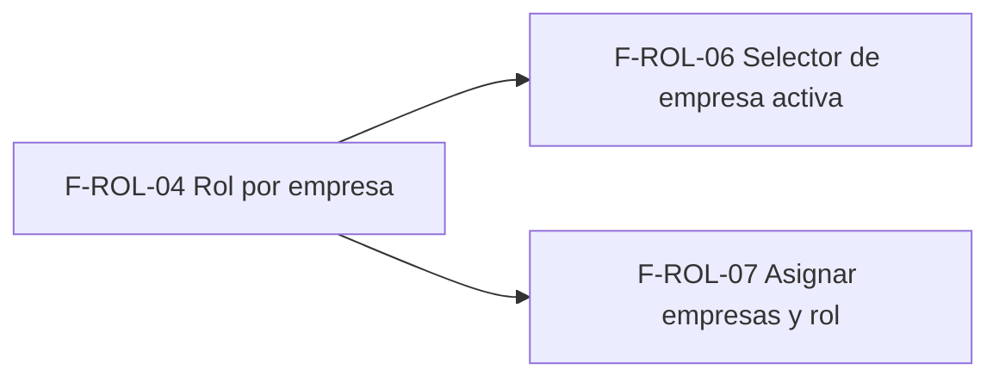

# Tasks: Acceso, organización y permisos · Permisos por empresa

**Input**: `specs/20261016-140000-permisos-por-empresa/` (spec.md, plan.md)

**Formato**: `- [ ] T### [P] [STORY-x][USy] descripción`. **[P]** = paralelizable (archivos distintos, sin dependencia); sin [P] = secuencial dentro de su historia.

**Delivery scope**: `refine`, `supabase`

**Regla**: ninguna tarea queda `[ ]` al cierre: se hace con evidencia o se cierra con `[x]` + `Desvío:` y seguimiento trazado.

## Matriz de trazabilidad Jira ↔ US ↔ tasks

| Jira | Historia | Requisitos (dueña única) | Tasks |
|------|----------|--------------------------|-------|
| F-ROL-04 | US1 Rol por empresa | FR-001–FR-008, SC-001 | T001–T007 |
| F-ROL-06 | US2 Selector de empresa activa | FR-009–FR-014 | T008–T014 |
| F-ROL-07 | US3 Asignar empresas y rol por empresa | FR-015–FR-018 | T015–T021 |
| Tarea de cierre (label cierre) | E2E, docs, seguridad, roadmap | SC-002, SC-003, SC-004 | T022–T026 |

## Phase 1: Rol por empresa — F-ROL-04 (US1)

**Goal**: datos y resolución de permisos por empresa en la base.

- [ ] T001 [F-ROL-04][US1] Verificar esquema de cada tabla (Principio VII: `usuarios_empresas` y `usuario_empresa_activa` en `public`; `dominio.empresas` solo referenciada) y leer `nivel_seccion`/`puede_accion` de `20261013130002` para fijar el reemplazo (FR-001–FR-007)
- [ ] T002 [F-ROL-04][US1] Migración `supabase/migrations/20261016140000_roles_por_empresa.sql`: tablas con RLS, `check` de los cinco roles, trigger de misma organización, sin privilegios a `anon`, reversión en el encabezado (FR-001, FR-002, FR-004)
- [ ] T003 [F-ROL-04][US1] En la misma migración: helpers `private` (empresas accesibles, empresa activa válida, rol en empresa, listas de secciones compartidas/por empresa) y reemplazo de `nivel_seccion` y `puede_accion` con la resolución del plan (FR-003, FR-005, FR-006, FR-007)
- [ ] T004 [P] [F-ROL-04][US1] pgTAP `supabase/tests/database/roles_por_empresa.test.sql`: 2 organizaciones × 2 empresas, Operador en una y Consulta en la otra, sobre tablas de prueba de Ventas, Consultas y Productos; Administrador sin filas; rol `administrador`/`miembro` rechazado; empresa ajena rechazada; sin asignaciones = rol de organización (FR-002, FR-003, FR-006, FR-008, SC-001)
- [ ] T005 [P] [F-ROL-04][US1] Panel: `permisos_actuales()` y `PermisosPanelProvider` exponen el nivel resuelto por empresa; Vitest de `lib/permisos.ts`/`accessControlProvider` con usuario de varias empresas (FR-006)
- [ ] T006 [P] [F-ROL-04][US1] Docs: `docs/permisos-por-rol.md` (resolución por empresa, secciones compartidas/por empresa, supuestos) (FR-006)
- [ ] T007 [F-ROL-04][US1] Regresión: `permisos_por_rol`, aislamiento y `anon` (pgTAP) en verde; `pnpm lint && pnpm build && pnpm test`

**Checkpoint**: F-ROL-04 verde; desbloquea F-ROL-06 y F-ROL-07.

## Phase 2: Selector de empresa activa — F-ROL-06 (US2)

**Goal**: el usuario elige con qué empresa trabaja y el panel lo aplica.

- [ ] T008 [F-ROL-06][US2] Verificar esquema (sin tablas nuevas; usa `usuario_empresa_activa`) y definir en `EncabezadoPanel` la convivencia con `SelectorEmpresa` de F-EMP-05, que no se modifica (FR-013)
- [ ] T009 [F-ROL-06][US2] Migración `supabase/migrations/20261016150000_cambiar_empresa_activa.sql`: RPC `cambiar_empresa_activa` con `grant`/`revoke` explícitos, validación de acceso y evento `usuario.empresa_activa_cambiada` en la misma transacción (FR-009, FR-013, FR-014)
- [ ] T010 [P] [F-ROL-06][US2] pgTAP `supabase/tests/database/cambiar_empresa_activa.test.sql`: cambio válido, empresa ajena o de otra organización rechazada, `anon` sin ejecución, evento registrado, persistencia (FR-009, FR-013, FR-014)
- [ ] T011 [P] [F-ROL-06][US2] Componente `SelectorEmpresaActiva` en la barra superior: lista accesible, activa marcada, etiqueta fija con una empresa, estados carga/error, teclado y 320/768/1440 px (FR-010)
- [ ] T012 [F-ROL-06][US2] Cambio de empresa: RPC → `invalidarCachePermisos()` → recarga de permisos; confirmación con cambios sin guardar; Vitest de ambos (FR-011, FR-012)
- [ ] T013 [P] [F-ROL-06][US2] Docs `docs/empresa-activa.md` (selector, persistencia, límite con F-EMP-05) y tipo en `ETIQUETA_TIPO_ACTIVIDAD` + `docs/actividad.md` (FR-013, FR-014)
- [ ] T014 [F-ROL-06][US2] Verificación local: `pnpm lint && pnpm build && pnpm test`

**Checkpoint**: F-ROL-06 verde.

## Phase 3: Asignar empresas y rol por empresa — F-ROL-07 (US3)

**Goal**: el Administrador asigna empresas y roles desde Usuarios.

- [ ] T015 [F-ROL-07][US3] Verificar esquema (sin tablas nuevas) y leer `pages/usuarios/list.tsx`, `DialogoInvitarUsuario` y la invitación para ubicar dónde viajan las asignaciones (FR-015–FR-017)
- [ ] T016 [F-ROL-07][US3] Migración `supabase/migrations/20261016160000_asignar_empresas_usuario.sql`: RPC `asignar_empresas_usuario` (solo Administrador, reemplazo atómico, `grant`/`revoke`), asignaciones en la invitación, primera empresa como activa y evento `usuario.empresas_asignadas` (FR-015, FR-017, FR-018)
- [ ] T017 [P] [F-ROL-07][US3] pgTAP `supabase/tests/database/asignar_empresas_usuario.test.sql`: éxito, no Administrador rechazado, empresa ajena, rol inválido, atomicidad, quitar todas, evento (FR-015, FR-018)
- [ ] T018 [P] [F-ROL-07][US3] Diálogo Editar usuario: empresas y rol por empresa, seis roles, Administrador = todas las empresas; lista de Usuarios con tiendas y rol por tienda; Vitest (FR-016)
- [ ] T019 [P] [F-ROL-07][US3] Diálogo Invitar usuario con empresas y rol por empresa; Vitest (FR-016, FR-017)
- [ ] T020 [P] [F-ROL-07][US3] Docs `docs/usuarios-y-empresas.md` y tipo en `ETIQUETA_TIPO_ACTIVIDAD` + `docs/actividad.md` (FR-016, FR-018)
- [ ] T021 [F-ROL-07][US3] Verificación local: `pnpm lint && pnpm build && pnpm test`

**Checkpoint**: F-ROL-07 verde.

## Phase 4: Cierre (últimas, sin ser prerrequisito de ninguna historia)

- [ ] T022 [CIERRE] E2E (Playwright): asignar, cambiar de empresa y comprobar botones de edición (SC-002)
- [ ] T023 [CIERRE] Revisión de seguridad `authz-security` del diff (RLS, RPC, `anon`) y re-verificación del esquema de cada tabla (Principio VII)
- [ ] T024 [CIERRE] Validación final: `pnpm lint && pnpm build && pnpm test && pnpm infra:config && pnpm docs:check` (SC-003, SC-004)
- [ ] T025 [CIERRE] Cerrar tareas pendientes (`[x]` o `Desvío:` + seguimiento trazado); confirmar que ninguna queda `[ ]`
- [ ] T026 [CIERRE] Al merge del PR (merge commit `--no-ff`): actualizar la fila de `docs/roadmap-template.md` (paso manual)

## Plan de ejecución (historias)

| Historia | Depende de | Grupo |
|----------|------------|-------|
| F-ROL-04 | — (MSF-125 y MSF-138 ya en `main`) | 1 |
| F-ROL-06 | F-ROL-04 | 2 |
| F-ROL-07 | F-ROL-04 | 2 |
| [Cierre] | F-ROL-04, F-ROL-06, F-ROL-07 | 3 |

