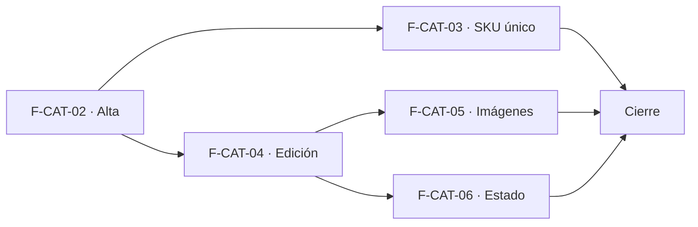

# Tasks: Catálogo · Catálogo alta y edición

**Input**: `specs/20261017-120000-catalogo-alta-y-edicion/` (spec.md, plan.md)

**Formato**: `- [ ] T### [P] [STORY-x][USy] descripción`. **[P]** = paralelizable (archivos distintos, sin dependencia; las [P] del mismo grupo van en paralelo); sin [P] = secuencial. Regla del proyecto: ninguna tarea queda `[ ]` al cierre — se hace con evidencia o se cierra con `[x]` + `Desvío:` y seguimiento trazado. Las dependencias de cada historia son solo internas; M1 (F-CAT-02) es prerrequisito de historia, no de tarea.

**Delivery scope**: `refine`, `supabase`

## Matriz de trazabilidad Jira ↔ US ↔ tasks

| Jira | Historia | Requisitos (dueño único) | Tasks |
|------|----------|--------------------------|-------|
| F-CAT-02 | US1 Alta de producto | FR-001, FR-002, FR-003, FR-004, FR-005, FR-006, FR-018, SC-002 | T001–T007 |
| F-CAT-03 | US2 SKU único | FR-007, FR-008, FR-019, SC-003 | T008–T010 |
| F-CAT-04 | US3 Edición de producto | FR-009, FR-010, FR-011 | T011–T014 |
| F-CAT-05 | US4 Imágenes del producto | FR-012, FR-013, FR-014, SC-004 | T015–T018 |
| F-CAT-06 | US5 Estado activo / inactivo | FR-015, FR-016, SC-005 | T019–T022 |
| Tarea de cierre (label `cierre`) | Docs, seguridad, E2E, roadmap | FR-017, SC-001, SC-006 | T023–T027 |

## Phase 1: Alta de producto (F-CAT-02 · refine + supabase)

- [ ] T001 [F-CAT-02][US1] Migración M1 `<ts>_catalogo_productos_y_costos.sql`: `dominio.productos` (incluye `activo default true`) y `dominio.producto_costos`, RLS por organización y sección (`productos` / `rentabilidad`), sin DELETE, grants por columna, `anon` sin privilegios, reversión en el encabezado (FR-001, FR-002, FR-003, FR-005)
- [ ] T002 [F-CAT-02][US1] Migración M2 `<ts>_catalogo_crear_producto.sql`: RPC `public.crear_producto` (security invoker; costo solo con acceso a Rentabilidad; sin parámetro de stock) y disparador `producto.creado` sin costo; `revoke … public, anon` / `grant … authenticated` (FR-006)
- [ ] T003 [P] [F-CAT-02][US1] pgTAP `catalogo_productos.test.sql`: aislamiento entre dos organizaciones, permisos por rol sobre `productos` y `producto_costos` (Operador: 0 filas; Consulta sin escritura), `anon` sin privilegios, evento en Actividad sin costo; `rls_en_toda_tabla` verde (SC-002)
- [ ] T004 [P] [F-CAT-02][US1] `lib/productos.ts` (validación de nombre/precio/moneda, tipos) y recurso `productos` en `SECCION_POR_RECURSO` (FR-001, FR-004)
- [ ] T005 [F-CAT-02][US1] `FormularioProducto` + `pages/productos/create.tsx`: campos del alta, costo condicionado a Rentabilidad, aviso «Faltan datos obligatorios», diálogo «Descartar cambios», «Precio en pesos: No disponible», sin stock inicial (FR-001, FR-002, FR-003, FR-004)
- [ ] T006 [P] [F-CAT-02][US1] Destino de menú «Productos» (Catálogo, ícono, `seccionPermiso: 'productos'`, carga diferida), ruta `/productos/create` con `RequiereAccesoSeccion`, estados de carga/vacío/error/éxito (FR-018)
- [ ] T007 [P] [F-CAT-02][US1] Vitest del alta: validación, aviso, descartar, costo oculto al Operador, sin stock, precio en pesos no disponible, menú y guard (FR-001…FR-004, FR-018)

**Checkpoint**: se puede crear un producto con y sin costo; `pnpm lint`, `pnpm build`, `pnpm test` verdes.

## Phase 2: SKU único (F-CAT-03 · supabase + refine)

- [ ] T008 [F-CAT-03][US2] Migración M3 `<ts>_catalogo_sku_unico.sql`: recorte de SKU, índice único `(organizacion_id, lower(btrim(sku)))` y disparador `BEFORE INSERT OR UPDATE` que autogenera `PRD-XXXXXXXX` cuando el SKU llega vacío (reintenta ante colisión), reversión (`drop trigger`/`drop index`) y consulta previa de duplicados en el encabezado (FR-007, FR-019)
- [ ] T009 [P] [F-CAT-03][US2] pgTAP `catalogo_sku_unico.test.sql`: mayúsculas/espacios, otra organización, SKU vacío → autogenerado y distinto entre productos, edición a SKU ocupado, edición a vacío → regenerado, dos altas concurrentes con el mismo SKU → una sola y con SKU vacío → SKU distintos (SC-003, FR-019)
- [ ] T010 [P] [F-CAT-03][US2] Mapeo de `23505` a «Ese SKU ya existe» en `lib/productos/errores.ts` con el formulario conservando lo cargado, ayuda «Se genera sola si lo dejás vacío» en el campo SKU, y Vitest (FR-008, FR-019)

## Phase 3: Edición de producto (F-CAT-04 · supabase + refine)

- [ ] T011 [F-CAT-04][US3] Migración M4 `<ts>_catalogo_actualizar_producto.sql`: RPC `public.actualizar_producto` (security invoker, bloqueo optimista por `updated_at`, costo solo con acceso, `updated_at` también ante cambio de costo) y disparador `producto.editado` solo ante cambios reales, sin costo (FR-010)
- [ ] T012 [P] [F-CAT-04][US3] pgTAP `catalogo_actualizar_producto.test.sql`: Operador no cambia costo, Consulta no actualiza, conflicto concurrente, evento solo con cambios reales (FR-009, FR-010)
- [ ] T013 [F-CAT-04][US3] `pages/productos/edit.tsx` sobre `FormularioProducto`: carga, guardado, «Descartar cambios», aviso de conflicto, solo lectura sin acción de guardar, ruta `/productos/:id/edit` con guard (FR-009, FR-011)
- [ ] T014 [P] [F-CAT-04][US3] Vitest de la edición: persistencia, descartar, conflicto, costo oculto/readonly, solo lectura, redirección sin acceso (FR-009, FR-011)

## Phase 4: Imágenes del producto (F-CAT-05 · supabase + refine)

- [ ] T015 [F-CAT-05][US4] Migración M5 `<ts>_catalogo_producto_imagenes.sql`: `dominio.producto_imagenes` con RLS por sección, tope de 4 (disparador), bucket privado `productos-imagenes` (JPG/PNG/WebP, 2 MB) y políticas por prefijo de organización, eventos `producto.imagen_agregada|eliminada`, reversión en el encabezado (FR-012, FR-013, FR-014)
- [ ] T016 [P] [F-CAT-05][US4] pgTAP `catalogo_producto_imagenes.test.sql`: aislamiento entre organizaciones en tabla y Storage, permisos por rol, quinta imagen rechazada, eventos (SC-004)
- [ ] T017 [F-CAT-05][US4] `ImagenesProducto` integrado en alta y edición: validación de tipo/tamaño/cantidad, subida al guardar con reintento, eliminar, la primera es la principal, URLs firmadas (FR-012)
- [ ] T018 [P] [F-CAT-05][US4] Vitest de imágenes: límites, errores claros, eliminar/promover principal, solo lectura (FR-012)

## Phase 5: Estado activo / inactivo (F-CAT-06 · supabase + refine)

- [ ] T019 [F-CAT-06][US5] Migración M6 `<ts>_catalogo_cambiar_estado.sql`: RPC `public.cambiar_estado_producto` (security invoker, solo `edicion`) y disparador `producto.activado|desactivado`, reversión en el encabezado (FR-015, FR-016)
- [ ] T020 [P] [F-CAT-06][US5] pgTAP `catalogo_estado_producto.test.sql`: desactivar conserva datos e imágenes, solo-lectura rechazado, eventos, aislamiento (SC-005)
- [ ] T021 [F-CAT-06][US5] Acción activar/desactivar en la ficha y grilla mínima de solo lectura `pages/productos/list.tsx` (nombre, SKU, estado «Inactivo», editar y activar/desactivar) (FR-015)
- [ ] T022 [P] [F-CAT-06][US5] Vitest del estado y la grilla: acción solo con permiso, etiqueta Inactivo, vacío/error (FR-015)

## Phase 6: Cierre (docs, seguridad, E2E, roadmap)

- [ ] T023 [CIERRE] Re-verificar el esquema de cada tabla (`productos`, `producto_costos`, `producto_imagenes` en `dominio`; Storage en plataforma) contra spec, plan y migraciones; anotar el resultado en plan.md (Principio VII)
- [ ] T024 [P] [CIERRE] `docs/catalogo.md` y actualización de `docs/permisos-por-rol.md`, `docs/aislamiento-por-organizacion.md`, `docs/actividad.md` (FR-017, Principio VIII)
- [ ] T025 [CIERRE] E2E «crear, editar, subir fotos y desactivar» con Administrador y Operador y verificación de los eventos en Actividad sin costo; si aún no hay suite Playwright de la app, cerrar con `[x]` + `Desvío:` y deuda trazada, nunca `[ ]` (SC-001, SC-006)
- [ ] T026 [CIERRE] Revisión de seguridad (`authz-security`, `database-reviewer`) de RLS, RPC, Storage y disparadores; `pnpm lint && pnpm build && pnpm test && pnpm docs:check`; anotar en el PR las diferencias con el prototipo (FR-017)
- [ ] T027 [CIERRE] Al merge del PR (merge commit `--no-ff`): actualizar `docs/roadmap-template.md` (paso manual) y comprobar que ninguna tarea queda `[ ]`; dejar comentario/seguimiento trazado en MSF-160 (agregar el campo categoría —columna aditiva, campo en `FormularioProducto` y su obligatoriedad— y reemplazar la grilla mínima por el listado real) y en MSF-205 (proveedor y código de barras) (FR-017)

## Dependencias

Dentro de cada historia: F-CAT-02 T001 → T002 → T003; T004 → T005 → T007; T006 [P]. F-CAT-03 T008 → (T009 [P], T010 [P]). F-CAT-04 T011 → (T012 [P]) y T013 → T014. F-CAT-05 T015 → T016 [P]; T017 → T018. F-CAT-06 T019 → T020 [P]; T021 → T022. Cierre: T023 → T024 [P] → T025 → T026 → T027.

## Plan de ejecución (historias)

| Historia | Depende de | Grupo |
|----------|------------|-------|
| F-CAT-02 | — | 1 |
| F-CAT-03 | F-CAT-02 | 2 |
| F-CAT-04 | F-CAT-02 | 2 |
| F-CAT-05 | F-CAT-02, F-CAT-04 | 3 |
| F-CAT-06 | F-CAT-02, F-CAT-04 | 3 |
| [Cierre] | F-CAT-02, F-CAT-03, F-CAT-04, F-CAT-05, F-CAT-06 | 4 |

