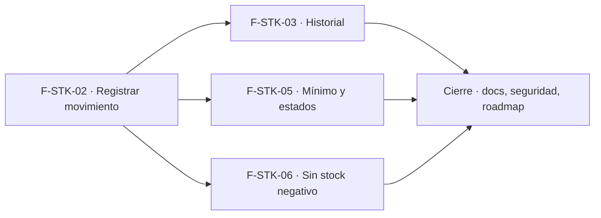

# Tasks: Stock · Stock movimientos

**Input**: `specs/20261017-120000-stock-movimientos/` (spec.md, plan.md)

**Formato**: `- [ ] T### [P] [STORY-x][USy] descripción`. **[P]** = paralelizable (archivos distintos, sin dependencia; las [P] del mismo grupo van en paralelo); sin [P] = secuencial. Las dependencias de cada tarea son solo dentro de su historia. Regla del proyecto: ninguna tarea queda `[ ]` al cierre — se hace con evidencia o se cierra con `[x]` + `Desvío:` y seguimiento trazado.

**Delivery scope**: `refine`, `supabase`

**Bloqueo previo**: la migración de F-STK-02 referencia `dominio.productos` (épica Catálogo, MSF-456); se implementa con ese merge ya en `main`.

## Matriz de trazabilidad Jira ↔ US ↔ tasks

| Jira | Historia | FR / SC | Tasks |
|------|----------|---------|-------|
| F-STK-02 | US1 Registrar un movimiento | FR-001…009, FR-019, SC-002, SC-006 | T001–T006, T025–T026 |
| F-STK-03 | US2 Historial de movimientos | FR-010…012, SC-003 | T007–T010 |
| F-STK-05 | US3 Stock mínimo y estados | FR-013…015, SC-004 | T011–T015 |
| F-STK-06 | US4 Prevención de stock negativo | FR-016…018, SC-005 | T016–T019 |
| Tarea de cierre (label `cierre`) | Integración, docs, seguridad y roadmap | SC-001 | T020–T024 |

## Phase 1: F-STK-02 · Registrar un movimiento (US1)

**Goal**: existencias en 0 al crear producto, RPC de movimientos con permisos, actividad y motivos, y pantalla con diálogo.

- [x] T001 [F-STK-02][US1] Migración M1 `20261017140000_stock_existencias_y_movimientos.sql`: `dominio.existencias`, `dominio.movimientos_stock`, `dominio.motivos_movimiento` (siembra por organización + relleno), disparador de existencias en 0 al crear producto + relleno, RLS por `nivel_seccion('stock')` sin escritura directa, `anon` sin privilegios; reversión en el encabezado (FR-001, FR-004, FR-005, FR-007)
- [x] T002 [F-STK-02][US1] Migración `20261017140100_stock_registrar_movimiento.sql`: `public.registrar_movimiento_stock` (*security definer*, `search_path = ''`, bloqueo de fila, validaciones, diferencia/saldo, evento `stock.*` en la misma transacción, `revoke … from public, anon` + `grant execute … to authenticated`) (FR-002, FR-003, FR-004, FR-005, FR-006, FR-008)
- [x] T003 [P] [F-STK-02][US1] pgTAP `stock_movimientos.test.sql`: existencias en 0 al crear producto; entrada 10 / salida 4 / ajuste a 3 con saldos y diferencias; roles edición vs. lectura vs. `ninguno`; escritura directa rechazada; aislamiento entre dos organizaciones; motivos editables solo por Administrador; evento de actividad; `anon` sin acceso (SC-002, SC-006)
- [x] T004 [P] [F-STK-02][US1] Ajustar y confirmar verdes `rls_en_toda_tabla`, `aislamiento_organizaciones` y el test de ejecutabilidad por `anon` con las tablas y RPC nuevas (FR-005, SC-002)
- [x] T005 [F-STK-02][US1] Recurso `stock` en `App.tsx`, ítem de navegación e `/stock` (`pages/stock/list.tsx` con producto, SKU y cantidad, estados compartidos, 320/768/1440 px) y `NuevoMovimientoDialog` (tipo, producto, cantidad o stock contado, fecha, motivo, nota, vista previa del stock resultante, responsable, doble envío deshabilitado, confirmación «Movimiento registrado», carga diferida); botón oculto con `lectura` (FR-009)
- [x] T006 [P] [F-STK-02][US1] Vitest del listado y del diálogo: tres tipos, vista previa, validaciones, error del servidor con reintento, doble envío, botón por rol (Operador vs. Consulta) (FR-009, SC-006)

- [x] T025 [F-STK-02][US1] Pantalla `/stock/motivos` (`pages/stock/motivos.tsx`) para el Administrador: listar, crear, renombrar, elegir tipos a los que aplica y activar/desactivar motivos; ruta protegida (Operador/Consulta no la ven), estados compartidos, 320/768/1440 px; el diálogo de T005 filtra por motivos activos del tipo (FR-019)
- [x] T026 [P] [F-STK-02][US1] Vitest de motivos: alta, renombre, desactivación, nombre duplicado rechazado, acceso solo Administrador (FR-019)

**Checkpoint**: `pnpm test:db` (pgTAP) verde y Vitest de la historia en verde.

## Phase 2: F-STK-03 · Historial de movimientos (US2)

**Goal**: historial paginado, inmodificable y de solo lectura.

- [x] T007 [F-STK-03][US2] Migración M2 `20261017150000_stock_historial_inmutable.sql`: disparador `BEFORE UPDATE OR DELETE` en `movimientos_stock`, `revoke update, delete, truncate`, `public.listar_movimientos_stock` (*security invoker*, paginación con tope y total, filtro por producto, nombre y SKU, `anon` revocado); reversión en el encabezado (FR-011, FR-012)
- [x] T008 [P] [F-STK-03][US2] pgTAP `stock_historial.test.sql`: `update`/`delete` rechazados con todos los roles (también Administrador y propietario), listado ordenado, paginación y total, filtro por producto, aislamiento entre organizaciones, rol `ninguno` sin filas, `anon` sin acceso (SC-003)
- [x] T009 [F-STK-03][US2] `pages/stock/movimientos.tsx` + hook `useMovimientos` + pestañas «Stock actual · Movimientos» y ruta `/stock/movimientos`: tabla (fecha, producto, tipo, motivo/nota, cantidad, saldo, responsable), filtro por producto, paginación en servidor, vacío/error/carga compartidos, 320/768/1440 px, sin identificadores técnicos (FR-010, FR-012)
- [x] T010 [P] [F-STK-03][US2] Vitest del historial: orden, paginación, filtro, estado vacío y error, solo lectura para Consulta (FR-010, FR-012)

**Checkpoint**: pgTAP y Vitest de la historia en verde.

## Phase 3: F-STK-05 · Stock mínimo y estados (US3)

**Goal**: mínimo por producto, vista de estados y listado con alertas.

- [x] T011 [F-STK-05][US3] Migración M3 `20261017160000_stock_minimo_y_estados.sql`: columna `minimo` (default 0, ≥ 0), `public.definir_minimo_stock` (*security definer*, exige `edicion`, evento `stock.minimo`, grants) y vista `public.stock_estados` (*security_invoker*, `anon` revocado); reversión en el encabezado (FR-013, FR-014)
- [x] T012 [P] [F-STK-05][US3] pgTAP `stock_minimo_estados.test.sql`: mínimo inválido rechazado, permisos por rol, evento, estados en los bordes (0, igual al mínimo, mínimo 0, por encima), aislamiento entre organizaciones, `anon` sin acceso (SC-004)
- [x] T013 [F-STK-05][US3] Extender `pages/stock/list.tsx` con `stock_estados`: columnas mínimo, estado y último movimiento, búsqueda por nombre/SKU, filtros por estado, resumen «N productos sin stock y M con stock bajo» con «Ver solo alertas» y edición del mínimo para quien tiene edición (hook `useDefinirMinimo`) (FR-015)
- [x] T014 [P] [F-STK-05][US3] Vitest: etiquetas de estado, filtros y alertas, edición de mínimo (válido/inválido), solo lectura para Consulta (FR-015, SC-004)
- [x] T015 [F-STK-05][US3] Documentar en el encabezado de la migración M3 el contrato de `public.stock_estados` (columnas y significado de cada estado) para Inicio (MSF-156) y MSF-231 (FR-014)

**Checkpoint**: pgTAP y Vitest de la historia en verde.

## Phase 4: F-STK-06 · Prevención de stock negativo (US4)

**Goal**: la base impide el negativo y la interfaz lo explica.

- [x] T016 [F-STK-06][US4] Migración M4 `20261017170000_stock_sin_negativos.sql`: `check (cantidad >= 0)` y disparador que levanta «No hay stock suficiente» con la cantidad vigente y la pedida; reversión en el encabezado (FR-016, FR-017)
- [x] T017 [P] [F-STK-06][US4] pgTAP `stock_sin_negativos.test.sql`: salida mayor al stock rechazada por la RPC y por SQL directo sin movimiento ni evento; ajuste a negativo rechazado; dos sesiones simultáneas no sobrepasan el stock (SC-005)
- [x] T018 [F-STK-06][US4] Aviso en `NuevoMovimientoDialog`: «No hay stock suficiente» con el detalle apenas la cantidad supera el stock, «Registrar» deshabilitado, y mensaje equivalente si el servidor rechaza por carrera con reintento posible (FR-018)
- [x] T019 [P] [F-STK-06][US4] Vitest del aviso: bloqueo del botón, texto exacto, rechazo del servidor y reintento (FR-018, SC-005)

**Checkpoint**: pgTAP y Vitest de la historia en verde.

## Phase 5: Integración, docs y cierre

- [x] T020 [CIERRE] Inventariar consumidores de `dominio.productos` y re-verificar el esquema de cada tabla (`existencias`, `movimientos_stock`, `motivos_movimiento` en `dominio`) contra las migraciones reales; anotar el resultado en plan.md (Principio VII)
- [x] T021 [CIERRE] E2E «producto → entrada 10 → salida 4 → ajuste a 3 → stock 3 y tres filas en el historial; salida de 5 → No hay stock suficiente». Si aún no hay suite Playwright (MSF-499), cerrar con `[x]` + `Desvío:` y deuda trazada, nunca `[ ]` (SC-001)
- [x] T022 [P] [CIERRE] `docs/stock.md` (modelo, RPC, permisos, estados, inmutabilidad, reversión) y actualización de `docs/permisos-por-rol.md` y `docs/aislamiento-por-organizacion.md` (Principio VIII)
- [x] T023 [CIERRE] Revisión de seguridad (`authz-security`, `database-reviewer`) de RLS, las dos RPC *security definer* y los disparadores; validación final `pnpm lint && pnpm build && pnpm test && pnpm docs:check`; anotar en el PR las contradicciones con el prototipo (tienda/canal, depósitos, reservado/disponible, tablero analítico, exportar) y la deuda de la pantalla de motivos
- [x] T024 [CIERRE] Al merge del PR (merge commit `--no-ff`): actualizar la fila de `docs/roadmap-template.md` (paso manual), cargar en Jira el *Blocks* de MSF-456 → MSF-136 y comprobar que ninguna tarea queda `[ ]`

## Dependencias

Dentro de cada historia: F-STK-02: T001 → T002 → (T003 [P], T004 [P]) → T005 → (T006 [P], T025) → T026 [P]. F-STK-03: T007 → (T008 [P], T009) → T010 [P]. F-STK-05: T011 → (T012 [P], T013) → (T014 [P], T015). F-STK-06: T016 → (T017 [P], T018) → T019 [P]. Cierre: T020 → T021 → T022 [P] → T023 → T024 (van al final y no son prerequisito de ninguna historia).

## Plan de ejecución (historias)

El **orden de toma** de las historias lo declara esta tabla: el orquestador la **consume** (no lo infiere del orden de las tareas). Una historia arranca cuando sus dependencias (`Depende de`) están **Finalizadas (mergeadas)**; las del **mismo** `Grupo` van **en paralelo** y los grupos avanzan **en orden**. La **tabla es la AUTORIDAD** (la máquina NO lee el dibujo de abajo; el diagrama es para leerlo nosotros).

| Historia | Depende de | Grupo |
|----------|------------|-------|
| F-STK-02 | — | 1 |
| F-STK-03 | F-STK-02 | 2 |
| F-STK-05 | F-STK-02 | 2 |
| F-STK-06 | F-STK-02 | 2 |
| [Cierre] | F-STK-02, F-STK-03, F-STK-05, F-STK-06 | 3 |

