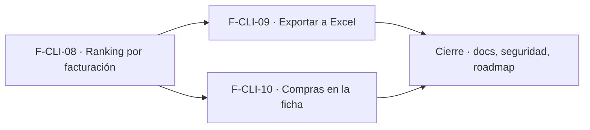

# Tasks: Clientes y proveedores · Ranking de clientes

**Input**: `specs/20261018-100000-ranking-de-clientes/` (spec.md, plan.md)

**Formato**: `- [ ] T### [P] [STORY-x][USy] descripción`. **[P]** = paralelizable (archivos distintos, sin dependencia; las [P] del mismo grupo van en paralelo); sin [P] = secuencial. Regla del proyecto: ninguna tarea queda `[ ]` al cierre — se hace con evidencia o se cierra con `[x]` + `Desvío:` y seguimiento trazado.

**Delivery scope**: `refine`, `supabase`

## Matriz de trazabilidad Jira ↔ US ↔ tasks

| Jira | Historia | FR / SC | Tasks |
|------|----------|---------|-------|
| F-CLI-08 | US1 Ranking de clientes por facturación | FR-001…009, FR-014, FR-015, SC-001…003 | T001–T008 |
| F-CLI-09 | US2 Exportar el ranking a Excel | FR-010, FR-011, SC-004 | T009–T011 |
| F-CLI-10 | US3 Historial de compras en la ficha | FR-012, FR-013, SC-005 | T012–T016 |
| Tarea de cierre (label `cierre`) | Docs, seguridad, seguimiento y roadmap | FR-016, SC-006, Principio VIII | T017–T020 |

## Phase 1: F-CLI-08 · Ranking de clientes por facturación

**Goal**: contrato de datos de venta, función `ranking_clientes` y solapa «Ranking por facturación» en Clientes.

- [ ] T001 [F-CLI-08][US1] Migración M1 `supabase/migrations/20261018100000_ventas_contrato_comprobantes.sql`: `dominio.comprobantes_venta` (contrato de la spec, FK compuesta a `public.clientes`, checks, índices), RLS por organización y sección `ventas` solo `select`, `revoke` a `anon`/`public`, reversión en el encabezado; esquema `dominio` verificado (FR-001)
- [ ] T002 [F-CLI-08][US1] Migración M2 `supabase/migrations/20261018100100_clientes_ranking.sql`: `private.comprobante_cuenta_como_facturado` (único criterio de Ventas) y `public.ranking_clientes` (`security definer`, `search_path = ''`, sección `clientes`, validaciones, orden estable, participación sobre el total, paginación con `total_filas`, `revoke`/`grant`) (FR-003, FR-004, FR-005, FR-006, FR-007)
- [ ] T003 [P] [F-CLI-08][US1] pgTAP `supabase/tests/database/ranking_clientes.test.sql`: extremos inclusivos, orden/desempate, anuladas y presupuestos fuera, filtros tipo/Consumidor final/IVA, participación 100 %, paginación, validaciones, niveles `ninguno`/`lectura`/`edicion`, otra organización, `anon` sin ejecución (FR-014, SC-001, SC-002, SC-003)
- [ ] T004 [P] [F-CLI-08][US1] pgTAP `supabase/tests/database/comprobantes_venta_contrato.test.sql`: RLS por organización y sección `ventas`, sin escritura para `authenticated`, FK cruzada rechazada; confirmar verdes `rls_en_toda_tabla` y `aislamiento_organizaciones` (FR-001, SC-003)
- [ ] T005 [P] [F-CLI-08][US1] Datos de ejemplo locales en `supabase/seed.sql`: comprobantes de varios clientes (minoristas, mayoristas y Consumidor final), facturas, presupuestos y anuladas en dos meses; nunca en producción (FR-002)
- [ ] T006 [P] [F-CLI-08][US1] `apps/web/src/lib/periodosRanking.ts` (atajos Este mes, Mes anterior, Últimos 90 días, Año en curso en zona Buenos Aires; validación de rango) y `apps/web/src/hooks/useRankingClientes.ts` (RPC `ranking_clientes`, paginación, estados) (FR-008)
- [ ] T007 [F-CLI-08][US1] `apps/web/src/components/clientes/RankingClientes.tsx` (Desde/Hasta/Aplicar, atajos, tipo de cliente, interruptor Consumidor final, Ver con IVA, tabla #/Cliente/Tipo/Comprobantes/Facturado/Participación con barra, vacío/error/carga, vista adaptable, enlace a la ficha) y solapas «Listado» / «Ranking por facturación» en `apps/web/src/pages/clientes/list.tsx` con carga diferida y visibilidad por sección (FR-008, FR-009, FR-015)
- [ ] T008 [F-CLI-08][US1] Vitest del ranking: atajos y validación de rango, filtros y base con/sin IVA, paginación conservando filtros, vacío/error/carga, solapa oculta sin acceso a Clientes, enlace a la ficha, teclado/roles (SC-001, SC-002)

**Checkpoint F-CLI-08**: `pnpm test:db`, `pnpm lint`, `pnpm build` y `pnpm test:web` verdes.

## Phase 2: F-CLI-09 · Exportar el ranking a Excel

**Goal**: «Exportar a Excel» con la misma función del ranking.

- [ ] T009 [F-CLI-09][US2] `apps/web/src/lib/exportarRanking.ts`: lotes sobre `ranking_clientes` hasta `total_filas` (tope 100.000), `.xlsx` real con `write-excel-file` cargado de forma diferida, hoja «Ranking de clientes», encabezados en la primera fila, período y base indicados, texto neutralizado con `neutralizarFormula`, importes/porcentaje numéricos, progreso y cancelación (FR-010, FR-011)
- [ ] T010 [P] [F-CLI-09][US2] Vitest de `exportarRanking`: lotes y tope, `.xlsx` válido y reabrible con las mismas filas y totales que la pantalla, fórmulas neutralizadas, tildes, cancelación, error con reintento (SC-004)
- [ ] T011 [P] [F-CLI-09][US2] Botón «Exportar a Excel» en `RankingClientes.tsx` (solo con `usePuedeAccion('clientes','exportar')`, deshabilitado en curso y con ranking vacío, progreso, confirmación «Exportación lista», error con reintento) y su Vitest (FR-010, SC-004)

**Checkpoint F-CLI-09**: `pnpm lint`, `pnpm build` y `pnpm test:web` verdes.

## Phase 3: F-CLI-10 · Historial de compras en la ficha

**Goal**: «Compras» en la ficha con total facturado del año y últimos comprobantes.

- [ ] T012 [F-CLI-10][US3] Migración M3 propia `supabase/migrations/20261018100200_clientes_compras.sql`: `public.compras_de_cliente` (`security definer`, `search_path = ''`, sección `clientes`, cliente de la organización, total del año con el predicado único, listado paginado, `revoke`/`grant`, reversión en el encabezado) (FR-012)
- [ ] T013 [P] [F-CLI-10][US3] pgTAP `supabase/tests/database/clientes_compras.test.sql`: total del año, listado ordenado y paginado, anuladas/presupuestos no suman, cliente sin compras → $ 0, cliente ajeno o inexistente, niveles de sección, `anon` sin ejecución (SC-005)
- [ ] T014 [P] [F-CLI-10][US3] `apps/web/src/hooks/useComprasCliente.ts` (RPC `compras_de_cliente`, paginación, estados) (FR-013)
- [ ] T015 [F-CLI-10][US3] `apps/web/src/components/clientes/ComprasCliente.tsx` («Resumen comercial» con total facturado del año y «Últimos comprobantes» con número, fecha, estado y total; vacío/error/carga; adaptable) montado en `apps/web/src/pages/clientes/show.tsx` (FR-013)
- [ ] T016 [F-CLI-10][US3] Vitest de la ficha de compras: total del año, listado y paginación, vacío con $ 0, error con reintento sin afectar al resto de la ficha, Consumidor final, teclado/lector (SC-005)

**Checkpoint F-CLI-10**: `pnpm test:db`, `pnpm lint`, `pnpm build` y `pnpm test:web` verdes.

## Phase 4: Documentación, seguridad y cierre

- [ ] T017 [P] [CIERRE] Documentación (Principio VIII): `docs/clientes.md` (ranking, criterio de facturación y su predicado único, base sin/con IVA, contrato `dominio.comprobantes_venta` para Ventas, exportación, compras en la ficha, reversión) y `docs/permisos-por-rol.md` (quién ve el ranking y quién exporta); `pnpm docs:check` verde (FR-016)
- [ ] T018 [CIERRE] Revisión de seguridad (`authz-security`, `database-reviewer`) de `ranking_clientes`, `compras_de_cliente` y la RLS de `comprobantes_venta`; re-verificar el esquema de cada tabla (`dominio.comprobantes_venta` en `dominio`, `clientes` sin cambios); validación final `pnpm lint && pnpm build && pnpm test && pnpm docs:check && pnpm matriz:check`; anotar en el PR las diferencias con el prototipo (atajos, filtros no dibujados, total del año vs. 12 meses, ranking duplicado en Ventas · Reportes) (SC-006)
- [ ] T019 [CIERRE] Abrir el seguimiento trazado (Tarea `seguimiento` en Jira) para el ranking de Ventas · Reportes (mismo componente/función con filtro y desglose por tienda) y anotar el link en esta tarea; avisar a MSF-159/177 del contrato `dominio.comprobantes_venta` y del predicado único de estados
- [ ] T020 [CIERRE] Al merge del PR (merge commit `--no-ff`): actualizar la fila de `docs/roadmap-template.md` (paso manual) y comprobar que ninguna tarea queda `[ ]`

## Dependencias

Dentro de F-CLI-08: T001 → T002 → (T003 [P], T004 [P], T005 [P], T006 [P]) → T007 → T008.
Dentro de F-CLI-09: T009 → (T010 [P], T011 [P]).
Dentro de F-CLI-10: T012 → (T013 [P], T014 [P]) → T015 → T016.
Cierre: T017 [P] puede arrancar con las historias; T018 → T019 → T020 al final. Las tareas [CIERRE] nunca son prerequisito de una historia.
Entre historias: F-CLI-09 y F-CLI-10 requieren F-CLI-08 mergeada (el Excel usa su función y su componente; Compras usa su tabla y su predicado), nunca una tarea abierta de otra historia.

## Plan de ejecución (historias)

El **orden de toma** de las historias lo declara esta tabla: el orquestador la **consume** (no lo infiere del orden de las tareas). Una historia arranca cuando sus dependencias (`Depende de`) están **Finalizadas (mergeadas)**; las del **mismo** `Grupo` van **en paralelo** (F-CLI-09 y F-CLI-10 no comparten archivos ni migración).

| Historia | Depende de | Grupo |
|----------|------------|-------|
| F-CLI-08 | — | 1 |
| F-CLI-09 | F-CLI-08 | 2 |
| F-CLI-10 | F-CLI-08 | 2 |
| [Cierre] | F-CLI-08, F-CLI-09, F-CLI-10 | 3 |

