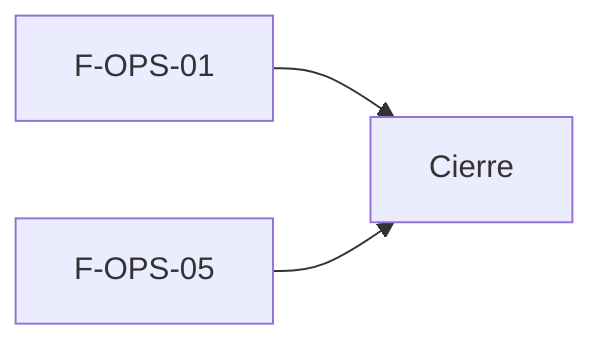

# Tasks: Plataforma · Operación, copias y documentación

**Input**: `specs/20261018-120000-operacion-copias-y-documentacion/` (spec.md, plan.md)

**Formato**: `- [ ] T### [P] [STORY-x][USy] descripción`. **[P]** = paralelizable (archivos distintos, sin dependencia); sin [P] = secuencial.

**Delivery scope**: `supabase`, `kestra`, docs

**Regla**: ninguna tarea queda `[ ]` al cierre: se hace con evidencia o se cierra con `[x]` + `Desvío:` y seguimiento trazado.

## Matriz de trazabilidad Jira ↔ US ↔ tasks

| Jira | Historia | Requisitos (dueño único) | Tasks |
|------|----------|--------------------------|-------|
| F-OPS-01 | US1 Copias de seguridad y restauración | FR-001…FR-008, SC-001, SC-003, SC-005 | T001–T012 |
| F-OPS-05 | US2 Documentación funcional y técnica | FR-010, SC-004 (parte documental) | T013–T017 |
| Tarea de cierre (label cierre) | Simulacro, revisión, seguridad y roadmap | FR-011, SC-002 | T018–T021 |

## Phase 1: F-OPS-01 — Copias de seguridad y restauración (supabase + kestra) — US1

**Goal**: copias diarias de base e imágenes con retención, verificación de restauración, aviso y procedimiento.

- [ ] T001 [F-OPS-01][US1] Verificar esquema (`respaldos_imagenes` y `verificaciones_restauracion` en `public`, backups/transversal; ninguna en `dominio`; `respaldos` sin alterar) y anotarlo en plan.md (FR-008, Principio VII)
- [ ] T002 [F-OPS-01][US1] Migración aditiva `supabase/migrations/20261018120000_copias_imagenes_y_verificaciones.sql`: dos tablas, checks de consistencia, índice de un solo `en_progreso`, RLS (select solo `private.is_superadmin()`), sin privilegios `anon`, funciones `security definer` con `revoke … public, anon, authenticated` / `grant execute … kestra_backups`, reversión en el encabezado (FR-002, FR-004, FR-008)
- [ ] T003 [P] [F-OPS-01][US1] pgTAP `supabase/tests/database/copias_imagenes_verificaciones.test.sql`: solo superadmin lee, ningún rol de organización ni `anon`, sin escritura directa, funciones solo ejecutables por `kestra_backups`, estados consistentes; `rls_en_toda_tabla` y ejecutabilidad por `anon` verdes (FR-008, SC-005)
- [ ] T004 [P] [F-OPS-01][US1] Flow `infra/kestra/flows/respaldo-imagenes.yml`: copia diaria de los objetos de Storage a un destino fuera del proyecto Supabase que los aloja; registro en `respaldos_imagenes` (en progreso / completado con cantidad, tamaño, ubicación / error con motivo) (FR-002, SC-001)
- [ ] T005 [P] [F-OPS-01][US1] Ampliar `infra/kestra/flows/respaldo-postgres.yml`: tras la verificación estructural, guardar el archivo también en el destino externo y registrar esa ubicación; sin romper el contrato de spec 011 (FR-001, SC-001)
- [ ] T006 [P] [F-OPS-01][US1] Flow `infra/kestra/flows/retencion-copias.yml`: conservar 30 diarias y 12 mensuales (parámetros), purgar el resto y nunca borrar la última copia válida (FR-003)
- [ ] T007 [P] [F-OPS-01][US1] Flow `infra/kestra/flows/verificar-restauracion.yml`: restaurar la última copia de base en un Postgres efímero y aislado, comprobar tablas esperadas con datos, registrar resultado y duración en `verificaciones_restauracion` (FR-004)
- [ ] T008 [P] [F-OPS-01][US1] Subflow `infra/kestra/flows/aviso-fallo-copias.yml`: correo SMTP al equipo de soporte con el motivo; invocado desde los `errors:` de los flows de copia y verificación (FR-005, SC-003)
- [ ] T009 [P] [F-OPS-01][US1] Variables nuevas solo en `.env.example` e `infra/kestra/.env.example` (destino externo, SMTP, correo de soporte, retención diaria/mensual); sin secretos en Git (FR-001, FR-005)
- [ ] T010 [F-OPS-01][US1] Prueba `node --test` de los flows (estructura, `errors:` con aviso, variables definidas, namespace `platform.backups`) y `pnpm infra:config` verde (FR-005, SC-003)
- [ ] T011 [P] [F-OPS-01][US1] `docs/copias-y-restauracion.md`: qué se copia, dónde, retención, objetivo de recuperación propuesto (24 h / 4 h, a confirmar con el cliente), procedimiento guiado de restauración de base e imágenes, cómo leer el historial y qué hacer ante el correo de fallo (FR-006, FR-007)
- [ ] T012 [F-OPS-01][US1] Evidencia local: `pnpm lint && pnpm build && pnpm infra:config && pnpm test`; lo que dependa de Docker/CI se anota con `Desvío:` (FR-008)

**Checkpoint**: `pnpm test:db` (pgTAP) y `pnpm infra:config` verdes.

## Phase 2: F-OPS-05 — Documentación funcional y técnica (docs) — US2

**Goal**: el equipo encuentra cómo usar, operar y entregar el sistema desde `docs/`.

- [ ] T013 [P] [F-OPS-05][US2] `docs/guia-funcional.md`: cómo usar cada función entregada hoy, por rol/sección, enlazando las guías existentes; solo lo que existe, sin inventar (FR-010)
- [ ] T014 [P] [F-OPS-05][US2] `docs/operar-sistema.md`: operar ambientes, Supabase self-hosted, Kestra, Superset, workers y alertas; enlaza `docs/copias-y-restauracion.md` y `docs/ambientes-verificacion.md` (FR-010)
- [ ] T015 [P] [F-OPS-05][US2] `docs/entregar-sistema.md`: checklist de entrega (variables, secretos fuera de Git, ambientes, copias, accesos) (FR-010)
- [ ] T016 [F-OPS-05][US2] Índice en `docs/README.md` con las tres entradas (usar / operar / entregar) y tabla funcionalidad↔documento; huecos de otras épicas se listan como deuda trazada (FR-010, SC-004)
- [ ] T017 [F-OPS-05][US2] Verificar `pnpm docs:check` y enlaces del índice sin romper (FR-010)

**Checkpoint**: índice navegable desde `docs/README.md`.

## Phase 3: Cierre

- [ ] T018 [CIERRE] Simulacro de restauración en staging con tiempo medido (≤ 4 h) y pérdida ≤ 24 h; resultado firmado por el propietario en `docs/simulacro-restauracion.md`. Si no hay autorización para tocar staging, `[x]` + `Desvío:` y seguimiento trazado (FR-011, SC-002)
- [ ] T019 [CIERRE] Revisión de que cada funcionalidad entregada tiene documentación enlazada en el índice; completar o trazar huecos (FR-011, SC-004)
- [ ] T020 [CIERRE] Revisión de seguridad (`authz-security`, `crypto-secrets`) y validación final `pnpm lint && pnpm build && pnpm infra:config && pnpm test && pnpm docs:check`; anotar en el PR (FR-011, SC-005)
- [ ] T021 [CIERRE] Al merge del PR (merge commit `--no-ff`): actualizar la fila de `docs/roadmap-template.md` (paso manual) y comprobar que ninguna tarea queda `[ ]` (FR-011)

## Plan de ejecución (historias)

| Historia | Depende de | Grupo |
|----------|------------|-------|
| F-OPS-01 | — | 1 |
| F-OPS-05 | — | 1 |
| [Cierre] | F-OPS-01, F-OPS-05 | 2 |

F-OPS-01 y F-OPS-05 son independientes (archivos distintos, sin tablas ni migraciones compartidas): van en paralelo. La dependencia con MSF-455 es externa y ya está en `main`.

