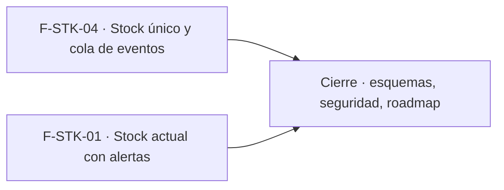

# Tasks: Stock · Stock único y alertas

**Input**: `specs/20261018-180000-stock-unico-y-alertas/` (spec.md, plan.md)

**Formato**: `- [ ] T### [P] [F-STK-xx][USy] descripción`. **[P]** = paralelizable (archivos distintos, sin dependencia; las [P] del mismo grupo van en paralelo); sin [P] = secuencial. Las dependencias de cada tarea son solo dentro de su historia. Regla del proyecto: ninguna tarea queda `[ ]` al cierre — se hace con evidencia o se cierra con `[x]` + `Desvío:` (corto, con `ver commit <hash>`) y seguimiento trazado.

**Delivery scope**: `refine`, `supabase`

**Prerrequisito**: MSF-136 (Stock movimientos) ya en `main`.

## Matriz de trazabilidad Jira ↔ US ↔ tasks

| Jira | Historia | FR / SC (dueño único) | Tasks |
|------|----------|-----------------------|-------|
| F-STK-04 | US1 Stock único y consistente entre canales | FR-001, FR-002, SC-001 → T007 · FR-003, FR-006 → T002 · FR-004, FR-007 → T001 · FR-005 → T003 · FR-008 → T008 · SC-002, SC-003, SC-005 → T005 | T001–T008 |
| F-STK-01 | US2 Stock actual con alertas | FR-009 → T009 · SC-007 → T010 · FR-010 → T011 · FR-011 → T012 · SC-008 → T013 · FR-012…FR-015, SC-006 → T014 · SC-004 → T015 | T009–T016 |
| Tarea de cierre (label `cierre`) | Esquemas, seguridad, roadmap | verificación transversal (Principios VII y VIII) | T017–T019 |

## Phase 1: F-STK-04 · Stock único y consistente entre canales (US1)

**Goal**: cola durable con evento `stock.actualizado` por cada cambio, reclamo con reintentos y prueba de concurrencia real. Solo base de datos.

- [ ] T001 [F-STK-04][US1] Migración `20261018180000_stock_cola_eventos.sql`: `public.cola_eventos` (esquema `public`, Principio VII), estados, intentos, lease, `unique (organizacion_id, tipo, clave_idempotencia)`, índices parciales, RLS (select solo Administrador), `revoke all … from public, anon, authenticated` + `grant select` de columnas; reversión en el encabezado (FR-004, FR-007)
- [ ] T002 [P] [F-STK-04][US1] Migración `20261018180100_stock_evento_actualizado.sql`: `private.emitir_stock_actualizado()` (*security definer*, `search_path = ''`, sin ejecución para `public/anon/authenticated`) y disparador `AFTER INSERT` en `dominio.movimientos_stock` con la carga del contrato y `on conflict do nothing`; reversión en el encabezado (FR-003, FR-006)
- [ ] T003 [P] [F-STK-04][US1] Migración `20261018180200_cola_eventos_reclamo.sql`: `private.reclamar_eventos` (`skip locked`, vencimiento de lease, límites del template) y `private.resolver_evento` (confirmar, liberar con espera creciente, agotar; rechaza intentos vencidos o reemplazados); verificar contra `reclamar_despachos_ejecucion` / `resolver_despacho_ejecucion` los valores por defecto y el máximo de intentos; reversión en el encabezado (FR-005)
- [ ] T004 [F-STK-04][US1] Aplicar las migraciones en limpio (`pnpm dev:supabase` + reset) y confirmar que el esquema de `public.cola_eventos` y de las funciones coincide con la doc de schema generada (`pnpm docs:check`); dejar evidencia en el commit
- [ ] T005 [P] [F-STK-04][US1] pgTAP `stock_cola_eventos.test.sql`: un evento por entrada/salida/ajuste con la carga del contrato; ninguno si la RPC revierte o la salida se rechaza; el mínimo no emite; sin consumidor el evento queda `pendiente`; reclamo exclusivo, lease vencido vuelve a `pendiente`, reintento con espera, `agotada`, confirmación vencida rechazada; otra organización y no Administrador sin filas; `authenticated` sin escritura; `anon` sin acceso; `rls_en_toda_tabla` y `aislamiento_organizaciones` verdes con la tabla nueva (SC-002, SC-003, SC-005)
- [ ] T006 [F-STK-04][US1] Confirmar que el test de ejecutabilidad por `anon` y el de `authenticated` sobre funciones de `public`/`private` siguen verdes con las funciones nuevas; ajustar su lista de excepciones solo si corresponde y con motivo en el commit
- [ ] T007 [F-STK-04][US1] `apps/web/e2e/stock-concurrencia.e2e.ts`: producto con stock 10, 20 salidas de 1 unidad en paralelo por RPC (`APIRequestContext` contra el Supabase local) → exactamente 10 aceptadas, 10 rechazadas con «No hay stock suficiente», stock 0, 10 movimientos y 10 eventos; y dos sesiones de empresas distintas de la misma organización ven la misma cantidad (FR-001, FR-002, SC-001)
- [ ] T008 [P] [F-STK-04][US1] `docs/stock-eventos.md`: contrato de `stock.actualizado` (campos y semántica de `cantidad`/`diferencia`), cola y estados, reclamo/lease/reintentos, por qué no se reutiliza `despachos_ejecucion`, cómo consumirá MSF-123 en Etapa 2, reversión de las migraciones (FR-008)

**Dependencias**: T001 → (T002 [P], T003 [P]) → T004 → (T005 [P], T006) → T007; T008 [P] en paralelo desde el inicio.

**Checkpoint**: `pnpm test:db` (pgTAP) verde y la prueba de concurrencia en verde.

## Phase 2: F-STK-01 · Stock actual con alertas de reposición (US2)

**Goal**: el listado `/stock` se actualiza en vivo y sus alertas y filtros quedan verificados contra los requisitos. Sin pantalla nueva.

- [ ] T009 [F-STK-01][US2] Migración `20261018190000_stock_existencias_realtime.sql`: agrega `dominio.existencias` a la publicación `supabase_realtime` de forma idempotente (Supabase self-hosted, sin Cloud); reversión en el encabezado (FR-009)
- [ ] T010 [P] [F-STK-01][US2] pgTAP `stock_realtime.test.sql`: `existencias` figura en `pg_publication_tables` de `supabase_realtime`; un rol de otra organización no puede leer sus filas (la RLS que Realtime aplica) (SC-007)
- [ ] T011 [F-STK-01][US2] Hook `apps/web/src/lib/useExistenciasRealtime.ts`: canal `postgres_changes` sobre `existencias` filtrado por organización activa, agrupa ráfagas, se limpia al desmontar o cambiar de organización, tolera fallos de conexión sin error bloqueante (FR-010)
- [ ] T012 [F-STK-01][US2] `apps/web/src/pages/stock/list.tsx`: usar el hook para refrescar listado y resumen con la `cargar()` actual, conservando búsqueda, filtro y página y sin mover el foco (FR-011)
- [ ] T013 [P] [F-STK-01][US2] Vitest del hook y del refresco: un aviso dispara un solo refresco, una ráfaga se agrupa, se conservan búsqueda/filtro/página, cambio de organización re-suscribe, desmontar limpia, fallo de canal deja el listado usable (SC-008)
- [ ] T014 [P] [F-STK-01][US2] Confirmar o completar `list.tsx` y `list.test.tsx` contra los requisitos: columnas producto, SKU, stock total, mínimo, estado y último movimiento con total de productos; resumen «N productos sin stock y M con stock bajo» sobre toda la organización; «Ver solo alertas»; búsqueda por nombre o SKU; filtros Todos / Sin stock / Stock bajo / Disponible; `lectura` sin botones de edición y `ninguno` sin acceso (FR-012, FR-013, FR-014, FR-015, SC-006)
- [ ] T015 [F-STK-01][US2] `apps/web/e2e/stock-actual-vivo.e2e.ts`: dos sesiones; la A abre `/stock`, la B registra una salida que deja un producto en stock bajo/sin stock → la A ve cantidad, estado y resumen actualizados sin recargar (SC-004)
- [ ] T016 [P] [F-STK-01][US2] Sección «Stock actual en vivo» en `docs/stock.md`: Realtime sobre `existencias`, qué se conserva al refrescar, comportamiento sin conexión en vivo, reversión de la publicación

**Dependencias**: T009 → (T010 [P], T011) → T012 → (T013 [P], T014 [P]) → T015; T016 [P] al final de la historia.

**Checkpoint**: pgTAP, Vitest y E2E de dos sesiones en verde (o cierre con `Desvío:` trazado si la suite no puede correr).

## Phase 3: Cierre

- [ ] T017 [CIERRE] Re-verificar el esquema de cada objeto contra las migraciones reales (`public.cola_eventos` en `public`; `existencias` y `movimientos_stock` en `dominio`) y anotar el resultado en plan.md (Principio VII)
- [ ] T018 [CIERRE] Revisión de seguridad (`authz-security`, `database-reviewer`): RLS de la cola, funciones *security definer* y sus grants, publicación Realtime con RLS; validación final `pnpm lint && pnpm build && pnpm infra:config && pnpm test && pnpm docs:check`; anotar en el PR las diferencias con el prototipo (Reservado/Disponible, depósitos, «A pedido/entrante»)
- [ ] T019 [CIERRE] Al merge del PR (merge commit `--no-ff`): actualizar la fila de Stock en `docs/roadmap-template.md` (paso manual con criterio), verificar que ninguna tarea queda `[ ]` y que cada desvío tiene seguimiento trazado

## Plan de ejecución (historias)

El **orden de toma** de las historias lo declara esta tabla: el orquestador la **consume**. F-STK-04 (solo base de datos, migraciones y docs propios) y F-STK-01 (listado y publicación Realtime) no comparten archivos, tabla ni migración y ninguna depende de la otra, por eso van en el mismo grupo.

| Historia | Depende de | Grupo |
|----------|------------|-------|
| F-STK-04 | — | 1 |
| F-STK-01 | — | 1 |
| [Cierre] | F-STK-04, F-STK-01 | 2 |

