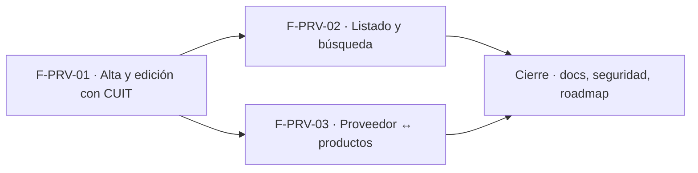

# Tasks: Clientes y proveedores · Proveedores y productos

**Input**: [spec.md](./spec.md) y [plan.md](./plan.md) · **Épica**: MSF-205
**Formato**: `- [ ] T### [P] [Historia][USx] descripción (FR/SC)`. `[P]` = paralelizable (archivos distintos, sin dependencia dentro del mismo grupo). Cada FR/SC tiene **una sola** tarea dueña.
**Validación por historia**: `pnpm test:db`, `pnpm lint`, `pnpm build` y `pnpm test:web` verdes antes de cerrar la fase.

## Phase 1: F-PRV-01 · Alta y edición de proveedor con CUIT

**Goal**: tabla `dominio.proveedores` con CUIT validado, RPC de alta/edición/estado, actividad, diálogo y ficha.

- [ ] T001 [F-PRV-01][US1] Migración `supabase/migrations/20261018190001_proveedores_tabla.sql`: `dominio.proveedores` (columnas, `unique (id, organizacion_id)`, `unique (organizacion_id, cuit)`), disparador `private.normalizar_proveedor` (recorte, CUIT a dígitos, largo, dígito verificador módulo 11, correo), RLS por organización y sección `proveedores` (select `lectura`/`edicion`, insert/update `edicion`, **sin delete**), grants por columna, `anon` sin privilegios, reversión en el encabezado (FR-001, FR-002)
- [ ] T002 [F-PRV-01][US1] Migración `supabase/migrations/20261018190100_proveedores_rpc.sql`: `public.crear_proveedor`, `public.actualizar_proveedor` (bloqueo optimista por `updated_at`) y `public.cambiar_estado_proveedor` (idempotente), `security invoker`, `search_path = ''`, `revoke … from public, anon` y `grant execute … to authenticated` (FR-003, FR-004, FR-005)
- [ ] T003 [P] [F-PRV-01][US1] Migración `supabase/migrations/20261018190200_proveedores_actividad.sql`: disparador `security definer` que registra `proveedor.creado|editado|desactivado|reactivado` vía `private.insertar_actividad` con la razón social, sin evento si no hubo cambio (FR-006)
- [ ] T004 [F-PRV-01][US1] pgTAP `supabase/tests/database/proveedores.test.sql`: RLS por organización y por nivel (Administrador/Administración escriben; Depósito, Operador, Mostrador, Consulta no), CUIT válido/inválido/con guiones/duplicado incluso inactivo, conflicto de edición, estado idempotente, eventos de actividad, sin `delete`, `anon` sin ejecución; `rls_en_toda_tabla` verde (SC-001)
- [ ] T005 [P] [F-PRV-01][US1] `apps/web/src/lib/cuit.ts` (normalizar, validar con dígito verificador, formatear `XX-XXXXXXXX-X`) + `cuit.test.ts` con los mismos vectores que pgTAP (soporte de FR-007)
- [ ] T006 [P] [F-PRV-01][US1] `apps/web/src/lib/proveedores.ts` (tipos, llamadas a las RPC, mapeo de `23505`/conflicto/`42501` a mensajes claros) (soporte de FR-007 y FR-008)
- [ ] T007 [F-PRV-01][US1] `apps/web/src/components/proveedores/ProveedorFormDialog.tsx`: diálogo Nuevo/Editar con Razón social, CUIT, Persona de contacto, Correo, Teléfono, Dirección y Observaciones, `Cancelar`/`Guardar proveedor`, errores asociados al campo, foco, estados compartidos, adaptable (FR-007)
- [ ] T008 [F-PRV-01][US1] `apps/web/src/pages/proveedores/show.tsx`: ficha con datos, volver a Proveedores, **Editar**, **Desactivar**/**Reactivar** con confirmación, inactivo marcado, acciones ocultas por nivel (FR-008)
- [ ] T009 [F-PRV-01][US1] Registrar el recurso `proveedores` en Refine con la ruta `/proveedores/show/:id` y la apertura del diálogo, protegida por nivel de sección (sin permiso → «Acceso restringido») (FR-009)
- [ ] T010 [F-PRV-01][US1] Vitest del diálogo y la ficha: validación y formato de CUIT, errores por campo, duplicado y conflicto, confirmación de desactivar/reactivar, acciones ocultas por nivel, teclado/lector (SC-002)

**Checkpoint F-PRV-01**: `pnpm test:db`, `pnpm lint`, `pnpm build` y `pnpm test:web` verdes.

## Phase 2: F-PRV-02 · Listado y búsqueda de proveedores

**Goal**: pantalla `/proveedores` con búsqueda, filtro de estado y paginación en servidor, y su entrada de menú.

- [ ] T011 [F-PRV-02][US2] Migración propia `supabase/migrations/20261018190300_proveedores_listar.sql`: `public.listar_proveedores(p_busqueda, p_estado, p_pagina, p_tamano)` (`security invoker`, razón social parcial sin mayúsculas/tildes, CUIT con o sin guiones, orden estable, tope 200, `total_filas`), índice de búsqueda, `revoke`/`grant`, reversión en el encabezado (FR-010)
- [ ] T012 [P] [F-PRV-02][US2] pgTAP `supabase/tests/database/proveedores_listar.test.sql`: búsqueda por razón social y CUIT, estado activos/inactivos/todos, orden estable, paginación y tope, aislamiento por organización y sección, `anon` sin ejecución (SC-003)
- [ ] T013 [P] [F-PRV-02][US2] `apps/web/src/hooks/useListarProveedores.ts` (RPC, búsqueda con debounce, estado y paginación, errores) (soporte de FR-011)
- [ ] T014 [F-PRV-02][US2] `apps/web/src/pages/proveedores/list.tsx`: tabla Razón social, CUIT, Correo y Teléfono, buscador «Buscar por razón social o CUIT», filtro Estado, paginación, **Nuevo proveedor** (abre `ProveedorFormDialog`), **Ver ficha**, «Sin resultados», vacío inicial, carga/error con «Reintentar», tarjetas en angosto (FR-011)
- [ ] T015 [F-PRV-02][US2] Entrada de menú **Proveedores** con icono en el grupo Clientes y proveedores, visible según el nivel de sección, y ruta canónica `/proveedores` con acceso restringido sin permiso (FR-012)
- [ ] T016 [F-PRV-02][US2] Vitest del listado y la navegación: búsqueda, filtro de estado, paginación conservando filtros, «Sin resultados», error con reintento, vista adaptable, entrada de menú por rol, acceso restringido (SC-004)

**Checkpoint F-PRV-02**: `pnpm test:db`, `pnpm lint`, `pnpm build` y `pnpm test:web` verdes.

## Phase 3: F-PRV-03 · Relación del proveedor con los productos

**Goal**: cada producto guarda su proveedor y el código del proveedor; la ficha lista sus productos; `proveedores_basico` sirve a quien registra ingresos.

- [ ] T017 [F-PRV-03][US3] Migración propia `supabase/migrations/20261018190400_productos_proveedor.sql`: `proveedor_id` y `codigo_proveedor` en `dominio.productos`, FK compuesta `(proveedor_id, organizacion_id)`, índice, restricción «sin código sin proveedor», disparador «proveedor nuevo activo», grants por columna, reversión en el encabezado (FR-013)
- [ ] T018 [P] [F-PRV-03][US3] Migración `supabase/migrations/20261018190500_proveedores_basico.sql`: vista `public.proveedores_basico` (`id`, `razon_social`, `activo`) filtrada por organización y nivel (`edicion` en `productos`, o `lectura`/`edicion` en `stock` o `proveedores`), `revoke … from public, anon`, `grant select … to authenticated`, justificación de la vista en el encabezado (FR-014)
- [ ] T019 [F-PRV-03][US3] Migración `supabase/migrations/20261018190600_productos_proveedor_rpc.sql`: reemplaza `crear_producto` y `actualizar_producto` con `p_proveedor_id`/`p_codigo_proveedor` opcionales, conservando permisos, bloqueo optimista, costo y eventos; `revoke`/`grant`; reversión con las firmas de `20261017120200`/`20261017120400`; contrato señalado en el PR (FR-015)
- [ ] T020 [P] [F-PRV-03][US3] Migración `supabase/migrations/20261018190700_productos_de_proveedor.sql`: `public.productos_de_proveedor(p_proveedor_id, p_pagina, p_tamano)` (`security invoker`, exige `proveedores` y `productos`, orden por nombre, tope 100, `total_filas`), `revoke`/`grant` (FR-017)
- [ ] T021 [F-PRV-03][US3] pgTAP `supabase/tests/database/proveedores_productos.test.sql`: columnas y FK compuesta, rechazo de proveedor ajeno/inexistente/inactivo nuevo, código sin proveedor, quitar proveedor limpia el código, `proveedores_basico` sin CUIT ni contacto para un Operador y sin filas ajenas, `productos_de_proveedor` por niveles, `crear/actualizar_producto` con y sin proveedor (SC-005)
- [ ] T022 [P] [F-PRV-03][US3] `apps/web/src/hooks/useProveedoresBasico.ts` y ajuste de `apps/web/src/lib/productos*` para enviar `proveedor_id`/`codigo_proveedor` a las RPC (soporte de FR-016)
- [ ] T023 [F-PRV-03][US3] Campos **Proveedor** (selector con búsqueda, opcional, solo activos para nuevas asignaciones, «No hay proveedores activos») y **Código del proveedor** en `apps/web/src/pages/productos/create.tsx` y `edit.tsx`, con mensajes de error claros (FR-016)
- [ ] T024 [P] [F-PRV-03][US3] `apps/web/src/hooks/useProductosDeProveedor.ts` (RPC, paginación, estados) (soporte de FR-018)
- [ ] T025 [F-PRV-03][US3] `apps/web/src/components/proveedores/ProductosDelProveedor.tsx` (Producto, Código del proveedor, **Ver producto**, inactivos marcados, paginación, vacío «Este proveedor todavía no tiene productos.», carga/error aislados, tarjetas en angosto) montado en `apps/web/src/pages/proveedores/show.tsx` (FR-018)
- [ ] T026 [F-PRV-03][US3] Vitest de producto y ficha: selector y código en alta/edición, quitar proveedor, proveedor desactivado conservado, sección Productos con vacío/error/paginación, teclado/lector; actualizar `productos/create.test.tsx` y `edit.test.tsx` (SC-006)

**Checkpoint F-PRV-03**: `pnpm test:db`, `pnpm lint`, `pnpm build` y `pnpm test:web` verdes.

## Phase 4: Documentación, seguridad y cierre

- [ ] T027 [P] [CIERRE] Documentación (Principio VIII): `docs/proveedores.md` (modelo, CUIT, roles, `proveedores_basico`, contrato `productos.proveedor_id`/`codigo_proveedor` para MSF-219 y reposición, reversión), `docs/permisos-por-rol.md`, `docs/actividad.md` (tipos `proveedor.*`) y corrección de `docs/catalogo.md` (proveedor entregado; código de barras fuera de esta épica); `pnpm docs:check` verde (FR-019)
- [ ] T028 [CIERRE] Revisión de seguridad (`authz-security`, `database-reviewer`) de la RLS de `dominio.proveedores`, la vista `proveedores_basico`, las RPC nuevas y las de producto reemplazadas; re-verificar el esquema de cada objeto (`proveedores` y `productos` en `dominio`, vista en `public`); validación final `pnpm lint && pnpm build && pnpm test && pnpm docs:check && pnpm matriz:check`; anotar en el PR las diferencias con el prototipo (Desactivar en vez de Eliminar, condiciones de compra, «Compra para», «Enviar correo», N.º, Último ingreso, Costo) y el cambio de contrato de las RPC de producto (SC-007)
- [ ] T029 [CIERRE] Abrir los seguimientos trazados (Tarea `seguimiento` en Jira) de lo que el prototipo muestra y la épica no pide: condiciones de compra, «Compra para», «Enviar correo a proveedor», importar/exportar proveedores, N.º correlativo, Último ingreso y Costo en la ficha (MSF-219/MSF-179), código de barras, varios proveedores por producto; anotar los links en esta tarea (FR-020)
- [ ] T030 [CIERRE] Al merge del PR (merge commit `--no-ff`): actualizar la fila de `docs/roadmap-template.md` (paso manual) y comprobar que ninguna tarea queda `[ ]`

## Dependencias

Dentro de F-PRV-01: T001 → T002 → T004; T001 → T003 [P] (con T002) → T004; T005 [P] y T006 [P] pueden arrancar con T001 → T007 → T008 → T009 → T010.
Dentro de F-PRV-02: T011 → (T012 [P], T013 [P]) → T014 → T015 → T016.
Dentro de F-PRV-03: T017 → (T018 [P], T019, T020 [P]) → T021; T022 [P] y T024 [P] → T023 y T025 → T026.
Cierre: T027 [P] puede arrancar con las historias; T028 → T029 → T030 al final. Las tareas [CIERRE] nunca son prerequisito de una historia.
Entre historias: F-PRV-02 y F-PRV-03 requieren F-PRV-01 mergeada (la tabla, el diálogo y la ficha), nunca una tarea abierta de otra historia. F-PRV-02 y F-PRV-03 no comparten archivos ni migraciones.

## Plan de ejecución (historias)

El **orden de toma** de las historias lo declara esta tabla: el orquestador la **consume** (no lo infiere del orden de las tareas). Una historia arranca cuando sus dependencias (`Depende de`) están **Finalizadas (mergeadas)**; las del **mismo** `Grupo` van **en paralelo** (F-PRV-02 y F-PRV-03 no comparten archivos, tabla ni migración).

| Historia | Depende de | Grupo |
|----------|------------|-------|
| F-PRV-01 | — | 1 |
| F-PRV-02 | F-PRV-01 | 2 |
| F-PRV-03 | F-PRV-01 | 2 |
| [Cierre] | F-PRV-01, F-PRV-02, F-PRV-03 | 3 |

