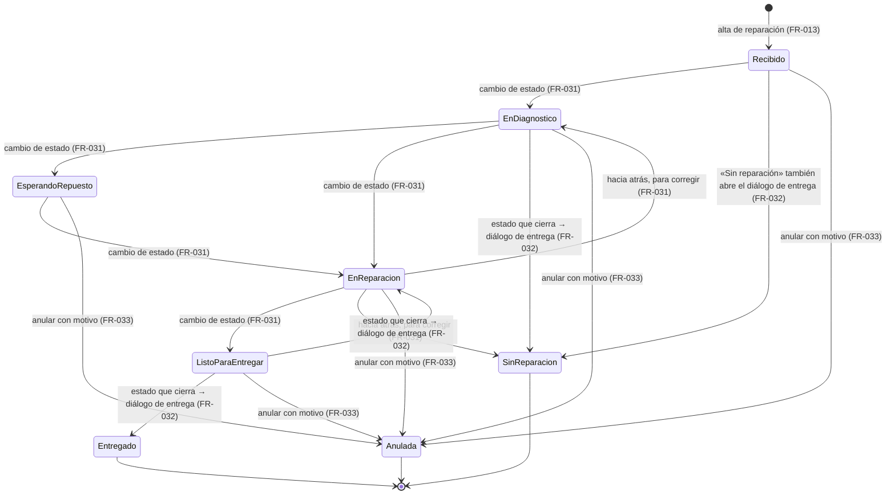
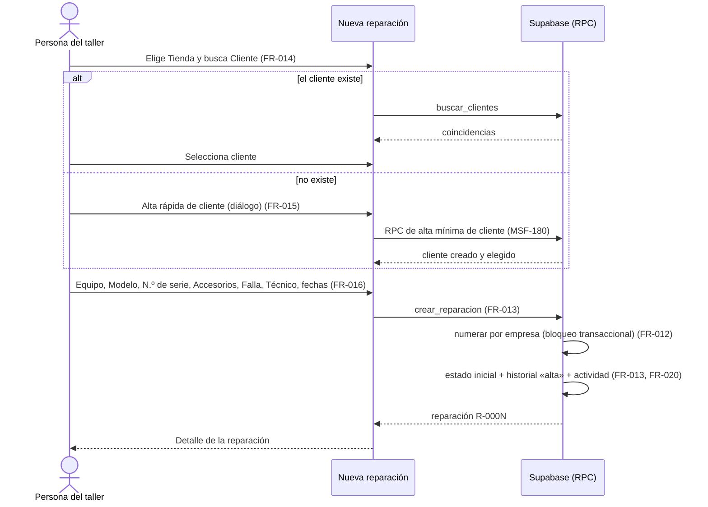
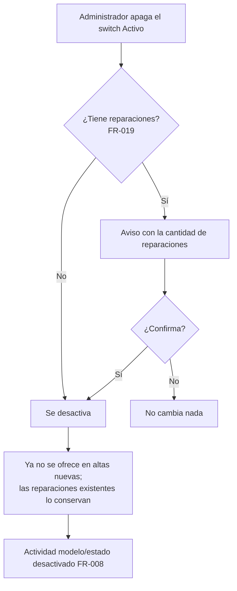
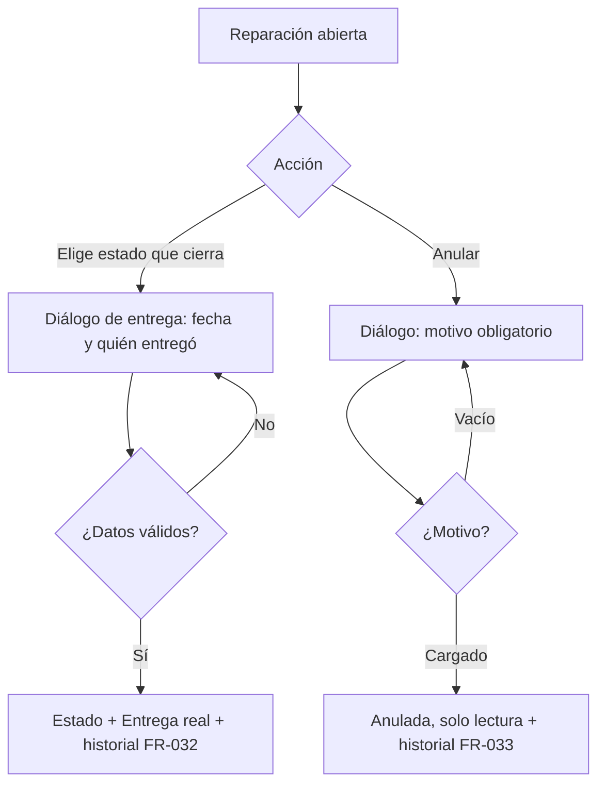

# Feature Specification: Service técnico · Service alta, estados y permisos

**Feature Branch**: `epic/MSF-182-service-tecnico-service-alta-estados-y-p`

**Jira Epic**: MSF-182 — Service técnico · Service alta estados y permisos (spec `service-alta-estados-y-permisos`)

**Created**: 2026-10-20

**Status**: Ready for implementation — la especificación viene completa desde Jira. Los puntos de «A revisar» no bloquean: cada uno lleva una decisión provisoria en *Decisiones abiertas*.

**Delivery scope**: `refine` (apps/web) y `supabase` (migraciones + RPC + pgTAP). Sin `kestra`, `superset` ni `workers`.

**Prioridad / Hito**: P0 · Hito 4 (30 de noviembre al 11 de diciembre de 2026) · 27 h (la suma de tallas da 32 h; se conserva el 27 del doc) · alcance diciembre.

**Dependencias**:
- Bloqueada por: MSF-121 (Acceso · Permisos por empresa: `permisos_rol`, `usuarios_empresas`, `private.nivel_seccion()`, empresa activa; trae Usuarios y roles MSF-125 y Empresas MSF-138) y MSF-180 (Clientes · alta y búsqueda: tabla de clientes, búsqueda y RPC de alta mínima). **MSF-121 ya está en `main`** (`docs/permisos-por-rol.md`, `docs/empresa-activa.md`; la sección `service_tecnico` ya está sembrada en la matriz). **De MSF-180 la búsqueda (`public.buscar_clientes`) está en `main`; la RPC de alta mínima de cliente no existe todavía** (verificar su nombre con Clientes; ver *Decisiones abiertas* 7).
- Bloquea a: MSF-199 (Service listado, ítems e impresión), que necesita reparaciones, estados y entrega.
- Relacionada, sin bloqueo: Plataforma · historial de actividad (F-AUD-01, `registro_actividad`): los eventos se construyen contra el contrato ya vigente (`private.registrar_actividad`, `docs/actividad.md`).
- Esta épica no se recorta: sin alta ni estados no hay service.

**Input**: Epic MSF-182. Objetivo: «Al terminar, el taller puede dar de alta una reparación con su cliente, equipo y número de serie, cambiarle el estado con historial y registrar la entrega, con modelos y estados configurables y permisos propios para técnicos.»

**Regla de fuentes** (literal de la épica):
- Comportamiento y datos: mandan los requisitos y escenarios de esta historia.
- Qué se ve (disposición, textos, estados, popups, flujos): el prototipo validado es referencia visual, no hace falta que quede extremadamente idéntico; los flujos (si hay) aclaran estados y acciones.
- Cómo se construye (componentes, estilos y patrones): mandan el template y el system design del producto (MSF-117, `docs/sistema-de-diseno.md`). No se copia HTML ni CSS: se reproduce con los componentes del template y los tokens.
- El prototipo muestra más que esta historia: se implementa solo lo que piden los requisitos de esta épica; otras secciones, botones o diálogos son de otras historias.
- Si algo no se puede igualar: lo más cercano, sin inventar, anotando la diferencia en el PR. Si prototipo y requisitos se contradicen: requisitos para el comportamiento, prototipo para lo visual, y la contradicción queda anotada en el PR.
- Prototipos (solo lectura, presentes en el árbol de trabajo; la rama `design/prototipo` no existe en `origin` hoy): `design/pantallas/ServicioModelos.dc.html`, `ServicioEstados.dc.html`, `ServicioReparacion.dc.html` (+ carpeta homónima), `ServicioReparaciones.dc.html`, `Roles.dc.html` y `AccesoRestringido.dc.html`. Inventarios generados con `pnpm prototipo:inventario` (`*.inventory.json` al día en el repo).

## Modelo y supuestos

- **Modelos y estados son por organización** (no por empresa); **la numeración de reparaciones es por empresa** (cada reparación pertenece a la empresa/tienda que recibió el equipo).
- El cliente ya existe en Clientes o se crea con el **alta rápida** desde la propia reparación.
- **Los importes se cargan sin IVA.**
- **Datos iniciales** (los del panel actual, sembrados por organización): siete modelos —Nintendo Switch Estándar / Lite / OLED, Joystick Pro Controller / Joy-Con (par), PlayStation 4 Slim, PlayStation 5 Estándar— y los estados del prototipo: Recibido, En diagnóstico, Esperando repuesto, En reparación, Listo para entregar, Entregado y Sin reparación. La épica habla de **ocho** estados y dice que la lista completa con su mensaje «se define con el cliente»: el prototipo trae siete; el octavo queda pendiente de definición (ver *Decisiones abiertas* 1) y se agrega desde la pantalla de Estados, sin migración.
- **La matriz de permisos de Service técnico es fija** en el lanzamiento (la matriz editable pasa a enero). La sección `service_tecnico` **ya existe** en la matriz (Administrador y Operador `edicion`; Consulta, Mostrador, Administración `lectura`; Depósito `ninguno`); esta épica agrega el **rol Técnico**.
- Base del template: RLS por `organizacion_id` con `private.organizacion_id()`, nivel por sección con `private.nivel_seccion()`, patrón de RPC, feature flags por organización (`private.tiene_feature`), `roles_organizacion` como datos, kit de panel (estados vacío/error/carga) y patrón CRUD de clientes.
- «Alta» de una reparación **no** incluye ítems de mano de obra ni repuestos, impresión de la orden ni listado: son de MSF-199.

### Esquema de datos (Constitución, Principio VII)

| Objeto | Esquema | Justificación | RLS / acceso |
|--------|---------|---------------|--------------|
| `modelos_equipo` (**nueva**, F-SVC-01) | **`dominio`** | Entidad de negocio del producto (qué equipos se reparan), no plataforma. | **Sí**: `organizacion_id = (select private.organizacion_id())`; `select` con `private.nivel_seccion('service_tecnico')` en `lectura`/`edicion`; `insert`/`update` con `edicion`; **sin `delete`**. `anon` sin acceso. |
| `estados_reparacion` (**nueva**, F-SVC-01) | **`dominio`** | Etapas del proceso de reparación del producto; es dominio. | Igual que `modelos_equipo`. |
| `reparaciones` (**nueva**, F-SVC-02) | **`dominio`** | Entidad central del negocio de Service. | Igual + `empresa_id` de la organización; sin `delete` (se anula, no se borra). |
| `reparacion_historial` (**nueva**, F-SVC-02; la usa F-SVC-03) | **`dominio`** | Bitácora de negocio de cada reparación (estados, entrega, anulación); distinta de la actividad transversal. | `select` por organización y nivel; **solo se escribe desde RPC `security definer`** (sin `insert/update/delete` directos); `anon` sin acceso. |
| `roles_organizacion` / `permisos_rol` / `permisos_rol_accion` (**existentes**, F-SVC-05 solo agrega datos) | `public` (sin cambio) | Mecanismo de acceso transversal (Principio VII); el rol `tecnico` y sus filas son datos. | RLS vigente de MSF-125/MSF-121. |
| `public.registro_actividad` (**existente**) | `public` (sin cambio) | Tabla transversal; solo se escribe vía `private.registrar_actividad`. | Vigente. |

No se crean otras tablas (la numeración usa un bloqueo transaccional, no una tabla contador). `rls_en_toda_tabla` (pgTAP, recorre `public` + `dominio`) debe seguir verde. Todas las migraciones son **aditivas** con reversión documentada en su encabezado.

## User Scenarios & Testing *(mandatory)*

### User Story 1 - Modelos de equipo y estados de reparación configurables (F-SVC-01, P0, talla S)

Como administrador del taller, quiero configurar los modelos de equipo y los estados de reparación, para que el taller trabaje con sus propios modelos y etapas.

**Why this priority**: sin modelos y estados no se puede dar de alta ninguna reparación.

**Independent Test**: con el rol Administrador, una organización recién creada ya tiene sus siete modelos y sus estados; crear, editar, reordenar y activar/desactivar un modelo o un estado se refleja en pantalla; con Depósito la sección no existe; otra organización no ve nada de esto.

**Acceptance Scenarios**:
1. **Given** una organización nueva, **When** el Administrador abre «Modelos», **Then** ve los siete modelos iniciales con Equipo, Modelo, Mano de obra base y Activo.
2. **Given** «Nuevo modelo», **When** completa Equipo, Modelo y Mano de obra base y pulsa «Crear modelo», **Then** aparece en la tabla; si repite Equipo+Modelo recibe un error claro.
3. **Given** «Estados de reparación», **When** sube o baja un estado, **Then** el orden cambia y persiste (el orden define el flujo).
4. **Given** el switch «Avisa al cliente» de un estado, **When** lo cambia, **Then** queda guardado (el aviso real no se envía en esta épica).
5. **Given** un usuario con `service_tecnico` en `lectura`, **When** abre Modelos o Estados, **Then** ve la lista pero no puede crear, editar, reordenar ni activar/desactivar.

### User Story 2 - Alta y edición de reparación (F-SVC-02, P0, talla L)

Como persona del taller, quiero dar de alta una reparación con su cliente, equipo y número de serie y poder editarla, para registrar el equipo que ingresa.

**Why this priority**: es el corazón del módulo; sin alta no hay service.

**Independent Test**: crear una reparación eligiendo cliente existente (o creándolo con el alta rápida), modelo y número de serie; recibe número correlativo de su empresa, estado inicial y fecha de ingreso; se edita con control de conflicto; desactivar un modelo o estado en uso avisa con la cantidad de reparaciones.

**Acceptance Scenarios**:
1. **Given** «Nueva reparación», **When** elige Tienda, Cliente, Equipo/Modelo y completa N.º de serie y Falla informada, **Then** se crea con número `R-0001` de esa empresa, el primer estado activo (Recibido) e ingreso de hoy.
2. **Given** el campo Cliente, **When** no encuentra al cliente, **Then** ofrece el alta rápida en un diálogo y, al guardar, el cliente queda elegido en la reparación.
3. **Given** dos altas simultáneas en la misma empresa, **Then** reciben números distintos y sin saltos; en otra empresa la numeración es independiente.
4. **Given** una reparación abierta en dos pestañas, **When** la segunda guarda con datos viejos, **Then** recibe «Esta reparación cambió; recargá» y no pisa el cambio.
5. **Given** un modelo con reparaciones, **When** el Administrador lo desactiva, **Then** ve un aviso con la cantidad de reparaciones, confirma, y las reparaciones existentes lo conservan mientras el modelo ya no se ofrece en altas nuevas (ídem estados).
6. **Given** un usuario sin `ver_costos`, **Then** no ve ni edita Costo mano de obra / Costo repuestos.
7. **Given** una reparación anulada, **Then** no se puede editar.

### User Story 3 - Cambio de estado, historial y entrega (F-SVC-03, P0, talla M)

Como persona del taller, quiero cambiar el estado de la reparación con historial y registrar la entrega, para saber en qué etapa está cada equipo y cuándo se retiró.

**Why this priority**: cierra el ciclo de la reparación; la verificación de la épica la recorre completa.

**Independent Test**: crear una reparación, pasarla por tres estados (cada cambio queda en el historial con fecha y usuario) y entregarla con fecha y quién entregó; anular otra con motivo.

**Acceptance Scenarios**:
1. **Given** una reparación en «Recibido», **When** elige «En diagnóstico», **Then** el estado cambia y el historial suma «En diagnóstico · fecha · usuario».
2. **Given** el mismo estado elegido otra vez, **Then** no se duplica el historial.
3. **Given** un estado que **cierra la reparación**, **When** lo elige, **Then** se abre el diálogo de entrega (fecha y quién entregó); al confirmar se guarda la Entrega real y el cierre queda en el historial.
4. **Given** «Anular», **When** confirma con un motivo obligatorio, **Then** la reparación queda anulada, marcada y de solo lectura, con el motivo en el historial.
5. **Given** un usuario con `lectura`, **Then** ve el estado y el historial pero no puede cambiarlos.
6. **Given** dos cambios de estado simultáneos, **Then** ambos quedan en el historial en orden, sin pisarse.

### User Story 4 - Permisos de Service técnico y rol Técnico (F-SVC-05, P0, talla S)

Como administrador, quiero asignar el rol Técnico con permisos propios sobre Service técnico, para que los técnicos operen sin acceder al resto.

**Why this priority**: sin el rol no se pueden dar permisos acotados a los técnicos.

**Independent Test**: un usuario con rol Técnico edita Service técnico y tiene `ninguno` en las secciones reservadas; la matriz sigue siendo fija; ningún rol existente cambia de nivel.

**Acceptance Scenarios**:
1. **Given** una organización existente o nueva, **Then** existe el rol `tecnico` con su fila para cada sección (backfill + trigger de sembrado).
2. **Given** un usuario Técnico, **Then** `nivel_seccion('service_tecnico') = 'edicion'` y su acceso a las demás secciones es el de la matriz inicial del rol.
3. **Given** la pantalla Roles y permisos, **Then** muestra la columna Técnico como parte de la matriz fija (sin edición).
4. **Given** Usuarios, **Then** «Técnico» se puede asignar como rol.
5. **Given** los roles existentes, **Then** sus niveles no cambian (pgTAP de regresión).

### Edge Cases

- Cliente de otra organización o inexistente → rechazo (`23503`/`42501`), nunca una reparación cruzada.
- Modelo o estado inactivo en el alta → rechazo; en una reparación ya creada se conserva.
- Número de serie vacío permitido (joysticks: «—» en el prototipo); duplicado de serie **no** se bloquea (un equipo puede reingresar).
- Importes negativos → rechazo; con decimales sin IVA.
- Entrega real anterior al ingreso → rechazo.
- Estado inexistente / de otra organización → rechazo.
- Sin sesión o sin empresa accesible → `42501`.

## Flujos

### Flujo 1 · Ciclo de vida de la reparación (máquina de estados)

Los estados son configurables por organización; el diagrama muestra el flujo inicial del prototipo («el orden define el flujo»). Cada transición exige `service_tecnico` en `edicion` (FR-031); la reparación nace en el primer estado activo (FR-013).

Notas: las transiciones dibujadas son las del flujo nominal; por decisión de Nicolás el sistema admite pasar de cualquier estado abierto a cualquier otro estado activo, también hacia atrás (el diagrama solo dibuja el flujo nominal y algunos retrocesos de ejemplo; *Decisiones abiertas* 4). «Anulada» no es un estado configurable: es una marca de la reparación (`anulada_en` + motivo). El **aviso real al cliente** de los estados con «Avisa al cliente» queda FUERA DE ALCANCE (solo se guarda el indicador, FR-006).

### Flujo 2 · Alta de reparación con alta rápida de cliente

### Flujo 3 · Desactivar un modelo o estado en uso

### Flujo 4 · Entrega y anulación

## Requirements *(mandatory)*

### Functional Requirements

**F-SVC-01 · Modelos y estados configurables**

- **FR-001**: Existe `dominio.modelos_equipo` (`organizacion_id`, `equipo`, `modelo`, `mano_obra_base` ≥ 0 sin IVA, `activo`, `updated_at`), única por organización + equipo + modelo sin distinguir mayúsculas/tildes, con RLS por organización y nivel de `service_tecnico`, sin `delete` y sin acceso de `anon`.
- **FR-002**: Existe `dominio.estados_reparacion` (`organizacion_id`, `nombre` único por organización, `descripcion` = «Qué significa», `orden`, `avisa_cliente`, `cierra`, `tono` visual, `activo`, `updated_at`), con la misma RLS que FR-001.
- **FR-003**: Cada organización (nueva por trigger y existentes por backfill) recibe los siete modelos y los siete estados iniciales del prototipo; el sembrado es idempotente. Los estados «Entregado» y «Sin reparación» nacen con `cierra = true`; «Recibido», «Esperando repuesto», «Listo para entregar» y «Sin reparación» con `avisa_cliente = true`.
- **FR-004**: RPC `crear_modelo_equipo`, `actualizar_modelo_equipo` (bloqueo optimista por `updated_at`) y `cambiar_estado_modelo_equipo` (activar/desactivar, idempotente), `security invoker`, exigen `edicion`; `revoke … from public, anon` y `grant execute … to authenticated`.
- **FR-005**: RPC `crear_estado_reparacion`, `actualizar_estado_reparacion` (nombre, descripción, `avisa_cliente`), `mover_estado_reparacion` (subir/bajar: intercambio atómico de `orden`) y `cambiar_estado_estado_reparacion` (activar/desactivar), mismas reglas de acceso que FR-004.
- **FR-006**: El indicador `avisa_cliente` y el indicador `cierra` se guardan y se muestran; **no** se envía ningún aviso en esta épica.
- **FR-007**: Pantalla **Modelos** (`/service-tecnico/modelos`): tabla Equipo, Modelo, Mano de obra base y Activo (switch), botón «Nuevo modelo» con el diálogo (Equipo, Modelo, Mano de obra base en ARS, «Cancelar»/«Crear modelo»), subtítulo «Consolas y equipos que se reparan, con su mano de obra base.», estados vacío/error/carga/éxito, errores de validación asociados al campo, foco y teclado, adaptable a 320/768/1440 px.
- **FR-008**: Pantalla **Estados de reparación** (`/service-tecnico/estados`): tabla Orden (botones Subir/Bajar), Estado, Qué significa, Avisa al cliente (switch) y Cierra la reparación (solo lectura), aviso informativo, botón «Nuevo estado» con el diálogo (Nombre, Qué significa, «Avisar al cliente al pasar a este estado», «Cancelar»/«Crear estado»), mismos estados compartidos y adaptabilidad que FR-007. Registra además eventos de actividad `modelo.*` y `estado.*` (`creado`, `editado`, `desactivado`, `reactivado`, `reordenado`) vía `private.registrar_actividad`, en la misma transacción, sin evento si no hubo cambio.
- **FR-009**: Entrada de menú **Service técnico** (icono, grupo propio) con la tira de pestañas Reparaciones / Modelos / Estados de reparación, visible por nivel de `service_tecnico` y por la funcionalidad `service-tecnico` de la organización (`private.tiene_feature`), recursos registrados en `SECCION_POR_RECURSO`; sin permiso → «Acceso restringido».
- **FR-010**: Documentación de la historia en `docs/service-tecnico.md` (modelo de datos, sembrado, RPC, reversión).

**F-SVC-02 · Alta y edición de reparación**

- **FR-011**: Existe `dominio.reparaciones` (`organizacion_id`, `empresa_id` = Tienda, `numero`, `cliente_id` con FK compuesta a `public.clientes (id, organizacion_id)`, `contacto`, `modelo_id` y `estado_id` con FK compuesta a su organización, `numero_serie` opcional, `accesorios`, `falla`, `costo_mano_obra` y `costo_repuestos` ≥ 0 sin IVA, `tecnico_id`, `ingreso_en`, `entrega_prevista`, `entrega_real`, `entregado_por`, `anulada_en`, `anulada_motivo`, `updated_at`), única por empresa + número, con RLS por organización y nivel, sin `delete` y sin acceso de `anon`.
- **FR-012**: La numeración es **correlativa por empresa**, formato `R-0001`, asignada en el servidor bajo bloqueo transaccional: sin saltos ni repetidos con altas simultáneas; otra empresa tiene su propia serie.
- **FR-013**: Existe `dominio.reparacion_historial` (reparación, tipo `alta`/`estado`/`entrega`/`anulacion`, estado anterior y nuevo, nota, usuario, fecha) con RLS de solo lectura por organización y nivel, sin escritura directa. RPC `crear_reparacion` (exige `edicion`; valida cliente, modelo activo y empresa accesibles de la organización; asigna número, primer estado activo por `orden` e ingreso de hoy; escribe el evento `alta` y la actividad `reparacion.creada`).
- **FR-014**: El campo Cliente busca con `public.buscar_clientes` y muestra solo clientes de la organización; el campo Contacto se completa con el del cliente y es editable.
- **FR-015**: **Alta rápida de cliente** dentro de la reparación: diálogo mínimo que usa la RPC de alta mínima de MSF-180 (sin duplicar su lógica ni validaciones) y deja el cliente elegido; errores de la RPC se muestran en el diálogo.
- **FR-016**: Pantalla **Nueva reparación / Reparación R-000N** (`/service-tecnico/reparaciones/nueva` y `/:id`): breadcrumb «Reparaciones», título, tarjeta «Cliente y equipo» (Tienda, Cliente, Contacto, Consola o equipo, Modelo, N.º de serie, Accesorios recibidos, Falla informada), costo interno (Costo mano de obra, Costo repuestos), tarjeta «Técnico y fechas» (Técnico, Ingreso, Entrega prevista, Entrega real de solo lectura) y botón «Guardar»; Tienda por defecto = empresa activa; Técnico elegible entre los usuarios de la organización con `service_tecnico` en `edicion` (RPC de lectura sin datos personales extra).
- **FR-017**: RPC `actualizar_reparacion` con bloqueo optimista por `updated_at`; no edita reparaciones anuladas; no cambia número, empresa ni estado (el estado va por F-SVC-03); registra la actividad `reparacion.editada` solo si hubo cambio. Validaciones: cliente y modelo obligatorios, importes ≥ 0, entrega prevista no anterior al ingreso; mensajes claros por campo.
- **FR-018**: La pestaña **Reparaciones** de Service técnico ofrece «Nueva reparación» y lleva al detalle recién creado; el **listado** de reparaciones queda para MSF-199 (*Decisiones abiertas* 5).
- **FR-019**: Uso de modelos y estados: RPC `uso_modelo_equipo` y `uso_estado_reparacion` devuelven la cantidad de reparaciones que los usan; la tabla de Modelos suma la columna **Reparaciones** y, al desactivar un modelo o estado en uso, se muestra un aviso con la cantidad y se pide confirmación; desactivarlo no altera las reparaciones existentes y deja de ofrecerse en altas nuevas.
- **FR-020**: Actividad `reparacion.creada` / `reparacion.editada` en la misma transacción que la operación.
- **FR-021**: Los costos internos (`costo_mano_obra`, `costo_repuestos`) solo los devuelve y los acepta la base si el usuario tiene la acción `ver_costos` de `service_tecnico`; sin ella llegan nulos y la UI los oculta (*Decisiones abiertas* 3).
- **FR-022**: Documentación de la historia en `docs/service-tecnico.md` (reparaciones, numeración, costos, alta rápida).

**F-SVC-03 · Cambio de estado, historial y entrega**

- **FR-030**: Sección **Estado** en el detalle: selector con los estados activos, el «Qué significa» del estado elegido como ayuda y la sección **Historial de estados** (estado · fecha · usuario, más reciente primero), de solo lectura.
- **FR-031**: RPC `cambiar_estado_reparacion` (exige `edicion`; estado activo de la misma organización; reparación no anulada ni cerrada por entrega; bloquea la fila para serializar cambios simultáneos; **idempotente**: elegir el estado actual no duplica historial); escribe el evento `estado` con estado anterior, nuevo, usuario y fecha, y la actividad `reparacion.estado_cambiado`.
- **FR-032**: **Entrega**: al elegir un estado con `cierra = true` la UI abre el diálogo de entrega (fecha y quién entregó); RPC `registrar_entrega_reparacion` guarda `entrega_real` y `entregado_por`, cambia el estado en la misma transacción, escribe el evento `entrega` y la actividad `reparacion.entregada`. Fecha no anterior al ingreso ni futura; quién entregó obligatorio.
- **FR-033**: **Anulación con motivo**: diálogo con motivo obligatorio; RPC `anular_reparacion` guarda `anulada_en`/`anulada_motivo`, escribe el evento `anulacion` y la actividad `reparacion.anulada`; la reparación queda marcada y de solo lectura; la anulación no se revierte.
- **FR-034**: Toda mutación de estado, entrega o anulación exige `edicion` en `service_tecnico`; con `lectura` la UI oculta los controles y la base rechaza con `42501`.
- **FR-035**: Documentación de la historia en `docs/service-tecnico.md` (estados, historial, entrega, anulación) y en `docs/actividad.md` (tipos `reparacion.*`).

**F-SVC-05 · Permisos y rol Técnico**

- **FR-040**: Existe el rol **`tecnico`** (dato en `public.roles_organizacion`) con su matriz sembrada en `permisos_rol` y `permisos_rol_accion` para todas las secciones, tanto en organizaciones existentes (backfill) como nuevas (trigger vigente), vía una migración propia que amplía `private.matriz_inicial()` / `private.matriz_acciones_iniciales()` sin cambiar el nivel de ningún rol existente.
- **FR-041**: La sección `service_tecnico` conserva sus valores vigentes para los seis roles y el Técnico tiene `edicion`; el resto de secciones del Técnico queda según *Decisiones abiertas* 2 (a confirmar con el cliente). La matriz es fija: no hay edición en esta épica.
- **FR-042**: La pantalla **Roles y permisos** muestra el rol Técnico como columna de la matriz fija y «Técnico» es asignable como rol desde Usuarios, sin cambiar la edición de la grilla (que pasa a enero).
- **FR-043**: Documentación en `docs/permisos-por-rol.md` (rol Técnico, matriz, reversión).

**Cierre**

- **FR-090**: Revisión de seguridad (`authz-security`, `database-reviewer`) de la RLS de las cuatro tablas y las RPC; re-verificación de esquema de cada objeto (`dominio` / `public`); índice documental `docs/service-tecnico.md` completo; validación final y notas del PR (diferencias con el prototipo).
- **FR-091**: Al merge del PR: actualizar la fila de Service técnico en `docs/roadmap-template.md` (paso manual) y comprobar que ninguna tarea queda `[ ]`.

### Success Criteria

- **SC-001**: pgTAP de F-SVC-01: aislamiento entre dos organizaciones en `modelos_equipo` y `estados_reparacion`; escribe con `edicion`, lee con `lectura`, `ninguno`/`anon` sin acceso; sembrado idempotente; unicidad; reorden atómico; sin `delete`.
- **SC-002**: Vitest de F-SVC-01: tablas y diálogos de Modelos y Estados (validación, vacío/error/carga), reorden, switches, menú y acceso restringido por nivel.
- **SC-003**: pgTAP de F-SVC-02: aislamiento entre dos organizaciones en `reparaciones` y `reparacion_historial`; numeración sin saltos con concurrencia y serie por empresa; cliente/modelo/empresa ajenos rechazados; conflicto de edición; máscara de costos sin `ver_costos`; conteos de uso.
- **SC-004**: Vitest de F-SVC-02: formulario (validaciones, alta rápida de cliente, conflicto de edición, costos ocultos), landing de Reparaciones y aviso de desactivación con cantidad.
- **SC-005**: pgTAP de F-SVC-03: cambio de estado idempotente y serializado, historial íntegro, entrega con validaciones, anulación solo lectura, permisos por nivel. Vitest de selector, historial y diálogos. **E2E**: crea una reparación, la pasa por tres estados y la entrega/retira.
- **SC-006**: pgTAP de F-SVC-05: permisos por rol (incluido Técnico) en `nivel_seccion`/`puede_accion`, regresión de los seis roles, backfill y trigger de organización nueva; Vitest de la columna Técnico y la asignación del rol.
- **SC-007**: Cierre: `pnpm lint && pnpm build && pnpm test && pnpm docs:check && pnpm matriz:check` verdes; `rls_en_toda_tabla` verde.

## Decisiones abiertas

Nicolás respondió en Jira el 2026-10-19 y **confirmó** las decisiones 2, 3 (primera parte), 4, 5, 6 y 8 (marcadas **✔ Confirmada**): son requisitos, no provisorias. Las restantes no bloquean y llevan su decisión provisoria.

1. **Estados: ocho vs siete.** La épica habla de ocho y dice que la lista completa con su mensaje «se define con el cliente»; el prototipo trae siete. *Provisoria*: se siembran los siete del prototipo y el octavo se crea desde la pantalla Estados cuando el cliente lo defina (sin migración).
2. **Permisos del rol Técnico fuera de Service.** ✔ **Confirmada por Nicolás (2026-10-19).** La épica solo fija «permisos propios para técnicos». *Decisión*: `service_tecnico` = `edicion`; `inicio` y `clientes` = `lectura` (necesita ver al cliente de la reparación); `productos` y `stock` = `lectura`; el resto `ninguno`. Acciones: sin `eliminar`, `exportar` ni `ver_costos`.
3. **¿El técnico ve todas las reparaciones o solo las asignadas? ¿Ve importes?** ✔ **Confirmada por Nicolás (2026-10-19).** Pregunta abierta del doc. *Decisión (el técnico ve todas, confirmado; lo de importes/costos queda como provisorio)*: ve **todas** las reparaciones de la organización; los importes que el taller carga son los **costos internos**, que se ocultan a quien no tiene `ver_costos` (Técnico, Operador, Mostrador, Consulta, Depósito); el Total al cliente es de MSF-199.
4. **Transiciones de estado.** ✔ **Confirmada por Nicolás (2026-10-19).** El doc dice que el orden define el flujo pero no prohíbe saltos. *Decisión*: se admite pasar a cualquier estado activo, también hacia atrás. Las reparaciones cerradas por entrega y las anuladas no vuelven a cambiar de estado (a confirmar: si Nicolás quiere poder reabrir una entregada, es un cambio chico en `cambiar_estado_reparacion`).
5. **Cómo se llega a una reparación sin listado.** ✔ **Confirmada por Nicolás (2026-10-19).** El listado es de MSF-199 y la épica pide el alta. *Decisión*: la pestaña Reparaciones muestra el botón «Nueva reparación» (FR-018) y el alta lleva al detalle; MSF-199 entrega la tabla, KPIs y filtros.
6. **«Disponible en» (tiendas por modelo).** ✔ **Confirmada por Nicolás (2026-10-19).** El prototipo habilita cada modelo por tienda, pero el supuesto de la épica dice que los modelos son **por organización**. *Decisión*: FUERA DE ALCANCE (modelos de toda la organización); si el cliente lo quiere, es historia nueva.
7. **Alta mínima de cliente (MSF-180).** La RPC todavía no está en `main`. *Provisoria*: FR-015 la consume cuando MSF-180 la entregue; antes de implementar F-SVC-02 se confirma su nombre y firma con Clientes (verificación previa pedida por la épica).
8. **Entrega con «Sin reparación».** ✔ **Confirmada por Nicolás (2026-10-19).** Ambos estados «cierran» y el equipo se retira igual. *Decisión*: «Sin reparación» también abre el diálogo de entrega; todo estado con `cierra = true` lo abre.
9. **Apagado del panel actual (31/12), historial de reparaciones migrado y sección por empresa.** Preguntas del doc que no cambian esta épica: la migración de reparaciones históricas no se especifica aquí (la carga inicial es de otra épica); `service_tecnico` queda **a nivel organización** (no entra en `secciones_por_empresa`) y la Tienda es un dato de la reparación.

## Matriz pantalla↔criterios

Prototipos: `ServicioModelos.dc.html`, `ServicioEstados.dc.html`, `ServicioReparacion.dc.html`, `ServicioReparaciones.dc.html`, `Roles.dc.html`, `AccesoRestringido.dc.html` (inventarios en `design/pantallas/*.inventory.json`). `ServicioCatalogo.dc.html` (servicios de mano de obra) **no tiene historia en el doc** y queda completa FUERA DE ALCANCE (la épica no lo pide).

### Service técnico · Modelos (`ServicioModelos`)

| Ítem del inventario | Dueño |
|---|---|
| Tabla: Equipo, Modelo, Mano de obra base, Activo | FR-007 (FR-001) |
| Tabla: Reparaciones (cantidad) | FR-019 |
| Tabla: Disponible en | **FUERA DE ALCANCE** — los modelos son por organización (supuesto); *Decisiones abiertas* 6 |
| Campo Disponible en (diálogo) y chips de tienda / filtro «Tienda» | **FUERA DE ALCANCE** — mismo motivo |
| Campos Equipo, Modelo, Mano de obra base (diálogo «Nuevo modelo») | FR-007 |
| Botones «Nuevo modelo», «Cancelar», «Crear modelo» | FR-007 |
| Switch Activo | FR-004, FR-007; aviso en uso FR-019 |
| Tabs Reparaciones / Modelos / Estados de reparación | FR-009 (destino Reparaciones: FR-018) |
| Mensaje de éxito («Modelo creado») y subtítulo | FR-007 |

### Service técnico · Estados de reparación (`ServicioEstados`)

| Ítem | Dueño |
|---|---|
| Tabla: Orden (subir/bajar), Estado, Qué significa | FR-008 (FR-002, FR-005) |
| Tabla: Avisa al cliente (switch) | FR-008, FR-006 |
| Tabla: Cierra la reparación | FR-008, FR-006 (solo lectura) |
| Campos Nombre, Qué significa; casilla «Avisar al cliente al pasar a este estado» | FR-008 |
| Botones «Nuevo estado», «Cancelar», «Crear estado» | FR-008 |
| Aviso informativo («El orden define el flujo») | FR-008 |
| Tabs | FR-009 |
| Aviso real al cliente (envío) | **FUERA DE ALCANCE** — la épica solo pide el indicador; el envío no está entre sus historias |

### Service técnico · Reparación (detalle) (`ServicioReparacion`)

| Ítem | Dueño |
|---|---|
| Breadcrumb «Reparaciones», título «Reparación R-0238», subtítulo cliente · equipo | FR-016, FR-012 |
| Chip de estado | FR-030 |
| Campos Tienda, Cliente, Contacto | FR-016, FR-014 |
| Campos Consola o equipo, Modelo, N.º de serie, Accesorios recibidos, Falla informada | FR-016 |
| Campos Costo mano de obra, Costo repuestos | FR-016, FR-021 |
| Campos Técnico, Ingreso, Entrega prevista, Entrega real | FR-016, FR-032 (Entrega real) |
| Botón «Guardar» | FR-017 |
| Selector Estado y ayuda | FR-030, FR-031 |
| Historial de estados | FR-030 |
| Botón «Avisar al cliente» | **FUERA DE ALCANCE** — envío de avisos no pedido por la épica |
| Botón «Imprimir orden» | **FUERA DE ALCANCE** — impresión es de MSF-199 |
| Sección «Mano de obra y repuestos»: tablas, subtotales, Total al cliente, Ganancia estimada | **FUERA DE ALCANCE** — ítems son de MSF-199 («listado, items e impresión») |
| Diálogos «Agregar mano de obra» y «Agregar repuesto» (Concepto, Precio, Cantidad, Buscar producto, Depósito, «Sugerido», «Editar el catálogo de servicios →», chips Principal/Local) | **FUERA DE ALCANCE** — MSF-199; el catálogo de servicios no tiene historia |
| Descuento de repuestos del depósito al Entregado | **FUERA DE ALCANCE** — depende de los ítems (MSF-199) |

### Diálogos que pide la épica (no dibujados en los artboards; se arman con el kit de panel)

| Diálogo / estado | Dueño |
|---|---|
| Alta rápida de cliente dentro de la reparación | FR-015 |
| Diálogo de entrega (fecha y quién entregó) | FR-032 |
| Anulación con motivo | FR-033 |
| Aviso al desactivar un modelo o estado en uso (con la cantidad) | FR-019 |
| Errores de validación | FR-007, FR-008, FR-017 |
| Acceso restringido (`AccesoRestringido`: «Volver al inicio»; «Solicitar acceso» ya lo resuelve el componente existente) | FR-009 |

### Service técnico · Reparaciones (listado) (`ServicioReparaciones`)

| Ítem | Dueño |
|---|---|
| Botón «Nueva reparación» | FR-018 |
| Tabs Reparaciones / Modelos / Estados de reparación | FR-009 |
| Tabla: Reparación, Tienda, Cliente, Equipo, N.º de serie, Estado, Técnico, Entrega, Total | **FUERA DE ALCANCE** — listado = MSF-199 |
| KPIs (En reparación, Listas para entregar, Esperando repuesto), filtros de período y de tienda, «Sin entregas en este período» | **FUERA DE ALCANCE** — MSF-199 |

### Roles y permisos (`Roles`)

| Ítem | Dueño |
|---|---|
| Tabla: Sección × Administrador, Operador, Consulta, Mostrador, Depósito, Administración | ya entregado por MSF-125/MSF-121; sin cambio (FR-041) |
| Columna Técnico (rol nuevo, fija) | FR-042 |
| Fila Service técnico | FR-041 |
| Botón «Guardar cambios» y edición de la grilla | **FUERA DE ALCANCE** — la matriz editable pasa a enero |
| Tabs Usuarios / Roles y permisos, «Usuarios con este rol: N · Ver →» | sin cambio (existentes); el rol Técnico se asigna desde Usuarios (FR-042) |

## Matriz de trazabilidad Jira ↔ US ↔ FR ↔ tareas

| Jira | Historia | US | FR / SC | Tareas |
|------|----------|----|---------|--------|
| MSF-182 (épica) | F-SVC-01 Modelos y estados configurables | US1 | FR-001…FR-010, SC-001, SC-002 | T001–T013 |
| MSF-182 (épica) | F-SVC-02 Alta y edición de reparación | US2 | FR-011…FR-022, SC-003, SC-004 | T014–T028 |
| MSF-182 (épica) | F-SVC-03 Cambio de estado, historial y entrega | US3 | FR-030…FR-035, SC-005 | T029–T040 |
| MSF-182 (épica) | F-SVC-05 Permisos y rol Técnico | US4 | FR-040…FR-043, SC-006 | T041–T045 |
| Tarea de cierre (label `cierre`) | Seguridad, índice documental, roadmap | — | FR-090, FR-091, SC-007 | T046–T048 |

== GUÍA PARA NICOLÁS ==
- 🎯 Qué se va a construir: el taller podrá dar de alta una reparación (cliente, equipo, número de serie), cambiarle el estado dejando historial, registrar la entrega o anularla con motivo. Los modelos y estados se configuran desde dos pantallas, y hay un rol nuevo «Técnico» con permisos propios.
- 👀 Mirá con atención: (1) el rol Técnico ve Inicio, Clientes, Productos y Stock en lectura, edita Service técnico y el resto queda sin acceso (como aprobaste); (2) ve todas las reparaciones, pero los costos internos se ocultan a quien no tiene «ver costos»; (3) el alta de cliente rápida depende de MSF-180, que todavía no tiene en `main` la RPC de alta mínima: hay que confirmar su nombre antes de F-SVC-02; (4) la épica habla de ocho estados y el prototipo trae siete: se siembran siete y el octavo se carga desde la pantalla.
- 🖐️ Decidí vos: solo dos detalles menores. ¿Una reparación ya entregada puede reabrirse (hoy no: las entregadas y anuladas quedan cerradas)? ¿Cuál es el octavo estado y su mensaje?
- 🚫 Qué queda afuera (son notas, no tareas): listado, KPIs y filtros de reparaciones (MSF-199); mano de obra y repuestos con sus diálogos; «Imprimir orden»; «Avisar al cliente» (solo se guarda el indicador); catálogo de servicios; «Disponible en» por tienda; edición de la matriz de permisos (enero).
- ⚡ ¿100% de tu atención?: NO. Todo lo dudoso ya tiene decisión y no bloquea; lo único para mirar antes de F-SVC-02 es el nombre de la RPC de alta de cliente de MSF-180.
