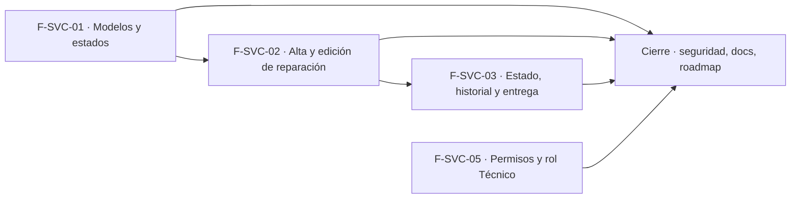

# Tasks: Service técnico · Service alta, estados y permisos

**Input**: [spec.md](./spec.md) y [plan.md](./plan.md) · **Épica**: MSF-182
**Formato**: `- [ ] T### [P] [Historia][USx] descripción (FR/SC)`. `[P]` = paralelizable (archivos distintos, sin dependencia dentro del mismo grupo). Cada FR/SC tiene **una sola** tarea dueña; «soporte de» marca una tarea que contribuye sin ser dueña. Las historias son autosuficientes: ninguna tarea depende de otra historia ni de una `[CIERRE]`.
**Validación por historia**: `pnpm test:db`, `pnpm lint`, `pnpm build` y `pnpm test:web` verdes antes de cerrar la fase.
**Esquema (Principio VII, re-verificado)**: `modelos_equipo`, `estados_reparacion`, `reparaciones` y `reparacion_historial` → `dominio`; `roles_organizacion`/`permisos_rol`/`permisos_rol_accion`/`registro_actividad` → `public` (solo datos).

## Phase 1: F-SVC-01 · Modelos de equipo y estados de reparación configurables

**Goal**: tablas `dominio.modelos_equipo` y `dominio.estados_reparacion` con sembrado, RPC, pantallas Modelos y Estados, y la entrada de menú «Service técnico».

- [ ] T001 [P] [F-SVC-01][US1] Migración `supabase/migrations/20261021163400_modelos_equipo.sql`: `dominio.modelos_equipo` (columnas de FR-001, `unique (id, organizacion_id)`, unicidad equipo+modelo por organización, `check mano_obra_base >= 0`), RLS por organización y `nivel_seccion('service_tecnico')` (select `lectura`/`edicion`; insert/update `edicion`; **sin delete**), grants por columna, `anon` sin privilegios, reversión en el encabezado (FR-001)
- [ ] T002 [P] [F-SVC-01][US1] Migración `supabase/migrations/20261021163500_estados_reparacion.sql`: `dominio.estados_reparacion` (columnas de FR-002, `unique (id, organizacion_id)`, `unique (organizacion_id, nombre)`), misma RLS/grants/reversión que T001 (FR-002)
- [ ] T003 [F-SVC-01][US1] Migración `supabase/migrations/20261021163600_service_sembrado.sql`: `private.sembrar_service(organizacion)` idempotente con los siete modelos y los siete estados del prototipo (`cierra` y `avisa_cliente` según FR-003), trigger sobre `organizaciones` y backfill de las existentes, reversión en el encabezado (FR-003)
- [ ] T004 [P] [F-SVC-01][US1] Migración `supabase/migrations/20261021163700_modelos_equipo_rpc.sql`: `public.crear_modelo_equipo`, `actualizar_modelo_equipo` (bloqueo optimista por `updated_at`) y `cambiar_estado_modelo_equipo` (idempotente), `security invoker`, `search_path = ''`, exigen `edicion`, `revoke … from public, anon` y `grant execute … to authenticated` (FR-004)
- [ ] T005 [P] [F-SVC-01][US1] Migración `supabase/migrations/20261021163800_estados_reparacion_rpc.sql`: `crear_estado_reparacion`, `actualizar_estado_reparacion`, `mover_estado_reparacion` (intercambio atómico de `orden`) y `cambiar_estado_estado_reparacion`; `avisa_cliente` y `cierra` se guardan sin enviar avisos, mismos permisos que T004 (FR-005, FR-006)
- [ ] T006 [P] [F-SVC-01][US1] Migración `supabase/migrations/20261021163900_service_catalogo_actividad.sql`: eventos `modelo.*` y `estado.*` (`creado`, `editado`, `desactivado`, `reactivado`, `reordenado`) vía `private.registrar_actividad`, misma transacción, sin evento si no hubo cambio (soporte de FR-008)
- [ ] T007 [F-SVC-01][US1] pgTAP `supabase/tests/database/service_catalogos.test.sql`: aislamiento entre dos organizaciones, escritura con `edicion`, lectura con `lectura`, `ninguno` y `anon` sin acceso, sembrado idempotente (organización nueva y backfill), unicidad, reorden atómico, bloqueo optimista, sin `delete`; `rls_en_toda_tabla` verde (SC-001)
- [ ] T008 [P] [F-SVC-01][US1] `apps/web/src/lib/serviceTecnico.ts`: tipos y llamadas a las RPC de modelos y estados, mapeo de `23505`/conflicto/`42501` a mensajes claros (soporte de FR-007)
- [ ] T009 [F-SVC-01][US1] `apps/web/src/pages/service-tecnico/modelos.tsx` + `components/service/ModeloFormDialog.tsx`: tabla Equipo/Modelo/Mano de obra base/Activo (switch), «Nuevo modelo» con Equipo, Modelo, Mano de obra base (ARS), «Cancelar»/«Crear modelo», subtítulo del prototipo, estados vacío/error/carga/éxito, errores por campo, foco, adaptable 320/768/1440 px; sin «Disponible en» (FR-007)
- [ ] T010 [F-SVC-01][US1] `apps/web/src/pages/service-tecnico/estados.tsx` + `components/service/EstadoFormDialog.tsx`: tabla Orden (Subir/Bajar), Estado, Qué significa, Avisa al cliente (switch) y Cierra la reparación (solo lectura), aviso informativo, «Nuevo estado» con Nombre, Qué significa y «Avisar al cliente al pasar a este estado», «Cancelar»/«Crear estado», mismos estados compartidos (FR-008)
- [ ] T011 [F-SVC-01][US1] Entrada de menú **Service técnico** con icono y pestañas Reparaciones/Modelos/Estados de reparación en `destinosPanel.ts`, recursos en `SECCION_POR_RECURSO` (`lib/permisos.ts`), rutas `/service-tecnico/modelos` y `/service-tecnico/estados` protegidas por nivel («Acceso restringido» sin permiso) y migración `20261021164000_service_funcionalidad.sql` que registra la funcionalidad `service-tecnico` para `private.tiene_feature` (FR-009)
- [ ] T012 [F-SVC-01][US1] Vitest de Modelos, Estados y navegación: tablas, diálogos, validación, vacío/error/carga, reorden, switches, ocultar controles con `lectura`, menú por nivel y acceso restringido (SC-002)
- [ ] T013 [F-SVC-01][US1] Documentación: `docs/service-tecnico.md` (modelo de datos de modelos y estados, sembrado, RPC, menú, reversión) (FR-010)

**Checkpoint F-SVC-01**: `pnpm test:db`, `pnpm lint`, `pnpm build` y `pnpm test:web` verdes.

## Phase 2: F-SVC-02 · Alta y edición de reparación

**Goal**: `dominio.reparaciones` y `dominio.reparacion_historial`, numeración por empresa, RPC de alta/edición, alta rápida de cliente, pantalla de la reparación y aviso al desactivar en uso. Requiere F-SVC-01 mergeada (FK a modelos y estados).

- [ ] T014 [F-SVC-02][US2] Migración `supabase/migrations/20261021164300_reparaciones.sql`: `dominio.reparaciones` (columnas de FR-011, FK compuestas a `public.clientes`, `modelos_equipo` y `estados_reparacion`, `unique (empresa_id, numero)`), RLS por organización y nivel, sin delete, costos sin `select` directo, `anon` sin privilegios, reversión en el encabezado (FR-011)
- [ ] T015 [F-SVC-02][US2] Migración `supabase/migrations/20261021164400_reparaciones_numeracion.sql`: `private.siguiente_numero_reparacion(empresa)` con bloqueo transaccional por empresa, correlativo sin saltos, formato `R-0001` para presentar (FR-012)
- [ ] T016 [F-SVC-02][US2] Migración `supabase/migrations/20261021164500_reparacion_historial_crear.sql`: `dominio.reparacion_historial` (tipo `alta`/`estado`/`entrega`/`anulacion`, anterior/nuevo, nota, usuario, fecha; RLS de solo lectura, sin escritura directa) y `public.crear_reparacion` (valida cliente, modelo activo y empresa de la organización; número, primer estado activo por `orden`, ingreso de hoy; evento `alta`) con `revoke`/`grant` (FR-013)
- [ ] T017 [F-SVC-02][US2] Migración `supabase/migrations/20261021164600_reparaciones_actualizar.sql`: `public.actualizar_reparacion` con bloqueo optimista, rechazo de anuladas, sin cambiar número/empresa/estado, validaciones por campo (cliente y modelo obligatorios, importes ≥ 0, entrega prevista ≥ ingreso) (FR-017)
- [ ] T018 [F-SVC-02][US2] Migración `supabase/migrations/20261021164700_reparaciones_leer.sql`: `public.obtener_reparacion` con máscara de costos sin la acción `ver_costos`, escritura de costos solo con esa acción, y RPC de lectura `tecnicos_de_service` (usuarios de la organización con `service_tecnico` en `edicion`, sin datos extra) (FR-021, soporte de FR-016)
- [ ] T019 [P] [F-SVC-02][US2] Migración `supabase/migrations/20261021164800_service_uso.sql`: `public.uso_modelo_equipo` y `public.uso_estado_reparacion` (cantidad de reparaciones que los usan, `security invoker`, `revoke`/`grant`) (soporte de FR-019)
- [ ] T020 [P] [F-SVC-02][US2] Migración `supabase/migrations/20261021164900_reparaciones_actividad.sql`: eventos `reparacion.creada` y `reparacion.editada` vía `private.registrar_actividad` en la misma transacción, sin evento si no hubo cambio (FR-020)
- [ ] T021 [F-SVC-02][US2] pgTAP `supabase/tests/database/service_reparaciones.test.sql`: aislamiento entre dos organizaciones en `reparaciones` y `reparacion_historial`, numeración sin saltos con concurrencia y serie por empresa, cliente/modelo/empresa ajenos o inactivos rechazados, conflicto de edición, anuladas no editables, máscara de costos por rol, conteos de uso, `anon` sin ejecución; `rls_en_toda_tabla` verde (SC-003)
- [ ] T022 [P] [F-SVC-02][US2] `apps/web/src/lib/reparaciones.ts`: tipos, llamadas a las RPC (crear, actualizar, obtener, técnicos, uso), búsqueda de clientes y alta mínima de cliente de MSF-180 (**confirmar nombre y firma con Clientes antes**), mapeo de errores a mensajes claros (soporte de FR-016)
- [ ] T023 [P] [F-SVC-02][US2] `apps/web/src/components/service/ClienteSelector.tsx`: búsqueda con `buscar_clientes` (solo clientes de la organización), «Contacto» completado con el del cliente y editable, estados de carga/vacío/error (FR-014)
- [ ] T024 [F-SVC-02][US2] `apps/web/src/components/service/AltaRapidaClienteDialog.tsx`: diálogo mínimo que usa la RPC de alta mínima de MSF-180 sin duplicar su lógica, deja el cliente elegido y muestra los errores en el diálogo (FR-015)
- [ ] T025 [F-SVC-02][US2] `apps/web/src/pages/service-tecnico/reparacion.tsx` (rutas `/service-tecnico/reparaciones/nueva` y `/:id`): breadcrumb, título `R-000N`, tarjeta «Cliente y equipo» (Tienda = empresa activa por defecto, Cliente, Contacto, Consola o equipo, Modelo, N.º de serie, Accesorios recibidos, Falla informada), costo interno oculto sin `ver_costos`, tarjeta «Técnico y fechas» (Técnico, Ingreso, Entrega prevista, Entrega real solo lectura), «Guardar», conflicto de edición y errores por campo; sin mano de obra/repuestos (FR-016)
- [ ] T026 [F-SVC-02][US2] `apps/web/src/pages/service-tecnico/reparaciones.tsx` (pestaña Reparaciones con «Nueva reparación», que lleva al detalle creado) y, en Modelos/Estados de F-SVC-01, columna **Reparaciones** y aviso con la cantidad y confirmación al desactivar un modelo o estado en uso (FR-018, FR-019)
- [ ] T027 [F-SVC-02][US2] Vitest: formulario (validaciones, alta rápida, conflicto de edición, costos ocultos, Tienda por defecto), landing de Reparaciones y aviso de desactivación con cantidad (SC-004)
- [ ] T028 [F-SVC-02][US2] Documentación: `docs/service-tecnico.md` (reparaciones, numeración por empresa, historial, costos y `ver_costos`, alta rápida, uso y desactivación, reversión) (FR-022)

**Checkpoint F-SVC-02**: `pnpm test:db`, `pnpm lint`, `pnpm build` y `pnpm test:web` verdes.

## Phase 3: F-SVC-03 · Cambio de estado, historial y entrega

**Goal**: cambio de estado idempotente con historial, diálogo de entrega y anulación con motivo. Requiere F-SVC-02 mergeada (tablas `reparaciones` y `reparacion_historial`).

- [ ] T029 [F-SVC-03][US3] Migración `supabase/migrations/20261021165000_reparaciones_estado.sql`: `public.cambiar_estado_reparacion` (exige `edicion`, estado activo de la organización, rechaza anuladas y cerradas, `for update`, idempotente, escribe el evento `estado`), `revoke`/`grant` (FR-031)
- [ ] T030 [F-SVC-03][US3] Migración `supabase/migrations/20261021165200_reparaciones_entrega.sql`: `public.registrar_entrega_reparacion` (estado con `cierra = true`, `entrega_real` no anterior al ingreso ni futura, `entregado_por` obligatorio, cambio de estado en la misma transacción, evento `entrega`) (FR-032)
- [ ] T031 [F-SVC-03][US3] Migración `supabase/migrations/20261021165300_reparaciones_anular.sql`: `public.anular_reparacion` (motivo obligatorio, `anulada_en`/`anulada_motivo`, evento `anulacion`, irreversible, la reparación queda de solo lectura) (FR-033)
- [ ] T032 [P] [F-SVC-03][US3] Migración `supabase/migrations/20261021165400_reparaciones_estado_actividad.sql`: eventos `reparacion.estado_cambiado`, `reparacion.entregada` y `reparacion.anulada` vía `private.registrar_actividad` en la misma transacción (soporte de FR-031, FR-032 y FR-033)
- [ ] T033 [F-SVC-03][US3] pgTAP `supabase/tests/database/service_estado_entrega.test.sql`: cambio idempotente y serializado, historial íntegro y ordenado, estado ajeno/inactivo rechazado, entrega con validaciones, anulación solo lectura, `42501` con `lectura`/`ninguno`, `anon` sin ejecución, aislamiento entre organizaciones (SC-005)
- [ ] T034 [P] [F-SVC-03][US3] Ampliación de `apps/web/src/lib/reparaciones.ts` propia de esta historia (`cambiarEstado`, `registrarEntrega`, `anular`, historial) y hook que oculta los controles con `lectura` y mapea `42501`/conflicto a mensajes claros (FR-034)
- [ ] T035 [F-SVC-03][US3] Sección **Estado** del detalle: selector con estados activos y «Qué significa» del estado elegido, chip de estado y `components/service/HistorialEstados.tsx` (estado · fecha · usuario, más reciente primero) (FR-030)
- [ ] T036 [P] [F-SVC-03][US3] `components/service/EntregaDialog.tsx`: se abre al elegir un estado que cierra, fecha y quién entregó con validación y errores por campo, foco y teclado (soporte de FR-032)
- [ ] T037 [P] [F-SVC-03][US3] `components/service/AnularDialog.tsx` y acción «Anular»: motivo obligatorio, reparación anulada marcada y de solo lectura (soporte de FR-033)
- [ ] T038 [F-SVC-03][US3] Vitest: selector, historial, diálogos de entrega y anulación, controles ocultos con `lectura`, reparación anulada de solo lectura (soporte de SC-005)
- [ ] T039 [F-SVC-03][US3] E2E `apps/web/e2e/service-tecnico.e2e.ts`: crea una reparación, la pasa por tres estados y la entrega/retira (se omite sin `SUPABASE_URL`/`SUPABASE_SERVICE_ROLE_KEY`; anotar en el PR cómo se corrió) (soporte de SC-005)
- [ ] T040 [F-SVC-03][US3] Documentación: `docs/service-tecnico.md` (estados, historial, entrega, anulación, transiciones admitidas) y `docs/actividad.md` (tipos `reparacion.*`, `modelo.*`, `estado.*`) (FR-035)

**Checkpoint F-SVC-03**: `pnpm test:db`, `pnpm lint`, `pnpm build`, `pnpm test:web` verdes y E2E ejecutado.

## Phase 4: F-SVC-05 · Permisos de Service técnico y rol Técnico

**Goal**: rol `tecnico` en la matriz fija, sin alterar los roles existentes.

- [ ] T041 [F-SVC-05][US4] Migración `supabase/migrations/20261021165600_rol_tecnico.sql`: rol `tecnico` en `public.roles_organizacion`, redefinición aditiva de `private.matriz_inicial()` y `private.matriz_acciones_iniciales()` con `tecnico` (`service_tecnico` = `edicion`, resto según *Decisiones abiertas* 2), backfill con `on conflict do nothing` de `permisos_rol`/`permisos_rol_accion` y reversión con las funciones de `20261013130002` en el encabezado (FR-040, FR-041)
- [ ] T042 [F-SVC-05][US4] pgTAP `supabase/tests/database/rol_tecnico.test.sql`: `nivel_seccion`/`puede_accion` del Técnico, regresión de los seis roles existentes contra la matriz vigente, backfill y trigger de organización nueva, matriz de `service_tecnico` intacta, Depósito `ninguno`; `rls_en_toda_tabla` verde (SC-006)
- [ ] T043 [F-SVC-05][US4] UI: columna **Técnico** (fija, sin edición) en Roles y permisos, «Técnico» asignable desde Usuarios, sin tocar la edición de la grilla (FR-042)
- [ ] T044 [F-SVC-05][US4] Vitest de la columna Técnico y de la asignación del rol (soporte de SC-006)
- [ ] T045 [F-SVC-05][US4] Documentación: `docs/permisos-por-rol.md` (rol Técnico, valores, matriz fija, reversión) (FR-043)

**Checkpoint F-SVC-05**: `pnpm test:db`, `pnpm lint`, `pnpm build` y `pnpm test:web` verdes.

## Phase 5: Documentación, seguridad y cierre

- [ ] T046 [P] [CIERRE] Revisión de seguridad (`authz-security`, `database-reviewer`) de la RLS de las cuatro tablas, las RPC, la máscara de costos y el rol Técnico; re-verificar el esquema de cada objeto (cuatro tablas en `dominio`, datos de roles y actividad en `public`); completar el índice `docs/service-tecnico.md` y anotar en el PR las diferencias con el prototipo (sin «Disponible en», sin listado, sin ítems/catálogo, sin «Avisar al cliente» ni «Imprimir orden») y las contradicciones prototipo↔requisitos (FR-090)
- [ ] T047 [CIERRE] Validación final: `pnpm lint && pnpm build && pnpm test && pnpm docs:check && pnpm matriz:check && pnpm prototipo:check` y `rls_en_toda_tabla` verdes (SC-007)
- [ ] T048 [CIERRE] Al merge del PR (merge commit `--no-ff`): actualizar la fila de Service técnico en `docs/roadmap-template.md` (paso manual) y comprobar que ninguna tarea queda `[ ]` (FR-091)

## Dependencias

Dentro de F-SVC-01: (T001 [P], T002 [P]) → T003; T001 → T004 [P]; T002 → T005 [P] y T006 [P]; todos → T007; T008 [P] puede arrancar con T004/T005 → T009 y T010 → T011 → T012 → T013.
Dentro de F-SVC-02: T014 → T015 → T016 → T017 → T018; T019 [P] y T020 [P] tras T016 → T021; T022 [P] y T023 [P] → T024 → T025 → T026 → T027 → T028.
Dentro de F-SVC-03: T029 → T030 → T031; T032 [P] tras T031 → T033; T034 [P] → T035; T036 [P] y T037 [P] → T038 → T039 → T040.
Dentro de F-SVC-05: T041 → T042 → T043 → T044 → T045.
Cierre: T046 [P] puede arrancar con las historias; T047 → T048 al final. Las tareas [CIERRE] nunca son prerequisito de una historia.
Entre historias: F-SVC-02 requiere F-SVC-01 **mergeada** (FK a modelos y estados); F-SVC-03 requiere F-SVC-02 mergeada (tablas y pantalla de la reparación); F-SVC-05 es independiente de las otras tres (no comparte archivos ni migraciones: solo datos de roles).

## Plan de ejecución (historias)

El **orden de toma** de las historias lo declara esta tabla: el orquestador la **consume** (no lo infiere del orden de las tareas). Una historia arranca cuando sus dependencias (`Depende de`) están **Finalizadas (mergeadas)**; las del **mismo** `Grupo` van **en paralelo** (F-SVC-01 y F-SVC-05 no comparten archivos, tabla ni migración: la primera crea tablas de dominio y menú, la segunda solo agrega datos de roles).

| Historia | Depende de | Grupo |
|----------|------------|-------|
| F-SVC-01 | — | 1 |
| F-SVC-05 | — | 1 |
| F-SVC-02 | F-SVC-01 | 2 |
| F-SVC-03 | F-SVC-02 | 3 |
| [Cierre] | F-SVC-01, F-SVC-02, F-SVC-03, F-SVC-05 | 4 |

