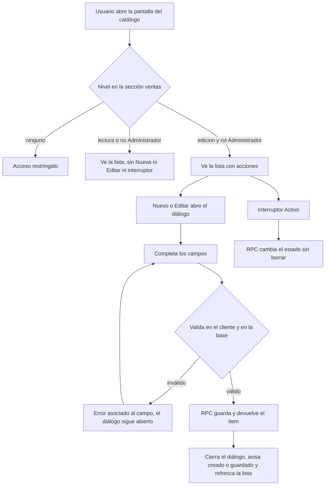
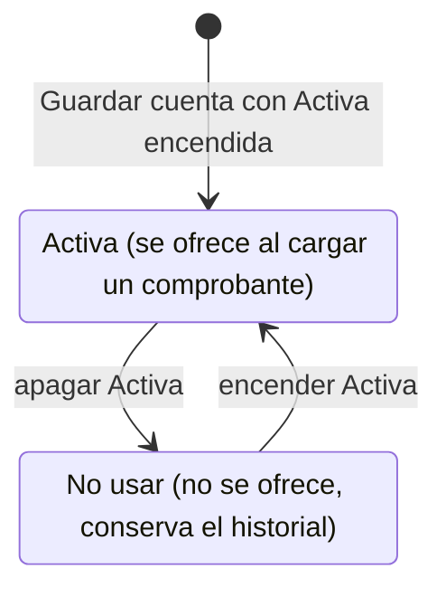
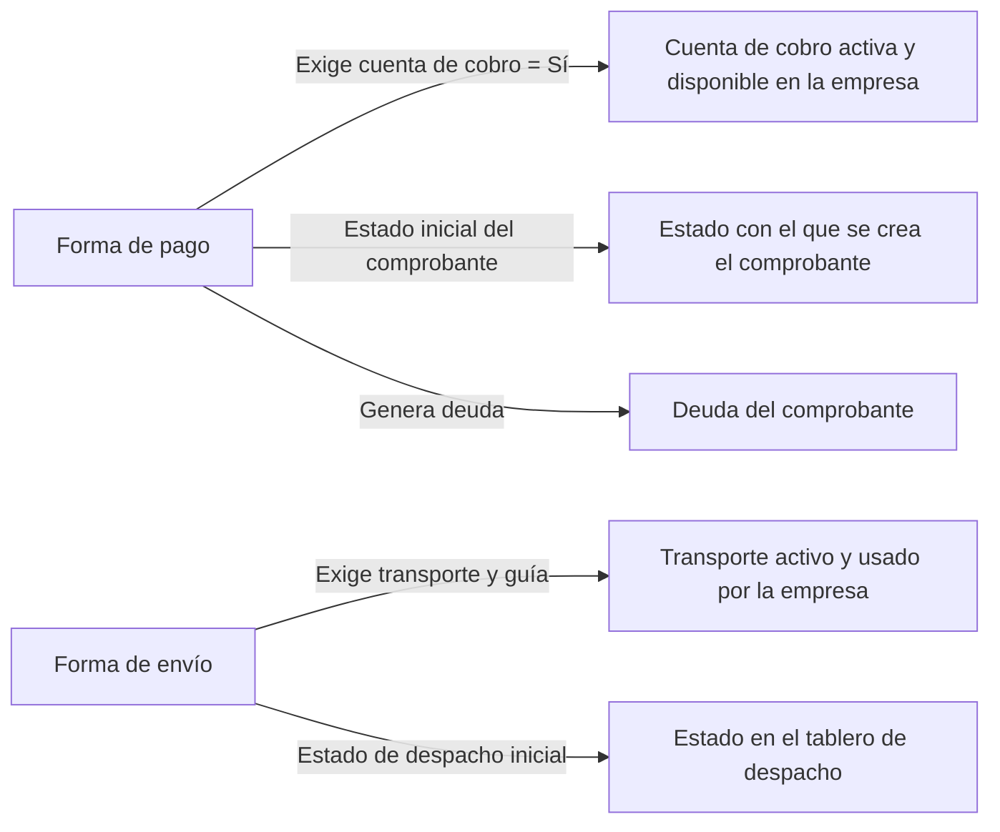

# Feature Specification: Ventas y despacho · Ventas catálogos de cobro y envío

**Feature Branch**: `epic/MSF-139-ventas-y-despacho-ventas-catalogos-de-co`

**Jira Epic**: MSF-139 — Ventas y despacho · Ventas catálogos de cobro y envío (spec `ventas-catalogos-de-cobro-y-envio`)

**Created**: 2026-10-20

**Status**: Ready for implementation — la especificación viene completa desde Jira. Los puntos de «A revisar» no bloquean: cada uno lleva una decisión provisoria en *Decisiones abiertas*.

**Delivery scope**: `refine` (apps/web) y `supabase` (migraciones + RPC + pgTAP). Sin `kestra`, `superset` ni `workers`.

**Prioridad / Hito**: P0 · Hito 3 (16 de noviembre al 11 de diciembre de 2026) · 17 h aprox. (antes 20: el template ya trae el patrón CRUD de panel y las bases de RLS; las cuentas de cobro no se achican) · alcance diciembre.

**Dependencias**:
- Bloqueada por: MSF-121 (Acceso, organización y permisos · Permisos por empresa), que trae `usuarios_empresas` y `private.nivel_seccion`. **Ya en el árbol** (`20261016140100_roles_por_empresa.sql`, `docs/permisos-por-rol.md`, `docs/empresa-activa.md`). MSF-121 ya depende de MSF-138 (Empresas), por eso no se vincula directo.
- Bloquea a: MSF-159 (ventas-comprobantes). MSF-195 y MSF-135 usan cuentas de cobro y transportes, pero dependen de MSF-139 por cadena (MSF-159 → MSF-177 → MSF-195; MSF-159 → MSF-135).
- Relacionada, sin bloqueo: el **transporte preferido del cliente** es un campo del componente Clientes y proveedores (MSF-180); no se construye aquí.

**Input**: Epic MSF-139. Objetivo: «Al terminar, cada empresa tiene sus formas de pago y de envío, el equipo tiene sus cuentas de cobro y sus transportes cargados, y todo queda listo para elegirlo en un comprobante.»

**Regla de fuentes** (literal de la épica):
- Comportamiento y datos: mandan los requisitos y escenarios de esta historia.
- Qué se ve (disposición, textos, estados, popups, flujos): el prototipo validado es referencia visual, no hace falta que quede extremadamente idéntico; los flujos (si hay) aclaran estados y acciones.
- Cómo se construye (componentes, estilos y patrones): mandan el template y el sistema de diseño (MSF-117, `docs/sistema-de-diseno.md`). No se copia HTML ni CSS: se reproduce con los componentes del template y los tokens.
- El prototipo muestra más que esta historia: se implementa solo lo que piden los requisitos de F-VTA-01…04; otras secciones, botones o diálogos son de otras historias.
- Si algo no se puede igualar: lo más cercano, sin inventar, anotando la diferencia en el PR. Si prototipo y requisitos se contradicen: requisitos para el comportamiento, prototipo para lo visual, y la contradicción queda anotada en el PR.
- Prototipos (solo lectura, presentes en el árbol; la rama `design/prototipo` no existe en `origin`): `design/pantallas/VentasConfiguracion.dc.html` (F-VTA-01/02), `CuentasCobro.dc.html` (F-VTA-03), `VentasTransportes.dc.html` (F-VTA-04).

## Modelo y supuestos

- **Formas de pago y de envío: por empresa.** Cada empresa (San Javucho, Mundo JC) tiene su propio catálogo; un cambio aplica solo a la empresa elegida.
- **Cuentas de cobro: de la organización, habilitadas por empresa.** Unas 70 en el panel actual, algunas «no usar». Una cuenta «No usar» no se ofrece al cargar un comprobante pero conserva su historial.
- **Transportes y terminales de retiro: de la organización** (unos 30 en el panel actual), con las empresas donde se usan. La terminal de retiro es un dato de la fila del transporte (el prototipo muestra una terminal por empresa de transporte).
- **Los datos bancarios son sensibles: solo el Administrador los edita.** Lee quien tiene la sección `ventas` en `lectura` o `edicion`. Esa regla se aplica a los cuatro catálogos (la épica nombra a Administrador como quien edita estos catálogos y a Ventas como quien los lee).
- **Se desactiva, no se borra**: ningún catálogo tiene eliminación; un ítem inactivo se conserva y se puede reactivar (el prototipo solo ofrece el interruptor `Activo` / `Activa`).
- **La carga de los datos reales** (≈70 cuentas, ≈30 transportes) es de la migración inicial (MSF-142); aquí queda la estructura lista.
- **Elegirlos en un comprobante** es de MSF-159: esta épica solo deja los catálogos listos y consultables.

### Esquema de datos (Constitución, Principio VII)

Todas las tablas son entidades de negocio de Ventas (qué se cobra, cómo se envía), no mecanismos de plataforma: viven en **`dominio`**, nunca en `public`. Los helpers de permisos (`private.nivel_seccion`, `private.es_administrador_de`, `private.empresas_accesibles`) ya existen.

| Objeto | Esquema | Historia | Justificación | RLS / acceso |
|--------|---------|----------|---------------|--------------|
| `formas_pago` (**nueva**) | **`dominio`** | F-VTA-01 | Catálogo de negocio por empresa. | **Sí**: `organizacion_id = (select private.organizacion_id())`, `empresa_id` en `private.empresas_accesibles()` y `nivel_seccion('ventas')` ≥ `lectura` para `select`; `insert`/`update` solo `es_administrador_de`; **sin `delete`**; `anon` sin privilegios. |
| `formas_envio` (**nueva**) | **`dominio`** | F-VTA-02 | Ídem, por empresa. | Ídem `formas_pago`. |
| `cuentas_cobro` (**nueva**) | **`dominio`** | F-VTA-03 | Cuenta bancaria/billetera de la organización (dato de negocio y sensible). | **Sí**: por organización; `select` con `nivel_seccion('ventas')` ≥ `lectura`; `insert`/`update` solo Administrador; sin `delete`; `anon` sin privilegios. |
| `cuentas_cobro_empresas` (**nueva**) | **`dominio`** | F-VTA-03 | Habilitación de la cuenta por empresa («Disponible en»). | Ídem, y la empresa debe ser de la misma organización. |
| `transportes` (**nueva**) | **`dominio`** | F-VTA-04 | Empresa de transporte con su terminal de retiro (dato de negocio de la organización). | **Sí**: por organización; `select` con `nivel_seccion('ventas')` ≥ `lectura`; `insert`/`update` solo Administrador; sin `delete`. |
| `transportes_empresas` (**nueva**) | **`dominio`** | F-VTA-04 | «Empresas donde se usa». | Ídem. |

Cada historia trae **su propia migración aditiva** con reversión en el encabezado (`drop table …`); ninguna toca tablas de otra. La FK a `dominio.empresas` es simple y la coherencia de organización se exige en la política y en la RPC (no se altera `empresas`). Las RPC de `public` llevan `revoke … from public, anon` y `grant execute … to authenticated` (regla `anon`, `docs/acceso-ingreso.md`). La prueba pgTAP `rls_en_toda_tabla` recorre `public` + `dominio` y debe seguir verde. El esquema de cada tabla se re-verifica en plan, tareas, implementación y revisión (T034).

## Flujos

La épica no trae diagramas; describe comportamientos. Se transcriben los que declara (alta/edición con permiso; cuenta activa ↔ «No usar»; qué deja listo cada catálogo para el comprobante).

### Alta y edición de un ítem de catálogo (pago, envío, cuenta, transporte)

Pasos → FR: permiso y «Acceso restringido» (FR-003, FR-014, FR-018); lista (FR-004, FR-008, FR-014, FR-018); diálogo (FR-005, FR-009, FR-015, FR-019); validación (FR-002, FR-007, FR-011, FR-012, FR-017); interruptor (FR-004, FR-008, FR-012, FR-017).

### Cuenta de cobro: activa ↔ «No usar»

Mapea a FR-012 (cambio de estado idempotente), FR-013 (evento de actividad) y FR-015 (texto de ayuda del interruptor).

### Qué deja listo el catálogo para el comprobante

Esta épica **guarda** esos datos y expone qué está activo y disponible por empresa (FR-001, FR-006, FR-010, FR-016); **aplicarlos** al crear el comprobante es de MSF-159 y el tablero de despacho es de su épica (fuera de alcance, sin tarea).

## User Scenarios & Testing *(mandatory)*

### User Story 1 - Formas de pago por empresa (F-VTA-01, P0, talla S)

Como administrador, quiero definir las formas de pago de cada empresa, para que el comprobante ofrezca solo las que esa empresa acepta.

**Why this priority**: es la base de la pantalla Configuración de ventas y de lo que MSF-159 elige al cobrar.

**Independent Test**: con el rol Administrador, elegir San Javucho, crear «Transferencia o depósito bancario» (exige cuenta de cobro) y verificar que aparece solo para esa empresa; desactivarla y reactivarla; con Mundo JC la lista es otra; con un rol de solo lectura se ve la lista sin acciones.

**Acceptance Scenarios**:
1. **Given** la pantalla Configuración de ventas con la pestaña `Formas de pago`, **When** el usuario con acceso la abre, **Then** ve la lista de la empresa elegida (arranca en la empresa activa de la barra superior) con `Orden`, `Forma de pago`, `Pide cuenta de cobro`, `Genera deuda`, interruptor `Activo` y acción de editar.
2. **Given** el botón `Nueva forma de pago`, **When** se completan `Nombre`, `Tipo de forma de pago`, `Exige cuenta de cobro`, `Genera deuda`, `Estado inicial del comprobante`, `Orden`, `Activo` y `Empresas donde aplica` y se pulsa `Crear`, **Then** la forma queda creada para cada empresa marcada y se avisa «Creado · <nombre>».
3. **Given** un nombre vacío, **When** se pulsa `Crear`, **Then** se avisa «Completá el nombre» y no se guarda.
4. **Given** una forma existente, **When** se edita y se pulsa `Guardar cambios`, **Then** el cambio aplica solo a la empresa elegida y se avisa «Cambios guardados · <nombre>».
5. **Given** el interruptor `Activo`, **When** se apaga, **Then** la forma queda inactiva y no se ofrece, sin perder datos; al encenderlo vuelve.
6. **Given** un nombre ya usado en la misma empresa, **When** se guarda, **Then** se rechaza con un mensaje claro; en otra empresa el mismo nombre es válido.
7. **Given** un rol sin edición (o que no es Administrador), **When** abre la pantalla, **Then** ve la lista sin `Nueva`, `Editar` ni interruptor; sin acceso a `ventas` ve «Acceso restringido».

### User Story 2 - Formas de envío por empresa (F-VTA-02, P0, talla S)

Como administrador, quiero definir las formas de envío de cada empresa, para que el comprobante sepa si pide transporte y guía y cuánto cuesta por defecto.

**Why this priority**: junto con las formas de pago completa la pantalla de Configuración.

**Independent Test**: en la pestaña `Formas de envío` de una empresa, crear «Expreso» con `Exige transporte y guía = Sí`, y «Retiro en local» con costo vacío; cada empresa ve las suyas.

**Acceptance Scenarios**:
1. **Given** la pestaña `Formas de envío`, **When** se abre, **Then** la lista muestra `Orden`, `Forma de envío`, `Requiere transporte y guía`, `Costo por defecto`, interruptor `Activo` y editar.
2. **Given** `Nueva forma de envío`, **When** se completan `Nombre`, `Tipo de forma de envío`, `Exige transporte y guía`, `Costo por defecto` (ARS), `Estado de despacho inicial`, `Orden`, `Activo` y `Empresas donde aplica`, **Then** queda creada para cada empresa marcada.
3. **Given** un costo por defecto vacío, **Then** la lista muestra «—»; con valor, importe en pesos; un costo negativo se rechaza.
4. **Given** el interruptor `Activo`, los permisos y el nombre duplicado por empresa, **Then** se comportan igual que en F-VTA-01 (escenarios 3 a 7).

### User Story 3 - Cuentas de cobro (F-VTA-03, P0, talla M)

Como administrador, quiero cargar las cuentas de cobro de la organización con su titular, CBU y CUIT, y habilitarlas por empresa, para que el comprobante ofrezca solo las cuentas válidas.

**Why this priority**: es lo más sensible de la épica (datos bancarios) y lo que MSF-195 concilia después.

**Independent Test**: con el Administrador, crear una cuenta con CBU de 22 dígitos válido y CUIT válido, disponible solo en Mundo JC; CBU o CUIT inválidos son rechazados; marcarla «No usar»; con un rol de lectura se ve sin poder editar.

**Acceptance Scenarios**:
1. **Given** la pantalla `Cuentas de cobro`, **When** se abre, **Then** la tabla muestra `Cuenta`, `Titular`, `Banco`, `CBU`, `CUIT`, `Disponible en` (chips por tienda), `Estado` y acciones, con el filtro `Tienda` (Todas las tiendas / San Javucho / Mundo JC), el recuento de cuentas y la paginación («1–10 de N»).
2. **Given** `Nueva cuenta de cobro`, **When** se completan `Nombre de la cuenta`, `Titular`, `CUIT del titular`, `Banco`, `Alias`, `CBU / CVU`, `Tipo de cuenta` (Cuenta corriente / Caja de ahorro / Billetera virtual), `Moneda` (ARS / USD), `Orden`, `Activa`, `Notas internas` y `Disponible en`, y se pulsa `Guardar cuenta`, **Then** queda creada y se avisa «Cuenta de cobro creada».
3. **Given** un CBU/CVU que no tiene 22 dígitos o cuyos dígitos verificadores no cierran, **Then** se rechaza con un mensaje en el campo.
4. **Given** un CUIT con dígito verificador incorrecto, **Then** se rechaza; se acepta con o sin guiones y se guarda normalizado.
5. **Given** el interruptor `Activa` apagado («No usar»), **Then** la cuenta no se ofrece, conserva su historial y el texto de ayuda lo dice; al encender vuelve.
6. **Given** el filtro `Tienda` o una empresa activa en la barra superior, **Then** se ven solo las cuentas disponibles en esa empresa.
7. **Given** un rol que no es Administrador, **Then** puede ver (si tiene `ventas`) pero no ve `Nueva cuenta de cobro` ni edita; la base rechaza igual cualquier escritura directa.

### User Story 4 - Transportes y terminales de retiro (F-VTA-04, P0, talla S)

Como administrador, quiero cargar las empresas de transporte con su terminal de retiro y contacto, y marcar en qué empresas se usan, para elegirlas al despachar.

**Why this priority**: completa lo que el comprobante y el despacho necesitan elegir.

**Independent Test**: crear «Expreso Ejemplo del Sur» tipo Expreso con CUIT válido, terminal «Terminal Sur…» en Rosario, usada en San Javucho; aparece en la lista filtrada por esa tienda y no en la de Mundo JC.

**Acceptance Scenarios**:
1. **Given** la pantalla `Transportes` (la parte de terminales de retiro de «Transportes y contrarreembolsos»), **When** se abre, **Then** la tabla muestra `Empresa de transporte`, `Terminal de retiro`, `Localidad`, `Teléfono`, `Contacto`, acción de editar, el filtro `Tienda`, el recuento («8 de 30 empresas de transporte») y `Nueva empresa`.
2. **Given** `Nueva empresa`, **When** se completan `Empresa de transporte`, `Tipo` (Expreso / Correo / Moto propia), `CUIT`, `Terminal de retiro`, `Localidad`, `Teléfono`, `Correo`, `Persona de contacto`, `Dirección de la oficina`, `Cobra contrarreembolso` (Sí/No), `Comisión` (%), `Plazo de rendición` (días), `Orden`, `Activa` y `Empresas donde se usa`, y se pulsa `Guardar empresa`, **Then** queda creada («Empresa de transporte guardada»).
3. **Given** un CUIT con dígito verificador incorrecto, **Then** se rechaza; el CUIT es opcional (la moto propia no tiene).
4. **Given** una comisión fuera de 0–100 o un plazo negativo, **Then** se rechaza.
5. **Given** el interruptor `Activa` y los permisos, **Then** se comportan como en F-VTA-03 (escenarios 5 y 7); el filtro `Tienda` muestra los transportes usados en esa empresa.

### Edge Cases

- Sin empresas asignadas o sin empresa activa válida: la pantalla por empresa pide elegir una; nunca muestra datos de otra empresa.
- Dos Administradores editan el mismo ítem a la vez: gana el segundo guardado con aviso de conflicto (bloqueo optimista por `updated_at`, como en proveedores).
- Una cuenta o transporte sin ninguna empresa marcada se permite y queda «sin disponibilidad» (no se ofrece en ningún comprobante).
- Un usuario de otra organización no ve ni escribe nada (RLS por organización).

## Requirements *(mandatory)*

### Functional Requirements

**F-VTA-01 · Formas de pago por empresa**
- **FR-001**: Existe `dominio.formas_pago` por empresa con nombre, tipo (Efectivo, Transferencia o depósito bancario, Contrarreembolso, Tarjeta, Otro), exige cuenta de cobro, genera deuda, estado inicial del comprobante (Pendiente, Aceptado, Cobrado, Deuda), orden y activo; nombre único por empresa; RLS por organización, empresa y sección `ventas`; escritura solo del Administrador; sin `delete`.
- **FR-002**: RPC `public.crear_forma_pago`, `public.actualizar_forma_pago` (bloqueo optimista por `updated_at`) y `public.cambiar_estado_forma_pago` (idempotente), `security invoker`, con validación de nombre, valores permitidos y duplicado; el alta multiempresa crea un ítem independiente por empresa marcada.
- **FR-003**: Pantalla `Configuración de ventas` (`/ventas/configuracion`) con título, subtítulo, selector `Empresa` (San Javucho / Mundo JC, empieza en la empresa activa), pestañas de catálogo, entrada de menú con icono en el grupo Ventas y acceso por nivel de sección (sin permiso → «Acceso restringido»).
- **FR-004**: Pestaña `Formas de pago`: ayuda, tabla (`Orden`, `Forma de pago`, `Pide cuenta de cobro`, `Genera deuda`, `Activo`, editar), chips Sí/No, nombre atenuado si está inactiva, interruptor `Activo`, `Nueva forma de pago` y acciones ocultas sin edición; estados de carga, vacío y error con «Reintentar».
- **FR-005**: Diálogo Nueva/Editar forma de pago con `Nombre`, `Tipo de forma de pago`, `Exige cuenta de cobro`, `Genera deuda`, `Estado inicial del comprobante` (con su ayuda), `Orden`, `Activo`, `Empresas donde aplica`, `Cancelar` y `Crear`/`Guardar cambios`; errores asociados al campo.

**F-VTA-02 · Formas de envío por empresa**
- **FR-006**: Existe `dominio.formas_envio` por empresa con nombre, tipo (Retiro en local, Correo, Expreso, Moto, Terminal), exige transporte y guía, costo por defecto (ARS, opcional, no negativo), estado de despacho inicial (Sin armar, Armando, Listo para despachar), orden y activo; mismas reglas de unicidad, RLS y escritura que FR-001.
- **FR-007**: RPC `crear_forma_envio`, `actualizar_forma_envio` y `cambiar_estado_forma_envio` con las mismas garantías que FR-002.
- **FR-008**: Pestaña `Formas de envío` dentro de Configuración de ventas: ayuda, tabla (`Orden`, `Forma de envío`, `Requiere transporte y guía`, `Costo por defecto`, `Activo`, editar), «—» sin costo, `Nueva forma de envío`.
- **FR-009**: Diálogo Nueva/Editar forma de envío con `Nombre`, `Tipo de forma de envío`, `Exige transporte y guía`, `Costo por defecto` (prefijo ARS), `Estado de despacho inicial` (con su ayuda), `Orden`, `Activo`, `Empresas donde aplica`.

**F-VTA-03 · Cuentas de cobro**
- **FR-010**: Existen `dominio.cuentas_cobro` (nombre, titular, CUIT del titular, banco, alias, CBU/CVU, tipo, moneda, orden, activa, notas internas) y `dominio.cuentas_cobro_empresas` («Disponible en»); RLS por organización y sección `ventas` (lectura) con escritura solo del Administrador; sin `delete`; `anon` sin privilegios.
- **FR-011**: La base valida el CUIT (reutiliza `private.cuit_valido`, con o sin guiones, guardado normalizado) y el CBU/CVU (22 dígitos con ambos dígitos verificadores); el cliente aplica las mismas reglas con los mismos vectores de prueba.
- **FR-012**: RPC `crear_cuenta_cobro`, `actualizar_cuenta_cobro` (bloqueo optimista) y `cambiar_estado_cuenta_cobro` (idempotente, «No usar» conserva el historial), con la habilitación por empresa en la misma transacción; rechazo explícito a quien no es Administrador.
- **FR-013**: Cada alta, edición y cambio de estado de una cuenta registra un evento `cuenta_cobro.*` en `registro_actividad` (actor, fecha, nombre; sin CBU completo en el detalle).
- **FR-014**: Pantalla `Cuentas de cobro` (`/ventas/cuentas-cobro`): título y descripción, aviso de «No usar», filtro `Tienda`, recuento y paginación en servidor, tabla (`Cuenta`, `Titular`, `Banco`, `CBU`, `CUIT`, `Disponible en`, `Estado`, editar), `Nueva cuenta de cobro`, entrada de menú con icono y acceso por nivel.
- **FR-015**: Diálogo `Cuenta de cobro` con `Nombre de la cuenta`, `Titular`, `CUIT del titular`, `Banco`, `Alias`, `CBU / CVU`, `Tipo de cuenta`, `Moneda`, `Orden`, `Activa` (con su nota «Se ofrece al cargar un comprobante» / «No usar: no se ofrece, conserva historial»), `Notas internas`, `Disponible en`, `Cancelar` y `Guardar cuenta`.

**F-VTA-04 · Transportes y terminales de retiro**
- **FR-016**: Existen `dominio.transportes` (nombre, tipo, CUIT opcional, terminal de retiro, localidad, teléfono, correo, persona de contacto, dirección de la oficina, cobra contrarreembolso, comisión %, plazo de rendición en días, orden, activa) y `dominio.transportes_empresas` («Empresas donde se usa»); RLS por organización y sección `ventas` (lectura), escritura solo del Administrador, sin `delete`.
- **FR-017**: RPC `crear_transporte`, `actualizar_transporte` y `cambiar_estado_transporte` con validación de CUIT (`private.cuit_valido`), rangos de comisión y plazo, unicidad de nombre por organización y bloqueo optimista.
- **FR-018**: Pantalla `Transportes` (`/ventas/transportes`): título, descripción, filtro `Tienda`, tabla de terminales (`Empresa de transporte`, `Terminal de retiro`, `Localidad`, `Teléfono`, `Contacto`, editar), recuento «N de M empresas de transporte», `Nueva empresa`, entrada de menú con icono y acceso por nivel.
- **FR-019**: Diálogo Nueva/Editar empresa de transporte con `Empresa de transporte`, `Tipo`, `CUIT`, `Terminal de retiro`, `Localidad`, `Teléfono`, `Correo`, `Persona de contacto`, `Dirección de la oficina`, `Cobra contrarreembolso`, `Comisión`, `Plazo de rendición`, `Orden`, `Activa`, `Empresas donde se usa`, `Cancelar` y `Guardar empresa`.

**Cierre (Tarea de cierre)**
- **FR-020**: Documentación: `docs/ventas-catalogos.md` (modelo, esquemas, permisos, reversión), actualización de `docs/permisos-por-rol.md` y fila del roadmap (`docs/roadmap-template.md`).

### Success Criteria

- **SC-001**: pgTAP de `formas_pago`: aislamiento por organización y empresa, lectura con `ventas`, escritura solo Administrador, nombre duplicado por empresa, valores fuera de lista, conflicto de edición, estado idempotente, sin `delete`, `anon` sin ejecución.
- **SC-002**: Vitest de la pantalla y el diálogo de pagos: lista, chips, alta multiempresa, «Completá el nombre», interruptor, acciones ocultas sin edición, «Acceso restringido», teclado.
- **SC-003**: pgTAP de `formas_envio` (mismo alcance que SC-001 más costo negativo).
- **SC-004**: Vitest de la pestaña y el diálogo de envío (costo «—», importe, validaciones).
- **SC-005**: pgTAP de cuentas de cobro: RLS y escritura solo Administrador, CBU/CVU y CUIT válidos e inválidos, habilitación por empresa de otra organización rechazada, «No usar» idempotente, eventos de actividad, `anon` sin acceso.
- **SC-006**: Vitest de Cuentas de cobro: tabla, filtro `Tienda`, paginación, diálogo con validación, nota de «No usar», acciones ocultas para quien no es Administrador.
- **SC-007**: pgTAP de transportes (RLS, CUIT, rangos, unicidad, empresas de otra organización).
- **SC-008**: Vitest de Transportes (tabla, filtro, recuento, diálogo, permisos).
- **SC-009**: Revisión de seguridad de cierre: `rls_en_toda_tabla` verde sobre las seis tablas, `anon` sin privilegios, ningún dato bancario en logs ni en el cliente de servicio.
- **SC-010**: `pnpm prototipo:check`, `pnpm matriz:check`, `pnpm docs:check`, `pnpm lint`, `pnpm build` y `pnpm test` verdes con la documentación del cambio.

## Decisiones abiertas

Provisorias; ninguna bloquea.

1. **¿Dónde van formas de pago y de envío?** El documento las ubica como pestaña de la ficha de empresa; el artboard `VentasConfiguracion` las muestra en la configuración de ventas. **Provisorio: se sigue el prototipo** (pantalla `/ventas/configuracion` con selector de empresa); la pestaña en la ficha de empresa no se construye.
2. **Roles.** El template tiene los roles de MSF-125 (administrador, administración, operador, mostrador, depósito, consulta). **Provisorio:** edita solo `administrador` (`private.es_administrador_de`) y lee quien tiene `ventas` ≥ `lectura`; no se crea un rol nuevo.
3. **«Empresas donde aplica» en un catálogo por empresa.** Se interpreta como alta en varias empresas a la vez (un ítem independiente por empresa marcada); al editar el campo se muestra con la empresa de la fila bloqueada.
4. **Estados del comprobante y de despacho.** `Estado inicial del comprobante` y `Estado de despacho inicial` usan las listas fijas del prototipo; el catálogo de estados editable (pestaña `Estados` del prototipo) es de otra épica.
5. **Terminal de retiro.** Se guarda como columnas de la empresa de transporte (una terminal por fila, como el prototipo); varias terminales por transporte no las pide la épica.
6. **Horas.** El roadmap estima `Transportes y contrarreembolsos` en 15 h por separado; ante conflicto manda el roadmap. Esta spec cubre solo los transportes y terminales (F-VTA-04); los contrarreembolsos a rendir son de despacho.
7. **Auditoría.** La épica no la pide; se agrega solo para las cuentas de cobro (datos sensibles, Principio III) como FR-013, revisable.

## Matriz pantalla↔criterios

Inventario determinista con `pnpm prototipo:inventario` sobre `VentasConfiguracion.dc.html`, `CuentasCobro.dc.html` y `VentasTransportes.dc.html` (`design/pantallas/*.inventory.json`; `pnpm prototipo:check` confirma que están al día). La épica pide un subconjunto: lo que no pide se declara fuera de alcance sin ser deuda.

### Ventas · Configuración (`VentasConfiguracion.dc.html`)

| Ítem del inventario | Destino | Criterio |
|---|---|---|
| Título, subtítulo («Cada empresa tiene los suyos») y selector `Empresa` (botones `San Javucho`, `Mundo JC`) con su texto de ayuda | En alcance | FR-003, US1-1 |
| Pestañas `Formas de pago` y `Formas de envío` | En alcance | FR-003, FR-004, FR-008 |
| Pestañas `Formas de RMA`, `Contrarreembolsos`, `Estados de comprobante` y sus botones `Nueva forma de RMA`, `Nueva empresa de contrarreembolso`, `Nuevo estado` | Fuera de alcance: la épica pide solo formas de pago y de envío (devoluciones, despacho y estados son de otras épicas) | — |
| Columna `Orden` | En alcance | FR-004, FR-008 |
| Columnas dinámicas `Forma de pago` / `Pide cuenta de cobro` / `Genera deuda` | En alcance | FR-004, US1-1 |
| Columnas dinámicas `Forma de envío` / `Requiere transporte y guía` / `Costo por defecto` | En alcance | FR-008, US2-1 |
| Columna `Activo` (interruptor) y columna de acciones (editar) | En alcance | FR-004, FR-008, US1-5 |
| Botones `Nueva forma de pago`, `Nueva forma de envío` | En alcance | FR-004, FR-008 |
| Campos `Nombre`, `Tipo de forma de pago`, `Exige cuenta de cobro`, `Genera deuda`, `Estado inicial del comprobante` | En alcance | FR-005, US1-2 |
| Campos `Tipo de forma de envío`, `Exige transporte y guía`, `Costo por defecto`, `Estado de despacho inicial` | En alcance | FR-009, US2-2 |
| Campos `Orden`, `Activo`, `Empresas donde aplica` (en ambos diálogos) | En alcance | FR-005, FR-009 |
| Placeholders `Ej.: Transferencia o depósito bancario`, `Ej.: Expreso a domicilio`, `0`, `1` | En alcance | FR-005, FR-009 |
| Botones `Cancelar`, `Crear` / `Guardar cambios` y avisos «Completá el nombre», «Creado · …», «Cambios guardados · …» | En alcance | FR-005, US1-2/3/4 |
| Campos `Genera movimiento de stock`, `Devuelve importe` y placeholder `Ej.: Cambio directo` | Fuera de alcance: son del diálogo de RMA | — |
| Campos `Empresa de transporte`, `Teléfono`, `Correo`, `Dirección`, `Comisión`, `Plazo de rendición` y placeholders `Ej.: Expreso Ejemplo del Sur`, `0341 000-0000`, `cobranzas@empresa.example`, `Terminal, calle y localidad`, `2,5`, `7` | Fuera de alcance en esta pantalla: son del diálogo de contrarreembolso; los equivalentes de transportes se entregan en `Transportes` | FR-019 |
| Campos `Nombre del estado`, `Color`, `Efecto sobre el stock` y placeholder `Ej.: Armando` | Fuera de alcance: son del diálogo de estados | — |

### Ventas · Cuentas de cobro (`CuentasCobro.dc.html`)

| Ítem del inventario | Destino | Criterio |
|---|---|---|
| Título, descripción, aviso de «No usar» y texto de conciliación | En alcance (la mención «Se concilian en Ventas · Pagos» es texto informativo; Pagos es de otra épica) | FR-014 |
| Filtro `Tienda` (botones `San Javucho`, `Mundo JC`, «Todas las tiendas») y su texto | En alcance | FR-014, US3-6 |
| Recuento «N cuentas · se muestran las primeras 10» y paginación «1–10 de N» | En alcance | FR-014, US3-1 |
| Columnas `Cuenta`, `Titular`, `Banco`, `CBU`, `CUIT`, `Disponible en`, `Estado` y columna de acciones | En alcance | FR-014, US3-1 |
| Botón `Nueva cuenta de cobro` | En alcance | FR-014 |
| Diálogo `Cuenta de cobro`: `Nombre de la cuenta`, `Titular`, `CUIT del titular`, `Banco`, `Alias`, `CBU / CVU`, `Tipo de cuenta`, `Moneda`, `Orden`, `Activa`, `Notas internas`, `Disponible en` | En alcance | FR-015, US3-2…5 |
| Botones `Cancelar`, `Guardar cuenta` y aviso «Cuenta de cobro creada» | En alcance | FR-015, US3-2 |

### Ventas · Transportes y contrarreembolsos (`VentasTransportes.dc.html`)

| Ítem del inventario | Destino | Criterio |
|---|---|---|
| Título, descripción, filtro `Tienda` y su texto | En alcance (el título se adapta a «Transportes»; ver Decisiones 6) | FR-018, US4-1/5 |
| Tabla `Empresa de transporte`, `Terminal de retiro`, `Localidad`, `Teléfono`, `Contacto` y acciones | En alcance | FR-018, US4-1 |
| Columna `Envíos del mes` | Fuera de alcance: se calcula de comprobantes y despacho que aún no existen (MSF-159); sin dato real no se muestra | — |
| Recuento «N de M empresas de transporte» y botón `Nueva empresa` | En alcance | FR-018 |
| Diálogo: `Empresa de transporte`, `Tipo`, `CUIT`, `Terminal de retiro`, `Localidad`, `Teléfono`, `Correo`, `Persona de contacto`, `Dirección de la oficina`, `Cobra contrarreembolso`, `Comisión`, `Plazo de rendición`, `Orden`, `Activa`, `Empresas donde se usa` | En alcance (como dato del catálogo; su uso al rendir es de despacho) | FR-019, US4-2 |
| Botones `Cancelar`, `Guardar empresa` y aviso «Empresa de transporte guardada» | En alcance | FR-019 |
| Tablas de contrarreembolsos pendientes y de motos (`Fecha`, `Tienda`, `Comprobante`, `Cliente`, `Empresa de transporte`, `Guía`, `Importe`, `Estado`, `Mensajero`, `Costo de envío`, `Abona al recibir`, `Enviado`, `Rendido`), indicadores y botón `Marcar cobrado` | Fuera de alcance: son del despacho y la rendición, no de los catálogos | — |
| Botón `Exportar` | Fuera de alcance: no lo pide la épica | — |
| Pestañas/botones `Comprobantes`, `Presupuestos`, `Pagos`, `Faltantes`, `Devoluciones (RMA)`, `Transportes y contrarreembolsos` | Fuera de alcance: navegación de otras épicas de Ventas; esta pantalla se alcanza por el menú | — |

## Trazabilidad Jira ↔ US ↔ tareas

| Jira | Historia / US | FR / SC | Tareas |
|------|---------------|---------|--------|
| MSF-139 / F-VTA-01 | US1 | FR-001…005, SC-001, SC-002 | T001–T008 |
| MSF-139 / F-VTA-02 | US2 | FR-006…009, SC-003, SC-004 | T009–T015 |
| MSF-139 / F-VTA-03 | US3 | FR-010…015, SC-005, SC-006 | T016–T025 |
| MSF-139 / F-VTA-04 | US4 | FR-016…019, SC-007, SC-008 | T026–T032 |
| Tarea de cierre (label cierre) | — | FR-020, SC-009, SC-010 | T033–T035 |
