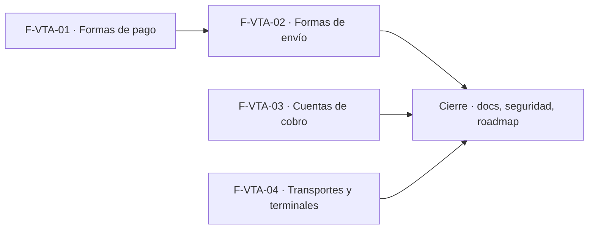

# Tasks: Ventas y despacho · Ventas catálogos de cobro y envío

**Input**: [spec.md](./spec.md) y [plan.md](./plan.md) · **Épica**: MSF-139
**Formato**: `- [ ] T### [P] [Historia][USx] descripción (FR/SC)`. `[P]` = paralelizable (archivos distintos, sin dependencia dentro del mismo grupo). Cada FR/SC tiene **una sola** tarea dueña; "soporte de" = pieza auxiliar sin dueñar el requisito.
**Validación por historia**: `pnpm test:db`, `pnpm lint`, `pnpm build` y `pnpm test:web` verdes antes de cerrar la fase.
**Esquema (Principio VII)**: toda tabla de esta épica es `dominio`; se re-verifica en cada migración y en T034.

## Phase 1: F-VTA-01 · Formas de pago por empresa

**Goal**: tabla `dominio.formas_pago`, RPC, pantalla Configuración de ventas (shell + pestaña de pagos) y diálogo.

- [ ] T001 [F-VTA-01][US1] Migración `supabase/migrations/20261020100000_formas_pago.sql`: `dominio.formas_pago` (empresa, nombre, tipo, exige cuenta de cobro, genera deuda, estado inicial, orden, activo, `updated_at`), `unique (empresa_id, lower(nombre))`, checks de valores permitidos, RLS por organización/empresa accesible/sección `ventas` (select) y `es_administrador_de` (insert/update), **sin delete**, `anon` sin privilegios, reversión en el encabezado (FR-001)
- [ ] T002 [F-VTA-01][US1] Migración `supabase/migrations/20261020100100_formas_pago_rpc.sql`: `public.crear_forma_pago` (lista de empresas, un ítem por empresa), `actualizar_forma_pago` (bloqueo optimista) y `cambiar_estado_forma_pago` (idempotente), `security invoker`, `search_path = ''`, `revoke … from public, anon` + `grant execute … to authenticated` (FR-002)
- [ ] T003 [F-VTA-01][US1] pgTAP `supabase/tests/database/formas_pago.test.sql`: aislamiento por organización y empresa, lectura con `ventas`, escritura solo Administrador, nombre duplicado por empresa (y válido en otra), valores fuera de lista, conflicto, estado idempotente, sin `delete`, `anon` sin ejecución; `rls_en_toda_tabla` verde (SC-001)
- [ ] T004 [P] [F-VTA-01][US1] `apps/web/src/lib/ventas/formasPago.ts`: tipos, llamadas a las RPC y mapeo de errores (`23505`, conflicto, `42501`) a mensajes claros (soporte de FR-004 y FR-005)
- [ ] T005 [P] [F-VTA-01][US1] `apps/web/src/pages/ventas/configuracion/index.tsx` (shell): ruta `/ventas/configuracion`, título/subtítulo, selector `Empresa` (empieza en la empresa activa), contenedor de pestañas por catálogo, grupo **Ventas** del menú con icono (si no existe lo crea; si existe agrega la entrada), acceso por nivel de `ventas` («Acceso restringido» sin permiso) (FR-003)
- [ ] T006 [F-VTA-01][US1] `apps/web/src/pages/ventas/configuracion/FormasPagoTab.tsx`: ayuda, tabla `Orden`/`Forma de pago`/`Pide cuenta de cobro`/`Genera deuda`/`Activo`/editar, chips Sí/No, nombre atenuado si inactiva, interruptor, `Nueva forma de pago`, acciones ocultas sin edición, carga/vacío/error con «Reintentar», tarjetas en angosto; registrada como pestaña del shell (FR-004)
- [ ] T007 [P] [F-VTA-01][US1] `apps/web/src/components/ventas/FormaPagoDialog.tsx`: diálogo Nueva/Editar con los campos de FR-005, ayuda del estado inicial, `Empresas donde aplica` (bloqueada en edición), `Cancelar`/`Crear`/`Guardar cambios`, avisos «Creado · …», «Cambios guardados · …», «Completá el nombre», errores por campo, foco y teclado (FR-005)
- [ ] T008 [F-VTA-01][US1] Vitest de shell, pestaña y diálogo: lista, chips, alta multiempresa, validaciones, interruptor, selector de empresa, acciones ocultas sin edición, «Acceso restringido», teclado/lector (SC-002)

**Checkpoint F-VTA-01**: `pnpm test:db`, `pnpm lint`, `pnpm build` y `pnpm test:web` verdes. Orden interno: T001 → T002 → T003; T004 [P] y T005 [P] con T002; T006 y T007 [P] tras T004/T005; T008 al final.

## Phase 2: F-VTA-02 · Formas de envío por empresa

**Goal**: tabla `dominio.formas_envio`, RPC, pestaña y diálogo dentro de Configuración de ventas (la pantalla ya existe por F-VTA-01).

- [ ] T009 [F-VTA-02][US2] Migración propia `supabase/migrations/20261020110000_formas_envio.sql`: `dominio.formas_envio` (empresa, nombre, tipo, exige transporte y guía, costo por defecto `numeric(12,2)` ≥ 0 nulo permitido, estado de despacho inicial, orden, activo, `updated_at`), unicidad por empresa, RLS y grants como FR-001, sin delete, reversión en el encabezado (FR-006)
- [ ] T010 [F-VTA-02][US2] Migración `supabase/migrations/20261020110100_formas_envio_rpc.sql`: `crear_forma_envio`, `actualizar_forma_envio`, `cambiar_estado_forma_envio` con las garantías de FR-002 (FR-007)
- [ ] T011 [F-VTA-02][US2] pgTAP `supabase/tests/database/formas_envio.test.sql`: mismo alcance que `formas_pago` más costo negativo y costo nulo (SC-003)
- [ ] T012 [P] [F-VTA-02][US2] `apps/web/src/lib/ventas/formasEnvio.ts`: tipos, RPC y mapeo de errores (soporte de FR-008 y FR-009)
- [ ] T013 [P] [F-VTA-02][US2] `apps/web/src/components/ventas/FormaEnvioDialog.tsx`: campos de FR-009 (costo con prefijo ARS, ayuda del estado de despacho inicial), `Empresas donde aplica`, errores por campo (FR-009)
- [ ] T014 [F-VTA-02][US2] `apps/web/src/pages/ventas/configuracion/FormasEnvioTab.tsx`: tabla `Orden`/`Forma de envío`/`Requiere transporte y guía`/`Costo por defecto` («—» sin costo)/`Activo`/editar, `Nueva forma de envío`; se registra como pestaña en el shell de F-VTA-01 (FR-008)
- [ ] T015 [F-VTA-02][US2] Vitest de la pestaña y el diálogo de envío: «—» y importe, costo negativo, interruptor, permisos, alta multiempresa (SC-004)

**Checkpoint F-VTA-02**: `pnpm test:db`, `pnpm lint`, `pnpm build` y `pnpm test:web` verdes. Orden: T009 → T010 → T011; T012 [P] y T013 [P] tras T010 → T014 → T015.

## Phase 3: F-VTA-03 · Cuentas de cobro

**Goal**: cuentas de la organización con CBU/CUIT validados, habilitación por empresa, auditoría y pantalla.

- [ ] T016 [F-VTA-03][US3] Migración `supabase/migrations/20261020120000_cuentas_cobro.sql`: `dominio.cuentas_cobro` y `dominio.cuentas_cobro_empresas` (nombre, titular, CUIT, banco, alias, CBU/CVU, tipo, moneda, orden, activa, notas, `updated_at`), RLS por organización y `ventas` (select), escritura solo Administrador, **sin delete**, `anon` sin privilegios, reversión en el encabezado (FR-010)
- [ ] T017 [F-VTA-03][US3] Migración `supabase/migrations/20261020120100_cuentas_cobro_validacion.sql`: `private.cbu_valido(text)` (22 dígitos, dígitos verificadores) y disparador que normaliza y valida CBU/CVU y CUIT (`private.cuit_valido`) (FR-011)
- [ ] T018 [F-VTA-03][US3] Migración `supabase/migrations/20261020120200_cuentas_cobro_rpc.sql`: `crear_cuenta_cobro`, `actualizar_cuenta_cobro` (bloqueo optimista) y `cambiar_estado_cuenta_cobro` (idempotente) con la habilitación por empresa en la misma transacción, rechazo a no Administradores, `revoke`/`grant` (FR-012)
- [ ] T019 [F-VTA-03][US3] Migración `supabase/migrations/20261020120300_cuentas_cobro_actividad.sql`: disparador `security definer` que registra `cuenta_cobro.creada|editada|desactivada|reactivada` vía `private.insertar_actividad` sin CBU completo y sin evento si no hubo cambio (FR-013)
- [ ] T020 [F-VTA-03][US3] pgTAP `supabase/tests/database/cuentas_cobro.test.sql`: RLS y escritura solo Administrador, CBU/CVU y CUIT válidos e inválidos, empresa de otra organización rechazada, «No usar» idempotente, eventos de actividad sin CBU completo, `anon` sin acceso; `rls_en_toda_tabla` verde (SC-005)
- [ ] T021 [P] [F-VTA-03][US3] `apps/web/src/lib/ventas/cbu.ts` (validar CBU/CVU, formatear) + `cbu.test.ts` con los mismos vectores que pgTAP; reutiliza `lib/cuit.ts` (soporte de FR-011 y FR-015)
- [ ] T022 [P] [F-VTA-03][US3] `apps/web/src/lib/ventas/cuentasCobro.ts`: tipos, listado paginado por tienda, RPC y mapeo de errores (soporte de FR-014 y FR-015)
- [ ] T023 [F-VTA-03][US3] `apps/web/src/pages/ventas/cuentas-cobro/list.tsx`: título, descripción, aviso de «No usar», filtro `Tienda`, recuento y paginación («1–10 de N»), tabla `Cuenta`/`Titular`/`Banco`/`CBU`/`CUIT`/`Disponible en`/`Estado`/editar, `Nueva cuenta de cobro`, ruta `/ventas/cuentas-cobro`, entrada de menú en el grupo Ventas con icono, acceso por nivel, estados compartidos, tarjetas en angosto (FR-014)
- [ ] T024 [P] [F-VTA-03][US3] `apps/web/src/components/ventas/CuentaCobroDialog.tsx`: campos de FR-015, nota del interruptor `Activa`, `Disponible en`, validación de CBU/CUIT por campo, `Cancelar`/`Guardar cuenta`, aviso «Cuenta de cobro creada» (FR-015)
- [ ] T025 [F-VTA-03][US3] Vitest de la pantalla y el diálogo: tabla, filtro `Tienda`, paginación, validaciones de CBU/CUIT, nota de «No usar», acciones ocultas para quien no es Administrador, «Acceso restringido» (SC-006)

**Checkpoint F-VTA-03**: `pnpm test:db`, `pnpm lint`, `pnpm build` y `pnpm test:web` verdes. Orden: T016 → T017 → T018 → T019 → T020; T021 [P] y T022 [P] tras T018 → T023 y T024 [P] → T025.

## Phase 4: F-VTA-04 · Transportes y terminales de retiro

**Goal**: transportes de la organización con terminal, contacto y empresas donde se usan.

- [ ] T026 [F-VTA-04][US4] Migración `supabase/migrations/20261020130000_transportes.sql`: `dominio.transportes` y `dominio.transportes_empresas` (campos de FR-016, comisión 0–100, plazo ≥ 0, CUIT opcional), unicidad de nombre por organización, RLS por organización y `ventas` (select), escritura solo Administrador, sin delete, `anon` sin privilegios, reversión en el encabezado (FR-016)
- [ ] T027 [F-VTA-04][US4] Migración `supabase/migrations/20261020130100_transportes_rpc.sql`: `crear_transporte`, `actualizar_transporte` (bloqueo optimista) y `cambiar_estado_transporte` (idempotente), validación de CUIT con `private.cuit_valido`, `revoke`/`grant` (FR-017)
- [ ] T028 [F-VTA-04][US4] pgTAP `supabase/tests/database/transportes.test.sql`: RLS y escritura solo Administrador, CUIT, rangos de comisión y plazo, unicidad, empresa de otra organización rechazada, estado idempotente, `anon` sin acceso; `rls_en_toda_tabla` verde (SC-007)
- [ ] T029 [P] [F-VTA-04][US4] `apps/web/src/lib/ventas/transportes.ts`: tipos, listado paginado por tienda, RPC y mapeo de errores (soporte de FR-018 y FR-019)
- [ ] T030 [F-VTA-04][US4] `apps/web/src/pages/ventas/transportes/list.tsx`: título, descripción, filtro `Tienda`, tabla `Empresa de transporte`/`Terminal de retiro`/`Localidad`/`Teléfono`/`Contacto`/editar, recuento «N de M empresas de transporte», `Nueva empresa`, ruta `/ventas/transportes`, entrada de menú en el grupo Ventas con icono, acceso por nivel, estados compartidos (FR-018)
- [ ] T031 [P] [F-VTA-04][US4] `apps/web/src/components/ventas/TransporteDialog.tsx`: campos de FR-019, `Empresas donde se usa`, `Cancelar`/`Guardar empresa`, aviso «Empresa de transporte guardada», errores por campo (FR-019)
- [ ] T032 [F-VTA-04][US4] Vitest de la pantalla y el diálogo: tabla, filtro, recuento, validaciones de CUIT/comisión/plazo, interruptor, permisos (SC-008)

**Checkpoint F-VTA-04**: `pnpm test:db`, `pnpm lint`, `pnpm build` y `pnpm test:web` verdes. Orden: T026 → T027 → T028; T029 [P] tras T027 → T030 y T031 [P] → T032.

## Phase 5: Cierre

**Goal**: documentación, revisión de seguridad y cierre de la épica (las ejecuta la Tarea de cierre, label `cierre`).

- [ ] T033 [P] [CIERRE] `docs/ventas-catalogos.md` (modelo, esquemas `dominio`, permisos lectura `ventas`/edición Administrador, CBU/CUIT, pantallas y rutas, reversión por migración) y actualización de `docs/permisos-por-rol.md` (FR-020)
- [ ] T034 [CIERRE] Revisión de seguridad/authz: re-verificar el esquema `dominio` de las seis tablas, `rls_en_toda_tabla`, `anon` sin privilegios, escritura solo Administrador, ningún CBU en logs ni en actividad, sin service-role en el navegador (SC-009)
- [ ] T035 [CIERRE] Cierre: `pnpm prototipo:check`, `pnpm matriz:check`, `pnpm docs:check`, `pnpm lint`, `pnpm build`, `pnpm test`; fila de `docs/roadmap-template.md` (estado y link a la spec); `graphify . --code-only --update`; todas las tareas en `[x]` (SC-010)

## Dependencias

Cada historia es autosuficiente: sus tareas dependen solo de tareas de la misma historia. Las tareas `[CIERRE]` van al final y nunca son prerequisito de una historia.
Entre historias solo hay una dependencia real de archivos: F-VTA-02 agrega su pestaña al shell de Configuración de ventas que crea F-VTA-01 (T005), por eso requiere F-VTA-01 mergeada. F-VTA-03 y F-VTA-04 no comparten archivos, tablas ni migraciones con las demás (cada una agrega su propia entrada al grupo Ventas del menú; si dos historias tocan el mismo archivo de menú, la segunda en mergear resuelve un conflicto trivial).

## Plan de ejecución (historias)

El orquestador **consume** esta tabla (no infiere el orden del `tasks.md`). Una historia arranca cuando sus dependencias están **Finalizadas (mergeadas)**; las del mismo `Grupo` van en paralelo.

| Historia | Depende de | Grupo |
|----------|------------|-------|
| F-VTA-01 | — | 1 |
| F-VTA-03 | — | 1 |
| F-VTA-04 | — | 1 |
| F-VTA-02 | F-VTA-01 | 2 |
| [Cierre] | F-VTA-01, F-VTA-02, F-VTA-03, F-VTA-04 | 3 |

