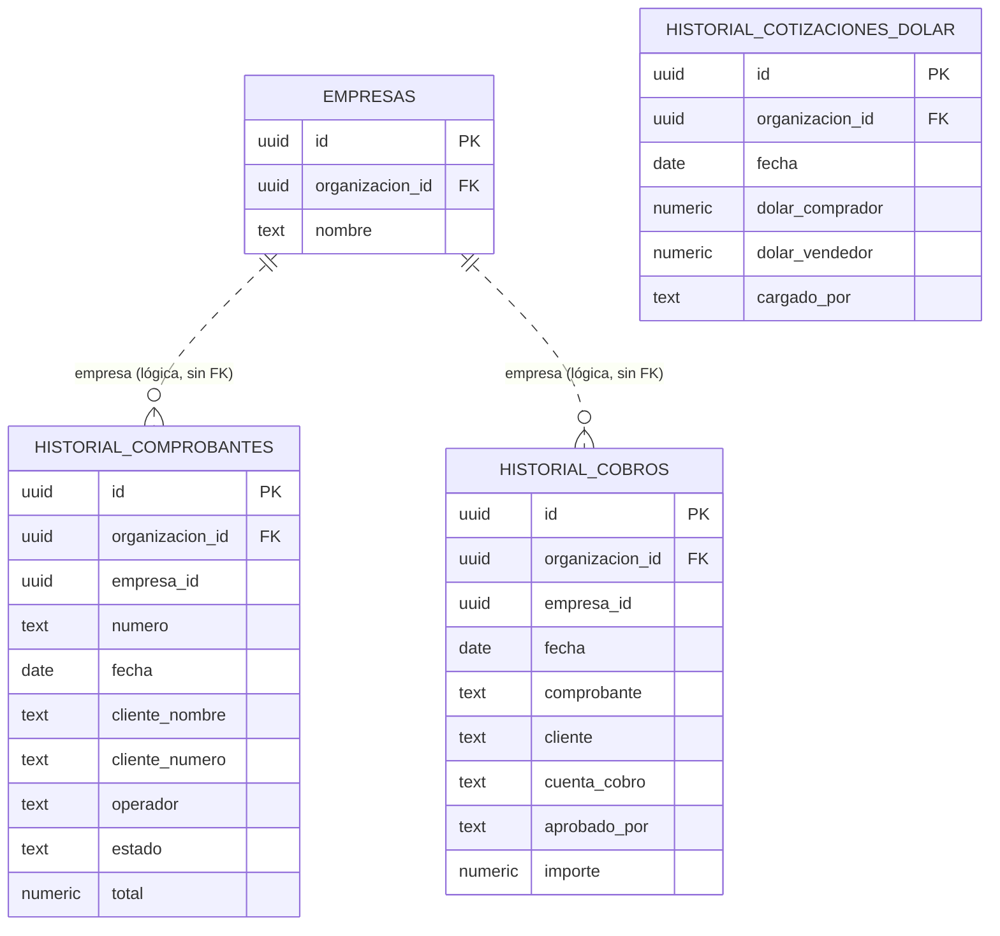
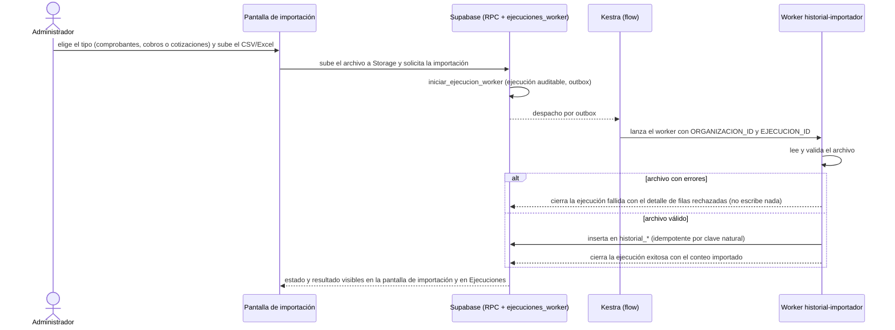
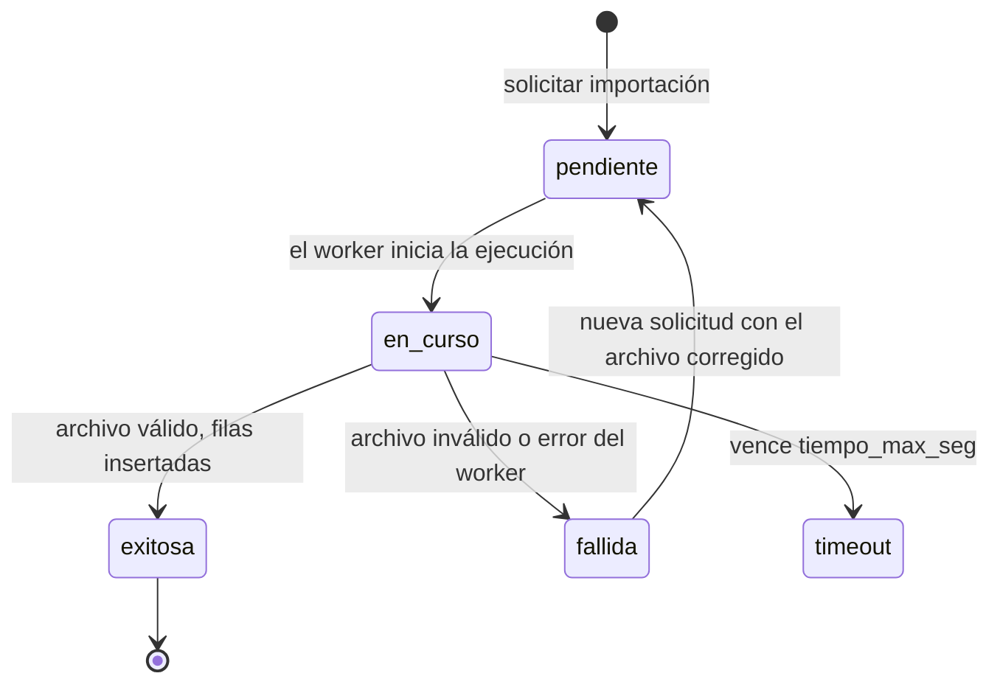
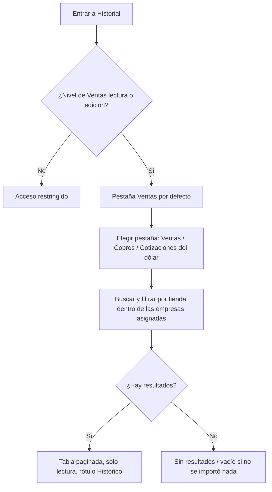

# Feature Specification: Ventas y despacho · Ventas historial de consulta

**Feature Branch**: `epic/MSF-275-ventas-y-despacho-ventas-historial-de-co`

**Jira Epic**: MSF-275 — Ventas y despacho · Ventas historial de consulta (spec `ventas-historial-de-consulta`)

**Created**: 2026-10-20

**Status**: Ready for implementation — la especificación viene completa desde Jira. Los puntos de «A revisar» no bloquean: cada uno lleva una decisión provisoria en *Decisiones abiertas*.

**Delivery scope**: `refine` (apps/web), `supabase` (migraciones + RPC + Storage + pgTAP), `workers` (importador de planillas) y `kestra` (flow que despacha ese worker). Sin `superset`.

**Prioridad / Hito**: P0 · Hito 4 (30 de noviembre al 11 de diciembre de 2026) · 22 h (la suma nominal de tallas L + M + S es 28 h; la diferencia sale del ahorro por lo que ya trae el template) · alcance diciembre.

**Dependencias**:
- Bloqueada por: MSF-121 (Acceso, organización y permisos · Permisos por empresa): empresas asignadas al usuario y nivel de acceso a la sección Ventas para las políticas de acceso (RLS) del historial. MSF-121 ya está bloqueada por MSF-138 (Empresas) y MSF-125 (Usuarios y roles), que no se repiten acá. Ya en `main`: `private.empresas_accesibles()`, `private.nivel_seccion('ventas')`, `private.organizacion_id()`.
- Relacionada, sin bloqueo: MSF-180 (Clientes alta y búsqueda): el historial guarda el nombre del cliente tal como figura y el número de cliente como dato; el vínculo con la ficha actual se resuelve al consultar y no hace falta que la ficha exista para construir ni probar la épica.
- Relacionada, sin bloqueo: MSF-206 (Plataforma · Importaciones y monitoreo, Etapa 2): confirmar que no duplica un importador genérico (*Decisiones abiertas* 3).
- Bloquea a: ninguna épica.

**Input**: Epic MSF-275. Objetivo: «Al terminar, los comprobantes, cobros y cotizaciones del dólar del panel actual se pueden buscar y ver en solo lectura dentro de la plataforma, sin haberlos migrado a las tablas vivas.»

**Regla de fuentes** (literal de la épica):
- Comportamiento y datos: mandan los requisitos y escenarios de esta historia.
- Qué se ve (disposición, textos, estados, popups, flujos): el prototipo validado es referencia visual, no hace falta que quede extremadamente idéntico; los flujos (si hay) aclaran estados y acciones.
- Cómo se construye (componentes, estilos y patrones): mandan el template y el sistema de diseño (MSF-117, `docs/sistema-de-diseno.md`). No se copia HTML ni CSS: se reproduce con los componentes del template y los tokens.
- El prototipo muestra más que esta historia: se implementa solo lo que piden los requisitos de F-VTA-37…39.
- Si algo no se puede igualar: lo más cercano, sin inventar, anotando la diferencia en el PR. Si prototipo y requisitos se contradicen: requisitos para el comportamiento, prototipo para lo visual, y la contradicción queda anotada en el PR.
- Prototipo (solo lectura, presente en el árbol de trabajo; la rama `design/prototipo` no existe en `origin` hoy): `design/pantallas/Historial.dc.html`. **La importación (F-VTA-37) no tiene pantalla dibujada.**

## Modelo y supuestos

- Los datos históricos **no se migran** a comprobantes, cobros ni a la cotización vigente: no cuentan para stock, saldos, estados ni reportes. Se importan **una sola vez** a tablas de archivo `historial_*` que **ninguna pantalla puede modificar**.
- La importación llega como **exportaciones (CSV o Excel)** del panel actual; no se conecta a su base.
- Los comprobantes históricos **conservan sus números originales** y se rotulan «Histórico». La numeración nueva arranca en un número posterior al último histórico (ver FR-009).
- El historial guarda el **nombre del cliente tal como figura** y el **número de cliente como dato**; no hay clave foránea a `public.clientes`.
- **Qué trae ya el template (no se reconstruye)**: contrato de workers (`workers/CONTRATO.md`), ciclo auditable de ejecuciones (`ejecuciones_worker`, RPC `iniciar_ejecucion_worker`, pantalla `pages/ejecuciones`), outbox durable, aislamiento por organización (`private.organizacion_id()`, `private.puede_escribir()`) y el kit de panel (`ContenidoAdaptable`, estados vacío/error/carga, `EncabezadoPagina`).
- **Qué agrega esta épica**: el lector y validador de archivos (worker nuevo), las tablas `historial_*`, la pantalla de importación y las pantallas de consulta (el template no trae filtros, búsqueda ni paginación en sus listas).
- **Por qué P0**: el día uno el equipo responde consultas de clientes (garantías, repetir un pedido, saldos viejos); sin esto debería mantener abierto el panel actual.
- **Roles**: el template solo trae administrador y miembro; los operativos (Mostrador, Depósito, Administración) y los permisos por sección y empresa los extiende MSF-121. Los escenarios con «Mostrador» y «Acceso restringido» suponen esa extensión (ya presente en `main`: matriz `roles_basicos_permisos`, sección `ventas`).
- **«Tienda» = empresa** de la organización: cada venta y cobro histórico queda asignado a la empresa que lo emitió (columna `empresa_id`). Las cotizaciones del dólar son **globales** de la organización.

### Esquema de datos (Constitución, Principio VII)

| Objeto | Esquema | Justificación | RLS / acceso |
|--------|---------|---------------|--------------|
| `historial_comprobantes` (**nueva**, F-VTA-37) | **`dominio`** | Dato de negocio del producto (ventas archivadas), no plataforma. | **Sí**: `organizacion_id = (select private.organizacion_id())`, `empresa_id in (select private.empresas_accesibles())`, `select` solo con `private.nivel_seccion('ventas')` en `lectura`/`edicion`. **Sin políticas ni grants de insert/update/delete** para `authenticated`; escribe solo el worker con su rol de servicio. `anon` sin acceso. |
| `historial_cobros` (**nueva**, F-VTA-37) | **`dominio`** | Ídem. | Ídem. |
| `historial_cotizaciones_dolar` (**nueva**, F-VTA-37) | **`dominio`** | Ídem; sin `empresa_id` (global por organización). | `organizacion_id = (select private.organizacion_id())` y nivel `ventas` `lectura`/`edicion`; sin escritura desde el panel. |
| Bucket Storage `historial-importaciones` (**nuevo**, F-VTA-37) | Storage (no es tabla) | Archivo temporal de la planilla subida, por organización. | Policies por prefijo `<organizacion_id>/`; solo quien importa sube; el worker lee. |

No se crean otras tablas ni se altera ninguna existente (`comprobantes_venta`, cobros y cotización vigente quedan intactas). La prueba pgTAP `rls_en_toda_tabla` recorre `public` + `dominio` y debe seguir verde. Las RPC de lectura y de solicitud viven en `public` con `revoke … from public, anon` y `grant execute … to authenticated`.

## Modelo de datos (DER)

Tablas de archivo en `dominio`. No tienen FKs ni disparadores hacia las tablas vivas: la relación con la empresa es lógica (`empresa_id`), no una clave foránea (FR-008).

| Tabla | Estado | Cambio |
|---|---|---|
| `dominio.historial_comprobantes` | nueva | — |
| `dominio.historial_cobros` | nueva | — |
| `dominio.historial_cotizaciones_dolar` | nueva | — |
| `dominio.empresas` | existente | sin cambios (referencia lógica, sin FK) |

## Flujos

### Flujo 1 — Importación del historial (F-VTA-37)

La épica describe el proceso en texto (subir la exportación, validarla, importarla una sola vez); se transcribe sin agregar pasos de negocio.

| Paso | Dueño |
|------|-------|
| Elegir tipo y subir el archivo | FR-002, FR-010 |
| Solicitar la importación / ejecución auditable | FR-003 |
| Despacho Kestra → worker | FR-004 |
| Leer y validar el archivo | FR-005, FR-006 |
| Rechazo total si hay errores | FR-006 |
| Inserción idempotente en `historial_*` | FR-007 |
| Resultado visible | FR-010 |

### Flujo 2 — Estados de la ejecución de importación

Reutiliza los estados del ciclo del template (`ejecuciones_worker`, `docs/adoptar-ciclo-ejecuciones.md`); no se agregan estados propios. Los nombres exactos son los de ese ciclo.

Mapeo: solicitar → FR-003; `en_curso` → FR-004/FR-005; `exitosa` → FR-007; `fallida` → FR-006; `timeout` → FR-004 (reintentos del contrato); nueva solicitud → FR-003 y FR-007 (idempotente); todos visibles → FR-010.

### Flujo 3 — Consulta del historial (F-VTA-38 / F-VTA-39)

| Paso | Dueño |
|------|-------|
| Control de acceso / Acceso restringido | FR-011, FR-012 |
| Pestañas | FR-013 |
| Búsqueda y filtro por tienda | FR-014, FR-015 |
| Tabla paginada, solo lectura, «Histórico» | FR-016, FR-017 |
| Sin resultados / vacío | FR-018 |
| Cotizaciones (sin tienda) | FR-020, FR-021 |

## User Scenarios & Testing *(mandatory)*

### User Story 1 - Importación del historial desde el panel actual (F-VTA-37, P0, talla L)

Como administrador, quiero importar una sola vez las exportaciones (CSV o Excel) de comprobantes, cobros y cotizaciones del panel actual, para consultarlas en la plataforma sin migrarlas a las tablas vivas.

**Why this priority**: sin los datos archivados no hay nada que consultar; es la base de la épica.

**Independent Test**: con el rol Administrador, subir un CSV válido de cada tipo inserta las filas en `historial_*` con sus números originales y deja la ejecución en `exitosa` con el conteo; subir un archivo con filas inválidas no inserta nada y muestra qué filas fallaron; reimportar el mismo archivo no duplica; ninguna pantalla ni RPC puede modificar ni borrar lo importado; el stock, los saldos y los reportes no cambian.

**Acceptance Scenarios**:

1. **Given** un CSV válido de comprobantes, **When** el administrador lo sube, **Then** las filas quedan en `historial_comprobantes` con su número original, tienda, fecha, cliente (nombre y número), operador, estado final y total, y la ejecución termina `exitosa` con la cantidad importada.
2. **Given** una planilla Excel (`.xlsx`) válida de cobros o de cotizaciones, **When** se importa, **Then** se carga igual que un CSV.
3. **Given** un archivo con filas inválidas (fecha ilegible, importe no numérico, columna obligatoria ausente), **When** se valida, **Then** no se inserta ninguna fila y la ejecución queda `fallida` con el detalle de las filas rechazadas y su motivo.
4. **Given** un archivo ya importado, **When** se vuelve a importar, **Then** no se duplican filas (clave natural por organización) y el resultado informa cuántas ya existían.
5. **Given** datos importados, **When** cualquier usuario (incluido el administrador) intenta insertar, modificar o borrar filas de `historial_*` desde la app o la API, **Then** la base lo rechaza.
6. **Given** datos importados, **When** se consulta stock, saldos, estados o reportes, **Then** no incluyen el historial.
7. **Given** un usuario sin permiso de escritura de la organización, **When** intenta importar, **Then** la acción no existe o es rechazada.
8. **Given** el historial importado, **When** se consulta el último número histórico, **Then** está disponible para que la numeración nueva arranque después (FR-009).

### User Story 2 - Consulta de ventas y cobros históricos (F-VTA-38, P0, talla M)

Como persona de mostrador, quiero buscar y ver en solo lectura las ventas y cobros anteriores a la plataforma, para responder a un cliente (garantía, repetir un pedido, saldo viejo) sin abrir el panel actual.

**Why this priority**: es la razón P0 de la épica (consultas de clientes el día uno).

**Independent Test**: con el rol Mostrador y una empresa asignada, abrir Historial, buscar por cliente o número y filtrar por tienda devuelve solo filas de sus empresas; las filas llevan el rótulo «Histórico» y no hay forma de editarlas; un usuario sin acceso a Ventas ve «Acceso restringido».

**Acceptance Scenarios**:

1. **Given** historial importado, **When** el usuario con acceso a Ventas abre Historial, **Then** ve la pestaña **Ventas** con Comprobante, Tienda, Fecha, Cliente, Operador, Estado final y Total, paginada y ordenada por fecha descendente.
2. **Given** la pestaña **Cobros**, **When** se abre, **Then** ve Fecha, Comprobante, Tienda, Cliente, Cuenta de cobro, Aprobado por e Importe.
3. **Given** el buscador «Buscar por cliente o número», **When** escribe parte del nombre del cliente, su número o el número del comprobante, **Then** la tabla se filtra (sin distinguir mayúsculas ni tildes) y la paginación se reinicia.
4. **Given** el filtro **Tienda**, **When** elige una, **Then** solo se listan filas de esa tienda; las opciones son solo las empresas asignadas al usuario (MSF-121).
5. **Given** un usuario con empresas asignadas limitadas, **When** consulta, **Then** nunca ve filas de empresas no asignadas ni de otras organizaciones, por RLS y no solo por la interfaz.
6. **Given** un comprobante histórico, **When** se muestra, **Then** conserva su número original y lleva el rótulo «Histórico»; no hay acciones de edición, anulación ni borrado.
7. **Given** que no hay resultados, **When** se busca, **Then** se muestra «Sin resultados»; si aún no se importó nada, el estado vacío indica que no hay historial importado.
8. **Given** un usuario sin acceso a la sección Ventas (p. ej. Depósito), **When** entra a Historial, **Then** ve «Acceso restringido» y la entrada de menú no aparece.
9. **Given** un fallo de carga, **When** ocurre, **Then** se muestra el error con «Reintentar».
10. **Given** anchos de 320, 768 y 1440 px, **When** se consulta, **Then** la tabla se adapta (tarjetas en angosto) y es operable con teclado y lector.

### User Story 3 - Consulta de cotizaciones históricas del dólar (F-VTA-39, P0, talla S)

Como usuario con acceso a Ventas, quiero ver las cotizaciones del dólar anteriores a la plataforma, para conocer a cuánto estaba el dólar en una fecha pasada.

**Why this priority**: completa el historial; sin ella el equipo seguiría usando el panel actual para ese dato.

**Independent Test**: con historial importado, abrir la pestaña Cotizaciones del dólar muestra fecha, comprador, vendedor y quién la cargó; buscar por fecha filtra; no hay filtro por tienda; no se puede editar.

**Acceptance Scenarios**:

1. **Given** cotizaciones importadas, **When** se abre la pestaña **Cotizaciones del dólar**, **Then** ve Fecha, Dólar comprador, Dólar vendedor y Cargó, ordenadas por fecha descendente y paginadas.
2. **Given** el buscador «Buscar por fecha», **When** escribe una fecha (`dd/mm/aaaa` o parte), **Then** se filtra.
3. **Given** las cotizaciones, **When** se consultan, **Then** son globales de la organización (sin filtro de tienda) y solo de lectura.
4. **Given** la cotización vigente de la plataforma, **When** se importa el historial, **Then** no cambia.
5. **Given** sin acceso a Ventas, **Then** «Acceso restringido» (igual que US2).

### Edge Cases

- Archivo vacío, sin encabezados reconocidos o con columnas obligatorias ausentes: falla con motivo claro, sin insertar.
- Codificación y separador del CSV (UTF-8/Latin-1, `,` o `;`) y fechas `dd/mm/aaaa` o ISO: el lector los admite y los documenta (FR-005).
- Importes con coma o punto decimal: se normalizan; no se inventan reglas de signo.
- Archivo muy grande: se procesa por lotes dentro de la ejecución; el límite de tamaño y filas se fija con el volumen real (*Decisiones abiertas* 1).
- Una importación en curso para el mismo tipo bloquea una segunda simultánea (idempotencia y carrera).
- Cliente sin número en la planilla: se guarda solo el nombre; el número queda vacío.
- Fila con una tienda que no existe en la organización: se rechaza con motivo (no se crean empresas).

## Requirements *(mandatory)*

### Functional Requirements

**F-VTA-37 — Importación del historial**

- **FR-001**: Migración aditiva de `dominio.historial_comprobantes`, `dominio.historial_cobros` y `dominio.historial_cotizaciones_dolar` con RLS por organización (y por `empresa_id` en las dos primeras), `select` por nivel de `ventas`, **sin políticas ni grants de escritura** para `authenticated`/`anon`, índices de búsqueda y reversión documentada.
- **FR-002**: Bucket privado `historial-importaciones` con policies por prefijo de organización; solo quien tiene permiso de importar sube planillas (`.csv`, `.xlsx`).
- **FR-003**: RPC `public.solicitar_importacion_historial(p_tipo, p_archivo)` (`security invoker`, `private.puede_escribir()`, organización tomada de `private.organizacion_id()`) que valida el tipo y crea la ejecución con `iniciar_ejecucion_worker` (origen, actor, estado, timestamps); rechaza una segunda importación simultánea del mismo tipo; `revoke … from public, anon` / `grant execute … to authenticated`.
- **FR-004**: Flow de Kestra que consume el outbox y lanza el worker `historial-importador` con `ORGANIZACION_ID` y `EJECUCION_ID`, con reintentos según `workers/CONTRATO.md`.
- **FR-005**: Worker `workers/historial-importador` (contrato de workers): lector de CSV y Excel (`.xlsx`) con mapeo documentado de columnas por tipo, normalización de fechas e importes y detección de codificación/separador.
- **FR-006**: Validación completa antes de escribir: todo o nada. Si hay filas inválidas la ejecución queda `fallida` (código `78`, no reintentable) con el detalle (fila, columna, motivo) sin datos sensibles.
- **FR-007**: Inserción idempotente (clave natural por organización: tipo+número+empresa en comprobantes y cobros, fecha en cotizaciones; `on conflict do nothing`) y conteo de nuevas/existentes en el cierre de la ejecución. El worker usa su rol de servicio, nunca la service-role en el navegador.
- **FR-008**: El historial **no escribe ni referencia** comprobantes, cobros, cotización vigente, stock ni saldos: sin claves foráneas ni disparadores hacia tablas vivas; pgTAP lo demuestra.
- **FR-009**: Función `public.historial_ultimo_numero(p_tipo, p_empresa_id)` que devuelve el mayor número histórico, para que la numeración nueva (épica de Ventas) arranque en uno posterior. Fijar la numeración nueva queda fuera de esta épica.
- **FR-010**: Pantalla de importación (sin diseño en el prototipo; se arma con el kit de panel): elegir tipo, subir archivo, ver el estado de la ejecución (en curso, exitosa con conteo, fallida con detalle de filas) y enlace a Ejecuciones; visible solo con permiso de importar.

**F-VTA-38 — Consulta de ventas y cobros**

- **FR-011**: Ruta canónica `/historial` con entrada de menú «Historial» (icono) en el grupo Ventas, visible según el nivel de la sección `ventas`.
- **FR-012**: Sin nivel `lectura`/`edicion` en `ventas`, la pantalla muestra «Acceso restringido» y la base no devuelve filas (RLS).
- **FR-013**: Encabezado «Historial» con la etiqueta «Solo lectura», el subtítulo «Consulta de lo registrado antes de la plataforma. No se puede editar ni borrar.» y las pestañas **Ventas**, **Cobros** y **Cotizaciones del dólar**.
- **FR-014**: RPC `public.listar_historial_ventas` y `public.listar_historial_cobros` (`security invoker`, `p_busqueda`, `p_empresa_id`, `p_pagina`, `p_tamano`, tope 200, orden estable por fecha desc, `total_filas`), búsqueda por cliente, número de cliente o número de comprobante sin mayúsculas/tildes.
- **FR-015**: Filtro **Tienda** con las empresas asignadas al usuario (`private.empresas_accesibles()`); la RLS impide ver otras.
- **FR-016**: Tabla Ventas (Comprobante, Tienda, Fecha, Cliente, Operador, Estado final, Total) y tabla Cobros (Fecha, Comprobante, Tienda, Cliente, Cuenta de cobro, Aprobado por, Importe), paginadas en servidor, con importes alineados a la derecha.
- **FR-017**: Rótulo «Histórico» en cada comprobante, número original conservado, sin acciones de edición, anulación ni borrado; texto informativo «Datos del sistema anterior, importados una sola vez al migrar. Sirven para consultar ventas, cobros y cotizaciones del dólar anteriores a la plataforma; no afectan el stock actual.» y «Cada venta y cobro quedó asignado a la tienda que lo emitió. Las cotizaciones del dólar son globales.»
- **FR-018**: Estados: carga, error con «Reintentar», «Sin resultados», vacío si no hay historial importado; indicadores «Desde / Hasta» (rango de fechas del historial de la pestaña), «N registros mostrados» y paginación («Página N»).
- **FR-019**: Vista adaptable a 320/768/1440 px (tarjetas en angosto), teclado y lector de pantalla; nombre del cliente como identidad visible, sin ids técnicos.

**F-VTA-39 — Cotizaciones históricas del dólar**

- **FR-020**: RPC `public.listar_historial_cotizaciones` (`p_busqueda` por fecha, paginación, tope 200, orden por fecha desc) sin filtro de empresa.
- **FR-021**: Pestaña **Cotizaciones del dólar** con Fecha, Dólar comprador, Dólar vendedor y Cargó, buscador «Buscar por fecha», solo lectura, mismos estados y adaptabilidad que FR-018/FR-019.

### Success Criteria

- **SC-001** *(F-VTA-37)*: pgTAP — RLS por organización/empresa/sección, ninguna escritura posible desde `authenticated`/`anon`, `solicitar_importacion_historial` (permiso, simultaneidad, `anon` sin ejecución), `historial_ultimo_numero`, `rls_en_toda_tabla` verde y ausencia de FKs/disparadores a tablas vivas (FR-001, FR-003, FR-008, FR-009).
- **SC-002** *(F-VTA-37)*: Vitest del worker — CSV y Excel válidos de cada tipo, separadores/codificaciones/fechas/importes, rechazo todo-o-nada con detalle, idempotencia al reimportar, códigos de salida del contrato (FR-005, FR-006, FR-007).
- **SC-003** *(F-VTA-37)*: Vitest de la pantalla de importación — subida, estados, error con detalle y acceso por permiso (FR-002, FR-010); el flow de Kestra valida con `pnpm infra:config` (FR-004).
- **SC-004** *(F-VTA-38)*: pgTAP de `listar_historial_ventas`/`listar_historial_cobros` — búsqueda, filtro de tienda, paginación y tope, aislamiento por empresas asignadas y sección, `anon` sin ejecución (FR-012, FR-014, FR-015).
- **SC-005** *(F-VTA-38)*: Vitest de la pantalla — pestañas, tablas, búsqueda, filtro de tienda, «Histórico», solo lectura, vacío/sin resultados/error, acceso restringido, adaptable y teclado (FR-011, FR-013, FR-016…FR-019).
- **SC-006** *(F-VTA-39)*: pgTAP + Vitest de cotizaciones — columnas, búsqueda por fecha, globales sin tienda, solo lectura, acceso restringido (FR-020, FR-021).

## Matriz pantalla↔criterios

Inventario determinista con `pnpm prototipo:inventario` sobre `Historial.dc.html` (`design/pantallas/Historial.inventory.json`; `pnpm prototipo:check` confirma que está al día). Cada ítem visible tiene dueño o está fuera de alcance con motivo.

### Historial (`Historial.dc.html`)

| Ítem del inventario | Destino | Criterio |
|---------------------|---------|----------|
| Tabla Ventas · `Comprobante`, `Tienda`, `Fecha`, `Cliente`, `Operador`, `Estado final`, `Total` | En alcance | US2-1, FR-016 |
| Tabla Cobros · `Fecha`, `Comprobante`, `Tienda`, `Cliente`, `Cuenta de cobro`, `Aprobado por`, `Importe` | En alcance | US2-2, FR-016 |
| Tabla Cotizaciones · `Fecha`, `Dólar comprador`, `Dólar vendedor`, `Cargó` | En alcance | US3-1, FR-021 |
| Campo `(buscar: {{ph}})` — «Buscar por cliente o número» (Ventas/Cobros) y «Buscar por fecha» (Cotizaciones) | En alcance | US2-3, US3-2, FR-014, FR-020 |
| Botón `Exportar` | **FUERA DE ALCANCE** | La épica pide buscar y ver en solo lectura; no pide exportar. Otra épica podrá pedirlo. |
| Pestañas Ventas · Cobros · Cotizaciones del dólar (el inventario no las detecta como `tabs`) | En alcance | FR-013 |
| Filtro «Tienda» (chips) | En alcance | US2-4, FR-015 |
| Empresa activa (barra superior, Constitución VIII) | En alcance | US2-4, FR-015: el filtro Tienda parte de la empresa activa; al cambiar de empresa u organización se reencuadra (página 1, recarga, chip descartado). Test en `list.test.tsx` |
| Etiqueta «Solo lectura», título «Historial», subtítulo y textos informativos | En alcance | FR-013, FR-017 |
| «Desde: …», «Hasta: …», «N registros mostrados», «Página N» | En alcance | FR-018 |
| Rótulo «Histórico» en comprobantes (no dibujado en el prototipo; lo pide la épica) | En alcance | US2-6, FR-017 |
| Diálogos | Ninguno en el prototipo | — |
| Pantalla de importación (sin prototipo) | En alcance, con el kit de panel | US1, FR-010 |

## Decisiones abiertas

1. **Volumen real y horas**: las 22 h son orden de magnitud; se fijan con cuántos años y filas tiene el panel actual y qué exportaciones permite. Provisorio: lotes dentro de la ejecución y límite de archivo configurable.
2. **Reportes de Etapa 2**: si deben incluir el historial (hoy usan solo datos vivos). Provisorio: **no** los incluyen; el historial no entra a ningún reporte.
3. **Solapamiento con MSF-206**: si prevé un importador genérico que esta épica deba reutilizar. Provisorio: importador propio y acotado sobre el contrato de workers; si MSF-206 llega antes, se migra el lector sin cambiar las tablas.
4. **Panel actual al 31/12**: decisión pendiente del cliente; no bloquea esta épica.
5. **Pestañas**: el prototipo dibuja tres (Ventas, Cobros, Cotizaciones del dólar); la épica nombra «Ventas y cobros» y «Cotizaciones». Se sigue el prototipo (visual); se anota en el PR.
6. **Quién importa**: provisorio, quien tiene `private.puede_escribir()` (Administrador); la consulta usa el nivel de `ventas`.
7. **Sección de las cotizaciones**: provisorio, la misma sección `ventas` (la épica solo nombra Ventas).
8. **Columnas de las planillas** (nombres exactos de las exportaciones del panel actual): se documentan en `docs/` con una muestra real al implementar; si difieren, se ajusta el mapeo, no el modelo.

## Reversión

Migraciones aditivas. Reversión en una migración posterior (exportar antes los datos si ya se importó): eliminar las tres tablas `historial_*` y las funciones `solicitar_importacion_historial`, `historial_ultimo_numero` y `listar_historial_*`, y vaciar y quitar el bucket `historial-importaciones`. Nunca en el mismo PR que las crea.

## Trazabilidad Jira ↔ US ↔ tareas

| Jira | Historia | US | FR / SC | Tareas (`tasks.md`) |
|------|----------|----|---------|---------------------|
| F-VTA-37 | Importación del historial | US1 | FR-001…FR-010, SC-001…SC-003 | T001–T012 |
| F-VTA-38 | Consulta de ventas y cobros | US2 | FR-011…FR-019, SC-004, SC-005 | T013–T019 |
| F-VTA-39 | Cotizaciones del dólar | US3 | FR-020, FR-021, SC-006 | T020–T023 |
| Tarea de cierre (label cierre) | Docs, seguridad, roadmap | — | Principio VIII | T024–T026 |
