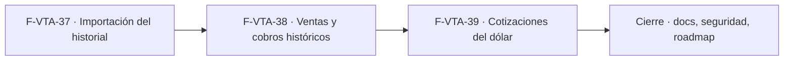

# Tasks: Ventas y despacho · Ventas historial de consulta

**Input**: [spec.md](./spec.md) y [plan.md](./plan.md) · **Épica**: MSF-275
**Formato**: `- [ ] T### [P] [Historia][USx] descripción (FR/SC)`. `[P]` = paralelizable (archivos distintos, sin dependencia dentro del mismo grupo). Cada FR/SC tiene **una sola** tarea dueña.
**Validación por historia**: `pnpm test:db`, `pnpm lint`, `pnpm build` y `pnpm test:web` verdes antes de cerrar la fase (más `pnpm infra:config` en F-VTA-37).
**Esquema (Principio VII)**: las tres tablas `historial_*` van en `dominio`; re-verificar en cada tarea de migración que el esquema coincide con `spec.md`.

## Phase 1: F-VTA-37 · Importación del historial desde el panel actual

**Goal**: tablas de archivo `historial_*` sin escritura desde el panel, bucket, RPC de solicitud, worker lector/validador, flow de Kestra y pantalla de importación.

- [ ] T001 [F-VTA-37][US1] Migración `supabase/migrations/20261020100001_historial_tablas.sql`: `dominio.historial_comprobantes`, `dominio.historial_cobros` y `dominio.historial_cotizaciones_dolar` (columnas del prototipo, claves naturales únicas por organización, índices de búsqueda), RLS por organización/empresa/nivel de `ventas`, **sin políticas ni grants de escritura**, `anon` sin privilegios, **sin FKs ni disparadores a tablas vivas**, reversión en el encabezado (FR-001, FR-008)
- [ ] T002 [F-VTA-37][US1] Migración `supabase/migrations/20261020100100_historial_bucket.sql`: bucket privado `historial-importaciones` con policies por prefijo de organización, solo `.csv`/`.xlsx` y solo quien puede importar (FR-002)
- [ ] T003 [F-VTA-37][US1] Migración `supabase/migrations/20261020100200_historial_solicitar_importacion.sql`: `public.solicitar_importacion_historial(p_tipo, p_archivo)` (`security invoker`, `private.puede_escribir()`, bloqueo de simultáneas por tipo, `iniciar_ejecucion_worker`), `revoke … from public, anon` y `grant execute … to authenticated` (FR-003)
- [ ] T004 [F-VTA-37][US1] Migración `supabase/migrations/20261020100300_historial_ultimo_numero.sql`: `public.historial_ultimo_numero(p_tipo, p_empresa_id)` con `revoke`/`grant` (FR-009)
- [ ] T005 [F-VTA-37][US1] pgTAP `supabase/tests/database/historial_importacion.test.sql`: RLS por organización/empresa/sección, ninguna escritura posible para `authenticated`/`anon`, permiso y simultaneidad de la solicitud, `historial_ultimo_numero`, sin FKs/disparadores a tablas vivas, `anon` sin ejecución; `rls_en_toda_tabla` verde (SC-001)
- [ ] T006 [P] [F-VTA-37][US1] Worker `workers/historial-importador` (`package.json` `@workers/historial-importador`, scripts `build`/`lint`/`test`/`start`, `src/index.ts`, entrada por `ORGANIZACION_ID`/`EJECUCION_ID`, allowlist de egress si aplica): lector de CSV y `.xlsx` con mapeo de columnas por tipo, detección de separador/codificación y normalización de fechas e importes (FR-005)
- [ ] T007 [F-VTA-37][US1] Validación todo-o-nada en el worker: reporte de filas rechazadas (fila, columna, motivo) sin datos sensibles, cierre `fallida` con código `78` (FR-006)
- [ ] T008 [F-VTA-37][US1] Inserción idempotente por lotes (`on conflict do nothing`) con rol de servicio, conteo de nuevas/existentes en el cierre de la ejecución exitosa (FR-007)
- [ ] T009 [F-VTA-37][US1] Vitest del worker `workers/historial-importador/test/`: CSV y Excel válidos de cada tipo, separadores/codificaciones/fechas/importes, rechazo todo-o-nada, idempotencia al reimportar, códigos de salida del contrato (SC-002)
- [ ] T010 [P] [F-VTA-37][US1] Flow de Kestra `infra/kestra/flows/historial-importador.yaml` que consume el outbox y lanza el worker con reintentos del contrato; `pnpm infra:config` verde (FR-004)
- [ ] T011 [P] [F-VTA-37][US1] `apps/web/src/pages/historial/importar.tsx` + `apps/web/src/lib/historial.ts`: elegir tipo, subir archivo, estado de la ejecución (en curso, exitosa con conteo, fallida con detalle), enlace a Ejecuciones, visible solo con permiso de importar, con estados del kit de panel y carga diferida (FR-010)
- [ ] T012 [F-VTA-37][US1] Vitest de la pantalla de importación: subida, estados, error con detalle, acceso por permiso, teclado/lector (SC-003)

**Checkpoint F-VTA-37**: `pnpm test:db`, `pnpm lint`, `pnpm build`, `pnpm test:web` y `pnpm infra:config` verdes.

## Phase 2: F-VTA-38 · Consulta de ventas y cobros históricos

**Goal**: pantalla `/historial` con pestañas Ventas y Cobros, búsqueda, filtro de tienda, paginación, solo lectura y rótulo «Histórico».

- [ ] T013 [F-VTA-38][US2] Migración propia `supabase/migrations/20261020110000_historial_listar_ventas_cobros.sql`: `public.listar_historial_ventas` y `public.listar_historial_cobros` (`security invoker`, búsqueda sin mayúsculas/tildes, filtro de empresa dentro de `private.empresas_accesibles()`, orden estable, tope 200, `total_filas`, rango de fechas), `revoke`/`grant`, reversión en el encabezado (FR-014)
- [ ] T014 [P] [F-VTA-38][US2] pgTAP `supabase/tests/database/historial_listar_ventas_cobros.test.sql`: búsqueda, filtro de tienda, paginación y tope, aislamiento por empresas asignadas y sección, `anon` sin ejecución (SC-004)
- [ ] T015 [P] [F-VTA-38][US2] `apps/web/src/hooks/useHistorialVentasCobros.ts` (RPC, búsqueda con debounce, tienda y paginación, errores) (soporte de FR-016 y FR-018)
- [ ] T016 [P] [F-VTA-38][US2] Entrada de menú **Historial** con icono en el grupo Ventas, ruta canónica `/historial` protegida por nivel de `ventas` y «Acceso restringido» sin permiso (FR-011, FR-012)
- [ ] T017 [F-VTA-38][US2] `apps/web/src/pages/historial/list.tsx` (estructura): encabezado «Historial» con «Solo lectura», subtítulo, textos informativos, pestañas Ventas/Cobros/Cotizaciones del dólar (la tercera se completa en F-VTA-39), buscador, estados carga/error con «Reintentar»/«Sin resultados»/vacío, indicadores «Desde/Hasta», «N registros mostrados» y «Página N» (FR-013, FR-017, FR-018)
- [ ] T018 [F-VTA-38][US2] Tablas Ventas y Cobros con las columnas del prototipo, rótulo «Histórico», importes a la derecha, filtro **Tienda** con las empresas asignadas, paginación en servidor, tarjetas en angosto, teclado y lector (FR-015, FR-016, FR-019)
- [ ] T019 [F-VTA-38][US2] Vitest de la pantalla: pestañas, tablas, búsqueda, filtro de tienda, «Histórico», solo lectura, vacío/sin resultados/error, acceso restringido, adaptable y teclado (SC-005)

**Checkpoint F-VTA-38**: `pnpm test:db`, `pnpm lint`, `pnpm build` y `pnpm test:web` verdes.

## Phase 3: F-VTA-39 · Consulta de cotizaciones históricas del dólar

**Goal**: pestaña Cotizaciones del dólar, global, con búsqueda por fecha y solo lectura.

- [ ] T020 [F-VTA-39][US3] Migración propia `supabase/migrations/20261020120000_historial_listar_cotizaciones.sql`: `public.listar_historial_cotizaciones` (`security invoker`, búsqueda por fecha, orden por fecha desc, tope 200, sin filtro de empresa), `revoke`/`grant`, reversión en el encabezado (FR-020)
- [ ] T021 [P] [F-VTA-39][US3] pgTAP `supabase/tests/database/historial_listar_cotizaciones.test.sql`: búsqueda por fecha, orden, paginación, aislamiento por organización y sección, globales sin tienda, `anon` sin ejecución (soporte de SC-006)
- [ ] T022 [F-VTA-39][US3] `apps/web/src/pages/historial/CotizacionesTab.tsx` + hook `useHistorialCotizaciones.ts`: columnas Fecha, Dólar comprador, Dólar vendedor y Cargó, buscador «Buscar por fecha», solo lectura, mismos estados y adaptabilidad, enchufada a la pestaña (FR-021)
- [ ] T023 [F-VTA-39][US3] Vitest de la pestaña: columnas, búsqueda por fecha, sin filtro de tienda, solo lectura, acceso restringido (SC-006)

**Checkpoint F-VTA-39**: `pnpm test:db`, `pnpm lint`, `pnpm build` y `pnpm test:web` verdes.

## Phase 4: Cierre (integración, docs, seguridad, roadmap)

**Goal**: trabajo que ninguna historia atiende; lo ejecuta la Tarea de cierre.

- [ ] T024 [CIERRE] `docs/historial-ventas.md` (importación, mapeo de columnas, solo lectura, permisos, reversión) y mención en `AGENTS.md`/`CLAUDE.md` si corresponde; `pnpm docs:check` verde (Principio VIII)
- [ ] T025 [CIERRE] Revisión de seguridad del conjunto: `authz-security` sobre RLS/RPC de `historial_*`, `crypto-secrets` sobre el worker y el bucket, `supply-chain-security` sobre las dependencias de CSV/Excel; hallazgos resueltos o trazados
- [ ] T026 [CIERRE] Actualizar `docs/roadmap-template.md` (estado, link a la spec, mover a «Backlog entregado» si aplica) y confirmar que `pnpm prototipo:check` y `pnpm matriz:check` pasan

## Dependencias

Dentro de F-VTA-37: T001 → (T002, T003, T004) → T005; T006 [P] (con T001) → T007 → T008 → T009; T010 [P] y T011 [P] pueden arrancar con T003 → T012.
Dentro de F-VTA-38: T013 → (T014 [P], T015 [P], T016 [P]) → T017 → T018 → T019.
Dentro de F-VTA-39: T020 → (T021 [P], T022) → T023.
Cierre: T024 → T025 → T026 al final. Las tareas [CIERRE] nunca son prerequisito de una historia.
Entre historias: F-VTA-38 requiere F-VTA-37 mergeada (las tablas `historial_*`); F-VTA-39 requiere F-VTA-38 mergeada (comparten `pages/historial/list.tsx` y la pantalla). Nunca una tarea abierta de otra historia: cada una trae su propia migración con su timestamp.

## Plan de ejecución (historias)

El **orden de toma** de las historias lo declara esta tabla: el orquestador la **consume** (no lo infiere del orden de las tareas). Una historia arranca cuando sus dependencias (`Depende de`) están **Finalizadas (mergeadas)**; las del **mismo** `Grupo` van **en paralelo**. F-VTA-39 no va en paralelo con F-VTA-38 porque comparten la pantalla `pages/historial/list.tsx`.

| Historia | Depende de | Grupo |
|----------|------------|-------|
| F-VTA-37 | — | 1 |
| F-VTA-38 | F-VTA-37 | 2 |
| F-VTA-39 | F-VTA-38 | 3 |
| [Cierre] | F-VTA-37, F-VTA-38, F-VTA-39 | 4 |

## Trazabilidad Jira ↔ US ↔ tareas

| Jira | US | FR / SC (dueño único) | Tareas |
|------|----|------------------------|--------|
| F-VTA-37 | US1 | FR-001, FR-008 → T001 · FR-002 → T002 · FR-003 → T003 · FR-009 → T004 · SC-001 → T005 · FR-005 → T006 · FR-006 → T007 · FR-007 → T008 · SC-002 → T009 · FR-004 → T010 · FR-010 → T011 · SC-003 → T012 | T001–T012 |
| F-VTA-38 | US2 | FR-014 → T013 · SC-004 → T014 · FR-011, FR-012 → T016 · FR-013, FR-017, FR-018 → T017 · FR-015, FR-016, FR-019 → T018 · SC-005 → T019 (T015 soporte) | T013–T019 |
| F-VTA-39 | US3 | FR-020 → T020 · FR-021 → T022 · SC-006 → T023 (T021 soporte) | T020–T023 |
| Tarea de cierre (label cierre) | — | Principio VIII → T024 · seguridad → T025 · roadmap → T026 | T024–T026 |
