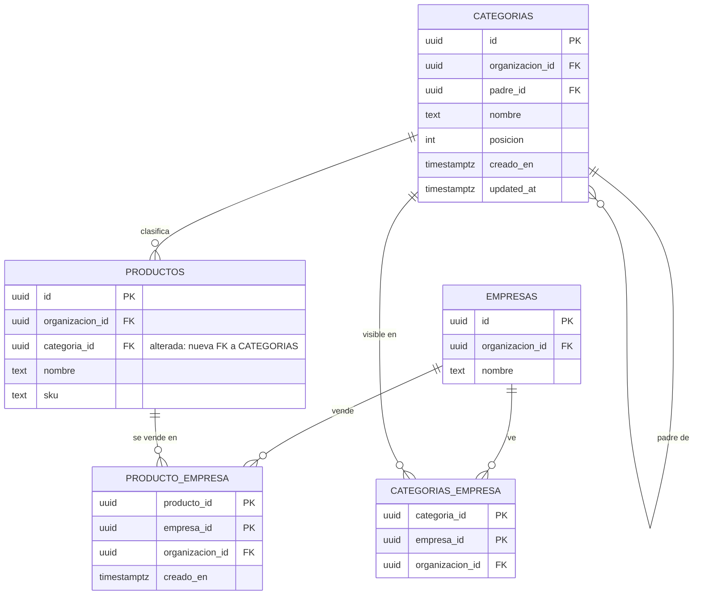
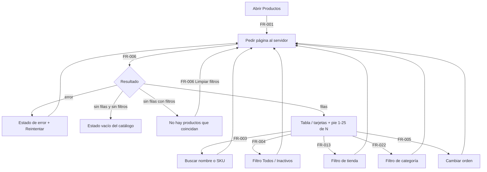
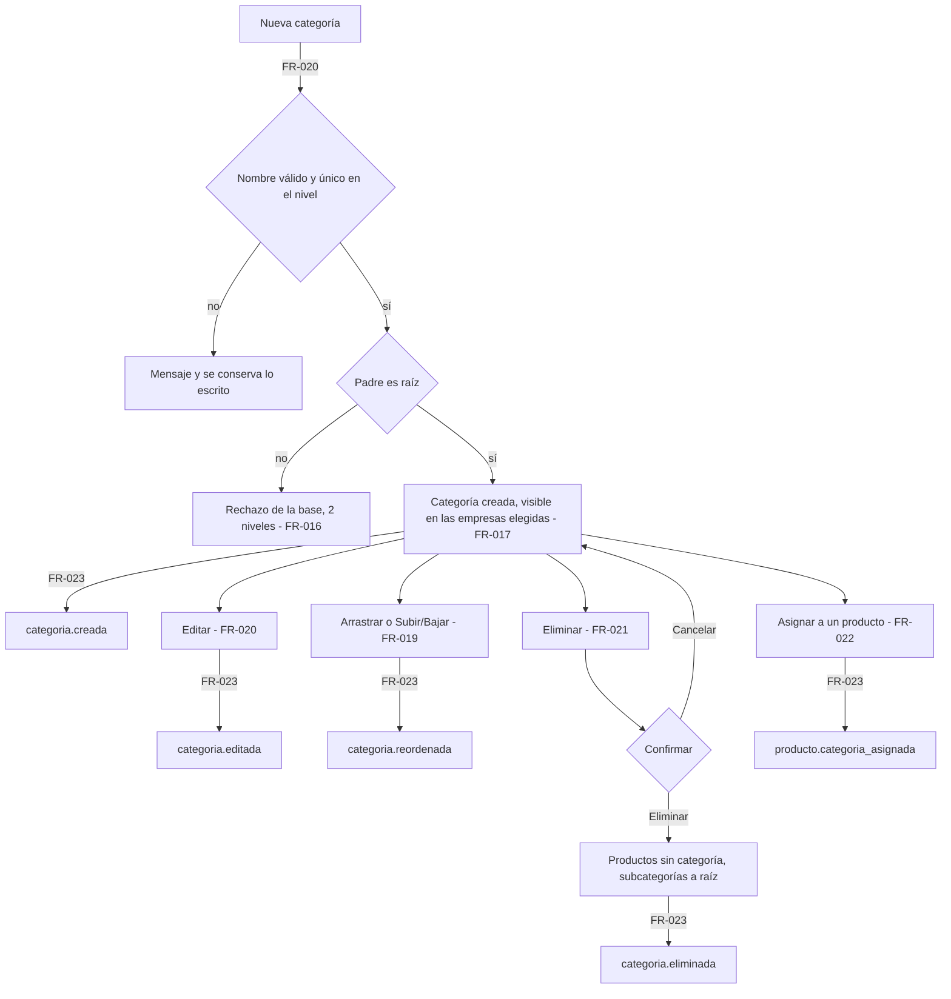

# Feature Specification: Catálogo · Catálogo listado y categorías

**Feature Branch**: `epic/MSF-160-catalogo-catalogo-listado-y-categorias`

**Jira Epic**: MSF-160 — Catálogo · Catálogo listado y categorías (spec `catalogo-listado-y-categorias`)

**Created**: 2026-10-20

**Status**: Ready for implementation — la especificación viene completa desde Jira; las discrepancias de «A revisar» se resuelven abajo (sección «Decisiones») aplicando la Regla de fuentes, sin agregar alcance.

**Delivery scope**: `refine` (apps/web) y `supabase` (migraciones, RPC, vista, pgTAP). Sin `kestra`, `superset` ni `workers`.

**Prioridad / Hito**: P0 · Hito 1 (6 al 30 de octubre de 2026) · 18 h · alcance diciembre.

**Dependencias**:
- Bloqueada por: MSF-456 (Catálogo alta y edición: `dominio.productos`, `producto_costos`, `producto_imagenes`, ya en `main`) y MSF-138 (Empresas: `dominio.empresas`, ya en `main`). **Hallazgo verificado en el repo:** `producto_empresa` y `categorias_empresa` **no existen todavía** (ninguna migración las crea; MSF-456 declaró «`producto_empresa` no se usa en esta épica»). Por eso esta épica las crea, de forma aditiva (F-CAT-07 y F-CAT-08).
- Bloquea a: MSF-114 (Precios e IVA: F-PRE-12 agrega el IVA sobre `categorias`), MSF-179 (amplía `v_productos_listado`), MSF-202 (la exportación lee `v_productos_listado`), MSF-218 (edición masiva sobre el listado) y MSF-142 (migración inicial de datos).
- Relacionada, sin bloqueo: registro de actividad (F-AUD-01; los eventos se emiten contra el contrato de FR-023/FR-014). Precio final por empresa (Precios), stock, margen y Mercado Libre se muestran con «—» hasta que lleguen esos componentes.

**Input**: Epic MSF-160. Objetivo: «Al terminar, el equipo encuentra cualquier producto en segundos con búsqueda y filtros, decide en qué empresa se vende cada uno y organiza las categorías que verán los clientes en el menú de cada tienda.»

**Regla de fuentes** (literal de la épica):
- Comportamiento y datos: mandan los requisitos y escenarios de esta spec.
- Qué se ve (disposición, textos, estados, popups, flujos): el prototipo validado es referencia visual, lo más fiel posible, no idéntico al pixel; lo que no se construye se anota como FUERA DE ALCANCE, no se omite en silencio.
- Cómo se construye: mandan el template y el sistema de diseño (MSF-117, `docs/sistema-de-diseno.md`). No se copia HTML ni CSS: se reproduce con los componentes del kit de panel y los tokens.
- El prototipo muestra más que esta épica: se implementa solo lo que piden F-CAT-01, F-CAT-07 y F-CAT-08.
- Si algo no se puede igualar: lo más cercano, sin inventar, anotando la diferencia en el PR. Si prototipo y requisitos se contradicen: requisitos para el comportamiento, prototipo para lo visual, y la contradicción queda anotada en el PR.
- Prototipos (solo lectura, ya presentes en el árbol; la rama `design/prototipo` no existe en `origin`): `design/pantallas/Productos.dc.html`, `design/pantallas/Categorias.dc.html`, `design/pantallas/ProductoAlta.dc.html` (sección «Empresas que lo venden»). Inventarios: `*.inventory.json` vigentes (`pnpm prototipo:check`).

## Lo que ya trae el template / el repo (no se reconstruye)

Kit de panel (`ContenidoAdaptable` tabla/tarjetas, `EstadoVacio`, `EstadoError`, `EstadoCargaPagina`, `EncabezadoPagina`, `BarraHerramientas`, `EtiquetaEstado`, `MiniaturaProducto`), el patrón `pages/clientes/list.tsx`, `useNivelSeccion`, `useFiltroPorEmpresaActiva`, `private.organizacion_id()`, `private.nivel_seccion()`, `private.registrar_actividad()`, las secciones de permiso `productos` y `categorias` (ya sembradas), `dominio.empresas`, la grilla mínima `pages/productos/list.tsx` (F-CAT-06) que **esta épica reemplaza**, y `pg_trgm` (migración `20261016160000`).

**Lo que hay que construir:** búsqueda, filtros, orden y paginación **en servidor** para productos; vista `v_productos_listado`; `producto_empresa`; árbol de categorías 2 niveles con arrastrar y soltar; `categorias_empresa`; columna `categoria_id` en `productos`.

## Decisiones (resuelven «A revisar» sin agregar alcance)

1. **Niveles de categoría = 2** (categoría y subcategoría). Lo dice la épica (Supuestos) y manda sobre el «hasta 3 niveles (o más)» del prototipo y el «multinivel» del roadmap. Se aplica en la base, no solo en la pantalla. Diferencia con el prototipo: va al PR.
2. **IVA de la categoría** (columna y campo del prototipo): **fuera** — lo agrega F-PRE-12 (MSF-114) sobre `categorias`. Visible en tienda por categoría **sí** entra (el objetivo es «las categorías que verán los clientes en el menú de cada tienda»).
3. **Acciones del listado que no son de esta épica**: Exportar (MSF-202), Importar CSV (sin historia en esta épica), selección múltiple con Mover de categoría / Marcar destacado / Enviar al newsletter / Borrar (Mover masivo → MSF-218; destacado, newsletter y borrado masivo no tienen historia en esta épica; el producto se desactiva, no se borra — MSF-456). Todo declarado FUERA DE ALCANCE en la matriz; no genera tareas.
4. **Etiqueta de stock** (Disponible / Stock bajo / Sin stock) y los estados Stock / Sin stock / A pedido / Stock entrante en breve (F-CAT-17, épica 6): **fuera**. La columna Stock queda visible con «—».
5. **Costo**: la épica enumera «—» para precio final, stock, margen y Mercado Libre; el costo lo entrega MSF-179 («costo y disponibilidad»). La columna Costo queda visible con «—» y **la vista no expone costo** (hoy `producto_costos` se restringe por sección Rentabilidad; no se filtra por el listado). *Necesita OK de Nicolás (ver guía).*
6. **Asignación de categoría al producto**: sin ella los conteos y el filtro por categoría no tienen sentido (`docs/catalogo.md` ya anota que «categoría la agrega MSF-160»). Se incluye un selector de categoría **opcional** (2 niveles) en el alta y la edición del producto, dentro de F-CAT-08. *Necesita OK de Nicolás.*
7. **Drag & drop sin dependencia nueva**: HTML5 nativo + alternativa por teclado (Subir / Bajar y «Categoría padre» del formulario), sin sumar librería (supply chain, Principio V).
8. **Eliminar categoría**: se sigue el texto del prototipo (los productos quedan sin categoría; las subcategorías suben un nivel, es decir pasan a categoría raíz). Es la única fuente de ese comportamiento.

## Esquema de datos (Constitución, Principio VII — verificar en plan, tareas, implementación y PR)

| Objeto | Esquema | Justificación | RLS |
|--------|---------|---------------|-----|
| `producto_empresa` (nueva) | **`dominio`** | Relación de negocio producto↔empresa que vende. | `organizacion_id = private.organizacion_id()`; select con `lectura`/`edicion` en `productos`; insert/delete con `edicion` en `productos`; sin UPDATE. |
| `categorias` (nueva) | **`dominio`** | Estructura de negocio del catálogo (menú de cada tienda). | `organizacion_id = private.organizacion_id()`; select con `lectura`/`edicion` en `categorias`; insert/update/delete con `edicion` en `categorias`. |
| `categorias_empresa` (nueva) | **`dominio`** | Visibilidad de una categoría por empresa. | Igual que `categorias`. |
| `productos` (alterada: `categoria_id`) | **`dominio`** | Ya vive en `dominio` (MSF-456); columna aditiva, FK compuesta `(categoria_id, organizacion_id)`, `on delete set null (categoria_id)`. | Sin cambios de políticas; el grant de columnas suma `categoria_id` para quien edita. |
| `v_productos_listado` (vista) | **`public`** (vista, no tabla) | Contrato de lectura del listado para la app y para MSF-179/202; `security_invoker = true` (rige la RLS de las tablas de `dominio`); `revoke … from public, anon`, `grant select … to authenticated`. Sin costo. | Hereda RLS de las tablas base. |

Ninguna tabla va a `public`. Migraciones aditivas, cada historia con **su propia** migración y reversión en el encabezado. La prueba `rls_en_toda_tabla` recorre `public` + `dominio` y debe seguir verde. Las RPC nuevas son `security invoker`, `revoke … from public, anon` y `grant execute … to authenticated`.

## Modelo de datos (DER)

La vista `public.v_productos_listado` es de lectura (`security_invoker`) y no se dibuja como entidad.

| Tabla | Estado | Cambio |
|---|---|---|
| `dominio.producto_empresa` | nueva | — |
| `dominio.categorias` | nueva | — |
| `dominio.categorias_empresa` | nueva | — |
| `dominio.productos` | alterada | + `categoria_id` (FK compuesta, `on delete set null`) |
| `dominio.empresas` | existente | sin cambios (referencia) |



## User Scenarios & Testing *(mandatory)*

### User Story 1 - Listado de productos con búsqueda y filtros (F-CAT-01, P0, talla M)

Como persona con acceso de lectura a Productos, quiero buscar, filtrar y ordenar el catálogo, para encontrar cualquier producto en segundos.

**Independent Test**: con ~10 000 productos, buscar «joy» devuelve la primera página en < 2 s; «Inactivos» muestra solo inactivos; «Limpiar filtros» vuelve al estado inicial; un usuario de otra organización no ve ninguno.

**Acceptance Scenarios**:
1. **Given** el catálogo, **When** se abre Productos, **Then** se ve una tabla (tarjetas en pantallas angostas) paginada en el servidor con pie «1–25 de N» y las columnas Producto (miniatura, nombre, SKU), Precio, Costo, Margen, Stock (las cuatro con «—»), Estado (Activo/Inactivo) y las acciones existentes.
2. **Given** texto en «Buscar por nombre o SKU», **When** se escribe, **Then** la búsqueda se resuelve en el servidor, parcial, sin distinguir mayúsculas, y los comodines `%`/`_`/`\` del usuario se tratan como texto.
3. **Given** los filtros, **Then** «Todos» e «Inactivos» funcionan; «Sin stock», «Stock bajo» y «Sin vincular a ML» se ven **deshabilitados** con la explicación «Se activa cuando llegue Stock / Mercado Libre».
4. **Given** el orden por Producto (nombre), SKU o Estado, **When** se cambia, **Then** se ordena en el servidor con desempate estable.
5. **Given** búsqueda/filtros sin resultados, **Then** aparece «No hay productos que coincidan» + «Probá con otra búsqueda o limpiá los filtros.» y «Limpiar filtros» restablece todo; catálogo vacío usa el estado vacío del kit; falla de carga usa el estado de error con «Reintentar».
6. **Given** un usuario con solo lectura, **Then** ve el listado sin acciones de edición; con edición, además «Nuevo producto», «Editar» y Activar/Desactivar (comportamiento F-CAT-06 intacto).
7. **Given** otra organización, **Then** no ve productos ajenos (RLS; pgTAP).

### User Story 2 - Empresas que venden el producto (F-CAT-07, P0, talla M)

Como persona con edición en Productos, quiero elegir en qué empresas se vende cada producto, para publicar solo donde corresponde.

**Independent Test**: crear un producto, activar San Javucho y no Mundo JC; el listado muestra el chip de San Javucho relleno y el de Mundo JC en contorno; filtrar por Mundo JC no lo trae; queda un evento en Actividad.

**Acceptance Scenarios**:
1. **Given** el alta o la edición, **Then** hay una sección «Empresas que lo venden» con el texto «El producto y su stock son únicos y compartidos. Cada tienda lo publica con su propio precio y estado.», una fila por empresa (nombre, dominio, «Precio: —») y un interruptor accesible; ningún código asume exactamente dos empresas.
2. **Given** un producto nuevo, **Then** no se vende en ninguna empresa hasta marcarlas, y se muestra la nota de visibilidad correspondiente.
3. **Given** cambios de empresas, **When** se guarda, **Then** se persisten de forma atómica e idempotente (RPC); solo se aceptan empresas de la propia organización.
4. **Given** el listado, **Then** la columna «Visible en» muestra un chip por empresa (relleno si vende, contorno si no) y el filtro por tienda (Todas / cada empresa) sigue la empresa activa; filtrar por una empresa muestra solo lo que vende.
5. **Given** un cambio real de empresas, **Then** se registra `producto.empresas_actualizadas` en Actividad (sin precios ni costo); sin cambios reales no se registra.
6. **Given** solo lectura, **Then** las empresas se ven sin poder cambiarlas (UI y llamada directa).
7. **Given** si falla guardar empresas tras crear el producto, **Then** el producto queda creado y se ofrece reintentar, sin perder lo elegido.

### User Story 3 - Categorías (F-CAT-08, P0, talla M)

Como persona con edición en Categorías, quiero organizar las categorías y subcategorías y decidir en qué tienda se ven, para armar el menú de cada tienda.

**Independent Test**: crear «Joysticks» con subcategoría «Cableados» visible solo en Mundo JC, reordenarlas arrastrando, asignar un producto, eliminar la categoría y ver que el producto queda sin categoría y la subcategoría sube a raíz.

**Acceptance Scenarios**:
1. **Given** Catálogo → Categorías, **Then** se ve el árbol (Categoría con «N subcategorías», Productos con el total incluyendo subcategorías, Visible en, Acciones), «Expandir todo» / «Contraer todo», el filtro de tienda (Todas las tiendas / cada empresa) y «Nueva categoría».
2. **Given** «Nueva categoría» o «Editar», **Then** el diálogo pide Nombre (obligatorio), Categoría padre (opcional, solo categorías raíz; «Ninguna (categoría raíz)») y Visible en (una casilla por empresa, todas marcadas al crear), con Cancelar/Guardar y la ruta resultante («Joysticks > Nueva categoría»).
3. **Given** el máximo de 2 niveles, **Then** no se puede crear una subcategoría bajo una subcategoría ni mover bajo otra una categoría que ya tiene subcategorías; la base lo rechaza aunque la pantalla falle.
4. **Given** un nombre ya usado en el mismo nivel (sin distinguir mayúsculas ni espacios extremos), **Then** se rechaza con «Ya existe una categoría con ese nombre en ese nivel» sin perder lo escrito.
5. **Given** el árbol, **When** se arrastra una fila, **Then** se reordena dentro de su nivel o se mueve a otra categoría raíz; el mismo resultado se logra con teclado (Subir/Bajar y Categoría padre) y el orden persiste.
6. **Given** «Eliminar», **Then** el diálogo «Eliminar categoría» informa ««X» tiene N productos y M subcategorías. Los productos quedan sin categoría y las subcategorías suben un nivel.» y al confirmar se aplica de forma atómica.
7. **Given** el alta/edición de producto, **Then** hay un selector de categoría opcional (2 niveles); el listado suma la columna Categoría y el filtro por categoría (una categoría raíz incluye sus subcategorías).
8. **Given** cada alta/edición/eliminación/reordenado, **Then** se registra el evento en Actividad (FR-023).
9. **Given** solo lectura en Categorías, **Then** el árbol se ve sin acciones; sin acceso a la sección, el guard bloquea la ruta.

### Edge Cases
- Búsqueda con `%`, `_`, comillas o 200+ caracteres: texto literal, límite de longitud, sin error de SQL.
- Página fuera de rango tras filtrar: vuelve a la 1.
- Dos personas reordenan a la vez: gana la última escritura por posición, sin duplicar posiciones inválidas (la RPC renumera dentro de una transacción con candado por organización).
- Eliminar una categoría con subcategorías que repiten nombre con una raíz existente: se rechaza con mensaje claro y no se elimina nada.
- Empresa eliminada o inexistente al guardar empresas: error `22023`, sin cambios parciales.

## Requirements *(mandatory)*

### Functional Requirements

**F-CAT-01 — Listado**
- **FR-001**: El listado MUST consultar `public.v_productos_listado` con paginación, búsqueda, filtro y orden **en el servidor** (`range`/`count`); tamaño de página 25; pie «desde–hasta de N».
- **FR-002**: Columnas del listado: Producto (miniatura de la imagen principal, nombre, SKU), Precio, Costo, Margen y Stock (cada una «—»), Estado (Activo/Inactivo) y la columna de acciones existente (Editar, Activar/Desactivar solo con edición). Visible en y Categoría las suman FR-012 y FR-022.
- **FR-003**: La búsqueda MUST ser por nombre o SKU, parcial, sin distinguir mayúsculas, con espera de tipeo, comodines escapados y longitud acotada, respaldada por índice trigram.
- **FR-004**: Los filtros «Todos» e «Inactivos» MUST funcionar; «Sin stock», «Stock bajo» y «Sin vincular a ML» MUST verse deshabilitados con su explicación hasta que lleguen Stock y Mercado Libre.
- **FR-005**: El orden MUST poder cambiarse por Producto, SKU y Estado, con desempate estable por `id`.
- **FR-006**: MUST existir «Limpiar filtros» y los estados vacío («No hay productos que coincidan» / «Probá con otra búsqueda o limpiá los filtros.»), carga y error con «Reintentar», con los componentes del kit.
- **FR-007**: `v_productos_listado` MUST ser `security_invoker`, sin costo, sin acceso de `anon`, con columnas añadibles al final (contrato para MSF-179/202). Reemplaza la consulta directa de la grilla mínima.
- **FR-008**: La pantalla MUST respetar permisos (lectura ve; edición suma «Nuevo producto», «Editar» y Activar/Desactivar), funcionar con teclado y lector de pantalla y mostrarse en 320, 768 y 1440 px (Principio VI). Ubicación: Catálogo → Productos, ruta `/productos` (sin cambios).

**F-CAT-07 — Empresas que venden**
- **FR-009**: Tabla `dominio.producto_empresa` (PK `(producto_id, empresa_id)`, `organizacion_id`, `creado_en`, FKs compuestas que impiden cruzar organizaciones) con RLS de la tabla de esquema; sin asumir cantidad de empresas.
- **FR-010**: RPC `public.definir_empresas_producto(p_producto_id, p_empresa_ids uuid[])`: atómica, idempotente, exige `edicion` en `productos`, rechaza empresas de otra organización (`22023`) o producto inexistente (`P0002`); calcula el delta.
- **FR-011**: Sección «Empresas que lo venden» en `FormularioProducto` (alta y edición) con los textos, filas e interruptores del prototipo; el precio por empresa se muestra «—» hasta Precios; con solo lectura es de lectura; manejo de fallo post-alta con reintento.
- **FR-012**: `v_productos_listado` suma las empresas del producto (columna añadida al final) y el listado la columna «Visible en» con chips relleno/contorno.
- **FR-013**: Filtro de tienda del listado (Todas / cada empresa) que sigue la empresa activa (`useFiltroPorEmpresaActiva`) y se resuelve en el servidor.
- **FR-014**: Evento `producto.empresas_actualizadas` en Actividad (trigger sobre `producto_empresa`, misma transacción, solo con cambios reales, detalle «Cambió las empresas del producto <nombre> (SKU …): agregó …; quitó …», sin precios ni costo).

**F-CAT-08 — Categorías**
- **FR-015**: Tabla `dominio.categorias` (`id`, `organizacion_id`, `nombre`, `padre_id`, `posicion`, `creado_en`, `updated_at`) con nombre recortado y no vacío, único por `(organizacion_id, padre_id, lower(btrim(nombre)))`, FK compuesta del padre y RLS por la sección `categorias`.
- **FR-016**: Máximo **2 niveles** garantizado por la base (disparador): el padre debe ser raíz y una categoría con hijos no puede tener padre; sin ciclos.
- **FR-017**: Tabla `dominio.categorias_empresa` (PK `(categoria_id, empresa_id)`, `organizacion_id`) para la visibilidad por tienda; una categoría sin filas no se ve en ninguna tienda; al crear se marcan todas las empresas.
- **FR-018**: Pantalla Catálogo → Categorías (`/categorias`, sección `categorias`, ícono y audiencia declarados en el plan) con el árbol, «Expandir todo»/«Contraer todo», filtro de tienda, «Nueva categoría», conteo de subcategorías y de productos (con descendientes), estados vacío/carga/error.
- **FR-019**: Reordenar y mover por arrastrar y soltar (HTML5 nativo, sin dependencia nueva) y por teclado (Subir/Bajar, Categoría padre); RPC `public.reordenar_categorias` atómica con candado por organización que persiste `padre_id` y `posicion`.
- **FR-020**: Diálogo Nueva/Editar categoría (Nombre, Categoría padre opcional, Visible en, ruta resultante, Cancelar/Guardar) con validaciones y mensajes de las escenas 2–4, vía RPC `public.guardar_categoria`.
- **FR-021**: Diálogo «Eliminar categoría» y RPC `public.eliminar_categoria` atómica: productos a `categoria_id = null`, subcategorías suben a raíz (rechaza si el nombre choca con una raíz).
- **FR-022**: `productos.categoria_id` (aditiva), selector opcional en alta/edición (`actualizar_producto`/`crear_producto` **no** se alteran: la categoría se asigna con la RPC `public.asignar_categoria_producto`), `v_productos_listado` suma la categoría (columnas al final), columna Categoría y filtro por categoría en el listado (raíz incluye subcategorías).
- **FR-023**: Eventos en Actividad: `categoria.creada`, `categoria.editada`, `categoria.eliminada`, `categoria.reordenada`, `producto.categoria_asignada`; detalle legible, sin datos sensibles; solo con cambios reales.
- **FR-024**: Permisos de Categorías por `private.nivel_seccion('categorias')` en pantalla y RLS (nunca `puede_escribir()`); solo lectura sin acciones; guard de ruta.

**Cierre**
- **FR-025**: La documentación (`docs/catalogo.md`, `docs/actividad.md`, `docs/permisos-por-rol.md` si aplica), la fila del roadmap (`docs/roadmap-template.md`), `pnpm docs:check` y la revisión de seguridad (RLS/RPC/grants) se cierran en la Tarea de cierre.

### Success Criteria

- **SC-001** *(F-CAT-01)*: Con 10 000 productos, búsqueda/filtro/orden devuelve la página en < 2 s (p95 medido en el entorno de pruebas) usando índice; el listado nunca trae todas las filas.
- **SC-002** *(F-CAT-01)*: pgTAP `catalogo_listado.test.sql`: aislamiento entre dos organizaciones, `anon` sin acceso, la vista no expone costo, comodines escapados.
- **SC-003** *(F-CAT-07)*: pgTAP `catalogo_producto_empresa.test.sql`: aislamiento, FK entre organizaciones, permisos por rol, atomicidad e idempotencia de la RPC, evento sin precios.
- **SC-004** *(F-CAT-08)*: pgTAP `catalogo_categorias.test.sql`: 2 niveles, nombre único por nivel, RLS por sección, reordenado concurrente, `rls_en_toda_tabla` verde.
- **SC-005** *(F-CAT-08)*: eliminar categoría deja productos sin categoría y sube subcategorías, probado en pgTAP y Vitest.
- **SC-006** *(Cierre)*: `pnpm lint`, `pnpm build`, `pnpm infra:config`, `pnpm test`, `pnpm docs:check`, `pnpm prototipo:check` y `pnpm matriz:check` en verde; revisión de seguridad hecha.

## Flujos

Fuente: la épica no trae diagramas; se transcriben los procesos de sus historias.

### Flujo 1 — Búsqueda y filtros del listado (F-CAT-01)


### Flujo 2 — Empresas que venden un producto (F-CAT-07)
```mermaid
sequenceDiagram
  actor U as Persona con edición
  participant P as Formulario de producto
  participant R as RPC definir_empresas_producto
  participant A as Actividad
  U->>P: Marca o desmarca empresas (FR-011)
  U->>P: Guardar
  P->>R: producto_id + empresas elegidas (FR-010)
  alt empresa ajena o producto inexistente
    R-->>P: error 22023 / P0002, sin cambios
    P-->>U: aviso y Reintentar (FR-011)
  else cambios reales
    R->>A: producto.empresas_actualizadas (FR-014)
    R-->>P: ok
    P-->>U: confirmación; el listado muestra Visible en (FR-012)
  else sin cambios
    R-->>P: ok sin evento (FR-010)
  end
```

### Flujo 3 — Ciclo de una categoría (F-CAT-08)


## Matriz pantalla↔criterios

Leyenda: **FA** = FUERA DE ALCANCE (no genera tarea; motivo indicado).

### Productos · listado (`Productos.dc.html`)

| Ítem del inventario | Dueño |
|---|---|
| Tabla, col. «» (casilla de selección) | FA — selección múltiple sin historia en esta épica (acciones masivas: MSF-218/otras) |
| Col. Producto | FR-002 |
| Col. Precio | FR-002 («—» hasta Precios, MSF-114) |
| Col. Costo | FR-002 («—» hasta MSF-179, Decisión 5) |
| Col. Margen | FR-002 («—» hasta Rentabilidad, Hito 4) |
| Col. Stock | FR-002 («—» hasta Stock; etiqueta Disponible/Stock bajo/Sin stock: FA, F-CAT-17) |
| Col. Visible en | FR-012 |
| Col. Estado | FR-002 |
| Col. final «» (acciones por fila) | FR-002, FR-008 |
| Campo «(buscar: Buscar por nombre o SKU)» | FR-003 |
| Botón «Nuevo producto» | FR-008 (ya existe, MSF-456) |
| Botón «Categoría: ·» (filtro) | FR-022 |
| Chips de tienda (Todas / San Javucho / Mundo JC) | FR-013 |
| Chips Todos / Inactivos | FR-004 |
| Chips Sin stock / Stock bajo / Sin vincular a ML | FR-004 (visibles, deshabilitados) |
| Botón «Limpiar filtros» y estado «No hay productos que coincidan» | FR-006 |
| Pie «1–10 de N» (paginación) | FR-001 |
| Botón «Exportar», diálogo «Exportar productos» y campos «Qué exportar», «Formato», «Columnas» | FA — MSF-202 (exportación lee `v_productos_listado`) |
| Botón «Importar CSV» | FA — sin historia en esta épica |
| Barra de selección: «Mover de categoría» + diálogo | FA — MSF-218 (edición masiva) |
| «Marcar destacado», «·· · ·Destacado» (estrella) | FA — sin historia en esta épica |
| «Enviar al newsletter» | FA — Etapa 2, sin historia en esta épica |
| «Borrar», «Borrar · productos», «Cancelar», diálogo «Borrar productos» | FA — el producto se desactiva, no se borra (MSF-456) |
| «Quitar selección» | FA — selección múltiple (ver arriba) |

### Categorías (`Categorias.dc.html`)

| Ítem del inventario | Dueño |
|---|---|
| Col. Categoría (árbol, «N subcategorías») | FR-018 |
| Col. Productos | FR-018 |
| Col. IVA | FA — F-PRE-12 (MSF-114) |
| Col. Visible en | FR-017, FR-018 |
| Col. Acciones (agregar subcategoría, subir/bajar, editar, eliminar) | FR-018, FR-019, FR-020, FR-021 |
| Botones «Expandir todo» / «Contraer todo» | FR-018 |
| Botón «Nueva categoría» | FR-018, FR-020 |
| Chips «San Javucho» / «Mundo JC» (filtro de tienda) | FR-018 |
| Diálogo Nueva/Editar: «Nombre», «(buscar: Ej.: Fundas rígidas)» | FR-020 |
| Diálogo: «Categoría padre (opcional)» | FR-016, FR-020 (solo raíces: 2 niveles; el prototipo admite 3, Decisión 1) |
| Diálogo: «IVA de la categoría» | FA — F-PRE-12 (MSF-114) |
| Diálogo: «Visible en» (San Javucho / Mundo JC) | FR-017, FR-020 |
| Botones «Cancelar» / «Guardar» | FR-020 |
| Diálogo «Eliminar categoría» + botón «Eliminar» | FR-021 |
| Arrastrar y soltar (épica) | FR-019 |

### Producto · alta (`ProductoAlta.dc.html`) — solo «Empresas que lo venden» y Categoría

| Ítem del inventario | Dueño |
|---|---|
| Sección «Empresas que lo venden» (filas San Javucho / Mundo JC con interruptor) | FR-011 |
| Campo «Categoría (hasta 3.er nivel)» | FR-022 (2 niveles, Decisión 1) |
| Nombre, SKU, Descripción, Compatible con, Moneda, Precio de lista, Costo, imágenes, «Guardar producto», «Cancelar», «Descartar y salir», «Seguir editando» | Ya entregado en MSF-456 (sin cambios) |
| Proveedor, «Código del proveedor» | Ya entregado en MSF-205 |
| Código de barras (EAN-13) | Ya entregado (MSF-529) |
| Variantes (tabla Variante/Código/Código de barras/Stock/Activa, «Agregar variante»), «Video del producto», relacionados («Agregar»), «Cotización →» | FA — no los pide esta épica (otras épicas de Catálogo) |
| IVA | FA — F-PRE-12 (MSF-114) |
| Stock por depósito: «Local», «Depósito principal», «Stock mínimo (alerta)» | FA — Stock (el alta no lleva stock, MSF-456) |
| Estado del producto (Stock/Sin stock/A pedido/Stock entrante), «Destacado», «Lugar en Productos destacados», «Ver productos destacados →» | FA — F-CAT-17 / sin historia en esta épica |
| Diálogo «Desvincular publicación» + «Desvincular» | FA — Mercado Libre, Etapa 2 |
| «Productos» (migas), «Principal/Imagen 2–4 Subir imagen», interruptor «Producto activo» | Ya entregado (MSF-456) |

## Matriz de trazabilidad Jira ↔ US ↔ FR

| Jira | Historia | Requisitos (dueño único) |
|------|----------|--------------------------|
| F-CAT-01 | US1 Listado con búsqueda y filtros | FR-001…FR-008, SC-001, SC-002 |
| F-CAT-07 | US2 Empresas que venden el producto | FR-009…FR-014, SC-003 |
| F-CAT-08 | US3 Categorías | FR-015…FR-024, SC-004, SC-005 |
| Tarea de cierre (label `cierre`) | Docs, roadmap, seguridad | FR-025, SC-006 |

## Fuera de alcance (resumen)

Exportar, Importar CSV, acciones masivas, destacado, newsletter, borrado de productos, IVA de categoría, etiquetas de stock, variantes/video/relacionados, cálculo de precio, stock, margen y Mercado Libre (solo «—»). Son notas, no deuda.
