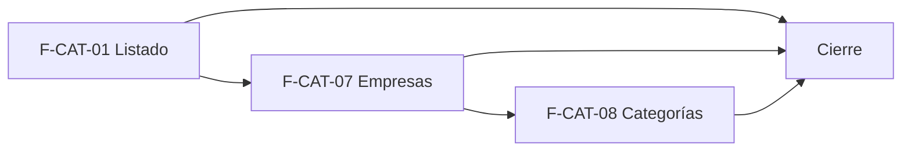

# Tasks: Catálogo · Catálogo listado y categorías

**Input**: `specs/20261020-120000-catalogo-listado-y-categorias/` (spec.md, plan.md)

**Formato**: `- [ ] T### [P] [F-CAT-NN][USy] descripción`. **[P]** = paralelizable (archivos distintos, sin dependencia; las [P] del mismo grupo van en paralelo); sin [P] = secuencial. Las dependencias de cada historia son **solo internas**. Regla del proyecto: ninguna tarea queda `[ ]` al cierre — se hace con evidencia o se cierra con `[x]` + `Desvío:` y seguimiento trazado.

**Delivery scope**: `refine`, `supabase`

## Matriz de trazabilidad Jira ↔ US ↔ tasks

| Jira | Historia | Requisitos (dueño único) | Tasks |
|------|----------|--------------------------|-------|
| F-CAT-01 | US1 Listado con búsqueda y filtros | FR-001…FR-008, SC-001, SC-002 | T001–T009 |
| F-CAT-07 | US2 Empresas que venden el producto | FR-009…FR-014, SC-003 | T010–T016 |
| F-CAT-08 | US3 Categorías | FR-015…FR-024, SC-004, SC-005 | T017–T029 |
| Tarea de cierre (label `cierre`) | Docs, roadmap, seguridad | FR-025, SC-006 | T030–T033 |

## Phase 1: Listado de productos (F-CAT-01 · supabase + refine)

- [ ] T001 [F-CAT-01][US1] Migración `20261020120000_catalogo_listado_vista.sql`: `public.v_productos_listado` (`security_invoker = true`; id, organizacion_id, nombre, sku, activo, imagen principal, updated_at; sin costo), `revoke … public, anon`, `grant select … authenticated`, reversión en el encabezado (FR-007)
- [ ] T002 [F-CAT-01][US1] Migración `20261021165100_catalogo_listado_indices.sql`: índices GIN trigram sobre `lower(nombre)` y `lower(sku)` y de orden `(organizacion_id, lower(nombre), id)` en `dominio.productos`, con reversión (FR-003, FR-005)
- [ ] T003 [P] [F-CAT-01][US1] pgTAP `catalogo_listado.test.sql`: aislamiento entre dos organizaciones, `anon` sin acceso, la vista no expone costo, comodines escapados, `rls_en_toda_tabla` verde (SC-002)
- [ ] T004 [P] [F-CAT-01][US1] `lib/productosListado.ts`: construir la consulta (búsqueda con escape de `%`/`_`/`\` y tope de longitud, filtro Todos/Inactivos, orden por nombre/SKU/estado con desempate por id, `range`+`count`) y Vitest (FR-001, FR-003, FR-004, FR-005)
- [ ] T005 [F-CAT-01][US1] `FiltrosListado` (buscador con espera de tipeo, chips Todos/Inactivos, chips Sin stock/Stock bajo/Sin vincular a ML deshabilitados con explicación, «Limpiar filtros») usando `BarraHerramientas` (FR-004, FR-006)
- [ ] T006 [F-CAT-01][US1] Reemplazar `pages/productos/list.tsx`: tabla/tarjetas con las columnas de FR-002, orden por encabezado, pie «desde–hasta de N», paginación en servidor, vuelta a la página 1 al filtrar, acciones F-CAT-06 intactas según `useNivelSeccion` (FR-001, FR-002, FR-005, FR-008)
- [ ] T007 [F-CAT-01][US1] Estados de carga, vacío del catálogo, «No hay productos que coincidan» + «Probá con otra búsqueda o limpiá los filtros.» y error con «Reintentar» con el kit de panel (FR-006)
- [ ] T008 [P] [F-CAT-01][US1] Vitest de la pantalla: columnas con «—», búsqueda y filtros llaman al servidor, chips deshabilitados, vacío/error, solo lectura sin acciones, responsive 320/768/1440 y teclado; actualizar `list.test.tsx` previo (FR-006, FR-008)
- [ ] T009 [F-CAT-01][US1] Prueba de rendimiento con 10 000 productos sembrados (pgTAP con `explain` que use el índice) con evidencia en la nota de la tarea; sección «Listado» en `docs/catalogo.md` (SC-001)

**Checkpoint**: se busca, filtra, ordena y pagina en el servidor; `pnpm lint`, `pnpm build`, `pnpm test` verdes.

## Phase 2: Empresas que venden el producto (F-CAT-07 · supabase + refine)

- [ ] T010 [F-CAT-07][US2] Migración `20261021165500_catalogo_producto_empresa.sql`: `dominio.producto_empresa` (PK `(producto_id, empresa_id)`, `organizacion_id`, FKs compuestas, índice por empresa), RLS (select `productos` lectura/edición; insert/delete edición; sin UPDATE), grants sin `anon`, reversión (FR-009)
- [ ] T011 [F-CAT-07][US2] Migración `20261021165700_catalogo_producto_empresa_rpc.sql`: RPC `public.definir_empresas_producto` (security invoker, atómica, idempotente, `22023`/`P0002`) y trigger `producto.empresas_actualizadas` solo ante cambios reales y sin precios; `revoke … public, anon`/`grant … authenticated` (FR-010, FR-014)
- [ ] T012 [F-CAT-07][US2] Migración `20261021165900_catalogo_listado_visible_en.sql`: `create or replace view v_productos_listado` con **todas** las columnas previas más `empresa_ids` al final (FR-012)
- [ ] T013 [P] [F-CAT-07][US2] pgTAP `catalogo_producto_empresa.test.sql`: aislamiento, FK cruzada rechazada, permisos por rol, empresa ajena, atomicidad e idempotencia, evento sin precios, `rls_en_toda_tabla` (SC-003)
- [ ] T014 [P] [F-CAT-07][US2] `EmpresasProducto` en `FormularioProducto` (alta y edición): textos del prototipo, una fila por empresa con nombre, dominio, «Precio: —» e interruptor accesible, solo lectura sin edición, guardado vía RPC con reintento si falla tras el alta (FR-011)
- [ ] T015 [F-CAT-07][US2] Listado: columna «Visible en» (chips relleno/contorno) y filtro de tienda que sigue la empresa activa (`useFiltroPorEmpresaActiva`) resuelto en el servidor (FR-012, FR-013)
- [ ] T016 [P] [F-CAT-07][US2] Vitest: interruptores, nota de visibilidad, reintento, solo lectura, chips y filtro por tienda; sección «Empresas» en `docs/catalogo.md` (FR-011, FR-013)

**Checkpoint**: un producto se asigna a empresas y el listado lo refleja y filtra.

## Phase 3: Categorías (F-CAT-08 · supabase + refine)

- [ ] T017 [F-CAT-08][US3] Migración `20261021170100_catalogo_categorias.sql`: `dominio.categorias` y `dominio.categorias_empresa` con RLS por sección `categorias`, nombre único por nivel, disparador de 2 niveles y sin ciclos, FKs compuestas, grants sin `anon`, reversión (FR-015, FR-016, FR-017)
- [ ] T018 [F-CAT-08][US3] Migración `20261021170200_catalogo_categorias_rpc.sql`: `guardar_categoria`, `reordenar_categorias` (candado asesor por organización), `eliminar_categoria` (hijos a raíz, productos sin categoría, rechazo por choque de nombre), conteo de productos por categoría y triggers de actividad `categoria.*` (FR-019, FR-020, FR-021, FR-023)
- [ ] T019 [F-CAT-08][US3] Migración `20261021170300_catalogo_productos_categoria.sql`: `productos.categoria_id` (FK compuesta, `on delete set null (categoria_id)` o `update` explícito), grant de columna, RPC `asignar_categoria_producto` con evento `producto.categoria_asignada`, y vista con **todas** las columnas previas más categoría al final (FR-022, FR-023)
- [ ] T020 [P] [F-CAT-08][US3] pgTAP `catalogo_categorias.test.sql`: 2 niveles, nombre único por nivel, RLS por sección y organización, reordenado, concurrencia, eliminar (productos/hijos), asignación, eventos, `rls_en_toda_tabla` (SC-004, SC-005)
- [ ] T021 [P] [F-CAT-08][US3] `lib/categorias.ts` (tipos, armado del árbol de 2 niveles, validación de nombre, ruta «A > B», reglas de movimiento) y Vitest (FR-016, FR-020)
- [ ] T022 [F-CAT-08][US3] `pages/categorias/list.tsx` + `ArbolCategorias`: árbol, Expandir/Contraer todo, filtro de tienda, conteos de subcategorías y productos, chips de visibilidad, estados vacío/carga/error; menú Catálogo → Categorías (ícono, `seccionPermiso: 'categorias'`, carga diferida), ruta con `RequiereAccesoSeccion` (FR-018, FR-024)
- [ ] T023 [F-CAT-08][US3] Arrastrar y soltar HTML5 nativo y Subir/Bajar por teclado persistiendo con `reordenar_categorias`; rechazo visible de movimientos que violan los 2 niveles (FR-019)
- [ ] T024 [F-CAT-08][US3] `FormularioCategoria` (Nueva/Editar): Nombre, Categoría padre solo raíces, Visible en por empresa, ruta resultante, Cancelar/Guardar, mensajes de nombre vacío y duplicado conservando lo escrito (FR-020)
- [ ] T025 [F-CAT-08][US3] `EliminarCategoriaDialogo` con el texto del prototipo y confirmación atómica (FR-021)
- [ ] T026 [F-CAT-08][US3] `SelectorCategoria` opcional en alta y edición de producto, guardado con `asignar_categoria_producto` (FR-022)
- [ ] T027 [F-CAT-08][US3] Listado: columna Categoría y filtro por categoría (raíz incluye subcategorías) resueltos en el servidor (FR-022)
- [ ] T028 [P] [F-CAT-08][US3] Vitest: árbol, formulario, duplicado, drag/teclado, eliminar, solo lectura y guard, selector y filtro de categoría (FR-018…FR-024)
- [ ] T029 [P] [F-CAT-08][US3] Sección «Categorías» en `docs/catalogo.md` y eventos en `docs/actividad.md` (FR-023)

**Checkpoint**: árbol operable, productos categorizados y filtrables.

## Phase 4: Cierre (Tarea de cierre, label `cierre`)

- [x] T030 [P] [CIERRE] Revisión de seguridad (`authz-security`): RLS, grants, `anon` sin RPC/vista, FKs entre organizaciones, escape de búsqueda, tres tablas nuevas en `dominio` y vista en `public` (Principio VII) (SC-006) — ver commit bcb3441
- [x] T031 [P] [CIERRE] Consolidar `docs/catalogo.md` (alcance, tabla de esquemas, diferencias con el prototipo: 2 niveles, sin IVA, sin acciones masivas, «—») y `docs/permisos-por-rol.md` si corresponde (FR-025) — ver commit bcb3441
- [x] T032 [P] [CIERRE] Actualizar la fila de MSF-160 en `docs/roadmap-template.md` (estado, link a la spec) como paso manual (FR-025) — ver commit bcb3441
- [x] T033 [CIERRE] Verificación final: `pnpm lint`, `pnpm build`, `pnpm infra:config`, `pnpm test`, `pnpm docs:check`, `pnpm prototipo:check`, `pnpm matriz:check`; `graphify . --code-only --update` (SC-006) — ver commit 8f473ff. Evidencia (2026-10-22): `docs:check`, `prototipo:check` (120 pantallas), `matriz:check` y `infra:config` OK; `lint` sin errores (solo warnings previos); `build`, `test` y graphify quedan al CI.

## Plan de ejecución (historias)

| Historia | Depende de | Grupo |
|----------|------------|-------|
| F-CAT-01 | — | 1 |
| F-CAT-07 | F-CAT-01 | 2 |
| F-CAT-08 | F-CAT-07 | 3 |
| [Cierre] | F-CAT-01, F-CAT-07, F-CAT-08 | 4 |

Las tres historias comparten `v_productos_listado`, `list.tsx` y `FormularioProducto` (cada una reemplaza la vista con sus columnas al final), por eso se serializan; no es un orden por dependencia de datos.

