# Feature Specification: Clientes y proveedores · Ingreso de mercadería por proveedor

**Feature Branch**: `epic/MSF-219-ingreso-de-mercaderia-por-proveedor`

**Componente**: Clientes y proveedores (con Stock)

**Jira Epic**: MSF-219 — Clientes y proveedores · Ingreso de mercadería por proveedor (spec `ingreso-de-mercaderia-por-proveedor`)

**Historias Jira**: MSF-383 (F-PRV-04), MSF-393 (F-PRV-05), MSF-404 (F-PRV-06)

**Created**: 2026-10-21

**Status**: Draft — lista para planificar e implementar. Las decisiones de negocio se cerraron el 2026-10-21; queda abierta la convivencia con F-STK-10 (ver *Decisión abierta*).

**Delivery scope**: `refine` (`apps/web`) y `supabase` (migraciones, RPC y pgTAP). Sin `kestra`, `superset` ni `workers`.

**Prioridad / Hito**: P0 · Hito 3 (16 de noviembre al 11 de diciembre de 2026) · 28 h · alcance diciembre.

**Input**: Epic MSF-219. Objetivo: «Al terminar, el depósito registra la mercadería que llega de cada proveedor, queda un historial con fecha, producto, cantidad, operador y proveedor, y el stock del depósito elegido sube de forma atómica.»

## Regla de fuentes (literal de la épica)

- Comportamiento y datos: mandan los requisitos y escenarios de esta historia.
- Qué se ve (disposición, textos, estados, popups, flujos): el prototipo validado es referencia visual; no hace falta que quede extremadamente idéntico. Los flujos aclaran estados y acciones.
- Cómo se construye (componentes, estilos y patrones): mandan el template y el sistema de diseño del producto (épica MSF-117). No copiar el HTML ni el CSS del prototipo: reproducir lo que muestra con los componentes del template y los tokens del sistema de diseño.
- El prototipo muestra más que esta historia: implementar solo lo que piden los requisitos; otras secciones, botones o diálogos son de otras historias.
- Si algo no se puede igualar con el template / el sistema de diseño: usar lo más cercano, sin inventar, y anotar la diferencia en la descripción del PR.
- Si el prototipo y los requisitos se contradicen: requisitos para el comportamiento, prototipo para lo visual, y dejar la contradicción anotada en el PR.

Prototipos (solo lectura): `design/pantallas/IngresoMercaderia.dc.html` y
`design/pantallas/StockMovimientos.dc.html`, con sus `.inventory.json`.

## Dependencias

| Dependencia | Estado | ¿En la base de esta rama? | ¿Bloquea? |
|---|---|---|---|
| MSF-136 · Stock movimientos (`registrar_movimiento_stock`) | Review in DEV | Sí (`main` y `dokploy`) | No: se reutiliza la RPC atómica. |
| MSF-205 · Proveedores y productos (`dominio.proveedores`, `productos.proveedor_id`) | Review in DEV | **Sí en `dokploy`**, no en `main` | No para implementar en esta rama: la épica parte de `dokploy`, que ya la contiene. Sí para promover a `main`. |
| MSF-292 · Stock depósitos y reservas | Backlog | No | No: hasta que exista, el ingreso usa el depósito único y el selector se oculta. |
| MSF-142 · Migración inicial de datos | Backlog | No | No: esta épica la bloquea, no al revés. |
| MSF-445 · Mejoras de clientes y proveedores | Backlog | No | No: esta épica la bloquea. |

La rama de la épica parte de `origin/dokploy` porque MSF-205 todavía no está
promovida a `main`. Cuando `dokploy` se promueva, la épica viaja con esa base.

## Decisiones (2026-10-21)

- **D1 · Costo de compra: se implementa.** Cada línea registra `costo_unitario_usd`
  (obligatorio, ≥ 0, dos decimales) y el formulario ofrece «Actualizar el costo
  del producto con este ingreso». Si se marca, se actualiza
  `dominio.producto_costos.costo` de cada producto; no se toca el precio de
  lista. La opción solo está disponible con `rentabilidad` en **edición**.
- **D2 · Historial completo y anulación: entran.** Se implementan el historial
  con filtros (F-PRV-05) y la anulación con motivo (F-PRV-06). El prototipo no
  dibuja el historial completo ni el diálogo de anulación: se construyen con
  los patrones del sistema de diseño y se anota la diferencia en el PR.
- **D3 · F-STK-10 (ingreso en lote de Stock)**: ver *Decisión abierta*. No se
  implementa nada de F-STK-10 en esta épica.
- **D4 · Anulación antes del 31/12**: entra en el alcance de diciembre, sin
  esperar a Etapa 2.

## Modelo y supuestos

- **El stock es único por organización**, compartido entre empresas
  (MSF-136). Esta épica **no calcula stock**: por cada línea llama a
  `public.registrar_movimiento_stock` con tipo `entrada` y el motivo
  «Compra a proveedor». La suma es atómica: cabecera, líneas, movimientos,
  costo y evento se confirman o se revierten juntos.
- **Un ingreso** tiene una empresa («Compra a nombre de»), un proveedor, una
  fecha y un comprobante opcional; puede tener N líneas, una por producto.
  No hay dos líneas del mismo producto en un ingreso.
- **La empresa es metadata**: identifica a nombre de quién se compró y se
  muestra como «Tienda» en el historial; el stock no se separa por empresa.
- **El proveedor es de la organización** (MSF-205), no de una empresa. Se
  ofrecen solo proveedores activos.
- **Productos**: se ofrecen los activos de la organización. El vínculo
  `producto.proveedor_id` de MSF-205 se usa para mostrar el código del
  proveedor cuando coincide; no se exige que el producto esté asignado a ese
  proveedor (una compra puede venir de otro proveedor). *Supuesto explícito:
  si producto y proveedor no coinciden, se permite el ingreso y se muestra el
  código solo cuando existe.*
- **Depósitos**: no existen hasta MSF-292. No hay selector ni columna
  `deposito_id`; el ingreso suma al stock único. En la UI, «Destino» se
  muestra como «Depósito principal» fijo y el panel «Stock resultante» muestra
  el total del producto, sin separar Local / Depósito (el prototipo muestra
  esa separación, que no aplica al stock único; diferencia anotada en el PR).
- **No se edita un ingreso**: un error se corrige anulándolo y registrando uno
  nuevo. La anulación genera una `salida` por línea con el motivo
  «Anulación de ingreso de mercadería».
- **El costo es en USD** (como el prototipo). `dominio.producto_costos` no
  guarda moneda; el costo del producto se interpreta en USD en este producto.
- **Actor y fecha/hora**: el actor sale de la sesión y `creado_en` lo pone el
  servidor. La fecha del ingreso la elige la persona y no puede ser futura
  (misma regla que Stock).
- **Permisos**: registrar y anular exigen `nivel_seccion('stock') = 'edicion'`;
  ver exige `lectura` o `edicion`. Actualizar costo exige además
  `nivel_seccion('rentabilidad') = 'edicion'`. Sin ese permiso, la casilla no
  se muestra y el costo no se actualiza (el ingreso sí se registra).
- **Aislamiento**: todas las lecturas y escrituras se filtran por
  `private.organizacion_id()`; una organización no ve ni afecta datos de otra.

## Esquema de datos (Constitución, Principio VII)

Las entidades del negocio van a **`dominio`**; las RPC se publican en
**`public`** y son el único camino de escritura. Las tablas nuevas nacen sin
privilegios para `anon` y sin políticas de escritura directa.

| Tabla | Esquema | Justificación | RLS |
|---|---|---|---|
| `ingresos_mercaderia` | **`dominio`** | Cabecera del ingreso: entidad del negocio. | Select con `stock` en `lectura`/`edicion`; sin insert/update/delete directos. |
| `ingresos_mercaderia_lineas` | **`dominio`** | Líneas del ingreso y vínculo con los movimientos. | Select con `stock` en `lectura`/`edicion`; solo escribe la RPC. |
| `movimientos_stock` | existente (`dominio`) | Libro de stock (MSF-136); se referencia, no se modifica el esquema. | Sin cambios. |
| `motivos_movimiento` | existente (`dominio`) | Se agrega el motivo «Anulación de ingreso de mercadería» como dato. | Sin cambios de esquema. |
| `proveedores` | existente (`dominio`) | MSF-205; FK compuesta por organización. | Sin cambios. |
| `productos` | existente (`dominio`) | MSF-205 agrega `proveedor_id` y `codigo_proveedor`. | Sin cambios. |
| `producto_costos` | existente (`dominio`) | Se actualiza desde la RPC cuando corresponde. | Sin cambios. |
| `existencias` | existente (`dominio`) | La actualiza la RPC de stock; no se escribe directo. | Sin cambios. |
| `empresas` | existente (`dominio`) | «Compra a nombre de». | Sin cambios. |
| `organizaciones` | existente (`public`) | Alcance multi-tenant. | Sin cambios. |
| `registro_actividad` | existente (`public`) | Eventos `ingreso.*`. | Sin cambios. |

**Motivo nuevo.** La migración inserta «Anulación de ingreso de mercadería»
(`aplica_a = {salida}`) en las organizaciones existentes y actualiza
`private.sembrar_motivos_movimiento` para las nuevas. Es un dato, no un cambio
de esquema.

**RPC nuevas (en `public`)**:

- `registrar_ingreso_mercaderia(p_empresa uuid, p_proveedor uuid, p_fecha date,
  p_comprobante text, p_lineas jsonb, p_actualizar_costo boolean,
  p_clave_idempotencia uuid) returns dominio.ingresos_mercaderia`. `security definer`, `search_path = ''`.
  Valida sesión, permisos, empresa/proveedor/productos activos y de la
  organización, líneas, costos y fecha; inserta cabecera y líneas; llama a
  `registrar_movimiento_stock` por línea; opcionalmente actualiza el costo;
  registra `ingreso.registrado`. Todo en una transacción.
- `anular_ingreso_mercaderia(p_ingreso uuid, p_motivo text) returns
  dominio.ingresos_mercaderia`. `security definer`, `search_path = ''`.
  Exige motivo (3–500 caracteres), verifica que el ingreso esté registrado,
  crea una `salida` por línea con el motivo de anulación y la vincula; si
  algún producto no tiene stock suficiente, rechaza todo; registra
  `ingreso.anulado`.
- `listar_ingresos_mercaderia(...)` y `detalle_ingreso_mercaderia(...)` para la
  lectura paginada y filtrada del historial. `security invoker` (rige RLS).

## Navegación y patrones del panel (Principio VI)

- Dentro del ítem **Stock** de la navegación, la pestaña **«Ingreso de
  mercadería»**, visible con `nivel_seccion('stock')` ≠ `ninguno`.
- Ruta canónica: `/stock/ingresos`. La misma pantalla muestra el formulario
  «Nuevo ingreso» (como el prototipo) y debajo el historial de ingresos con
  filtros; no se agrega un ítem de navegación propio.
- Las pestañas «Stock actual» y «Movimientos» ya existen (MSF-136) y no
  cambian. «Depósitos de mercadería», «Faltantes» y «Actualizar por Excel» son
  de otras épicas: no se implementan.
- Estados compartidos de carga, vacío, error y éxito; teclado, lector de
  pantalla y 320 / 768 / 1440 px; sin UUID visibles (se muestran nombre y SKU
  del producto, razón social del proveedor y nombre de la empresa).
- El formulario y el diálogo de anulación se cargan de forma diferida; el
  historial pagina en el servidor.

## User Scenarios & Testing *(mandatory)*

### User Story 1 - Registrar ingreso de mercadería (MSF-383 · F-PRV-04, P1, talla L)

Como persona con edición en Stock, quiero registrar la mercadería que llega de
un proveedor, para que el stock suba y quede el historial de la compra.

**Why this priority**: es el corazón de la épica; sin el ingreso no hay
historial ni anulación.

**Independent Test**: con un producto en stock 0, registrar un ingreso de 10
unidades con proveedor, empresa, fecha y costo; el stock pasa a 10, aparece una
fila en «Últimos ingresos» y el movimiento queda en Stock con motivo «Compra a
proveedor».

**Acceptance Scenarios**:

1. **Given** un producto activo con stock 0 y un proveedor activo, **When** se
   registra un ingreso con empresa, proveedor, fecha, comprobante y una línea
   de 10 unidades, **Then** el stock es 10, el ingreso queda «registrado» con
   su línea, se crea un movimiento de entrada y se registra `ingreso.registrado`
   en la actividad.
2. **Given** dos productos en el mismo ingreso (12 y 40 unidades), **When** se
   confirma, **Then** ambos stocks suben y el historial muestra una fila por
   producto con la cantidad correspondiente.
3. **Given** el formulario con una línea y la casilla «Actualizar el costo del
   producto con este ingreso» marcada, **When** el usuario tiene `rentabilidad`
   en edición y registra, **Then** el costo del producto queda en el costo
   unitario informado y el precio de lista no cambia.
4. **Given** el mismo caso sin permiso de edición en Rentabilidad, **When**
   abre el formulario, **Then** no ve la casilla y el ingreso se registra sin
   tocar el costo.
5. **Given** un usuario con Stock en solo lectura, **When** abre la pestaña,
   **Then** no ve «Registrar ingreso» ni puede llamar a la RPC: la base lo
   rechaza.
6. **Given** una fecha futura, un producto inactivo, un proveedor inactivo o
   dos líneas del mismo producto, **When** se intenta registrar, **Then** se
   rechaza con un mensaje claro y no cambia nada.
7. **Given** una falla al insertar la segunda línea o al mover el stock de un
   producto, **When** se confirma, **Then** no queda cabecera, ni línea, ni
   movimiento, ni costo actualizado (todo o nada).
8. **Given** dos envíos simultáneos del mismo formulario (doble clic), **When**
   se confirman, **Then** se crea un solo ingreso y el stock sube una vez.

### User Story 2 - Historial de ingresos de mercadería (MSF-393 · F-PRV-05, P2, talla M)

Como persona con acceso a Stock, quiero ver el historial de ingresos con sus
datos y filtros, para saber qué llegó, de quién y quién lo registró.

**Why this priority**: da trazabilidad a la compra y es la puerta a la
anulación.

**Independent Test**: tras dos ingresos de proveedores distintos, el historial
muestra las filas ordenadas por fecha descendente y los filtros por proveedor,
empresa y rango de fechas acotan el resultado.

**Acceptance Scenarios**:

1. **Given** ingresos registrados, **When** se abre `/stock/ingresos`,
   **Then** se listan paginados, del más reciente al más antiguo, con fecha,
   producto (nombre y SKU), cantidad, destino, empresa, proveedor y operador.
2. **Given** el historial, **When** se filtra por rango de fechas, proveedor,
   empresa, producto u operador, **Then** solo se ven las filas que cumplen y
   el total acompaña a la paginación.
3. **Given** un ingreso anulado, **When** se lista, **Then** sigue visible,
   marcado «Anulado», con su motivo y la fecha de anulación.
4. **Given** una organización sin ingresos, **When** se abre la pestaña,
   **Then** se ve el estado vacío del patrón compartido.
5. **Given** un usuario sin acceso a Stock, **When** consulta el historial,
   **Then** no recibe filas ni puede abrir el detalle.

### User Story 3 - Anular un ingreso de mercadería (MSF-404 · F-PRV-06, P3, talla S)

Como persona con edición en Stock, quiero anular un ingreso con un motivo,
para corregir una carga equivocada sin editar ni borrar el historial.

**Why this priority**: cierra el ciclo de corrección y mantiene el stock
confiable.

**Independent Test**: con un ingreso de 10 unidades y stock 10, anularlo deja
el stock en 0, el ingreso marcado «Anulado» con motivo y un movimiento de
salida vinculado.

**Acceptance Scenarios**:

1. **Given** un ingreso registrado, **When** se anula con un motivo de 3 a 500
   caracteres, **Then** el stock baja en la cantidad de cada línea, el ingreso
   queda «anulado» con actor y fecha, se crean los movimientos de salida con
   el motivo de anulación y se registra `ingreso.anulado`.
2. **Given** un ingreso ya anulado, **When** se intenta anular de nuevo,
   **Then** se rechaza y nada cambia.
3. **Given** un ingreso cuyas unidades ya se vendieron y no alcanza el stock,
   **When** se anula, **Then** se rechaza con el mensaje de stock insuficiente
   y no se modifica nada (ni el estado del ingreso).
4. **Given** un motivo vacío o demasiado largo, **When** se confirma,
   **Then** se rechaza con un mensaje claro.
5. **Given** dos anulaciones simultáneas del mismo ingreso, **When** se
   confirman, **Then** solo una prospera y el stock baja una vez.
6. **Given** un usuario con Stock en solo lectura, **When** intenta anular por
   la interfaz o por la RPC, **Then** se rechaza.

### Edge Cases

- Cantidad 0, negativa, decimal o vacía → rechazada.
- Costo vacío, negativo o con más de dos decimales → rechazado. Costo 0 se
  acepta (compra sin costo informado) y, si se marca actualizar, deja el costo
  en 0.
- Producto, proveedor o empresa de otra organización o inexistente → error
  genérico, sin filtrar datos.
- Producto o proveedor inactivo → no se ofrece; una llamada directa se
  rechaza. Un ingreso viejo conserva los datos del producto/proveedor aunque
  después se desactiven.
- Empresa inactiva → no se ofrece para ingresos nuevos; el historial la sigue
  mostrando.
- Fecha futura → rechazada. La fecha de hoy y las pasadas se aceptan.
- Comprobante duplicado → se acepta (puede haber notas de crédito o
  comprobantes repetidos por proveedor); no hay unicidad.
- Producto sin `proveedor_id` o asignado a otro proveedor → se permite el
  ingreso; se muestra el código solo si coincide (ver *Supuestos*).
- Anulación con stock insuficiente en una de varias líneas → se rechaza el
  ingreso completo, no se anula parcialmente.
- Historial sin resultados por filtros → estado vacío con opción de limpiar
  filtros.
- Zona horaria: la fecha del ingreso es la fecha de negocio (día), no se
  convierte a UTC para mostrarla.

## Requirements *(mandatory)*

### Functional Requirements

- **FR-001**: Registrar un ingreso con empresa («Compra a nombre de»),
  proveedor, fecha y comprobante opcional (hasta 100 caracteres).
- **FR-002**: Agregar N líneas, cada una con producto, cantidad entera > 0 y
  costo unitario en USD ≥ 0 con dos decimales; sin productos repetidos.
- **FR-003**: El ingreso, sus líneas, los movimientos de stock, la eventual
  actualización de costo y el evento de actividad se confirman en una sola
  transacción: si falla una parte, no persiste nada.
- **FR-004**: Por cada línea, llamar a `public.registrar_movimiento_stock` con
  tipo `entrada`, la cantidad, el motivo «Compra a proveedor», la fecha del
  ingreso y una nota con el comprobante; vincular el movimiento a la línea.
- **FR-005**: El stock afectado es el único de la organización; no se separa
  por empresa ni por depósito hasta MSF-292.
- **FR-006**: Si se marca «Actualizar el costo del producto con este ingreso»
  y la persona tiene `rentabilidad` en edición, actualizar
  `dominio.producto_costos.costo` de cada producto con el costo unitario de su
  línea; no modificar `precio_lista`. Sin ese permiso, la opción no se ofrece
  y el costo no se actualiza.
- **FR-007**: Validar en la base (no solo en la UI): sesión, organización,
  permisos, empresa/proveedor/productos activos y de la organización, al menos
  una línea, cantidades, costos, duplicados y fecha no futura.
- **FR-008**: Exigir `stock` en edición para registrar y anular; `stock` en
  lectura o edición para ver. Un usuario sin acceso no recibe filas.
- **FR-009**: Listar el historial paginado, del más reciente al más antiguo,
  con fecha, producto (nombre y SKU), cantidad, destino, empresa, proveedor,
  operador y estado.
- **FR-010**: Filtrar el historial por rango de fechas, proveedor, empresa,
  producto y operador; los filtros se combinan y el total refleja el conjunto
  filtrado.
- **FR-011**: Mostrar el detalle de un ingreso con sus líneas, costo unitario,
  movimientos vinculados, estado y, si está anulado, motivo, actor y fecha.
- **FR-012**: Anular un ingreso registrado con un motivo obligatorio de 3 a 500
  caracteres; marcar la cabecera como `anulado` y guardar actor y fecha.
- **FR-013**: La anulación crea una `salida` por línea con el motivo
  «Anulación de ingreso de mercadería», la vincula al ingreso y es atómica:
  si falta stock en cualquier línea, no se anula nada.
- **FR-014**: Impedir anular dos veces el mismo ingreso y editar o borrar
  ingresos/líneas. Las tablas nuevas no tienen políticas de escritura directa:
  solo escriben las RPC.
- **FR-015**: Registrar `ingreso.registrado` e `ingreso.anulado` en
  `public.registro_actividad`, con el detalle del ingreso (proveedor, empresa,
  comprobante, unidades) sin exponer costos. Si se actualiza el costo, dejar
  constancia del cambio sin importe (evento `producto.costo_actualizado` o
  detalle del ingreso, a definir en el plan).
- **FR-016**: Aislar por organización todas las tablas y RPC; ninguna fila de
  otra organización es visible ni modificable.
- **FR-017**: La UI muestra la pestaña «Ingreso de mercadería» dentro de Stock,
  con el formulario del prototipo, el historial debajo y confirmación
  «Ingreso registrado · N unidades». Sin selector de depósito ni separación
  Local/Depósito.
- **FR-018**: La UI no muestra UUID; usa nombre y SKU del producto, razón
  social del proveedor y nombre de la empresa. Cumple teclado, lector de
  pantalla y 320/768/1440 px.
- **FR-019**: Deshabilitar «Registrar ingreso» mientras guarda y evitar el
  doble envío. Además, el cliente envía una clave de idempotencia y el servidor
  la hace única por organización: un reintento con la misma clave devuelve el
  ingreso ya creado sin volver a mover stock.
- **FR-020**: La fecha y el actor no se aceptan desde el cliente: la fecha la
  elige la persona (no futura), el actor y `creado_en` los pone el servidor.

### Key Entities

- **Ingreso de mercadería**: cabecera de una compra; empresa, proveedor,
  fecha, comprobante, estado y datos de anulación.
- **Línea de ingreso**: producto, cantidad y costo unitario en USD; vínculo
  con el movimiento de entrada y con el de anulación.
- **Movimiento de stock**: registro inmutable de la entrada o de la salida de
  anulación (MSF-136).
- **Proveedor / Producto / Costo del producto / Empresa**: entidades
  existentes que el ingreso referencia o actualiza.

## Modelo de datos (DER)

| Tabla | Estado | Cambio |
|---|---|---|
| `dominio.ingresos_mercaderia` | nueva | Cabecera del ingreso. |
| `dominio.ingresos_mercaderia_lineas` | nueva | Líneas y vínculo con los movimientos. |
| `dominio.movimientos_stock` | existente | Se referencia; sin cambios de esquema. |
| `dominio.motivos_movimiento` | existente | Se agrega el motivo de anulación (dato). |
| `dominio.proveedores` | existente | Referenciada (MSF-205). |
| `dominio.productos` | existente | Referenciada; `proveedor_id`/`codigo_proveedor` de MSF-205. |
| `dominio.producto_costos` | existente | Se actualiza por RPC. |
| `dominio.existencias` | existente | La actualiza la RPC de stock. |
| `dominio.empresas` | existente | «Compra a nombre de». |
| `public.organizaciones` | existente | Alcance multi-tenant. |
| `public.registro_actividad` | existente | Eventos `ingreso.*`. |

```mermaid
erDiagram
  ORGANIZACIONES ||--o{ INGRESOS_MERCADERIA : tiene
  EMPRESAS ||--o{ INGRESOS_MERCADERIA : "compra a nombre de"
  PROVEEDORES ||--o{ INGRESOS_MERCADERIA : provee
  INGRESOS_MERCADERIA ||--|{ INGRESOS_MERCADERIA_LINEAS : contiene
  PRODUCTOS ||--o{ INGRESOS_MERCADERIA_LINEAS : "se ingresa"
  PRODUCTOS ||--|| PRODUCTO_COSTOS : "costo vigente"
  PRODUCTOS ||--|| EXISTENCIAS : "stock"
  INGRESOS_MERCADERIA_LINEAS ||--|| MOVIMIENTOS_STOCK : "entrada"
  INGRESOS_MERCADERIA_LINEAS ||--o| MOVIMIENTOS_STOCK : "anulacion"
  MOTIVOS_MOVIMIENTO ||--o{ MOVIMIENTOS_STOCK : clasifica
  ORGANIZACIONES ||--o{ PROVEEDORES : tiene
  ORGANIZACIONES ||--o{ PRODUCTOS : tiene
  ORGANIZACIONES ||--o{ MOVIMIENTOS_STOCK : tiene
  ORGANIZACIONES ||--o{ REGISTRO_ACTIVIDAD : registra

  ORGANIZACIONES {
    uuid id PK
    text nombre
  }
  EMPRESAS {
    uuid id PK
    uuid organizacion_id FK
    text nombre
    boolean activa
  }
  PROVEEDORES {
    uuid id PK
    uuid organizacion_id FK
    text razon_social
    text cuit
    boolean activo
  }
  PRODUCTOS {
    uuid id PK
    uuid organizacion_id FK
    uuid proveedor_id FK
    text nombre
    text sku
    boolean activo
  }
  PRODUCTO_COSTOS {
    uuid producto_id PK
    uuid organizacion_id FK
    numeric costo
    timestamptz updated_at
  }
  EXISTENCIAS {
    uuid producto_id PK
    uuid organizacion_id FK
    integer cantidad
    integer minimo
  }
  INGRESOS_MERCADERIA {
    uuid id PK
    uuid organizacion_id FK
    uuid empresa_id FK
    uuid proveedor_id FK
    date fecha
    text comprobante
    text estado
    text motivo_anulacion
    uuid anulado_por
    timestamptz anulado_en
    uuid actor_id
    text actor_nombre
    uuid clave_idempotencia
    timestamptz creado_en
  }
  INGRESOS_MERCADERIA_LINEAS {
    uuid id PK
    uuid ingreso_id FK
    uuid organizacion_id FK
    uuid producto_id FK
    integer cantidad
    numeric costo_unitario_usd
    uuid movimiento_id FK
    uuid movimiento_anulacion_id FK
    timestamptz creado_en
  }
  MOVIMIENTOS_STOCK {
    uuid id PK
    uuid organizacion_id FK
    uuid producto_id FK
    text tipo
    integer cantidad
    integer diferencia
    integer saldo
    uuid motivo_id FK
    text nota
    date fecha
    uuid actor_id
    text actor_nombre
    timestamptz creado_en
  }
  MOTIVOS_MOVIMIENTO {
    uuid id PK
    uuid organizacion_id FK
    text nombre
    text[] aplica_a
    boolean activo
  }
  REGISTRO_ACTIVIDAD {
    uuid id PK
    uuid organizacion_id FK
    text accion
    text detalle
    timestamptz creado_en
  }
```

Restricciones e índices previstos (el plan los detalla):

- `ingresos_mercaderia`: FK compuesta `(proveedor_id, organizacion_id)` a
  `proveedores`, FK compuesta `(empresa_id, organizacion_id)` a `empresas`,
  `check` de estado y coherencia de anulación; índices por
  `(organizacion_id, creado_en desc, id)`, `(organizacion_id, proveedor_id,
  fecha desc)` y `(organizacion_id, empresa_id, fecha desc)`.
- `ingresos_mercaderia_lineas`: FK compuesta `(producto_id, organizacion_id)`
  a `productos`, `unique (ingreso_id, producto_id)`, `unique (movimiento_id)`,
  `unique (movimiento_anulacion_id)`; FK a `movimientos_stock`.
- Ambas tablas: `enable row level security`, política solo de `select` con
  `stock` en `lectura`/`edicion`, y `revoke` de escritura a `anon` y
  `authenticated`.

## Matriz pantalla↔criterios

Ítems tomados de `design/pantallas/IngresoMercaderia.inventory.json` y
`StockMovimientos.inventory.json`.

### IngresoMercaderia (`IngresoMercaderia.inventory.json`)

| Ítem del inventario | Dueño | Criterio / nota |
|---|---|---|
| Pestañas «Stock actual» y «Movimientos» | Stock (MSF-136) | Sin cambios. |
| Pestaña «Ingreso de mercadería» | Esta épica | US1 / FR-017. |
| Pestañas «Depósitos de mercadería», «Faltantes», «Actualizar por Excel» | Fuera de alcance | MSF-292 y otras épicas; no se dibujan. |
| Botón/card «Nuevo ingreso» | Esta épica | US1 / FR-001. |
| Campo «Compra a nombre de» | Esta épica | US1 / FR-001 (empresa). |
| Campo «Proveedor» | Esta épica | US1 / FR-001; solo activos. |
| Campo «Fecha» | Esta épica | US1 / FR-001; no futura. |
| Campo «Remito o factura de compra» | Esta épica | US1 / FR-001; opcional. |
| Campo «Depósito de mercadería de destino» | Fuera de alcance (oculto) | MSF-292; hasta entonces el stock es único y no hay selector (FR-005). |
| Línea: «Producto» | Esta épica | US1 / FR-002. |
| Línea: «Cantidad» con − / + | Esta épica | US1 / FR-002. |
| Línea: «Costo unit. USD» | Esta épica | US1 / FR-002 y FR-006 (decisión D1). |
| Botón «Agregar producto» | Esta épica | US1 / FR-002. |
| Casilla «Actualizar el costo del producto con este ingreso» | Esta épica | US1 / FR-006; visible solo con `rentabilidad` edición. |
| Botón «Limpiar» | Esta épica | US1; limpia el formulario sin borrar datos guardados. |
| Botón «Registrar ingreso» | Esta épica | US1 / FR-003 y FR-019. |
| Panel «Stock resultante» con Local / Depósito | Adaptado | El stock es único (FR-005): se muestra el total por producto, sin separar Local/Depósito. Diferencia anotada en el PR. |
| Texto «Un producto en estado “Stock entrante en breve”…» | Fuera de alcance | Estado de producto de otra épica. |
| Tabla «Últimos ingresos»: Fecha, Producto, Cantidad, Destino, Tienda, Proveedor, Operador | Esta épica | US2 / FR-009; «Destino» se muestra «Depósito principal» fijo. |
| Snackbar «Ingreso registrado» | Esta épica | US1 / FR-017. |
| Diálogo de anulación (no dibujado) | Esta épica | US3 / FR-012; se construye con el patrón de confirmación del sistema de diseño. |
| Historial completo con filtros (no dibujado) | Esta épica | US2 / FR-010; tabla + filtros del sistema de diseño. |

### StockMovimientos (`StockMovimientos.inventory.json`)

| Ítem del inventario | Dueño | Criterio / nota |
|---|---|---|
| Pantalla completa de movimientos, filtros y detalle | Stock (MSF-136) | Sin cambios. Los movimientos de esta épica aparecen con los motivos «Compra a proveedor» y «Anulación de ingreso de mercadería». |
| Columna «Comprobante o motivo» | Stock (MSF-136) | Muestra la nota del movimiento con el comprobante del ingreso (FR-004). |

## Fuera de alcance

- Depósitos, selector de depósito, reservas y stock por depósito (MSF-292).
- «Faltantes», «Actualizar por Excel», importación masiva y F-STK-10.
- Lotes, vencimientos, órdenes de compra, pagos al proveedor y cuentas
  corrientes.
- Edición o borrado de un ingreso: solo anulación.
- Costo en ARS, conversión de moneda y actualización masiva de precios.
- Cambios en la pantalla de Movimientos de Stock (MSF-136).
- Migración inicial de datos (MSF-142) y mejoras de clientes/proveedores
  (MSF-445).

## Decisión abierta: F-STK-10

La épica de Stock define F-STK-10 como «ingreso en lote» (P2) y el documento
sugiere que el ingreso por proveedor viva solo acá y que Stock retire F-STK-10.
**Todavía no está confirmado por producto.** Esta spec no implementa F-STK-10.

Recomendación: dejar F-STK-10 para cargas que **no** son compras a un proveedor
(inicial, ajustes masivos) y mantener el ingreso por proveedor como el único
camino para mercadería recibida con proveedor, comprobante y costo. Si producto
decide retirarlo, se actualiza la épica de Stock y se cierra la historia; no
cambia el alcance de esta spec.

## Success Criteria *(mandatory)*

- **SC-001**: Un ingreso de 3 productos se registra en menos de 1 minuto y el
  stock de los 3 sube exactamente en las cantidades informadas.
- **SC-002**: El 100% de los ingresos registrados aparece en el historial con
  fecha, producto, cantidad, empresa, proveedor, operador y estado.
- **SC-003**: Anular un ingreso deja el stock como estaba antes del ingreso y
  el historial conserva ambas operaciones (entrada y salida) con sus motivos.
- **SC-004**: Ninguna llamada directa a las tablas o RPC puede escribir datos
  de otra organización, saltar permisos o dejar un ingreso a medias.
- **SC-005**: Un usuario de solo lectura puede ver el historial y el detalle,
  pero no registrar ni anular, ni por UI ni por API.
- **SC-006**: La pantalla funciona sin errores en 320, 768 y 1440 px, con
  teclado y lector de pantalla, y no muestra UUID.
