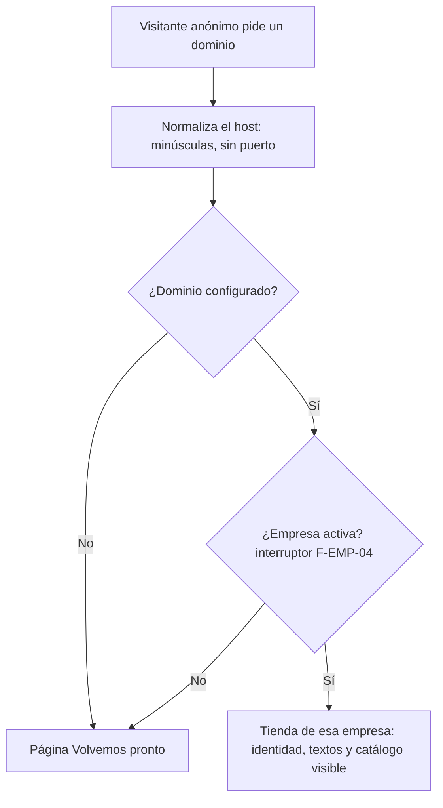
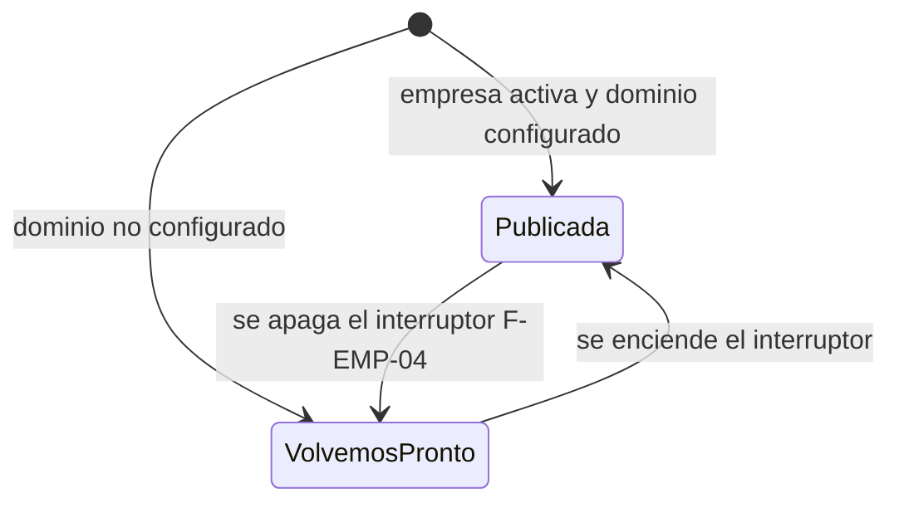
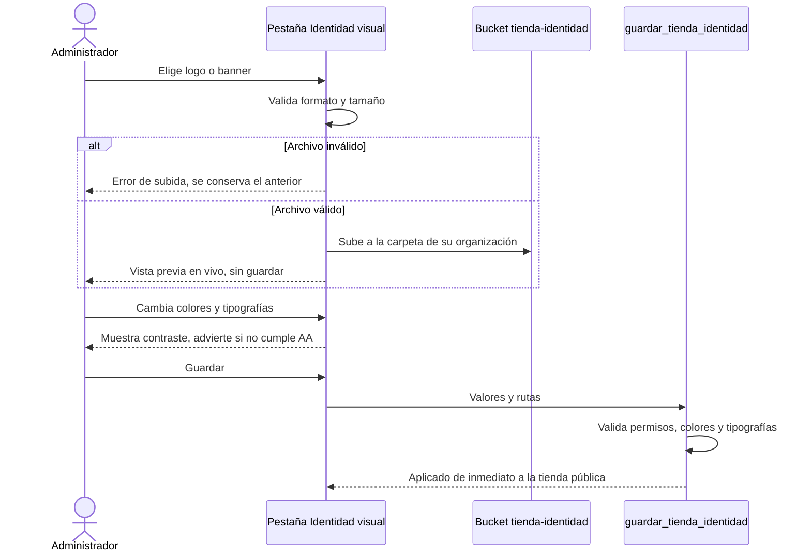
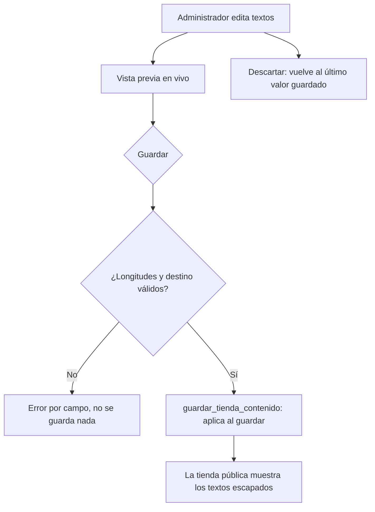
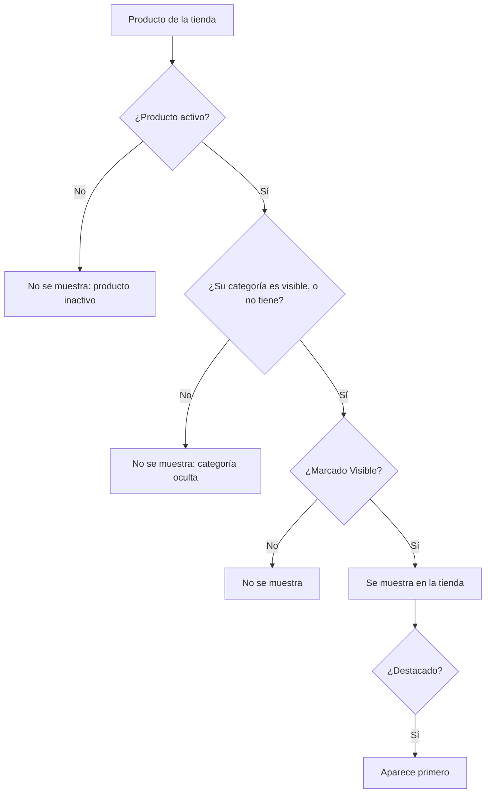

# Feature Specification: Tiendas online · Tienda dominio e identidad

**Feature Branch**: `epic/MSF-147-tiendas-online-tienda-dominio-e-identida`

**Componente**: Tiendas online

**Jira Epic**: MSF-147 — Tiendas online · Tienda dominio e identidad (spec `tienda-dominio-e-identidad`)

**Historias previstas**: F-TDA-01 (L), F-TDA-02 (M), F-TDA-03 (M), F-TDA-04 (M), todas P0.

**Created**: 2026-10-22

**Status**: Draft — lista para planificar. Quedan decisiones de Nicolás anotadas en *Decisiones abiertas* (ninguna bloquea implementar con el supuesto indicado).

**Delivery scope**: `refine` (`apps/web`: gestión de la tienda y front público mínimo) y `supabase` (migraciones, RPC de lectura anónima, bucket y pgTAP). Sin `kestra`, `superset` ni `workers`.

**Prioridad / Hito**: P0 · Hito 3 (16 de noviembre al 11 de diciembre de 2026) · ~36 h · alcance diciembre.

**Input**: Epic MSF-147. Objetivo: «Al terminar, cada empresa tiene su tienda resuelta por su dominio con acceso anónimo seguro, y el administrador puede definir su identidad visual, sus textos comerciales y qué categorías y productos se muestran y se destacan.»

## Regla de fuentes (literal de la épica)

- Comportamiento y datos: mandan los requisitos y escenarios de esta historia.
- Qué se ve (disposición, textos, estados, popups, flujos): el prototipo validado es referencia visual, no hace falta que quede extremadamente idéntico; los flujos (si hay) aclaran estados y acciones.
- Cómo se construye (componentes, estilos y patrones): mandan el template y el system design del producto (épica Plataforma · Sistema de diseño). No copiar el HTML ni el CSS del prototipo: reproducir lo que muestra con los componentes del template y los tokens del sistema de diseño.
- El prototipo muestra más que esta historia: implementar solo lo que piden los requisitos de esta historia; otras secciones, botones o diálogos son de otras historias.
- Si algo no se puede igualar con el template / el sistema de diseño: usar lo más cercano, sin inventar, y anotar la diferencia en la descripción del PR.
- Si el prototipo y los requisitos se contradicen: requisitos para el comportamiento, prototipo para lo visual, y dejar la contradicción anotada en el PR.

Prototipos (solo lectura, ya presentes en `design/pantallas/`): `StoreIdentidad`, `StoreContenido`, `StoreCatalogo` (y sus variantes `SJ_*` de San Javucho), más `StoreGeneral` / `StorePublicacion` solo como contexto (fuera de alcance, ver matriz). Cada uno con su `.inventory.json`.

## Dependencias

| Dependencia | Estado | ¿En la base de esta rama? | ¿Bloquea? |
|---|---|---|---|
| MSF-160 · Catálogo: productos y categorías (`dominio.categorias`, `productos.categoria_id`) | Review In DEV | **No**: está en `origin/epic/MSF-160-catalogo-catalogo-listado-y-categorias`, no en esta rama | **Sí para F-TDA-04** (FK a `dominio.categorias`). F-TDA-01/02/03 no dependen de él. Antes de implementar F-TDA-04 la rama debe incluir MSF-160 (merge de esa rama o de `main` cuando se promueva). |
| MSF-138 · Empresas (`dominio.empresas`, interruptor `activa` de F-EMP-04) | Finalizada | Sí | No (llega por transitividad vía MSF-160). |
| MSF-435 · DS-04 Temas de las tiendas públicas por empresa | Finalizada | Sí (tokens/temas del sistema de diseño) | No. Fija la lista de tipografías y las variables de tema que consume la tienda. |
| `private.nivel_seccion` / matriz de permisos por sección | Existe en la base | Sí | No (relacionada; se usa con la sección `empresas`). |
| Registro de actividad (F-AUD-01) | Sin épica propia | Existe `public.registro_actividad` | No: se construye contra el contrato de eventos de esta spec (FR-012, FR-029, FR-037, FR-049). |

Bloquea a: MSF-167 (tienda-catalogo-y-ficha), MSF-133 (tienda-dominio-y-publicacion) y MSF-122 (Consultas bandeja y aviso).

## Supuestos (de la épica)

- En el lanzamiento el equipo técnico configura los dominios; cada tienda se activa con el interruptor de F-EMP-04 (`dominio.empresas.activa`). No hay pantalla de dominio en esta épica.
- La tienda **no tiene borrador**: los cambios se aplican al guardar (el borrador es F-TDA-06, Etapa 2).
- La gestión de la tienda requiere **edición en la sección Empresas**; se asume que la gestiona el Administrador (si el Operador debe elegir productos hay que darle edición sobre esa parte: decisión abierta D3).
- «Tienda» = una por empresa. La clave de tienda en las tablas nuevas es `empresa_id` (con `organizacion_id` para RLS).

## Contradicciones prototipo ↔ épica (anotar en el PR)

1. **Borrador/publicación.** El prototipo dibuja «Hay cambios sin publicar», «Descartar», «Guardar y publicar» y los diálogos «Publicar cambios» / «Descartar cambios», más «Podés volver a la versión anterior». La épica fija que **no hay borrador**: el comportamiento manda. Se adapta: un único botón **«Guardar»** aplica de inmediato (en vez de «Guardar y publicar»); «Descartar» solo restaura el formulario al último valor guardado (sin diálogo de borrador); los diálogos «Publicar cambios» y «Descartar cambios» y las versiones quedan **fuera de alcance** (F-TDA-06/07).
2. **Vista previa.** El relevamiento pide ver el cambio «sin publicarse»; eso depende del borrador. Se entrega una **muestra en vivo** dentro de la pantalla que refleja los valores del formulario sin guardar; nada se aplica a la tienda hasta guardar.

## Decisiones abiertas (no bloquean; se implementa el supuesto)

- **D1 · Dominios**: falta confirmar si los dominios de las dos tiendas ya existen y quién controla el DNS. Supuesto: el seed usa dominios de prueba; el equipo técnico configura los reales.
- **D2 · Precio y destacados por tienda**: el modelo (`productos_tienda`) permite destacados distintos por tienda; en esta épica el **precio** se lee del producto y no se edita por tienda. Falta confirmarlo con el cliente.
- **D3 · Quién gestiona**: se asume Administrador (edición en Empresas). Si el Operador debe elegir qué productos se muestran, otorgarle edición sobre esa parte.
- **D4 · «El botón lleva a»**: el prototipo solo muestra «Catálogo completo». Supuesto: la lista de destinos es cerrada y por ahora tiene esa única opción; MSF-167 puede ampliarla.
- **D5 · Límites de archivos y textos** (la épica no los fija): logo ≤ 1 MB (PNG/SVG), banners ≤ 3 MB (PNG/JPG/WebP), títulos ≤ 120 caracteres, textos largos ≤ 300. Son valores técnicos por defecto, ajustables en una sola constante/migración.
- **D6 · Categorías ya existentes en MSF-160**: MSF-160 trae `dominio.categorias_empresa` (en qué empresas se ve una categoría, F-CAT-08). Esta épica crea `categorias_tienda` como pide la épica (visibilidad **dentro de la tienda**). Supuesto: la tienda solo considera `categorias_tienda`; coordinar con MSF-160 si deben unificarse.
- **D7 · Horas**: el roadmap asigna menos horas a Tiendas online que la suma de las épicas; el recorte queda pendiente (no cambia el alcance de esta spec).

## Modelo y supuestos técnicos

- **Estado por defecto**: sin fila en `tienda_identidad` / `tienda_contenido` la tienda usa el tema base de DS-04 y no muestra textos opcionales. Sin fila en `categorias_tienda` / `productos_tienda` un elemento es **visible** y **no destacado** (así un producto o categoría nuevo aparece sin sincronizar nada).
- **Acceso anónimo**: la regla del proyecto es que `anon` solo ejecuta las RPC de acceso de `public`. El acceso público vive en un esquema nuevo **`publico`** que contiene **solo funciones** `SECURITY DEFINER` de lectura (sin tablas) y se agrega a los esquemas expuestos de la API (`supabase/config.toml` y el entorno self-hosted). `anon` no recibe privilegios sobre `public` ni `dominio`.
- **Front público**: ruta de `apps/web` resuelta por el `Host` de la petición, sin sesión; muestra identidad, textos y catálogo visible con los componentes y tokens del sistema de diseño. Catálogo navegable, ficha y búsqueda son de MSF-167 (fuera de alcance).

## Esquema de datos (Constitución, Principio VII)

Cada tabla verificada por su naturaleza. Todas son **dominio del producto** (las tiendas son entidades de negocio de quién vende) → `dominio`. Ninguna va a `public`. Todas con RLS por organización y migraciones **aditivas** con reversión documentada; cada historia trae su propia migración.

| Objeto | Esquema | Historia | Naturaleza / justificación |
|---|---|---|---|
| `dominio.tiendas` (id, organizacion_id, empresa_id **único**, dominio **único** normalizado, timestamps) | `dominio` | F-TDA-01 | Entidad de negocio: la tienda de una empresa y su dominio. FK compuesta `(empresa_id, organizacion_id)` → `dominio.empresas`. |
| `dominio.tienda_identidad` (empresa_id PK, colores, tipografías, `logo_path`, `banner_path`, `banner_movil_path`) | `dominio` | F-TDA-02 | Configuración visual de la tienda de una empresa. |
| `dominio.tienda_contenido` (empresa_id PK, textos comerciales) | `dominio` | F-TDA-03 | Textos comerciales de la tienda. |
| `dominio.categorias_tienda` (empresa_id, categoria_id, visible) | `dominio` | F-TDA-04 | Qué categorías muestra la tienda. FK compuesta a `dominio.categorias` (MSF-160). |
| `dominio.productos_tienda` (empresa_id, producto_id, visible, destacado) | `dominio` | F-TDA-04 | Qué productos muestra y destaca la tienda. FK compuesta a `dominio.productos`. |
| `storage.buckets` `tienda-identidad` | storage | F-TDA-02 | Archivos de logo y banners; lectura pública (son imágenes públicas por naturaleza), escritura solo `authenticated` con edición en Empresas y carpeta de su organización. |
| `publico.*` (funciones de lectura anónima) | `publico` (**solo funciones, sin tablas**) | F-TDA-01 (resolución), 02/03/04 (cada una agrega la suya) | Contrato de lectura anónima mínima; no es una tabla expuesta. |

El pgTAP de aislamiento DEBE recorrer `public` y `dominio` y verificar que `publico` **no contiene tablas**.

**Reversión (migraciones posteriores, solo mientras no haya datos productivos)**: `drop function publico.*`; `drop table dominio.productos_tienda, categorias_tienda, tienda_contenido, tienda_identidad, tiendas`; borrar el bucket `tienda-identidad` (exportar antes los archivos).

## Navegación y patrones del panel (Principio VI)

- **Ubicación**: dentro de **Empresas** (icono y menú existentes). Ruta canónica `/empresas/:id/tienda/:pestaña` con `:pestaña` ∈ `identidad`, `contenido`, `catalogo`. Sin rutas anteriores que preservar.
- **Audiencia**: usuarios con **edición en la sección Empresas** (matriz de permisos / `private.nivel_seccion('empresas')`). Sin edición: no ven la pestaña ni acceden por URL (patrón de acceso restringido existente).
- **Patrones**: carga, vacío, error y éxito del kit de panel (EncabezadoPagina, ContenedorSeccion, ContenidoAdaptable). Teclado, lector de pantalla y anchos de 320/768/1440 px. Sin identificadores técnicos como identidad visible (se muestra el nombre de la empresa y el dominio, nunca UUID).
- **Carga diferida**: las pestañas y el front público se cargan con `lazy`; el selector de color y la subida de archivos no entran al recorrido principal de Empresas.

## User Scenarios & Testing *(mandatory)*

### US1 — Una tienda por empresa, resuelta por dominio (F-TDA-01, P0)

El visitante anónimo entra al dominio de Mundo JC y ve su tienda; en el de San Javucho ve la otra. Si el dominio no está configurado o la tienda está desactivada, ve «Volvemos pronto». El administrador abre la gestión de la tienda desde Empresas.

1. **Given** dos tiendas con dominio y activas, **When** se pide cada dominio sin sesión, **Then** cada una devuelve solo su propia tienda y nunca datos de la otra.
2. **Given** un dominio no configurado, **When** se pide, **Then** se ve «Volvemos pronto».
3. **Given** una empresa con `activa = false`, **When** se pide su dominio, **Then** se ve la **misma** página «Volvemos pronto» (no se revela si el dominio existe).
4. **Given** el visitante anónimo, **When** intenta leer `dominio.*`, `public.*` o llamar RPC que no sean las de `publico`, **Then** el acceso es denegado.
5. **Given** un usuario con edición en Empresas, **When** abre la gestión de la tienda de su empresa, **Then** ve el encabezado con nombre, dominio y estado, «Cambiar a <otra empresa> ↔» y «Ver tienda», y las pestañas Identidad visual, Contenido y Catálogo visible.
6. **Given** un usuario sin edición en Empresas, **When** intenta abrir la gestión, **Then** no tiene acceso.
7. **Given** la gestión abierta, **When** cambia la empresa activa (barra superior o «Cambiar a …»), **Then** todo se reencuadra a la nueva empresa y no queda un dato de la anterior (Principio VIII).

### US2 — Identidad visual de la tienda (F-TDA-02, P0)

1. **Given** la pestaña Identidad visual, **When** el administrador sube un logo PNG/SVG válido, **Then** se muestra «Logo actual de <empresa>» con «Reemplazar» y «Quitar».
2. **Given** colores y tipografías elegidos, **When** guarda, **Then** la tienda pública los aplica de inmediato y solo la tienda de esa empresa cambia.
3. **Given** un primario con contraste insuficiente con texto blanco, **When** lo elige, **Then** ve una advertencia AA (no bloquea el guardado).
4. **Given** un archivo de formato no admitido o demasiado grande, **When** lo sube, **Then** ve un error claro y el archivo anterior se conserva.
5. **Given** cambios sin guardar, **When** mira la vista previa, **Then** refleja los valores sin guardar y no cambia la tienda pública hasta guardar.

### US3 — Contenido y textos comerciales (F-TDA-03, P0)

1. **Given** la pestaña Contenido, **When** edita título, subtítulo, texto y destino del botón del banner principal y guarda, **Then** la home pública los muestra.
2. **Given** los textos comerciales (bienvenida, pie, aviso de ficha, texto del botón de contacto), **When** guarda, **Then** la tienda pública los muestra como **texto** (nunca interpretado como HTML).
3. **Given** un texto que supera el límite, **When** guarda, **Then** ve un error por campo y no se guarda nada.
4. **Given** dos empresas, **When** una edita sus textos, **Then** la otra no cambia.

### US4 — Catálogo visible y destacados (F-TDA-04, P0)

1. **Given** la pestaña Catálogo visible, **When** oculta una categoría, **Then** la tienda pública no la muestra ni en menú ni en filtros, ni los productos que dependan de ella.
2. **Given** un producto inactivo marcado como visible, **When** mira la fila, **Then** ve «No se muestra: producto inactivo» y la tienda no lo muestra.
3. **Given** el listado, **When** mira el resumen, **Then** ve «N visibles, M destacados» coherente con lo que realmente se muestra.
4. **Given** un producto no visible, **When** intenta destacarlo, **Then** se pide confirmación antes de marcarlo.
5. **Given** dos tiendas con los mismos productos, **When** una cambia visibilidad o destacados, **Then** la otra no cambia.
6. **Given** el buscador «Buscar producto», **When** escribe, **Then** la tabla filtra por nombre.

### Casos borde

- Dominio con mayúsculas, puerto o punto final → se normaliza; dominio duplicado entre dos empresas → rechazado por la base.
- Guardados simultáneos sobre la misma empresa: gana el último de forma coherente (la RPC aplica el conjunto en una transacción).
- Archivo subido pero guardado fallido: el archivo huérfano no se referencia; se limpia al siguiente reemplazo.
- Producto o categoría eliminado: su fila de tienda desaparece por cascada.
- Imagen o logo ausente: la tienda usa el valor del tema base, sin imagen rota.

## Requirements *(mandatory)*

### F-TDA-01 — Una tienda por empresa, resuelta por dominio

- **FR-001**: Cada empresa tiene como máximo **una** tienda (`dominio.tiendas.empresa_id` único) con un **dominio único** a nivel plataforma, guardado normalizado (minúsculas, sin puerto ni punto final).
- **FR-002**: Existe `publico.tienda_por_dominio(host)` ejecutable por `anon` que normaliza el `host` y devuelve **solo** los datos públicos de esa tienda (nombre comercial de la empresa, identificador público de tienda y estado). Nunca devuelve `organizacion_id`, datos de otra tienda ni columnas internas.
- **FR-003**: Si el dominio no está configurado o la empresa está desactivada (`dominio.empresas.activa = false`, interruptor F-EMP-04) la respuesta es **la misma** y el front muestra «Volvemos pronto» (versión mínima de F-TDA-19).
- **FR-004**: Los dominios los configura el equipo técnico (seed/operación); esta épica no incluye pantalla de dominio ni verificación DNS (F-TDA-05, MSF-133).
- **FR-005**: El esquema `publico` contiene solo funciones de lectura; `anon` no tiene privilegios sobre `public` (salvo las RPC de acceso ya vigentes) ni `dominio`; `revoke … from public` explícito y `grant execute … to anon` solo en las funciones de `publico`. Un pgTAP falla si `publico` tiene tablas o si `anon` ejecuta otra función.
- **FR-006**: Aislamiento: cada dominio resuelve únicamente su tienda; RLS en `dominio.tiendas` por organización (`private.organizacion_id()`); el usuario autenticado solo ve y edita tiendas de su organización y de empresas a las que tiene acceso.
- **FR-007**: Front público mínimo en `apps/web`: la ruta resuelve la tienda por `Host` sin sesión, aplica identidad/textos/catálogo visible cuando existen (cada historia aporta su sección) y muestra «Volvemos pronto» según FR-003. Sin catálogo navegable, ficha ni búsqueda (MSF-167).
- **FR-008**: Pantalla de gestión de la tienda dentro de Empresas, accesible solo con **edición en Empresas**: encabezado «Empresas › <empresa>» con dominio y estado («Publicada» cuando está activa), botón «Cambiar a <otra empresa> ↔», botón «Ver tienda» (abre el dominio) y pestañas. Las pestañas se registran por archivo en una carpeta (cada historia aporta la suya sin tocar un archivo común).
- **FR-009**: Principio VIII — la empresa activa de la barra superior es la fuente única; «Cambiar a <otra> ↔» cambia **esa** empresa activa (no guarda otra). Al cambiar: invalida y recarga todas las consultas, descarta cambios sin guardar con aviso y nunca muestra datos de la empresa anterior.
- **FR-010**: Accesibilidad y responsividad de la pantalla (teclado, lector de pantalla, 320/768/1440) y estados de carga/vacío/error del kit de panel.
- **FR-011**: Datos de prueba (seed): dos organizaciones/empresas (Mundo JC y San Javucho) con dominios de prueba y tienda activa, para pgTAP y E2E.
- **FR-012**: Auditoría — la alta/cambio de dominio de una tienda registra `tienda.dominio_configurado` (actor, empresa, fecha) en el registro de actividad.

### F-TDA-02 — Identidad visual

- **FR-020**: `dominio.tienda_identidad` guarda colores (Primario, Primario oscuro, Acento, Fondo en `#RRGGBB` validado), tipografías (Títulos, Texto) y rutas de logo, banner principal y banner móvil. Sin fila → tema base de DS-04.
- **FR-021**: Logo: PNG o SVG (el aviso del prototipo pide fondo transparente); acciones «Reemplazar» y «Quitar»; texto «Logo actual de <empresa>». El SVG se rechaza si contiene `<script>` o manejadores `on*`.
- **FR-022**: Cuatro campos de color con muestra y validación de formato; error por campo si es inválido.
- **FR-023**: Se calcula y muestra el contraste del texto blanco sobre el primario («Contraste de texto blanco sobre el primario: 7,4:1 (AA)»); por debajo de 4,5:1 se muestra una **advertencia** de contraste AA que **no bloquea** guardar.
- **FR-024**: Tipografías de Títulos y Texto elegidas de una **lista cerrada** definida por DS-04; cualquier otro valor se rechaza en la base.
- **FR-025**: Banner principal (recomendado 1440×440) y banner móvil (recomendado 390×300): «Reemplazar» y «Quitar»; las medidas son una sugerencia visible, no un rechazo.
- **FR-026**: Errores de subida de logo y banners con mensaje claro (formato no admitido, supera el tamaño máximo, fallo de red); el archivo anterior se conserva. Límites según D5.
- **FR-027**: Vista previa **en vivo** (muestra: encabezado con logo, banner, productos de ejemplo) que refleja los valores sin guardar; no modifica la tienda pública. Texto «Se actualiza con los cambios sin publicar.» adaptado a «Se actualiza con tus cambios sin guardar.» (contradicción 1).
- **FR-028**: «Guardar» aplica de inmediato; «Descartar» restaura el último valor guardado. Escritura por RPC `public.guardar_tienda_identidad` (authenticated, edición en Empresas, `revoke … from public, anon`).
- **FR-029**: Bucket `tienda-identidad`: lectura pública, escritura solo `authenticated` con edición en Empresas y bajo la carpeta de su organización/empresa; tipos y tamaño restringidos por el bucket. Auditoría `tienda.identidad_actualizada`.
- **FR-030**: `publico.identidad_por_dominio(host)` devuelve la identidad pública; el front aplica colores y tipografías como variables de tema (tokens DS-04) y el logo/banners en la home.

### F-TDA-03 — Contenido y textos comerciales

- **FR-031**: `dominio.tienda_contenido` guarda: Título, Subtítulo, Texto del botón y «El botón lleva a» (banner principal), Mensaje de bienvenida (barra superior), Texto del pie de página, Aviso en la ficha de producto y Texto del botón de contacto.
- **FR-032**: «El botón lleva a» es una lista cerrada (hoy «Catálogo completo», D4); se valida en la base.
- **FR-033**: Todos los textos son **texto plano** con recorte de espacios y límites de longitud (D5), validados en la base; se renderizan siempre escapados (nunca HTML).
- **FR-034**: Un texto vacío oculta su elemento en la tienda pública (no se muestran marcadores vacíos).
- **FR-035**: Escritura por `public.guardar_tienda_contenido` (authenticated, edición en Empresas, `revoke … from public, anon`); «Guardar» aplica de inmediato y «Descartar» restaura el último guardado.
- **FR-036**: `publico.contenido_por_dominio(host)` devuelve los textos públicos; la home los muestra (banner, barra superior, pie). El aviso de ficha y el texto del botón de contacto quedan guardados y expuestos para MSF-167 (la ficha es de esa épica).
- **FR-037**: Vista previa en vivo del banner con los textos sin guardar (mismo criterio que FR-027). Auditoría `tienda.contenido_actualizado`.

### F-TDA-04 — Catálogo visible y destacados

- **FR-040**: `dominio.categorias_tienda (empresa_id, categoria_id, visible)` y `dominio.productos_tienda (empresa_id, producto_id, visible, destacado)` con **claves foráneas compuestas** `(…, organizacion_id)` a `dominio.categorias` / `dominio.productos` y a `dominio.empresas`; una fila no cruza organizaciones ni empresas. Ausencia de fila = visible y no destacado.
- **FR-041**: Sección «Categorías visibles» con el texto «Las categorías ocultas no aparecen en el menú ni en los filtros de esta store.», una fila por categoría con interruptor y conteo «· N productos».
- **FR-042**: Sección «Productos visibles y destacados» con el texto «Un producto inactivo o sin la categoría visible no se muestra aunque esté marcado.», buscador «Buscar producto» y tabla: Producto, Precio, Stock, Visible, Destacado (estrella).
- **FR-043**: **Visibilidad efectiva**: un producto se muestra solo si está activo, su fila `visible` es verdadera y su categoría (si tiene) es visible. Un producto sin categoría depende solo de su estado y su `visible`.
- **FR-044**: Una fila no efectiva muestra el aviso «No se muestra: producto inactivo» (o el motivo por categoría oculta); el motivo se calcula en el servidor.
- **FR-045**: Resumen «N visibles, M destacados» sobre los productos **efectivamente** visibles y destacados.
- **FR-046**: Destacar un producto **no visible** pide confirmación explícita («Este producto no se muestra en la tienda. ¿Destacarlo igual?»); confirmar marca destacado sin cambiar su visibilidad.
- **FR-047**: Precio y Stock se muestran de lectura (D2); no se editan en esta pantalla. Si no hay precio se muestra «—».
- **FR-048**: Escritura por RPC `public.guardar_catalogo_tienda` (authenticated, edición en Empresas, `revoke … from public, anon`) que aplica el conjunto de cambios en una transacción e idempotente; «Guardar» aplica de inmediato y «Descartar» restaura lo guardado.
- **FR-049**: `publico.catalogo_visible_por_dominio(host)` devuelve categorías visibles y productos efectivamente visibles (destacados primero) con nombre, precio, imagen principal y categoría. **Nunca** costos, stock exacto, proveedor ni datos internos. Auditoría `tienda.catalogo_actualizado`.

### Transversales verificados en el cierre

- Aislamiento pgTAP entre dos organizaciones y acceso anónimo (sin costos, sin otra empresa) — SC-001, SC-002.
- E2E con dos dominios del seed: identidad, textos y catálogo visible de cada tienda cambian solo la propia — SC-003.

## Matriz pantalla↔criterios

Ítems tomados de `design/pantallas/StoreIdentidad.inventory.json`, `StoreContenido.inventory.json`, `StoreCatalogo.inventory.json` (y sus `SJ_*`, idénticos en estructura), más `StoreGeneral` y `StorePublicacion` para declarar su alcance. Las variantes de San Javucho solo cambian datos (nombre, dominio, colores), no estructura.

### Elementos comunes a las pantallas de tienda

| Ítem del inventario | Dueño | Criterio / nota |
|---|---|---|
| Botón «Empresas» (migas) | F-TDA-01 | FR-008. |
| Botón «Cambiar a San Javucho ↔» | F-TDA-01 | FR-008, FR-009 (cambia la empresa activa; el nombre es la otra empresa). |
| Botón «Ver tienda» | F-TDA-01 | FR-008 (abre el dominio de la tienda). |
| Chip de estado «Publicada» | F-TDA-01 | FR-008 (activa según F-EMP-04). |
| Pestañas «Identidad visual», «Contenido», «Catálogo visible» | F-TDA-01 (estructura) / cada historia (contenido) | FR-008; cada pestaña la aporta su historia. |
| Pestañas «General», «Precios y moneda», «Mercado Libre» | **Fuera de alcance** | General es F-EMP-04 (Empresas); Precios y Mercado Libre son de otras épicas. No se dibujan. |
| Pestaña «Dominio y publicación» y pantalla `StorePublicacion` (tablas Tipo/Nombre/Valor/Estado y Versión/Fecha/Por/Cambios, campos «Dominio principal» y «Redirigir también», botones «Verificar ahora», «Ver cambios», «Restaurar», diálogo «Restaurar versión») | **Fuera de alcance** | F-TDA-05/06/07 (Etapa 2, MSF-133): verificación DNS, borrador y versiones. En esta épica el dominio lo configura el equipo técnico (FR-004). |
| Pantalla `StoreGeneral` (Nombre comercial, Dominio o subdominio, Idioma, Moneda, WhatsApp, Correo, Instagram, Dirección, interruptor de tienda activa) | **Fuera de alcance** | F-EMP-04 (componente Empresas); esta épica solo lee `activa` (FR-003). |
| Botón «Guardar y publicar» | F-TDA-02/03/04 | FR-028/035/048, adaptado a **«Guardar»** (aplica de inmediato; contradicción 1). |
| Botón «Descartar» | F-TDA-02/03/04 | FR-028/035/048: restaura el último valor guardado. |
| Barra «Hay cambios sin publicar.» | F-TDA-02/03/04 | Adaptada a «Hay cambios sin guardar.» (indica cambios pendientes; sin borrador). |
| Diálogo «Publicar cambios» (Cancelar / Publicar) | **Fuera de alcance** | Depende del borrador (F-TDA-06). Guardar no pide confirmación. |
| Diálogo «Descartar cambios» | **Fuera de alcance** | Su texto «Se pierden los cambios sin publicar» presupone borrador; «Descartar» restaura el formulario sin diálogo (solo hay aviso al cambiar de empresa con cambios sin guardar, FR-009). |
| Tarjeta «Vista previa» (Joystick Pro cableado, Case OLED Zelda, Transformador Switch) | F-TDA-02/03/04 | FR-027, FR-037: muestra en vivo con productos de ejemplo reales de la tienda; el texto se adapta (contradicción 2). |
| **Empresa activa** | F-TDA-01 | FR-009: la gestión opera sobre la empresa activa de la barra superior en modo una empresa; «Todas mis empresas» **no aplica** (la tienda es de una sola empresa: sin empresa concreta se pide elegir una). Test de cambio de empresa en SC-006. |

### StoreIdentidad (`StoreIdentidad.inventory.json`)

| Ítem | Dueño | Criterio / nota |
|---|---|---|
| Sección «Logo» + texto «PNG o SVG con fondo transparente…» | F-TDA-02 | FR-021. |
| Botones «Reemplazar» / «Quitar» (logo y banners) | F-TDA-02 | FR-021, FR-025. |
| Campos «Primario», «Primario oscuro», «Acento», «Fondo» | F-TDA-02 | FR-020, FR-022. |
| Texto «Contraste de texto blanco sobre el primario: 7,4:1 (AA)» y advertencia | F-TDA-02 | FR-023. |
| Campos «Títulos» y «Texto» (tipografías) + muestra «Todo para tu consola» | F-TDA-02 | FR-024. |
| Campo «Banner principal (1440×440)» | F-TDA-02 | FR-025. |
| Campo «Banner móvil (390×300)» | F-TDA-02 | FR-025. |
| Errores de subida | F-TDA-02 | FR-026. |

### StoreContenido (`StoreContenido.inventory.json`)

| Ítem | Dueño | Criterio / nota |
|---|---|---|
| Campos «Título», «Subtítulo», «Texto del botón» | F-TDA-03 | FR-031. |
| Campo «El botón lleva a» | F-TDA-03 | FR-032 (D4). |
| Campos «Mensaje de bienvenida (barra superior)», «Texto del pie de página», «Aviso en la ficha de producto» | F-TDA-03 | FR-031, FR-033. |
| Campo «Texto del botón de contacto» | F-TDA-03 | FR-031. |
| Bloque «Información de contacto visible» (WhatsApp, Correo, Instagram, Dirección y qué se muestra) | **Fuera de alcance** | La épica no lo pide: WhatsApp y formulario de contacto son de otra épica de Tiendas online; los datos se editan en General (F-EMP-04). |

### StoreCatalogo (`StoreCatalogo.inventory.json`)

| Ítem | Dueño | Criterio / nota |
|---|---|---|
| Sección «Categorías visibles» (lista con interruptor y «· N productos») | F-TDA-04 | FR-041. |
| Sección «Productos visibles y destacados» + buscador «Buscar producto» | F-TDA-04 | FR-042. |
| Columnas «Producto», «Precio», «Stock», «Visible», «Destacado» | F-TDA-04 | FR-042, FR-047. |
| Aviso «No se muestra: producto inactivo» | F-TDA-04 | FR-044. |
| Resumen «25 visibles, 5 destacados» | F-TDA-04 | FR-045. |
| Confirmación al destacar un producto no visible | F-TDA-04 | FR-046. |

### Estados citados por las historias

| Estado | Dueño | Criterio |
|---|---|---|
| Página «Volvemos pronto» | F-TDA-01 | FR-003. |
| Advertencia de contraste AA | F-TDA-02 | FR-023. |
| Errores de subida de logo y banners | F-TDA-02 | FR-026. |

## Fuera de alcance

- Borrador, versiones, «Publicar cambios», «Restaurar versión» (F-TDA-06/07); verificación DNS y pantalla de dominio (F-TDA-05, MSF-133).
- Pestañas General, Precios y moneda, Mercado Libre; editar precio por tienda (D2).
- Catálogo público navegable, ficha, búsqueda, carrito, WhatsApp y formulario de contacto (MSF-167 y otras épicas de Tiendas online).
- Información de contacto visible (qué dato mostrar).
- «Volvemos pronto» como historia completa (F-TDA-19): solo la versión mínima.

## Flujos

La épica describe los flujos en prosa y en las pantallas; se transcriben sin agregar estados ni transiciones.

### Resolución de la tienda por dominio (F-TDA-01 · FR-001…FR-007)



### Estado de la tienda (F-TDA-01 · FR-003, FR-008)



### Guardar identidad con subida de archivos (F-TDA-02 · FR-021…FR-029)



### Guardar contenido (F-TDA-03 · FR-031…FR-037)



### Visibilidad y destacados (F-TDA-04 · FR-040…FR-049)



```mermaid
sequenceDiagram
  actor Adm as Administrador
  participant UI as Pestaña Catálogo visible
  participant RPC as guardar_catalogo_tienda
  Adm->>UI: Marca la estrella de un producto no visible
  UI-->>Adm: Pide confirmación
  alt Confirma
    UI->>UI: Marca destacado, sigue sin mostrarse
  else Cancela
    UI->>UI: No cambia nada
  end
  Adm->>UI: Guardar
  UI->>RPC: Conjunto de cambios
  RPC-->>UI: Aplicado en una transacción; resumen N visibles, M destacados
```

## Success Criteria *(mandatory)*

- **SC-001**: pgTAP de aislamiento entre dos organizaciones: una no lee ni escribe tiendas, identidad, contenido ni catálogo de la otra; `rls_en_toda_tabla` pasa con las tablas nuevas (FR-005, FR-006, FR-040).
- **SC-002**: pgTAP de acceso anónimo: `anon` solo ejecuta las funciones de `publico` y las RPC de acceso; no ve costos, stock exacto, proveedores ni otra empresa; `publico` no tiene tablas (FR-002, FR-005, FR-049).
- **SC-003**: E2E con los dos dominios del seed: identidad, textos y catálogo visible de cada tienda cambian solo la propia (FR-007, FR-030, FR-036, FR-049).
- **SC-004**: Dominio desconocido y tienda desactivada muestran la misma página «Volvemos pronto» (FR-003).
- **SC-005**: Un texto con HTML/script se muestra literal y un SVG con script se rechaza (FR-021, FR-033).
- **SC-006**: Cambiar de empresa en la gestión recarga todo y no deja datos ni diálogos de la anterior (FR-009).
- **SC-007**: El resumen «N visibles, M destacados» coincide con lo que `catalogo_visible_por_dominio` devuelve (FR-043…FR-049).
- **SC-008**: Lint, build, `pnpm infra:config`, `pnpm test`, `pnpm prototipo:check`, `pnpm matriz:check` y `pnpm docs:check` pasan.
- **SC-009**: La documentación del cambio está al día (`docs/tiendas-online.md`, enlace desde `docs/empresas.md`, nota de contradicciones para el PR) y `pnpm docs:check` pasa (regla «Documentación obligatoria» del proyecto).
- **SC-010**: La fila de la épica en `docs/roadmap-template.md` refleja el estado y el link a esta spec al cerrar el PR (paso manual del cierre).
- **SC-011**: Gestión y front público: la ruta por `Host` muestra la tienda o «Volvemos pronto», el encabezado, el acceso restringido y los estados de carga/vacío/error se comportan como piden FR-007, FR-008 y FR-010 (Vitest + axe a 320/768/1440 px).
- **SC-012**: Identidad: contraste AA con advertencia no bloqueante, errores de subida que conservan el archivo anterior, vista previa en vivo sin tocar la tienda pública y tema aplicado solo a la tienda propia (FR-021…FR-028, FR-030).
- **SC-013**: Contenido: límites por campo, destino en lista cerrada, texto vacío que oculta su elemento y vista previa en vivo (FR-031…FR-037).
- **SC-014**: Catálogo visible: buscador, interruptores, aviso por fila, confirmación al destacar un producto no visible y resumen coherente en la pestaña (FR-041, FR-042, FR-044…FR-047).

## Verificación por requisito

Cada FR y SC tiene al menos una verificación concreta (test o tarea que lo ejerce). «Impl.» es la tarea dueña que lo construye (dueño único); «Verifica» son las pruebas que lo ejercitan.

| Requisito | Impl. | Verifica (test / SC) |
|---|---|---|
| FR-001 | T001 | pgTAP T006 (unicidad de empresa y dominio, normalización) · SC-001 |
| FR-002 | T002 | pgTAP T006 (solo columnas públicas, sin `organizacion_id`) · SC-002 |
| FR-003 | T007 | pgTAP T006 (misma respuesta) + Vitest T043 · SC-004 |
| FR-004 | T004 | pgTAP T006 (ambos dominios del seed resuelven; no hay RPC de escritura de dominio para `authenticated`) |
| FR-005 | T002 | pgTAP T006 · SC-002 |
| FR-006 | T001 | pgTAP T006 · SC-001 |
| FR-007 | T007 | Vitest T043 · E2E T038 · SC-003, SC-011 |
| FR-008 | T008 | Vitest T043 · SC-011 |
| FR-009 | T009 | Vitest T009 (cambio de empresa) · SC-006 |
| FR-010 | T010 | Vitest + axe T043 a 320/768/1440 px · SC-011 |
| FR-011 | T004 | pgTAP T006 (usa las dos organizaciones del seed) · E2E T038 |
| FR-012 | T003 | pgTAP T006 (fila `tienda.dominio_configurado` en `public.registro_actividad`) |
| FR-020 | T011 | pgTAP T019 (checks de color y fila ausente) |
| FR-021 | T015 | Vitest T020 (SVG con script/`on*`, formatos) · SC-005, SC-012 |
| FR-022 | T016 | Vitest T020 (validación de color) · SC-012 |
| FR-023 | T016 | Vitest T020 (casos límite 4,5:1) · SC-012 |
| FR-024 | T011 | pgTAP T019 (tipografía fuera de la lista se rechaza) |
| FR-025 | T015 | Vitest T020 (medidas sugeridas, «Reemplazar»/«Quitar») · SC-012 |
| FR-026 | T015 | Vitest T020 (errores de formato/tamaño/red conservan el archivo) · SC-012 |
| FR-027 | T017 | Vitest T020 (la vista previa refleja lo no guardado y no escribe) · SC-012 |
| FR-028 | T013 | pgTAP T019 (permisos, idempotencia, `revoke`) · Vitest T020 («Guardar»/«Descartar») |
| FR-029 | T012 | pgTAP T019 (políticas del bucket, evento de auditoría) |
| FR-030 | T018 | pgTAP T019 (función pública) · Vitest T020 (variables de tema) · SC-003, SC-012 |
| FR-031 | T021 | pgTAP T024 (columnas y límites) · SC-013 |
| FR-032 | T021 | pgTAP T024 (destino inválido rechazado) · SC-013 |
| FR-033 | T021 | pgTAP T024 (límites) · Vitest T027 (HTML literal) · SC-005 |
| FR-034 | T026 | Vitest T027 (vacío oculta) · SC-013 |
| FR-035 | T022 | pgTAP T024 (permisos, idempotencia, evento) · Vitest T027 |
| FR-036 | T023 | pgTAP T024 (función pública) · SC-003 |
| FR-037 | T025 | Vitest T027 (vista previa en vivo) · SC-013 |
| FR-040 | T028 | pgTAP T032 (FK compuestas, ausencia de fila = visible) · SC-001 |
| FR-041 | T033 | Vitest T037 · SC-014 |
| FR-042 | T034 | Vitest T037 (buscador y columnas) · SC-014 |
| FR-043 | T029 | pgTAP T032 (inactivo, categoría oculta, sin categoría) · SC-007 |
| FR-044 | T029 | pgTAP T032 (motivo calculado en servidor) · Vitest T037 · SC-014 |
| FR-045 | T029 | pgTAP T032 · SC-007 |
| FR-046 | T035 | Vitest T037 (confirmación) · SC-014 |
| FR-047 | T029 | pgTAP T032 (precio de lectura, «—» sin precio) · Vitest T037 |
| FR-048 | T030 | pgTAP T032 (transacción, idempotencia, `revoke`) |
| FR-049 | T031 | pgTAP T032 (sin costos ni stock exacto) · SC-002, SC-003, SC-007 |
| SC-001 | T006 | pgTAP `tienda_dominio.test.sql` (aislamiento) |
| SC-002 | T006 | pgTAP `tienda_dominio.test.sql` (acceso anónimo) |
| SC-004 | T006 | pgTAP `tienda_dominio.test.sql` (misma respuesta) |
| SC-003 | T038 | E2E Playwright con los dos dominios del seed |
| SC-005 | T039 | Vitest T020 + T027 y revisión de seguridad T039 |
| SC-006 | T009 | Vitest T009 |
| SC-007 | T032 | pgTAP `tienda_catalogo.test.sql` |
| SC-008 | T042 | Comandos de validación del repo |
| SC-009 | T040 | Test: `pnpm docs:check` pasa y `grep -q tiendas-online docs/empresas.md` + existencia de `docs/tiendas-online.md` (comprobación en T040) |
| SC-010 | T041 | Comprobación: `grep` de la clave de la spec y su link en `docs/roadmap-template.md` (paso manual con comprobación en T041) |
| SC-011 | T043 | Vitest + axe |
| SC-012 | T020 | Vitest |
| SC-013 | T027 | Vitest |
| SC-014 | T037 | Vitest |
