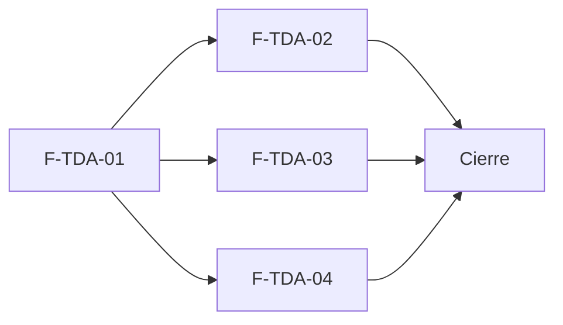

# Tasks: Tiendas online · Tienda dominio e identidad

**Input**: `specs/20261022-084830-tienda-dominio-e-identidad/` (spec.md, plan.md)

**Formato**: `- [ ] T### [P] [F-TDA-0x][USy] descripción`. **[P]** = paralelizable (archivos distintos, sin dependencia; las [P] del mismo grupo van en paralelo); sin [P] = secuencial. Las dependencias de cada tarea son solo dentro de su historia. Regla del proyecto: ninguna tarea queda `[ ]` al cierre — se hace con evidencia o se cierra con `[x]` + `Desvío:` y seguimiento trazado.

**Delivery scope**: `refine`, `supabase`

**Base**: F-TDA-04 necesita MSF-160 (`dominio.categorias`) en la rama (ver Dependencias de la spec); F-TDA-01/02/03 no.

## Matriz de trazabilidad Jira ↔ US ↔ tasks

| Jira | Historia | FR / SC (dueño único) | Tasks |
|------|----------|-----------------------|-------|
| F-TDA-01 (clave Jira de la historia: la asigna el orquestador) | US1 Una tienda por empresa, resuelta por dominio | FR-001…FR-012, SC-001, SC-002, SC-004, SC-006 | T001–T010 |
| F-TDA-02 | US2 Identidad visual de la tienda | FR-020…FR-030 | T011–T020 |
| F-TDA-03 | US3 Contenido y textos comerciales | FR-031…FR-037 | T021–T027 |
| F-TDA-04 | US4 Catálogo visible y destacados | FR-040…FR-049, SC-007 | T028–T037 |
| Tarea de cierre (label cierre) | Integración, seguridad, docs y roadmap | SC-003, SC-005, SC-008 | T038–T042 |

### Dueño único por requisito

| Requisito | Tarea dueña | | Requisito | Tarea dueña |
|---|---|---|---|---|
| FR-001, FR-006 | T001 | | FR-031, FR-032, FR-033 | T021 |
| FR-002, FR-005 | T002 | | FR-035 | T022 |
| FR-012 | T003 | | FR-036 | T023 |
| FR-004, FR-011 | T004 | | FR-037 | T025 |
| FR-003, FR-007 | T007 | | FR-034 | T026 |
| FR-008 | T008 | | FR-040 | T028 |
| FR-009, SC-006 | T009 | | FR-043, FR-044, FR-045, FR-047 | T029 |
| FR-010 | T010 | | FR-048 | T030 |
| SC-001, SC-002, SC-004 | T006 | | FR-049 | T031 |
| FR-020, FR-024 | T011 | | FR-041 | T033 |
| FR-029 | T012 | | FR-042 | T034 |
| FR-028 | T013 | | FR-046 | T035 |
| FR-021, FR-025, FR-026 | T015 | | SC-007 | T032 |
| FR-022, FR-023 | T016 | | SC-003 | T038 |
| FR-027 | T017 | | SC-005 | T039 |
| FR-030 | T018 | | SC-008 | T042 |

Las tareas de soporte sin requisito propio (T005, T014, T019, T020, T024, T027, T036, T037) son infraestructura o pruebas de los requisitos de su misma historia.

---

## Fase 1 — F-TDA-01 · Una tienda por empresa, resuelta por dominio (US1)

**Esquemas (Principio VII, re-verificado)**: `dominio.tiendas` → `dominio`; `publico` → solo funciones, sin tablas.

- [ ] T001 [F-TDA-01][US1] Migración `supabase/migrations/20261023100000_tiendas_dominio.sql`: `create schema publico` (+ `revoke all on schema publico from public`), `dominio.tiendas` (id, organizacion_id, empresa_id **único**, dominio **único** normalizado con check de formato, timestamps) con FK compuesta a `dominio.empresas`, RLS por organización (`private.organizacion_id()` y edición en Empresas), `anon` sin privilegios; reversión documentada en el encabezado. **FR-001, FR-006**.
- [ ] T002 [F-TDA-01][US1] `publico.tienda_por_dominio(host)` en la misma migración (secuencial tras T001): `SECURITY DEFINER`, normaliza host, respuesta idéntica para dominio desconocido y empresa desactivada, solo columnas públicas; `revoke … from public`, `grant execute … to anon, authenticated`. **FR-002, FR-005**.
- [ ] T003 [F-TDA-01][US1] Evento `tienda.dominio_configurado` en el registro de actividad al crear/cambiar el dominio de una tienda (actor, empresa, fecha). **FR-012**.
- [ ] T004 [P] [F-TDA-01][US1] Seed: dos organizaciones/empresas (Mundo JC y San Javucho) con dominios de prueba y tienda activa (`supabase/seed.sql`), y nota en `docs/tiendas-online.md` de cómo el equipo técnico configura un dominio (sin pantalla). **FR-004, FR-011**.
- [ ] T005 [P] [F-TDA-01][US1] Exponer el esquema `publico` en la API: `supabase/config.toml` (`[api] schemas`) y variable del entorno self-hosted + `.env.example` (sin secretos); validar con `pnpm infra:config`. Soporte de FR-005.
- [ ] T006 [F-TDA-01][US1] pgTAP `supabase/tests/database/tienda_dominio.test.sql`: aislamiento entre dos organizaciones; `anon` solo ejecuta funciones de `publico` (y las RPC de acceso), no lee `dominio.*` ni `public.*`; `publico` no tiene tablas; dominio desconocido y tienda desactivada devuelven lo mismo; el test de `rls_en_toda_tabla` recorre las tablas nuevas. **SC-001, SC-002, SC-004**.
- [ ] T007 [P] [F-TDA-01][US1] Front público en `apps/web/src/pages/tienda-publica/`: ruta por `Host` sin sesión, `PaginaTienda` con secciones cargadas por `import.meta.glob('./secciones/*.tsx')` ordenadas por `orden`, y `VolvemosPronto` con el texto de la épica. **FR-003, FR-007**.
- [ ] T008 [P] [F-TDA-01][US1] Gestión en `apps/web/src/pages/empresas/tienda/`: ruta `/empresas/:id/tienda/:pestaña`, guardia (edición en Empresas, patrón de acceso restringido), `EncabezadoTienda` (migas «Empresas › <empresa>», dominio · «Publicada», «Cambiar a … ↔», «Ver tienda»), pestañas cargadas por `import.meta.glob('./pestanas/*.tsx')`, entrada en la navegación de Empresas. **FR-008**.
- [ ] T009 [F-TDA-01][US1] Empresa activa (Principio VIII): el encabezado lee la empresa del selector; «Cambiar a … ↔» cambia esa misma empresa activa; al cambiar invalida y recarga todas las consultas, avisa si hay cambios sin guardar y no muestra datos de la anterior; test Vitest de cambio de empresa. **FR-009, SC-006**.
- [ ] T010 [F-TDA-01][US1] Accesibilidad y responsividad (teclado, lector de pantalla, 320/768/1440) y estados de carga/vacío/error del kit de panel en la gestión y en «Volvemos pronto». **FR-010**.

**Checkpoint F-TDA-01**: `pnpm test` (pgTAP + Vitest), `pnpm lint`, `pnpm build`, `pnpm infra:config`.

---

## Fase 2 — F-TDA-02 · Identidad visual de la tienda (US2)

**Esquemas (re-verificado)**: `dominio.tienda_identidad` → `dominio`; bucket `tienda-identidad` en Storage; lectura anónima solo por función de `publico`.

- [ ] T011 [F-TDA-02][US2] Migración `20261023100100_tienda_identidad.sql`: `create schema if not exists publico`, `dominio.tienda_identidad` (empresa_id PK, colores `#RRGGBB` con check, tipografías contra la lista cerrada de DS-04, rutas de logo/banners), FK compuesta a `dominio.empresas`, RLS por organización y edición en Empresas; reversión documentada. **FR-020, FR-024**.
- [ ] T012 [F-TDA-02][US2] Bucket `tienda-identidad` (lectura pública, tipos y tamaño según D5) con políticas de escritura `authenticated` bajo la carpeta de su organización/empresa y edición en Empresas; define el evento `tienda.identidad_actualizada` que emite la RPC de T013. **FR-029**.
- [ ] T013 [F-TDA-02][US2] RPC `public.guardar_tienda_identidad` (authenticated, edición en Empresas, idempotente, `revoke … from public, anon`, emite el evento de T012). **FR-028**.
- [ ] T014 [F-TDA-02][US2] `publico.identidad_por_dominio(host)` con lista blanca de columnas y URLs públicas; `grant execute … to anon`. Soporte de FR-030.
- [ ] T015 [P] [F-TDA-02][US2] Componentes de logo y banners (`apps/web/src/pages/empresas/tienda/componentes/imagen-tienda/`): subida con validación previa de formato y tamaño, rechazo de SVG con `<script>`/`on*`, «Reemplazar»/«Quitar», «Logo actual de <empresa>», medidas sugeridas 1440×440 y 390×300, mensajes de error de subida que conservan el archivo anterior. **FR-021, FR-025, FR-026**.
- [ ] T016 [P] [F-TDA-02][US2] Campos de color con validación y muestra, cálculo de contraste del texto blanco sobre el primario con texto «Contraste de texto blanco sobre el primario: N:1 (AA)» y advertencia AA no bloqueante, y selector de tipografías (Títulos/Texto) desde la lista de DS-04. **FR-022, FR-023**.
- [ ] T017 [F-TDA-02][US2] `pestanas/identidad.tsx`: arma T015 y T016, vista previa en vivo con los valores sin guardar, «Guardar» / «Descartar» y barra «Hay cambios sin guardar» (sin borrador). **FR-027**.
- [ ] T018 [P] [F-TDA-02][US2] Sección pública `secciones/TemaTienda.tsx`: aplica colores y tipografías como variables de tema (tokens DS-04) y logo/banners desde `publico.identidad_por_dominio`. **FR-030**.
- [ ] T019 [F-TDA-02][US2] pgTAP `tienda_identidad.test.sql`: aislamiento entre organizaciones, políticas del bucket, validaciones de color/tipografía, `anon` solo lee por función pública. Soporte de FR-020/029/030.
- [ ] T020 [F-TDA-02][US2] Vitest: contraste (casos AA límite), validación de SVG, formatos y tamaños. Soporte de FR-021/023/026.

**Checkpoint F-TDA-02**: pgTAP + Vitest de la historia verdes; `pnpm lint`, `pnpm build`.

---

## Fase 3 — F-TDA-03 · Contenido y textos comerciales (US3)

**Esquemas (re-verificado)**: `dominio.tienda_contenido` → `dominio`.

- [ ] T021 [F-TDA-03][US3] Migración `20261023100200_tienda_contenido.sql`: `create schema if not exists publico`, `dominio.tienda_contenido` (empresa_id PK; título, subtítulo, texto y destino del botón, bienvenida, pie, aviso de ficha, texto del botón de contacto) con recorte, límites (D5) y destino en lista cerrada; FK compuesta, RLS y reversión. **FR-031, FR-032, FR-033**.
- [ ] T022 [F-TDA-03][US3] RPC `public.guardar_tienda_contenido` (authenticated, edición en Empresas, idempotente, `revoke … from public, anon`, emite `tienda.contenido_actualizado`). **FR-035**.
- [ ] T023 [F-TDA-03][US3] `publico.contenido_por_dominio(host)` con lista blanca; `grant execute … to anon`. **FR-036**.
- [ ] T024 [F-TDA-03][US3] pgTAP `tienda_contenido.test.sql`: aislamiento, límites, destino inválido, `anon` solo por función pública. Soporte de FR-031…036.
- [ ] T025 [P] [F-TDA-03][US3] `pestanas/contenido.tsx`: campos «Título», «Subtítulo», «Texto del botón», «El botón lleva a», «Mensaje de bienvenida (barra superior)», «Texto del pie de página», «Aviso en la ficha de producto», «Texto del botón de contacto» con contadores y error por campo, vista previa en vivo del banner, «Guardar» / «Descartar». **FR-037**.
- [ ] T026 [P] [F-TDA-03][US3] Secciones públicas `BannerHome`, `BarraBienvenida`, `PieTienda`: texto siempre escapado y elemento oculto si el texto está vacío. **FR-034**.
- [ ] T027 [F-TDA-03][US3] Vitest: texto con HTML/script se muestra literal, vacío oculta, límites. Soporte de FR-033/034.

**Checkpoint F-TDA-03**: pgTAP + Vitest de la historia verdes; `pnpm lint`, `pnpm build`.

---

## Fase 4 — F-TDA-04 · Catálogo visible y destacados (US4)

**Esquemas (re-verificado)**: `categorias_tienda` y `productos_tienda` → `dominio`. Requiere `dominio.categorias` de MSF-160 en la base.

- [ ] T028 [F-TDA-04][US4] Migración `20261023100300_tienda_catalogo_visible.sql`: `create schema if not exists publico`, `dominio.categorias_tienda` y `dominio.productos_tienda` con FK compuestas `(…, organizacion_id)` a `dominio.categorias`, `dominio.productos` y `dominio.empresas`, RLS por organización y edición en Empresas; ausencia de fila = visible y no destacado; reversión. **FR-040**.
- [ ] T029 [F-TDA-04][US4] RPC `public.listar_catalogo_tienda(empresa)`: categorías con conteo y productos con precio y stock de lectura, visibilidad efectiva y motivo («No se muestra: producto inactivo» / categoría oculta), y resumen «N visibles, M destacados» calculados en el servidor. **FR-043, FR-044, FR-045, FR-047**.
- [ ] T030 [F-TDA-04][US4] RPC `public.guardar_catalogo_tienda` (authenticated, edición en Empresas, transaccional e idempotente, `revoke … from public, anon`, emite `tienda.catalogo_actualizado`). **FR-048**.
- [ ] T031 [F-TDA-04][US4] `publico.catalogo_visible_por_dominio(host)`: categorías visibles y productos efectivamente visibles (destacados primero) con nombre, precio, imagen y categoría; nunca costos, stock exacto ni proveedor; `grant execute … to anon`. **FR-049**.
- [ ] T032 [F-TDA-04][US4] pgTAP `tienda_catalogo.test.sql`: aislamiento entre dos tiendas/organizaciones, `anon` sin costos ni datos internos, visibilidad efectiva (inactivo, categoría oculta, sin categoría) y que el resumen coincide con lo que devuelve la función pública. **SC-007**.
- [ ] T033 [P] [F-TDA-04][US4] `pestanas/catalogo.tsx` — bloque «Categorías visibles» con su texto de ayuda, interruptor y «· N productos». **FR-041**.
- [ ] T034 [P] [F-TDA-04][US4] Bloque «Productos visibles y destacados» con su texto de ayuda, buscador «Buscar producto», tabla (Producto, Precio, Stock, Visible, Destacado), aviso por fila y resumen. **FR-042**.
- [ ] T035 [F-TDA-04][US4] Estrella de destacado con diálogo de confirmación para productos no visibles, «Guardar» / «Descartar». **FR-046**.
- [ ] T036 [P] [F-TDA-04][US4] Sección pública mínima `secciones/ProductosTienda.tsx` (destacados primero, solo lo que devuelve la función pública). Soporte de FR-049.
- [ ] T037 [F-TDA-04][US4] Vitest: visibilidad efectiva, confirmación al destacar, buscador y resumen. Soporte de FR-043…046.

**Checkpoint F-TDA-04**: pgTAP + Vitest de la historia verdes; `pnpm lint`, `pnpm build`.

---

## Fase final — Cierre `[CIERRE]` (integración, seguridad, docs, roadmap)

- [ ] T038 [CIERRE] E2E Playwright con los dos dominios del seed: identidad, textos y catálogo visible de cada tienda cambian solo la propia. **SC-003**.
- [ ] T039 [CIERRE] Revisión de seguridad (`authz-security`, `crypto-secrets`): `anon` solo `publico`, RPC con `revoke`/`grant` explícitos, SVG con script rechazado, textos escapados, bucket y enumeración de dominios. **SC-005**.
- [ ] T040 [CIERRE] Documentación: `docs/tiendas-online.md` (modelo, esquema `publico`, dominios, límites, operación), enlace desde `docs/empresas.md`, y la nota de contradicciones prototipo↔épica para la descripción del PR; `pnpm docs:check`.
- [ ] T041 [CIERRE] Roadmap: actualizar a mano la fila de la épica en `docs/roadmap-template.md` (estado, link a la spec) al cerrar el PR.
- [ ] T042 [CIERRE] Verificación final: `pnpm lint`, `pnpm build`, `pnpm infra:config`, `pnpm test`, `pnpm prototipo:check`, `pnpm matriz:check`, `pnpm docs:check`. **SC-008**.

---

## Plan de ejecución (historias)

| Historia | Depende de | Grupo |
|---|---|---|
| F-TDA-01 | — | 1 |
| F-TDA-02 | F-TDA-01 | 2 |
| F-TDA-03 | F-TDA-01 | 2 |
| F-TDA-04 | F-TDA-01 | 2 |
| [Cierre] | F-TDA-01, F-TDA-02, F-TDA-03, F-TDA-04 | 3 |

F-TDA-01 va primero porque entrega la gestión (carpeta `pestanas/`), el front público (carpeta `secciones/`) y la exposición del esquema `publico` que las otras tres usan. F-TDA-02/03/04 no comparten archivos, tablas ni migraciones entre sí y van en paralelo. F-TDA-04 además necesita MSF-160 en la base de la rama (dependencia externa, no de esta tabla).

