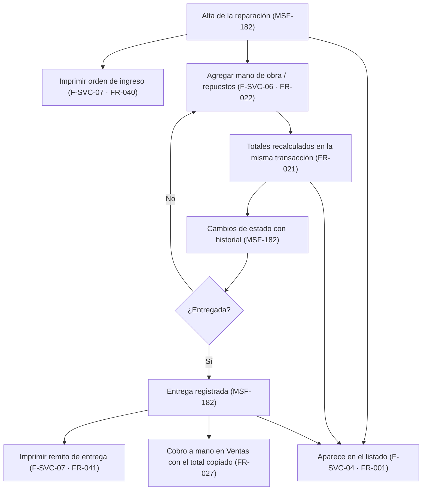
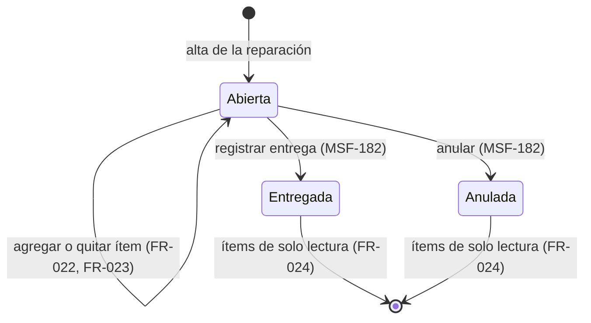
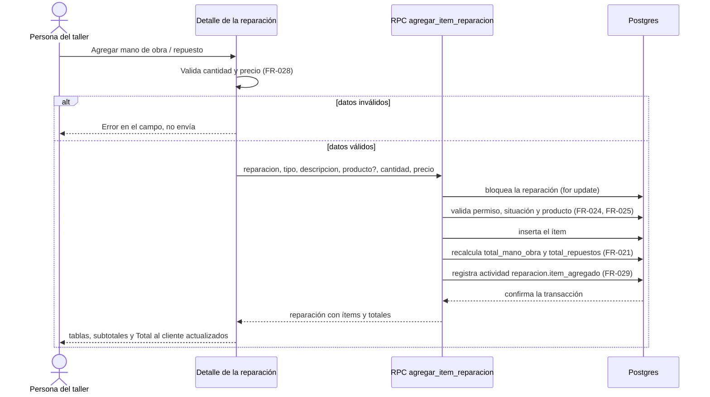
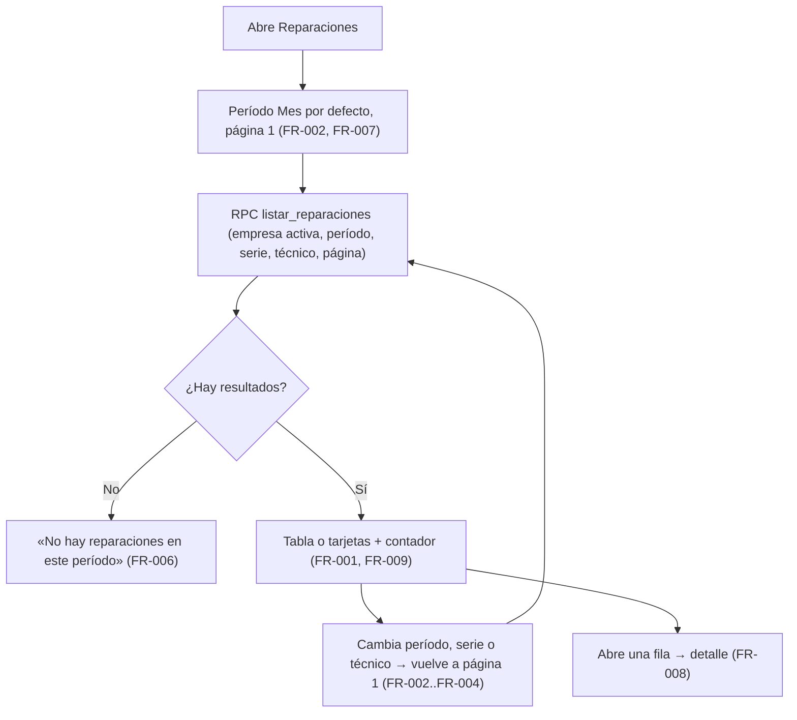
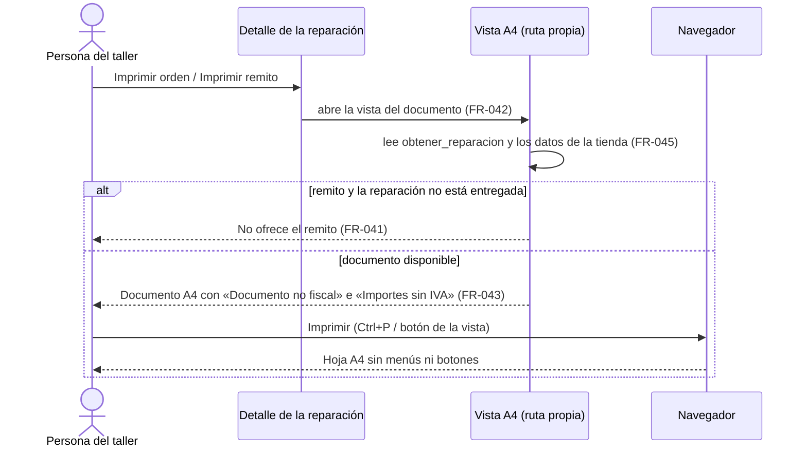

# Feature Specification: Service técnico · Service listado, ítems e impresión

**Feature Branch**: `epic/MSF-199-service-tecnico-service-listado-items-e-`

**Jira Epic**: MSF-199 — Service técnico · Service listado items e impresión (spec `service-listado-items-e-impresion`)

**Created**: 2026-10-22

**Status**: Ready for implementation — la especificación viene completa desde Jira. Los puntos de «A revisar» no bloquean: cada uno lleva una decisión provisoria en *Decisiones abiertas*.

**Delivery scope**: `refine` (apps/web) y `supabase` (migraciones + RPC + pgTAP). Sin `kestra`, `superset` ni `workers`.

**Prioridad / Hito**: P0 · Hito 4 (30 de noviembre al 11 de diciembre de 2026) · 21 h (por tallas S 4 + M 8 + M 8 = 20 h; se conserva el 21 de la tabla) · alcance diciembre.

**Dependencias**:
- Bloqueada por: MSF-182 (Service alta, estados y permisos). **Ya está en `main`**: `dominio.reparaciones`, `reparacion_historial`, `obtener_reparacion`, `tecnicos_de_service`, estados, entrega, anulación, rol Técnico y la pantalla de detalle (`docs/service-tecnico.md`).
- Bloquea a: MSF-217 (Service repuestos y stock), MSF-232 (Service cobro y avisos) y MSF-124 (Service seguimiento y reportes).
- Relacionada, sin bloqueo: MSF-213 (Ventas · impresión). **Verificado en el árbol: no existe un mecanismo de impresión reutilizable** (no hay vistas `@media print` ni `window.print` en `apps/web`), así que Service arma su vista A4 propia, sin esperar (FR-043).
- Catálogo: la tabla `dominio.productos` **ya existe en `main`** (`20261017120100_catalogo_productos_y_costos.sql`, spec `20261017-120000-catalogo-alta-y-edicion`). Lo que la épica anota en «A revisar» (épica de Catálogo no cargada) deja de ser un bloqueo; el `producto_id` de los ítems sigue siendo **opcional** (repuesto libre).
- Corte de calendario (orden de recorte, de la épica): 1.º F-SVC-04 en versión simple (sin búsqueda por serie ni filtro por técnico); 2.º el remito de F-SVC-07 (queda la orden de ingreso); 3.º se mueve la épica entera a enero. **Es un plan de contingencia, no una reducción de alcance**: esta spec cubre el alcance completo.

**Input**: Epic MSF-199. Objetivo: «Al terminar, el taller encuentra cualquier reparación en un listado con filtros por período, carga repuestos y mano de obra con totales correctos e imprime la orden de ingreso y el remito de entrega.»

**Regla de fuentes** (literal de la épica):
- Comportamiento y datos: mandan los requisitos y escenarios de esta historia.
- Qué se ve (disposición, textos, estados, popups, flujos): el prototipo validado es referencia visual, no hace falta que quede extremadamente idéntico; los flujos (si hay) aclaran estados y acciones.
- Cómo se construye (componentes, estilos y patrones): mandan el template y el system design del producto (MSF-117, `docs/sistema-de-diseno.md`). No se copia HTML ni CSS: se reproduce con los componentes del template y los tokens.
- El prototipo muestra más que esta historia: se implementa solo lo que piden los requisitos de esta historia; otras secciones, botones o diálogos son de otras historias.
- Si algo no se puede igualar: lo más cercano, sin inventar, anotando la diferencia en el PR. Si prototipo y requisitos se contradicen: requisitos para el comportamiento, prototipo para lo visual, y la contradicción queda anotada en el PR.
- Prototipos (solo lectura, presentes en el árbol de trabajo; la rama `design/prototipo` no existe en `origin` hoy): `design/pantallas/ServicioReparaciones.dc.html` (listado), `ServicioReparacion.dc.html` (detalle con mano de obra y repuestos) y `ServicioCatalogo.dc.html`. Inventarios generados con `pnpm prototipo:inventario` (`*.inventory.json` al día en el repo). **La impresión no tiene artboard** (el doc la lista como «a dibujar»).

## Modelo y supuestos

- **Los ítems P0 no mueven stock.** El descuento de repuestos del depósito es de MSF-217.
- **Los importes son sin IVA** (ARS). Lo que se imprime lo rotula como tal.
- **La impresión es A4 desde el navegador y no es fiscal.**
- **El cobro se carga a mano en Ventas hasta que llegue F-SVC-13** (riesgo de doble ingreso): por eso el detalle muestra el **Total al cliente listo para copiar** (FR-027).
- Base del template: `useTable` y `ContenidoAdaptable` (tabla en escritorio, tarjetas en móvil), estados vacío/error/carga, `EncabezadoPagina`. **El template no trae filtros, búsqueda, orden ni paginación en sus listas, ni formularios complejos, ni impresión/PDF**: esas piezas se construyen en esta épica.
- La reparación, su estado, sus costos internos (`ver_costos`) y la numeración por empresa ya existen (MSF-182). Esta épica **suma** ítems y totales, el listado y los documentos imprimibles; no cambia el ciclo de vida de la reparación.
- «Total al cliente» = suma de ítems de mano de obra + repuestos. **No es el costo interno** (`costo_mano_obra` / `costo_repuestos` de MSF-182, solo con `ver_costos`).

### Esquema de datos (Constitución, Principio VII)

| Objeto | Esquema | Justificación | RLS / acceso |
|--------|---------|---------------|--------------|
| `reparacion_items` (**nueva**, F-SVC-06) | **`dominio`** | Entidad de negocio del taller (qué se cobra por una reparación), no plataforma. | **Sí**: `organizacion_id = (select private.organizacion_id())` y nivel de `service_tecnico` (`select` con `lectura`/`edicion`) + visibilidad por tienda de la reparación (mismo criterio que `20261021170000_reparaciones_lectura_por_tienda`); **sin `insert/update/delete` directos**: solo RPC `security definer`. FK compuestas `(reparacion_id, organizacion_id)` y `(producto_id, organizacion_id)` impiden cruzar organizaciones. `anon` sin acceso. |
| `reparaciones` (**existente**, F-SVC-06 agrega `total_mano_obra` y `total_repuestos`) | **`dominio`** (sin cambio) | Entidad central ya declarada en MSF-182; las columnas son derivadas de los ítems. | RLS vigente. Las dos columnas son **de cara al cliente**, no internas: con `grant select` por columna a `authenticated` (el listado las lee) y **sin** grant de escritura (solo las toca el recálculo). Los costos internos siguen sin `select` directo. |
| `productos` (**existente**) | `dominio` (sin cambio) | Catálogo de la organización; solo se lee para buscar el repuesto. | RLS vigente de Catálogo. |

No se crean otras tablas. `rls_en_toda_tabla` (pgTAP, recorre `public` + `dominio`) debe seguir verde. Todas las migraciones son **aditivas** con reversión documentada en su encabezado. Las RPC viven en `public` (contrato de la app), con `revoke … from public, anon` y `grant execute … to authenticated`; las ayudas internas en `private`.

## User Scenarios & Testing *(mandatory)*

### User Story 1 - Listado de reparaciones con filtros por período (F-SVC-04, P0, talla S)

Como persona del taller, quiero ver todas las reparaciones en un listado y filtrarlas por período, para encontrar cualquiera sin buscarla una por una.

**Why this priority**: sin listado, una reparación cargada no se vuelve a encontrar.

**Independent Test**: con 2.000 reparaciones de varias tiendas y técnicos, el listado abre rápido, pagina, filtra por Hoy/Semana/Mes, busca por N.º de serie y por técnico; con un período sin resultados muestra «No hay reparaciones en este período»; otra organización no ve nada de esto.

**Acceptance Scenarios**:
1. **Given** reparaciones cargadas, **When** abre «Reparaciones», **Then** ve la tabla con Reparación (`R-0238` + «Ingreso dd/mm»), Tienda, Cliente, Equipo (con el modelo debajo), N.º de serie, Estado (chip), Técnico, Entrega y Total, más el contador «N reparaciones».
2. **Given** el listado, **When** elige Hoy, Semana o Mes, **Then** se filtra por la **fecha de entrega prevista** y el subtítulo lo aclara.
3. **Given** un N.º de serie (o parte), **When** lo escribe en el buscador, **Then** aparecen las reparaciones que lo contienen, sin importar el período.
4. **Given** el filtro Técnico, **When** elige uno, **Then** solo ve sus reparaciones.
5. **Given** un período sin reparaciones, **Then** ve el estado vacío «No hay reparaciones en este período».
6. **Given** una reparación sin ítems, **Then** su Total dice «A presupuestar»; con ítems muestra el importe.
7. **Given** una empresa elegida en la barra superior, **Then** el listado muestra solo las reparaciones de esa tienda.
8. **Given** una fila, **When** la abre, **Then** va al detalle de esa reparación.
9. **Given** un usuario con `service_tecnico` en `lectura`, **Then** ve el listado completo pero no el botón «Nueva reparación».

### User Story 2 - Ítems y costos de la reparación (F-SVC-06, P0, talla M)

Como persona del taller, quiero cargar la mano de obra y los repuestos de una reparación y ver los totales, para saber cuánto se le cobra al cliente.

**Why this priority**: sin ítems no hay importe que cobrar ni que imprimir en el remito.

**Independent Test**: en una reparación abierta, agregar mano de obra y un repuesto (del catálogo y libre) actualiza subtotales y Total al cliente en la misma operación; cantidad o precio inválidos muestran su error; una reparación entregada o anulada no admite cambios; el listado muestra el nuevo Total.

**Acceptance Scenarios**:
1. **Given** el detalle de una reparación abierta con permiso de `edicion`, **When** pulsa «Agregar mano de obra» y completa Concepto, Precio y Cantidad, **Then** el ítem aparece en la tabla de mano de obra y el subtotal y el Total al cliente se actualizan.
2. **Given** «Agregar repuesto», **When** busca un producto del catálogo por Nombre o SKU y completa Precio y Cantidad, **Then** queda cargado con su producto; si no elige ninguno, queda como repuesto libre con su descripción.
3. **Given** una cantidad vacía, cero, negativa o no entera, o un precio vacío o negativo, **Then** el diálogo muestra el error en el campo y no guarda.
4. **Given** dos personas agregando ítems a la vez, **Then** los totales finales suman los dos ítems (sin pérdida).
5. **Given** una reparación entregada o anulada, **Then** la sección es de solo lectura y la base rechaza la carga.
6. **Given** un usuario con `ver_costos`, **Then** ve además la «Ganancia estimada» (Total al cliente − costo interno); sin `ver_costos` no la ve ni llega a su navegador.
7. **Given** un ítem cargado por error, **When** lo quita, **Then** los totales se recalculan (ver *Decisiones abiertas* 2).
8. **Given** el Total al cliente, **Then** se ve en el detalle como un importe seleccionable, listo para copiar y cargarlo en Ventas.

### User Story 3 - Impresión de orden de ingreso y remito de entrega (F-SVC-07, P0, talla M)

Como persona del taller, quiero imprimir la orden de ingreso al recibir el equipo y el remito al entregarlo, para darle al cliente un comprobante en papel.

**Why this priority**: el cliente se lleva un papel al dejar y al retirar el equipo.

**Independent Test**: desde el detalle, «Imprimir orden» abre la vista A4 de la orden de ingreso; con la reparación entregada, «Imprimir remito» abre el remito con los ítems y el total sin IVA; ninguna de las dos muestra costos internos ni se presenta como factura.

**Acceptance Scenarios**:
1. **Given** cualquier reparación, **When** pulsa «Imprimir orden», **Then** se abre la vista A4 de la orden de ingreso con tienda, número, fecha de ingreso, cliente y contacto, equipo (modelo, N.º de serie, accesorios), falla informada, técnico y entrega prevista.
2. **Given** una reparación entregada, **When** pulsa «Imprimir remito», **Then** se abre el remito con los datos del equipo, los ítems de mano de obra y repuestos, el total sin IVA, la fecha de entrega y quién entregó.
3. **Given** una reparación no entregada, **Then** no se ofrece el remito.
4. **Given** cualquiera de los dos documentos, **When** lo imprime desde el navegador, **Then** sale en A4, sin menús ni botones, rotulado «Documento no fiscal» e «Importes sin IVA».
5. **Given** un usuario con o sin `ver_costos`, **Then** ningún documento contiene el costo interno ni la ganancia.
6. **Given** un usuario con `service_tecnico` en `lectura`, **Then** puede imprimir ambos documentos.

### Edge Cases

- Reparación sin ítems: Total «A presupuestar» en el listado; el remito muestra «Sin ítems» y total $ 0,00 (no se bloquea la entrega ya hecha en MSF-182).
- Reparación sin N.º de serie (opcional en MSF-182): la columna muestra «—».
- Reparación sin técnico o sin entrega prevista: «—». Las reparaciones sin entrega prevista no entran en Hoy/Semana (ver *Decisiones abiertas* 1).
- Producto del catálogo desactivado o de otra organización: no se ofrece en la búsqueda y la base rechaza un `producto_id` ajeno.
- Producto en moneda USD: el precio del ítem se **escribe a mano** en ARS (la conversión es de Precios, MSF-114); no se precarga.
- Edición simultánea del formulario de la reparación y carga de un ítem: tras cada operación sobre ítems la pantalla recarga la reparación para tomar su nuevo `updated_at` (el recálculo de totales cambia la fila).
- Volumen: 2.000 reparaciones por organización; el listado nunca baja la lista completa al navegador.
- Importes con más de dos decimales: se redondean a dos; subtotal = cantidad × precio redondeado a dos decimales.
- Sin permiso (`ninguno`) en `service_tecnico`: «Acceso restringido» ya existente (MSF-182).

## Flujos

### Flujo 1 · Recorrido de la reparación (alta → ítems → estados → entrega → impresión)

Proceso de punta a punta que verifica la épica (E2E, SC-007). Los pasos «Alta», «Estados» y «Entrega» ya existen (MSF-182); esta épica agrega los pasos marcados.

### Flujo 2 · Ítems de una reparación según su situación

Cuándo se pueden cargar ítems (`stateDiagram-v2` sobre las situaciones que ya define MSF-182; no se agregan estados).

### Flujo 3 · Agregar un ítem (recálculo atómico)

### Flujo 4 · Listado con filtros

### Flujo 5 · Impresión de un documento

## Requirements *(mandatory)*

### Functional Requirements

**F-SVC-04 · Listado de reparaciones**
- **FR-001**: El sistema DEBE ofrecer la RPC `public.listar_reparaciones` (paginada; **desvío documentado: `security definer`**, igual que `obtener_reparacion`, que replica a mano la RLS de `reparaciones` —organización, nivel `service_tecnico` y `empresas_accesibles`— y se prueba en pgTAP; ver `plan.md` y `docs/service-listado.md`) y la pantalla `/service-tecnico/reparaciones` DEBE mostrar, por reparación: Reparación (`R-0238` y «Ingreso dd/mm»), Tienda, Cliente, Equipo (con el modelo), N.º de serie, Estado (chip), Técnico (nombre visible, nunca el correo), Entrega (prevista) y Total (total al cliente), más el contador «N reparaciones».
- **FR-002**: DEBE filtrar por período **Hoy / Semana / Mes** sobre la fecha de entrega prevista (por defecto Mes), con el subtítulo «Según la fecha de entrega prevista (hoy: dd/mm/aaaa)». Cambiar el filtro vuelve a la primera página.
- **FR-003**: DEBE buscar por N.º de serie (coincidencia parcial, sin distinguir mayúsculas), **independiente del período**, para poder encontrar cualquier reparación.
- **FR-004**: DEBE filtrar por técnico, ofreciendo los técnicos de `tecnicos_de_service()`.
- **FR-005**: DEBE respetar la **empresa activa** de la barra superior (cada reparación pertenece a la tienda que recibió el equipo); con «todas las empresas» lista todas las accesibles. No hay chips de tienda dentro de la pantalla.
- **FR-006**: DEBE usar los patrones compartidos de carga, error (con reintento) y vacío; el vacío del período dice «No hay reparaciones en este período» y el de una búsqueda por serie sin coincidencias dice «No hay reparaciones con ese número de serie».
- **FR-007**: DEBE paginar **en el servidor** (tamaño por defecto 25), ordenar de más reciente a más antigua (ingreso, luego número descendente) y apoyarse en índices (organización + tienda + entrega prevista; serie en minúsculas; técnico existente).
- **FR-008**: Cada fila DEBE llevar al detalle `/service-tecnico/reparaciones/:id`. Total en cero (sin ítems) se muestra «A presupuestar»; serie, técnico o entrega ausentes se muestran «—».
- **FR-009**: DEBE mostrarse como tabla en escritorio y tarjetas en móvil (`ContenidoAdaptable`), usable con teclado y lector de pantalla a 320, 768 y 1440 px.
- **FR-010**: Con `service_tecnico` en `lectura` o `edicion` DEBE listar solo reparaciones de la organización y de las tiendas accesibles; el botón «Nueva reparación» (ya entregado en MSF-182) solo con `edicion`. `anon` sin acceso; la RPC lleva `revoke … from public, anon` y `grant execute … to authenticated`.
- **FR-011**: DEBE documentar la RPC, los filtros, los índices y la reversión en `docs/service-listado.md`.

**F-SVC-06 · Ítems y costos**
- **FR-020**: DEBE existir `dominio.reparacion_items` con `id`, `organizacion_id`, `reparacion_id`, `tipo` (`mano_obra` | `repuesto`), `descripcion` (obligatoria, ≤ 200), `producto_id` (opcional), `cantidad`, `precio_unitario` (ARS sin IVA), `subtotal` (cantidad × precio, dos decimales), `creado_en`, `creado_por`; con RLS, FK compuestas por organización, sin escritura directa y sin `delete` directo.
- **FR-021**: `reparaciones` DEBE llevar `total_mano_obra` y `total_repuestos` (derivadas, sin escritura directa), y **toda RPC de ítems DEBE recalcularlos en la misma transacción** que la operación, bloqueando la reparación (`for update`) para que dos cargas simultáneas no pierdan un total. Total al cliente = `total_mano_obra + total_repuestos`.
- **FR-022**: `public.agregar_item_reparacion(reparacion, tipo, descripcion, producto, cantidad, precio)` DEBE validar permiso `edicion`, tipo, descripción, **cantidad** (entero de 1 a 9999) y **precio** (≥ 0, máximo 99.999.999,99), con `22023` y el campo afectado en `hint`; sin permiso `42501`; inexistente o de tienda no accesible `P0002`.
- **FR-023**: `public.quitar_item_reparacion(item)` DEBE quitar el ítem y recalcular, con las mismas reglas de permiso y situación (*Decisiones abiertas* 2).
- **FR-024**: Las RPC DEBEN rechazar con `55000` cargar o quitar ítems en una reparación **entregada o anulada**, y **no DEBEN mover stock** ni tocar existencias (supuesto P0).
- **FR-025**: El repuesto DEBE poder vincularse a un producto del catálogo (búsqueda por Nombre o SKU, solo activos de la organización) o quedar libre; la base valida la pertenencia a la organización del `producto_id`. Al elegir un producto, la descripción se completa con su nombre y el precio **no** se precarga.
- **FR-026**: `public.obtener_reparacion` DEBE devolver además los ítems, `total_mano_obra`, `total_repuestos` y el total al cliente, y la **ganancia estimada** (total al cliente − costos internos) **solo con la acción `ver_costos`** (sin ella llega `null`, igual que los costos de MSF-182).
- **FR-027**: El detalle DEBE mostrar la sección «Mano de obra y repuestos»: tabla de mano de obra (CONCEPTO, CANT., PRECIO, SUBTOTAL) con «Subtotal mano de obra», tabla de repuestos (PRODUCTO con SKU, CANT., PRECIO, SUBTOTAL) con «Subtotal repuestos», resumen Mano de obra / Repuestos / **Total al cliente** (importe seleccionable, sin decoración que impida copiarlo) y, con `ver_costos`, «Ganancia estimada» junto a la tarjeta «Costo interno» de MSF-182.
- **FR-028**: DEBE ofrecer los diálogos «Agregar mano de obra» (Concepto en texto libre, Precio editable, Cantidad, «Subtotal:», «Cancelar») y «Agregar repuesto» (Buscar producto del catálogo, Precio, Cantidad, «Subtotal:», «Cancelar»), con validación de cantidad y precio antes de enviar y los errores de la base mostrados en el campo. Los botones solo con `edicion` y reparación abierta.
- **FR-029**: Agregar y quitar un ítem DEBE registrar la actividad `reparacion.item_agregado` / `reparacion.item_quitado` por `private.registrar_actividad`, en la misma transacción, solo con sesión.
- **FR-030**: DEBE documentar el modelo, las RPC, las reglas y la reversión en `docs/service-items.md` y los tipos de actividad en `docs/actividad.md`.

**F-SVC-07 · Impresión**
- **FR-040**: DEBE existir la vista A4 de la **Orden de ingreso** con: tienda (nombre y los datos de contacto que existan), «Orden de ingreso», número `R-000N`, fecha de ingreso, cliente y contacto, equipo (modelo), N.º de serie, accesorios recibidos, falla informada, técnico, entrega prevista y el bloque de condiciones (*Decisiones abiertas* 3). No muestra importes.
- **FR-041**: DEBE existir la vista A4 del **Remito de entrega**, **solo para reparaciones entregadas**, con los datos de la orden, las tablas de mano de obra y repuestos, subtotales y **total sin IVA**, fecha de entrega y quién entregó.
- **FR-042**: El detalle DEBE ofrecer «Imprimir orden» (en todas las reparaciones) e «Imprimir remito» (solo entregadas); cada uno abre la vista en una ruta propia (`/service-tecnico/reparaciones/:id/orden` y `/service-tecnico/reparaciones/:id/remito`).
- **FR-043**: La impresión DEBE ser desde el navegador (diálogo de impresión), tamaño A4, con estilos de impresión que ocultan navegación y botones, y DEBE rotular «Documento no fiscal» e «Importes sin IVA». Se arma la vista propia de Service: no hay mecanismo de MSF-213 que reutilizar.
- **FR-044**: Ningún documento DEBE contener costos internos ni ganancia, tenga o no `ver_costos` quien imprime.
- **FR-045**: Los datos de la tienda DEBEN salir de `dominio.empresas` (nombre y los datos de contacto cargados: dirección, WhatsApp, correo); lo que no esté cargado se omite. CUIT y domicilio fiscal **no existen** hoy en `dominio.empresas`: no se inventan (*Decisiones abiertas* 3).
- **FR-046**: Imprimir DEBE exigir al menos `lectura` en `service_tecnico` y respetar la visibilidad por tienda; sin permiso, «Acceso restringido». Lee solo `obtener_reparacion` (sin RPC nueva).
- **FR-047**: DEBE documentar las vistas, rutas, contenido y límites en `docs/service-impresion.md`.

**Cierre**
- **FR-090**: Revisión de seguridad (RLS de `reparacion_items`, RPC, máscara de ganancia, ausencia de costos en documentos), re-verificación del esquema de cada objeto, índice en `docs/service-tecnico.md` y anotación en el PR de las diferencias con el prototipo y contradicciones prototipo↔requisitos.
- **FR-091**: Al merge del PR, actualizar la fila de Service técnico en `docs/roadmap-template.md` (paso manual) y comprobar que ninguna tarea queda `[ ]`.

### Success Criteria

- **SC-001**: pgTAP del listado: períodos, serie, técnico, tienda, paginación, aislamiento entre dos organizaciones y `anon` sin ejecución. *(F-SVC-04)*
- **SC-002**: Con **2.000 reparaciones** el listado devuelve una página en menos de 500 ms en la base local y su plan usa los índices (umbral provisorio, *Decisiones abiertas* 5). *(F-SVC-04)*
- **SC-003**: Vitest del listado: columnas, filtros, vacío/error/carga, paginación, tarjetas móviles, botón «Nueva reparación» oculto con `lectura`. *(F-SVC-04)*
- **SC-004**: pgTAP de ítems: totales correctos tras agregar/quitar, concurrencia sin pérdida, validación de cantidad/precio, entregada/anulada rechazadas, producto ajeno rechazado, ganancia enmascarada sin `ver_costos`, aislamiento, `anon`; `rls_en_toda_tabla` verde. *(F-SVC-06)*
- **SC-005**: Vitest de la sección y los diálogos de ítems: tablas, subtotales, Total al cliente, errores de cantidad y precio, solo lectura en entregadas/anuladas, ganancia oculta sin `ver_costos`. *(F-SVC-06)*
- **SC-006**: Vitest de impresión: contenido de orden y remito, remito no disponible sin entrega, ausencia de costos, rótulos, `lectura` puede imprimir. *(F-SVC-07)*
- **SC-007**: E2E del recorrido completo (alta, ítems, estados, entrega, impresión de remito). *(cierre)*
- **SC-008**: `pnpm lint && pnpm build && pnpm test && pnpm docs:check && pnpm matriz:check && pnpm prototipo:check` y `rls_en_toda_tabla` verdes. *(cierre)*

## Decisiones abiertas

Ninguna bloquea; cada una lleva su decisión provisoria.

1. **Período del listado.** El prototipo filtra por *fecha de entrega prevista* (Hoy = hoy; Semana = hoy a hoy+6; Mes = el mes calendario en curso). *Provisoria*: se adopta tal cual; las reparaciones **sin** entrega prevista aparecen solo en Mes, y la búsqueda por serie ignora el período para que «cualquier reparación» se pueda encontrar. Queda a confirmar si las vencidas (entrega prevista anterior a hoy) merecen un período propio: no está en el prototipo ni en la épica.
2. **Quitar ítems.** La épica pide «RPC de ítems» y cargar, pero no nombra el borrado; el prototipo no dibuja un botón para quitar. *Provisoria*: se incluye `quitar_item_reparacion` (acción mínima por fila, con confirmación) porque sin ella un error de carga no se corrige y deja un total equivocado; **no** se incluye edición de un ítem (se quita y se vuelve a cargar). Si se prefiere sin quitar, se elimina FR-023.
3. **Orden de ingreso: condiciones y datos fiscales** (pregunta abierta de la épica). *Provisoria*: el texto de condiciones es una constante de código marcada «pendiente de confirmar con el cliente» (fácil de reemplazar), y no se imprimen CUIT ni domicilio fiscal porque `dominio.empresas` no los tiene (sí tiene dirección, WhatsApp y correo). La orden **no** lleva importes; el remito **sí** (sin IVA).
4. **Mano de obra desde catálogo.** El prototipo elige el Concepto del catálogo «Servicios de reparación» (`ServicioCatalogo`), que **ninguna historia de la épica pide**. *Provisoria*: el concepto es texto libre y el precio se escribe a mano; sin «Sugerido» ni enlace al catálogo.
5. **Umbral de velocidad.** La épica pide «prueba con 2.000 reparaciones» sin número. *Provisoria*: < 500 ms por página en base local y plan con índices.
6. **Tamaño de página** por defecto 25 (la épica pide paginación sin cifra).
7. **Ítems en reparaciones entregadas.** *Provisoria*: bloqueados (coherente con MSF-182, donde entregadas y anuladas quedan cerradas); corregir un remito ya emitido queda fuera.

## Matriz pantalla↔criterios

Prototipos: `ServicioReparaciones.dc.html`, `ServicioReparacion.dc.html`, `ServicioCatalogo.dc.html` (inventarios generados con `pnpm prototipo:inventario` en `design/pantallas/*.inventory.json`). «Ya entregado (MSF-182)» = existe en `main` y esta épica no lo cambia. La impresión no tiene artboard (lo pide la épica; FR-040…FR-047).

### Service técnico · Reparaciones (listado) (`ServicioReparaciones`)

| Ítem del inventario | Dueño |
|---|---|
| Tabla: Reparación, Tienda, Cliente, Equipo, N.º de serie, Estado, Técnico, Entrega, Total | FR-001, FR-008 |
| Botón «Nueva reparación» | ya entregado (MSF-182 FR-018); visibilidad por permiso FR-010 |
| Tabs / botones Reparaciones, Modelos, Estados de reparación | ya entregado (MSF-182 FR-009) |
| Chips de período Hoy / Semana / Mes y subtítulo «Según la fecha de entrega prevista» | FR-002 |
| Contador «N reparaciones» | FR-001 |
| Estado vacío («Sin entregas en este período» en el prototipo) | FR-006 — la épica fija el texto «No hay reparaciones en este período»; contradicción anotada en el PR |
| Total «A presupuestar» | FR-008 |
| Filtro de tienda (chips) y nota «Si elegís una empresa en la barra superior, se filtra por esa tienda» | FR-005 (se resuelve con la empresa activa); los **chips dentro de la pantalla** son FUERA DE ALCANCE: la épica pide filtro por período, serie y técnico y la empresa activa ya filtra |
| KPIs «En reparación», «Listas para entregar», «Esperando repuesto» | **FUERA DE ALCANCE** — la épica no los pide (otra épica podrá pedirlos: MSF-124 seguimiento y reportes) |
| Mensaje de éxito (snack) | **FUERA DE ALCANCE** — el listado no ejecuta acciones |
| Buscador por N.º de serie y filtro por técnico | no están en el prototipo; los pide la épica: FR-003, FR-004 |

### Service técnico · Reparación (detalle) (`ServicioReparacion`)

| Ítem del inventario | Dueño |
|---|---|
| Campos Tienda, Cliente, Contacto, Consola o equipo, Modelo, N.º de serie, Accesorios recibidos, Falla informada | ya entregado (MSF-182 FR-016) |
| Campos Técnico, Ingreso, Entrega prevista, Entrega real; botones «Reparaciones» (breadcrumb) y «Guardar»; selector Estado e historial | ya entregado (MSF-182 FR-016, FR-017, FR-030) |
| Campos Costo mano de obra, Costo repuestos (tarjeta «Costo interno») | ya entregado (MSF-182 FR-021) |
| Sección «Mano de obra y repuestos»: tablas CONCEPTO/CANT./PRECIO/SUBTOTAL y PRODUCTO/DEPÓSITO/CANT./PRECIO/SUBTOTAL, subtotales, resumen y Total al cliente | FR-027 (la columna DEPÓSITO DE MERCADERÍA es FUERA DE ALCANCE, abajo) |
| «Ganancia estimada» | FR-026, FR-027 |
| Botones «Agregar mano de obra» y «Agregar repuesto» | FR-028 |
| Diálogo «Agregar mano de obra»: campos Concepto, Precio (editable), Cantidad, «Subtotal:», «Cancelar» | FR-028 (Concepto en texto libre: *Decisiones abiertas* 4) |
| Diálogo «Agregar repuesto»: campos Buscar producto del catálogo («Nombre o SKU»), Precio, Cantidad, «Subtotal:», «Cancelar» | FR-025, FR-028 |
| Botón «Imprimir orden» | FR-042 (vista: FR-040) |
| Botón «Avisar al cliente» | **FUERA DE ALCANCE** — avisos son de MSF-232 (cobro y avisos) |
| Campo «Depósito de mercadería de donde se descuenta» y su nota; columna DEPÓSITO | **FUERA DE ALCANCE** — los ítems P0 no mueven stock; el descuento es de MSF-217 |
| Existencias por depósito en la lista de productos («Principal N · Local N», chips `·· · Principal · · Local ··`) | **FUERA DE ALCANCE** — MSF-217 (stock) |
| Botón «·Sugerido ·» y precio sugerido por servicio | **FUERA DE ALCANCE** — depende del catálogo de servicios, sin historia (*Decisiones abiertas* 4) |
| Enlace «Editar el catálogo de servicios →» | **FUERA DE ALCANCE** — idem |
| Nota «el costo interno sale del catálogo» (diálogo de mano de obra) | **FUERA DE ALCANCE** — idem |
| Texto de ayuda «Se descuentan del depósito … al marcar la reparación como Entregado» | **FUERA DE ALCANCE** — idem MSF-217 |
| Mensaje de éxito (snack) al agregar un ítem | FR-028 |
| Texto de «Total al cliente» listo para copiar | FR-027 |
| «Imprimir remito» (no está en el prototipo; lo pide la épica) | FR-042 |

### Service técnico · Servicios de reparación (`ServicioCatalogo`)

Completa **FUERA DE ALCANCE**: ninguna historia de la épica lo pide (la propia épica lo anota en «A revisar»). Cada ítem del inventario queda sin dueño a propósito: tabla (Orden, Servicio, Equipo, Disponible en, Precio sugerido, Costo interno, Tiempo estimado, Activo), campos (Nombre del servicio, Equipo al que aplica, Precio sugerido, Costo interno, Tiempo estimado, Orden, Disponible en, Activo), botones «Nuevo servicio», «Reparación (detalle)», «Cancelar», «Guardar servicio» y el diálogo de alta/edición.

### Documentos imprimibles (sin artboard)

| Elemento | Dueño |
|---|---|
| Vista A4 Orden de ingreso | FR-040 |
| Vista A4 Remito de entrega | FR-041 |
| Rótulos «Documento no fiscal» / «Importes sin IVA» | FR-043 |
| Datos de la tienda y condiciones | FR-045, *Decisiones abiertas* 3 |
| Errores de validación de cantidad y precio | FR-022, FR-028 |
| Estado vacío del listado | FR-006 |

## Matriz de trazabilidad Jira ↔ US ↔ FR ↔ tareas

| Jira | Historia | US | FR / SC | Tareas |
|------|----------|----|---------|--------|
| MSF-199 (épica) | F-SVC-04 Listado de reparaciones con filtros por período | US1 | FR-001…FR-011, SC-001…SC-003 | T014–T022 |
| MSF-199 (épica) | F-SVC-06 Ítems y costos de la reparación | US2 | FR-020…FR-030, SC-004, SC-005 | T001–T013 |
| MSF-199 (épica) | F-SVC-07 Impresión de orden de ingreso y remito de entrega | US3 | FR-040…FR-047, SC-006 | T023–T029 |
| Tarea de cierre (label `cierre`) | E2E del recorrido, seguridad, índice documental, roadmap | — | FR-090, FR-091, SC-007, SC-008 | T030–T033 |
