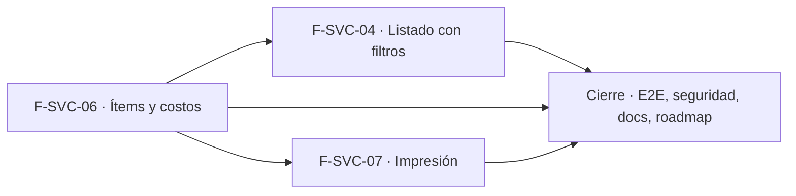

# Tasks: Service técnico · Service listado, ítems e impresión

**Input**: [spec.md](./spec.md) y [plan.md](./plan.md) · **Épica**: MSF-199
**Formato**: `- [ ] T### [P] [Historia][USx] descripción (FR/SC)`. `[P]` = paralelizable (archivos distintos, sin dependencia dentro del mismo grupo). Cada FR/SC tiene **una sola** tarea dueña; «soporte de» marca una tarea que contribuye sin ser dueña. Las historias son autosuficientes: ninguna tarea depende de otra historia ni de una `[CIERRE]`.
**Validación por historia**: `pnpm test:db`, `pnpm lint`, `pnpm build` y `pnpm test:web` verdes antes de cerrar la fase.
**Esquema (Principio VII, re-verificado)**: `reparacion_items` → `dominio`; columnas nuevas de `reparaciones` → `dominio`; `productos` y `empresas` (solo lectura) → `dominio`; actividad → `public` (solo datos).

## Phase 1: F-SVC-06 · Ítems y costos de la reparación

**Goal**: `dominio.reparacion_items`, totales derivados en `reparaciones`, RPC que los recalculan en la misma transacción y la sección «Mano de obra y repuestos» del detalle.

- [ ] T001 [F-SVC-06][US2] Migración `supabase/migrations/20261022100100_reparacion_items.sql`: `dominio.reparacion_items` (columnas de FR-020, FK compuestas `(reparacion_id, organizacion_id)` y `(producto_id, organizacion_id)`, `check cantidad`/`precio_unitario`), RLS por organización, nivel `service_tecnico` y tienda de la reparación, sin `insert/update/delete` directos, `anon` sin privilegios, índice por reparación, reversión en el encabezado (FR-020)
- [ ] T002 [F-SVC-06][US2] Migración `supabase/migrations/20261022100200_reparaciones_totales.sql`: columnas `total_mano_obra` y `total_repuestos` (`numeric(14,2) not null default 0`) con `grant select` por columna y sin escritura directa, y `private.recalcular_totales_reparacion(id)` (suma de ítems por tipo), reversión en el encabezado (FR-021)
- [ ] T003 [P] [F-SVC-06][US2] Migración `supabase/migrations/20261022100300_reparacion_item_agregar.sql`: `public.agregar_item_reparacion` (`security definer`, `search_path = ''`, `for update` de la reparación, permiso `edicion`, validación de tipo/descripción/cantidad entera 1–9999/precio ≥ 0 con `22023` y `hint`, `55000` si la reparación está entregada o anulada, sin tocar stock, valida `producto_id` de la organización, recalcula), `revoke … from public, anon` y `grant execute … to authenticated` (FR-022, FR-024)
- [ ] T004 [P] [F-SVC-06][US2] Migración `supabase/migrations/20261022100400_reparacion_item_quitar.sql`: `public.quitar_item_reparacion` con las mismas reglas de permiso, situación y recálculo atómico, mismos `revoke`/`grant` (FR-023)
- [ ] T005 [P] [F-SVC-06][US2] Migración `supabase/migrations/20261022100500_reparaciones_leer_items.sql`: `create or replace public.obtener_reparacion` devolviendo además `items`, `total_mano_obra`, `total_repuestos`, total al cliente y `ganancia_estimada` (`null` sin `ver_costos`), sin romper el contrato vigente (FR-026)
- [ ] T006 [P] [F-SVC-06][US2] Migración `supabase/migrations/20261022100600_reparacion_items_actividad.sql`: eventos `reparacion.item_agregado` y `reparacion.item_quitado` vía `private.registrar_actividad` en la misma transacción, solo con sesión (FR-029)
- [ ] T007 [F-SVC-06][US2] pgTAP `supabase/tests/database/service_items.test.sql`: totales tras agregar/quitar, dos cargas concurrentes sin pérdida, cantidad y precio inválidos, entregada/anulada rechazadas, producto ajeno, ganancia enmascarada sin `ver_costos`, aislamiento entre dos organizaciones, `anon` sin ejecución, ningún movimiento de stock; `rls_en_toda_tabla` verde (SC-004)
- [ ] T008 [P] [F-SVC-06][US2] `apps/web/src/lib/reparacionItems.ts`: tipos, llamadas a `agregar_item_reparacion`/`quitar_item_reparacion`, búsqueda de productos activos por Nombre o SKU reutilizando `lib/productos.ts` y mapeo de `22023`/`55000`/`42501` a mensajes claros (soporte de FR-025)
- [ ] T009 [P] [F-SVC-06][US2] `apps/web/src/components/service/ItemsReparacion.tsx`: tablas de mano de obra (CONCEPTO, CANT., PRECIO, SUBTOTAL) y repuestos (PRODUCTO con SKU, CANT., PRECIO, SUBTOTAL), subtotales, resumen y **Total al cliente** seleccionable, «Ganancia estimada» solo con `ver_costos`, acción de quitar con confirmación, solo lectura en entregadas/anuladas, adaptable 320/768/1440 px (FR-027)
- [ ] T010 [F-SVC-06][US2] `components/service/AgregarManoObraDialog.tsx` y `AgregarRepuestoDialog.tsx`: campos del prototipo (Concepto en texto libre, Precio editable, Cantidad, «Subtotal:», «Cancelar»; Buscar producto por Nombre o SKU con opción de repuesto libre), validación de cantidad y precio antes de enviar, errores de la base en el campo, mensaje de éxito (FR-025, FR-028)
- [ ] T011 [F-SVC-06][US2] Integrar la sección y los botones «Agregar mano de obra»/«Agregar repuesto» en `pages/service-tecnico/reparacion.tsx` (carga diferida de los diálogos, recarga de la reparación tras cada operación para tomar el nuevo `updated_at`, botones solo con `edicion` y reparación abierta) (soporte de FR-027, FR-028)
- [ ] T012 [F-SVC-06][US2] Vitest de la sección y los diálogos: tablas, subtotales, Total al cliente, errores de cantidad y precio, quitar, solo lectura, ganancia oculta sin `ver_costos`, botones ocultos con `lectura` (SC-005)
- [ ] T013 [F-SVC-06][US2] Documentación: `docs/service-items.md` (modelo, RPC, reglas, concurrencia, reversión) y `docs/actividad.md` (tipos `reparacion.item_*`) (FR-030)

**Checkpoint F-SVC-06**: `pnpm test:db`, `pnpm lint`, `pnpm build` y `pnpm test:web` verdes.

## Phase 2: F-SVC-04 · Listado de reparaciones con filtros por período

**Goal**: `listar_reparaciones` paginada con índices y la pantalla de Reparaciones con filtros. Requiere F-SVC-06 mergeada (columna de total).

- [ ] T014 [F-SVC-04][US1] Migración `supabase/migrations/20261022110100_reparaciones_listado_indices.sql`: índices `(organizacion_id, empresa_id, entrega_prevista)` y `(organizacion_id, lower(numero_serie))` (parcial sin nulos), reversión en el encabezado (soporte de FR-007)
- [ ] T015 [F-SVC-04][US1] Migración `supabase/migrations/20261022110200_reparaciones_listar.sql`: `public.listar_reparaciones(empresa, periodo, serie, tecnico, pagina, tamano)` `security invoker`, período Hoy/Semana/Mes sobre la entrega prevista (hoy en zona Argentina; Mes incluye las sin fecha), serie parcial sin distinguir mayúsculas e independiente del período, técnico con nombre visible, orden de más reciente a más antigua, `{ total_filas, filas }`, `revoke … from public, anon` y `grant execute … to authenticated` (FR-001, FR-002, FR-003, FR-004, FR-005, FR-007, FR-010)
- [ ] T016 [F-SVC-04][US1] pgTAP `supabase/tests/database/service_listado.test.sql`: períodos, serie, técnico, tienda/empresa activa, paginación y total, visibilidad por tienda, aislamiento entre dos organizaciones, sin costos internos en la salida, `anon` sin ejecución (SC-001)
- [ ] T017 [P] [F-SVC-04][US1] pgTAP de volumen `supabase/tests/database/service_listado_volumen.test.sql`: siembra 2.000 reparaciones en varias tiendas y técnicos, mide una página y comprueba que el plan usa los índices (< 500 ms en base local) (SC-002)
- [ ] T018 [P] [F-SVC-04][US1] `apps/web/src/lib/reparacionesListado.ts`: tipos y hook de la RPC con filtros y página en la URL, empresa activa, y mapeo de errores a mensajes claros (soporte de FR-001)
- [ ] T019 [P] [F-SVC-04][US1] `apps/web/src/components/service/FiltrosReparaciones.tsx`: chips Hoy/Semana/Mes con el subtítulo «Según la fecha de entrega prevista (hoy: …)», buscador por N.º de serie con espera de tipeo y selector de técnico (`tecnicos_de_service`), accesibles por teclado (FR-002, FR-003, FR-004)
- [ ] T020 [F-SVC-04][US1] `pages/service-tecnico/reparaciones.tsx`: tabla de nueve columnas con chip de estado, `R-000N` + «Ingreso dd/mm», equipo con modelo, «A presupuestar», «—» donde falte dato, contador «N reparaciones», paginación en el servidor, tarjetas en móvil (`ContenidoAdaptable`), fila → detalle, estados carga/error/vacío con «No hay reparaciones en este período» y «No hay reparaciones con ese número de serie», «Nueva reparación» solo con `edicion` (FR-006, FR-008, FR-009; soporte de FR-001, FR-005)
- [ ] T021 [F-SVC-04][US1] Vitest del listado: columnas, filtros, vacío/error/carga, paginación, tarjetas móviles, filtros que vuelven a la página 1, botón oculto con `lectura` (SC-003)
- [ ] T022 [F-SVC-04][US1] Documentación: `docs/service-listado.md` (RPC, períodos, filtros, índices, volumen medido, reversión) (FR-011)

**Checkpoint F-SVC-04**: `pnpm test:db`, `pnpm lint`, `pnpm build` y `pnpm test:web` verdes.

## Phase 3: F-SVC-07 · Impresión de orden de ingreso y remito de entrega

**Goal**: vistas A4 propias de la orden de ingreso y del remito, abiertas desde el detalle. Sin migraciones. Requiere F-SVC-06 mergeada (ítems en `obtener_reparacion`).

- [ ] T023 [P] [F-SVC-07][US3] `apps/web/src/lib/documentosReparacion.ts`: arma los datos de cada documento desde `obtener_reparacion` y la tienda de `dominio.empresas` (solo campos cargados), texto de condiciones como constante «pendiente de confirmar», sin leer costos internos ni ganancia (FR-044, FR-045)
- [ ] T024 [P] [F-SVC-07][US3] `apps/web/src/components/service/DocumentoA4.tsx`: hoja A4 con `@page { size: A4 }` y `@media print` que oculta navegación y botones, rótulos «Documento no fiscal» e «Importes sin IVA», botón «Imprimir» que llama a `window.print()` (FR-043)
- [ ] T025 [P] [F-SVC-07][US3] `pages/service-tecnico/orden-ingreso.tsx`: Orden de ingreso (tienda, número, ingreso, cliente y contacto, equipo, serie, accesorios, falla, técnico, entrega prevista, condiciones; sin importes), acceso con `lectura` y «Acceso restringido» sin permiso (FR-040, FR-046)
- [ ] T026 [P] [F-SVC-07][US3] `pages/service-tecnico/remito-entrega.tsx`: Remito (datos de la orden, tablas de ítems, subtotales, total sin IVA, fecha de entrega y quién entregó), «Sin ítems» si no hay, no disponible si la reparación no está entregada (FR-041)
- [ ] T027 [F-SVC-07][US3] Rutas `/service-tecnico/reparaciones/:id/orden` y `/…/remito` en `App.tsx` (carga diferida) y botones «Imprimir orden» (siempre) e «Imprimir remito» (solo entregadas) en `pages/service-tecnico/reparacion.tsx` (FR-042)
- [ ] T028 [F-SVC-07][US3] Vitest de impresión: contenido de la orden y del remito, remito no disponible sin entrega, ausencia de costos y ganancia con y sin `ver_costos`, rótulos, `window.print` invocado, `lectura` puede imprimir (SC-006)
- [ ] T029 [F-SVC-07][US3] Documentación: `docs/service-impresion.md` (vistas, rutas, contenido, límites: no fiscal, sin IVA, condiciones y datos fiscales pendientes) (FR-047)

**Checkpoint F-SVC-07**: `pnpm lint`, `pnpm build` y `pnpm test:web` verdes.

## Phase 4: Cierre, seguridad y recorrido completo

- [ ] T030 [CIERRE] E2E `apps/web/e2e/service-recorrido.e2e.ts`: alta, ítems, cambios de estado, entrega, impresión del remito y aparición en el listado (se omite sin `SUPABASE_URL`/`SUPABASE_SERVICE_ROLE_KEY`; anotar en el PR cómo se corrió) (SC-007)
- [ ] T031 [P] [CIERRE] Revisión de seguridad (`authz-security`, `database-reviewer`) de la RLS de `reparacion_items`, las RPC de ítems y de listado, la máscara de ganancia y la ausencia de costos en los documentos; re-verificar el esquema de cada objeto; agregar al índice `docs/service-tecnico.md` los enlaces a las tres guías nuevas y anotar en el PR las diferencias con el prototipo y las contradicciones prototipo↔requisitos (FR-090)
- [ ] T032 [CIERRE] Validación final: `pnpm lint && pnpm build && pnpm test && pnpm docs:check && pnpm matriz:check && pnpm prototipo:check` y `rls_en_toda_tabla` verdes (SC-008)
- [ ] T033 [CIERRE] Al merge del PR (merge commit `--no-ff`): actualizar la fila de Service técnico en `docs/roadmap-template.md` (paso manual) y comprobar que ninguna tarea queda `[ ]` (FR-091)

## Dependencias

Dentro de F-SVC-06: T001 → T002 → (T003 [P], T004 [P], T005 [P]); T001 → T006 [P]; todos → T007; T008 [P] y T009 [P] en paralelo → T010 (necesita T008) → T011 (necesita T009 y T010) → T012 → T013.
Dentro de F-SVC-04: T014 → T015 → T016; T017 [P] tras T015; T018 [P] y T019 [P] → T020 → T021 → T022.
Dentro de F-SVC-07: T023 [P], T024 [P] → T025 [P], T026 [P] → T027 → T028 → T029.
Cierre: T031 [P] puede arrancar con las historias; T030 y T032 → T033 al final. Las tareas [CIERRE] nunca son prerequisito de una historia.
Entre historias: F-SVC-04 y F-SVC-07 requieren F-SVC-06 **mergeada** (columnas de total, ítems en `obtener_reparacion`, `reparacion.tsx`); F-SVC-04 y F-SVC-07 son independientes entre sí (no comparten archivos, tabla, migración ni documento).

## Plan de ejecución (historias)

El **orden de toma** de las historias lo declara esta tabla: el orquestador la **consume** (no lo infiere del orden de las tareas). Una historia arranca cuando sus dependencias (`Depende de`) están **Finalizadas (mergeadas)**; las del **mismo** `Grupo` van **en paralelo** (F-SVC-04 y F-SVC-07 no comparten archivos, tabla ni migración: la primera lista y la segunda imprime).

| Historia | Depende de | Grupo |
|----------|------------|-------|
| F-SVC-06 | — | 1 |
| F-SVC-04 | F-SVC-06 | 2 |
| F-SVC-07 | F-SVC-06 | 2 |
| [Cierre] | F-SVC-04, F-SVC-06, F-SVC-07 | 3 |

