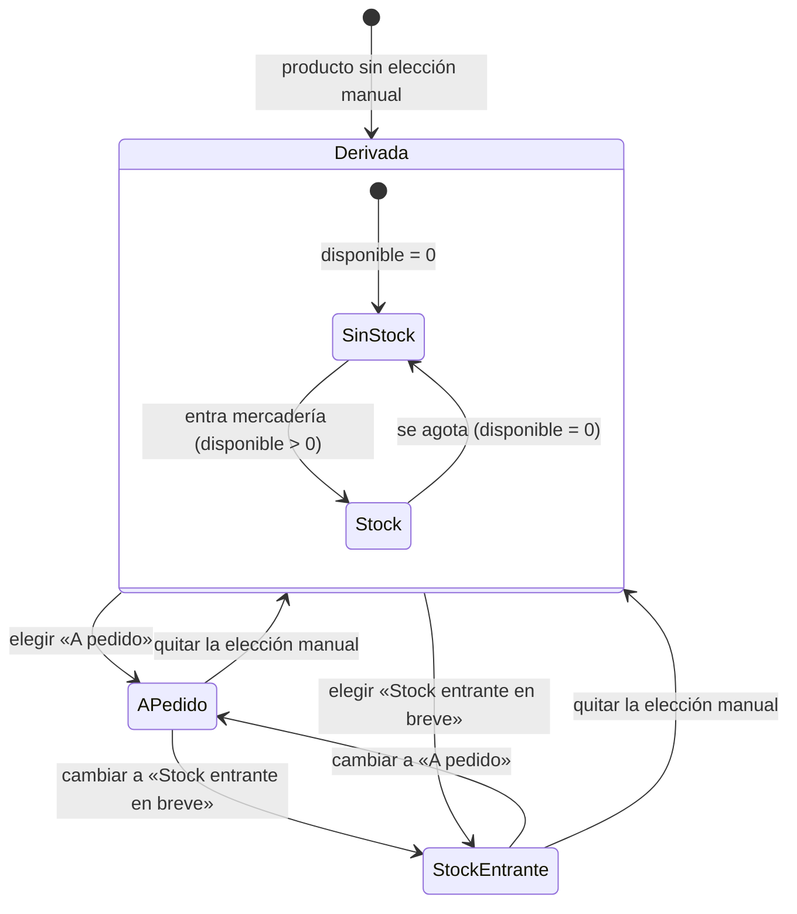
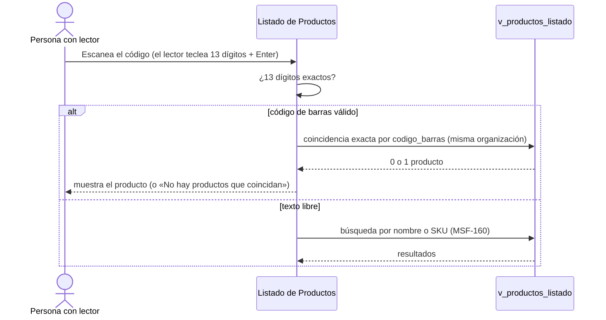
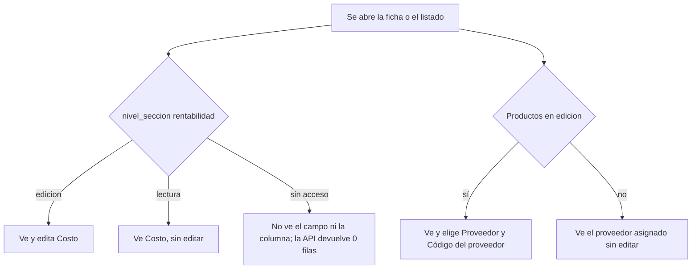
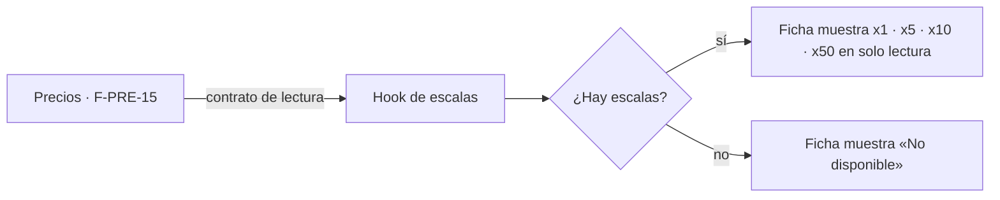

# Feature Specification: Catálogo · Catálogo costo y disponibilidad

**Feature Branch**: `epic/MSF-179-catalogo-catalogo-costo-y-disponibilidad`

**Jira Epic**: MSF-179 — Catálogo · Catálogo costo y disponibilidad (spec `catalogo-costo-y-disponibilidad`)

**Created**: 2026-10-22

**Status**: Draft para revisión — la especificación viene completa desde Jira; las decisiones abiertas están en «Decisiones para Nicolás». La épica sigue con el HOLD `espera-dependencia` hasta que se revise esta spec (no avanza a Implementation).

**Delivery scope**: `refine` (apps/web) y `supabase` (migraciones, RPC, vista, pgTAP). Sin `kestra`, `superset` ni `workers`.

**Prioridad / Hito**: P0 · Hito 2 (2 al 20 de noviembre de 2026) · 16 h · alcance diciembre.

**Dependencias**:
- Bloqueada por: MSF-160 (Catálogo listado y categorías: `v_productos_listado` y las pantallas «Productos · listado» y ficha, que esta épica amplía) y MSF-205 (Proveedores y productos: tabla `proveedores`, `productos.proveedor_id`).
- Bloquea a: MSF-292 (Stock · depósitos y reservas; lee la disponibilidad de F-CAT-17).
- Relacionada, sin bloqueo: MSF-125 (`private.nivel_seccion`, ya cubierto por la cadena MSF-125 → MSF-138 → MSF-160 y MSF-125 → MSF-205); MSF-136 (las existencias que derivan «Stock» y «Sin stock» se consumen contra el contrato de FR-006; el seed de pruebas las simula); MSF-114 (Precios: las escalas F-PRE-15 se leen de ahí y, si faltan, la ficha muestra «No disponible»).

**Input**: Epic MSF-179. Objetivo: «Al terminar, cada producto tiene costo y proveedor (que ve solo el Administrador), una disponibilidad clara (Stock, Sin stock, A pedido o Stock entrante en breve) y un código de barras que se busca con lector; la ficha muestra además las escalas de precio por cantidad que define Precios.»

**Regla de fuentes** (literal de la épica):
- Comportamiento y datos: mandan los requisitos y escenarios de esta historia.
- Qué se ve (disposición, textos, estados, popups, flujos): el prototipo validado es referencia visual, no hace falta que quede extremadamente idéntico; los flujos (si hay) aclaran estados y acciones.
- Cómo se construye (componentes, estilos y patrones): mandan el template y el system design (MSF-117, `docs/sistema-de-diseno.md`). No copiar el HTML ni el CSS del prototipo.
- El prototipo muestra más que esta historia: implementar solo lo que piden los requisitos; otras secciones, botones o diálogos son de otras historias.
- Si algo no se puede igualar: lo más cercano, sin inventar, anotando la diferencia en el PR. Si prototipo y requisitos se contradicen: requisitos para el comportamiento, prototipo para lo visual, contradicción anotada en el PR.
- Prototipos (solo lectura, presentes en el árbol de trabajo; la rama `design/prototipo` no existe en `origin` hoy): `design/pantallas/ProductoAlta.dc.html`, `ProductoEditar.dc.html`, `Productos.dc.html` (+ sus `.inventory.json`).

## Estado actual del repo (verificado)

Parte de lo pedido ya existe; esta épica **no lo rehace**, lo completa y lo prueba:

| Pedido | Estado | Origen |
|--------|--------|--------|
| Tabla `dominio.producto_costos` + RLS por sección `rentabilidad`; campo Costo en alta/edición (oculto al Operador) | **Hecho** | MSF-456 (`20261017120100`) |
| `productos.proveedor_id` / `codigo_proveedor` + selector en alta/edición | **Hecho** | MSF-205 (`20261018190400`, `…190600`) |
| `productos.codigo_barras` (13 dígitos, único por organización) + campo en alta/edición | **Hecho** | MSF-529 (`20261019120000`) |
| `dominio.existencias` (cantidad única por organización) | **Hecho** | MSF-136 (`20261017140000`) |
| `v_productos_listado` y el listado con búsqueda/filtros | **Pendiente** (la grilla actual es mínima: nombre, SKU, estado) | MSF-160 (spec aprobada) — la vista deja Costo y Stock en «—» y **sin costo** (FR-007 de MSF-160) |
| Disponibilidad (4 estados), columna Costo y Stock del listado, búsqueda por código de barras, escalas de precio | **Esta épica** | — |

## Modelo y supuestos

- **Costo y proveedor** siguen donde están: el costo en `producto_costos` (lo ve quien tiene `rentabilidad`; el Operador, nada); el proveedor en `productos.proveedor_id` (un solo proveedor principal por producto — a confirmar).
- **Disponibilidad**: «Stock» y «Sin stock» se **derivan** del stock disponible (cantidad menos reservado, sumando los depósitos). «A pedido» y «Stock entrante en breve» se **eligen a mano**. Si hay una elección manual, manda sobre la derivada.
- **Hasta que llegue MSF-292** (depósitos y reservas) el stock es único por organización y no hay reservas: disponible = `existencias.cantidad` (reservado = 0). El contrato (FR-006) es el punto donde MSF-292 enchufa depósitos y reservas sin tocar a los consumidores.
- **Escalas de precio** (x1, x5, x10, x50) y tipo de cliente (minorista/mayorista) son de Precios; acá solo se muestran, en lectura. Si Precios no las entrega, la ficha muestra «No disponible».
- **Permisos**: se resuelven con `private.nivel_seccion(...)` en pantalla y RLS, nunca con `private.puede_escribir()`. Costo/proveedor: sección `rentabilidad` (hoy Administrador edita; Administración lee; Operador nada). Disponibilidad manual: edita quien tiene `edicion` en `productos`.
- **Template**: ya trae panel, formularios, RLS por organización (`private.organizacion_id()`, `private.puede_escribir()`). Lo que se extiende: el rol/sección ya está resuelto por Acceso (MSF-125).

### Esquema de datos (Constitución, Principio VII — re-verificar en plan, tareas, implementación y PR)

| Objeto | Esquema | Justificación | RLS / acceso |
|--------|---------|---------------|--------------|
| `productos` (alterada: `disponibilidad_manual`) | **`dominio`** | Entidad de negocio del producto; columna aditiva. | Sin políticas nuevas: hereda las de `productos` (select `lectura`/`edicion`; insert/update `edicion`; sin DELETE). Grant de columna solo a `authenticated`. |
| `producto_costos` (existente) | **`dominio`** | Sin cambios. | `rentabilidad`; Operador: 0 filas. |
| `v_productos_listado` (vista de MSF-160, se amplía) | **`public`** (vista, no tabla) | Contrato de lectura del listado; columnas **al final** (`disponibilidad`, `codigo_barras`); `security_invoker = true`; `revoke … from public, anon`, `grant select … to authenticated`. **Sin costo** (respeta FR-007 de MSF-160). | Hereda la RLS de las tablas base. |
| `private.disponibilidad_producto(uuid)` (función) | **`private`** | Deriva la disponibilidad sin exponer cantidades a quien no tiene `stock`. `security definer`, `set search_path = ''`, filtra por `private.organizacion_id()` y exige `productos` en lectura; devuelve solo la etiqueta. | Sin ejecución para `anon`. |

Ninguna tabla nueva. Migraciones **aditivas** con reversión en el encabezado (ver plan). Las RPC `crear_producto` / `actualizar_producto` cambian de firma (cambio de contrato, **alto riesgo**, ver FR-007): se señala en el PR y se conserva `revoke … from public, anon` + `grant execute … to authenticated`.

## Decisiones para Nicolás

1. **¿Quién ve el proveedor?** La épica dice «costo y proveedor (que ve solo el Administrador)», pero hoy (MSF-205) el Operador con edición en Productos ve y elige el proveedor en el formulario, vía `proveedores_basico`. **Por defecto se deja como está** (el costo sí queda solo para Rentabilidad); restringir el proveedor sería un cambio de MSF-205. Pregunta #2 de Funcionalidades (¿qué ve el Operador?) sigue abierta.
2. **A pedido: ¿descuenta stock?** El prototipo dice «no descuenta stock al venderse»; el doc (RF-CAT-17-4) dice que reserva y descuenta recién al retirar o recibir. Esta épica **solo guarda la etiqueta**; la regla de reserva/descuento es de Stock/Ventas (MSF-292). Para el comportamiento mandan los requisitos: el texto de ayuda de la opción se escribe sin afirmar que no descuenta («Se consigue bajo pedido.») y la diferencia queda anotada en el PR.
3. **Prioridad de F-CAT-14**: historias-detalle la pone P2/Etapa 3; se mantiene **P0 / Hito 2** según roadmap.
4. **Columna «Costo» del listado**: MSF-160 la deja en «—» y pide OK. Se llena **solo** para quien tiene `rentabilidad`, con una consulta aparte a `producto_costos` (la vista sigue sin costo). La columna Margen queda fuera.
5. **Nombre del contrato para MSF-292**: se propone la columna `disponibilidad` de `v_productos_listado` + `private.disponibilidad_producto(uuid)`. Confirmar con MSF-292 (la épica lo llama `productos.disponibilidad`).

## Flujos

### Disponibilidad del producto (F-CAT-17)

Mapeo: Derivada/Stock/Sin stock → FR-006; A pedido y Stock entrante en breve (elección y quitar) → FR-005, FR-007; el efecto de reserva/descuento de «A pedido» → **fuera de alcance** (MSF-292, ver Decisión 2).

### Búsqueda por código de barras con lector (F-CAT-14)

Mapeo: coincidencia exacta y mensaje sin resultado → FR-012; teclear + Enter y foco → FR-013; carga del código en el producto → ya entregado (MSF-529) y verificado en FR-014.

### Visibilidad del costo y del proveedor (F-CAT-16)

Mapeo: ramas de costo → FR-001, FR-002; ramas de proveedor → FR-003.

### Escalas de precio en la ficha (F-CAT-16)

Mapeo: FR-004.

## User Scenarios & Testing *(mandatory)*

### User Story 1 - Costo, proveedor y escalas en la ficha (F-CAT-16, P0, talla M)

Como Administrador, quiero ver y cargar el costo y el proveedor de cada producto —y ver en la ficha las escalas de precio—, para conocer cuánto me cuesta y a quién se lo compro, sin que el Operador lo vea.

**Independent Test**: el Administrador abre un producto y ve Costo, Proveedor, Código del proveedor y el bloque de escalas; en el listado ve la columna Costo. El Operador no ve Costo (ni en la ficha ni en el listado ni por la API).

**Acceptance Scenarios**:
1. **Given** un usuario con edición en Rentabilidad, **When** abre alta o edición, **Then** ve y edita «Costo»; con lectura lo ve sin editar; sin acceso, el campo no aparece y la API no devuelve la fila.
2. **Given** el listado, **When** lo abre quien tiene acceso a Rentabilidad, **Then** la columna «Costo» muestra el costo de cada producto de la página (en lugar de «—»); **When** lo abre el Operador, **Then** la columna no se muestra y no se consulta el costo.
3. **Given** un proveedor asignado, **When** se abre la ficha, **Then** se ven «Proveedor» y «Código del proveedor»; un código sin proveedor se rechaza.
4. **Given** la ficha de un producto, **When** Precios entrega las escalas, **Then** se muestra «Precios por escala · sin IVA» con x1 (1 a 4 u.), x5 (5 a 9), x10 (10 a 49) y x50 (50 o más) en solo lectura; **When** no las entrega, **Then** se muestra «No disponible».

### User Story 2 - Disponibilidad del producto (F-CAT-17, P0, talla M)

Como persona que edita productos, quiero marcar si un producto está en stock, sin stock, a pedido o por llegar, para que el catálogo diga con claridad si se puede vender.

**Independent Test**: un producto con existencias muestra «Stock»; al agotarse muestra «Sin stock»; el Operador lo marca «A pedido» y el listado lo muestra así; al quitar la marca vuelve a la etiqueta derivada; el filtro por disponibilidad lista solo los de ese estado.

**Acceptance Scenarios**:
1. **Given** un producto sin elección manual, **When** su disponible es > 0 (cantidad menos reservado, sumando depósitos), **Then** la disponibilidad es «Stock»; **When** es 0, **Then** es «Sin stock».
2. **Given** el alta o edición, **When** se elige «A pedido» o «Stock entrante en breve», **Then** se guarda y manda sobre la derivada; «Stock» y «Sin stock» se ven como estados calculados (no se eligen) y se puede quitar la elección manual.
3. **Given** el listado, **Then** la columna de disponibilidad muestra la etiqueta de cada producto y el filtro por disponibilidad (Todos, Stock, Sin stock, A pedido, Stock entrante en breve) acota la lista en el servidor.
4. **Given** quien no tiene acceso a Stock, **When** ve la disponibilidad, **Then** la ve correcta (se deriva en la base) sin ver cantidades.
5. **Given** un cambio de disponibilidad, **Then** queda en Actividad dentro del evento `producto.editado` (sin costo).

### User Story 3 - Código de barras buscable con lector (F-CAT-14, P0, talla S)

Como persona de mostrador o depósito, quiero escanear un código de barras en el listado, para encontrar el producto al instante.

**Independent Test**: con el foco en el buscador del listado, un lector teclea `7790000012421` + Enter y aparece ese producto; un código inexistente muestra «No hay productos que coincidan».

**Acceptance Scenarios**:
1. **Given** el buscador del listado, **When** se ingresa un texto de 13 dígitos, **Then** se busca por coincidencia **exacta** de código de barras dentro de la organización; cualquier otro texto sigue buscando por nombre o SKU.
2. **Given** un lector que teclea los dígitos y Enter, **When** termina, **Then** la búsqueda se dispara sin esperar la pausa de tipeo y el campo queda listo para el siguiente escaneo.
3. **Given** el alta o edición, **Then** el campo «Código de barras (EAN-13)» (ya entregado) acepta 13 dígitos, es único por organización y su ayuda dice que se puede escanear.

## Requirements *(mandatory)*

### Functional Requirements

**F-CAT-16 · Costo, proveedor y escalas**
- **FR-001**: El campo «Costo» de alta/edición MUST verse y editarse solo con `edicion` en `rentabilidad`, verse en solo lectura con `lectura`, y no existir para el resto (en pantalla y por la API). *(Ya implementado por MSF-456; se verifica con pruebas de regresión, sin rehacerlo.)*
- **FR-002**: La columna «Costo» del listado MUST llenarse solo para quien tiene `rentabilidad` (lectura o edición), consultando `producto_costos` por los ids de la página; para el resto la columna no se muestra y no se hace la consulta. `v_productos_listado` NO expone costo.
- **FR-003**: «Proveedor» y «Código del proveedor» MUST seguir el comportamiento de MSF-205 (un proveedor principal; código sin proveedor se rechaza). *(Ya implementado; se verifica.)*
- **FR-004**: La ficha MUST mostrar el bloque «Precios por escala · sin IVA» (x1 · 1 a 4 u., x5 · 5 a 9 u., x10 · 10 a 49 u., x50 · 50 u. o más) en solo lectura, leído de Precios (F-PRE-15), con el subtítulo «Minorista usa x1 · Mayorista usa la escala según la cantidad»; si Precios no entrega las escalas, MUST mostrar «No disponible». No se calcula ni se edita nada acá.

**F-CAT-17 · Disponibilidad**
- **FR-005**: `dominio.productos` MUST tener la columna aditiva `disponibilidad_manual` (nula | `a_pedido` | `stock_entrante`), con CHECK y grant de columna a `authenticated`.
- **FR-006**: La disponibilidad MUST resolverse en `private.disponibilidad_producto(uuid)`: si hay `disponibilidad_manual`, esa; si no, «Stock» cuando el disponible (cantidad menos reservado, sumando los depósitos) es > 0 y «Sin stock» si es 0. Hasta MSF-292: disponible = `existencias.cantidad` y reservado = 0. Devuelve solo la etiqueta.
- **FR-007**: `crear_producto` y `actualizar_producto` MUST aceptar la disponibilidad manual (parámetro final opcional; en actualizar solo cambia con `p_cambiar_disponibilidad = true`; nulo = quitar). Exige `edicion` en `productos`. Cambio de contrato de alto riesgo: los llamadores anteriores siguen funcionando.
- **FR-008**: El formulario de alta/edición MUST mostrar la sección de disponibilidad con las cuatro opciones y sus textos del prototipo; «A pedido» y «Stock entrante en breve» se eligen, «Stock» y «Sin stock» se muestran como calculadas, con opción de quitar la elección manual.
- **FR-009**: `v_productos_listado` MUST sumar la columna `disponibilidad` (al final) y el listado MUST mostrarla como etiqueta (reemplaza el «—» de la columna Stock de MSF-160) y MUST permitir filtrar por disponibilidad en el servidor (los filtros «Sin stock» de MSF-160 pasan a funcionar).
- **FR-010**: Un cambio de disponibilidad MUST registrarse en Actividad dentro de `producto.editado`, sin datos de costo.
- **FR-011**: El contrato de FR-006 MUST quedar documentado para MSF-292 (`docs/`), de modo que depósitos y reservas se enchufen sin cambiar a los consumidores.

**F-CAT-14 · Código de barras**
- **FR-012**: El buscador del listado MUST resolver un texto de exactamente 13 dígitos por coincidencia exacta de `codigo_barras` en la organización (columna `codigo_barras` sumada al final de `v_productos_listado`); otro texto sigue por nombre/SKU (MSF-160). Sin coincidencia: «No hay productos que coincidan».
- **FR-013**: Con lector (teclea + Enter) la búsqueda MUST dispararse al Enter sin la espera de tipeo, y el campo MUST conservar el foco listo para el siguiente escaneo.
- **FR-014**: El campo «Código de barras (EAN-13)» de alta/edición, su validación (13 dígitos, único por organización) y su ayuda «Se puede escanear al armar un pedido o ingresar mercadería» MUST seguir vigentes (MSF-529); se verifican con pruebas de regresión.

**Transversales**
- **FR-015** *(cierre)*: La documentación (`docs/`, contrato de disponibilidad, permisos, roadmap) MUST actualizarse en el mismo cambio y `pnpm docs:check` MUST pasar.
- **FR-016** *(cierre)*: Revisión de seguridad de RLS/permisos de costo y de la función `security definer`, y una prueba de punta a punta (E2E) del recorrido Administrador/Operador.

### Success Criteria

- **SC-001** *(F-CAT-17)*: pgTAP — la derivación devuelve Stock/Sin stock/A pedido/Stock entrante en breve para los casos de FR-006 con existencias simuladas; la manual manda; otra organización no ve nada.
- **SC-002** *(F-CAT-16)*: pgTAP — el Operador obtiene 0 filas de `producto_costos`; `v_productos_listado` no contiene costo; `anon` sin acceso.
- **SC-003** *(F-CAT-14)*: la búsqueda por código de barras devuelve el producto exacto en < 2 s con 10 000 productos (usa el índice único existente `productos_org_codigo_barras_uidx`).
- **SC-004** *(F-CAT-17)*: el filtro por disponibilidad sobre 10 000 productos devuelve la página en < 2 s (p95 en el entorno de pruebas).
- **SC-005** *(cierre)*: `pnpm lint`, `pnpm build`, `pnpm infra:config`, `pnpm test` y `pnpm docs:check` verdes; `rls_en_toda_tabla` verde.

## Matriz pantalla↔criterios

Inventario generado con `pnpm prototipo:inventario` (`design/pantallas/*.inventory.json`). «Hecho» = ya entregado por otra épica y solo se verifica. «Fuera» = no lo pide esta épica (nota, no deuda; lo toman otras épicas).

### Producto · alta (`ProductoAlta.dc.html`) y Producto · edición (`ProductoEditar.dc.html`)

| Ítem del prototipo | Criterio / decisión |
|--------------------|---------------------|
| Campo **Proveedor** | FR-003 (Hecho, MSF-205) |
| Campo **Código del proveedor** | FR-003 (Hecho) |
| Campo **Código de barras (EAN-13)** (+ ayuda «13 dígitos, o escanealo») | FR-014 (Hecho, MSF-529); texto «Se puede escanear al armar un pedido o ingresar mercadería» → FR-014 |
| Campo **Costo** | FR-001 (Hecho, MSF-456) |
| Sección de disponibilidad (4 tarjetas: Stock, Sin stock, A pedido, Stock entrante en breve) *(no figura en el inventario automático; se ve en el prototipo)* | FR-008 (textos de las tarjetas del prototipo; ayuda de «A pedido» según Decisión 2) |
| Bloque **Precios por escala · sin IVA** x1/x5/x10/x50 *(solo en edición; no figura en el inventario)* | FR-004 (sin la línea «Margen … · mayoristas» ni el «Margen estimado»: **Fuera**, es de Precios/Rentabilidad) |
| Botones **Guardar producto** / **Guardar cambios**, **Cancelar**, **Productos** (volver), **Seguir editando**, **Descartar y salir** | Fuera (MSF-456 los entregó; esta épica solo les suma campos) |
| Campos Nombre, SKU, Descripción, Categoría, Compatible con, Video, Moneda, Precio de lista, IVA, Lugar en Productos destacados, Buscar… | Fuera (MSF-456 / MSF-160 / MSF-114 / Productos destacados) |
| Campos Local, Depósito principal, Stock mínimo (alerta) y texto «Es el stock inicial» | Fuera (Stock: MSF-136/MSF-292). Nota: el texto «Un producto “A pedido” no descuenta stock al venderse» **no se replica** (Decisión 2) |
| Botones Subir imagen (Principal, 2, 3, 4) | Fuera (MSF-456 F-CAT-05) |
| Botón **Cotización →** | Fuera (Precios, MSF-114) |
| Tabla **Variantes** (Variante, Código, Código de barras, Stock, Activa), **Agregar variante**, **Agregar** | Fuera (variantes son P1, otra épica; el código de barras de variantes tampoco entra) |
| Botones **Resolver**, **Ver movimientos →**, **Ver productos destacados →** | Fuera (Stock / Productos destacados) |
| Diálogo **Desvincular publicación** + botón **Desvincular** | Fuera (Mercado Libre, Etapa 2) |
| Diálogo **Descartar cambios** | Fuera (MSF-456) |

### Productos · listado (`Productos.dc.html`)

| Ítem del prototipo | Criterio / decisión |
|--------------------|---------------------|
| Columna **Costo** | FR-002 (solo con `rentabilidad`) |
| Columna **Stock** (etiqueta) | FR-009 (muestra la disponibilidad; encabezado según MSF-160; la cantidad numérica y «Stock bajo» quedan **Fuera**: Stock/MSF-231) |
| Filtro por disponibilidad *(no figura en el inventario; lo pide la épica)* | FR-009 |
| Campo **Buscar por nombre o SKU** | FR-012, FR-013 (suma el código de barras; el texto del placeholder se ajusta a «Buscar por nombre, SKU o código de barras» — diferencia anotada en el PR) |
| Columnas «», Producto, Precio, Margen, Visible en, Estado, «» | Fuera (MSF-160 / MSF-114) |
| Botones Exportar, Importar CSV y diálogo **Exportar productos** (Qué exportar, Formato, Columnas, incluidas «Código de barras» y «Proveedor») | Fuera (exportación: MSF-202) |
| Botón **Nuevo producto** | Fuera (MSF-456) |
| Acciones masivas: Categoría, Mover de categoría (diálogo), Marcar destacado, Enviar al newsletter, Borrar (+ diálogo **Borrar productos**), Quitar selección, Borrar · productos, Cancelar | Fuera (edición masiva: MSF-218; categorías: MSF-160) |
| «·· · ·Destacado», **Limpiar filtros** | Fuera (MSF-160) |

## Fuera de alcance

- Reserva y descuento de stock de «A pedido» y «Stock entrante en breve», depósitos y reservas (MSF-292).
- Cálculo, edición o margen de las escalas de precio y tipo de cliente (Precios, MSF-114).
- Columna Margen, stock numérico, «Stock bajo» y Mercado Libre del listado; exportación (MSF-202); edición masiva (MSF-218).
- Variantes y su código de barras; lector por cámara (el lector es el de teclado/USB que teclea y envía Enter).
- Restringir el proveedor al Administrador (Decisión 1).
- Rediseño del listado y de las pantallas (se amplían las de MSF-456/MSF-160).
