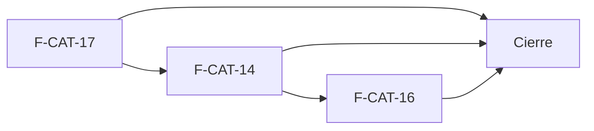

# Tasks: Catálogo · Catálogo costo y disponibilidad

**Input**: `specs/20261022-120000-catalogo-costo-y-disponibilidad/` (spec.md, plan.md) · **Jira Epic**: MSF-179

**Formato**: `- [ ] T### [P] [F-CAT-xx][USy] descripción`. **[P]** = paralelizable (archivos distintos, sin dependencia; las [P] del mismo grupo van en paralelo); sin [P] = secuencial. Regla del proyecto: ninguna tarea queda `[ ]` al cierre — se hace con evidencia o se cierra con `[x]` + `Desvío:` y seguimiento trazado. Las dependencias de cada historia son solo internas.

**Delivery scope**: `refine`, `supabase`

## Matriz de trazabilidad Jira ↔ US ↔ tasks

| Jira | Historia | Requisitos (dueño único) | Tasks |
|------|----------|--------------------------|-------|
| F-CAT-17 | US2 Disponibilidad del producto | FR-005, FR-006, FR-007, FR-008, FR-009, FR-010, FR-011, SC-001, SC-004 | T001–T008 |
| F-CAT-14 | US3 Código de barras | FR-012, FR-013, FR-014, SC-003 | T009–T013 |
| F-CAT-16 | US1 Costo, proveedor y escalas | FR-001, FR-002, FR-003, FR-004, SC-002 | T014–T019 |
| Tarea de cierre (label `cierre`) | Docs, seguridad, E2E, roadmap | FR-015, FR-016, SC-005 | T020–T023 |

## Phase 1: Disponibilidad del producto (F-CAT-17 · refine + supabase)

- [ ] T001 [F-CAT-17][US2] Migración `20261022120900_catalogo_disponibilidad.sql` (renombrada desde `20261022120000` por colisión con `formas_pago_rpc` de DEV): columna `dominio.productos.disponibilidad_manual` (CHECK `a_pedido`/`stock_entrante`, grants por columna), `private.disponibilidad_producto(uuid)` (`security definer`, `search_path ''`, por organización, solo etiqueta; contrato para MSF-292), `revoke … public, anon`, reversión en el encabezado (FR-005, FR-006)
- [ ] T002 [F-CAT-17][US2] En la misma migración (o una siguiente propia): nuevas `crear_producto` (+1 parámetro) y `actualizar_producto` (+2, `p_cambiar_disponibilidad`) con `grant execute … authenticated` / `revoke … public, anon`, cuenta en `updated_at` y en el evento `producto.editado` sin costo; `create or replace view public.v_productos_listado` con `disponibilidad` al final, `security_invoker`, sin costo. Marcar cambio de contrato (alto riesgo) (FR-007, FR-009, FR-010)
- [ ] T003 [P] [F-CAT-17][US2] pgTAP `catalogo_disponibilidad.test.sql`: derivación Stock/Sin stock con existencias simuladas, manual manda, aislamiento entre organizaciones, `anon` sin acceso, compatibilidad de las firmas anteriores, evento sin costo; `rls_en_toda_tabla` verde (SC-001)
- [ ] T004 [P] [F-CAT-17][US2] `lib/productos.ts`: tipos de disponibilidad, mapeo etiqueta→tono para `EtiquetaEstado`, payload de `crear_producto`/`actualizar_producto` con `p_cambiar_disponibilidad` (FR-007, FR-008)
- [ ] T005 [F-CAT-17][US2] `FormularioProducto`: sección de disponibilidad (4 opciones con textos del prototipo; «Stock»/«Sin stock» calculadas, «A pedido»/«Stock entrante en breve» elegibles, quitar elección; ayuda de «A pedido» sin afirmar que no descuenta) en alta y edición (FR-008)
- [ ] T006 [F-CAT-17][US2] `pages/productos/list.tsx`: columna de disponibilidad con etiqueta y filtro por disponibilidad en servidor sobre `v_productos_listado`, estados de carga/vacío/error del kit, accesible y responsive (FR-009)
- [ ] T007 [P] [F-CAT-17][US2] Vitest de formulario y listado: opciones, elección y quitar, etiqueta, filtro, sin acceso a Stock ve la etiqueta (FR-008, FR-009)
- [ ] T008 [F-CAT-17][US2] Medir el filtro con 10 000 productos sembrados (< 2 s p95) y documentar el contrato para MSF-292 en `docs/` (FR-011, SC-004)

**Checkpoint**: se puede elegir y filtrar la disponibilidad; `pnpm lint`, `pnpm build`, `pnpm test` verdes.

## Phase 2: Código de barras (F-CAT-14 · refine + supabase)

- [ ] T009 [F-CAT-14][US3] Migración `20261022121000_catalogo_listado_codigo_barras.sql` (renombrada desde `20261022120100` por colisión con `formas_envio` de DEV): `create or replace view public.v_productos_listado` sumando `codigo_barras` al final (conserva las columnas vigentes, `security_invoker`, sin costo), reversión en el encabezado (FR-012)
- [ ] T010 [P] [F-CAT-14][US3] pgTAP: la vista expone `codigo_barras` solo de la propia organización y no expone costo (FR-012, SC-003)
- [ ] T011 [F-CAT-14][US3] `list.tsx` + `lib/productos.ts`: texto de 13 dígitos → coincidencia exacta de código de barras; otro texto → nombre/SKU; Enter inmediato, foco conservado, placeholder «Buscar por nombre, SKU o código de barras», sin resultados → «No hay productos que coincidan» (FR-012, FR-013)
- [ ] T012 [P] [F-CAT-14][US3] Vitest: 13 dígitos + Enter encuentra el producto, inexistente muestra vacío, texto libre sigue por nombre/SKU, el campo conserva el foco (FR-012, FR-013)
- [ ] T013 [P] [F-CAT-14][US3] Vitest de regresión del campo «Código de barras (EAN-13)» en alta/edición (13 dígitos, único, ayuda de escaneo) y medición con 10 000 productos (< 2 s) (FR-014, SC-003)

**Checkpoint**: escanear en el listado encuentra el producto; checks verdes.

## Phase 3: Costo, proveedor y escalas (F-CAT-16 · refine)

- [ ] T014 [F-CAT-16][US1] `list.tsx`: columna «Costo» con segunda consulta a `producto_costos` por los ids de la página, solo si `useNivelSeccion('rentabilidad')` es lectura/edición; sin acceso la columna no se renderiza ni se consulta (FR-002)
- [ ] T015 [P] [F-CAT-16][US1] Hook `useEscalasPrecio(productoId)` que consume el contrato de lectura de Precios (F-PRE-15) y devuelve `null` si no hay datos; punto de enlace único y documentado, sin inventar el contrato (FR-004)
- [ ] T016 [F-CAT-16][US1] Ficha (`edit.tsx`/`FormularioProducto`): bloque «Precios por escala · sin IVA» (x1 · 1 a 4 u., x5 · 5 a 9 u., x10 · 10 a 49 u., x50 · 50 u. o más) en solo lectura con subtítulo de tipo de cliente; sin datos → «No disponible»; sin la línea de margen (FR-004)
- [ ] T017 [P] [F-CAT-16][US1] pgTAP `catalogo_costo_visibilidad.test.sql`: Operador 0 filas de `producto_costos`, `v_productos_listado` sin columna de costo, `anon` sin acceso, aislamiento entre organizaciones (SC-002)
- [ ] T018 [P] [F-CAT-16][US1] Vitest: columna Costo según nivel (edición/lectura/sin acceso), ficha con y sin escalas, «No disponible» (FR-002, FR-004)
- [ ] T019 [P] [F-CAT-16][US1] Vitest de regresión de costo (oculto al Operador, lectura sin editar) y de proveedor/código del proveedor (código sin proveedor se rechaza) (FR-001, FR-003)

**Checkpoint**: Administrador ve costo en listado y ficha, Operador no; `pnpm lint`, `pnpm build`, `pnpm test` verdes.

## Phase 4: Cierre (docs, seguridad, E2E, roadmap)

- [ ] T020 [CIERRE] Documentación: `docs/` (catálogo, contrato de disponibilidad para MSF-292, permisos de costo/proveedor), `AGENTS.md`/`CLAUDE.md` si aplica; `pnpm docs:check` verde (FR-015)
- [ ] T021 [CIERRE] Revisión de seguridad: RLS y permisos de costo/proveedor, función `security definer` de disponibilidad, cambio de contrato de las RPC, `anon` (FR-016)
- [ ] T022 [CIERRE] E2E del recorrido Administrador vs Operador (costo, disponibilidad, escaneo) y validación final `pnpm lint`, `pnpm build`, `pnpm infra:config`, `pnpm test` (FR-016, SC-005)
- [ ] T023 [CIERRE] Actualizar la fila/sección de la épica en `docs/roadmap-template.md` (estado, link a la spec) como paso manual al mergear (FR-015)

## Plan de ejecución (historias)

| Historia | Depende de | Grupo |
|----------|------------|-------|
| F-CAT-17 | — | 1 |
| F-CAT-14 | F-CAT-17 | 2 |
| F-CAT-16 | F-CAT-14 | 3 |
| [Cierre] | F-CAT-17, F-CAT-14, F-CAT-16 | 4 |

Las tres historias comparten `list.tsx`, `FormularioProducto` y/o la vista `v_productos_listado` (F-CAT-17 y F-CAT-14 redefinen la misma vista con `create or replace`), por eso van en serie; el orden sigue la prioridad (F-CAT-17 desbloquea a MSF-292) y la menor cantidad de trabajo nuevo al final (F-CAT-16 está mayormente entregado).

