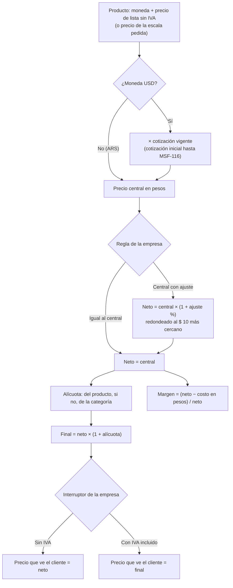
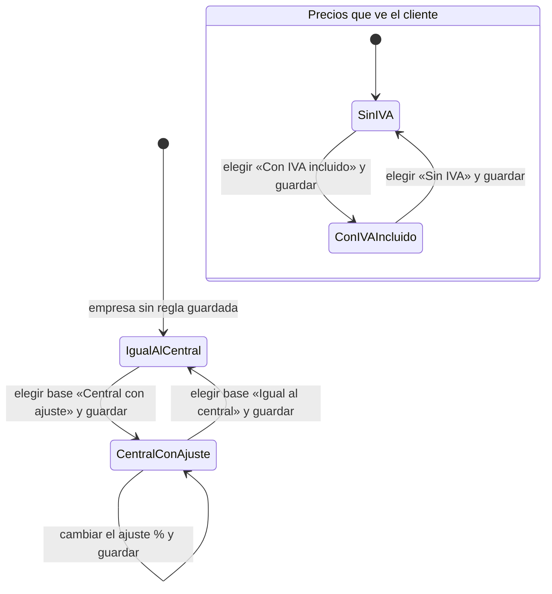
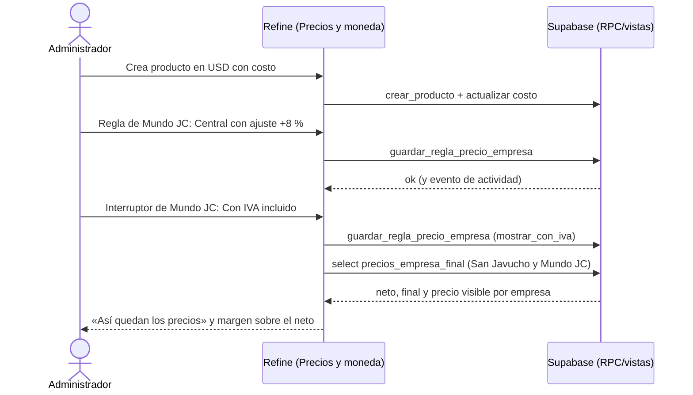

# Feature Specification: Precios y dólar · Precios e IVA

**Épica**: MSF-114 · **Spec**: `precios-e-iva` · **Hito**: 2 (2 al 20 de noviembre de 2026) · **Prioridad**: P0 · **Horas aprox.**: 30
**Alcance de entrega**: `refine`, `supabase` (sin `kestra`, `superset` ni `workers`: el cálculo es SQL, ver *Decisiones abiertas* 1).
**Fuente**: especificación de Nicolás cargada en la épica (Jira), prototipo en `design/pantallas/*.dc.html` y artefactos del producto (documento del componente «Precios y dólar», Funcionalidades, Roadmap, Relevamiento). Esta spec **traduce**; no agrega alcance.

> Nota de rama: la rama `design/prototipo` citada en el encargo no existe en `origin`; los prototipos viven versionados en `design/pantallas/` de este repo y de ahí salen los inventarios. Esta rama debe **traer `main`** (que ya incluye MSF-160: `dominio.categorias`) antes de implementar F-PRE-12.

## Objetivo

Al terminar, cada producto tiene moneda, precio de lista sin IVA y costo; cada empresa calcula su propio precio neto y su precio final desde el central, y el IVA se asigna por categoría con ajuste por producto y se muestra con o sin IVA según lo que elija cada empresa.

## Modelo y supuestos

- El precio de lista y el costo se cargan **sin IVA**. El margen se calcula sobre el **precio neto**.
- El dólar usado es el **vigente**. La carga y el recálculo masivo son de la épica 2 (`dolar-y-recalculo`, MSF-116); hasta entonces un producto en USD usa la **cotización inicial** que carga el administrador. En el lanzamiento la cotización es **una sola para toda la organización** y la moneda de las tiendas es **ARS**.
- Los precios **no se envían a Mercado Libre** en esta épica (Etapa 2).
- **Ya existe** (F-CAT-02 / F-CAT-04, `docs/catalogo.md`): `dominio.productos` con `moneda` (`USD`/`ARS`) y `precio_lista` (> 0), `dominio.producto_costos` con `costo` (sección `rentabilidad`), `public.crear_producto` / `public.actualizar_producto`, `dominio.empresas` y `public.registro_actividad` con `private.insertar_actividad`. Esta épica **no los recrea**: los usa y les suma lo que falta.
- **Viene de MSF-160** (bloqueo declarado): `dominio.categorias` (árbol de 2 niveles), la pantalla Categorías y el listado de productos. F-PRE-12 le agrega `alicuota_iva_id`.
- **No se guarda ningún precio en pesos**: el precio central en ARS, el neto por empresa y el final se **calculan al leer** a partir de lista, cotización vigente, regla de la empresa y alícuota. Así el recálculo masivo de MSF-116 solo cambia la cotización y nada queda desactualizado.
- Permisos: la regla de precio por empresa y la cotización inicial las edita el **Administrador** (sección `empresas`, nivel `edicion`); el IVA de la categoría, la sección `categorias`; el IVA del producto, la sección `productos`; el **costo y el margen** solo con la sección `rentabilidad` (ya vigente: quien no la tiene no ve costo ni margen). Si el Operador puede ver el costo es una pregunta abierta del relevamiento y **se mantiene la matriz vigente** hasta que se resuelva.
- El template no trae nada del dominio de precios. Se reutilizan: `organizacion_id` con RLS y `private.nivel_seccion`, el kit de panel de Refine (`EncabezadoPagina`, `ContenidoAdaptable`, estados vacío/error/carga), el patrón de pages de catálogo y el modelo pgTAP de aislamiento.

### Esquema de datos (Constitución, Principio VII)

Todo es entidad de negocio del producto (qué se cobra y a cuánto) → **`dominio`**; ninguna tabla va a `public`. Las vistas y RPC expuestas viven en `public` (superficie de lectura/ejecución, **no almacenan datos**), como en MSF-160 y MSF-205. Se re-verifica en plan, tareas, implementación y PR.

| Objeto | Esquema | Historia | Justificación | RLS / acceso |
|--------|---------|----------|---------------|--------------|
| `cotizacion_inicial` (**nueva**) | `dominio` | F-PRE-01 | Dato de negocio (dólar de arranque) de la organización. | `organizacion_id = (select private.organizacion_id())`; select para quien ve `productos`; insert/update `empresas`=`edicion`; sin delete; `anon` sin privilegios |
| `precios_empresa` (**nueva**) | `dominio` | F-PRE-07 | Regla de precio de cada empresa (tienda). | RLS por organización; FK compuesta `(empresa_id, organizacion_id)`; select `empresas`≥`lectura`; escritura `empresas`=`edicion`; sin delete |
| `alicuotas_iva` (**nueva**) | `dominio` | F-PRE-12 | Catálogo de alícuotas (21 %, 10,5 %, Exento; 27 % se suma desde la administración de alícuotas). | RLS por organización; lectura para toda la organización autenticada; sin escritura desde la app en esta épica |
| `categorias` (existente, MSF-160; **se altera**) | `dominio` (sin cambio) | F-PRE-12 | Se suma `alicuota_iva_id` (aditivo, FK compuesta). | RLS vigente de MSF-160 |
| `productos` (existente; **se altera**) | `dominio` (sin cambio) | F-PRE-12 | Se suma `alicuota_iva_id` nullable (null = hereda de la categoría). | RLS vigente de F-CAT-02 |
| `precios_empresa.mostrar_con_iva` (**columna nueva**) | `dominio` | F-PRE-12 | Interruptor «Precios que ve el cliente» por empresa. | RLS de `precios_empresa` |
| `producto_precios_escala` (**nueva**) | `dominio` | F-PRE-15 | Precios por escala (x5, x10, x50) de un producto. | RLS por organización; FK compuesta `(producto_id, organizacion_id)`; select `productos`≥`lectura`; escritura `productos`=`edicion`; sin delete |
| Vistas `public.precios_empresa_neto`, `public.precios_empresa_final` | `public` (vista de lectura, `security_invoker`) | F-PRE-07 / F-PRE-12 | No almacenan datos. | Heredan la RLS de las tablas base |
| RPC `fijar_cotizacion_inicial`, `guardar_regla_precio_empresa`, `guardar_alicuota_categoria`, `guardar_precios_escala` | `public` | F-PRE-01/07/12/15 | Superficie de ejecución. | `security invoker`, `revoke … from public, anon`, `grant execute … to authenticated` |
| Funciones `private.a_pesos`, `private.precio_central_ars`, `private.precio_neto_empresa`, `private.alicuota_producto`, `private.precio_para` | `private` | F-PRE-01/07/12/15 | Cálculo. | Sin `execute` para `anon` |

La prueba pgTAP `rls_en_toda_tabla` recorre `public` + `dominio` y debe seguir verde. Reversión de cada migración: ver `plan.md` (aditivas; cada historia aporta la suya).

## User Scenarios & Testing *(mandatory)*

### User Story 1 - Precio y costo en pesos o dólares (F-PRE-01, P0, talla M)

Como administrador cargo un producto con su moneda (pesos o dólares), su precio de lista sin IVA y su costo, y veo cuánto vale en pesos y cuánto margen deja.

**Por qué**: es la base de todo cálculo de precio (las otras historias parten del precio central en pesos).

**Escenarios**:
1. **Dado** un producto en USD con lista 20 y costo 12 y una cotización inicial de 1.465, **cuando** abro su ficha, **entonces** veo el hint «costo $ 17.580 · con dólar $ 1.465» y el precio central en pesos 29.300.
2. **Dado** un producto en ARS, **cuando** lo cargo, **entonces** el precio y el costo se muestran tal cual y no hay conversión.
3. **Dado** la cotización inicial vacía y un producto en USD, **cuando** pido su precio en pesos, **entonces** no se inventa un valor: la ficha avisa «Cargá la cotización» y el cálculo devuelve sin precio.
4. **Dado** un usuario con la sección `rentabilidad`, **cuando** ve el producto, **entonces** ve costo y «Margen estimado» = (precio neto − costo) / precio neto; **dado** uno sin esa sección, **entonces** no ve costo ni margen.
5. **Cuando** guardo un cambio de moneda, lista o costo, **entonces** queda el evento `producto.precio_actualizado` en el registro de actividad con quién y cuándo.
6. **Dado** precio de lista vacío, cero o negativo, o costo negativo, **cuando** guardo, **entonces** se rechaza con mensaje claro asociado al campo.

### User Story 2 - Regla de precio por empresa (F-PRE-07, P0, talla M)

Como administrador defino, en la pestaña «Precios y moneda» de cada empresa, cómo se calcula su precio neto desde el central.

**Escenarios**:
1. **Dado** Mundo JC con base «Igual al central», **cuando** veo la tabla «Así quedan los precios», **entonces** la columna de la empresa es igual a «Central».
2. **Dado** base «Central con ajuste» y ajuste +8 %, **cuando** guardo, **entonces** el neto de la empresa = central × 1,08 redondeado «Al $ 10 más cercano»; con −5 baja.
3. **Dado** dos empresas con reglas distintas, **cuando** miro el mismo producto, **entonces** cada una muestra su propio precio neto.
4. **Dado** una empresa sin regla guardada, **entonces** se comporta como «Igual al central».
5. **Dado** un usuario sin permiso de edición de `empresas`, **cuando** abre la pestaña, **entonces** ve la regla en solo lectura o «Acceso restringido» según su nivel, y la RPC rechaza la escritura (`42501`).
6. **Dado** dos administradores que editan a la vez, **cuando** el segundo guarda con datos viejos, **entonces** recibe un conflicto claro (bloqueo optimista por `updated_at`).
7. **Dado** ajuste fuera de rango (≤ −100 %) o no numérico, **cuando** guardo, **entonces** se rechaza con mensaje en el campo.
8. **Dado** que abro otra empresa, **entonces** el formulario y la tabla muestran los datos de esa empresa, nunca los de la anterior.

### User Story 3 - IVA por categoría y precio final (F-PRE-12, P0, talla M)

Como administrador asigno el IVA a cada categoría, lo ajusto por producto y elijo, por empresa, si el cliente ve precios sin IVA o con IVA incluido.

**Escenarios**:
1. **Dado** la categoría Joysticks con IVA 21 %, **cuando** un producto no tiene IVA propio, **entonces** usa 21 %.
2. **Dado** un producto con IVA propio 10,5 %, **entonces** manda el del producto sobre el de la categoría.
3. **Dado** neto 29.186 y alícuota 21 %, **cuando** la empresa elige «Con IVA incluido», **entonces** el precio que ve el cliente es 35.315 y el texto de la pestaña lo ejemplifica; con «Sin IVA» ve 29.186.
4. **Dado** alícuota «Exento», **entonces** neto y final coinciden.
5. **Dado** dos empresas con interruptores distintos, **entonces** el mismo producto se ve con y sin IVA según cada una; el **margen no cambia** (siempre sobre el neto).
6. **Dado** la lista de alícuotas, **entonces** ofrece 21 %, 10,5 % y Exento (27 % no está hasta que exista la administración de alícuotas).
7. **Cuando** cambio el IVA de un producto, **entonces** queda `producto.precio_actualizado` en el registro de actividad.
8. **Dado** el valor inicial del interruptor de cada empresa, **entonces** es «Sin IVA» hasta que el administrador lo cambie (pregunta abierta del relevamiento, ver *Decisiones abiertas* 3).

### User Story 4 - Escalas de precio por cantidad y tipo de cliente (F-PRE-15, P0, talla M)

Como administrador cargo, en la ficha del producto, un precio por escala (x1, x5, x10, x50) y el sistema entrega el precio de la escala que corresponde al tipo de cliente.

**Escenarios**:
1. **Dado** un producto con x1 = precio de lista y x5 / x10 / x50 cargados, **cuando** consulto el precio para la escala `x10`, **entonces** obtengo el neto y el final de esa escala para la empresa.
2. **Dado** una escala sin precio cargado, **cuando** consulto, **entonces** se usa el precio de lista (x1) y el resultado lo indica.
3. **Dado** `private.precio_para(producto, empresa, escala)`, **cuando** una escala no existe (`x7`), **entonces** devuelve error claro, no un precio.
4. **Dado** el tipo de cliente «Mayorista» con `tipos_cliente.escala_precio = 'x5'` (contrato de Clientes y proveedores), **cuando** Ventas o la cuenta web piden el precio, **entonces** pasan esa escala a `precio_para` y reciben el precio de x5 con la regla de la empresa y el IVA aplicados.
5. **Dado** el bloque «Precios por escala · sin IVA», **entonces** cada escala muestra su margen y el «Margen estimado (escala x1)».

## Flujos

### F1 · Cálculo del precio (de la lista al precio que ve el cliente)

Dueños: lista/moneda/conversión FR-001, FR-002; costo y margen FR-003; regla y neto FR-008…FR-011; alícuota FR-015…FR-017; final e interruptor FR-018, FR-019; escala FR-024, FR-025. Pasos sin dueño: ninguno. **Fuera de alcance**: «precio propio por empresa» (reemplaza el calculado; es MSF-352) y el recargo de Mercado Libre (Etapa 2).

### F2 · Regla de precio de la empresa y su interruptor de IVA

Dueños: base y ajuste FR-009, FR-012; interruptor FR-018, FR-022. Las dos máquinas son independientes (la regla de base y el interruptor se guardan por separado en la misma pestaña).

### F3 · Ver el precio de un producto en dos empresas con reglas distintas (verificación de la épica)

Dueños: FR-001…FR-003 (producto), FR-009/FR-012 (regla), FR-018/FR-022 (interruptor), FR-019 (precio visible), SC-009 (E2E de cierre).

## Requirements *(mandatory)*

### F-PRE-01 · Precio y costo en pesos o dólares

- **FR-001**: Existe `dominio.cotizacion_inicial` (una fila por organización, `valor > 0`, `updated_at`) con RLS y la RPC `public.fijar_cotizacion_inicial(valor)` que solo el Administrador ejecuta; sin cotización cargada, un producto en USD **no tiene precio en pesos** (no se asume un valor).
- **FR-002**: `private.a_pesos(importe, moneda, organizacion)` convierte USD con la cotización vigente (hoy la inicial) y deja ARS igual; `private.precio_central_ars(producto)` devuelve el precio de lista en pesos **sin IVA**. No se guarda ningún precio en pesos.
- **FR-003**: El costo en pesos sale de `producto_costos` con la misma conversión y el **margen** = (precio neto − costo en pesos) / precio neto; ambos solo con la sección `rentabilidad` (sin ella no se devuelven filas, como hoy).
- **FR-004**: Guardar un cambio de moneda, precio de lista o costo registra `producto.precio_actualizado` en `registro_actividad` (actor, producto, antes/después), sin evento si no cambió nada.
- **FR-005**: El formulario de producto (alta y edición) muestra el bloque «Precio y costo» del prototipo: `Moneda`, `Precio de lista`, `Costo`, el texto «El precio de lista se carga sin IVA…», el hint «costo $ … · con dólar $ … (fecha)» y el enlace `Cotización →`; valida lista > 0 y costo ≥ 0 con error en el campo.
- **FR-006**: El bloque muestra «Margen estimado (escala x1)» y el texto «Margen = Precio − Costo − Comisión del canal. El precio es central para todas las stores.»; costo y margen se ocultan sin `rentabilidad`.
- **SC-001**: pgTAP: aislamiento entre dos organizaciones en `cotizacion_inicial`, permisos por rol, conversión USD/ARS, sin cotización → sin precio, evento de actividad y `anon` sin ejecución.
- **SC-002**: Vitest del bloque «Precio y costo» (validación, hint, margen, ocultamiento sin `rentabilidad`, teclado/lector).

### F-PRE-07 · Regla de precio por empresa

- **FR-008**: Existe `dominio.precios_empresa` (`empresa_id`, `organizacion_id`, `base` ∈ {`central`, `central_ajuste`}, `ajuste_pct`, `redondeo_pesos` = 10, `updated_at`) con RLS por organización y por sección `empresas`; la clave de la empresa es única (una regla por empresa).
- **FR-009**: `public.guardar_regla_precio_empresa` valida la base y un ajuste `> −100 %`, aplica bloqueo optimista por `updated_at`, es idempotente, exige `edicion` en `empresas` y registra el evento `empresa.regla_precio_actualizada`.
- **FR-010**: `private.precio_neto_empresa(producto, empresa)` aplica la regla al precio central en pesos con el redondeo «Al $ 10 más cercano»; una empresa sin regla equivale a «Igual al central»; la moneda de la tienda es ARS.
- **FR-011**: La vista `public.precios_empresa_neto` (`security_invoker`) devuelve por producto y empresa el central y el neto, para que la pantalla y otras épicas lean el mismo cálculo.
- **FR-012**: La pestaña «Precios y moneda» de la empresa reproduce el prototipo: bloque «Precio de venta de <Empresa>» (`Base`: «Igual al central» / «Central con ajuste», `Ajuste sobre el precio central` en %, `Redondeo` «Al $ 10 más cercano», nota de precio propio) y bloque «Moneda y cotización» (`Moneda de la tienda` «ARS · Peso argentino», `Cotización que usa` «La general del sistema», dólar vigente y `Cotización →`), con `Guardar` y aviso «Precios de la empresa guardados».
- **FR-013**: La tabla «Así quedan los precios» (`Producto (muestra)`, `Central`, `<Empresa> · Sin IVA`/`Con IVA incluido`) se calcula en el servidor con una muestra de productos de la organización, se actualiza con el ajuste sin guardar (vista previa) y rotula la columna según el interruptor.
- **FR-014**: La pestaña es de **una empresa concreta por ruta**; abrir otra empresa recarga todas sus consultas y reinicia el formulario (nunca muestra datos de la anterior); acceso por nivel de sección `empresas` (sin permiso → «Acceso restringido»).
- **SC-003**: pgTAP: aislamiento entre dos organizaciones en `precios_empresa`, permisos por rol, redondeo, ajuste +/−, dos empresas con reglas distintas, conflicto de edición, rango, `anon` sin ejecución.
- **SC-004**: Vitest de la pestaña (guardado, vista previa, cambio de empresa sin arrastre, solo lectura sin permiso, estados de carga/error).

### F-PRE-12 · IVA por categoría y precio final

- **FR-015**: Existe `dominio.alicuotas_iva` (por organización: nombre, `porcentaje`, `exento`, `activa`) sembrada con **21 %, 10,5 % y Exento** para cada organización (existentes y nuevas); 27 % queda para la administración de alícuotas (fuera de alcance).
- **FR-016**: `dominio.categorias.alicuota_iva_id` (aditivo, FK compuesta; las categorías existentes quedan en 21 %) y `public.guardar_alicuota_categoria` (sección `categorias`=`edicion`).
- **FR-017**: `dominio.productos.alicuota_iva_id` (nullable: hereda de la categoría) y `private.alicuota_producto(producto)` = la del producto, si no la de su categoría; el cambio de IVA del producto registra `producto.precio_actualizado`.
- **FR-018**: `precios_empresa.mostrar_con_iva` (por defecto «Sin IVA») y su guardado con la misma RPC de regla (aditiva), con evento de actividad.
- **FR-019**: La vista `public.precios_empresa_final` devuelve neto, alícuota, **precio final** (neto × (1 + alícuota), al peso entero) y **precio visible** según el interruptor; Exento ⇒ final = neto; el margen sigue calculándose sobre el neto.
- **FR-020**: La pantalla Categorías suma la columna `IVA` y, en el diálogo Nueva/Editar, el campo `IVA de la categoría` con la nota «Opciones: 21 %, 10,5 %, Exento. Cada producto puede tener el suyo.» (la opción 27 % no se ofrece hasta existir en `alicuotas_iva`).
- **FR-021**: El formulario de producto suma el campo `IVA` (hereda de la categoría o propio) y el texto «Con IVA 21 %: $ … (IVA $ …)».
- **FR-022**: La pestaña «Precios y moneda» suma `Precios que ve el cliente` («Sin IVA» / «Con IVA incluido»), el texto con el ejemplo calculado «El IVA sale de la categoría de cada producto (o del propio producto)…» y la columna final de la tabla.
- **SC-005**: pgTAP: aislamiento en `alicuotas_iva`, herencia producto/categoría, 21 % → 35.315 desde 29.186, Exento, interruptor distinto por empresa, margen invariable, evento de actividad.
- **SC-006**: Vitest: columna e IVA de Categorías, campo IVA del producto, interruptor, ejemplo de la pestaña.

### F-PRE-15 · Escalas de precio por cantidad y tipo de cliente

- **FR-024**: Existe `dominio.producto_precios_escala` (`producto_id`, `escala` ∈ {`x5`, `x10`, `x50`}, `precio`, sin IVA, en la moneda del producto) con RLS por organización y sección `productos`; **x1 es el precio de lista** del producto.
- **FR-025**: `private.precio_para(producto, empresa, escala default 'x1')` devuelve neto, alícuota, final y la escala usada: parte del precio de la escala (o el de lista si no está cargada), lo convierte a pesos, aplica la regla de la empresa y el IVA; una escala inexistente da error claro. **No consulta `tipos_cliente`**: el consumidor le pasa `tipos_cliente.escala_precio` (contrato con Clientes y proveedores, simulado en pruebas).
- **FR-026**: El formulario de producto suma «Precios por escala · sin IVA» (`x1 · 1 a 4 u.`, `x5 · 5 a 9 u.`, `x10 · 10 a 49 u.`, `x50 · 50 u. o más`) con el margen de cada escala y `public.guardar_precios_escala`; las etiquetas de uso («todos», «mayoristas») del prototipo se mantienen y el texto «Mayorista usa la escala según la cantidad» se adapta a «cada tipo de cliente usa su escala» (ver *Decisiones abiertas* 2; se anota en el PR).
- **FR-027**: El contrato `tipos_cliente.escala_precio` (texto, p. ej. `x1`) se documenta y se prueba con un tipo simulado; la pantalla Tipos de cliente es de Clientes y proveedores.
- **SC-007**: pgTAP: aislamiento en `producto_precios_escala`, permisos, escala faltante cae en lista, escala inválida da error, `precio_para` con regla de empresa e IVA, `anon` sin ejecución.
- **SC-008**: Vitest del bloque de escalas (carga, márgenes, validación, ocultamiento de margen sin `rentabilidad`).

### Cierre (docs, seguridad, verificación de la épica)

- **FR-028**: Documentación `docs/precios.md` (modelo, fórmulas, contrato `precio_para` y `tipos_cliente.escala_precio`, permisos, reversión) y fila de `docs/roadmap-template.md`; se pasa `pnpm docs:check`.
- **FR-029**: Revisión de seguridad de la superficie nueva (RLS en las 4 tablas, grants de RPC, `anon`, costo solo con `rentabilidad`) y del esquema de cada tabla contra el Principio VII.
- **SC-009**: E2E: crear un producto en USD con costo, ver su precio en dos empresas con reglas distintas, cambiar el interruptor de IVA y comprobar precio final y margen.
- **SC-010**: pgTAP `rls_en_toda_tabla` verde con las tablas nuevas y suite completa (`pnpm test`) verde.

## Decisiones abiertas

1. **RPC de Postgres, no worker.** El cálculo corre en SQL al leer (funciones y vistas); no hay recálculo propio. RF-PRE-03-3 (una sola transacción) se cumple porque el recálculo masivo del dólar (MSF-116) será una RPC de Postgres, no un worker. Por eso el alcance no incluye `workers`/`kestra`.
2. **¿La cantidad de la línea cambia la escala?** La historia define la escala **por tipo de cliente** y deja la pregunta abierta; aquí la escala la **pasa el consumidor** (`precio_para` recibe `x1…x50`) y la selección automática por cantidad queda para quien la defina (Ventas, F-VTA-06). `TiposCliente` suma «descuento adicional» y «condición de pago», que no están en ninguna historia: **fuera de alcance**.
3. **Alícuotas reales y valor inicial del interruptor** de San Javucho y Mundo JC: pregunta abierta del relevamiento. Se parte de 21 % / 10,5 % / Exento y del interruptor en «Sin IVA» (como el prototipo); se ajusta con una edición, no con código.
4. **Cotización inicial sin pantalla propia.** La carga de cotización es de MSF-116 (pantalla `Cotizacion`); aquí queda la RPC `fijar_cotizacion_inicial` y su siembra operativa, y los enlaces `Cotización →` apuntan a esa pantalla cuando exista. Si Nicolás prefiere un campo mínimo en la pestaña, es un cambio chico.
5. **Si el Operador ve el costo**: se mantiene la matriz vigente (solo con `rentabilidad`).
6. **Dependencias que no existen como épica en Jira** (`catalogo-alta-y-edicion` ficha/tabla `productos`, y el registro de actividad F-AUD-01): el código ya está en el repo (F-CAT-02/04 y `registro_actividad`); queda cargar sus links Blocks hacia MSF-114 en Jira.
7. **Esquemas**: todo en `dominio`; se confirma tabla por tabla en cada fase.

## Matriz pantalla↔criterios

Inventario determinista con `pnpm prototipo:inventario` sobre `ProductoAlta.dc.html`, `ProductoEditar.dc.html`, `Categorias.dc.html`, `StorePrecios.dc.html`, `SJ_StorePrecios.dc.html` y `TiposCliente.dc.html` (`design/pantallas/*.inventory.json`; `pnpm prototipo:check` confirma que están al día). Lo que la épica no pide **no es deuda**: lo declara otra épica o ya está entregado.

### Producto · alta y edición (`ProductoAlta.dc.html`, `ProductoEditar.dc.html`)

| Ítem del inventario | Destino | Criterio |
|---|---|---|
| Campos `Moneda`, `Precio de lista`, `Costo` | En alcance | F-PRE-01 US1-1…6, FR-005 |
| Hint «costo $ … con dólar $ …» y botón `Cotización →` | En alcance | US1-1, FR-005 |
| Campo `IVA` y texto «Con IVA 21 %: $ … (IVA $ …)» | En alcance | F-PRE-12 US3-1/2, FR-021 |
| Bloque «Precios por escala · sin IVA» (x1, x5, x10, x50) y márgenes | En alcance | F-PRE-15 US4-5, FR-026 |
| «Margen estimado (escala x1)» y su nota | En alcance | F-PRE-01 US1-4, FR-006 |
| Botones `Cancelar`, `Guardar producto` / `Guardar cambios`, `Productos`; diálogo «Descartar cambios» (`Seguir editando`, `Descartar y salir`) | Ya entregado (F-CAT-02/04); esta épica solo suma los campos de precio al mismo formulario | — |
| Campos `Nombre`, `SKU`, `Descripción`, `Categoría`, `Compatible con`, `Código de barras`, `Video`, imágenes (`Subir imagen`) | Fuera de alcance: ficha de producto (catalogo-alta-y-edicion, MSF-160) | — |
| Campos `Proveedor`, `Código del proveedor`; diálogo «Desvincular publicación» y botón `Desvincular` | Fuera de alcance: proveedores (MSF-205) y publicaciones (Mercado Libre, Etapa 2) | — |
| Tabla `Variante / Código / Código de barras / Stock / Activa`, `Agregar variante`, `Agregar`, `Resolver` | Fuera de alcance: variantes y relacionados, otra épica de Catálogo | — |
| Campos `Local`, `Depósito principal`, `Stock mínimo (alerta)`, `Ver movimientos →` | Fuera de alcance: stock | — |
| `Lugar en Productos destacados`, `Ver productos destacados →` | Fuera de alcance: destacados de Catálogo | — |
| Fila **Empresa activa** | No aplica: producto y precio central son de la **organización**, no de una empresa (el precio por empresa vive en la pestaña de la empresa, FR-014) | FR-014 |

### Categorías (`Categorias.dc.html`)

| Ítem del inventario | Destino | Criterio |
|---|---|---|
| Columna `IVA` | En alcance | F-PRE-12 US3-1, FR-020 |
| Campo `IVA de la categoría` (diálogo Nueva/Editar) y nota de opciones | En alcance (sin la opción 27 % hasta existir) | US3-6, FR-016, FR-020 |
| Columnas `Categoría`, `Productos`, `Visible en`, `Acciones`; campos `Nombre`, `Categoría padre`, `Visible en`; botones `Expandir todo`, `Contraer todo`, `Nueva categoría`, `San Javucho`, `Mundo JC`, `Cancelar`, `Guardar`; diálogo «Eliminar categoría» y `Eliminar` | Ya entregado en MSF-160 (F-CAT-08) | — |
| Fila **Empresa activa** | No aplica: las categorías son de la organización; el filtro «Visible en» es de MSF-160 | — |

### Empresa · Precios y moneda (`StorePrecios.dc.html`, `SJ_StorePrecios.dc.html`)

| Ítem del inventario | Destino | Criterio |
|---|---|---|
| Pestaña `Precios y moneda` y botón `Guardar` | En alcance | F-PRE-07 US2-2, FR-012 |
| Campos `Base` (`Igual al central`, `Central con ajuste`), `Ajuste sobre el precio central`, `Redondeo` | En alcance | US2-1…3, 7, FR-009, FR-012 |
| Campo `Precios que ve el cliente` (`Sin IVA`, `Con IVA incluido`) | En alcance | F-PRE-12 US3-3/5, FR-018, FR-022 |
| Campos `Moneda de la tienda`, `Cotización que usa` y botón `Cotización →` | En alcance (lectura: ARS y «La general del sistema») | F-PRE-07 FR-012 |
| Tabla `Producto (muestra)`, `Central`, `<Empresa> · …` | En alcance | US2-1/3, FR-013 |
| Botón `Cambiar a San Javucho ↔` / `Cambiar a Mundo JC ↔` | En alcance como navegación a la misma pestaña de la otra empresa accesible | FR-014 |
| Botón `Empresas` | Ya entregado (shell de la ficha de empresa, MSF-138) | — |
| Botón `Ver tienda` | Fuera de alcance: publicación de la tienda | — |
| Pestañas `General`, `Mercado Libre`, `Identidad visual`, `Contenido`, `Catálogo visible`, `Dominio y publicación` | Fuera de alcance: otras historias de Empresas y Mercado Libre (Etapa 2) | — |
| Nota «precio propio» y marca «Precio propio» en la tabla | Fuera de alcance: precio propio por empresa es MSF-352 | — |
| Fila **Empresa activa** | La pantalla es de una empresa **por ruta** (el prototipo trae su propio «Cambiar a»); test que abre otra empresa y comprueba que no arrastra datos | FR-014, SC-004 |

### Tipos de cliente (`TiposCliente.dc.html`) — solo contexto de F-PRE-15

| Ítem del inventario | Destino | Criterio |
|---|---|---|
| Todo: columnas `Tipo de cliente`, `Escalas que usa`, `Cantidades mínimas`, `Descuento`, `Condición de pago`, `Clientes`, `Activo`; campos del diálogo; `Nuevo tipo de cliente`, `Cancelar`, `Guardar tipo` | Fuera de alcance: pantalla de Clientes y proveedores; aquí solo se **lee** `tipos_cliente.escala_precio` por contrato | FR-027 |
| `Descuento adicional` y `Condición de pago` | Fuera de alcance: no están en ninguna historia | — |

## Matriz de trazabilidad Jira ↔ US ↔ FR ↔ tareas

| Jira | Historia | FR / SC | Tareas |
|------|----------|---------|--------|
| F-PRE-01 | US1 Precio y costo en pesos o dólares | FR-001…006, SC-001, SC-002 | T001–T009 |
| F-PRE-07 | US2 Regla de precio por empresa | FR-008…014, SC-003, SC-004 | T010–T019 |
| F-PRE-12 | US3 IVA por categoría y precio final | FR-015…022, SC-005, SC-006 | T020–T031 |
| F-PRE-15 | US4 Escalas por cantidad y tipo de cliente | FR-024…027, SC-007, SC-008 | T032–T040 |
| Tarea de cierre (label `cierre`) | Docs, seguridad, E2E y roadmap | FR-028, FR-029, SC-009, SC-010 | T041–T044 |

## Corrección posterior: dólar con el que se calculan los pesos (MSF-622)
La ficha del producto y la tabla «Así quedan los precios» calculaban los pesos con la cotización **inicial** (`cotizacion_inicial`). Desde esta corrección usan la cotización **vigente** (`estado_cotizacion`, MSF-116) y caen a la inicial si la organización todavía no confirmó ninguna o si el rol no puede leer el estado (`leerCotizacionVigente` en `apps/web/src/lib/precios.ts`, usada por `useCotizacionInicial`; el nombre del hook quedó de la primera versión). No cambia ningún contrato de base de datos.
