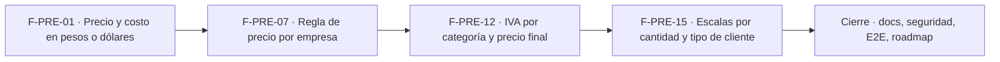

# Tasks: Precios y dólar · Precios e IVA

**Input**: [spec.md](./spec.md) y [plan.md](./plan.md) · **Épica**: MSF-114
**Formato**: `- [ ] T### [P] [Historia][USx] descripción (FR/SC)`. `[P]` = paralelizable (archivos distintos, sin dependencia dentro del mismo grupo). Cada FR/SC tiene **una sola** tarea dueña. Las dependencias y el orden son **solo dentro de la misma historia**; entre historias rige la tabla *Plan de ejecución* (objetos ya mergeados, nunca una tarea abierta de otra).
**Validación por historia**: `pnpm test:db`, `pnpm lint`, `pnpm build` y `pnpm test:web` verdes antes de cerrar la fase. Cada tabla nueva: esquema `dominio` re-verificado (Principio VII).

## Phase 1: F-PRE-01 · Precio y costo en pesos o dólares

**Goal**: cotización inicial, conversión a pesos, costo y margen, evento de actividad y bloque «Precio y costo» del formulario de producto.

- [ ] T001 [F-PRE-01][US1] Migración `supabase/migrations/20261022120000_precios_cotizacion_inicial.sql`: `dominio.cotizacion_inicial` (una fila por organización, `valor > 0`, `updated_at`), RLS por organización, escritura `empresas`=`edicion`, sin delete, `anon` sin privilegios, `public.fijar_cotizacion_inicial` (`revoke … from public, anon`, `grant … to authenticated`), reversión en el encabezado (FR-001)
- [ ] T002 [F-PRE-01][US1] Migración `supabase/migrations/20261022120100_precios_conversion_central.sql`: `private.a_pesos(importe, moneda, organizacion)` y `private.precio_central_ars(producto)` (USD × cotización, ARS igual, sin cotización → `null`), sin `execute` para `anon` (FR-002)
- [ ] T003 [P] [F-PRE-01][US1] Migración `supabase/migrations/20261022120200_precios_costo_margen.sql`: vista `security_invoker` con costo en pesos y margen sobre el neto, filtrada por `rentabilidad` (sin ella no devuelve filas de costo) (FR-003)
- [ ] T004 [P] [F-PRE-01][US1] Migración `supabase/migrations/20261022120300_precios_actividad_producto.sql`: disparador que registra `producto.precio_actualizado` vía `private.insertar_actividad` ante cambio de moneda, lista o costo; sin evento si no hubo cambio (FR-004)
- [ ] T005 [F-PRE-01][US1] pgTAP `supabase/tests/database/precios_cotizacion_conversion.test.sql`: aislamiento entre dos organizaciones, permisos por rol, conversión USD/ARS, sin cotización → sin precio, costo/margen solo con `rentabilidad`, evento de actividad, `anon` sin ejecución; `rls_en_toda_tabla` verde (SC-001)
- [ ] T006 [P] [F-PRE-01][US1] `apps/web/src/lib/precios.ts` (formato de importes ARS/USD, llamadas a la vista y a `fijar_cotizacion_inicial`, mapeo de errores `23514`/`42501`/`22003` a mensajes claros) (soporte de FR-005)
- [ ] T007 [F-PRE-01][US1] `apps/web/src/components/precios/PrecioCostoBloque.tsx`: bloque «Precio y costo» (`Moneda`, `Precio de lista`, `Costo`, texto «sin IVA», hint «costo $ … · con dólar $ … (fecha)», `Cotización →`, aviso «Cargá la cotización»), validación lista > 0 y costo ≥ 0 con error en el campo (FR-005)
- [ ] T008 [P] [F-PRE-01][US1] `apps/web/src/components/precios/MargenEstimado.tsx`: «Margen estimado (escala x1)» y nota «Margen = Precio − Costo − Comisión del canal…», oculto sin `rentabilidad` (FR-006)
- [ ] T009 [F-PRE-01][US1] Integrar el bloque y el margen en `pages/productos/create.tsx` y `edit.tsx` + Vitest del bloque (validación, hint, margen, ocultamiento sin `rentabilidad`, teclado/lector) (SC-002)

**Checkpoint F-PRE-01**: `pnpm test:db`, `pnpm lint`, `pnpm build` y `pnpm test:web` verdes.

## Phase 2: F-PRE-07 · Regla de precio por empresa

**Goal**: tabla `precios_empresa`, RPC de guardado, cálculo del neto, vista y pestaña «Precios y moneda».

- [x] T010 [F-PRE-07][US2] Migración `supabase/migrations/20261022130000_precios_empresa.sql`: `dominio.precios_empresa` (`empresa_id` único, `organizacion_id`, `base`, `ajuste_pct`, `redondeo_pesos` = 10, `updated_at`), FK compuesta `(empresa_id, organizacion_id)`, RLS por organización y sección `empresas`, sin delete, `anon` sin privilegios, reversión en el encabezado (FR-008)
- [x] T011 [F-PRE-07][US2] Migración `supabase/migrations/20261022130100_precios_empresa_rpc.sql`: `public.guardar_regla_precio_empresa` (valida base y ajuste `> −100`, bloqueo optimista por `updated_at`, idempotente, `edicion` en `empresas`, evento `empresa.regla_precio_actualizada`) (FR-009)
- [x] T012 [F-PRE-07][US2] Migración `supabase/migrations/20261022130200_precios_empresa_calculo.sql` (parte 1): `private.precio_neto_empresa(producto, empresa)` con redondeo «Al $ 10 más cercano» y empresa sin regla ≡ «Igual al central» (FR-010)
- [x] T013 [F-PRE-07][US2] Misma migración `…130200` (parte 2): vista `public.precios_empresa_neto` (`security_invoker`) y RPC `public.previsualizar_precios_empresa(empresa, base, ajuste)` para la vista previa en servidor (FR-011)
- [x] T014 [F-PRE-07][US2] pgTAP `supabase/tests/database/precios_empresa.test.sql`: aislamiento entre dos organizaciones, permisos por rol, redondeo, ajuste +/−, dos empresas con reglas distintas, conflicto de edición, rango, `anon` sin ejecución (SC-003)
- [x] T015 [P] [F-PRE-07][US2] `apps/web/src/hooks/usePreciosEmpresa.ts` y `lib/precios.ts` (extensión de tipos): lectura de la regla y de la vista, llamada a la vista previa, invalidación por `empresa_id` (soporte de FR-012 y FR-014)
- [x] T016 [F-PRE-07][US2] `apps/web/src/components/precios/ReglaPrecioEmpresa.tsx`: bloques «Precio de venta de <Empresa>» (`Base`, `Ajuste`, `Redondeo`, nota de precio propio) y «Moneda y cotización» (`ARS · Peso argentino`, `La general del sistema`, dólar vigente, `Cotización →`), `Guardar` y aviso «Precios de la empresa guardados» (FR-012)
- [x] T017 [P] [F-PRE-07][US2] `apps/web/src/components/precios/TablaAsiQuedan.tsx`: tabla «Así quedan los precios» (`Producto (muestra)`, `Central`, `<Empresa> · Sin IVA/Con IVA incluido`) con vista previa del ajuste sin guardar (FR-013)
- [x] T018 [F-PRE-07][US2] `apps/web/src/pages/empresas/precios.tsx` + ruta como pestaña `Precios y moneda` de la empresa, protegida por nivel de sección `empresas`, `Cambiar a <otra empresa> ↔` a la misma pestaña, reinicio del formulario y de las consultas al abrir otra empresa (FR-014)
- [x] T019 [F-PRE-07][US2] Vitest de la pestaña: guardado, vista previa, conflicto, solo lectura sin permiso, **abrir otra empresa no arrastra datos**, estados de carga/error, teclado/lector (SC-004)

**Checkpoint F-PRE-07**: `pnpm test:db`, `pnpm lint`, `pnpm build` y `pnpm test:web` verdes.

## Phase 3: F-PRE-12 · IVA por categoría y precio final

**Goal**: alícuotas, IVA por categoría y producto, interruptor por empresa y precio final.

- [ ] T020 [F-PRE-12][US3] Migración `supabase/migrations/20261022140000_alicuotas_iva.sql`: `dominio.alicuotas_iva` (por organización: nombre, `porcentaje`, `exento`, `activa`), RLS, siembra 21 % / 10,5 % / Exento para organizaciones existentes y disparador para las nuevas, `anon` sin privilegios, reversión en el encabezado (FR-015)
- [ ] T021 [F-PRE-12][US3] Migración `supabase/migrations/20261022140100_categorias_productos_alicuota.sql` (parte 1): `dominio.categorias.alicuota_iva_id` (FK compuesta; existentes en 21 %) y `public.guardar_alicuota_categoria` (`categorias`=`edicion`) (FR-016)
- [ ] T022 [F-PRE-12][US3] Misma migración `…140100` (parte 2): `dominio.productos.alicuota_iva_id` nullable, `private.alicuota_producto(producto)` (propia o de la categoría) y evento `producto.precio_actualizado` ante cambio de IVA (FR-017)
- [ ] T023 [F-PRE-12][US3] Migración `supabase/migrations/20261022140200_precios_empresa_iva.sql` (parte 1): `precios_empresa.mostrar_con_iva` (por defecto falso) y extensión aditiva de `guardar_regla_precio_empresa` con evento de actividad (FR-018)
- [ ] T024 [F-PRE-12][US3] Misma migración `…140200` (parte 2): vista `public.precios_empresa_final` (neto, alícuota, final al peso entero, precio visible; Exento ⇒ final = neto) (FR-019)
- [ ] T025 [F-PRE-12][US3] pgTAP `supabase/tests/database/precios_iva.test.sql`: aislamiento en `alicuotas_iva`, herencia producto/categoría, 29.186 → 35.315 al 21 %, Exento, interruptor distinto por empresa, margen invariable, evento, `anon` sin ejecución (SC-005)
- [ ] T026 [P] [F-PRE-12][US3] `apps/web/src/lib/iva.ts` y `hooks/useAlicuotas.ts` (lista de alícuotas, formato «21 %», «Exento», cálculo de texto de ejemplo desde la vista) (soporte de FR-020, FR-021 y FR-022)
- [ ] T027 [P] [F-PRE-12][US3] Pantalla Categorías: columna `IVA` y campo `IVA de la categoría` en el diálogo Nueva/Editar con la nota de opciones (sin 27 % hasta existir) (FR-020)
- [ ] T028 [P] [F-PRE-12][US3] Formulario de producto: campo `IVA` (hereda de la categoría o propio) y texto «Con IVA 21 %: $ … (IVA $ …)» en `components/precios/IvaProducto.tsx` (FR-021)
- [ ] T029 [F-PRE-12][US3] Pestaña «Precios y moneda»: `Precios que ve el cliente` (`Sin IVA` / `Con IVA incluido`), texto con el ejemplo calculado y columna final de «Así quedan los precios» (FR-022)
- [ ] T030 [F-PRE-12][US3] Vitest de Categorías (columna e IVA), campo IVA del producto, interruptor y ejemplo de la pestaña (SC-006)
- [ ] T031 [F-PRE-12][US3] Regenerar tipos de Supabase y actualizar `docs/schema.html`/`pnpm schema:doc` si aplica, y verificar el esquema `dominio` de las tablas tocadas (soporte de FR-015…FR-019)

**Checkpoint F-PRE-12**: `pnpm test:db`, `pnpm lint`, `pnpm build` y `pnpm test:web` verdes.

## Phase 4: F-PRE-15 · Escalas de precio por cantidad y tipo de cliente

**Goal**: precios por escala del producto y `private.precio_para`.

- [ ] T032 [F-PRE-15][US4] Migración `supabase/migrations/20261022150000_producto_precios_escala.sql`: `dominio.producto_precios_escala` (`producto_id`, `escala` ∈ x5/x10/x50, `precio` ≥ 0), FK compuesta `(producto_id, organizacion_id)`, RLS por organización y `productos`, sin delete, `anon` sin privilegios, reversión en el encabezado (FR-024)
- [ ] T033 [F-PRE-15][US4] Migración `supabase/migrations/20261022150100_precio_para.sql`: `private.precio_para(producto, empresa, escala default 'x1')` → neto, alícuota, final y escala usada (escala sin precio → lista; escala inexistente → error claro; no consulta `tipos_cliente`) (FR-025)
- [ ] T034 [F-PRE-15][US4] Misma migración `…150000`: RPC `public.guardar_precios_escala` (`productos`=`edicion`, `revoke … from public, anon`, `grant … to authenticated`) (soporte de FR-026)
- [ ] T035 [F-PRE-15][US4] pgTAP `supabase/tests/database/precios_escala.test.sql`: aislamiento entre dos organizaciones, permisos, escala faltante cae en lista, escala inválida da error, `precio_para` con regla de empresa e IVA, `anon` sin ejecución (SC-007)
- [ ] T036 [P] [F-PRE-15][US4] `apps/web/src/lib/escalas.ts` (escalas `x1…x50` con su rango «1 a 4 u.», «5 a 9 u.», «10 a 49 u.», «50 u. o más», llamada a `guardar_precios_escala`, márgenes por escala) (soporte de FR-026)
- [ ] T037 [F-PRE-15][US4] `apps/web/src/components/precios/EscalasPrecio.tsx`: bloque «Precios por escala · sin IVA» con las cuatro escalas, márgenes, etiquetas «todos»/«mayoristas» y texto adaptado a «cada tipo de cliente usa su escala»; margen oculto sin `rentabilidad` (FR-026)
- [ ] T038 [P] [F-PRE-15][US4] Prueba de contrato `tipos_cliente.escala_precio`: tipo simulado «Mayorista» = `x5` que llama a `precio_para` (pgTAP con tabla temporal + Vitest del mapeo) (FR-027)
- [ ] T039 [F-PRE-15][US4] Integrar `EscalasPrecio` en `pages/productos/create.tsx` y `edit.tsx`
- [ ] T040 [F-PRE-15][US4] Vitest del bloque de escalas (carga, márgenes, validación, ocultamiento de margen sin `rentabilidad`, teclado/lector) (SC-008)

**Checkpoint F-PRE-15**: `pnpm test:db`, `pnpm lint`, `pnpm build` y `pnpm test:web` verdes.

## Phase 5: Cierre (docs, seguridad, verificación de la épica)

**Goal**: lo que ninguna historia atiende. Las tareas `[CIERRE]` las ejecuta la Tarea de cierre y **nunca** son prerequisito de una historia.

- [ ] T041 [P] [CIERRE] `docs/precios.md` (modelo, fórmulas, contrato `precio_para` y `tipos_cliente.escala_precio`, permisos, reversión, preguntas abiertas) y fila/sección de `docs/roadmap-template.md` (estado, link a la spec); `pnpm docs:check` verde (FR-028)
- [ ] T042 [P] [CIERRE] Revisión de seguridad de la superficie nueva: RLS en las 4 tablas, grants de RPC y vistas, `anon` sin ejecución, costo solo con `rentabilidad`, y esquema de cada tabla contra el Principio VII (FR-029)
- [ ] T043 [CIERRE] E2E: crear un producto en USD con costo, ver su precio en dos empresas con reglas distintas, cambiar el interruptor de IVA y comprobar precio final y margen (SC-009)
- [ ] T044 [CIERRE] `pnpm lint`, `pnpm build`, `pnpm infra:config`, `pnpm test`, `rls_en_toda_tabla` verde y `pnpm prototipo:check`/`pnpm matriz:check` (SC-010)

**Checkpoint Cierre**: ninguna tarea queda `[ ]` sin hacerse o cerrarse con `Desvío:` y seguimiento trazado.

## Dependencias

Dentro de F-PRE-01: T001 → T002 → (T003 [P], T004 [P]) → T005; T006 [P] puede arrancar con T001 → T007 → (T008 [P]) → T009.
Dentro de F-PRE-07: T010 → T011 → T012 → T013 → T014; T015 [P] desde T010 → T016 → (T017 [P]) → T018 → T019.
Dentro de F-PRE-12: T020 → T021 → T022 → T023 → T024 → T025; T026 [P] desde T020 → (T027 [P], T028 [P]) → T029 → T030 → T031.
Dentro de F-PRE-15: T032 → T033 → T034 → T035; T036 [P] desde T032 → T037 → T039 → T040; T038 [P] con T033.
Cierre: T041 [P] y T042 [P] pueden arrancar cuando todas las historias estén mergeadas; T043 → T044 al final.
Entre historias (de entrega): F-PRE-07 requiere F-PRE-01 (conversión a pesos); F-PRE-12 requiere F-PRE-07 (`precios_empresa`) y MSF-160 (`categorias`); F-PRE-15 requiere F-PRE-12 (alícuota para el final). Las cuatro tocan los formularios de producto o la pestaña de empresa, por eso van en serie.

## Plan de ejecución (historias)

El **orden de toma** de las historias lo declara esta tabla: el orquestador la **consume** (no lo infiere del orden de las tareas). Una historia arranca cuando sus dependencias (`Depende de`) están **Finalizadas (mergeadas)**; las del **mismo** `Grupo` van **en paralelo**. Aquí hay dependencias reales (objetos de base y archivos compartidos: formularios de producto, pestaña de empresa, `precios_empresa`), por eso cada grupo tiene una sola historia.

| Historia | Depende de | Grupo |
|----------|------------|-------|
| F-PRE-01 | — | 1 |
| F-PRE-07 | F-PRE-01 | 2 |
| F-PRE-12 | F-PRE-07 | 3 |
| F-PRE-15 | F-PRE-12 | 4 |
| [Cierre] | F-PRE-01, F-PRE-07, F-PRE-12, F-PRE-15 | 5 |

