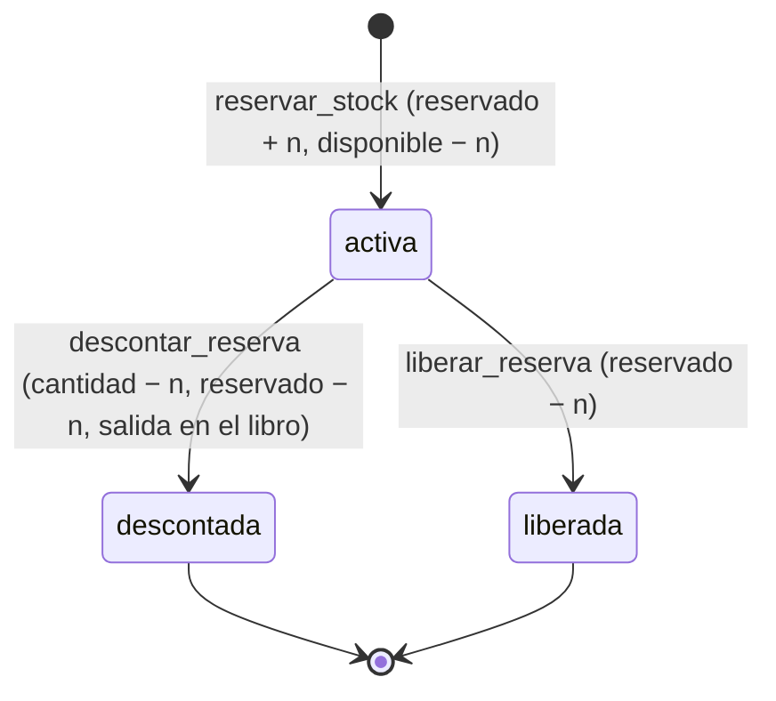
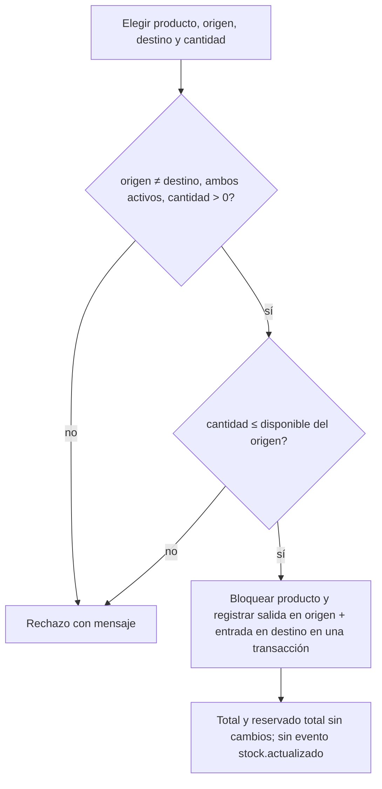
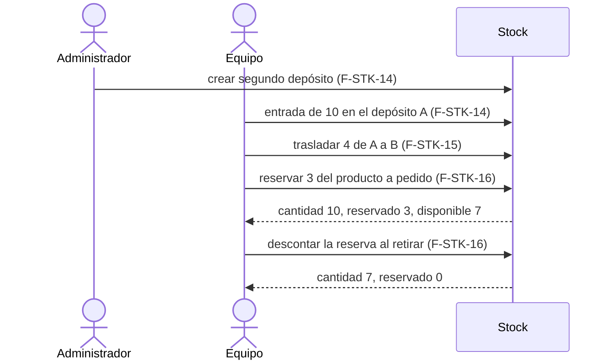

# Feature Specification: Stock · Stock depósitos y reservas

**Feature Branch**: `epic/MSF-292-stock-stock-depositos-y-reservas`

**Jira Epic**: MSF-292 — Stock · Stock depósitos y reservas (spec `stock-depositos-y-reservas`)

**Created**: 2026-10-22

**Status**: Ready for implementation — la especificación viene completa desde Jira. Los puntos de «A revisar» y las decisiones de traducción figuran en *Decisiones* (algunas quedan para el OK de Nicolás).

**Delivery scope**: `refine` (apps/web) y `supabase` (migraciones + pgTAP). Sin `kestra`, `superset` ni `workers`.

**Prioridad / Hito**: P0 · Hito 2 (2 al 20 de noviembre de 2026) · 20 h (M+S+M, coincide con la fuente) · alcance diciembre.

**Dependencias**:
- Bloqueada por: MSF-231 (Stock único y alertas: `stock.actualizado`, cola de eventos, listado `/stock` con Realtime) — **ya integrada** en la rama base (verificado: `origin/epic/MSF-231-…` es ancestro de `origin/dokploy`). Y MSF-179 (Catálogo · costo y disponibilidad: `dominio.productos.disponibilidad_manual` y `private.disponibilidad_producto`) — **su rama aún NO está integrada en la base**; F-STK-16 no se implementa hasta que lo esté (ver *Decisiones*, D-1).
- Dependencia indirecta, sin link: MSF-136 (Stock movimientos), a través de MSF-231.
- Bloquea a: épicas de otros componentes (ventas, service) que lo declaran en su propio texto.
- Relacionada, sin bloqueo: el formulario de venta (Consultas y ventas / Ventas y despacho) usa `reservar_stock`, `liberar_reserva` y `descontar_reserva` de F-STK-16 (el contrato de esas RPC se fija acá; la pantalla de venta no se construye acá).

**Input**: Epic MSF-292. Objetivo: «Al terminar, el administrador define los depósitos, cada producto muestra cuánto hay en cada uno sobre un stock total único, el equipo elige en qué depósito entra, sale o se traslada cada unidad, y los productos a pedido reservan al vender y descuentan recién cuando el cliente retira o recibe, sin pasar nunca el disponible.»

**Regla de fuentes** (literal de la épica):
- Comportamiento y datos: mandan los requisitos y escenarios de esta spec.
- Qué se ve (disposición, textos, estados, popups, flujos): el prototipo validado es la referencia visual y hay que ser lo más fiel posible (no se exige idéntico al pixel; lo que aún no se construye o queda fuera de alcance se anota, no se omite).
- Cómo se construye (componentes, estilos y patrones): mandan el template y el sistema de diseño (MSF-117, `docs/sistema-de-diseno.md`). No se copia HTML ni CSS del prototipo.
- El prototipo muestra más que esta épica: se implementa solo lo que piden F-STK-14, F-STK-15 y F-STK-16.
- Si algo no se puede igualar: lo más cercano, sin inventar, anotando la diferencia en el PR. Si prototipo y requisitos se contradicen: requisitos para el comportamiento, prototipo para lo visual, y la contradicción queda anotada en el PR.
- Prototipos (solo lectura, presentes en el árbol; la rama `design/prototipo` no existe en `origin` hoy): `design/pantallas/Depositos.dc.html`, `Stock.dc.html` y `StockMovimientos.dc.html`. **El prototipo no dibuja la acción «Trasladar»** (la épica lo anota: hay que dibujarla); se construye con los componentes del sistema de diseño y la diferencia se anota en el PR.

## Modelo y supuestos

- **Hoy hay un solo depósito**, pero el modelo y las pantallas admiten **N depósitos por organización**.
- **El stock sigue siendo uno por producto**, compartido entre empresas y canales: `dominio.existencias.cantidad` es el **stock total único** y es siempre la suma de las cantidades por depósito (se mantiene en la misma transacción).
- **Disponible = cantidad − reservado**, por depósito y en total. **El stock negativo sigue bloqueado, ahora sobre el disponible**: ninguna salida, traslado ni reserva puede dejar el disponible de un depósito por debajo de 0.
- **La reserva de F-STK-16 aplica a los productos «A pedido»** (`private.disponibilidad_producto(producto) = 'a_pedido'`, MSF-179). La reserva manual a un cliente (F-STK-12, P3) queda aparte.
- **La venta elige el depósito en cada línea**: `reservar_stock` recibe el depósito.
- **Una sola vía de escritura** de cantidad y reservado: `registrar_movimiento_stock`, `trasladar_stock` y las RPC de reserva (todas *security definer*, serializan por producto). Ningún `insert/update` directo desde la app.
- **Permisos** (contrato vigente `private.nivel_seccion('stock')`): `lectura` ve; `edicion` registra movimientos, traslada y reserva/libera/descuenta; **solo el Administrador define depósitos** («el administrador define los depósitos»); `ninguno` no accede.
- **Stock y depósitos son de la organización, no de una empresa**: las pantallas de stock no se filtran por empresa activa; la única relación con empresas es «Venden desde acá» (qué empresas pueden vender desde cada depósito), que sí alimenta el filtro de la pantalla Depósitos (prototipo, Principio VIII).

### Esquema de datos (Constitución, Principio VII)

Todas son entidades de negocio de Stock → esquema **`dominio`** (ninguna es transversal de plataforma). Verificado contra las migraciones existentes y el grafo (`dominio.existencias`, `movimientos_stock`, `motivos_movimiento`, `empresas`, `productos` existen; `depositos`, `existencias_deposito`, `reservas_stock` **no existen** y las crean las migraciones de esta épica).

| Objeto | Esquema | Historia | Justificación | RLS |
|--------|---------|----------|---------------|-----|
| `depositos` (nueva) | **`dominio`** | F-STK-14 | Entidad de negocio del producto (dónde está la mercadería). | Select: `organizacion_id = private.organizacion_id()` y `nivel_seccion('stock') in ('lectura','edicion')`. Insert/update: Administrador (`private.puede_escribir()` + `private.es_administrador_de`). Sin DELETE (se desactivan). `anon` sin privilegios. |
| `depositos_empresas` (nueva) | **`dominio`** | F-STK-14 | Relación depósito↔empresa («Venden desde acá»); ambas entidades son de dominio. | Mismo criterio que `depositos`. |
| `existencias_deposito` (nueva) | **`dominio`** | F-STK-14 | Cantidad y reservado por producto y depósito. | Select por organización y `nivel_seccion('stock')`; sin escritura para `authenticated`; la escriben solo las RPC. Publicada en Realtime. |
| `existencias` (existente, MSF-136) | **`dominio`** | F-STK-14 | Se le agrega `reservado integer not null default 0` (aditivo); `cantidad` pasa a ser el total derivado de los depósitos. | Sin cambios. |
| `movimientos_stock` (existente) | **`dominio`** | F-STK-14 / F-STK-15 | F-STK-14 agrega `deposito_id`; F-STK-15 agrega `traslado_id` (cada una en su migración). El libro sigue siendo de solo agregado. | Sin cambios. |
| `reservas_stock` (nueva) | **`dominio`** | F-STK-16 | Reservas de productos a pedido: negocio de Stock. | Select por organización y `nivel_seccion('stock')`; sin escritura directa; solo las RPC. |
| `cola_eventos` (existente, MSF-231) | **`public`** | F-STK-14 / F-STK-16 | Transversal; no se altera la tabla, solo la carga del evento. | Sin cambios. |

La prueba pgTAP de aislamiento recorre `public` + `dominio` y debe seguir verde con las tablas nuevas. El esquema de cada tabla se re-verifica en spec, plan, tareas, implementación y revisión (tarea de cierre).

**Contratos que cambian (alto riesgo, gate humano):** `registrar_movimiento_stock` (+1 parámetro final opcional `p_deposito`), la carga de `stock.actualizado` (campos aditivos) y los cuerpos de `private.disponibilidad_producto` / `private.productos_con_stock` (MSF-179; mismo resultado observable mientras no haya reservas).

## Navegación y patrones del panel (Principio VI)

- **Pantalla Depósitos**: pestaña «Depósitos de mercadería» dentro de Stock, ruta canónica **`/stock/depositos`**, bajo el ítem existente «Stock» de la navegación (mismo icono y audiencia que Stock; la pestaña la ve quien tiene `lectura` y la edita el Administrador). Sin rutas anteriores que preservar. Una pantalla de gestión por producto: no se crea otra de personas ni de configuración.
- **Trasladar**: acción dentro del listado Stock actual (diálogo), sin ruta nueva.
- Estados de carga, vacío, error y éxito con los patrones compartidos del kit de panel (`docs/kit-panel.md`); teclado, lector de pantalla y anchos de 320/768/1440 px; sin identificadores técnicos (uuid) como identidad visible: los depósitos se muestran por nombre.
- Peso inicial: sin librerías nuevas; el diálogo de traslado se carga junto a la lista (mismo patrón que `NuevoMovimientoDialog`).

## Decisiones tomadas al traducir («A revisar» y huecos)

- **D-1 (hold de orquestación).** La instrucción del CTO (AGE-566) mantenía la épica bloqueada hasta que MSF-231 esté integrada y MSF-179 aprobada en DEV. Luego el orquestador publicó «MSF-292 — desbloqueada» (MSF-179 desplegada en DEV) y despachó al Especificador; se especifica con eso. Verificado en git: MSF-231 integrada; **MSF-179 no está en la rama base todavía**. Consecuencia: F-STK-14 y F-STK-15 no la necesitan y pueden implementarse; **F-STK-16 requiere la migración `20261022120000_catalogo_disponibilidad.sql` en la base** (su tarea de arranque lo verifica y, si falta, se detiene y lo reporta). No se asume ninguna decisión de Nicolás sobre MSF-179.
- **D-2 (épica 5 vs. épica 6).** Esta épica supera en parte a «stock-reservas-y-depositos» (P3: F-STK-12 reserva manual, F-STK-13 múltiples depósitos), que no está cargada en Jira. Alcance de esta spec: solo F-STK-14/15/16. F-STK-12 queda fuera. *Para Nicolás*: confirmar si F-STK-12/13 se cargan como Backlog o se dan por absorbidas (F-STK-13 queda cubierta por F-STK-14).
- **D-3 (prioridad F-STK-13).** El documento de Clientes dice P0 y Stock dice P3: no afecta esta spec (se entrega F-STK-14 en P0). Solo se anota.
- **D-4 (stock por depósito en el listado).** El prototipo de Stock actual muestra el stock «Local y Depósito» con opciones «Depósito principal» / «Local mostrador». Se implementa un **control de depósito** (Todos los depósitos + cada depósito activo): con «Todos» las columnas Stock/Reservado/Disponible muestran los totales únicos; con un depósito, las cifras de ese depósito. Sin columnas por depósito fijas (con N depósitos no escalan). *Para Nicolás*: confirmar esta lectura de «columnas por depósito».
- **D-5 (traslado y evento).** Un traslado **no cambia el stock total**, por eso **no emite `stock.actualizado`** (los canales externos ven solo totales). Dejará dos movimientos vinculados (salida en el origen, entrada en el destino) con un motivo de sistema «Traslado entre depósitos». *Para Nicolás*: confirmar.
- **D-6 (evento y reservas).** `stock.actualizado` se amplía con `deposito_id`, `reservado` y `disponible` (campos aditivos; los consumidores existentes siguen válidos) y también se emite cuando una reserva o liberación cambia el disponible (con `diferencia = 0`), porque los canales venden contra el disponible. *Para Nicolás*: confirmar.
- **D-7 (motivo en descuento).** `descontar_reserva` registra una salida con un motivo de sistema «Entrega de producto a pedido» (se crea por organización la primera vez, `aplica_a = {salida}`), sin cambiar la restricción de motivo obligatorio del libro.
- **D-8 (idempotencia).** `reservar_stock` acepta una `p_referencia` opcional (p. ej. la línea de venta); con la misma referencia no duplica la reserva. La define quien llama (ventas); acá solo se garantiza.
- **D-9 (backfill).** La migración crea el depósito «Depósito principal» (por defecto, activo) en cada organización con existencias y asigna toda la cantidad actual a él, y los movimientos históricos quedan con ese depósito: el total no cambia.
- **D-10 (Excel / Faltantes).** Las pestañas «Faltantes» y «Actualizar por Excel» son de MSF-368 u otra épica: fuera de alcance.

## User Scenarios & Testing *(mandatory)*

### US1 — F-STK-14 · Depósitos y existencias por depósito (P0, M)

El administrador crea y administra depósitos; cada producto muestra su stock por depósito sobre un total único; quien registra un movimiento elige el depósito.

**Escenarios de aceptación**
1. *Dado* una organización con el «Depósito principal», *cuando* el Administrador crea «Depósito Sur» (dirección y empresas que venden desde acá), *entonces* aparece en la tabla con 0 productos y 0 unidades, activo y no por defecto, con el aviso «Depósito creado».
2. *Dado* dos depósitos, *cuando* se registra una entrada de 10 en uno, *entonces* el producto muestra Stock total 10, y con el control de depósito en ese depósito 10, y en el otro 0.
3. *Dado* un depósito con unidades, *cuando* el Administrador intenta desactivarlo, *entonces* se rechaza con «Tiene stock: trasladá la mercadería antes de desactivarlo».
4. *Dado* el depósito por defecto, *cuando* se intenta desactivar, *entonces* se rechaza con «El depósito por defecto no se puede desactivar»; *cuando* otro depósito pasa a ser por defecto, queda exactamente uno y aparece «<Nombre> es ahora el depósito por defecto».
5. *Dado* stock 5 en un depósito, *cuando* se registra una salida de 6 en él, *entonces* se rechaza con «No hay stock suficiente» y no deja movimiento ni evento, aunque otro depósito tenga unidades.
6. *Dado* un producto con reservado 3 y cantidad 5 en un depósito, *cuando* se registra una salida de 3, *entonces* se rechaza (el disponible es 2).
7. *Dado* el diálogo «Registrar movimiento de stock», *entonces* ofrece «Depósito de mercadería» con los depósitos activos y el por defecto preseleccionado; un llamador anterior que no envía depósito usa el por defecto.
8. *Dado* una empresa elegida en la barra superior, *cuando* se mira Depósitos, *entonces* solo se listan los depósitos desde los que esa empresa puede vender; con «Todas» se listan todos; al cambiar de empresa la tabla se recarga y no queda fila de la anterior; un diálogo abierto se cierra con aviso.
9. *Dado* un usuario con `lectura`, *entonces* ve Depósitos y stock por depósito sin botones de edición; con `ninguno` no accede.

### US2 — F-STK-15 · Traslado entre depósitos (P0, S)

El equipo traslada unidades de un depósito a otro sin cambiar el stock total.

**Escenarios de aceptación**
1. *Dado* 10 unidades en el depósito A, *cuando* se trasladan 4 a B, *entonces* A tiene 6, B tiene 4, el total sigue en 10 y quedan dos movimientos vinculados (salida en A, entrada en B) visibles en Movimientos con su depósito.
2. *Dado* A con 6 de las cuales 3 reservadas, *cuando* se intentan trasladar 4, *entonces* se rechaza (disponible 3) sin cambios.
3. *Dado* origen = destino, cantidad ≤ 0 o un depósito inactivo, *entonces* se rechaza con un mensaje claro.
4. *Dado* 10 traslados simultáneos de 1 desde un depósito con disponible 5, *entonces* exactamente 5 se aceptan y 5 se rechazan, sin pasar el disponible.
5. *Dado* un usuario con `lectura`, *entonces* no ve la acción «Trasladar».

### US3 — F-STK-16 · Reserva y descuento de productos a pedido (P0, M)

Los productos a pedido reservan al vender y descuentan recién cuando el cliente retira o recibe.

**Escenarios de aceptación**
1. *Dado* un producto «A pedido» con 10 en un depósito, *cuando* se reservan 3 en él, *entonces* cantidad 10, reservado 3, disponible 7.
2. *Dado* esa reserva, *cuando* se descuenta, *entonces* cantidad 7, reservado 0, disponible 7, queda una salida en el libro en ese depósito y la reserva pasa a «descontada».
3. *Dado* esa reserva, *cuando* se libera, *entonces* reservado vuelve a 0, la cantidad no cambia y la reserva pasa a «liberada».
4. *Dado* una reserva ya descontada o liberada, *cuando* se intenta descontar o liberar de nuevo, *entonces* se rechaza («La reserva ya fue descontada/liberada») sin doble descuento.
5. *Dado* un producto que no es «A pedido», *cuando* se intenta reservar, *entonces* se rechaza.
6. *Dado* disponible 4, *cuando* se reservan 5, *entonces* se rechaza («No hay stock suficiente»); con 8 reservas simultáneas de 1 sobre disponible 5, exactamente 5 se aceptan.
7. *Dado* la misma `p_referencia`, *cuando* se reserva dos veces, *entonces* hay una sola reserva.
8. *Dado* una reserva activa, *entonces* el producto sigue mostrando el estado «A pedido» (la etiqueta manual manda) y los productos derivados pasan a «Sin stock» cuando el disponible llega a 0.

### Verificación de la épica (E2E, dueña: tarea de cierre)

Crear un segundo depósito, cargar una entrada de 10 en uno, trasladar 4 al otro, reservar 3 de un producto a pedido, ver disponible 7, descontar al retirar y ver cantidad 7 y reservado 0; más pgTAP y prueba de concurrencia sobre el disponible.

## Flujos

### Estados de una reserva (F-STK-16)

| Estado / transición | Dueño |
|---------------------|-------|
| `activa` / reservar | FR-031, FR-032 |
| `activa → descontada` | FR-034 |
| `activa → liberada` | FR-033 |
| Transiciones desde estados finales (rechazo) | FR-035 |

### Traslado entre depósitos (F-STK-15)

| Paso | Dueño |
|------|-------|
| Validaciones de entrada | FR-021 |
| Control contra el disponible del origen | FR-021, FR-024 |
| Dos movimientos vinculados en una transacción | FR-022 |
| Total sin cambios, sin evento | FR-023 |

### Verificación de la épica (secuencia)

Cada paso de la secuencia mapea a los FR de la historia indicada; la secuencia completa la ejecuta la tarea de cierre (SC-008).

## Requirements *(mandatory)*

### F-STK-14 · Depósitos y existencias por depósito

- **FR-001**: Cada organización tiene N depósitos (`dominio.depositos`: nombre ≤ 80 sin distinguir mayúsculas y único por organización, dirección opcional ≤ 200, activo, por defecto); exactamente **uno** activo por defecto. La migración crea «Depósito principal» y reparte el stock actual (D-9).
- **FR-002**: El Administrador crea un depósito (diálogo «Nuevo depósito de mercadería»: Nombre, Dirección, «Pueden vender desde acá» = empresas de la organización) y edita uno existente con el mismo formulario.
- **FR-003**: «Usar por defecto» cambia el depósito por defecto en una transacción (siempre queda uno); el por defecto no puede desactivarse.
- **FR-004**: El interruptor «Activo» desactiva/activa; un depósito con unidades no puede desactivarse (nota al pie del prototipo y mensaje de rechazo). Un depósito inactivo no se ofrece en selectores ni admite entradas.
- **FR-005**: La tabla Depósitos muestra Depósito, Dirección, Venden desde acá (una etiqueta por empresa), Productos con stock, Unidades, Por defecto, Activo y acciones; y se filtra por la empresa activa (Principio VIII) según «Venden desde acá».
- **FR-006**: Solo el Administrador crea, edita, cambia el por defecto y activa/desactiva depósitos; `lectura`/`edicion` solo leen; RLS por organización; `anon` sin privilegios.
- **FR-007**: `dominio.existencias_deposito` guarda cantidad y reservado por producto y depósito (`cantidad ≥ 0`, `reservado ≥ 0`, `reservado ≤ cantidad`); `existencias.cantidad` y `existencias.reservado` son las sumas, actualizadas en la misma transacción que cada cambio. Solo las RPC escriben.
- **FR-008**: `registrar_movimiento_stock` recibe `p_deposito` (parámetro final opcional; por defecto, el depósito por defecto) y aplica entrada/salida/ajuste a ese depósito; los llamadores anteriores siguen funcionando; el libro guarda `deposito_id` en cada movimiento.
- **FR-009**: Salidas y ajustes no pueden dejar el disponible del depósito (cantidad − reservado) por debajo de 0; el rechazo mantiene el mensaje «No hay stock suficiente» y no deja movimiento, evento ni actividad. Las operaciones simultáneas sobre un producto se serializan.
- **FR-010**: El diálogo «Registrar movimiento de stock» agrega el campo «Depósito de mercadería» (depósitos activos, por defecto preseleccionado).
- **FR-011**: El listado Stock actual muestra las columnas Stock, Reservado y Disponible y un control de depósito (D-4); Realtime refresca también `existencias_deposito`; el estado y las alertas (MSF-231) se calculan sobre el disponible total.
- **FR-012**: Movimientos muestra la columna «Depósito» en el detalle y las columnas «Reserv.» y «Disp.» en el resumen por producto.
- **FR-013**: `stock.actualizado` se amplía con `deposito_id`, `reservado` y `disponible` (aditivo, D-6); sigue emitiéndose una vez por movimiento, en la misma transacción.
- **FR-014**: La pestaña «Depósitos de mercadería» (`/stock/depositos`) se agrega a las pestañas de Stock con ruta, permisos y estados de panel (Principio VI).
- **FR-015**: Tablas nuevas con RLS por organización, esquema `dominio`, migraciones aditivas con reversión en el encabezado; la prueba de aislamiento y las de `anon`/`authenticated` siguen verdes.

### F-STK-15 · Traslado entre depósitos

- **FR-020**: RPC `trasladar_stock(p_producto, p_origen, p_destino, p_cantidad, p_nota, p_fecha)` (*security definer*, `search_path = ''`, `revoke … from public, anon`, `grant execute … to authenticated`, exige `nivel_seccion('stock') = 'edicion'`).
- **FR-021**: Rechaza origen = destino, cantidad no entera o ≤ 0, depósitos inactivos o de otra organización, fecha futura y cantidad mayor que el **disponible del origen**; el rechazo no deja rastro.
- **FR-022**: Un traslado exitoso deja dos movimientos vinculados por `traslado_id` (salida en el origen, entrada en el destino) con el motivo de sistema «Traslado entre depósitos», en una sola transacción.
- **FR-023**: El total y el reservado totales del producto no cambian; no se emite `stock.actualizado` (D-5).
- **FR-024**: Traslados simultáneos sobre un producto se serializan y nunca pasan el disponible del origen.
- **FR-025**: El listado Stock actual agrega la acción «Trasladar» (solo con `edicion`) que abre un diálogo: Producto, Depósito de origen, Depósito de destino, Cantidad, Nota (opcional) y Fecha; muestra el disponible del origen y el resultado en ambos depósitos (aviso «Traslado registrado»).
- **FR-026**: Los dos movimientos aparecen en Movimientos con su depósito y se distinguen como traslado.

### F-STK-16 · Reserva y descuento de productos a pedido

- **FR-030**: `dominio.reservas_stock` (producto, depósito, cantidad, estado `activa | descontada | liberada`, referencia opcional, responsable, fechas); solo las RPC escriben; RLS por organización.
- **FR-031**: `reservar_stock(p_producto, p_deposito, p_cantidad, p_referencia)` crea una reserva `activa` solo si el producto es «A pedido» y la cantidad ≤ disponible del depósito; incrementa `reservado` en depósito y total.
- **FR-032**: Idempotencia: la misma `p_referencia` no duplica la reserva (D-8); las operaciones simultáneas se serializan y el disponible nunca queda < 0.
- **FR-033**: `liberar_reserva(p_reserva)` pasa `activa → liberada` y reduce `reservado`; la cantidad no cambia.
- **FR-034**: `descontar_reserva(p_reserva)` pasa `activa → descontada`, reduce `cantidad` y `reservado` en la cantidad reservada y registra una salida en el libro en el depósito de la reserva (motivo de sistema, D-7), en una transacción.
- **FR-035**: Descontar o liberar una reserva que no está `activa` se rechaza con un mensaje claro, sin doble efecto.
- **FR-036**: `private.disponibilidad_producto` y `private.productos_con_stock` (MSF-179) pasan a evaluar el **disponible** (cantidad − reservado > 0); mismo contrato de salida.
- **FR-037**: Las tres RPC: *security definer*, `search_path = ''`, `revoke … from public, anon`, `grant execute … to authenticated`, exigen `edicion`; el contrato queda documentado para el formulario de venta.
- **FR-038**: Reservar y liberar emiten `stock.actualizado` con la carga ampliada (D-6); descontar lo emite por su salida.

## Success Criteria *(mandatory)*

- **SC-001**: Ningún camino deja `existencias.cantidad` distinto de la suma por depósito (pgTAP, incluye backfill y todas las RPC).
- **SC-002**: 20 salidas simultáneas de 1 sobre un depósito con disponible 10 → 10 aceptadas, 10 rechazadas, disponible 0 (prueba de concurrencia real).
- **SC-003**: Traslados y reservas simultáneas nunca pasan el disponible (concurrencia mixta traslado + reserva + salida).
- **SC-004**: El backfill conserva el total de cada producto y deja un único depósito por defecto por organización.
- **SC-005**: Aislamiento: otra organización no ve ni opera depósitos, existencias ni reservas; `anon` sin acceso; solo Administrador define depósitos; `rls_en_toda_tabla` y `aislamiento_organizaciones` verdes.
- **SC-006**: Los llamadores anteriores de `registrar_movimiento_stock` y el listado de MSF-231 siguen pasando sus tests.
- **SC-007**: La pantalla Depósitos y los diálogos cumplen teclado, lector de pantalla y 320/768/1440 px; el cambio de empresa reencuadra Depósitos (test).
- **SC-008**: El E2E de la épica (secuencia de arriba) pasa: cantidad 7 y reservado 0 al final.

## Matriz pantalla↔criterios

Inventario determinista con `pnpm prototipo:inventario` sobre `Depositos.dc.html`, `Stock.dc.html` y `StockMovimientos.dc.html` (los `.inventory.json` del árbol coinciden con el generado). «Ya entregado» = lo hizo MSF-136/MSF-231/MSF-368 y esta épica no lo toca; se lista para que ningún elemento visible quede sin dueño. La épica pide **menos** que el prototipo: lo no pedido no es deuda (otras épicas lo piden).

### Depósitos de mercadería (`Depositos.dc.html`)

| Ítem del inventario | Destino | Criterio |
|---------------------|---------|----------|
| Tabla, columna `Depósito` | En alcance | FR-005, US1-1 |
| Tabla, columna `Dirección` | En alcance | FR-005, FR-002 |
| Tabla, columna `Venden desde acá` | En alcance | FR-005, FR-002, US1-8 |
| Tabla, columna `Productos con stock` | En alcance | FR-005, US1-1/2 |
| Tabla, columna `Unidades` | En alcance | FR-005, US1-2 |
| Tabla, columna `Por defecto` | En alcance | FR-003, FR-005, US1-4 |
| Tabla, columna `Activo` | En alcance | FR-004, FR-005, US1-3/4 |
| Tabla, columna de acciones (sin título; editar) | En alcance | FR-002, FR-006 |
| Campo `Nombre` | En alcance | FR-001, FR-002 |
| Campo `Dirección` | En alcance | FR-001, FR-002 |
| Campo `Pueden vender desde acá` | En alcance | FR-002, FR-005 |
| Botón `Nuevo depósito de mercadería` | En alcance (solo Administrador) | FR-002, FR-006, US1-1 |
| Botón `Por defecto` / `Usar por defecto` | En alcance | FR-003, US1-4 |
| Botón `Cancelar` (diálogo) | En alcance | FR-002 |
| Botón `Crear depósito` | En alcance | FR-002, US1-1 |
| Diálogo `Nuevo depósito de mercadería` | En alcance | FR-002, US1-1 |
| Nota al pie «Un depósito con stock no se puede desactivar…» | En alcance | FR-004, US1-3 |
| Filtro de tienda del prototipo (Todas las tiendas / empresa) | En alcance (es la empresa activa de la barra superior; la pantalla no duplica el selector) | FR-005, US1-8, SC-007 |
| Pestaña `Depósitos de mercadería` | En alcance (pestaña activa) | FR-014 |
| Pestañas/botones `Stock actual`, `Movimientos`, `Ingreso de mercadería` | Ya entregado (MSF-136/MSF-231 + F-PRV-06); solo se conserva el enlace | FR-014 |
| Pestañas/botones `Faltantes`, `Actualizar por Excel` | **FUERA DE ALCANCE**: la épica no los pide (D-10) | — |

### Stock actual (`Stock.dc.html`)

| Ítem del inventario | Destino | Criterio |
|---------------------|---------|----------|
| Tabla, columna `Producto` | Ya entregado (MSF-231) | FR-011 (sin cambios) |
| Tabla, columna `Stock` | En alcance (total único / del depósito elegido) | FR-011, US1-2 |
| Tabla, columna `Reservado` | En alcance | FR-011, FR-031, US3-1 |
| Tabla, columna `Disponible` | En alcance | FR-011, US3-1 |
| Tabla, columnas `Mínimo`, `Estado`, `Último movimiento`, acciones | Ya entregado (MSF-136/MSF-231); el estado pasa a calcularse sobre el disponible | FR-011 |
| Campo `Depósito de mercadería` (diálogo) | En alcance | FR-010, US1-7 |
| Campos `Producto`, `Tipo de movimiento`, `Fecha`, `Motivo`, `Nota (opcional)` | Ya entregado (MSF-136) | FR-008 (sin cambios) |
| Campo `Tienda o canal` | **FUERA DE ALCANCE**: la épica no pide canal por movimiento | — |
| Opciones `Depósito principal` / `Local mostrador` | En alcance como control de depósito y selector (D-4) | FR-010, FR-011 |
| Botones `Nuevo movimiento`, `Movimiento`, `Entrada`, `Salida`, `Ajuste`, `Cancelar`, `Registrar`, diálogo `Registrar movimiento de stock` | Ya entregado (MSF-136), con el selector de depósito agregado | FR-008, FR-010 |
| Botón `Ver solo alertas`, campo buscar | Ya entregado (MSF-231) | FR-011 (sin cambios) |
| Botón `Ingreso de mercadería` y pestañas | Ya entregado (F-PRV-06) | FR-014 |
| Acción `Trasladar` (no está en el prototipo) | En alcance; diseño con el sistema de diseño, diferencia anotada en el PR | FR-025, US2-1 |
| Pestañas `Faltantes`, `Actualizar por Excel` | **FUERA DE ALCANCE** (D-10) | — |

### Stock · movimientos (`StockMovimientos.dc.html`)

| Ítem del inventario | Destino | Criterio |
|---------------------|---------|----------|
| Tabla 2, columna `Depósito` | En alcance | FR-012, FR-026 |
| Tabla 1, columnas `Reserv.` y `Disp.` | En alcance | FR-012 |
| Tabla 1, columnas `Producto`, `Queda`, `Estado` y el resto del detalle (`Fecha`, `Tipo`, `Comprobante o motivo`, `Tienda`, `Cant.`, `Saldo`, `Operador`) | Ya entregado (MSF-136) | FR-012 (sin cambios) |
| Tabla 1, columnas `Inicial`, `Entradas`, `Ventas`, `Devol.`, `Ajustes`, `Cobertura`, `Última venta` | **FUERA DE ALCANCE**: la épica no las pide | — |
| Botón `Exportar`, chip `Categoría: ·`, campo buscar | **FUERA DE ALCANCE** / ya entregado (buscar) — la épica no pide exportación ni filtro por categoría | — |
| Botón `Nuevo movimiento`, pestañas | Ya entregado (MSF-136) | FR-014 |

### Transversal

| Ítem | Destino | Criterio |
|------|---------|----------|
| Empresa activa (barra superior, Constitución VIII) | En alcance en Depósitos (filtra por «Venden desde acá»; al cambiar de empresa se recarga, se reencuadra y el diálogo abierto se cierra con aviso). **No aplica** a Stock actual/Movimientos: el stock es único por organización y compartido entre empresas (Modelo y supuestos); la declaración y su motivo quedan acá | FR-005, US1-8, SC-007 (test que cambia de empresa en `depositos.test.tsx`) |
