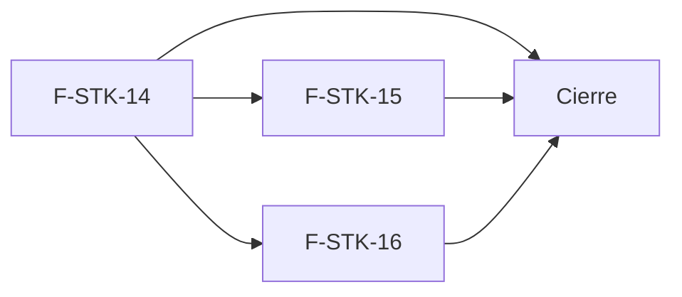

# Tasks: Stock · Stock depósitos y reservas

**Input**: `specs/20261022-180000-stock-depositos-y-reservas/` (spec.md, plan.md)

**Formato**: `- [ ] T### [P] [F-STK-xx][USy] descripción`. **[P]** = paralelizable (archivos distintos, sin dependencia; las [P] del mismo grupo van en paralelo); sin [P] = secuencial. Las dependencias de cada tarea son solo dentro de su historia. Regla del proyecto: ninguna tarea queda `[ ]` al cierre — se hace con evidencia o se cierra con `[x]` + `Desvío:` (corto, con `ver commit <hash>`) y seguimiento trazado.

**Delivery scope**: `refine`, `supabase`

**Prerrequisitos**: MSF-231 (ya integrada). MSF-179 ya integrada en `origin/dokploy` y traída a la rama (spec D-1); T024 la re-verifica antes de F-STK-16.

## Matriz de trazabilidad Jira ↔ US ↔ tasks

| Jira | Historia | FR / SC (dueño único) | Tasks |
|------|----------|-----------------------|-------|
| F-STK-14 | US1 Depósitos y existencias por depósito | FR-001, FR-007 → T001 · FR-003, FR-004, FR-006 → T002 · FR-008, FR-009 → T003 · FR-013 → T004 · FR-015, SC-001, SC-004, SC-005 → T007 · SC-006 → T008 · SC-002 → T009 · FR-014 → T010 · FR-005 → T011 · FR-002 → T012 · FR-010 → T013 · FR-011 → T014 · FR-012 → T015 · SC-007 → T016 | T001–T017 |
| F-STK-15 | US2 Traslado entre depósitos | FR-020, FR-021, FR-022, FR-023 → T018 · FR-024 → T019 · FR-025 → T020 · FR-026 → T021 | T018–T023 |
| F-STK-16 | US3 Reserva y descuento de productos a pedido | FR-030, FR-031, FR-032, FR-033, FR-034, FR-035, FR-037 → T025 · FR-036 → T026 · FR-038 → T027 | T024–T031 |
| Tarea de cierre (label `cierre`) | E2E de la épica, concurrencia mixta, esquemas/seguridad, índice de docs y roadmap | SC-003, SC-008 → T032 · verificación Principios VII/VIII → T033 · documentación/roadmap → T034 | T032–T034 |

## Phase 1: F-STK-14 · Depósitos y existencias por depósito (US1)

**Goal**: el Administrador define depósitos, cada producto muestra su stock por depósito sobre el total único y cada movimiento elige depósito.

- [ ] T001 [F-STK-14][US1] Migración `20261023120000_depositos_tablas.sql`: `dominio.depositos`, `dominio.depositos_empresas`, `dominio.existencias_deposito` (esquema `dominio`, Principio VII), `existencias.reservado`, `movimientos_stock.deposito_id`, «Depósito principal» por defecto y backfill del total (D-9), índice único del depósito por defecto, RLS por organización (escritura solo Administrador, sin DELETE), `anon` sin privilegios, publicación Realtime idempotente; reversión en el encabezado (FR-001, FR-007)
- [ ] T002 [P] [F-STK-14][US1] Migración `20261023120100_depositos_gestion.sql`: RPC `crear_deposito`, `actualizar_deposito`, `definir_deposito_por_defecto`, `cambiar_activo_deposito` (reglas: siempre un único por defecto, el por defecto no se desactiva, con unidades no se desactiva; mensajes del spec); `revoke … from public, anon` + `grant execute … to authenticated`; solo Administrador (FR-003, FR-004, FR-006)
- [ ] T003 [P] [F-STK-14][US1] Migración `20261023120200_stock_movimiento_deposito.sql`: `private.aplicar_movimiento_deposito` (serializa por producto, mantiene total = suma, bloquea sobre el **disponible**) y `registrar_movimiento_stock(+p_deposito opcional)` compatible con llamadores previos; rechazo sin rastro (FR-008, FR-009)
- [ ] T004 [P] [F-STK-14][US1] Migración `20261023120300_stock_evento_deposito.sql`: `private.emitir_stock_actualizado` con `deposito_id`, `reservado`, `disponible` aditivos (FR-013)
- [ ] T005 [P] [F-STK-14][US1] Migración `20261023120400_stock_lecturas_deposito.sql` (soporte de FR-011/FR-012): vista `security_invoker` de stock por depósito y `listar_movimientos_stock` con Depósito/Reserv./Disp.; sin `anon`
- [ ] T006 [F-STK-14][US1] Aplicar las migraciones en limpio (`pnpm dev:supabase` + reset) y confirmar `pnpm docs:check`/esquema generado; evidencia en el commit
- [ ] T007 [P] [F-STK-14][US1] pgTAP `stock_depositos.test.sql`: total = suma tras backfill y tras cada RPC; un único por defecto; solo Administrador define; otra organización sin filas; `authenticated` sin escritura directa; `anon` sin acceso; `rls_en_toda_tabla`/`aislamiento_organizaciones` verdes con las tablas nuevas (FR-015, SC-001, SC-004, SC-005) Verifica FR-001, FR-003, FR-004, FR-006, FR-007 (casos nombrados en la spec, «Verificación por requisito»).
- [ ] T008 [P] [F-STK-14][US1] pgTAP `stock_deposito_disponible.test.sql`: salida/ajuste que pasan el disponible se rechazan sin rastro; llamador sin depósito usa el por defecto; tests de MSF-136/MSF-231 siguen verdes (SC-006) Verifica FR-008, FR-009, FR-013 (incluye `stock.actualizado` con `deposito_id`, `reservado`, `disponible`).
- [ ] T009 [P] [F-STK-14][US1] `apps/web/e2e/stock-deposito-concurrencia.e2e.ts`: 20 salidas de 1 en paralelo sobre disponible 10 → 10 aceptadas, 10 rechazadas, disponible 0 (SC-002) Verifica FR-009.
- [ ] T010 [P] [F-STK-14][US1] Pestaña «Depósitos de mercadería» en `PestanasStock.tsx`, ruta `/stock/depositos` y permisos (lectura ve, `ninguno` sin acceso) (FR-014)
- [ ] T011 [P] [F-STK-14][US1] `pages/stock/depositos.tsx` + `lib/depositos.ts`: tabla con las 8 columnas del prototipo, nota al pie, estados de panel y filtro por empresa activa con recarga al cambiarla (FR-005)
- [ ] T012 [F-STK-14][US1] `DepositoDialog.tsx`: «Nuevo depósito de mercadería» (Nombre, Dirección, Pueden vender desde acá), edición, «Usar por defecto» y switch «Activo» con avisos del spec; botones solo para Administrador; foco y teclado (FR-002)
- [ ] T013 [P] [F-STK-14][US1] `NuevoMovimientoDialog.tsx`: campo «Depósito de mercadería» (activos, por defecto preseleccionado) y mensaje de stock insuficiente por depósito (FR-010)
- [ ] T014 [P] [F-STK-14][US1] `list.tsx`: columnas Stock/Reservado/Disponible, control de depósito (D-4), estado sobre el disponible y Realtime de `existencias_deposito` (FR-011)
- [ ] T015 [P] [F-STK-14][US1] `movimientos.tsx`: columna Depósito en el detalle y Reserv./Disp. en el resumen (FR-012)
- [ ] T016 [P] [F-STK-14][US1] Vitest `depositos.test.tsx` y ajustes de `list.test.tsx`/`movimientos.test.tsx`: alta/edición/por defecto/activo, rechazos, `lectura` sin botones, **cambio de empresa** (recarga, sin filas previas, diálogo cerrado con aviso), 320/768/1440 px y lector (SC-007) Incluye `NuevoMovimientoDialog.test.tsx` (FR-010), `list.test.tsx` (FR-011), `movimientos.test.tsx` (FR-012) y `depositos.test.tsx` (FR-002, FR-003, FR-004, FR-005, FR-006, FR-014).
- [ ] T017 [P] [F-STK-14][US1] `docs/stock-depositos.md`: modelo, RPC, reglas del disponible, evento ampliado, backfill y reversión

**Dependencias**: T001 → (T002 [P], T003 [P], T004 [P], T005 [P]) → T006 → (T007 [P], T008 [P], T009 [P]); T010 [P], T011 [P], T013 [P], T014 [P], T015 [P] desde T001 con mocks (se prueban contra las RPC tras T006) → T012 (necesita T011) → T016 [P]; T017 [P] desde el inicio.

**Checkpoint**: `pnpm test:db` y las pruebas web de Depósitos/Stock verdes.

## Phase 2: F-STK-15 · Traslado entre depósitos (US2)

**Goal**: trasladar unidades entre depósitos sin cambiar el total ni pasar el disponible. Trae su propia migración.

- [ ] T018 [F-STK-15][US2] Migración `20261023110000_stock_traslado.sql`: `movimientos_stock.traslado_id`, motivo de sistema «Traslado entre depósitos» (por organización, la primera vez), `trasladar_stock` (validaciones, disponible del origen, dos movimientos vinculados en una transacción, total sin cambios) y omisión de `stock.actualizado` en movimientos con `traslado_id`; `revoke`/`grant`; reversión en el encabezado (FR-020, FR-021, FR-022, FR-023)
- [ ] T019 [P] [F-STK-15][US2] pgTAP `stock_traslado.test.sql` (rechazos sin rastro, 4 de 10, disponible con reservado, otra organización, `anon`) + `apps/web/e2e/stock-traslado-concurrencia.e2e.ts` (10 traslados de 1 sobre disponible 5 → 5 aceptados) (FR-024) Verifica FR-020, FR-021, FR-022, FR-023 (pgTAP) y FR-024 (E2E).
- [ ] T020 [P] [F-STK-15][US2] `TrasladarDialog.tsx` y acción «Trasladar» en `list.tsx` (solo `edicion`): Producto, origen, destino, Cantidad, Nota, Fecha; muestra el disponible del origen; aviso «Traslado registrado»; diferencia con el prototipo anotada para el PR (FR-025)
- [ ] T021 [P] [F-STK-15][US2] `movimientos.tsx`: los dos movimientos del traslado se distinguen y muestran su depósito (FR-026) Se prueba con Vitest en `movimientos.test.tsx`.
- [ ] T022 [P] [F-STK-15][US2] Vitest `TrasladarDialog.test.tsx` del diálogo (validaciones, mensajes, `lectura` sin acción, foco/teclado) Archivo `TrasladarDialog.test.tsx`. Verifica FR-021 y FR-025.
- [ ] T023 [P] [F-STK-15][US2] `docs/stock-traslados.md`: contrato, decisión D-5 y reversión

**Dependencias**: T018 → T019; T020 [P], T021 [P], T022 [P], T023 [P] en paralelo (la UI se prueba contra mocks y luego contra la RPC tras T018).

**Checkpoint**: pgTAP del traslado y su prueba de concurrencia verdes.

## Phase 3: F-STK-16 · Reserva y descuento de productos a pedido (US3)

**Goal**: reservar, liberar y descontar productos a pedido sin pasar el disponible. Trae su propia migración.

- [ ] T024 [F-STK-16][US3] Verificar que `20261022120900_catalogo_disponibilidad.sql` (MSF-179, `a485805f`) está en la rama; si falta, detenerse y reportar (spec D-1); dejar la evidencia en el commit (prerrequisito de FR-030: sin la migración de MSF-179 no hay `disponibilidad_producto`). La rama ya se sincronizó con `origin/dokploy` por merge (commit `52dcff4`; la migración real es `20261022120900_catalogo_disponibilidad.sql`); acá se confirma con `git ls-files` y, si `dokploy` avanzó, se vuelve a sincronizar antes de seguir.
- [ ] T025 [F-STK-16][US3] Migración `20261023120000_stock_reservas.sql`: `dominio.reservas_stock` (RLS por organización, sin escritura directa), `reservar_stock`, `liberar_reserva`, `descontar_reserva` (solo «A pedido», disponible, idempotencia por referencia, estados, motivo de sistema «Entrega de producto a pedido», serialización por producto); `revoke`/`grant`; reversión en el encabezado (FR-030, FR-031, FR-032, FR-033, FR-034, FR-035, FR-037)
- [ ] T026 [P] [F-STK-16][US3] Migración `20261023120100_disponibilidad_con_reservas.sql`: cuerpos de `private.disponibilidad_producto` y `private.productos_con_stock` sobre el disponible, mismo contrato; reversión en el encabezado (FR-036)
- [ ] T027 [P] [F-STK-16][US3] Migración `20261023120200_stock_evento_reserva.sql`: disparador que emite `stock.actualizado` (con `diferencia = 0`) al reservar/liberar (FR-038)
- [ ] T028 [F-STK-16][US3] Aplicar las migraciones en limpio y confirmar `pnpm docs:check`; evidencia en el commit
- [ ] T029 [P] [F-STK-16][US3] pgTAP `stock_reservas.test.sql`: escenarios US3-1…US3-8 (reservar 3 de 10 → disponible 7; descontar → cantidad 7/reservado 0; liberar; estados finales; producto no a pedido; referencia repetida; otra organización; `anon`; ejecutabilidad de las RPC) Verifica FR-030, FR-031, FR-032, FR-033, FR-034, FR-035, FR-036, FR-037, FR-038.
- [ ] T030 [P] [F-STK-16][US3] `apps/web/e2e/stock-reservas-concurrencia.e2e.ts`: 8 reservas de 1 en paralelo sobre disponible 5 → 5 aceptadas, disponible 0 Verifica FR-032.
- [ ] T031 [P] [F-STK-16][US3] `docs/stock-reservas.md`: contrato de `reservar_stock`/`liberar_reserva`/`descontar_reserva` para el formulario de venta, estados, eventos y reversión; actualiza `docs/stock-eventos.md` con la carga ampliada

**Dependencias**: T024 → T025 → (T026 [P], T027 [P]) → T028 → (T029 [P], T030 [P]); T031 [P] desde el inicio.

**Checkpoint**: pgTAP de reservas y concurrencia verdes.

## Phase 4: Cierre

- [ ] T032 [CIERRE] E2E de la épica `apps/web/e2e/stock-depositos-reservas.e2e.ts` (crear 2.º depósito → entrada de 10 → trasladar 4 → reservar 3 a pedido → disponible 7 → descontar → cantidad 7 y reservado 0) y concurrencia mixta traslado + reserva + salida sobre el mismo disponible (SC-003, SC-008) Verifica SC-003 y SC-008.
- [ ] T033 [CIERRE] Re-verificar el esquema de cada tabla contra lo declarado (Principio VII), RLS/`anon`/`authenticated` de todas las RPC y la revisión de autorización (`authz-security`) del diff; dejar el resultado en el PR Revisión transversal de FR-015, FR-006, FR-037 y SC-005 (sus dueñas siguen siendo T007/T002/T025; acá solo se re-verifican).
- [ ] T034 [CIERRE] Índice en `docs/stock.md` hacia las tres guías, `docs/roadmap-template.md` (fila de la épica: estado, link a la spec, horizonte) y anotaciones del PR (diferencias de «Trasladar» con el prototipo) Tarea documental exigida por «Documentación obligatoria» del repo, sin requisito propio; da soporte a FR-037 (contrato documentado) y SC-008 (cierre de la épica).

## Plan de ejecución (historias)

| Historia | Depende de | Grupo |
|----------|------------|-------|
| F-STK-14 | — | 1 |
| F-STK-15 | F-STK-14 | 2 |
| F-STK-16 | F-STK-14 | 2 |
| [Cierre] | F-STK-14, F-STK-15, F-STK-16 | 3 |

F-STK-15 y F-STK-16 son independientes entre sí (migraciones, funciones y pantallas distintas; cada una trae la suya) y van en paralelo en el grupo 2; ambas necesitan las tablas y la función de movimiento de F-STK-14.

