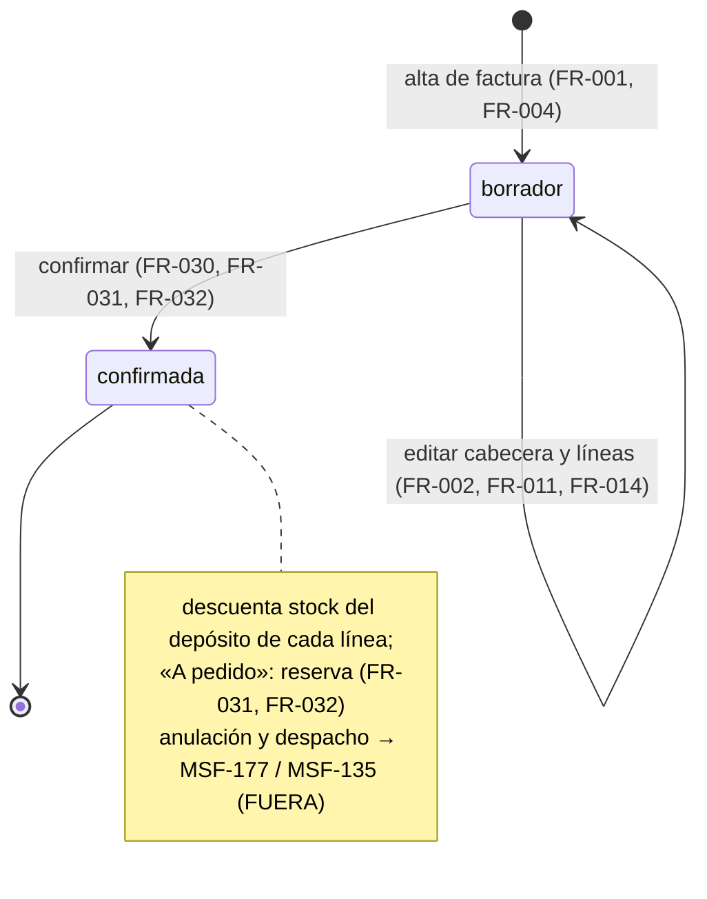
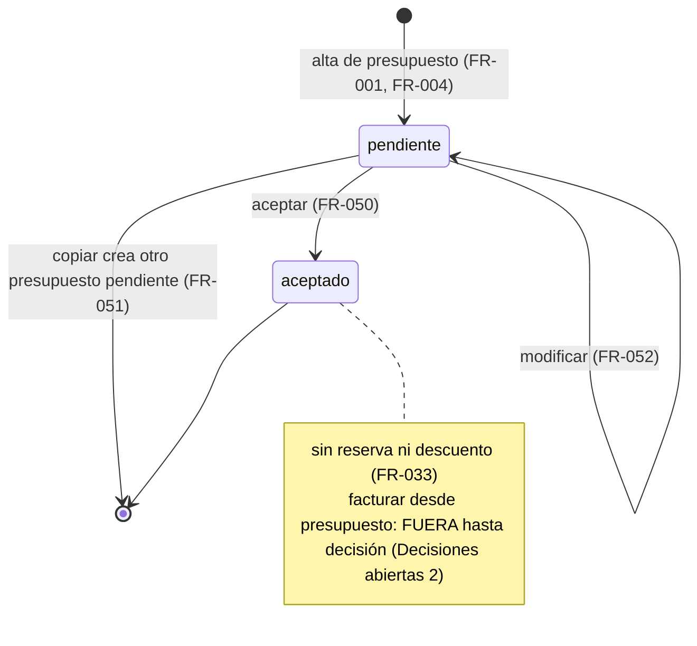
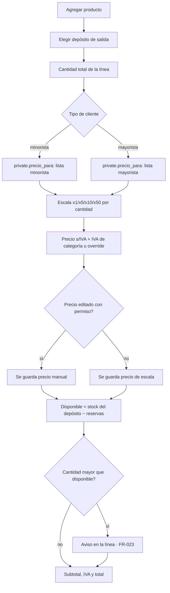
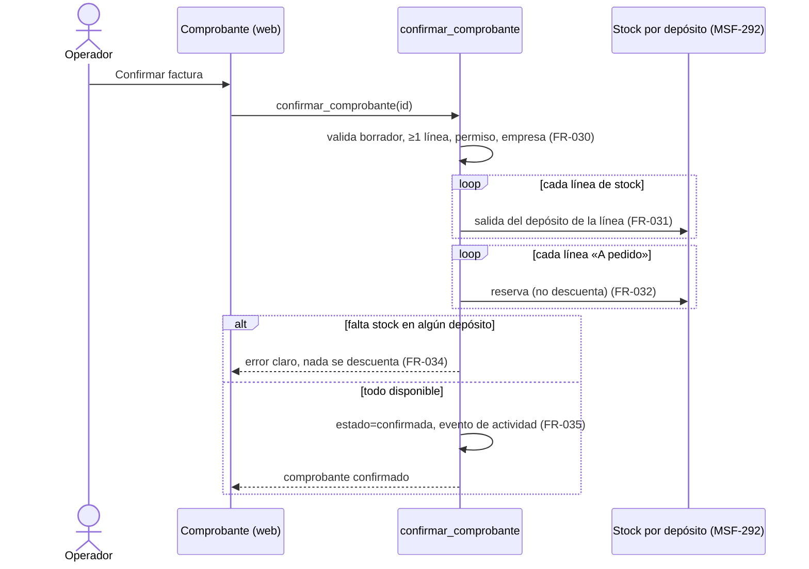

# Feature Specification: Ventas y despacho · Ventas comprobantes

**Feature Branch**: `epic/MSF-159-ventas-y-despacho-ventas-comprobantes`

**Jira Epic**: MSF-159 — Ventas y despacho · Ventas comprobantes (spec `ventas-comprobantes`)

**Created**: 2026-10-23

**Status**: Ready for implementation — la especificación viene completa desde Jira. Los puntos de «A revisar» no bloquean: cada uno lleva decisión provisoria en *Decisiones abiertas*.

**Delivery scope**: `refine` (apps/web) y `supabase` (migraciones + RPC + pgTAP). Sin `kestra`, `superset` ni `workers`.

**Prioridad / Hito**: P0 · Hito 3 (16 de noviembre al 11 de diciembre de 2026) · 46 h (la suma por talla L+L+L+M da ~56 h; se conserva el valor del documento) · alcance diciembre.

**Dependencias**:
- Bloqueada por: MSF-139 (catálogos de cobro y envío), MSF-114 (Precios e IVA: `private.precio_para`, F-PRE-15), MSF-292 (Stock · depósitos y reservas: existencias y reservas por depósito; incluye motor de movimientos y stock único, MSF-136/MSF-231) y MSF-180 (Clientes · alta y búsqueda). Según el CTO (AGE-844) las cuatro están liberadas en `Review In DEV`.
- **Estado verificado en esta rama (base `e1c1a7d`)**: existen `dominio.comprobantes_venta` (contrato mínimo de F-CLI-08, solo `select`), `dominio.existencias` y `registrar_movimiento_stock` (stock **único por producto**, sin depósito ni reservas), `public.buscar_clientes`, `dominio.empresas` y el sembrado de `ventas` en la matriz de permisos. **No existen** todavía en esta rama `private.precio_para`, los depósitos, las reservas ni los catálogos de cobro/envío: **llegan al mergear MSF-114, MSF-292 y MSF-139**. Los nombres y firmas exactos se **verifican contra `main` al implementar** (no se inventan aquí); si una no está mergeada, la historia que la usa espera.
- Bloquea a: MSF-177 (listado, estados y anulación), MSF-135 (despacho y faltantes), MSF-213 (impresión), y fuera de esta mitad del componente a MSF-145, MSF-232, MSF-144 y MSF-368.
- Relacionada, sin bloqueo: MSF-116 (Dólar y recálculo: las líneas leen precios ya calculados; se prueban con precios fijos).

**Input**: Epic MSF-159. Objetivo: «Al terminar, un operador carga una factura o un presupuesto interno para un cliente (o Consumidor final), con precios según la escala y el tipo de cliente, y al confirmar la factura el stock baja de la ubicación elegida.»

**Regla de fuentes** (literal de la épica):
- Comportamiento y datos: mandan los requisitos y escenarios de esta historia.
- Qué se ve (disposición, textos, estados, popups, flujos): el prototipo validado es referencia visual, no hace falta que quede extremadamente idéntico; los flujos (si hay) aclaran estados y acciones.
- Cómo se construye (componentes, estilos y patrones): mandan el template y el system design (MSF-117, `docs/sistema-de-diseno.md`). No se copia HTML ni CSS del prototipo.
- El prototipo muestra más que esta historia: se implementa solo lo que piden los requisitos; otras secciones, botones o diálogos son de otras historias.
- Si algo no se puede igualar: lo más cercano, sin inventar, anotando la diferencia en el PR. Si prototipo y requisitos se contradicen: requisitos para el comportamiento, prototipo para lo visual, y la contradicción queda anotada en el PR.
- Prototipos (solo lectura): `design/pantallas/VentasComprobante.dc.html` (F-VTA-05/06/07), `VentasPresupuestos.dc.html` (F-VTA-08) y `VentasComprobantes.dc.html` (listado: MSF-177, fuera de esta épica; solo su pestaña/ruta de navegación). Inventarios al día en `design/pantallas/*.inventory.json`.

## Modelo y supuestos

- **El comprobante es interno (no fiscal).** Dos tipos: `factura` y `presupuesto`.
- **Precio de lista sin IVA**; el IVA sale de la categoría del producto o de su override (dato de MSF-114 / catálogo).
- **Escala** (x1, x5, x10, x50): se elige por la **cantidad total de la línea**; el **tipo de cliente** (minorista o mayorista) define qué lista de escalas aplica. El cálculo lo hace `private.precio_para` (F-PRE-15); esta épica solo lo invoca.
- **El precio por línea es editable con permiso.**
- **Stock**: la factura confirmada **descuenta del depósito de cada línea**; los productos «A pedido» **reservan al confirmar y descuentan recién al marcar Entregado** (el «Entregado» es de MSF-135); el **presupuesto no reserva ni descuenta**.
- **Cliente**: uno existente (Clientes, MSF-180) o **Consumidor final**.
- **Empresa/tienda**: el comprobante pertenece a **una sola empresa**; en uno nuevo se preselecciona la empresa activa de la barra superior (F-ROL-06). Una vez emitido, la empresa no cambia.
- **Estados de esta épica** (columna `estado` ya existente, texto libre): factura `borrador` → `confirmada`; presupuesto `pendiente` → `aceptado` (y `convertido` / `vencido` quedan reservados para facturar y vencimiento, ver *Decisiones abiertas* 2). `anulada` es de MSF-177; los estados de despacho (Armando, Incompleto, Entregado…) son de MSF-135.

### Esquema de datos (Constitución, Principio VII)

| Objeto | Esquema | Justificación | RLS / acceso |
|--------|---------|---------------|--------------|
| `comprobantes_venta` (**existente**, F-CLI-08; se **altera** de forma aditiva en F-VTA-05) | **`dominio`** | Documento de venta: entidad de negocio del producto. | RLS vigente por `organizacion_id` + sección `ventas` (`select`). Se agregan columnas nulables/con default (empresa, canal, operador, validez, formas de pago y envío, origen); **sin políticas de escritura directa**: se escribe solo vía RPC `security definer`. `anon` sin acceso. |
| `comprobantes_venta_lineas` (**nueva**, F-VTA-06) | **`dominio`** | Detalle de venta: entidad de negocio. | `organizacion_id` + FK compuesta al comprobante; `select` con `ventas` en `lectura`/`edicion`; **escritura solo por RPC**; sin `delete` directo; `anon` sin acceso. |
| `comprobantes_venta_numeracion` (**nueva**, F-VTA-05) | **`dominio`** | Contador correlativo por empresa y tipo del documento de venta. | RLS por organización; sin lectura ni escritura directa (solo la función de numeración, `security definer`). |
| `public.clientes` (**existente**) | `public` (sin cambio de esquema) | Se le agrega, si hace falta, el cliente «Consumidor final» como **dato sembrado** por organización (*Decisiones abiertas* 3). | RLS vigente. |
| `permisos_rol_accion` (**existente**; F-VTA-06 agrega **datos**: acción `editar_precio` en `ventas`) | `public` (sin cambio) | Mecanismo de acceso transversal. | RLS vigente (MSF-121/125). |
| `public.registro_actividad` (**existente**) | `public` (sin cambio) | Auditoría transversal vía `private.registrar_actividad`. | Vigente. |

No se crean otras tablas. `rls_en_toda_tabla` (pgTAP, recorre `public` + `dominio`) debe seguir verde. Todas las migraciones son **aditivas** con reversión en su encabezado; **cada historia trae su propia migración** (timestamps propios, sin encadenarse a las de otra historia).

## Flujos

### Flujo 1 · Ciclo de vida de la factura (máquina de estados)

### Flujo 2 · Ciclo de vida del presupuesto (máquina de estados)

### Flujo 3 · Armado de líneas con precio y stock (proceso)

(Mapa: A→FR-012, B→FR-013, C/G→FR-014, D/E/F→FR-014, H→FR-015, I/J/K→FR-016, L/M/N→FR-017/FR-018, O→FR-019.)

### Flujo 4 · Confirmación de la factura (secuencia)

## User Scenarios & Testing *(mandatory)*

### User Story 1 - Alta de comprobante: factura y presupuesto (F-VTA-05, P0, talla L)

Como operador, quiero abrir un comprobante nuevo (factura o presupuesto) para un cliente o Consumidor final, con su cabecera, para empezar a venderle.

**Why this priority**: sin cabecera no hay comprobante; es la base de las otras tres historias.

**Independent Test**: con el rol Operador, «Nuevo comprobante» y «Nuevo presupuesto» crean un borrador/pendiente numerado en la empresa activa, con cliente elegido o Consumidor final; otra organización no lo ve; con `ventas` en `lectura` no se puede crear.

**Acceptance Scenarios**:
1. **Given** la empresa activa «Mundo JC», **When** el operador abre un comprobante nuevo, **Then** la Tienda viene preseleccionada con esa empresa y, una vez guardado, queda bloqueada (el comprobante pertenece a una sola tienda).
2. **Given** la cabecera, **When** elige el cliente (buscador de Clientes) o «Consumidor final», **Then** se muestran sus datos (CUIT / DNI, condición frente al IVA, dirección de entrega) como lectura y el tipo de cliente queda determinado para los precios.
3. **Given** la cabecera, **When** elige Canal de venta (Mostrador u otro canal habilitado) y Fecha, **Then** se guardan; «Mercado Libre queda para la Etapa 2».
4. **Given** un comprobante guardado, **When** se crea otro del mismo tipo y empresa, **Then** recibe el número correlativo siguiente sin duplicados ni saltos aun con altas simultáneas.
5. **Given** un comprobante `confirmada` o un presupuesto `aceptado`, **When** se intenta guardar cambios, **Then** se rechaza con mensaje claro.

### User Story 2 - Líneas con precio por escala, depósito de salida y stock disponible (F-VTA-06, P0, talla L)

Como operador, quiero agregar productos con su cantidad, el depósito del que salen y el precio correcto según la escala y el tipo de cliente, viendo el stock disponible, para cotizar o facturar sin errores.

**Why this priority**: es el corazón del precio y del stock de la venta.

**Independent Test**: con un cliente mayorista, una línea de 12 unidades toma la escala x10; con minorista aplica la lista minorista; cambiar la cantidad o el depósito recalcula; el disponible muestra stock menos reservas del depósito elegido; editar el precio exige el permiso.

**Acceptance Scenarios**:
1. **Given** «Agregar producto», **When** elige un producto, **Then** la línea muestra Producto (código + descripción), Stock, Depósito de mercadería, Cantidad, Precio s/IVA y Subtotal.
2. **Given** una línea, **When** cambia la cantidad (− / + / número), **Then** el precio se recalcula con `private.precio_para` según la escala de la cantidad y el tipo de cliente, y se muestra la escala aplicada.
3. **Given** una línea, **When** cambia el depósito (Local / Principal u otros), **Then** el disponible (stock del depósito menos reservado) se actualiza.
4. **Given** una cantidad mayor al disponible del depósito, **When** se ve la línea, **Then** muestra el aviso de faltante (no bloquea guardar el borrador; bloquea confirmar, FR-034).
5. **Given** un producto «A pedido», **When** se agrega, **Then** la línea indica «A pedido · no descuenta stock» y no muestra disponible.
6. **Given** un usuario sin el permiso de editar precio, **When** abre una línea, **Then** el precio es de solo lectura; con el permiso puede editarlo y la línea queda marcada como precio manual.
7. **Given** las líneas, **Then** el pie muestra Subtotal sin IVA, IVA y Total, con el IVA por línea según su categoría u override.

### User Story 3 - Confirmación, reserva y descuento de stock por depósito (F-VTA-07, P0, talla L)

Como operador, quiero confirmar la factura para que el stock baje del depósito elegido en cada línea, para que el inventario refleje lo vendido.

**Why this priority**: es el objetivo de la épica («el stock baja de la ubicación elegida»).

**Independent Test**: confirmar una factura con dos líneas de depósitos distintos baja cada depósito exactamente la cantidad vendida, queda `confirmada` y no se puede confirmar dos veces; una línea «A pedido» reserva sin descontar; un presupuesto no puede confirmarse como factura ni mueve stock; sin stock suficiente falla sin efectos parciales.

**Acceptance Scenarios**:
1. **Given** una factura `borrador` con líneas válidas, **When** el operador la confirma, **Then** el estado pasa a `confirmada` y cada línea de stock genera una salida del depósito de esa línea por su cantidad.
2. **Given** una línea «A pedido», **When** se confirma, **Then** se crea una reserva en el depósito de la línea y el stock no se descuenta (el descuento llega con «Entregado», MSF-135).
3. **Given** una cantidad mayor al disponible en algún depósito, **When** se confirma, **Then** falla con mensaje claro indicando producto y depósito, y no se descuenta ni reserva nada (todo o nada).
4. **Given** dos operadores confirmando a la vez el último stock, **Then** solo uno lo logra (sin stock negativo ni doble descuento).
5. **Given** un reintento de confirmación sobre una factura ya `confirmada`, **Then** no duplica movimientos (idempotente) y devuelve el estado actual.
6. **Given** un presupuesto, **Then** no tiene acción de confirmar y nunca reserva ni descuenta.
7. **Given** una factura `confirmada`, **Then** cuenta como facturada para el ranking de clientes (F-CLI-08) y un `borrador` no.

### User Story 4 - Presupuesto: aceptar, copiar y modificar (F-VTA-08, P0, talla M)

Como operador, quiero ver mis presupuestos y poder aceptarlos, copiarlos o modificarlos, para gestionar cotizaciones sin recargar todo.

**Why this priority**: completa el recorrido comercial del presupuesto.

**Independent Test**: en «Presupuestos», buscar por cliente o número y filtrar por estado funciona; aceptar cambia el estado; copiar crea un presupuesto nuevo `pendiente` con las mismas líneas; modificar abre el presupuesto editable solo mientras está `pendiente`.

**Acceptance Scenarios**:
1. **Given** la pantalla Presupuestos, **Then** lista Presupuesto, Tienda, Fecha, Cliente, Operador, Válido hasta, Estado y Total con búsqueda «Buscar por cliente o número», filtros por estado y filtro de tienda que sigue la empresa activa; «Sin resultados» cuando no hay coincidencias.
2. **Given** un presupuesto `pendiente`, **When** se acepta, **Then** pasa a `aceptado` y queda registrado quién y cuándo.
3. **Given** un presupuesto, **When** se copia, **Then** se crea uno nuevo `pendiente` con nuevo número, misma cliente y líneas, fecha de hoy, y se abre para editar; el original no cambia.
4. **Given** un presupuesto `pendiente`, **When** se modifica, **Then** se abre el comprobante en edición; si está `aceptado` la acción no está disponible.
5. **Given** un presupuesto de otra empresa/organización, **Then** no aparece (RLS y empresa activa).

### Edge Cases

- Cliente cambiado después de cargar líneas: los precios se recalculan con la lista del nuevo tipo de cliente antes de guardar.
- Cantidad 0 o negativa en una línea de venta: se rechaza (los negativos del prototipo son de nota de crédito, fuera de alcance).
- Producto desactivado o de otra organización: no se puede agregar.
- Cambio de empresa activa con un comprobante abierto: se cierra con aviso o se reencuadra (Principio VIII), nunca guarda datos bajo otra empresa.
- Confirmar sin líneas: se rechaza.

## Requirements *(mandatory)*

### Functional Requirements

**F-VTA-05 — Alta de comprobante**
- **FR-001**: `crear_comprobante` crea un comprobante `factura` (estado `borrador`) o `presupuesto` (estado `pendiente`) en la **empresa indicada** (preseleccionada con la activa) de la organización de la sesión; exige `ventas` en `edicion` en esa empresa; la organización y el operador salen de la sesión, nunca del llamador.
- **FR-002**: La cabecera guarda Tienda (empresa), Canal de venta, Cliente (existente o **Consumidor final**), Fecha, Operador (usuario que carga) y, en presupuesto, Válido hasta; `guardar_comprobante` edita la cabecera mientras el documento sea editable (factura `borrador`, presupuesto `pendiente`) con bloqueo optimista y rechaza editar un documento cerrado.
- **FR-003**: La empresa de un comprobante guardado **no cambia**; el cliente debe pertenecer a la misma organización (FK compuesta existente).
- **FR-004**: **Numeración correlativa** por organización, empresa y tipo, sin duplicados ni saltos bajo concurrencia (bloqueo transaccional sobre `comprobantes_venta_numeracion`); formato provisorio y su decisión en *Decisiones abiertas* 1.
- **FR-005**: La cabecera guarda la **forma de pago** y el **tipo de envío** elegidos de los catálogos de MSF-139; **solo se guarda la elección** (cobro, conciliación y despacho son de otras épicas).
- **FR-006**: La pantalla del comprobante (alta/edición) muestra cabecera con Tienda (bloqueada al guardar, con su texto de ayuda), Canal de venta, Cliente (CUIT / DNI, condición frente al IVA y dirección de entrega en lectura), Fecha y Operador; botones «Guardar cambios» y volver a «Comprobantes»; estados vacío/error/carga/éxito del kit de panel.
- **FR-007**: Las pantallas respetan la **empresa activa** (Principio VIII): la Tienda se preselecciona con ella; al cambiar de empresa se invalidan y recargan las consultas y un diálogo/formulario abierto se cierra con aviso o se reencuadra.
- **FR-008**: Cada alta y edición registra un evento de actividad (`comprobante.creado`, `comprobante.editado`) con `private.registrar_actividad`, en la misma transacción.
- **FR-009**: Acceso: sección `ventas`, por empresa (nivel de la empresa activa); sin `ventas` la ruta muestra «Acceso restringido»; con `lectura` se ve pero no se crea ni edita; entrada de menú/ruta canónica `/ventas/comprobantes/:id` y `/ventas/presupuestos`, icono y audiencia declarados (Principio VI).

**F-VTA-06 — Líneas**
- **FR-010**: `comprobantes_venta_lineas` guarda por línea: producto, descripción y código (copia), cantidad entera > 0, **precio unitario sin IVA**, **escala aplicada**, **marca de precio manual**, alícuota de IVA, **depósito de salida** y marca «A pedido»; `guardar_lineas_comprobante(id, lineas)` reemplaza las líneas de un documento editable en una transacción y **recalcula** subtotal sin IVA, IVA y total del comprobante.
- **FR-011**: No se aceptan líneas con producto de otra organización o inactivo, cantidad ≤ 0 ni depósito inexistente o ajeno.
- **FR-012**: «Agregar producto» incorpora un producto del catálogo a las líneas.
- **FR-013**: Cada línea elige **depósito de mercadería** (Local, Principal u otros de MSF-292); por defecto el depósito principal de la empresa.
- **FR-014**: El precio unitario sin IVA lo calcula `private.precio_para` (F-PRE-15) con el producto, el **tipo de cliente** y la **cantidad total de la línea**; devuelve la escala (x1/x5/x10/x50) y se muestra en la línea. Si cambia cantidad o cliente, se recalcula.
- **FR-015**: El IVA por línea sale de la categoría del producto o de su override; el pie muestra Subtotal sin IVA, IVA y Total.
- **FR-016**: Editar el precio de una línea exige el permiso `editar_precio` de `ventas` (acción nueva en `permisos_rol_accion`, sembrada para Administrador y Operador; *Decisiones abiertas* 4); la RPC lo verifica (no solo la UI) y marca la línea como precio manual, que el recálculo respeta.
- **FR-017**: El **disponible** de una línea = stock del depósito elegido menos lo reservado (de MSF-292); se muestra junto a Stock, Disp. y Res.; los productos «A pedido» muestran «A pedido · no descuenta stock» y no muestran disponible.
- **FR-018**: Una cantidad mayor al disponible muestra el aviso de faltante en la línea; no impide guardar el borrador.
- **FR-019**: La tabla de líneas reproduce columnas Producto, Stock, Depósito de mercadería, Cantidad (− / +), Precio s/IVA, Subtotal, con el texto de ayuda de precio y disponible del prototipo.

**F-VTA-07 — Confirmación**
- **FR-030**: `confirmar_comprobante(id)` solo aplica a `factura` en `borrador` con ≥ 1 línea; exige `ventas` en `edicion` en su empresa; un presupuesto nunca se confirma.
- **FR-031**: Al confirmar, cada línea de stock genera una **salida** del **depósito de esa línea** por su cantidad, usando el motor de movimientos de stock (MSF-292 / `registrar_movimiento_stock`), con el comprobante como referencia y motivo «venta».
- **FR-032**: Cada línea «A pedido» crea una **reserva** en su depósito y **no descuenta**; el descuento al marcar «Entregado» queda para MSF-135 (esta épica deja la reserva con la referencia necesaria).
- **FR-033**: El presupuesto **no reserva ni descuenta** en ningún caso (alta, aceptación, copia, modificación).
- **FR-034**: La confirmación es **todo o nada**: si algún depósito no tiene stock disponible suficiente falla con mensaje claro (producto y depósito) sin movimientos parciales, y es **segura bajo concurrencia** (sin stock negativo ni doble descuento).
- **FR-035**: La confirmación es **idempotente** (reintento sobre `confirmada` no duplica movimientos), pasa el estado a `confirmada`, fija `confirmado_en`/`confirmado_por` y registra `comprobante.confirmado`.
- **FR-036**: `private.comprobante_cuenta_como_facturado(tipo, estado)` pasa a contar solo facturas **no `borrador` y no `anulada`** (ajuste previsto por F-CLI-08).
- **FR-037**: La pantalla ofrece la acción «Confirmar factura», pide confirmación antes de ejecutar, muestra el resultado o el error y deja el comprobante de solo lectura.

**F-VTA-08 — Presupuesto**
- **FR-050**: `aceptar_presupuesto(id)` pasa un presupuesto `pendiente` a `aceptado`, registra `presupuesto.aceptado` (quién y cuándo) y es idempotente.
- **FR-051**: `copiar_presupuesto(id)` crea un presupuesto nuevo `pendiente` con número nuevo, mismo cliente y líneas (precios recalculados con la lista vigente, salvo precio manual), fecha de hoy y empresa de origen; el original no cambia.
- **FR-052**: «Modificar» abre el presupuesto en edición solo si está `pendiente`; `aceptado` no es editable.
- **FR-053**: La pantalla **Presupuestos** lista Presupuesto, Tienda, Fecha, Cliente, Operador, Válido hasta, Estado y Total, paginada, con búsqueda por cliente o número, filtro por estado (Todos, Pendiente, Aceptado, Vencido, Convertido en factura) y filtro de tienda que por defecto muestra todas y se acota con la empresa activa; «Sin resultados».
- **FR-054**: Acciones por fila: Copiar, Modificar y Aceptar según estado; «Nuevo presupuesto» crea uno (FR-001).
- **FR-055**: `Vencido` se **deriva** de `Válido hasta` < hoy en estado `pendiente` (sin job); no es editable ni aceptable.

### Success Criteria

- **SC-001** *(F-VTA-05)*: pgTAP de aislamiento y permisos: dos organizaciones/empresas no se ven; sin `ventas`/con `lectura` no se crea ni edita; `anon` sin acceso; numeración correlativa sin duplicados en altas concurrentes; `rls_en_toda_tabla` verde.
- **SC-002** *(F-VTA-05)*: Vitest de cabecera: preselección de empresa activa, Tienda bloqueada, cliente/Consumidor final, edición rechazada en documento cerrado, cambio de empresa reencuadra.
- **SC-003** *(F-VTA-06)*: pgTAP de líneas: escala por cantidad y tipo de cliente (minorista/mayorista) con precios fijos, IVA por categoría y override, precio manual solo con permiso, validaciones de producto/depósito ajeno.
- **SC-004** *(F-VTA-06)*: Vitest de líneas: recálculo al cambiar cantidad/depósito/cliente, disponible, aviso de faltante, «A pedido», totales.
- **SC-005** *(F-VTA-07)*: pgTAP de confirmación: baja exacta por depósito, «A pedido» reserva sin descontar, todo o nada, concurrencia, idempotencia, presupuesto sin movimientos, ranking de clientes.
- **SC-006** *(F-VTA-07)*: Vitest de la acción Confirmar (diálogo, éxito, error de stock, solo lectura posterior).
- **SC-007** *(F-VTA-08)*: pgTAP y Vitest de presupuestos: aceptar, copiar, modificar solo `pendiente`, vencido derivado, listado con búsqueda/filtros/empresa activa.
- **SC-008** *(Cierre)*: revisión de seguridad (RLS, `security definer`, permisos de RPC), `docs/ventas-comprobantes.md` e índice, fila del roadmap, `pnpm lint`, `pnpm build`, `pnpm test`, `pnpm docs:check`, `pnpm prototipo:check` y `pnpm matriz:check` verdes.

## Decisiones abiertas (provisorias; no bloquean)

1. **Numeración de comprobantes** (pendiente del cliente al 6/11): se implementa correlativo por empresa y tipo, 8 dígitos, guardando el entero aparte para poder cambiar el formato (p. ej. `0003-00001251` del prototipo) sin migrar datos.
2. **Facturar desde un presupuesto aceptado** («Facturar», estados `Convertido en factura`): el prototipo lo muestra pero la épica solo pide aceptar, copiar y modificar → **FUERA DE ALCANCE** hasta que Nicolás lo pida; la columna `origen_presupuesto_id` no se crea ahora.
3. **Consumidor final**: se modela como un cliente genérico sembrado por organización (la FK de `comprobantes_venta.cliente_id` es `not null`); tipo minorista. Alternativa: `cliente_id` nulable (rompe el contrato de F-CLI-08).
4. **«Precio editable con permiso»**: se crea la acción `editar_precio` (datos en `permisos_rol_accion`). Alternativa: reutilizar el nivel `edicion` de `ventas`.
5. **Prototipo vs. épica en el momento del descuento**: el prototipo reserva al crear y descuenta al «Entregado»; la épica manda: la factura **descuenta al confirmar** y solo «A pedido» reserva/descuenta al entregar (FR-031/032). Se anota en el PR.
6. **Acción «Confirmar factura»** no está en el prototipo (requisito de la épica): se agrega con el botón primario más cercano del sistema de diseño y se anota en el PR.
7. **Horas**: 46 h del documento vs. ~56 h por tallas; manda el roadmap ante conflicto; se conserva 46 h.
8. **Escala por línea o por total** (pendiente del cliente al 6/11): se asume la cantidad total de la línea.

## Matriz pantalla↔criterios

Prototipos: `VentasComprobante.dc.html`, `VentasPresupuestos.dc.html`, `VentasComprobantes.dc.html` (inventarios en `design/pantallas/*.inventory.json`). Lo que la épica no pide se declara FUERA DE ALCANCE (nota, no tarea).

### Ventas · Comprobante (`VentasComprobante`)

| Ítem del inventario / visible | Dueño |
|---|---|
| Campo Tienda (bloqueada al guardar, texto de ayuda) | FR-002, FR-003, FR-006 |
| Campo Canal de venta (Mostrador; ML = Etapa 2) | FR-002, FR-006 |
| Campos Cliente, CUIT / DNI, Condición frente al IVA, Dirección de entrega | FR-002, FR-006 |
| Campo Fecha | FR-002 |
| Campo Operador | FR-002 |
| Botón «Comprobantes» (volver) | FR-006 |
| Botón «Guardar cambios» | FR-002, FR-006 |
| Botón «Agregar producto» | FR-012 |
| Tabla de líneas (Producto, Stock, Depósito, Cantidad, Precio s/IVA, Subtotal), botones «Local» / «Principal», − / +, Disp./Res., «A pedido» | FR-010, FR-013, FR-014, FR-017, FR-018, FR-019 |
| Pie Subtotal sin IVA / IVA 21 % / Total | FR-015 |
| Forma de pago (chips: Efectivo, Transferencia, Contrarreembolso, Cuenta corriente) y Envío y transporte (Retiro en local, Moto, Expreso, Correo) | FR-005 (solo la elección; catálogos MSF-139) |
| Estados (Pendiente, Aceptado…, Armando, Incompleto, Entregado) y chips de estado | **FUERA DE ALCANCE** salvo `borrador`/`confirmada`/`pendiente`/`aceptado`: el resto es de MSF-177/MSF-135 |
| Acción «Confirmar factura» (no está en el prototipo) | FR-037 (*Decisiones abiertas* 6) |
| Botón «Copiar» (en un presupuesto) | FR-051; en una factura **FUERA DE ALCANCE** (la épica copia solo presupuestos) |
| Botón «Imprimir», diálogo «Imprimir comprobante», «Imprimir remito», «Enviar por correo», sección Documentos | **FUERA DE ALCANCE** — impresión y envío: MSF-213 |
| Botón «Nota de crédito», diálogo «Nota de crédito», tabla de la nota (Producto, Cantidad, Precio, Importe), «Cancelar»/«Emitir nota de crédito» | **FUERA DE ALCANCE** — el roadmap la estima aparte y la épica no la pide |
| Campo Cuenta de cobro, «Ir a Pagos →», «Sin conciliar» | **FUERA DE ALCANCE** — cobro y conciliación: épica Pagos |
| Campos Guía, Fecha de envío, Armó, Controló, Entregó, transporte | **FUERA DE ALCANCE** — despacho: MSF-135 |
| «Agregar flete», líneas manuales (flete, descuento), «Relacionados» | **FUERA DE ALCANCE** — la épica no los pide |
| Observaciones | **FUERA DE ALCANCE** — la épica no lo pide |
| Tabla Historial de estados y acciones (Cuándo, Acción, Quién, Tienda) | **FUERA DE ALCANCE** como pantalla (MSF-177); los eventos se registran en actividad (FR-008, FR-035) |
| Empresa activa | FR-007 (test SC-002) |

### Ventas · Presupuestos (`VentasPresupuestos`)

| Ítem del inventario | Dueño |
|---|---|
| Tabla: Presupuesto, Tienda, Fecha, Cliente, Operador, Válido hasta, Estado, Total, Acciones | FR-053, FR-054 |
| Campo «Buscar por cliente o número» | FR-053 |
| Filtros de estado (Todos, Pendiente, Aceptado, Vencido, Convertido en factura) | FR-053, FR-055 (`Convertido en factura`: sin filas hasta que se decida *Decisiones abiertas* 2) |
| Filtro Tienda (todas por defecto; la empresa activa filtra) y su texto | FR-053, FR-007 |
| Botón «Nuevo presupuesto» | FR-054 |
| «Sin resultados» y paginación «1–9 de N» | FR-053 |
| Botón «Facturar» | **FUERA DE ALCANCE** — *Decisiones abiertas* 2 |
| Acciones de fila «Enviar por correo» e «Imprimir» | **FUERA DE ALCANCE** — MSF-213 |
| Botón «Exportar» | **FUERA DE ALCANCE** — la épica no lo pide |
| Pestañas Comprobantes / Presupuestos / Pagos / Faltantes / Devoluciones (RMA) / Transportes y contrarreembolsos | Presupuestos: FR-009 (ruta); las demás **FUERA DE ALCANCE** — son de otras épicas |
| Empresa activa | FR-007, FR-053 (test SC-007) |

### Ventas · Comprobantes (`VentasComprobantes`)

Pantalla **completa FUERA DE ALCANCE**: es el listado, estados y anulación de MSF-177 (F-VTA-09). Su botón «Nuevo comprobante» lo cubre FR-001 vía la ruta de alta; tabla, búsqueda, filtros, «Exportar», «Limpiar filtros» y pestañas son de MSF-177.

## Matriz de trazabilidad Jira ↔ US ↔ FR ↔ tareas

| Jira | Historia | US | FR / SC | Tareas |
|------|----------|----|---------|--------|
| MSF-159 (épica) | F-VTA-05 Alta de comprobante: factura y presupuesto | US1 | FR-001…FR-009, SC-001, SC-002 | T001–T010 |
| MSF-159 (épica) | F-VTA-06 Líneas con precio por escala, depósito y stock | US2 | FR-010…FR-019, SC-003, SC-004 | T011–T021 |
| MSF-159 (épica) | F-VTA-07 Confirmación, reserva y descuento | US3 | FR-030…FR-037, SC-005, SC-006 | T022–T029 |
| MSF-159 (épica) | F-VTA-08 Presupuesto: aceptar, copiar y modificar | US4 | FR-050…FR-055, SC-007 | T030–T038 |
| Tarea de cierre (label `cierre`) | Seguridad, índice documental, roadmap | — | SC-008 | T039–T041 |
