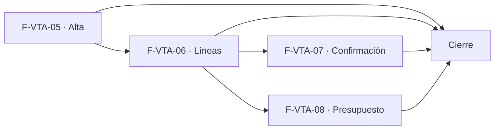

# Tasks: Ventas y despacho · Ventas comprobantes

**Input**: [spec.md](./spec.md) y [plan.md](./plan.md) · **Contratos**: [contracts/ventas-comprobantes.md](./contracts/ventas-comprobantes.md) · **Épica**: MSF-159
**Formato**: `- [ ] T### [P] [Historia][USx] descripción (FR/SC)`. `[P]` = paralelizable (archivos distintos, sin dependencia dentro del mismo grupo). Cada FR/SC tiene **una sola** tarea dueña; «soporte de» marca una tarea que contribuye sin ser dueña. Las historias son autosuficientes: ninguna tarea depende de otra historia ni de una `[CIERRE]`; el orden entre historias lo da el *Plan de ejecución*.
**Validación por historia**: `pnpm test:db`, `pnpm lint`, `pnpm build` y `pnpm test:web` verdes antes de cerrar la fase.
**Esquema (Principio VII, re-verificado)**: `comprobantes_venta` (alterada), `comprobantes_venta_lineas` y `comprobantes_venta_numeracion` → `dominio`; `permisos_rol_accion`, `clientes` (Consumidor final) y `registro_actividad` → `public` (solo datos).
**Antes de empezar cada historia**: verificar contra `main` las firmas de `private.precio_para` (MSF-114), depósitos/reservas (MSF-292), catálogos de cobro y envío (MSF-139) y alta mínima de cliente (MSF-180); no inventarlas.

## Phase 1: F-VTA-05 · Alta de comprobante: factura y presupuesto

**Goal**: cabecera de factura/presupuesto numerada, por empresa y cliente, con pantalla y permisos.

- [ ] T001 [P] [F-VTA-05][US1] Migración `supabase/migrations/20261024100100_comprobantes_cabecera.sql`: columnas aditivas en `dominio.comprobantes_venta` (`empresa_id` con FK compuesta a `dominio.empresas`, `canal`, `operador_id`, `valido_hasta`, `forma_pago_id`, `envio_id`, `confirmado_en`, `confirmado_por`, `updated_at`), índice único (organización, empresa, tipo, número), RLS y grants intactos (`anon` sin acceso), reversión en el encabezado (FR-003, FR-005)
- [ ] T002 [P] [F-VTA-05][US1] Migración `supabase/migrations/20261024100200_comprobantes_numeracion.sql`: `dominio.comprobantes_venta_numeracion` (organización, empresa, tipo, último) con RLS sin acceso directo y `private.siguiente_numero_comprobante` con bloqueo transaccional (FR-004)
- [ ] T003 [P] [F-VTA-05][US1] Migración `supabase/migrations/20261024100300_consumidor_final.sql`: cliente «Consumidor final» minorista sembrado por organización (trigger sobre `organizaciones` + backfill, idempotente), reversión en el encabezado (soporte de FR-002)
- [ ] T004 [F-VTA-05][US1] Migración `supabase/migrations/20261024100400_comprobantes_rpc.sql`: `crear_comprobante`, `guardar_comprobante` (bloqueo optimista, rechaza documentos cerrados, empresa/tipo inmutables), `obtener_comprobante`; `security definer`, `search_path = ''`, exigen `ventas` `edicion` en la empresa, `revoke … from public, anon` + `grant execute … to authenticated`; eventos `comprobante.creado`/`comprobante.editado` con `private.registrar_actividad` en la misma transacción (FR-001, FR-002, FR-008)
- [ ] T005 [F-VTA-05][US1] pgTAP `supabase/tests/database/ventas_comprobantes_alta.test.sql`: aislamiento entre organizaciones y empresas, `lectura`/`ninguno`/`anon` sin escritura, numeración correlativa sin duplicados en altas concurrentes, edición rechazada en `confirmada`/`aceptado`, `rls_en_toda_tabla` verde (SC-001)
- [ ] T006 [P] [F-VTA-05][US1] `apps/web/src/lib/ventas.ts`: tipos y llamadas a las RPC de F-VTA-05, mapeo de `42501`/`22023`/conflicto a mensajes claros (soporte de FR-006)
- [ ] T007 [F-VTA-05][US1] `apps/web/src/pages/ventas/comprobante.tsx`: cabecera con Tienda (preseleccionada, bloqueada al guardar con su ayuda), Canal de venta, Cliente (buscador de Clientes + Consumidor final; CUIT / DNI, condición frente al IVA y dirección en lectura), Fecha, Operador, Forma de pago y Envío (catálogos MSF-139), botones «Comprobantes» y «Guardar cambios», slots de líneas y acciones, estados vacío/error/carga/éxito, 320/768/1440 px (FR-006)
- [ ] T008 [F-VTA-05][US1] Rutas `/ventas/comprobantes/nuevo|:id` y entrada de menú **Ventas** (icono, audiencia por `ventas`, «Acceso restringido»), recurso en `SECCION_POR_RECURSO`; selector de empresa activa: preselección, reencuadre y cierre de formulario al cambiar de empresa (FR-007, FR-009)
- [ ] T009 [F-VTA-05][US1] Vitest de cabecera: preselección de empresa activa, Tienda bloqueada, cliente/Consumidor final, edición rechazada en documento cerrado, cambio de empresa reencuadra, controles ocultos con `lectura` (SC-002)
- [ ] T010 [F-VTA-05][US1] Documentación: `docs/ventas-comprobantes.md` (modelo de cabecera, numeración, RPC, permisos, reversión) (soporte de SC-001)

**Checkpoint F-VTA-05**: `pnpm test:db`, `pnpm lint`, `pnpm build` y `pnpm test:web` verdes.

## Phase 2: F-VTA-06 · Líneas con precio por escala, depósito de salida y stock disponible

**Goal**: líneas con precio de `private.precio_para`, depósito, disponible, IVA y totales. Requiere F-VTA-05 mergeada (cabecera y pantalla).

- [ ] T011 [P] [F-VTA-06][US2] Migración `supabase/migrations/20261024200100_comprobantes_lineas.sql`: `dominio.comprobantes_venta_lineas` (columnas de FR-010, FK compuesta al comprobante y al producto, `check cantidad > 0`), RLS por organización y `ventas` (`select` `lectura`/`edicion`), sin escritura ni `delete` directos, `anon` sin privilegios, reversión en el encabezado (FR-010)
- [ ] T012 [P] [F-VTA-06][US2] Migración `supabase/migrations/20261024200200_accion_editar_precio.sql`: acción `editar_precio` en `permisos_rol_accion` para la sección `ventas` (sembrada Administrador y Operador), reversión en el encabezado (soporte de FR-016)
- [ ] T013 [F-VTA-06][US2] Migración `supabase/migrations/20261024200300_lineas_rpc.sql`: `guardar_lineas_comprobante` (reemplazo transaccional; valida producto/depósito de la organización, cantidad > 0; precio y escala desde `private.precio_para` por tipo de cliente y cantidad de la línea; IVA por categoría u override; `precio_manual` solo con `puede_accion('ventas','editar_precio')`; recalcula subtotal, IVA y total) (FR-011, FR-014, FR-015, FR-016)
- [ ] T014 [P] [F-VTA-06][US2] Migración `supabase/migrations/20261024200400_disponible_para_venta.sql`: `disponible_para_venta(producto, depósito)` = existencias del depósito menos reservas (MSF-292), solo lectura (FR-017)
- [ ] T015 [F-VTA-06][US2] pgTAP `supabase/tests/database/ventas_comprobantes_lineas.test.sql`: escala por cantidad con cliente minorista y mayorista (precios fijos), IVA por categoría y override, precio manual con y sin permiso, producto o depósito ajeno rechazado, aislamiento y `anon` (SC-003)
- [ ] T016 [P] [F-VTA-06][US2] `apps/web/src/lib/ventasLineas.ts`: tipos y llamadas a `guardar_lineas_comprobante` y `disponible_para_venta` (soporte de FR-019)
- [ ] T017 [F-VTA-06][US2] `apps/web/src/components/ventas/LineasComprobante.tsx`: tabla Producto, Stock, Depósito de mercadería, Cantidad (− / +), Precio s/IVA (con escala), Subtotal; pie Subtotal sin IVA / IVA / Total; texto de ayuda del prototipo; recálculo al cambiar cantidad, depósito o cliente; precio editable solo con permiso (FR-019)
- [ ] T018 [P] [F-VTA-06][US2] `apps/web/src/components/ventas/AgregarProductoDialog.tsx`: botón «Agregar producto» con buscador del catálogo (FR-012)
- [ ] T019 [P] [F-VTA-06][US2] `apps/web/src/components/ventas/DepositoSelect.tsx`: selector Local / Principal (y los demás de MSF-292), por defecto el principal de la empresa (FR-013)
- [ ] T020 [P] [F-VTA-06][US2] `apps/web/src/components/ventas/FaltanteAviso.tsx`: Disp./Res., aviso de faltante y «A pedido · no descuenta stock» (FR-018)
- [ ] T021 [F-VTA-06][US2] Vitest de líneas: recálculo, disponible, faltante, «A pedido», precio de solo lectura sin permiso, totales (SC-004)

**Checkpoint F-VTA-06**: `pnpm test:db`, `pnpm lint`, `pnpm build` y `pnpm test:web` verdes.

## Phase 3: F-VTA-07 · Confirmación, reserva y descuento de stock por depósito

**Goal**: confirmar la factura descuenta stock por depósito y reserva «A pedido». Requiere F-VTA-06 mergeada (líneas).

- [ ] T022 [F-VTA-07][US3] Migración `supabase/migrations/20261024300100_confirmar_comprobante.sql`: `confirmar_comprobante` (solo `factura` `borrador` con ≥ 1 línea; `for update` sobre el comprobante; salida por línea y depósito con el motor de stock de MSF-292; reserva sin descuento para «A pedido»; todo o nada; idempotente; `confirmada` + `confirmado_en/por`; evento `comprobante.confirmado`); presupuesto nunca confirma ni mueve stock (FR-030, FR-031, FR-032, FR-033, FR-034, FR-035)
- [ ] T023 [P] [F-VTA-07][US3] Migración `supabase/migrations/20261024300200_facturado_sin_borradores.sql`: `create or replace private.comprobante_cuenta_como_facturado` (factura distinta de `borrador` y `anulada`), reversión en el encabezado (FR-036)
- [ ] T024 [P] [F-VTA-07][US3] `apps/web/src/lib/ventasConfirmacion.ts`: llamada a `confirmar_comprobante` y mapeo del error de stock (producto y depósito) (soporte de FR-037)
- [ ] T025 [F-VTA-07][US3] pgTAP `supabase/tests/database/ventas_confirmacion.test.sql`: baja exacta por depósito, «A pedido» reserva sin descontar, todo o nada, confirmaciones concurrentes sin stock negativo, idempotencia, presupuesto sin movimientos, `borrador` no suma en el ranking (SC-005)
- [ ] T026 [F-VTA-07][US3] `apps/web/src/components/ventas/ConfirmarFacturaDialog.tsx` + botón «Confirmar factura» en el slot de acciones: confirmación previa, resultado o error de stock, comprobante de solo lectura posterior (FR-037)
- [ ] T027 [F-VTA-07][US3] Vitest de la acción: diálogo, éxito, error de stock, solo lectura posterior, sin botón en presupuesto (SC-006)
- [ ] T028 [F-VTA-07][US3] Documentación en `docs/ventas-comprobantes.md`: confirmación, reserva «A pedido», entrega en MSF-135, ajuste del predicado de facturado (soporte de SC-005)
- [ ] T029 [F-VTA-07][US3] Divergencia prototipo/épica anotada para la descripción del PR (descuento al confirmar vs. al «Entregado»; acción «Confirmar factura» ausente del prototipo) (soporte de FR-037)

**Checkpoint F-VTA-07**: `pnpm test:db`, `pnpm lint`, `pnpm build` y `pnpm test:web` verdes.

## Phase 4: F-VTA-08 · Presupuesto: aceptar, copiar y modificar

**Goal**: pantalla Presupuestos y acciones sobre el presupuesto. Requiere F-VTA-06 mergeada (líneas a copiar y editar).

- [ ] T030 [F-VTA-08][US4] Migración `supabase/migrations/20261024400100_aceptar_presupuesto.sql`: `aceptar_presupuesto` idempotente (`pendiente` → `aceptado`, evento `presupuesto.aceptado` con actor y fecha), sin reserva ni descuento (FR-050)
- [ ] T031 [P] [F-VTA-08][US4] Migración `supabase/migrations/20261024400200_copiar_presupuesto.sql`: `copiar_presupuesto` (número nuevo, `pendiente`, mismo cliente y líneas con precios recalculados salvo manual, fecha de hoy, el original no cambia) (FR-051)
- [ ] T032 [P] [F-VTA-08][US4] Migración `supabase/migrations/20261024400300_listar_presupuestos.sql`: `listar_presupuestos` paginada con búsqueda por cliente o número, filtro por estado y por empresa, `vencido` derivado de `valido_hasta` (FR-055)
- [ ] T033 [F-VTA-08][US4] pgTAP `supabase/tests/database/ventas_presupuestos.test.sql`: aceptar idempotente, copiar sin tocar el original, vencido derivado, búsqueda, filtros, aislamiento por organización y empresa, `anon` (soporte de SC-007)
- [ ] T034 [P] [F-VTA-08][US4] `apps/web/src/lib/ventasPresupuestos.ts`: tipos y llamadas de F-VTA-08 (soporte de FR-053)
- [ ] T035 [F-VTA-08][US4] `apps/web/src/pages/ventas/presupuestos.tsx`: tabla Presupuesto, Tienda, Fecha, Cliente, Operador, Válido hasta, Estado, Total, Acciones; «Buscar por cliente o número»; filtros de estado; filtro de tienda (todas por defecto, la empresa activa filtra, con su texto); «Nuevo presupuesto»; «Sin resultados»; paginación; reencuadre al cambiar de empresa (FR-053)
- [ ] T036 [F-VTA-08][US4] Acciones por fila Aceptar, Copiar y Modificar (Modificar solo en `pendiente`, abre `/ventas/comprobantes/:id`); acciones deshabilitadas en `aceptado`/`vencido`; sin Facturar, Enviar por correo, Imprimir ni Exportar (FUERA DE ALCANCE) (FR-052, FR-054)
- [ ] T037 [F-VTA-08][US4] Vitest de Presupuestos: listado, búsqueda, filtros, empresa activa, acciones por estado, vacío/error/carga (SC-007)
- [ ] T038 [F-VTA-08][US4] Documentación en `docs/ventas-comprobantes.md`: presupuesto, estados y vencido derivado (soporte de SC-007)

**Checkpoint F-VTA-08**: `pnpm test:db`, `pnpm lint`, `pnpm build` y `pnpm test:web` verdes.

## Phase 5: Cierre (historia de cierre, label `cierre`)

**Goal**: trabajo que ninguna historia atiende. Solo se ejecuta con todas las historias finalizadas.

- [ ] T039 [CIERRE] Revisión de seguridad de las RPC y tablas de la épica (`authz-security`): RLS, `security definer`, permisos por empresa, `anon` sin acceso, precio manual y concurrencia de stock (soporte de SC-008)
- [ ] T040 [CIERRE] Índice documental (`docs/README.md`), `AGENTS.md`/`CLAUDE.md` si corresponde, y actualizar en `docs/roadmap-template.md` la fila de Ventas comprobantes (estado, enlace a la spec) (soporte de SC-008)
- [ ] T041 [CIERRE] Validación final: `pnpm lint`, `pnpm build`, `pnpm test`, `pnpm docs:check`, `pnpm prototipo:check`, `pnpm matriz:check` (SC-008)

## Plan de ejecución (historias)

El **orden de toma** lo declara esta tabla: el orquestador la **consume**. Una historia arranca cuando sus dependencias están **Finalizadas (mergeadas)**; las del **mismo** `Grupo` van **en paralelo**. F-VTA-07 y F-VTA-08 son independientes (migraciones, RPC y pantallas distintas; la pantalla del comprobante expone slots desde F-VTA-05/06) y comparten grupo.

| Historia | Depende de | Grupo |
|----------|------------|-------|
| F-VTA-05 | — | 1 |
| F-VTA-06 | F-VTA-05 | 2 |
| F-VTA-07 | F-VTA-06 | 3 |
| F-VTA-08 | F-VTA-06 | 3 |
| [Cierre] | F-VTA-05, F-VTA-06, F-VTA-07, F-VTA-08 | 4 |

