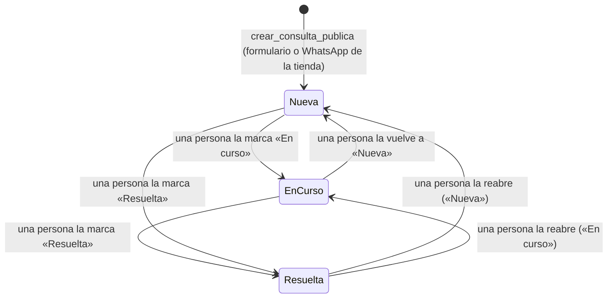
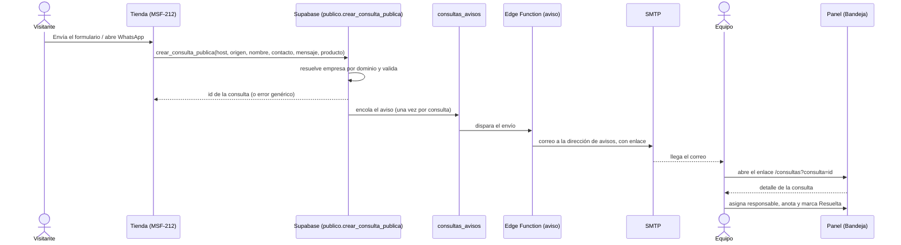
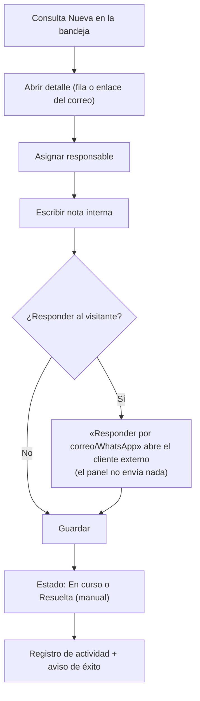

# Feature Specification: Consultas y ventas · Consultas bandeja y aviso

**Épica**: MSF-122 · **Spec**: `consultas-bandeja-y-aviso` · **Hito**: 3 (16 de noviembre al 11 de diciembre de 2026) · **Prioridad**: P0 · **Horas aprox.**: 24
**Alcance de entrega**: `refine`, `supabase` (migraciones + Edge Function de aviso). Sin `superset` ni `workers`. `kestra` solo si la *Decisión abierta 4* resuelve que el barrido de reintentos no puede vivir en Supabase.
**Fuente**: especificación de Nicolás cargada en la épica (Jira), prototipo en `design/pantallas/Consultas.dc.html` (+ `AdminSider.dc.html`, `StoreGeneral.dc.html` como contexto) y artefactos del producto. Esta spec **traduce**; no agrega alcance.

> Nota de rama: la rama `design/prototipo` citada en el encargo no existe en `origin`; los prototipos viven versionados en `design/pantallas/` de este repo y de ahí sale el inventario (`Consultas.inventory.json`, al día).

## Objetivo

Al terminar, cada consulta que un visitante envía desde una tienda queda registrada en el panel, el equipo la ve en una bandeja con estados, responsable y nota interna, y a la empresa le llega un correo de aviso con un enlace a la consulta.

## Modelo y supuestos

- La bandeja es **solo un registro**: la respuesta al visitante se da fuera del sistema (correo o WhatsApp) y el panel **no envía mensajes al visitante**. El estado «Resuelta» lo marca una persona.
- El formulario de la tienda (F-TDA-16), el botón «Consultar por WhatsApp» y su protección contra spam (campo trampa y límite por IP) son de **Tiendas online** (MSF-212). Esta épica entrega la RPC `crear_consulta_publica` con su **validación en el servidor**.
- Los **tres estados son fijos** en esta etapa (editables llega con F-CFG-01): **Nueva**, **En curso** y **Resuelta** (los nombres «Nueva» y «Resuelta» salen de la épica y del prototipo; «En curso» es la propuesta de esta spec, ver *Decisión abierta 1*). Todo cambio de estado es **manual**: asignar o anotar no cambia el estado solo.
- El aviso usa el SMTP ya presente en el repo (`supabase/functions/_shared/correo.ts`, variables `SMTP_*`) como **proveedor transaccional configurado por el equipo técnico**; qué proveedor y desde qué dominio (SPF/DKIM) es decisión operativa abierta (*Decisión abierta 3*). El centro de avisos configurable por usuario (F-NOT-01) es posterior.
- La dirección de avisos se edita en la ficha de la empresa (pestaña **General**) y se guarda en `consultas_configuracion`; mientras no se edite, el valor efectivo es el **correo de contacto de la empresa** (`dominio.empresas.correo`). Se coordina con el componente Empresas (MSF-138).
- **Ya existe** (no se recrea): sección `consultas` en `permisos_rol` / `private.matriz_inicial()` y `private.nivel_seccion('consultas')` (MSF-125); `dominio.empresas`, `private.empresas_accesibles()`, `public.registro_actividad` y `private.insertar_actividad` (MSF-138/MSF-121); `dominio.tiendas` y `publico.tienda_por_dominio(host)` (MSF-147); `dominio.productos` (MSF-160); grupo **Canales** del menú con `Empresas` (`destinosPanel.ts`).
- El template no trae filtros, búsqueda ni paginación en listas, ni correo transaccional de negocio, ni centro de avisos: se construyen aquí (lo mínimo que piden las historias).
- **Retención** de consultas y datos personales: no está definida (*Decisión abierta 5*); esta spec **no** implementa borrado ni expiración.

### Esquema de datos (Constitución, Principio VII)

Todo es entidad de negocio del producto (qué preguntan los visitantes de cada tienda) → **`dominio`**; ninguna tabla va a `public`. La RPC pública vive en el esquema `publico` (como `publico.tienda_por_dominio`, precedente de MSF-241): superficie para `anon`, sin almacenar datos. Las vistas y RPC internas viven en `public` (superficie de lectura/ejecución). Se re-verifica en plan, tareas, implementación y PR.

| Objeto | Esquema | Historia | Justificación | RLS / acceso |
|--------|---------|----------|---------------|--------------|
| `consultas` (**nueva**) | `dominio` | F-CON-01 | Registro de negocio: lo que un visitante preguntó a una empresa. | RLS por organización y por empresa (`empresa_id in (select private.empresas_accesibles())`); select `consultas`≥`lectura`; update solo de estado/responsable/nota con `consultas`=`edicion`; **sin insert ni delete desde la app** (el alta es solo la RPC pública); `anon` sin privilegios sobre la tabla |
| `consultas_configuracion` (**nueva**) | `dominio` | F-CON-03 | Configuración de la empresa para sus consultas (dirección de avisos). | RLS por organización; FK compuesta `(empresa_id, organizacion_id)`; una fila por empresa; select `consultas`≥`lectura` o `empresas`≥`lectura`; escritura solo por RPC con `empresas`=`edicion`; sin delete |
| `consultas_avisos` (**nueva**) | `dominio` | F-CON-03 | Cola/registro de los avisos por correo (estado, intentos, error útil) para reintentar sin duplicar. | RLS por organización; solo lectura para `empresas`≥`edicion`; escritura solo desde funciones `security definer` y la Edge Function; `anon` sin privilegios |
| RPC `publico.crear_consulta_publica` | `publico` | F-CON-01 | Único punto de alta; resuelve la empresa por el host (MSF-147). | `security definer`, `set search_path = ''`, `grant execute … to anon, authenticated`; entra a la lista de RPC permitidas a `anon` del pgTAP (ver `docs/acceso-ingreso.md`) |
| Vista `public.consultas_bandeja`; RPC `public.actualizar_consulta`, `public.contar_consultas_nuevas`, `public.responsables_consultas`, `public.guardar_correo_avisos_consultas` | `public` | F-CON-01 / F-CON-03 | Superficie de lectura/ejecución, no almacenan datos. | vista `security_invoker`; RPC `revoke … from public, anon` + `grant execute … to authenticated` |

La prueba pgTAP `rls_en_toda_tabla` (recorre `public` + `dominio`) debe seguir verde; la de «anon solo ejecuta las RPC permitidas» se actualiza con **una** entrada nueva (`publico.crear_consulta_publica`). Reversión: ver `plan.md` (migraciones aditivas; cada historia aporta la suya).

## User Scenarios & Testing *(mandatory)*

### User Story 1 - Bandeja de consultas (F-CON-01, P0, talla M)

Como integrante del equipo veo en una bandeja las consultas que llegan desde las tiendas, las filtro, abro cada una y le asigno responsable, nota interna y estado.

**Por qué**: es el registro de todo lo que preguntan los visitantes; sin ella las consultas se pierden.

**Escenarios**:
1. **Dado** una tienda publicada, **cuando** el visitante envía el formulario (nombre, contacto, mensaje, producto opcional), **entonces** `crear_consulta_publica` registra una consulta **Nueva** de la empresa dueña del dominio y la bandeja la muestra en menos de 5 segundos.
2. **Dado** un host desconocido o de empresa desactivada, **cuando** se llama a la RPC, **entonces** responde un error genérico (no revela si el dominio existe) y no crea nada.
3. **Dado** datos inválidos (nombre vacío, contacto que no es correo ni teléfono, mensaje largo, `producto_id` de otra organización, origen desconocido), **cuando** se llama a la RPC, **entonces** se rechaza en el servidor con un código claro y no se guarda nada. Un mensaje puede faltar solo cuando el origen es WhatsApp (el prototipo muestra «No dejó mensaje»).
4. **Dado** una consulta de la empresa A, **cuando** entra una persona de otra organización o sin acceso a la empresa A, **entonces** no la ve (pgTAP con dos organizaciones).
5. **Dado** los roles: con `consultas`=`edicion` puede asignar, anotar y cambiar estado; con `lectura` ve la bandeja y el detalle sin poder cambiar nada; con `ninguno` el menú no ofrece Consultas y la ruta muestra «Acceso restringido».
6. **Dado** la bandeja, **cuando** busco por nombre, producto o mensaje, filtro por estado, por fecha o por tienda, **entonces** la lista y el pie «N consultas» reflejan el filtro.
7. **Dado** consultas nuevas, **entonces** el ítem **Consultas** del menú (grupo **Canales**, primero) muestra el contador de nuevas de las empresas visibles.
8. **Dado** una consulta abierta, **cuando** asigno responsable, escribo la nota interna y marco **Resuelta**, **entonces** queda guardado con aviso de éxito y el evento en `registro_actividad`; si otra persona la modificó antes, recibo un conflicto claro (bloqueo optimista por `updated_at`).
9. **Dado** el enlace `/consultas?consulta=<id>` (el del correo), **cuando** lo abro con acceso, **entonces** se abre directo el detalle de esa consulta; sin acceso o de otra empresa, no se revela su existencia.
10. **Dado** que cambio la empresa activa de la barra superior, **entonces** la bandeja recarga todo, reencuadra la paginación, cierra el detalle abierto y nunca muestra filas ni totales de la empresa anterior.

### User Story 2 - Aviso de nueva consulta (F-CON-03, P0, talla S)

Como empresa recibo un correo de aviso cada vez que entra una consulta, con un enlace para abrirla en el panel.

**Escenarios**:
1. **Dado** una consulta nueva de la empresa, **entonces** se envía **un** correo a la dirección de avisos con empresa, origen, nombre, contacto, producto, mensaje y un enlace a la consulta.
2. **Dado** que el administrador no editó la dirección, **entonces** se usa el correo de contacto de la empresa; **dado** que la editó en la ficha (pestaña General), **entonces** se usa esa.
3. **Dado** que el envío falla (SMTP caído), **entonces** la consulta queda igualmente registrada, el aviso se reintenta con tope y el error útil queda guardado; un reintento no duplica el correo ya enviado.
4. **Dado** una empresa sin dirección de avisos ni correo de contacto, **entonces** el aviso queda en estado «sin destinatario» (la consulta sí se registra) y no se reintenta indefinidamente.
5. **Dado** el correo, **cuando** abro el enlace, **entonces** llego al detalle de la consulta (inicio de sesión mediante) — el recorrido E2E completo: enviar, ver el aviso, abrir el enlace, asignar, anotar y resolver.
6. **Dado** datos del visitante con saltos de línea u HTML, **entonces** el correo es texto plano y no permite inyectar cabeceras ni contenido.
7. **Dado** un usuario sin `empresas`=`edicion`, **entonces** ve la dirección de avisos en solo lectura y la RPC rechaza la escritura (`42501`).

## Flujos

### F1 · Estados de una consulta

Dueños: alta en `Nueva` FR-002; las transiciones (todas manuales, nunca automáticas; asignar o anotar no cambian el estado) FR-003 y FR-007. Los tres estados son fijos: la edición de estados es F-CFG-01, **fuera de alcance**.

### F2 · De la tienda al aviso y a la bandeja

Dueños: alta y validación FR-002; bandeja y detalle FR-005…FR-008; cola FR-011; envío y reintentos FR-012; enlace FR-013; destinatario FR-009/FR-010. **Fuera de alcance**: formulario, botón de WhatsApp y anti-spam de la tienda (Tiendas online, MSF-212).

### F3 · Atención de una consulta (verificación de la épica)

Dueños: FR-007 (detalle, responsable, nota, estado, «Responder por»), FR-003 (guardado y actividad).

## Requirements *(mandatory)*

### F-CON-01 · Bandeja de consultas

- **FR-001**: Existe `dominio.consultas` (`id`, `organizacion_id`, `empresa_id` con FK compuesta `(empresa_id, organizacion_id)`, `origen` ∈ {`formulario`, `whatsapp`}, `nombre`, `contacto`, `mensaje` (nullable), `producto_id` (FK compuesta a `dominio.productos`, nullable), `estado` ∈ {`nueva`, `en_curso`, `resuelta`} por defecto `nueva`, `responsable_id` (nullable), `nota_interna` (nullable), `created_at`, `updated_at`) con RLS por organización y por empresa accesible, e índices por `(empresa_id, estado, created_at desc)`. Sin insert ni delete desde la app.
- **FR-002**: `publico.crear_consulta_publica(host, origen, nombre, contacto, mensaje, producto_id)` (contrato en `contracts/consultas.md`) resuelve la empresa **únicamente por el dominio** (nunca por un `empresa_id` enviado por el cliente), valida en el servidor (nombre y contacto obligatorios, contacto = correo o teléfono, largos máximos, mensaje obligatorio salvo origen `whatsapp`, producto de la misma organización, origen permitido), crea la consulta en `nueva` y devuelve su id; host desconocido o empresa desactivada → mismo error genérico. Ejecutable por `anon`; es la única entrada a la lista de RPC permitidas a `anon`. La protección anti-spam es de MSF-212.
- **FR-003**: `public.actualizar_consulta(id, estado, responsable_id, nota_interna, updated_at)` exige `consultas`=`edicion` y empresa accesible, valida que el responsable sea un usuario activo con acceso a la empresa y a la sección `consultas`, aplica bloqueo optimista por `updated_at` (conflicto claro), es idempotente y registra en `registro_actividad` los eventos `consulta.estado_cambiado`, `consulta.asignada` y `consulta.nota_actualizada` solo si el valor cambió. Cambia **solo** esos tres campos.
- **FR-004**: `public.consultas_bandeja` (vista `security_invoker`) devuelve por consulta: estado, fecha, empresa (nombre), contacto, nombre, producto (nombre o «Sin producto»), origen, mensaje, responsable (nombre) y nota; admite filtro por empresa, estado, rango de fechas y búsqueda por nombre, producto o mensaje, con paginación y total; `public.contar_consultas_nuevas(empresa_id default null)` da el contador del menú respetando RLS; `public.responsables_consultas(empresa_id)` lista a quienes se pueden asignar.
- **FR-005**: El menú lateral ofrece **Consultas** (ruta `/consultas`, icono de comentarios, sección de permiso `consultas`) como **primer** ítem del grupo **Canales** —que ya existe con `Empresas`; no se duplica— con el contador de consultas nuevas; visible solo con `consultas`≥`lectura`; ruta protegida (sin permiso → «Acceso restringido»).
- **FR-006**: La pantalla **Consultas** reproduce el prototipo: título «Consultas» y subtítulo «Mensajes del formulario de contacto de las tiendas e interés por WhatsApp desde las fichas de producto.»; aviso informativo (texto adaptado a la épica: el aviso por correo va a **la dirección de avisos de la empresa**; la respuesta se da por correo o WhatsApp fuera del sistema); fila **Tienda** con chips («Todas las tiendas» + una por empresa accesible) y la nota «Cada consulta llega por el formulario o el WhatsApp de una tienda. Si elegís una empresa en la barra superior, se filtra por esa tienda.»; búsqueda «Buscar por nombre, producto o mensaje»; chips de estado «Todas», «Nuevas (n)», «En curso», «Resuelta» (el prototipo trae «Respondidas»: la épica fija «Resuelta», ver nota de divergencia); filtro por fecha (la épica lo pide; el prototipo no lo dibuja, va junto a los chips); tabla con columnas `Estado`, `Cuándo`, `Empresa`, `Contacto`, `Producto`, `Origen` (fila clicable; chip de estado y de empresa con su color); pie «N consultas»; estados de carga, vacío («Todavía no hay consultas» / «Sin resultados para el filtro») y error con reintento; operable con teclado y lector de pantalla a 320, 768 y 1440 px.
- **FR-007**: Abrir una fila (o el enlace `?consulta=<id>`) muestra el diálogo «Consulta de <nombre>» como el prototipo —chips de empresa, origen y estado, fecha, `Contacto`, `Producto de interés`, `Mensaje`— más, por la épica, los controles **Estado** (Nueva / En curso / Resuelta), **Responsable** y **Nota interna**; botones `Cerrar`, `Responder por <correo|WhatsApp>` (abre `mailto:` o el chat de WhatsApp en el cliente externo; **el panel no envía nada**) y `Guardar`; aviso de éxito al guardar; conflicto de edición y errores visibles; con `consultas`=`lectura` los controles quedan de solo lectura.
- **FR-008**: **Empresa activa** (Principio VIII): la bandeja usa la empresa activa de la barra superior como única fuente de verdad: con una empresa concreta filtra por ella (los chips «Tienda» la muestran seleccionada y bloqueada); con «Todas mis empresas» los chips filtran entre las accesibles. Al cambiar de empresa invalida y recarga **todas** las consultas (lista, contador, responsables), reencuadra la paginación, descarta la selección y cierra el diálogo abierto.
- **SC-001**: pgTAP: aislamiento entre dos organizaciones y entre empresas sin acceso en `consultas`; permisos por los tres niveles (`edicion`/`lectura`/`ninguno`); alta solo por la RPC (insert directo rechazado); validaciones de `crear_consulta_publica` (dominio desconocido, empresa inactiva, datos inválidos, producto de otra organización); `actualizar_consulta` (conflicto, responsable inválido, eventos de actividad); `anon` solo ejecuta la RPC pública; `rls_en_toda_tabla` verde.
- **SC-002**: Vitest de la pantalla: columnas, búsqueda, filtros de estado/fecha/tienda, pie, estados vacío/error/carga, contador del menú y acceso restringido.
- **SC-003**: Vitest del diálogo y de la empresa activa: asignar, anotar, resolver, conflicto, solo lectura, `?consulta=<id>`, «Responder por…», y **cambiar de empresa no arrastra datos ni deja el diálogo abierto**.

### F-CON-03 · Aviso de nueva consulta

- **FR-009**: Existe `dominio.consultas_configuracion` (`empresa_id` único con FK compuesta, `organizacion_id`, `correo_avisos`, `updated_at`) con RLS y la RPC `public.guardar_correo_avisos_consultas(empresa_id, correo)` (exige `empresas`=`edicion`, valida formato de correo, bloqueo optimista, registra evento en `registro_actividad`). El destinatario efectivo es `correo_avisos` si existe; si no, `dominio.empresas.correo`.
- **FR-010**: La ficha de la empresa, pestaña **General**, muestra el campo **Correo para avisos de consultas** (con el correo de contacto como valor inicial y una ayuda que lo explica) y se guarda con la RPC; solo lectura sin `empresas`=`edicion`. El prototipo `StoreGeneral.dc.html` no dibuja este campo: lo pide la épica y queda anotado como divergencia en el PR.
- **FR-011**: Existe `dominio.consultas_avisos` (`consulta_id` único, `estado` ∈ {`pendiente`, `enviado`, `fallido`, `sin_destinatario`}, `intentos`, `ultimo_error`, `enviado_en`, `created_at`) y un disparador `AFTER INSERT` en `consultas` que encola **un** aviso por consulta (idempotente) en la misma transacción del alta.
- **FR-012**: Una Edge Function (`enviar-aviso-consulta`, reutiliza `_shared/correo.ts`, sin service-role en el navegador) envía el correo en **texto plano** al destinatario efectivo, con asunto «Nueva consulta · <empresa>», cuerpo con origen, nombre, contacto, producto y mensaje, saneando saltos de línea en cabeceras; marca `enviado` o `fallido` con `ultimo_error` útil; reintenta con tope de intentos; un aviso ya `enviado` no se reenvía; sin destinatario → `sin_destinatario`. Un fallo de envío **nunca** impide ni revierte el registro de la consulta.
- **FR-013**: El correo incluye el enlace `<PANEL_URL>/consultas?consulta=<id>` (variable `PANEL_URL` documentada en `.env.example`); el enlace no contiene datos personales.
- **SC-005**: pgTAP: aislamiento en `consultas_configuracion` y `consultas_avisos` con dos organizaciones; permisos de la RPC (`42501`, `edicion`); destinatario efectivo (propio / contacto / ninguno); un aviso por consulta; reintento sin duplicar; `anon` sin privilegios.
- **SC-006**: Prueba de la Edge Function (Deno/Vitest con SMTP simulado): envío correcto con enlace, fallo y reintento con tope, `sin_destinatario`, saneamiento de cabeceras y texto plano.
- **SC-007**: Vitest del campo «Correo para avisos de consultas» (valor inicial, validación, guardado, solo lectura, error).

### Cierre (docs, seguridad, E2E)

- **FR-014**: `docs/consultas.md` documenta modelo, estados, permisos, RPC pública, aviso, variables (`SMTP_*`, `PANEL_URL`), retención pendiente y reversión; fila/sección de `docs/roadmap-template.md` actualizada; `pnpm docs:check` verde.
- **FR-015**: Revisión de seguridad de la superficie nueva: RLS en las 3 tablas, `anon` solo con la RPC pública, validación de entrada, sin enumeración de dominios, texto plano en el correo, y esquema de cada tabla contra el Principio VII.
- **SC-004**: En un entorno de prueba, una consulta enviada desde la tienda aparece en la bandeja de su empresa en menos de 5 segundos y dispara un correo (se mide en el E2E de cierre, no es de una sola historia).
- **SC-008**: E2E del recorrido completo: enviar desde la tienda, ver el aviso (Mailpit), abrir el enlace, asignar, anotar y resolver; con los tres roles.
- **SC-009**: `pnpm lint`, `pnpm build`, `pnpm infra:config`, `pnpm test`, `rls_en_toda_tabla`, `pnpm prototipo:check` y `pnpm matriz:check` verdes.

## Decisiones abiertas (para Nicolás)

1. **Nombre del estado intermedio**: la épica fija tres estados y nombra «Nueva» y «Resuelta»; esta spec propone **«En curso»** para el del medio. El prototipo muestra solo dos («Nueva» / «Respondida»).
2. **Origen en el filtro**: el prototipo tiene chips «Formulario» / «WhatsApp»; la épica pide filtros por empresa, estado y fecha. Se muestra la columna Origen pero **no** se filtra por origen (ver matriz).
3. **Proveedor de correo y dominio (SPF/DKIM)**: sin definir (decisión #6). La spec usa el SMTP ya integrado; cambiar de proveedor no cambia el diseño.
4. **Disparo y reintentos del aviso**: se propone disparar la Edge Function desde la base (webhook/`pg_net`) y barrer pendientes con la misma función. Si el entorno self-hosted no ofrece `pg_net`, el barrido pasa a un flow de Kestra (se sumaría alcance `kestra`).
5. **Retención de consultas y datos personales**: sin definir; no se borra nada en esta épica.
6. **Horas**: 24 h (la suma de tallas M+S es 12 h; se mantiene 24 h por RPC pública, RLS, E2E y proveedor), a confirmar. **Dependencias**: MSF-160 queda como bloqueante por la FK `consultas.producto_id`; si se prefiere sin FK hasta Catálogo, pasaría a «relacionada».
7. **Conflicto de roadmap** (etiqueta `revisar-roadmap`): el roadmap a diciembre solo nombra «Consulta por WhatsApp y formulario de contacto» (10 h); manda el roadmap, conflicto sin resolver por la épica.

## Matriz pantalla↔criterios

### Consultas (`Consultas.dc.html`, inventario `Consultas.inventory.json`)

| Ítem del inventario / visible | Destino | Criterio |
|---|---|---|
| Columna `Estado` (chip Nueva / En curso / Resuelta) | Incluido | FR-006 |
| Columna `Cuándo` | Incluido | FR-006 |
| Columna `Empresa` (chip con color de la tienda) | Incluido | FR-006 |
| Columna `Contacto` (nombre + correo/teléfono) | Incluido | FR-006 |
| Columna `Producto` («Sin producto» si no hay) | Incluido | FR-006 |
| Columna `Origen` (Formulario / WhatsApp) | Incluido | FR-006 |
| Botón `Cerrar` (diálogo) | Incluido | FR-007 |
| Botón `Responder por ·` (correo / WhatsApp) | Incluido: abre el cliente externo, no envía | FR-007 |
| Diálogo `Consulta de ·` (chips, Contacto, Producto de interés, Mensaje) | Incluido | FR-007 |
| Botón del diálogo «Marcar como respondida / nueva» | Reemplazado por los controles Estado + `Guardar` (la épica pide 3 estados, responsable y nota) | FR-007 |
| Controles `Estado`, `Responsable`, `Nota interna`, `Guardar` (no están en el prototipo) | Incluido por la épica (requisitos mandan el comportamiento) | FR-003, FR-007 |
| Título, subtítulo y aviso informativo | Incluido (texto del aviso adaptado a «dirección de avisos de la empresa») | FR-006 |
| Fila «Tienda» (chips + nota de la barra superior) | Incluido | FR-006, FR-008 |
| Búsqueda «Buscar por nombre, producto o mensaje» | Incluido | FR-004, FR-006 |
| Chips de estado «Todas / Nuevas (n) / Respondidas» | Incluido con los 3 estados de la épica («Resuelta») | FR-006 |
| Filtro por fecha (la épica lo pide; no está en el prototipo) | Incluido | FR-004, FR-006 |
| Chips «Formulario» / «WhatsApp» (filtro por origen) | **Fuera de alcance**: la épica pide filtros por empresa, estado y fecha; el origen se muestra, no filtra | — |
| Pie «N consultas» | Incluido | FR-006 |
| Aviso (snackbar) «Consulta marcada como …» | Incluido: aviso de éxito al guardar | FR-007 |
| Paginación | Incluido (el template no la trae; mínimo necesario) | FR-004, FR-006 |
| Fila **Empresa activa** | Incluido: filtra por la empresa de la barra superior; test de cambio de empresa | FR-008, SC-003 |

### Menú lateral (`AdminSider.dc.html`)

| Ítem | Destino | Criterio |
|---|---|---|
| Grupo «Canales» → ítem `Consultas` con contador (primero) | Incluido; el grupo ya existe (Empresas), no se duplica | FR-005 |
| Resto de ítems de Canales (Mercado Libre, Opiniones, Newsletter) y demás grupos | Fuera de alcance: de otras épicas | — |

### Ficha de empresa · General (`StoreGeneral.dc.html`, solo el campo nuevo)

| Ítem | Destino | Criterio |
|---|---|---|
| Campo **Correo para avisos de consultas** (no está en el prototipo) | Incluido por la épica | FR-009, FR-010, SC-007 |
| Demás campos, pestañas y botones de la ficha (`Nombre comercial`, `Dominio`, `Idioma`, `Moneda`, `WhatsApp`, `Correo`, `Instagram`, `Dirección`, `Guardar y publicar`, etc.) | Fuera de alcance: de MSF-138 / MSF-147 | — |

### Fuera de pantalla

| Ítem | Destino | Criterio |
|---|---|---|
| Correo de aviso (sin pantalla) | Incluido | FR-012, FR-013 |
| Formulario de contacto y botón «Consultar por WhatsApp» de la tienda | Fuera de alcance: Tiendas online (MSF-212) | — |
| Seguimiento posterior y WhatsApp (MSF-130), ventas vinculadas (MSF-159/MSF-275), alertas de Inicio (MSF-156), estados editables (F-CFG-01), centro de avisos (F-NOT-01) | Fuera de alcance: otras épicas | — |

## Matriz de trazabilidad Jira ↔ US ↔ FR ↔ tareas

| Jira | Historia | FR / SC | Tareas |
|------|----------|---------|--------|
| F-CON-01 | US1 Bandeja de consultas | FR-001…008, SC-001…003 | T001–T013 |
| F-CON-03 | US2 Aviso de nueva consulta | FR-009…013, SC-005…007 | T014–T023 |
| Tarea de cierre (label `cierre`) | Docs, seguridad, E2E, roadmap | FR-014, FR-015, SC-004, SC-008, SC-009 | T024–T027 |
