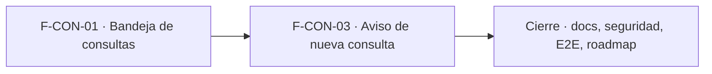

# Tasks: Consultas y ventas · Consultas bandeja y aviso

**Input**: [spec.md](./spec.md), [plan.md](./plan.md) y [contracts/consultas.md](./contracts/consultas.md) · **Épica**: MSF-122
**Formato**: `- [ ] T### [P] [Historia][USx] descripción (FR/SC)`. `[P]` = paralelizable (archivos distintos, sin dependencia dentro del mismo grupo). Cada FR/SC tiene **una sola** tarea dueña. Las dependencias y el orden son **solo dentro de la misma historia**; entre historias rige la tabla *Plan de ejecución* (objetos ya mergeados, nunca una tarea abierta de otra).
**Validación por historia**: `pnpm test:db`, `pnpm lint`, `pnpm build` y `pnpm test:web` verdes antes de cerrar la fase. Cada tabla nueva: esquema `dominio` re-verificado (Principio VII).

## Phase 1: F-CON-01 · Bandeja de consultas

**Goal**: tabla `consultas`, RPC pública de alta, edición con bloqueo optimista, vista de bandeja, ítem de menú con contador y pantalla con diálogo de detalle.

- [ ] T001 [F-CON-01][US1] Migración `supabase/migrations/20261205100000_consultas.sql`: `dominio.consultas` (columnas, `check` de origen y estado, FK compuestas a `empresas` y `productos`, índice `(empresa_id, estado, created_at desc)`), RLS por organización y empresa accesible, select `consultas`≥`lectura`, update de estado/responsable/nota con `consultas`=`edicion`, sin insert/delete desde la app, `anon` sin privilegios, reversión en el encabezado (FR-001)
- [ ] T002 [F-CON-01][US1] Migración `supabase/migrations/20261024100100_crear_consulta_publica.sql`: `publico.crear_consulta_publica` (empresa por dominio vía `dominio.tiendas`, validaciones, error genérico para host desconocido/empresa inactiva, `grant … to anon, authenticated`) y su alta en la lista de RPC permitidas a `anon` del pgTAP existente (FR-002)
- [ ] T003 [F-CON-01][US1] Migración `supabase/migrations/20261024100200_actualizar_consulta.sql`: `public.actualizar_consulta` (nivel `edicion`, responsable válido, bloqueo optimista por `updated_at`, idempotente) y eventos `consulta.estado_cambiado` / `consulta.asignada` / `consulta.nota_actualizada` vía `private.insertar_actividad`; `revoke … from public, anon`, `grant … to authenticated` (FR-003)
- [ ] T004 [F-CON-01][US1] Migración `supabase/migrations/20261024100300_consultas_bandeja.sql`: vista `public.consultas_bandeja` (`security_invoker`), `public.contar_consultas_nuevas` y `public.responsables_consultas` (FR-004)
- [ ] T005 [F-CON-01][US1] pgTAP `supabase/tests/database/consultas.test.sql`: aislamiento con dos organizaciones y entre empresas, tres niveles de permiso, alta solo por RPC, validaciones, conflicto de edición, eventos de actividad, `anon` solo la RPC pública; `rls_en_toda_tabla` verde (SC-001)
- [ ] T006 [P] [F-CON-01][US1] `apps/web/src/lib/consultas.ts` y `hooks/useConsultas.ts`: tipos, etiquetas de estado/origen, consulta paginada con filtros (empresa, estado, fecha, búsqueda), contador, responsables, `actualizar_consulta`, mapeo de errores `40001`/`42501`/`22023`, claves de consulta por `empresa_id` (soporte de FR-006, FR-007 y FR-008)
- [ ] T007 [F-CON-01][US1] Menú: ítem `Consultas` (ruta `/consultas`, `seccionPermiso: 'consultas'`) como **primer** destino del grupo `canales` en `destinosPanel.ts`, contador de nuevas en `SiderPanel` y ruta protegida con «Acceso restringido»; actualizar `destinosPanel.permisos.test.ts` (FR-005)
- [ ] T008 [F-CON-01][US1] `apps/web/src/pages/consultas/list.tsx` + `components/consultas/*`: título, subtítulo, aviso informativo, fila Tienda con chips y nota, búsqueda, chips de estado, filtro de fecha, tabla (`Estado`, `Cuándo`, `Empresa`, `Contacto`, `Producto`, `Origen`), pie «N consultas», paginación y estados cargando/vacío/error con reintento, con los componentes del template y tokens del sistema de diseño (FR-006)
- [ ] T009 [F-CON-01][US1] `components/consultas/DetalleConsulta.tsx`: diálogo «Consulta de <nombre>» (chips, Contacto, Producto de interés, Mensaje), controles Estado / Responsable / Nota interna, `Cerrar`, `Responder por <correo|WhatsApp>` (`mailto:`/enlace de chat, sin enviar nada), `Guardar`, aviso de éxito, conflicto, solo lectura con `lectura`, apertura por `?consulta=<id>` (FR-007)
- [ ] T010 [F-CON-01][US1] Empresa activa: la pantalla toma la de la barra superior (chips bloqueados en la empresa concreta; filtran en «Todas mis empresas»), invalida todas las consultas al cambiarla, reencuadra la paginación y cierra el diálogo (FR-008)
- [ ] T011 [F-CON-01][US1] Vitest de la pantalla y el menú: columnas, búsqueda, filtros, pie, estados vacío/error/carga, contador, acceso restringido, teclado/lector (SC-002)
- [ ] T012 [F-CON-01][US1] Vitest del diálogo y de la empresa activa: asignar, anotar, resolver, conflicto, solo lectura, `?consulta=<id>`, «Responder por…» y cambio de empresa sin arrastre de datos ni diálogo abierto (SC-003)
- [ ] T013 [F-CON-01][US1] Regenerar tipos de Supabase y `pnpm schema:doc` si aplica; verificar el esquema `dominio` de `consultas` (soporte de FR-001…FR-004)

**Checkpoint F-CON-01**: `pnpm test:db`, `pnpm lint`, `pnpm build` y `pnpm test:web` verdes.

## Phase 2: F-CON-03 · Aviso de nueva consulta

**Goal**: dirección de avisos por empresa, cola de avisos, envío por correo con enlace y reintentos.

- [ ] T014 [F-CON-03][US2] Migración `supabase/migrations/20261205200000_consultas_configuracion.sql`: `dominio.consultas_configuracion` (una fila por empresa, FK compuesta, RLS por organización, sin delete, `anon` sin privilegios), función `private.correo_avisos_consulta(empresa)` (propio o `empresas.correo`) y `public.guardar_correo_avisos_consultas` (`empresas`=`edicion`, formato, bloqueo optimista, evento de actividad, `revoke … from public, anon`, `grant … to authenticated`); reversión en el encabezado (FR-009)
- [ ] T015 [F-CON-03][US2] Migración `supabase/migrations/20261024200100_consultas_avisos.sql`: `dominio.consultas_avisos` (`consulta_id` único, `estado`, `intentos`, `ultimo_error`, `enviado_en`), RLS, disparador `AFTER INSERT` en `dominio.consultas` que encola un aviso por consulta y lo dispara según *Decisión abierta 4*, `anon` sin privilegios, reversión en el encabezado (FR-011)
- [ ] T016 [F-CON-03][US2] pgTAP `supabase/tests/database/consultas_aviso.test.sql`: aislamiento con dos organizaciones en las dos tablas, permisos de la RPC, destinatario efectivo (propio / contacto / ninguno), un aviso por consulta, reintento sin duplicar, `anon` sin privilegios (SC-005)
- [ ] T017 [P] [F-CON-03][US2] `supabase/functions/enviar-aviso-consulta/index.ts` y `handler.ts`: autenticación de la invocación, lectura de la consulta, envío con `_shared/correo.ts`, estados `enviado`/`fallido`/`sin_destinatario`/`ya_enviado`, tope de reintentos y `ultimo_error` útil, el fallo no toca la consulta (FR-012)
- [ ] T018 [P] [F-CON-03][US2] `supabase/functions/enviar-aviso-consulta/contenido.ts`: asunto, cuerpo en texto plano, saneamiento de cabeceras (`lineaSegura`) y enlace `<PANEL_URL>/consultas?consulta=<id>` sin datos personales (FR-013)
- [ ] T019 [F-CON-03][US2] Prueba de la función (Deno/Vitest, SMTP simulado): envío con enlace, fallo y reintento con tope, `sin_destinatario`, `ya_enviado`, cabeceras saneadas, texto plano (SC-006)
- [ ] T020 [F-CON-03][US2] Disparo y barrido de pendientes según *Decisión abierta 4* (webhook de base hacia la función y reintento de `pendiente`/`fallido` bajo tope); si no hay `pg_net`, flow de Kestra versionado en `kestra/` y `pnpm infra:config` verde (soporte de FR-012)
- [ ] T021 [P] [F-CON-03][US2] Pestaña General de la empresa: campo `Correo para avisos de consultas` (valor inicial = correo de contacto, ayuda, validación, solo lectura sin `empresas`=`edicion`) en `pages/empresas/` con hook de la RPC (FR-010)
- [ ] T022 [F-CON-03][US2] Vitest del campo: valor inicial, validación, guardado, conflicto, solo lectura, error (SC-007)
- [ ] T023 [P] [F-CON-03][US2] `.env.example` y `supabase/functions/.env.example`: `PANEL_URL` y `SMTP_*` documentados (sin secretos) (soporte de FR-012 y FR-013)

**Checkpoint F-CON-03**: `pnpm test:db`, `pnpm lint`, `pnpm build` y `pnpm test:web` verdes.

## Phase 3: Cierre (docs, seguridad, verificación de la épica)

**Goal**: lo que ninguna historia atiende. Las tareas `[CIERRE]` las ejecuta la Tarea de cierre y **nunca** son prerequisito de una historia.

- [ ] T024 [P] [CIERRE] `docs/consultas.md` (modelo, estados, permisos, RPC pública, aviso, variables `SMTP_*`/`PANEL_URL`, retención pendiente, reversión) y fila/sección de `docs/roadmap-template.md` (estado, link a la spec); `pnpm docs:check` verde (FR-014)
- [ ] T025 [P] [CIERRE] Revisión de seguridad de la superficie nueva: RLS en las 3 tablas, `anon` solo con la RPC pública, validación de entrada, sin enumeración de dominios, correo en texto plano, esquema de cada tabla contra el Principio VII (FR-015)
- [ ] T026 [CIERRE] E2E (Playwright + Mailpit): enviar una consulta por la RPC pública de una tienda, medir que aparece en la bandeja en menos de 5 segundos y que llega el correo, abrir el enlace, asignar, anotar y resolver, con los tres roles y con una segunda organización que no la ve (SC-004, SC-008)
- [ ] T027 [CIERRE] `pnpm lint`, `pnpm build`, `pnpm infra:config`, `pnpm test`, `rls_en_toda_tabla`, `pnpm prototipo:check` y `pnpm matriz:check` verdes (SC-009)

**Checkpoint Cierre**: ninguna tarea queda `[ ]` sin hacerse o cerrarse con `Desvío:` y seguimiento trazado.

## Dependencias

Dentro de F-CON-01: T001 → T002 → T003 → T004 → T005; T006 [P] desde T001 → T007 → T008 → T009 → T010 → (T011, T012) → T013.
Dentro de F-CON-03: T014 → T015 → T016; T017 [P] y T018 [P] desde T015 → T019 → T020; T021 [P] desde T014 → T022; T023 [P] libre.
Cierre: T024 [P] y T025 [P] pueden arrancar cuando todas las historias estén mergeadas; T026 → T027 al final.
Entre historias (de entrega): F-CON-03 requiere F-CON-01 mergeada (la tabla `consultas`, que su disparador usa, y la pantalla que abre el enlace); cada una trae su propia migración con su timestamp.

## Plan de ejecución (historias)

El **orden de toma** de las historias lo declara esta tabla: el orquestador la **consume** (no lo infiere del orden de las tareas). Una historia arranca cuando sus dependencias (`Depende de`) están **Finalizadas (mergeadas)**; las del **mismo** `Grupo` van **en paralelo**. Aquí F-CON-03 depende de la tabla `consultas` de F-CON-01.

| Historia | Depende de | Grupo |
|----------|------------|-------|
| F-CON-01 | — | 1 |
| F-CON-03 | F-CON-01 | 2 |
| [Cierre] | F-CON-01, F-CON-03 | 3 |

