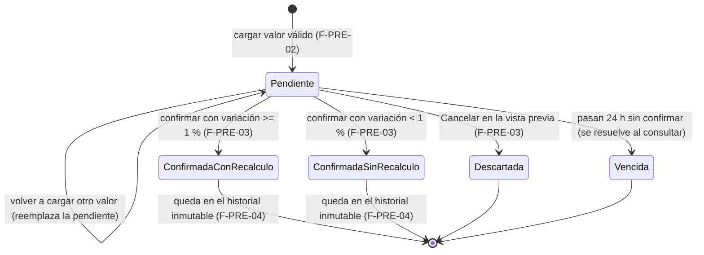
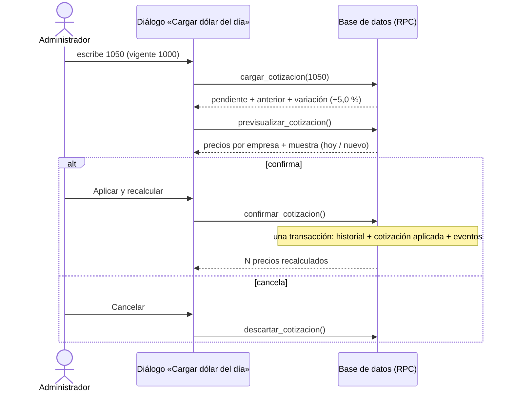
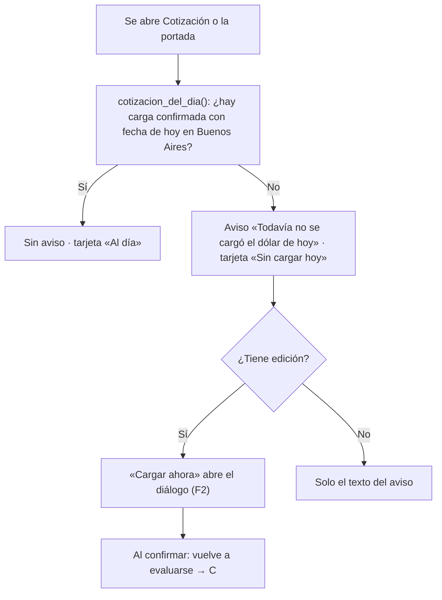

# Feature Specification: Precios y dólar · Dólar y recálculo

**Épica**: MSF-116 · **Spec**: `dolar-y-recalculo` · **Hito**: 2 (2 al 20 de noviembre de 2026) · **Prioridad**: P0 · **Horas aprox.**: 28
**Alcance de entrega**: `refine`, `supabase` (sin `kestra`, `superset` ni `workers`: el recálculo es una transacción de base de datos y el vencimiento se resuelve al consultar, ver *Decisiones abiertas* 1 y 2).
**Fuente**: especificación de Nicolás cargada en la épica (Jira), prototipo en `design/pantallas/Cotizacion.dc.html` y `Main.dc.html` y artefactos del producto (documento del componente «Precios y dólar», Funcionalidades, Roadmap, Relevamiento). Esta spec **traduce**; no agrega alcance.

> Nota de rama: la rama `design/prototipo` citada en el encargo no existe en `origin`; los prototipos viven versionados en `design/pantallas/` y de ahí salen los inventarios (`pnpm prototipo:inventario`).

## Objetivo

Al terminar, el administrador carga el dólar del día a mano, ve qué precios van a cambiar antes de confirmar, los precios de todas las empresas se recalculan juntos, queda un historial que no se puede editar y el sistema avisa cuando hoy no se cargó el dólar.

## Modelo y supuestos

- El dólar lo carga **solo quien tiene edición en «Cotización del dólar»** (sección `cotizacion_dolar`; hoy el Administrador), **a mano, una vez por día**; ningún proceso automático lo modifica.
- Una carga se confirma en **dos pasos**: cargar el valor (queda **pendiente**) y confirmar la vista previa.
- La cotización es **una sola para toda la organización**. En el lanzamiento el alcance («una para todo el sistema»), el redondeo (**$ 10 más cercano**), el umbral (**1 %**) y el aviso (**siempre activo**) son **fijos** (la configuración es F-PRE-06, Etapa 2).
- Hasta cargar un nuevo valor, los precios siguen con el **último conocido**.
- Las publicaciones de Mercado Libre aparecen en el historial recién en la Etapa 2.
- **Ya existe** (MSF-114, `docs/precios.md`): `dominio.cotizacion_inicial` y `private.a_pesos` (único punto de lectura de la cotización: aquí cambia su fuente, no sus llamadores), `private.precio_neto_empresa` / `private.aplicar_regla_precio`, `dominio.precios_empresa`, `dominio.empresas`, `public.registro_actividad` con `private.insertar_actividad`, `private.nivel_seccion` y la sección `cotizacion_dolar` (matriz de roles; el Jira la nombra `cotizacion`, manda el nombre del repo).
- **No se guarda ningún precio en pesos** (modelo de MSF-114: el precio se calcula al leer). Por eso «recalcular todos los precios» = **cambiar atómicamente la cotización aplicada** (una sola fila por organización) y registrar cuántos precios cambian; ninguna empresa puede quedar con un valor distinto de otra.
- «Hoy» se mide en la zona horaria **America/Argentina/Buenos_Aires** (el template no tiene zona por organización).
- Permisos por sección (`private.nivel_seccion('cotizacion_dolar')`): `edicion` carga, descarta y confirma; `lectura` ve la pantalla, el historial y el aviso sin acciones; `ninguno` no ve la pantalla.

### Esquema de datos (Constitución, Principio VII)

Todo es dato de negocio del producto → **`dominio`**; ninguna tabla va a `public`. Las RPC expuestas viven en `public` (superficie de ejecución, no almacenan datos). Se re-verifica en plan, tareas, implementación y PR.

| Objeto | Esquema | Historia | Justificación | RLS / acceso |
|--------|---------|----------|---------------|--------------|
| `cotizacion_pendiente` (**nueva**) | `dominio` | F-PRE-02 | Valor cargado que espera confirmación (una por organización, vence a las 24 h). | `organizacion_id = (select private.organizacion_id())`; select/insert/update/delete solo con `cotizacion_dolar`=`edicion`; `anon` sin privilegios |
| `cotizaciones` (**nueva**) | `dominio` | F-PRE-02 (tabla) · F-PRE-04 (inmutabilidad) | Historial de cargas confirmadas: valor, anterior, variación, quién, cuándo, precios recalculados. **Append-only.** | select con `cotizacion_dolar`≥`lectura`; sin insert/update/delete para `authenticated` (solo `public.confirmar_cotizacion`); trigger que rechaza update/delete/truncate; `anon` sin privilegios |
| `cotizacion_aplicada` (**nueva**) | `dominio` | F-PRE-03 | Cotización con la que se calculan los precios (una fila por organización). Se lee desde `private.a_pesos`. | select para quien ve `productos` (igual que `cotizacion_inicial`: si no, los precios de los roles sin acceso a la cotización se verían vacíos); escritura solo por `public.confirmar_cotizacion`; `anon` sin privilegios |
| `cotizacion_inicial` (existente) | `dominio` | — | Sin cambio: queda como respaldo cuando `cotizacion_aplicada` no tiene fila. | RLS vigente de MSF-114 |

Migraciones **aditivas**; cada historia trae la suya (ver `plan.md`). Reversión en el encabezado de cada una.

## User Scenarios & Testing *(mandatory)*

### User Story 1 - Carga diaria de la cotización del dólar (F-PRE-02, P0, talla M)

El administrador abre «Cotización del dólar», ve la cotización vigente y carga el valor del día en el diálogo «Cargar dólar del día».

**Why this priority**: sin carga no hay recálculo; bloquea F-PRE-03, F-PRE-04 y F-PRE-05.

**Acceptance Scenarios**:
1. **Given** una cotización vigente de $ 1.465, **When** abre la pantalla, **Then** ve la tarjeta «Vigente» con $ 1.465, «Última carga: <fecha> por <quién>» y «Productos con precio en USD».
2. **Given** el diálogo abierto, **When** escribe `1490` o `1490,50`, **Then** el campo (prefijo `$`, sufijo `por USD`) lo acepta, muestra «Anterior: $ 1.465 (<fecha>)» y la «Variación» (+1,7 %); el campo solo admite dígitos, `.` y `,`.
3. **Given** un valor vacío, cero, negativo o no numérico, **When** lo escribe, **Then** ve «Ingresá un valor válido, por ejemplo 1490 o 1490,50.» y no se puede avanzar.
4. **Given** una variación mayor al 15 %, **When** escribe el valor, **Then** ve la alerta «Variación inusual — La variación supera el 15 %. Revisá que el valor sea correcto antes de aplicarlo.» (aviso, no bloquea).
5. **Given** un valor válido, **When** lo confirma en el campo, **Then** queda **pendiente** (vence a las 24 h) y no cambia ningún precio.
6. **Given** un usuario con solo lectura, **When** abre la pantalla, **Then** ve la cotización pero no el botón «Cargar cotización».
7. **Given** una pendiente de más de 24 h, **When** se consulta, **Then** se trata como inexistente (no se puede confirmar).

### User Story 2 - Vista previa de impacto y recálculo (F-PRE-03, P0, talla L)

Antes de confirmar, el administrador ve qué precios van a cambiar en cada empresa; al confirmar, todos se recalculan juntos.

**Acceptance Scenarios**:
1. **Given** vigente 1000 y pendiente 1050 (+5 %), **When** ve la vista previa, **Then** ve «Qué va a cambiar» con un mosaico por empresa («38 precios · productos en USD visibles») y la tabla «Producto (muestra)» con «<Empresa> hoy» y «Nuevo» por empresa.
2. **Given** esa vista previa, **When** pulsa «Aplicar y recalcular», **Then** los precios de **todas** las empresas pasan a calcularse con 1050 en una sola transacción, el historial suma la carga y aparece «Cotización aplicada · N precios recalculados».
3. **Given** vigente 1000 y pendiente 1005 (+0,5 %, menor al umbral de 1 %), **When** ve la vista previa, **Then** ve «Sin recálculo — La variación es menor al umbral de 1 %: la cotización queda registrada, pero no se recalculan precios.», el botón dice «Registrar cotización» y al confirmar los precios **no cambian** («Cotización registrada · variación menor al umbral, precios sin cambios»).
4. **Given** una falla a mitad del recálculo, **When** ocurre, **Then** no queda ninguna empresa con precios nuevos y otra con viejos ni fila en el historial (todo o nada).
5. **Given** dos administradores que confirman a la vez, **When** ambos pulsan confirmar, **Then** solo una confirmación se aplica; la otra recibe un error claro sin duplicar el historial.
6. **Given** la vista previa abierta, **When** pulsa «Cancelar», **Then** la cotización pendiente se **descarta** y nada cambia (*supuesto a confirmar*, RF-PRE-03-7).
7. **Given** una pendiente vencida (24 h), **When** intenta confirmar, **Then** recibe «La cotización cargada venció; volvé a cargarla.» y no se aplica.
8. **Given** dos organizaciones, **When** una confirma, **Then** la otra no ve ningún cambio.

### User Story 3 - Historial de cotizaciones y trazabilidad (F-PRE-04, P0, talla S)

Cada carga confirmada queda en un historial que nadie puede editar ni borrar.

**Acceptance Scenarios**:
1. **Given** cargas confirmadas, **When** abre «Historial de cargas», **Then** ve, de la más nueva a la más vieja, `Fecha`, `Valor`, `Variación`, `Cargó` y `Precios` («N precios» o «Sin cambios (< 1 %)») y el pie «Cada cambio de precio guarda la cotización usada, para reconstruir la rentabilidad de cualquier fecha.»
2. **Given** una fila del historial, **When** cualquier rol (incluido el administrador y el rol de servicio) intenta modificarla o borrarla por SQL o API, **Then** la base lo rechaza.
3. **Given** más filas que una página, **When** navega, **Then** se pagina sin cargar todo el historial.
4. **Given** el historial vacío, con error o cargando, **When** se abre, **Then** se muestran los estados compartidos de vacío, error y carga.
5. **Given** dos organizaciones, **When** una consulta, **Then** solo ve su historial.

### User Story 4 - Aviso de cotización no cargada (F-PRE-05, P0, talla S)

Si hoy no se cargó el dólar, el sistema lo avisa en el panel de cotización y en la portada.

**Acceptance Scenarios**:
1. **Given** que hoy (Buenos Aires) no hubo carga confirmada, **When** abre la pantalla de Cotización o la portada, **Then** ve «Todavía no se cargó el dólar de hoy — Los precios en dólares se siguen calculando con $ 1.465 (Última carga: <fecha> por <quién>).» con el botón «Cargar ahora» (si tiene edición), que abre el diálogo «Cargar dólar del día».
2. **Given** una carga confirmada hoy (con o sin recálculo), **When** abre la pantalla, **Then** el aviso no aparece y la tarjeta muestra «Al día» y «Cargada hoy <hora> por <quién>».
3. **Given** que no se cargó hoy, **When** ve la tarjeta, **Then** el indicador dice «Sin cargar hoy».
4. **Given** una cotización pendiente sin confirmar, **When** se evalúa «hoy», **Then** no cuenta como cargada.

## Flujos

### F1 · Ciclo de vida de una cotización cargada

Dueños: Pendiente FR-001, FR-002, FR-003; Descartada FR-012; Vencida FR-003 (y su rechazo al confirmar, FR-010); confirmaciones FR-010, FR-011; historial FR-016, FR-017. Reemplazar la pendiente: FR-002.

### F2 · Cargar, ver el impacto y confirmar

Dueños: cargar FR-002, FR-006; previsualizar FR-009, FR-014; confirmar FR-010, FR-011, FR-015; descartar FR-012; eventos FR-013.

### F3 · Aviso diario de cotización no cargada

Dueños: evaluación de «hoy» FR-019; aviso FR-020; montaje FR-021; «Al día»/«Sin cargar hoy» FR-022. «Cargar ahora» reutiliza el diálogo de FR-006. **Fuera de alcance**: distinguir días hábiles/feriados (pregunta abierta, ver *Decisiones abiertas* 5) y apagar el aviso (F-PRE-06, Etapa 2).

## Requirements *(mandatory)*

### F-PRE-02 · Carga diaria de la cotización del dólar

- **FR-001**: Migración aditiva `20261023140000_cotizacion_tablas.sql`: crea en `dominio` `cotizacion_pendiente` (PK `organizacion_id`, `valor numeric(14,4) > 0`, `cargada_por`, `cargada_en`, `expira_en = cargada_en + 24 h`) y `cotizaciones` (DDL del historial: `id`, `organizacion_id`, `valor`, `valor_anterior`, `variacion_pct`, `cargada_por`, `cargada_por_nombre`, `cargada_en`, `recalculo_aplicado`, `precios_recalculados`), con RLS por organización, permisos de la tabla de esquema y reversión en el encabezado. `anon` sin privilegios.
- **FR-002**: `public.cargar_cotizacion(p_valor numeric)`: exige `cotizacion_dolar`=`edicion`; valida `p_valor > 0` y finito; **reemplaza** la pendiente de la organización (una sola); devuelve el valor, el anterior (último confirmado o, si no hay, la cotización inicial) y la variación %; no toca precios. `security invoker`, `revoke … from public, anon`, `grant execute … to authenticated`.
- **FR-003**: Una pendiente con más de 24 h se trata como inexistente **al consultar** (sin worker): ninguna RPC la devuelve ni la deja confirmar.
- **FR-004**: `public.estado_cotizacion()`: vigente (valor, cargada en, cargó), anterior, cantidad de productos con precio en USD de la organización y pendiente vigente; accesible con `cotizacion_dolar`≥`lectura`.
- **FR-005**: Pantalla «Cotización del dólar» (`/cotizacion`): encabezado (título, subtítulo «Valor que se carga cada día para calcular los precios de los productos en USD.», botón «Cargar cotización») y tarjeta «Vigente» con el valor, el subtítulo «Última carga: <fecha> por <quién>» y «Productos con precio en USD».
- **FR-006**: Diálogo «Cargar dólar del día» (campo «Dólar del día (pesos por dólar)» con `$` y `por USD`, «Anterior: …», «Variación», mensaje de valor inválido, formato `1490`/`1490,50`, solo dígitos `.` `,`); al confirmar el campo con un valor válido llama a FR-002.
- **FR-007**: Alerta «Variación inusual» cuando |variación| > 15 % (solo aviso).
- **FR-008**: Ruta `/cotizacion` protegida por `cotizacion_dolar`≥`lectura`; ítem «Cotización del dólar» en Administración del menú (icono y audiencia declarados en el plan); botón «Cargar cotización» solo con `edicion`; estados de carga y error compartidos; teclado y lector de pantalla; 320/768/1440 px.
- **SC-001**: pgTAP `cotizacion_carga.test.sql` con dos organizaciones: aislamiento, permisos por rol (edición/lectura/ninguno), validación del valor, reemplazo de la pendiente, vencimiento a 24 h, `anon` sin ejecución ni acceso.
- **SC-002**: Vitest de la pantalla y el diálogo (formato, validación, variación, alerta >15 %, ocultamiento del botón sin edición, teclado/lector).

### F-PRE-03 · Vista previa de impacto y recálculo

- **FR-009**: `public.previsualizar_cotizacion()`: sobre la pendiente vigente, devuelve por empresa la cantidad de precios en USD visibles y una muestra de productos con el precio que ve el cliente **hoy** y **nuevo** (redondeo $ 10), sin escribir nada.
- **FR-010**: `public.confirmar_cotizacion()` en **una transacción**: bloquea la organización, exige `edicion`, rechaza si no hay pendiente vigente (vencida o ya confirmada), inserta la fila de `cotizaciones` (variación contra la cotización **vigente**, valor, quién, cuándo) y borra la pendiente. Con |variación| **≥ umbral (1 %)** marca `recalculo_aplicado`; con menos, **solo registra**. Idempotente ante doble clic y segura ante concurrencia.
- **FR-011**: Migración `20261023110100_…`: crea `cotizacion_aplicada` y redefine `private.a_pesos` para leer `coalesce(cotizacion_aplicada, cotizacion_inicial)` (misma firma). Al recalcular se actualiza `cotizacion_aplicada` en la misma transacción de FR-010, de modo que **todas** las empresas cambian juntas; bajo el umbral no se toca.
- **FR-012**: `public.descartar_cotizacion()`: borra la pendiente (acción «Cancelar»). *Supuesto a confirmar* (RF-PRE-03-7).
- **FR-013**: Eventos en `registro_actividad` vía `private.insertar_actividad`: `cotizacion.cargada` (al confirmar), `cotizacion.descartada`, `recalculo.aplicado` y `recalculo.omitido` (bajo umbral), en la misma transacción que el cambio.
- **FR-014**: Bloque «Qué va a cambiar»: mosaico por empresa («<N> precios», «productos en USD visibles») y tabla «Producto (muestra)» con «<Empresa> hoy» / «Nuevo» por empresa; pie «Redondeo al $ 10 más cercano.»; solo si la variación alcanza el umbral.
- **FR-015**: Acciones del diálogo: «Cancelar» (FR-012), «Aplicar y recalcular» / «Registrar cotización» (bajo umbral), alerta «Sin recálculo», y avisos «Cotización aplicada · N precios recalculados» / «Cotización registrada · variación menor al umbral, precios sin cambios»; error claro ante vencida o conflicto.
- **SC-003**: pgTAP `cotizacion_recalculo.test.sql` con dos organizaciones: **atomicidad** (falla simulada → ni historial ni precios cambian), **umbral** (1005 sobre 1000 no recalcula; 1050 sí; justo 1 % recalcula), todas las empresas con el mismo valor tras confirmar, concurrencia (una sola confirmación), vencida rechazada, permisos por rol, eventos, `a_pesos` con y sin `cotizacion_aplicada`, `anon` sin ejecución.
- **SC-004**: Vitest de la vista previa y la confirmación (mosaicos, tabla, estados bajo/sobre umbral, Cancelar descarta, snackbars, errores), incluida la prueba de **cambio de empresa activa** (la pantalla no cambia de contenido: la cotización es de la organización).

### F-PRE-04 · Historial de cotizaciones y trazabilidad

- **FR-016**: Migración `20261023140400_cotizacion_historial.sql`: trigger `BEFORE UPDATE OR DELETE` y `BEFORE TRUNCATE` en `dominio.cotizaciones` que siempre lanza error (también para el dueño), sin políticas ni grants de escritura.
- **FR-017**: `public.listar_cotizaciones(p_limite integer, p_cursor …)`: paginado, más nueva primero, con valor, variación contra la fila anterior (`—` en la primera), quién, cuándo y precios recalculados; `cotizacion_dolar`≥`lectura`.
- **FR-018**: Tabla «Historial de cargas» («Quién cargó cada valor y qué se recalculó») con `Fecha`, `Valor`, `Variación`, `Cargó`, `Precios`, pie de trazabilidad, paginación, `ContenidoAdaptable` y estados vacío/error/carga; variación con tono (sube / baja / sin cambio) como el prototipo.
- **SC-005**: pgTAP `cotizacion_historial.test.sql`: update/delete/truncate rechazados para todos los roles, aislamiento entre dos organizaciones, permisos por rol, orden y variación, `anon` sin acceso.
- **SC-006**: Vitest de la tabla (columnas, variación, paginación, vacío/error/carga, 320/768/1440 px).

### F-PRE-05 · Aviso de cotización no cargada

- **FR-019**: Migración `20261023140500_cotizacion_aviso.sql`: `public.cotizacion_del_dia()` devuelve si hay carga **confirmada** con fecha de hoy en `America/Argentina/Buenos_Aires` (cualquier día calendario, sin calendario de feriados), más hora y quién; la pendiente no cuenta.
- **FR-020**: Componente propio `AvisoCotizacion` («Todavía no se cargó el dólar de hoy» + «Los precios en dólares se siguen calculando con {valor} ({subtítulo}).» + «Cargar ahora» con `edicion`), visible solo para quien tiene `cotizacion_dolar`≥`lectura`.
- **FR-021**: El componente se monta en la pantalla de Cotización y en la portada del panel (`Home` del template); Inicio (MSF-156) lo hospeda cuando exista.
- **FR-022**: Indicador de la tarjeta «Vigente»: «Al día» / «Sin cargar hoy» y subtítulo «Cargada hoy <hora> por <quién>».
- **SC-007**: pgTAP `cotizacion_aviso.test.sql`: “hoy” en Buenos Aires en el borde de medianoche, pendiente que no cuenta, dos organizaciones, permisos, `anon` sin ejecución.
- **SC-008**: Vitest del aviso (aparece/desaparece, “Cargar ahora” abre el diálogo, oculto el botón sin edición, montaje en Cotización y Home).

### Cierre (docs, seguridad, verificación de la épica)

- **FR-023**: Documentación `docs/dolar-y-recalculo.md` (modelo, umbral, atomicidad, permisos, eventos, reversión) y fila de `docs/roadmap-template.md`; se pasa `pnpm docs:check`.
- **FR-024**: Revisión de seguridad de la superficie nueva (RLS en las 3 tablas, grants de RPC, `anon`, inmutabilidad, esquema de cada tabla contra el Principio VII).
- **SC-009**: E2E: carga 1050 con vigente 1000, ve la vista previa por empresa, confirma y comprueba los precios; carga 1005 y comprueba que no se recalcula.
- **SC-010**: pgTAP `rls_en_toda_tabla` verde con las tablas nuevas y suite completa (`pnpm test`) verde.

## Decisiones abiertas

1. **RPC de Postgres, no worker.** El recálculo es una transacción; no hay `workers`/`kestra`. El ciclo de ejecuciones y el outbox del template no se usan.
2. **Vencimiento de 24 h sin worker.** Se resuelve **al consultar** (`expira_en > now()`); no hay barrido. Si Nicolás prefiere un disparo programado, es una historia aparte.
3. **Umbral contra la cotización vigente** (como dice la fuente), no contra la última con que se calcularon los precios: con cargas chicas sucesivas la diferencia se acumula sin recalcular. Cambiarlo a «contra la aplicada» es una línea en `confirmar_cotizacion`. *Pregunta abierta, necesita OK.*
4. **`RF-PRE-03-7`** (cancelar descarta la cotización) es *supuesto, a confirmar* en el relevamiento; se implementa así.
5. **Fines de semana y feriados**: el aviso corre **todos los días calendario** (no se inventa un calendario hábil). *Pregunta abierta, necesita OK.*
6. **Quién carga**: la sección `cotizacion_dolar` da hoy edición al Administrador **y** a `administracion`; el Jira dice «solo el administrador». Se respeta la matriz de roles vigente (se ajusta desde Roles, sin código).
7. **Precio de la muestra**: se muestra el precio que ve el cliente en cada empresa (con o sin IVA según su interruptor, MSF-114).
8. **Registro de actividad**: la épica de eventos `cotizacion.*`/`recalculo.*` no está cargada en Jira; se usa `private.insertar_actividad` ya existente (cadena vía MSF-114) con los cuatro tipos de FR-013.
9. **Suma de tallas** (M+L+S+S ≈ 32 h) supera las 28 h del relevamiento; se mantienen 28 h.
10. **Esquemas**: todo en `dominio`; se confirma tabla por tabla en cada fase.

## Matriz pantalla↔criterios

Inventario determinista con `pnpm prototipo:inventario` sobre `Cotizacion.dc.html` y `Main.dc.html` (`design/pantallas/*.inventory.json`; `pnpm prototipo:check`). La épica pide **menos** que el prototipo: lo que no pide **no es deuda** (F-PRE-06, Etapa 2, y Mercado Libre, Etapa 2).

### Cotización del dólar (`Cotizacion.dc.html`)

| Ítem del inventario | Destino | Criterio |
|---|---|---|
| Botón `Cargar cotización` | En alcance | FR-005, FR-008 |
| Tabla historial: columnas `Fecha`, `Valor`, `Variación`, `Cargó`, `Precios` | En alcance | F-PRE-04 US3-1, FR-018 |
| Tabla historial: columna `Mercado Libre` | Fuera de alcance: las publicaciones de ML entran al historial en la Etapa 2 | — |
| Pie «Cada cambio de precio guarda la cotización usada…» | En alcance | FR-018 |
| Campo `Dólar del día (pesos por dólar)`, «Anterior», «Variación», mensaje inválido | En alcance | US1-2/3, FR-006 |
| Alerta «Variación inusual» | En alcance | US1-4, FR-007 |
| Alerta «Sin recálculo» y botón `Registrar cotización` | En alcance | US2-3, FR-015 |
| Botones `Cancelar` y `Aplicar y recalcular` | En alcance | US2-2/6, FR-012, FR-015 |
| Diálogo «Cargar dólar del día» | En alcance | FR-006 |
| Bloque «Qué va a cambiar»: mosaico por empresa | En alcance | US2-1, FR-014 |
| Mosaico «Mercado Libre» y «Publicaciones de ML afectadas» | Fuera de alcance: Mercado Libre es Etapa 2 | — |
| Tabla vista previa: `Producto (muestra)` | En alcance | FR-014 |
| Tabla vista previa: `Mundo JC hoy`, `Nuevo` | En alcance, generalizado a «<Empresa> hoy / Nuevo» por empresa (la épica pide «ver la vista previa por empresa») | FR-014 |
| Tabla vista previa: `ML hoy`, `Nuevo` | Fuera de alcance: Mercado Libre es Etapa 2 | — |
| Pie «Las 3 publicaciones con promoción activa en Mercado Libre…» | Fuera de alcance: Mercado Libre es Etapa 2 | — |
| Pie «Redondeo al $ 10 más cercano.» y «Cada precio guarda la cotización…» | En alcance (redondeo fijo) | FR-014 |
| Tarjeta «Vigente»: valor, subtítulo, `Productos con precio en USD` | En alcance | US1-1, FR-005 |
| Indicador «Al día» / «Sin cargar hoy» | En alcance | US4-2/3, FR-022 |
| Banner «Todavía no se cargó el dólar de hoy» y `Cargar ahora` | En alcance | US4-1, FR-020 |
| Tarjeta «Configuración»: campo `Alcance` y botones `Una para todo el sistema`, `Una por empresa` | Fuera de alcance: F-PRE-06 (Etapa 2); en el lanzamiento el alcance es fijo (una para todo el sistema) | — |
| Campos `Redondeo del precio en pesos` y `Umbral para recalcular` | Fuera de alcance: F-PRE-06 (Etapa 2); valores fijos $ 10 y 1 % (FR-010, FR-014) | — |
| Interruptor «Aviso en Inicio» y nota «Solo pueden cargarla los roles con edición…» | Fuera de alcance: F-PRE-06 (Etapa 2); el aviso está siempre activo | — |
| Botón `Guardar configuración` | Fuera de alcance: F-PRE-06 (Etapa 2) | — |
| Fila **Empresa activa** | No aplica: la cotización es una sola para la organización (no depende de la empresa de la barra superior); test de que cambiar de empresa no altera la pantalla | SC-004 |

### Inicio (`Main.dc.html`)

| Ítem del inventario | Destino | Criterio |
|---|---|---|
| Diálogo «Cargar dólar del día» y campo `Dólar del día (pesos por dólar)` | En alcance: el mismo diálogo, abierto desde el aviso de la portada | FR-006, FR-021 |
| Aviso «Todavía no se cargó el dólar de hoy» | En alcance como componente montado en la portada (`Home` del template) | FR-020, FR-021 |
| Filas «Cargar el dólar del día» / «Dólar del día al día» de la lista de pendientes | Fuera de alcance: la lista de pendientes es de Inicio (MSF-156), que hospeda el componente | — |
| Resto de Inicio (ventas, stock, Mercado Libre, tablas, filtros) | Fuera de alcance: Inicio, rentabilidad y reportes (MSF-156) | — |

## Matriz de trazabilidad Jira ↔ US ↔ FR ↔ tareas

| Jira | Historia | FR / SC | Tareas |
|------|----------|---------|--------|
| F-PRE-02 | US1 Carga diaria de la cotización del dólar | FR-001…008, SC-001, SC-002 | T001–T008 |
| F-PRE-03 | US2 Vista previa de impacto y recálculo | FR-009…015, SC-003, SC-004 | T009–T016 |
| F-PRE-04 | US3 Historial de cotizaciones y trazabilidad | FR-016…018, SC-005, SC-006 | T017–T022 |
| F-PRE-05 | US4 Aviso de cotización no cargada | FR-019…022, SC-007, SC-008 | T023–T028 |
| Tarea de cierre (label `cierre`) | Docs, seguridad, E2E y roadmap | FR-023, FR-024, SC-009, SC-010 | T029–T032 |
