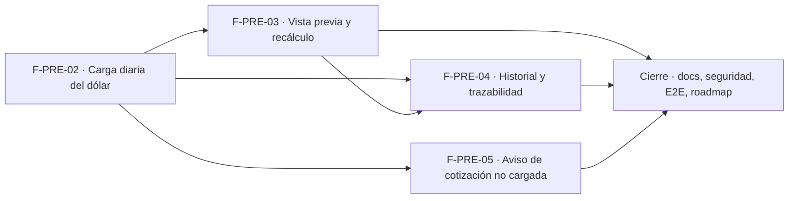

# Tasks: Precios y dólar · Dólar y recálculo

**Input**: [spec.md](./spec.md) y [plan.md](./plan.md) · **Épica**: MSF-116
**Formato**: `- [ ] T### [P] [Historia][USx] descripción (FR/SC)`. `[P]` = paralelizable (archivos distintos, sin dependencia dentro del mismo grupo). Cada FR/SC tiene **una sola** tarea dueña. Las dependencias y el orden son **solo dentro de la misma historia**; entre historias rige la tabla *Plan de ejecución* del final.
**Validación por historia**: `pnpm test:db`, `pnpm lint`, `pnpm build` y `pnpm test:web` verdes antes de cerrar la fase. Cada tabla nueva: esquema `dominio` re-verificado (Principio VII). Tras tocar código: `graphify update .`.

## Phase 1: F-PRE-02 · Carga diaria de la cotización del dólar

**Goal**: tablas, carga de la cotización pendiente, estado vigente, pantalla y diálogo «Cargar dólar del día».

- [ ] T001 [F-PRE-02][US1] Migración `supabase/migrations/20261023100000_cotizacion_tablas.sql`: `dominio.cotizacion_pendiente` y `dominio.cotizaciones` (DDL), RLS por organización y sección `cotizacion_dolar`, sin escritura directa a `cotizaciones`, `anon` sin privilegios, reversión en el encabezado (FR-001)
- [ ] T002 [F-PRE-02][US1] Migración `supabase/migrations/20261023100100_cotizacion_cargar_estado.sql`: `public.cargar_cotizacion` (valida, reemplaza la pendiente, devuelve anterior y variación), vencimiento de 24 h al consultar y `public.estado_cotizacion`; `revoke … from public, anon`, `grant execute … to authenticated` (FR-002, FR-003, FR-004)
- [ ] T003 [F-PRE-02][US1] pgTAP `supabase/tests/database/cotizacion_carga.test.sql`: dos organizaciones, permisos por rol, validación, reemplazo, vencimiento, `anon` sin ejecución (SC-001)
- [ ] T004 [P] [F-PRE-02][US1] `apps/web/src/lib/cotizacion.ts` y `apps/web/src/hooks/useCotizacion.ts`: formato de pesos (`$ 1.465`), parseo `1490`/`1490,50`, variación %, llamadas a `estado_cotizacion` y `cargar_cotizacion`, mapeo de errores a mensajes claros (soporte de FR-005 y FR-006)
- [ ] T005 [P] [F-PRE-02][US1] `apps/web/src/components/cotizacion/TarjetaVigente.tsx`: tarjeta «Vigente» (valor, «Última carga: <fecha> por <quién>», «Productos con precio en USD») y `apps/web/src/pages/cotizacion/index.tsx` con encabezado y botón «Cargar cotización», estados de carga/error (FR-005)
- [ ] T006 [F-PRE-02][US1] `apps/web/src/components/cotizacion/DialogoCargarDolar.tsx`: diálogo «Cargar dólar del día» (`$`/`por USD`, «Anterior», «Variación», mensaje inválido, solo dígitos `.` `,`, alerta «Variación inusual» > 15 %), carga diferida (FR-006, FR-007)
- [ ] T007 [F-PRE-02][US1] Ruta `/cotizacion` protegida por `cotizacion_dolar`≥`lectura`, ítem «Cotización del dólar» en Administración del menú, botón «Cargar cotización» solo con `edicion`, teclado/lector y 320/768/1440 px (FR-008)
- [ ] T008 [F-PRE-02][US1] Vitest de la pantalla y el diálogo: formato, validación, variación, alerta, botón oculto sin edición, teclado/lector (SC-002)

**Checkpoint F-PRE-02**: `pnpm test:db`, `pnpm lint`, `pnpm build` y `pnpm test:web` verdes.

## Phase 2: F-PRE-03 · Vista previa de impacto y recálculo

**Goal**: vista previa por empresa, confirmación atómica con umbral, cotización aplicada y descarte. Requiere F-PRE-02 mergeada (ver *Plan de ejecución*).

- [ ] T009 [F-PRE-03][US2] Migración `supabase/migrations/20261023110000_cotizacion_previsualizar.sql`: `public.previsualizar_cotizacion` (por empresa: cantidad de precios USD visibles y muestra hoy/nuevo con redondeo $ 10, sin escribir) reutilizando `private.aplicar_regla_precio` (FR-009)
- [ ] T010 [F-PRE-03][US2] Migración `supabase/migrations/20261023110100_cotizacion_confirmar_recalculo.sql` (parte 1): `dominio.cotizacion_aplicada`, redefinición de `private.a_pesos` (`coalesce(aplicada, inicial)`, misma firma) y `public.confirmar_cotizacion` (`security definer`, bloqueo por organización, historial, umbral 1 %, una transacción, idempotente) (FR-010, FR-011)
- [ ] T011 [F-PRE-03][US2] Misma migración `…110100` (parte 2): `public.descartar_cotizacion` (FR-012)
- [ ] T012 [F-PRE-03][US2] Misma migración `…110100` (parte 3): eventos `cotizacion.cargada`, `cotizacion.descartada`, `recalculo.aplicado`, `recalculo.omitido` vía `private.insertar_actividad`, en la misma transacción (FR-013)
- [ ] T013 [F-PRE-03][US2] pgTAP `supabase/tests/database/cotizacion_recalculo.test.sql`: atomicidad, umbral (1005/1000 no recalcula; 1050 sí; justo 1 %), todas las empresas juntas, concurrencia, vencida, permisos, eventos, `a_pesos` con/sin aplicada, dos organizaciones, `anon` (SC-003)
- [ ] T014 [P] [F-PRE-03][US2] `apps/web/src/components/cotizacion/BloqueQueVaACambiar.tsx` y su hook de `previsualizar_cotizacion`: mosaico por empresa, tabla «Producto (muestra)» con «<Empresa> hoy / Nuevo», pie «Redondeo al $ 10 más cercano.» (FR-014)
- [ ] T015 [F-PRE-03][US2] Integrar en `DialogoCargarDolar`: «Cancelar» (descarta), «Aplicar y recalcular» / «Registrar cotización», alerta «Sin recálculo», snackbars y errores de vencida/conflicto (FR-015)
- [ ] T016 [F-PRE-03][US2] Vitest de la vista previa y la confirmación (bajo/sobre umbral, Cancelar descarta, snackbars, errores) y prueba de **cambio de empresa activa** sin efecto en la pantalla (SC-004)

**Checkpoint F-PRE-03**: `pnpm test:db`, `pnpm lint`, `pnpm build` y `pnpm test:web` verdes.

## Phase 3: F-PRE-04 · Historial de cotizaciones y trazabilidad

**Goal**: historial inmutable y paginado con su tabla. Requiere F-PRE-02 y F-PRE-03 mergeadas.

- [ ] T017 [F-PRE-04][US3] Migración `supabase/migrations/20261023120000_cotizacion_historial.sql` (parte 1): trigger `BEFORE UPDATE OR DELETE` y `BEFORE TRUNCATE` en `dominio.cotizaciones` que siempre rechaza, sin políticas ni grants de escritura (FR-016)
- [ ] T018 [F-PRE-04][US3] Misma migración (parte 2): `public.listar_cotizaciones(p_limite, p_cursor)` paginada, más nueva primero, variación contra la fila anterior (FR-017)
- [ ] T019 [F-PRE-04][US3] pgTAP `supabase/tests/database/cotizacion_historial.test.sql`: update/delete/truncate rechazados para todos los roles, dos organizaciones, permisos, orden y variación, `anon` (SC-005)
- [ ] T020 [P] [F-PRE-04][US3] `apps/web/src/hooks/useHistorialCotizaciones.ts`: lectura paginada de `listar_cotizaciones` (soporte de FR-018)
- [ ] T021 [F-PRE-04][US3] `apps/web/src/components/cotizacion/TablaHistorial.tsx` y montaje en la pantalla: «Historial de cargas» con `Fecha`, `Valor`, `Variación` (tono), `Cargó`, `Precios`, pie de trazabilidad, paginación, `ContenidoAdaptable`, estados vacío/error/carga (FR-018)
- [ ] T022 [F-PRE-04][US3] Vitest de la tabla: columnas, variación, paginación, vacío/error/carga, 320/768/1440 px (SC-006)

**Checkpoint F-PRE-04**: `pnpm test:db`, `pnpm lint`, `pnpm build` y `pnpm test:web` verdes.

## Phase 4: F-PRE-05 · Aviso de cotización no cargada

**Goal**: aviso diario como componente propio, montado en Cotización y en la portada. Requiere F-PRE-02 mergeada.

- [ ] T023 [F-PRE-05][US4] Migración `supabase/migrations/20261023130000_cotizacion_aviso.sql`: `public.cotizacion_del_dia()` con «hoy» en `America/Argentina/Buenos_Aires`, la pendiente no cuenta (FR-019)
- [ ] T024 [F-PRE-05][US4] pgTAP `supabase/tests/database/cotizacion_aviso.test.sql`: borde de medianoche, pendiente, dos organizaciones, permisos, `anon` (SC-007)
- [ ] T025 [P] [F-PRE-05][US4] `apps/web/src/components/cotizacion/AvisoCotizacion.tsx` y `useCotizacionDelDia.ts`: aviso «Todavía no se cargó el dólar de hoy» + «Cargar ahora» (solo con `edicion`, abre el diálogo de F-PRE-02) (FR-020)
- [ ] T026 [F-PRE-05][US4] Montar el componente en `pages/cotizacion/index.tsx` y en `Home` de `apps/web/src/App.tsx` (FR-021)
- [ ] T027 [P] [F-PRE-05][US4] Indicador «Al día» / «Sin cargar hoy» y subtítulo «Cargada hoy <hora> por <quién>» en la tarjeta «Vigente» (FR-022)
- [ ] T028 [F-PRE-05][US4] Vitest del aviso: aparece/desaparece, «Cargar ahora», botón oculto sin edición, montaje en Cotización y Home (SC-008)

**Checkpoint F-PRE-05**: `pnpm test:db`, `pnpm lint`, `pnpm build` y `pnpm test:web` verdes.

## Phase 5: Cierre (docs, seguridad, verificación de la épica)

**Goal**: lo que ninguna historia atiende. Se ejecuta con todas las historias mergeadas.

- [ ] T029 [P] [CIERRE] `docs/dolar-y-recalculo.md` (modelo, umbral, atomicidad, permisos, eventos, reversión) y fila de `docs/roadmap-template.md`; `pnpm docs:check` (FR-023)
- [ ] T030 [P] [CIERRE] Revisión de seguridad: RLS en las 3 tablas, grants de RPC, `anon`, `security definer` de `confirmar_cotizacion`, inmutabilidad, esquema de cada tabla contra el Principio VII (FR-024)
- [ ] T031 [CIERRE] E2E: cargar 1050 con vigente 1000, ver la vista previa por empresa, confirmar y comprobar los precios; cargar 1005 y comprobar que no se recalcula (SC-009)
- [ ] T032 [CIERRE] `rls_en_toda_tabla` verde con las tablas nuevas y suite completa `pnpm test` verde (SC-010)

## Dependencias dentro de cada historia

- F-PRE-02: T001 → T002 → T003; T004 [P] y T005 [P] desde T002; T006 tras T004; T007 tras T005 y T006; T008 al final.
- F-PRE-03: T009 → T010 → T011 → T012 → T013; T014 [P] desde T009; T015 tras T014 y T012; T016 al final.
- F-PRE-04: T017 → T018 → T019; T020 [P] desde T018; T021 tras T020; T022 al final.
- F-PRE-05: T023 → T024; T025 [P] desde T023; T026 tras T025; T027 [P] desde T023; T028 al final.
- Cierre: T029 [P] y T030 [P] pueden arrancar con todas las historias mergeadas; T031 → T032 al final.

## Plan de ejecución (historias)

El **orden de toma** lo declara esta tabla: el orquestador la **consume**. Una historia arranca cuando sus dependencias están **Finalizadas (mergeadas)**; las del **mismo** `Grupo` van **en paralelo**. F-PRE-03 y F-PRE-05 son independientes entre sí (tablas, migraciones y componentes distintos; ambas parten de F-PRE-02) y van en paralelo; F-PRE-04 espera a F-PRE-03 porque el historial se llena al confirmar.

| Historia | Depende de | Grupo |
|----------|------------|-------|
| F-PRE-02 | — | 1 |
| F-PRE-03 | F-PRE-02 | 2 |
| F-PRE-05 | F-PRE-02 | 2 |
| F-PRE-04 | F-PRE-02, F-PRE-03 | 3 |
| [Cierre] | F-PRE-02, F-PRE-03, F-PRE-04, F-PRE-05 | 4 |

