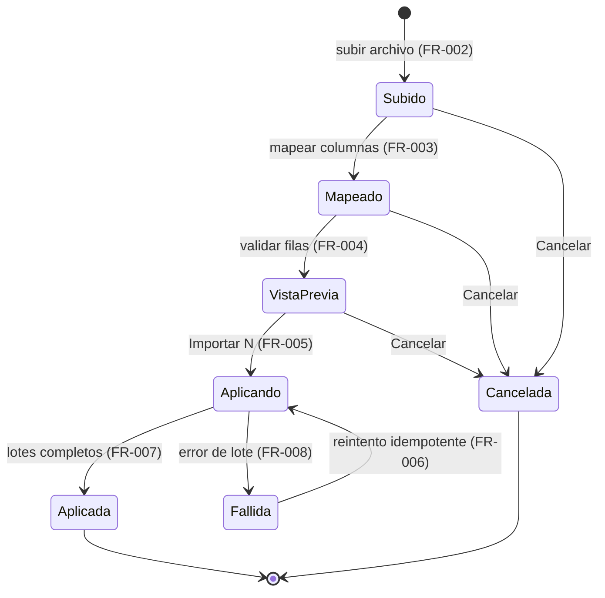
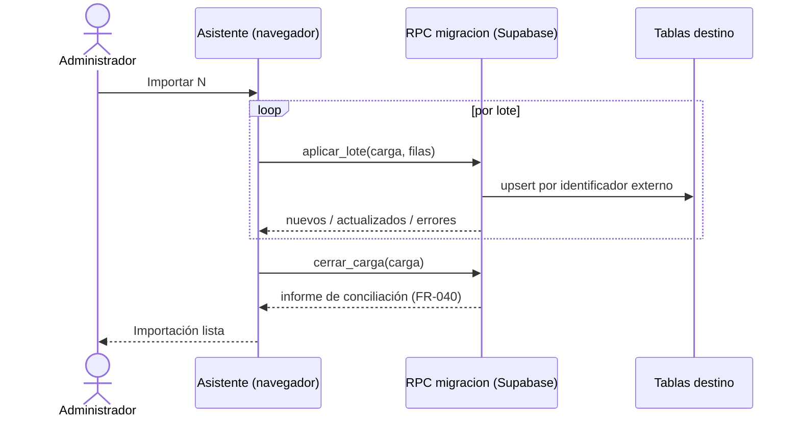

# Feature Specification: Clientes y proveedores · Migración inicial de datos

**Feature Branch**: `epic/MSF-142-clientes-y-proveedores-migracion-inicial`

**Componente**: Clientes y proveedores

**Jira Epic**: MSF-142 — Clientes y proveedores · Migración inicial de datos (spec `migracion-inicial-de-datos`)

**Historias previstas**: F-MIG-01 (L), F-MIG-02 (M), F-MIG-03 (M), F-MIG-04 (M)

**Created**: 2026-10-23

**Status**: Draft — lista para planificar. Traducción fiel de la épica de Nicolás; no agrega alcance.

**Delivery scope**: `refine` (`apps/web`) y `supabase` (migraciones, RPC y pgTAP). Sin `kestra`, `superset` ni `workers`: el archivo se lee en el navegador y se aplica por lotes con RPC (Principio V; el template no trae worker de importación y 135 proveedores / la base de clientes no lo justifican).

**Prioridad / Hito**: P0 · Hito 4 (30/11 al 11/12/2026) para herramientas y ensayos; carga real en pruebas y salida (14 al 31/12/2026) · ~36 h · alcance diciembre.

**Input**: Epic MSF-142. Objetivo: «Al terminar, los clientes y proveedores del panel actual están cargados como datos vivos y conciliados contra el origen, el historial de ingresos de mercadería queda como archivo consultable de solo lectura, y existe un procedimiento ensayado para repetir la carga el día del corte.»

## Regla de fuentes (literal de la épica)

1. Comportamiento y datos: mandan los requisitos y escenarios de esta historia.
2. Qué se ve (disposición, textos, estados, popups, flujos): el prototipo validado es referencia visual, no hace falta que quede extremadamente idéntico; los flujos (si hay) aclaran estados y acciones.
3. Cómo se construye (componentes, estilos y patrones): mandan el template y el system design del producto (épica MSF-117). No copiar el HTML ni el CSS del prototipo.
4. El prototipo muestra más que esta historia: implementar solo lo que piden los requisitos.
5. Si algo no se puede igualar con el template / el sistema de diseño: usar lo más cercano, sin inventar, y anotar la diferencia en el PR.
6. Si el prototipo y los requisitos se contradicen: requisitos para el comportamiento, prototipo para lo visual, y anotar la contradicción en el PR.

Prototipos (solo lectura): `design/pantallas/Clientes.dc.html` (solo el diálogo «Importar clientes»: referencia visual parcial) e `IngresoMercaderia.dc.html` (la tabla de ingresos). **No hay pantalla dibujada** «Migración · importación de datos» ni la pestaña «Archivo anterior al sistema»: se construyen con los componentes del template y el sistema de diseño, y se anota en el PR.

## Dependencias

| Dependencia | Para qué | ¿En la base de esta rama? |
|---|---|---|
| MSF-180 · Clientes alta y búsqueda | `public.clientes`, validaciones del alta, `clientes_identificadores_externos` | Sí (`main`) |
| MSF-219 · Ingreso de mercadería por proveedor (trae MSF-205 Proveedores) | `dominio.proveedores`, pantalla de Stock › Ingreso de mercadería donde vive la pestaña | Sí (`main`; spec `20261021-183246-ingreso-de-mercaderia-por-proveedor`) |
| MSF-160 · Catálogo listado y categorías | `dominio.productos` (SKU) para vincular productos a proveedores | Sí (`main`) |
| Relacionada, sin bloqueo | El archivo histórico de **Ventas** (comprobantes, presupuestos, cotizaciones del dólar) lo arma una épica de Ventas y despacho: **no se duplica acá**. | — |
| Coordinación con Stock | El archivo **no modifica stock**; el stock inicial entra por la carga inicial de Stock (F-STK-07, hoy P1). | — |

Dentro de la épica: F-MIG-01 bloquea a F-MIG-02 y F-MIG-03 (reutilizan su asistente y sus tablas); F-MIG-02 y F-MIG-03 bloquean a F-MIG-04.

## Supuestos (de la épica)

- Se migran como datos vivos solo los maestros: clientes (la base completa) y proveedores (~135). *A confirmar por Nicolás.*
- Comprobantes, ventas, presupuestos y cotizaciones del dólar anteriores **NO** se cargan a tablas vivas.
- El historial de ingresos de mercadería va a un archivo de solo lectura (`archivo_ingresos_mercaderia`).
- Productos, categorías y stock inicial se migran en sus componentes (Catálogo y Stock).
- El panel actual exporta a Excel o CSV: confirmado para clientes; **falta confirmar proveedores e ingresos**.
- Los datos reales se manejan solo en producción; las pruebas usan datos inventados.
- Los operadores históricos (~19) no son usuarios nuevos y se guardan como texto en el archivo.
- Los clientes de Service técnico son los mismos clientes, sin carga aparte.
- El template ya trae el catálogo `sistemas_externos` y el mapeo `clientes_identificadores_externos` (cliente propio contra id externo): sirve para registrar el origen y reconciliar **clientes**. Proveedores y el archivo de ingresos usan su propio `id_externo`.
- El template no trae importación de planillas: el asistente (subir, mapear, vista previa, aplicar) es nuevo.

## Decisiones de esta spec (traducciones, a confirmar)

- **D1 · Clientes: se usa el mapeo de identificadores del template, no se agrega `clientes.id_externo`.** Resuelve la «A revisar» de la épica en el sentido que ya declara el supuesto del template (menos ~4 h). Si Nicolás prefiere la columna, es una migración aditiva más.
- **D2 · Formato de archivo: CSV UTF-8.** Un export Excel se guarda como CSV antes de subirlo. Leer `.xlsx` exigiría una dependencia nueva (cadena de suministro) que la épica no pide; si Nicolás la quiere, es decisión suya.
- **D3 · Quién migra: solo el rol Administrador** (herramienta de plataforma, de uso único en el corte). La épica no define permisos; es la opción de menor privilegio.
- **D4 · Contradicción prototipo/requisitos anotada:** el diálogo del prototipo dice «los números existentes se actualizan»; el repo documenta que el `numero` del cliente lo asigna el sistema (nadie lo fija). Manda el requisito: la clave de conciliación es el **identificador externo** del panel actual; el número nuevo lo asigna el sistema. Se anota en el PR.

## Esquemas (Principio VII)

| Tabla | Esquema | Justificación | RLS |
|---|---|---|---|
| `public.migracion_cargas` (nueva, F-MIG-01) | `public` | Herramienta de plataforma transversal (lote de importación: entidad, archivo, actor, estado, contadores). | Sí, por organización; lectura Administrador; escritura solo por RPC. |
| `public.migracion_filas` (nueva, F-MIG-01) | `public` | Filas del lote (número de fila, estado, error). Misma naturaleza que la carga. | Sí, por organización vía `carga_id`. |
| `public.clientes` / `public.clientes_identificadores_externos` (existentes) | `public` | Preexistentes (MSF-180); sin cambios de esquema. | Ya activa. |
| `dominio.proveedores` (alterada, F-MIG-02: `+ id_externo`) | `dominio` | Entidad de negocio del producto. | Ya activa. |
| `dominio.productos` (existente, solo se actualiza `proveedor_id`/`codigo_proveedor`) | `dominio` | Sin cambios de esquema. | Ya activa. |
| `dominio.archivo_ingresos_mercaderia` (nueva, F-MIG-03) | `dominio` | Historial del negocio (ingresos de mercadería), no plataforma. | Sí; **solo `select`** (sin insert/update/delete para `authenticated`). |

Todo `authenticated`-callable lleva `grant execute` explícito y `revoke ... from public, anon`; las tablas nuevas nacen sin privilegios para `anon`. Migraciones aditivas con reversión documentada en `plan.md`. Se re-verifica el esquema en spec, plan, tareas, implementación y PR.

## User Stories

### US1 — F-MIG-01 · Importador de clientes desde el panel actual (P0, L)

El Administrador sube el CSV de clientes, mapea columnas, revisa una vista previa con errores por fila y aplica; los clientes quedan cargados y vinculados al origen.

**Requisitos**
- **FR-001** Asistente por entidad en cuatro pasos: subir archivo, mapear columnas, vista previa, aplicar. Es genérico (recibe la definición de la entidad) para que F-MIG-02 y F-MIG-03 lo reutilicen.
- **FR-002** Lectura del CSV UTF-8 en el navegador; se muestra nombre del archivo y «N filas · UTF-8». Archivo ilegible o vacío → mensaje claro, sin avanzar. «Descargar plantilla CSV» entrega `clientes.csv` con las columnas esperadas.
- **FR-003** Mapeo: el operador asocia cada columna del archivo a un campo de cliente (nombre o razón social, DNI/CUIT, tipo de cliente, correo, teléfono, celular, dirección, CP, localidad, provincia, expreso preferido) y a la columna que trae el **identificador del panel actual**. Sin las columnas obligatorias mapeadas no se puede pasar a la vista previa.
- **FR-004** Vista previa: totales (nuevos / a actualizar / con error) y aviso «N filas con error: <motivo> (filas X y Y). No se importan.» Cada fila inválida lista número de fila y motivo. Las validaciones son **las mismas del alta de Clientes (MSF-180)** (nombre, DNI/CUIT, unicidad de documento); además la fila exige identificador externo. Las filas con error no se importan; las válidas sí.
- **FR-005** Aplicar: botón «Importar N clientes» (N = filas válidas). Se envía por lotes a una RPC; cada lote es atómico. Conciliación por `clientes_identificadores_externos` con `sistema = 'panel_actual'`: si el identificador existe, **actualiza** el cliente; si no, **crea** el cliente y registra el vínculo. Los clientes nuevos quedan habilitados como cualquier alta (por defecto, todas las tiendas de la organización; MSF-180 / `clientes_empresas`).
- **FR-006** Idempotencia: volver a aplicar el mismo archivo no duplica clientes ni vínculos (Principio III); un reintento tras corte de red completa lo pendiente.
- **FR-007** Resultado: mensaje «Importación lista: N clientes nuevos, M actualizados, K con error».
- **FR-008** Registro de la carga: cada ejecución deja `migracion_cargas` (entidad, archivo, actor, organización, estado, contadores, timestamps, error útil) y `migracion_filas` con el resultado por fila.
- **FR-009** Permisos y aislamiento: solo Administrador; RLS por organización; `anon` sin acceso; sin service-role en el navegador. El botón «Importar» del listado de Clientes solo se muestra a quien puede migrar.
- **FR-010** Navegación y accesibilidad (Principio VI): pantalla «Migración de datos» en Administración, ruta `/migracion/importar/:entidad`, estados de carga/vacío/error/éxito del sistema de diseño, teclado y 320/768/1440 px; el identificador técnico no es la identidad visible.
- **FR-011** Empresa activa (Principio VIII): **no aplica filtrado por empresa** — clientes e identificadores son de la organización y se habilitan en tiendas por defecto (MSF-180). Se declara en pantalla y, al cambiar la empresa de la barra superior con el asistente abierto, el lote en curso no cambia de destino ni se mezcla. Test que cambia de empresa durante el asistente.
- **FR-012** Datos de prueba: solo inventados (fixtures sintéticos); ningún dato real en git ni en tests.

### US2 — F-MIG-02 · Importador de proveedores y vínculo con productos (P0, M)

Se cargan los ~135 proveedores y se vinculan a sus productos del catálogo, reutilizando el asistente.

**Requisitos**
- **FR-020** Entidad «proveedores» del asistente: razón social, CUIT, persona de contacto, correo, teléfono, dirección, observaciones e identificador del panel actual. Mismas validaciones que Proveedores (MSF-205: CUIT con dígito verificador, unicidad por organización).
- **FR-021** Conciliación por `dominio.proveedores.id_externo` (columna nueva, nullable, única por organización): existente → actualiza; nuevo → crea. Idempotente (reaplicar no duplica).
- **FR-022** Vínculo con productos: archivo de vínculos (SKU del producto + identificador externo del proveedor + código del proveedor) que fija `productos.proveedor_id` y `codigo_proveedor`. SKU inexistente o proveedor no cargado → error de fila (el producto lo migra Catálogo; no se crea acá).
- **FR-023** Misma vista previa con errores por fila, resultado y registro de carga que FR-004/007/008.
- **FR-024** Permisos (Administrador) y datos de prueba inventados, como FR-009/012. La confirmación de que el panel exporta proveedores a CSV/Excel queda como supuesto abierto.

### US3 — F-MIG-03 · Archivo consultable del historial de ingresos de mercadería (P0, M)

El historial anterior queda como archivo de solo lectura en una pestaña de Stock › Ingreso de mercadería.

**Requisitos**
- **FR-030** Entidad «ingresos anteriores» del asistente carga `dominio.archivo_ingresos_mercaderia`: fecha, producto (texto), cantidad, proveedor (texto), operador (texto, ~19 operadores históricos, no usuarios) e `id_externo`. Idempotente por `id_externo`.
- **FR-031** Solo lectura: RLS con `select` únicamente; sin insert/update/delete para `authenticated`; la carga entra por RPC `security definer` del asistente. Ninguna pantalla edita ni borra filas.
- **FR-032** **No modifica stock ni movimientos** y no se mezcla con `dominio.ingresos_mercaderia`. El stock inicial entra por Stock (F-STK-07).
- **FR-033** Pestaña «Archivo anterior al sistema» en el historial de ingresos (MSF-219), no dibujada en el prototipo: tabla con columnas Fecha, Producto, Cantidad, Proveedor y Operador, estilo de la tabla de ingresos, paginada en servidor, con estados vacío/carga/error y un aviso de «solo consulta».
- **FR-034** Empresa activa (Principio VIII): el archivo es de la **organización** (el panel anterior no tenía empresas), por eso la pestaña no filtra por empresa; lo dice con un texto y, al cambiar la empresa, no recarga datos de otra. Test que cambia de empresa.
- **FR-035** Confirmación abierta: que el panel exporte ingresos a CSV/Excel.

### US4 — F-MIG-04 · Ensayo, conciliación y plan de corte (P0, M)

**Requisitos**
- **FR-040** Informe de conciliación por entidad (clientes, proveedores, vínculos, ingresos archivados): filas del archivo origen vs. cargadas (nuevos, actualizados, con error, omitidos), y diferencia calculada por el sistema; disponible en el asistente tras aplicar y consultable de nuevo por carga.
- **FR-041** Ensayo: procedimiento documentado y repetible que ejecuta la carga completa con datos inventados en un entorno de prueba, conciliada, y deja evidencia (informe) en el PR.
- **FR-042** Repetibilidad: correr la carga dos veces da el mismo resultado (sin duplicados) y el informe lo demuestra (SC-004).
- **FR-043** Plan de corte `docs/migracion-inicial-de-datos.md`: orden de carga (clientes → proveedores → vínculos → archivo de ingresos), pre-requisitos (Catálogo cargado, Stock inicial por F-STK-07), responsables, conciliación, criterios de aceptación y de vuelta atrás. Los datos reales solo en producción.
- **FR-044** Permisos Administrador y aislamiento por organización del informe.

## Flujos

### Estados de una carga (asistente)

### Secuencia de aplicar (por lote)

### Proceso de corte

Mapeo de pasos: subir=FR-002, mapear=FR-003, vista previa=FR-004, aplicar=FR-005/006/007, fallida/registro=FR-008, cancelar=FR-001 (descartar sin escribir), informe=FR-040, ensayo=FR-041/042, plan=FR-043, carga real en producción = ejecución del plan FR-043 (sin código nuevo).

## Matriz pantalla↔criterios

Inventario corrido sobre `Clientes.inventory.json` e `IngresoMercaderia.inventory.json` (`pnpm prototipo:inventario`). La épica pide **solo** el diálogo «Importar clientes» como referencia visual y la pestaña de archivo; el resto del prototipo es de otras historias (fuera de alcance, no es deuda).

| Pantalla / ítem | Criterio | Estado |
|---|---|---|
| Clientes · botón «Importar» | FR-001, FR-009 (entrada al asistente) | En alcance |
| Clientes · diálogo «Importar clientes» (título, zona de archivo con «nombre · N filas · UTF-8», aviso de errores por fila) | FR-002, FR-004 | En alcance (visual como asistente) |
| Clientes · «Descargar plantilla CSV» | FR-002 | En alcance |
| Clientes · «Importar 54 clientes» | FR-005, FR-007 | En alcance |
| Clientes · campos Nombre o razón social, DNI / CUIT, Tipo de cliente, Correo, Teléfono, Celular, Dirección, CP, Localidad, Provincia, Expreso preferido | FR-003 (columnas del mapeo) | En alcance |
| Clientes · campo Número | D4 | Fuera de alcance como columna editable: lo asigna el sistema; la clave es el id externo |
| Clientes · campos Habilitado en, Cuenta web, «Enviar invitación…», «Incluir en el correo masivo», «Configurar tipos de cliente →» | FR-005 (default de MSF-180) | Fuera de alcance: no se crean cuentas web ni invitaciones en la migración |
| Clientes · tabla de listado (Cliente, Tipo, Tiendas, Contacto, Localidad, Expreso preferido, Cuenta web) y tabla de ranking (#, Cliente, Tipo, Comprobantes, Facturado, Participación) | — | Fuera de alcance: entregadas por MSF-180/ranking; el ranking de ventas anterior no se migra |
| Clientes · Etiquetas, Exportar, Nuevo cliente, Ver ficha, Exportar a Excel, Aplicar, Desde/Hasta | — | Fuera de alcance (otras épicas) |
| Clientes · diálogos «Enviar correo a seleccionados» (Asunto, Mensaje, Enviar correo), ficha de cliente (Guardar cliente), «Eliminar cliente» | — | Fuera de alcance (otras épicas) |
| Clientes · campo de búsqueda «Buscar por nombre, CUIT o número» | — | Fuera de alcance (MSF-180) |
| Ingreso de mercadería · pestaña nueva «Archivo anterior al sistema» (no dibujada) | FR-033 | En alcance; sin prototipo, se anota en el PR |
| Ingreso de mercadería · columnas Fecha, Producto, Cantidad, Proveedor, Operador | FR-030, FR-033 | En alcance |
| Ingreso de mercadería · columnas Destino, Tienda | FR-032, FR-034 | Fuera de alcance: el archivo no mueve stock ni tiene depósito/tienda |
| Ingreso de mercadería · pestañas Stock actual, Movimientos, Ingreso de mercadería, Depósitos de mercadería, Faltantes, Actualizar por Excel | — | Fuera de alcance (Stock) |
| Ingreso de mercadería · campos y botones del formulario (Compra a nombre de, Proveedor, Fecha, Remito o factura, Depósito de destino, Agregar producto, Actualizar el costo…, Limpiar, Registrar ingreso) | — | Fuera de alcance (MSF-219) |
| Pantalla «Migración de datos» (sin prototipo): pasos, mapeo, vista previa, informe de conciliación | FR-001, FR-003, FR-004, FR-040 | En alcance; con componentes del template |
| Empresa activa | FR-011, FR-034 | No aplica filtrado (motivo declarado en cada FR); test de cambio de empresa |

## Success Criteria

- **SC-001** Con el CSV de clientes inventado, la carga crea/actualiza todas las filas válidas, rechaza las inválidas con fila y motivo, y el informe cuadra con el archivo (FR-004/005/007/040).
- **SC-002** Los ~135 proveedores y sus vínculos a productos quedan cargados con conciliación sin diferencias (FR-020…023, FR-040).
- **SC-003** El archivo de ingresos se consulta en la pestaña y ningún usuario puede modificarlo ni afecta el stock (pgTAP: escritura directa rechazada, stock sin cambios) (FR-031/032).
- **SC-004** Dos corridas completas del procedimiento sobre datos inventados dan el mismo resultado y el informe sin diferencias (FR-006/042).
- **SC-005** Existe `docs/migracion-inicial-de-datos.md` con el plan de corte, ensayado (FR-041/043).
- **SC-006** Sin acceso de `anon`, sin service-role en el navegador y aislamiento por organización probado en pgTAP (FR-009/044).

## Fuera de alcance de la épica

Comprobantes, ventas, presupuestos y cotizaciones del dólar anteriores (épica de Ventas y despacho); productos, categorías y stock inicial (Catálogo y Stock); creación de usuarios para operadores históricos; cuentas web de clientes; lectura directa de `.xlsx` (D2).
