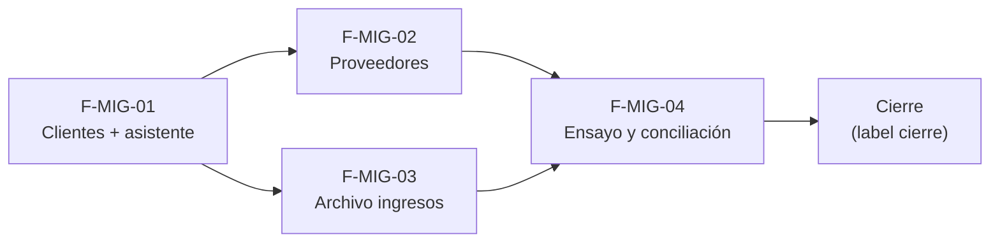

# Tasks: Clientes y proveedores · Migración inicial de datos

Formato: `- [ ] Txxx [P] [STORY][USy] descripción`. `[P]` = paralelizable dentro de su historia. Cada FR/SC tiene una sola tarea dueña.

## Matriz de trazabilidad Jira ↔ US ↔ tareas

| Historia | US | Requisitos (dueño único) | Tareas |
|---|---|---|---|
| F-MIG-01 | US1 | FR-001…FR-012 | T001–T008 |
| F-MIG-02 | US2 | FR-020…FR-024 | T009–T014 |
| F-MIG-03 | US3 | FR-030…FR-035 | T015–T021 |
| F-MIG-04 | US4 | FR-040…FR-044, SC-001…SC-006 | T022–T026 |
| Tarea de cierre (label cierre) | — | Docs transversales, verificación final, roadmap | T027–T030 |

## Phase 1: F-MIG-01 · Importador de clientes (L)

- [ ] T001 [F-MIG-01][US1] Migración `20261201100000_migracion_cargas.sql`: `migracion_cargas`/`migracion_filas` en `public` con RLS por organización (solo Administrador), RPC `iniciar_carga_migracion`, `aplicar_lote_clientes` (upsert por `clientes_identificadores_externos`, sistema `panel_actual`, mismas validaciones que el alta), `cerrar_carga_migracion`; grants/revoke; reversión documentada; confirmar si `sistema` requiere fila en `sistemas_externos` (FR-005, FR-006, FR-008, FR-009)
- [ ] T002 [F-MIG-01][US1] pgTAP `migracion_clientes.test.sql`: aislamiento, `anon`, rol, idempotencia, lote atómico, errores por fila (FR-006, FR-009)
- [ ] T003 [P] [F-MIG-01][US1] Parser CSV UTF-8 en navegador + plantilla `clientes.csv` descargable, con tests Vitest (FR-002)
- [ ] T004 [P] [F-MIG-01][US1] Definición de entidad «clientes» y paso de mapeo de columnas (incl. id del panel actual) (FR-003)
- [ ] T005 [F-MIG-01][US1] Asistente genérico (subir, mapear, vista previa con errores por fila, aplicar por lotes, resultado «Importación lista…», cancelar) con estados de carga/vacío/error/éxito (FR-001, FR-004, FR-007)
- [ ] T006 [F-MIG-01][US1] Ruta `/migracion/importar/:entidad`, ítem «Migración de datos» en Administración, botón «Importar» de Clientes restringido a Administrador; accesibilidad 320/768/1440 (FR-010)
- [ ] T007 [F-MIG-01][US1] Test: cambio de empresa durante el asistente no altera el lote; texto «no aplica» (FR-011)
- [ ] T008 [P] [F-MIG-01][US1] Fixtures sintéticos de clientes y guarda que impida datos reales en el repo (FR-012)

## Phase 2: F-MIG-02 · Proveedores y vínculo con productos (M)

- [ ] T009 [F-MIG-02][US2] Migración `20261201110000_proveedores_id_externo.sql`: `dominio.proveedores.id_externo` + único por organización, RPC `aplicar_lote_proveedores` y `aplicar_lote_vinculos_proveedor_producto` (FR-021, FR-022)
- [ ] T010 [F-MIG-02][US2] pgTAP `migracion_proveedores.test.sql`: idempotencia, CUIT, SKU inexistente, aislamiento (FR-021, FR-024)
- [ ] T011 [P] [F-MIG-02][US2] Definición de entidad «proveedores» + plantilla CSV (FR-020)
- [ ] T012 [P] [F-MIG-02][US2] Definición de entidad «vínculos proveedor↔producto» + plantilla CSV (FR-022)
- [ ] T013 [F-MIG-02][US2] Integrar ambas entidades en el asistente con vista previa/resultado/registro de carga reutilizados (FR-023)
- [ ] T014 [P] [F-MIG-02][US2] Fixtures sintéticos de ~135 proveedores y vínculos; documentar supuesto «exporta CSV» abierto (FR-024)

## Phase 3: F-MIG-03 · Archivo de ingresos de mercadería (M)

- [ ] T015 [F-MIG-03][US3] Migración `20261201120000_archivo_ingresos_mercaderia.sql`: tabla en `dominio`, RLS solo `select`, RPC `aplicar_lote_archivo_ingresos` (idempotente por `id_externo`) (FR-030, FR-031)
- [ ] T016 [F-MIG-03][US3] pgTAP `archivo_ingresos.test.sql`: escritura directa rechazada, aislamiento, stock y `ingresos_mercaderia` intactos (FR-031, FR-032)
- [ ] T017 [P] [F-MIG-03][US3] Definición de entidad «ingresos anteriores» + plantilla CSV (operador como texto) (FR-030)
- [ ] T018 [F-MIG-03][US3] Pestaña «Archivo anterior al sistema» en Stock › Ingreso de mercadería: tabla Fecha/Producto/Cantidad/Proveedor/Operador, paginación en servidor, estados y aviso de solo consulta (FR-033)
- [ ] T019 [F-MIG-03][US3] Test: cambio de empresa no recarga ni mezcla; texto de alcance de organización (FR-034)
- [ ] T020 [P] [F-MIG-03][US3] Fixtures sintéticos de ingresos (FR-030)
- [ ] T021 [P] [F-MIG-03][US3] Documentar en spec/PR la confirmación abierta de exportación de ingresos (FR-035)

## Phase 4: F-MIG-04 · Ensayo, conciliación y plan de corte (M)

- [ ] T022 [F-MIG-04][US4] Migración `20261201130000_migracion_conciliacion.sql`: `informe_conciliacion_migracion` (origen vs cargado por entidad) + pgTAP (FR-040, FR-044)
- [ ] T023 [F-MIG-04][US4] Pantalla de informe de conciliación (tras aplicar y por carga) (FR-040)
- [ ] T024 [F-MIG-04][US4] Guía/script de ensayo completo con datos inventados y evidencia del informe; correr dos veces (FR-041, FR-042, SC-001, SC-002, SC-003, SC-004)
- [ ] T025 [F-MIG-04][US4] `docs/migracion-inicial-de-datos.md`: plan de corte (orden, prerrequisitos, responsables, vuelta atrás) (FR-043, SC-005)
- [ ] T026 [F-MIG-04][US4] Revisión de seguridad del conjunto: anon, rol, RLS, sin service-role (SC-006)

## Phase 5: Cierre

- [ ] T027 [P] [CIERRE] Docs: `docs/clientes.md`, `docs/proveedores.md`, `docs/ingreso-de-mercaderia.md`, `docs/permisos-por-rol.md`, `docs/aislamiento-por-organizacion.md`, `mkdocs.yml`
- [ ] T028 [CIERRE] Re-verificar esquemas reales vs DER (Principio VII) y correr `pnpm lint`, `pnpm build`, `pnpm test`, `pnpm test:db`, `pnpm docs:check`, `pnpm der:check`, `pnpm matriz:check`, `pnpm prototipo:check`
- [ ] T029 [CIERRE] PR: anotar diferencias con el prototipo (asistente y pestaña no dibujados, D4) y comentar en Jira
- [ ] T030 [CIERRE] Al merge (`--no-ff`): actualizar `docs/roadmap-template.md`; verificar que ninguna tarea quedó `[ ]`

## Dependencias

Dentro de cada historia: F-MIG-01: T001 → T002; T003/T004 [P] → T005 → T006 → T007. F-MIG-02: T009 → T010; T011/T012 [P] → T013. F-MIG-03: T015 → T016; T017 [P] → T018 → T019. F-MIG-04: T022 → T023 → T024 → T025 → T026. Cierre: T027 → T028 → T029 → T030.

## Plan de ejecución (historias)

| Historia | Depende de | Grupo |
|----------|------------|-------|
| F-MIG-01 | — | 1 |
| F-MIG-02 | F-MIG-01 | 2 |
| F-MIG-03 | F-MIG-01 | 2 |
| F-MIG-04 | F-MIG-02, F-MIG-03 | 3 |
| [Cierre] | F-MIG-01, F-MIG-02, F-MIG-03, F-MIG-04 | 4 |

