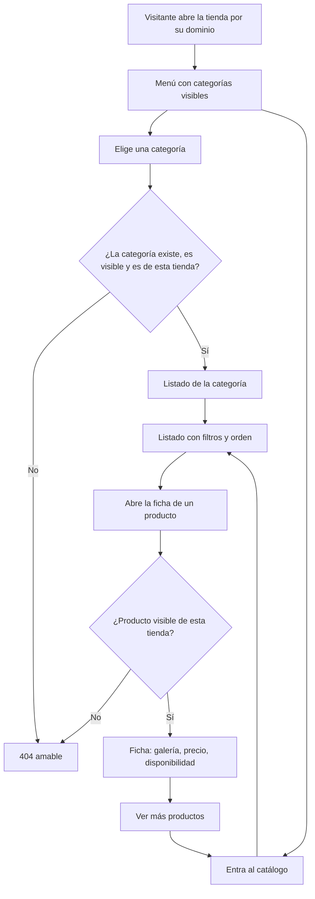
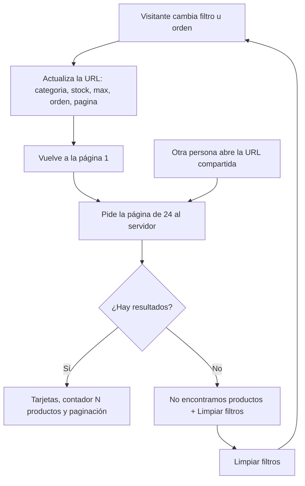
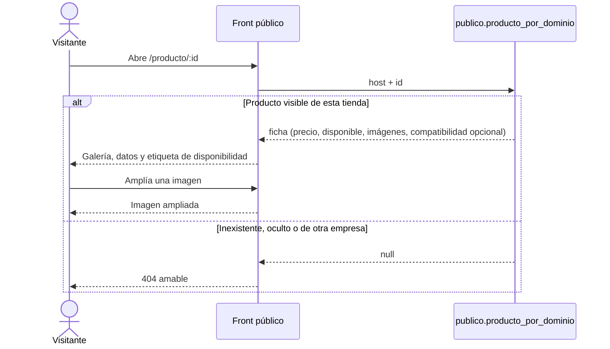
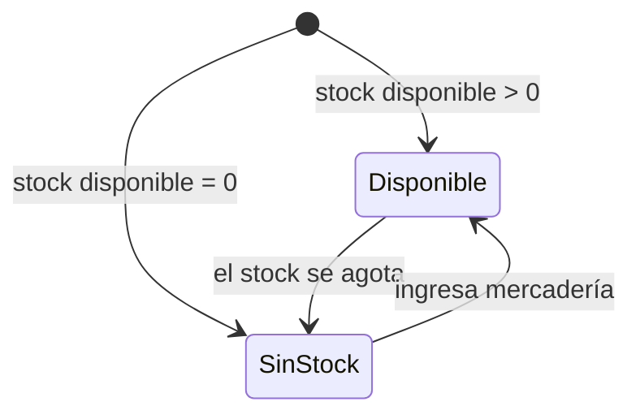

# Feature Specification: Tiendas online · Tienda catálogo y ficha

**Feature Branch**: `epic/MSF-167-tiendas-online-tienda-catalogo-y-ficha`

**Componente**: Tiendas online

**Jira Epic**: MSF-167 — Tiendas online · Tienda catálogo y ficha (spec `tienda-catalogo-y-ficha`)

**Historias previstas**: F-TDA-11 (M), F-TDA-12 (L), F-TDA-13 (L), F-TDA-18 (S), todas P0.

**Created**: 2026-10-23

**Status**: Draft — lista para planificar. Las decisiones de Nicolás quedan en *Decisiones abiertas*; ninguna bloquea implementar con el supuesto indicado.

**Delivery scope**: `refine` (`apps/web`: front público de la tienda) y `supabase` (migraciones: solo funciones, pgTAP). Sin `kestra`, `superset` ni `workers`.

**Prioridad / Hito**: P0 · Hito 3 (16 de noviembre al 11 de diciembre de 2026) · ~42 h · alcance diciembre.

**Input**: Epic MSF-167. Objetivo: «Al terminar, el visitante navega las categorías, filtra y ordena el catálogo, abre la ficha de un producto y ve si está disponible, con precios de la empresa y sin ningún dato interno.»

## Regla de fuentes (literal de la épica)

1. Comportamiento y datos: mandan los requisitos y escenarios de esta historia.
2. Qué se ve (disposición, textos, estados, popups, flujos): el prototipo validado es referencia visual, no hace falta que quede extremadamente idéntico; los flujos (si hay) aclaran estados y acciones.
3. Cómo se construye (componentes, estilos y patrones): mandan el template y el system design del producto (épica Plataforma · Sistema de diseño). No copiar el HTML ni el CSS del prototipo: reproducir lo que muestra con los componentes del template y los tokens del sistema de diseño.
4. El prototipo muestra más que esta historia: implementar solo lo que piden los requisitos de esta historia; otras secciones, botones o diálogos son de otras historias.
5. Si algo no se puede igualar con el template / el sistema de diseño: usar lo más cercano, sin inventar, y anotar la diferencia en la descripción del PR.
6. Si el prototipo y los requisitos se contradicen: requisitos para el comportamiento, prototipo para lo visual, y dejar la contradicción anotada en el PR.

Prototipos (solo lectura, ya presentes en `design/pantallas/`): `MJC_Catalogo`, `MJC_Categoria`, `MJC_Producto`, `SJ_Catalogo`, `SJ_Categoria`, `SJ_Producto` (con su `.inventory.json`). Las variantes `MJC_M_*` / `SJ_M_*` (móvil) son de F-TDA-17 (MSF-191) y están fuera de alcance.

## Dependencias

| Dependencia | Estado en esta rama | ¿Bloquea? |
|---|---|---|
| MSF-147 · Tienda dominio e identidad (modelo de tienda, esquema `publico`, front público por `Host`, `dominio.categorias_tienda` / `productos_tienda`, `private.catalogo_tienda_efectivo`, `publico.catalogo_visible_por_dominio`) | **Presente** (migraciones `20261023100000…100300`, `apps/web/src/pages/tienda-publica/`) | Sí; ya está en la base. |
| MSF-114 · Precios e IVA (`private.a_pesos`, `aplicar_regla_precio`, `aplicar_iva`, `alicuota_producto`, `precio_para`) | **Presente** (`20261022121001…150100`) | Sí; ya está en la base. |
| MSF-231 · Stock único y alertas (`dominio.existencias`, `private.productos_con_stock`) | **Presente** (`20261017140000`, `20261022120900`) | Sí; ya está en la base. |
| MSF-160 · Catálogo listado y categorías (relacionada, sin bloqueo) | Presente vía MSF-147 | No. |
| MSF-202 · Catálogo compatibilidad y planillas (relacionada, sin bloqueo) | La compatibilidad ya es `dominio.productos.compatible_con text[]` | No: es opcional en la ficha (CA-TDA-13-6). |
| MSF-117 · Sistema de diseño (tokens, DS-04 temas de tienda) | Presente (`TemaTienda` de MSF-147) | No. |

Bloquea a: MSF-191 (tienda-inicio-busqueda-movil), MSF-212 (tienda-whatsapp-y-contacto), MSF-176 (tienda-compra-y-cuentas) y MSF-237 (Cuenta web del cliente).

## Supuestos (de la épica)

- El precio público es el precio final en pesos de la empresa según su interruptor de IVA.
- El tamaño de página del catálogo es de **24** productos (constante única, se ajusta con pruebas reales).
- La compatibilidad es un texto del producto cargado en Catálogo (`compatible_con`); es opcional en la ficha.

## Contradicciones prototipo ↔ épica (anotar en el PR)

1. **«Últimas unidades · quedan N unidades».** El prototipo muestra una etiqueta intermedia con la cantidad exacta. La épica pide solo «Disponible» y «Sin stock» y «ningún dato interno»: el comportamiento manda, la cantidad exacta **no se expone** (F-TDA-18). Esa etiqueta queda fuera de alcance.
2. **Estado vacío.** El prototipo dice «No hay productos con esos filtros / Probá con otra categoría o quitá el filtro de stock.»; la épica cita «No encontramos productos» con sugerencias y botón «Limpiar filtros». Se usa el título de la épica y la sugerencia del prototipo.
3. **Precio de la tarjeta de MSF-147.** `publico.catalogo_visible_por_dominio` (MSF-147) devuelve `precio_lista` (sin IVA, puede estar en USD). La épica pide el precio final en pesos de la empresa: esta épica lo calcula en sus propias funciones nuevas y **no modifica** la de MSF-147 (ver D8).

## Decisiones abiertas (no bloquean; se implementa el supuesto)

- **D1 · Imágenes públicas por URL o firmadas** (de la épica, cambia el almacenamiento de Catálogo). Hoy el bucket `productos-imagenes` es privado y su ruta lleva el id de la organización. **Supuesto**: el bucket sigue privado; se agrega una política de lectura para `anon` acotada por `private.imagen_publica(ruta)` (solo imágenes de productos efectivamente visibles de tiendas activas) y el front las pide con la clave pública. Si Nicolás decide URL pública o firmada, cambia un único ayudante del front (`urlImagenProducto`) y una migración. Mientras no haya imagen, siempre funciona «Sin imagen».
- **D2 · Un mismo producto con precio y destacados distintos por tienda** (de la épica; falta confirmar con el cliente). Los destacados ya son por tienda (`productos_tienda`, MSF-147) y el precio por empresa sale de su regla (MSF-114); esta épica no agrega nada nuevo para eso.
- **D3 · Tamaño de página 24**: se ajusta con pruebas reales (constante única).
- **D4 · Stock reservado** (de la épica): «si Stock lo define» no cuenta como disponible. Hoy reservado = 0 y `disponible = existencias.cantidad > 0` (mismo criterio que `private.productos_con_stock()`); cuando Stock (MSF-292) lo cierre se cambia **solo** `private.disponible_publico`.
- **D5 · Horas**: el roadmap asigna menos horas que la suma de las épicas; el recorte queda pendiente (no cambia el alcance).
- **D6 · Disponibilidad manual** (`a_pedido` / `stock_entrante`, F-CAT-17): la épica solo define «Disponible» y «Sin stock». **Supuesto**: la tienda ignora la elección manual y publica solo lo derivado del stock.
- **D7 · SKU visible**: el prototipo lo muestra en la ficha («SKU 7297a») y la épica no lo declara interno. **Supuesto**: se muestra el SKU; `codigo_proveedor`, `codigo_barras`, costos y proveedor nunca.
- **D8 · Destacados de la raíz** (`ProductosTienda` de MSF-147) siguen leyendo `precio_lista`; es de MSF-147/MSF-191 (inicio). Se avisa a Nicolás en el PR; no se toca acá.
- **Confirmado por Nicolás (Jira, 2026-10-23)**: el precio **sí se muestra** y va en todos los lugares donde el prototipo lo muestra (tarjeta del catálogo y de la categoría, ficha). Las respuestas sobre D6, D7 y D9 (supuestos de abajo y de arriba) se mantienen.
- **D9 · Producto sin precio calculable** (USD sin cotización): **supuesto** — la tarjeta y la ficha no muestran precio (sin texto inventado), el producto queda al final en los órdenes por precio y no pasa el filtro «Precio máximo».
- **D10 · Categorías sin slug**: `dominio.categorias` no tiene slug; las rutas usan el id (`/categoria/:categoriaId`). Una URL con slug exigiría una columna en Catálogo (fuera de alcance).
- **D11 · Subcategorías**: el prototipo es plano. **Supuesto**: el menú y los filtros listan las categorías visibles en el orden de Catálogo y un producto pertenece solo a su categoría directa (sin agregar los de las hijas).

## Modelo y supuestos técnicos

- **Sin tablas nuevas.** Todo es lectura anónima mediante funciones de `publico` (solo funciones, ya expuesto en la API por MSF-147) y funciones internas de `private`. Reutiliza la visibilidad efectiva única de MSF-147 (`private.catalogo_tienda_efectivo`): activo + `visible` + categoría visible.
- **Precio**: `private.precio_final_publico(producto, empresa)` compone las mismas fórmulas únicas de Precios que `private.precio_para` (`a_pesos` → `aplicar_regla_precio` → `aplicar_iva` con `alicuota_producto`), pero sin la guardia de sesión (el visitante es anónimo). Un pgTAP de **paridad** exige que coincida con `precio_para(...).final` para los productos del seed.
- **Disponible**: `private.disponible_publico(producto)` devuelve solo un booleano; las existencias exactas nunca salen de la base.
- **Front público**: `apps/web/src/pages/tienda-publica/` ya resuelve la tienda por `Host`. Se agrega un enrutador con rutas registradas **por archivo** en `rutas/*.tsx` (cada historia aporta las suyas sin tocar un archivo común) y un layout con encabezado, menú de categorías y pie. Carga diferida por ruta (Principio VI).
- **Rutas**: `/catalogo`, `/categoria/:categoriaId`, `/producto/:productoId`, `*` (404 amable). Filtros, orden y página viven en la query (URL compartible).

## Esquema de datos (Constitución, Principio VII)

**No se crea ni altera ninguna tabla.** Verificado objeto por objeto:

| Objeto | Esquema | Historia | Naturaleza / justificación |
|---|---|---|---|
| `publico.categorias_por_dominio(host)` | `publico` (función) | F-TDA-11 | Contrato de lectura anónima mínima; `publico` sigue sin tablas. |
| `publico.catalogo_pagina_por_dominio(…)` | `publico` (función) | F-TDA-12 | Ídem. |
| `publico.producto_por_dominio(host, producto)` | `publico` (función) | F-TDA-13 | Ídem. |
| `private.disponible_publico(uuid)` | `private` (función) | F-TDA-18 | Lógica interna; sin `grant` a `anon`/`authenticated`. |
| `private.precio_final_publico(uuid, uuid)` | `private` (función) | F-TDA-12 | Ídem. |
| `private.imagen_publica(text)` + política `SELECT` de `anon` sobre `storage.objects` (bucket `productos-imagenes`) | `private` / storage | F-TDA-12 | Respaldo de D1; acota la lectura anónima a imágenes de productos visibles. |

RLS: las tablas que se leen (`dominio.*`) conservan su RLS por organización; las funciones `SECURITY DEFINER` la saltean **a propósito** y filtran por la tienda del `host` y `empresa.activa`. `anon` no recibe privilegios sobre `public` ni `dominio`. El pgTAP de aislamiento sigue recorriendo `public` + `dominio` y verifica que `publico` no tiene tablas. Cada historia trae **su propia migración aditiva** con reversión (`drop function …` / `drop policy …`).

## Navegación y patrones (Principio VI)

Es el **front público** de la tienda, no el panel: sin sesión, sin menú del panel y sin empresa activa. Cada pantalla usa los estados de carga / vacío / error del kit, funciona con teclado y lector de pantalla a 320 / 768 / 1440 px, no muestra identificadores técnicos (nunca ids ni UUID en pantalla; el UUID solo viaja en la URL) y se carga por ruta con `lazy`.

## User Scenarios & Testing *(mandatory)*

### US1 — Navegación por categorías (F-TDA-11, P0)

El visitante ve las categorías visibles de la tienda en el menú y el pie, entra a una y ve su título y migas; una categoría inexistente, oculta o de otra empresa muestra una página 404 amable.

1. **Given** la tienda de Mundo JC con 6 categorías visibles, **When** el visitante abre la tienda, **Then** el menú lista esas categorías y no las de San Javucho.
2. **Given** una categoría oculta en MSF-147, **When** se abre su URL, **Then** se ve la 404 amable (igual que una categoría inexistente o de otra empresa).

### US2 — Catálogo con filtros y orden (F-TDA-12, P0)

El visitante filtra por categoría, «Solo con stock» y «Precio máximo», ordena (Más relevantes / Menor precio / Mayor precio), pagina de a 24 y comparte la URL con el mismo resultado.

1. **Given** 30 productos visibles, **When** abre `/catalogo`, **Then** ve 24 y una segunda página con 6, y «30 productos».
2. **Given** filtros aplicados, **When** copia la URL y la abre en otra pestaña, **Then** ve los mismos filtros, orden, página y resultados.
3. **Given** filtros que no dejan resultados, **Then** ve «No encontramos productos», la sugerencia y «Limpiar filtros».

### US3 — Ficha de producto (F-TDA-13, P0)

El visitante abre la ficha y ve galería, nombre, precio de la empresa, disponibilidad, descripción, SKU, categoría y (si existe) compatibilidad; un producto inexistente, oculto o de otra empresa muestra la 404 amable.

1. **Given** un producto con 3 imágenes, **When** abre la ficha, **Then** ve la principal y 3 miniaturas, y puede ampliar una.
2. **Given** un producto sin imágenes, **Then** la galería muestra «Sin imagen».
3. **Given** un producto sin compatibilidad cargada, **Then** la ficha no muestra ese bloque.

### US4 — Disponibilidad visible (F-TDA-18, P0)

El visitante ve «Disponible» o «Sin stock» en la tarjeta y la ficha; nunca ve cantidades.

1. **Given** un producto con existencias > 0, **Then** muestra «Disponible».
2. **Given** existencias = 0, **Then** muestra «Sin stock» y el filtro «Solo con stock» lo excluye.

### Casos borde

- Host desconocido o tienda desactivada: «Volvemos pronto» de MSF-147 (no cambia).
- `orden`, `pagina`, `max` inválidos en la URL: se normalizan sin error (relevancia, página 1, sin límite).
- Página fuera de rango: lista vacía con el total real y el mismo estado «No encontramos productos»/volver a la primera página.
- Producto sin precio calculable: sin precio (D9).
- Producto que pasa a oculto mientras se ve su ficha: la próxima carga muestra la 404.
- Texto con HTML/script en nombre o descripción: se muestra literal (escapado).

## Requirements *(mandatory)*

### F-TDA-11 — Navegación por categorías

- **FR-001**: `publico.categorias_por_dominio(host)` ejecutable por `anon` devuelve las categorías **visibles** de la tienda del `host` (regla de MSF-147: la categoría y su padre) en el orden de Catálogo, con `id`, `nombre`, `padre_id` y `productos` (solo efectivamente visibles).
- **FR-002**: Aislamiento: cada dominio ve únicamente las categorías de su empresa; host desconocido y empresa desactivada devuelven lo mismo (`null`); nunca `organizacion_id` ni columnas internas.
- **FR-003**: Enrutador del front público con rutas registradas por archivo (`rutas/*.tsx`): `/`, `/catalogo`, `/categoria/:categoriaId`, `/producto/:productoId` y `*`; layout común con encabezado (marca de la tienda, por la identidad de MSF-147), menú y pie; carga diferida por ruta con estados de carga y error del kit.
- **FR-004**: Menú de categorías en el encabezado: «Inicio» (enlace a `/`) y una entrada por categoría visible; la categoría de la ruta actual queda marcada; navegable con teclado.
- **FR-005**: Pie con la columna «Categorías» (mismas categorías visibles, mismos enlaces).
- **FR-006**: Página de categoría `/categoria/:categoriaId`: migas «Inicio / <Categoría>» y título con el nombre; el cuerpo del listado lo aporta F-TDA-12 por una carpeta de secciones (`secciones-catalogo/*.tsx`), sin que F-TDA-11 dependa de ese archivo.
- **FR-007**: Página 404 amable (componente reutilizable): se muestra para categoría inexistente, oculta o de otra empresa, y para cualquier ruta desconocida; ofrece volver al catálogo/inicio. Sin revelar si la categoría existe.
- **FR-008**: Tienda sin categorías visibles: el menú muestra solo «Inicio» y no hay error.

### F-TDA-18 — Disponibilidad visible

- **FR-020**: `private.disponible_publico(producto)` devuelve un **booleano**: `true` si el stock único tiene unidades disponibles (hoy `existencias.cantidad > 0`, igual que `private.productos_con_stock()`); sin acceso para `anon`/`authenticated` (la usan las funciones públicas).
- **FR-021**: El reservado no cuenta como disponible: la definición vive en un solo lugar y cuando Stock la cierre (D4) se cambia solo esa función.
- **FR-022**: Componente `EtiquetaDisponibilidad` con los textos «Disponible» y «Sin stock»; el estado se comunica con texto (no solo color) y es legible por lector de pantalla.
- **FR-023**: La etiqueta y todas las respuestas públicas exponen únicamente el booleano; nunca cantidades, mínimos ni «últimas unidades» (contradicción 1). La elección manual `a_pedido` / `stock_entrante` se ignora (D6).

### F-TDA-12 — Catálogo con filtros y orden

- **FR-030**: `private.precio_final_publico(producto, empresa)` calcula el precio final en pesos enteros de la empresa (regla de la empresa + IVA según su interruptor) con las fórmulas únicas de Precios; `null` si no es calculable (D9). Paridad con `private.precio_para(...).final`.
- **FR-031**: Acceso público a las imágenes (D1): `private.imagen_publica(ruta)` y la política de lectura de `anon` limitan la lectura a imágenes de productos efectivamente visibles de tiendas activas; el front obtiene la imagen con un único ayudante `urlImagenProducto`.
- **FR-032**: `publico.catalogo_pagina_por_dominio(host, categoria, solo_con_stock, precio_max, orden, pagina)` devuelve `total`, `pagina`, `tamano = 24`, las categorías con conteo y los productos efectivamente visibles de esa página con `id`, `nombre`, `precio`, `disponible`, `imagen`, `categoria_id` y `destacado`. Filtros: categoría (visible de la tienda), `solo_con_stock` (por `disponible_publico`), `precio_max` (sobre el precio final).
- **FR-033**: Orden: «Más relevantes» (destacados primero, luego nombre, desempate por id), «Menor precio» y «Mayor precio» (desempate estable por nombre e id); los sin precio van al final.
- **FR-034**: Parámetros inválidos se normalizan sin error (orden desconocido → relevancia; página < 1 → 1; `precio_max` ≤ 0 o nulo → sin límite; categoría ajena/oculta → lista vacía). Lista blanca de campos: nunca costos, existencias, proveedor ni ids de organización; mismo `null` para host desconocido/desactivado.
- **FR-035**: Página `/catalogo` con: título «Todos los productos» y migas «Inicio / Todos los productos»; panel «Categorías» (opción «Todos los productos» + cada categoría con su conteo), «Disponibilidad» con «Solo con stock», «Precio máximo» (campo en $ con «Sin límite»), «Limpiar filtros», contador «N productos» y menú «Ordenar por» con las tres opciones.
- **FR-036**: URL compartible: categoría, «Solo con stock», precio máximo, orden y página viven en la query (`categoria`, `stock`, `max`, `orden`, `pagina`); abrir la URL restaura el estado y resultados idénticos; cambiar un filtro vuelve a la página 1; valores inválidos se ignoran.
- **FR-037**: Tarjeta de producto: imagen principal o «Sin imagen», nombre, precio («$ 18.455», es-AR, sin decimales) y `EtiquetaDisponibilidad`; el producto «Sin stock» se distingue visualmente; toda la tarjeta enlaza a la ficha.
- **FR-038**: Estado vacío: «No encontramos productos» con la sugerencia «Probá con otra categoría o quitá el filtro de stock.» y botón «Limpiar filtros» (contradicción 2).
- **FR-039**: Paginación de a 24 con control de páginas accesible; el total y las páginas salen del servidor.
- **FR-040**: `/categoria/:categoriaId` reutiliza el mismo listado con esa categoría preseleccionada (mismo comportamiento de filtros, orden, URL y paginación) registrándose en `secciones-catalogo/`.
- **FR-041**: Estados de carga, vacío y error del kit; teclado y lector de pantalla; 320 / 768 / 1440 px; el listado no recarga la página al cambiar filtros.

### F-TDA-13 — Ficha de producto

- **FR-050**: `publico.producto_por_dominio(host, producto)` devuelve la ficha de un producto **efectivamente visible** de la tienda del `host`: `id`, `nombre`, `descripcion`, `sku`, `categoria {id, nombre}`, `precio` (final de la empresa), `disponible`, `compatibilidad` (texto) e `imagenes [{posicion, ruta}]`. Producto inexistente, inactivo, oculto, con categoría oculta o de otra empresa → `null` (misma respuesta). Nunca costos, existencias, proveedor, códigos internos ni `organizacion_id`.
- **FR-051**: Ruta `/producto/:productoId`; si la función devuelve `null` (o el id no es válido) se muestra la 404 amable de F-TDA-11.
- **FR-052**: Galería: imagen principal (menor posición), miniaturas (hasta 4) con la seleccionada marcada, cambio de imagen por clic y teclado; sin imágenes, «Sin imagen».
- **FR-053**: Ampliación de imagen: abrir la imagen en un diálogo ampliado, con cierre por botón y tecla Esc, foco gestionado y texto alternativo.
- **FR-054**: Contenido de la ficha: migas «Inicio / Todos los productos / <Producto>», nombre, categoría, precio de la empresa, `EtiquetaDisponibilidad`, descripción, bloque con «SKU», «Categoría» y «Disponibilidad», la nota «Precios y disponibilidad sujetos a cambios.» y el botón «Ver más productos» (enlaza a `/catalogo`).
- **FR-055**: Compatibilidad opcional (CA-TDA-13-6): si el producto tiene `compatible_con`, se muestra como texto (valores unidos con coma) con su rótulo; si no, el bloque no aparece.
- **FR-056**: Estados de carga y error del kit, imágenes con carga diferida, texto escapado (HTML/script literal), teclado y lector de pantalla, 320 / 768 / 1440 px.

### Transversales

- **FR-060**: La tienda de una empresa nunca muestra datos de otra: todas las funciones filtran por el `host` y `empresa.activa` (se verifica en F-TDA-11/12/13 y en el E2E con las dos tiendas del seed).

## Matriz pantalla↔criterios

Ítems tomados de `design/pantallas/MJC_Catalogo.inventory.json`, `MJC_Categoria.inventory.json`, `MJC_Producto.inventory.json` y sus pares `SJ_*` (mismos ítems; solo cambian datos, marca y colores). Corrido con `pnpm prototipo:inventario`.

### Campos y botones comunes a las 6 pantallas

| Ítem del inventario | Dueño | Criterio / nota |
|---|---|---|
| Campo «Buscar productos» (buscador del encabezado) | **Fuera de alcance** | Búsqueda: tienda-inicio-busqueda-movil (MSF-191, F-TDA-16/17). |
| Botón «Ver todos los resultados →» y el texto «No encontramos productos con ese nombre.» (desplegable de búsqueda) | **Fuera de alcance** | Mismo motivo: parte de la búsqueda (MSF-191). |
| Botón «SAN JAVUCHO» (marca en el encabezado) | F-TDA-11 | FR-003 (marca/logo por la identidad de MSF-147; enlaza a `/`). |
| Botón «Inicio» (menú y migas) | F-TDA-11 | FR-004 (enlace a `/`). |
| Botón «Contacto» | **Fuera de alcance** | Contacto y WhatsApp: tienda-whatsapp-y-contacto (MSF-212). |
| Botones de categoría («Cargadores», «Protectores», «Joysticks», «Cases y estuches», «Vidrios templados», «Skins y calcos») | F-TDA-11 | FR-001, FR-004 (salen de la base, no son fijos). |
| Columna «Categorías» del pie con las mismas entradas | F-TDA-11 | FR-005. |
| Botón «Escribinos», teléfono y correo del pie, lema y © | **Fuera de alcance** | Contacto/WhatsApp (MSF-212) y pie de MSF-147 (`PieTienda`); esta épica no los toca. |

### Catálogo y Categoría (`MJC_Catalogo`, `MJC_Categoria`, `SJ_Catalogo`, `SJ_Categoria`)

| Ítem del inventario | Dueño | Criterio / nota |
|---|---|---|
| Migas «Inicio / <título>» y título («Todos los productos» o la categoría) | F-TDA-11 (categoría) / F-TDA-12 (catálogo) | FR-006 / FR-035. |
| Panel «Categorías» (con conteo y «Todos los productos») | F-TDA-12 | FR-035 (el conteo viene de FR-032). |
| «Disponibilidad» · botón «Solo con stock» | F-TDA-12 | FR-032, FR-035. |
| «Precio máximo» · campo «$» / «Sin límite» (`(buscar: Sin límite)` del inventario) | F-TDA-12 | FR-032, FR-035. |
| Botón «Limpiar filtros» | F-TDA-12 | FR-035, FR-038. |
| Contador «N productos» | F-TDA-12 | FR-035. |
| «Ordenar por» · botón «· ▾» y opciones «Más relevantes / Menor precio / Mayor precio» | F-TDA-12 | FR-033, FR-035. |
| Tarjeta de producto («Sin imagen», nombre, precio) | F-TDA-12 | FR-037. |
| Etiqueta «Sin stock» de la tarjeta | F-TDA-18 | FR-022. |
| Etiqueta «Disponible» (y estado intermedio «Últimas unidades · quedan N») | F-TDA-18 (Disponible) | FR-022. «Últimas unidades» **fuera de alcance**: expone stock exacto (contradicción 1). |
| «No hay productos con esos filtros» + sugerencia + «Limpiar filtros» | F-TDA-12 | FR-038 (contradicción 2). |
| Paginación (no dibujada en el prototipo) | F-TDA-12 | FR-039 (control del kit; diferencia anotada en el PR). |

### Ficha (`MJC_Producto`, `SJ_Producto`)

| Ítem del inventario | Dueño | Criterio / nota |
|---|---|---|
| Migas «Inicio / Todos los productos / <producto>» | F-TDA-13 | FR-054. |
| Botón «Todos los productos» (miga) | F-TDA-13 | FR-054 (enlaza a `/catalogo`). |
| Galería (imagen principal y miniaturas) y «Sin imagen» | F-TDA-13 | FR-052. |
| Ampliación de la imagen | F-TDA-13 | FR-053. |
| Nombre, categoría, precio y etiqueta de disponibilidad | F-TDA-13 (diseño) / F-TDA-18 (etiqueta) | FR-054, FR-022. |
| Descripción | F-TDA-13 | FR-054. |
| Bloque «SKU», «Categoría», «Disponibilidad» | F-TDA-13 | FR-054 (SKU público: D7). |
| Compatibilidad | F-TDA-13 | FR-055 (opcional). |
| Botón «Ver más productos» | F-TDA-13 | FR-054 (enlaza a `/catalogo`). |
| Nota «Precios y disponibilidad sujetos a cambios.» | F-TDA-13 | FR-054. |
| Botón «Consultar por WhatsApp» y diálogo (número, «Mensaje que se va a enviar», «Cancelar», «Abrir WhatsApp») | **Fuera de alcance** | tienda-whatsapp-y-contacto (MSF-212). |
| Sección «Productos relacionados» (con sus tarjetas «Sin imagen» / «Sin stock») | **Fuera de alcance** | La épica no la pide (otras épicas podrán pedirla). |
| 404 amable (producto inexistente/oculto/de otra empresa) | F-TDA-13 (producto) / F-TDA-11 (componente) | FR-051, FR-007. |

### Estados citados por las historias (no dibujados)

| Estado | Dueño | Criterio |
|---|---|---|
| Página 404 amable (categoría, producto) | F-TDA-11 / F-TDA-13 | FR-007, FR-051 |
| «No encontramos productos» + «Limpiar filtros» | F-TDA-12 | FR-038 |
| Tarjeta y galería «Sin imagen» | F-TDA-12 / F-TDA-13 | FR-037, FR-052 |
| Ampliación de imagen | F-TDA-13 | FR-053 |
| «Disponible» y «Sin stock» | F-TDA-18 | FR-022 |

### Pantallas móviles

`MJC_M_Catalogo`, `MJC_M_Producto`, `SJ_M_Catalogo`, `SJ_M_Producto` (y sus ítems): **Fuera de alcance** — se implementan en tienda-inicio-busqueda-movil (F-TDA-17, MSF-191). Esta épica deja el layout responsivo a 320 / 768 / 1440 px (FR-041, FR-056) pero no el menú ni los filtros móviles dedicados.

### Empresa activa (Principio VIII)

| Ítem | Dueño | Criterio / nota |
|---|---|---|
| Empresa activa de la barra superior | **No aplica** | Es el front público anónimo: no hay barra superior, sesión ni selector. La tienda se resuelve por el `Host` y nunca mezcla empresas (FR-002, FR-050, FR-060). El equivalente a «cambiar de empresa» es cambiar de dominio: se verifica en el E2E con las dos tiendas del seed (SC-003, SC-006, SC-008). |

## Fuera de alcance

- Buscador, «Ver todos los resultados», pantallas móviles dedicadas, inicio (F-TDA-16/17, MSF-191).
- Contacto, WhatsApp, «Escribinos», formulario (MSF-212).
- Compra, carrito y cuentas (MSF-176, MSF-237).
- «Productos relacionados»; «Últimas unidades · quedan N unidades» (expone stock); disponibilidad manual `a_pedido`/`stock_entrante` (D6).
- Slugs de categoría (D10) y agregación de subcategorías (D11).
- Cambios a `publico.catalogo_visible_por_dominio` y a la sección de destacados de MSF-147 (D8).
- Editar el precio por tienda, el interruptor IVA o el stock: son de Precios y Stock.

## Flujos

La épica describe los flujos en prosa (historias y criterios); se transcriben sin agregar estados ni transiciones.

### Recorrido del visitante (F-TDA-11, F-TDA-12, F-TDA-13 · FR-003…FR-007, FR-035, FR-051)

### Filtros, orden y URL compartible (F-TDA-12 · FR-032…FR-039)

### Ficha de producto (F-TDA-13 · FR-050…FR-055)

### Disponibilidad (F-TDA-18 · FR-020…FR-023)

## Success Criteria *(mandatory)*

- **SC-001** (F-TDA-11): pgTAP de `categorias_por_dominio`: solo categorías visibles de la tienda del host, conteos de productos efectivamente visibles, mismo `null` para host desconocido y empresa desactivada, sin columnas internas (FR-001, FR-002, FR-060).
- **SC-002** (F-TDA-11): Vitest + axe del layout, menú, pie, página de categoría y 404 a 320 / 768 / 1440 px (FR-003, FR-004, FR-005, FR-006, FR-007, FR-008).
- **SC-003** (F-TDA-11): E2E con las dos tiendas del seed: el menú de cada una lista solo sus categorías y una categoría ajena u oculta muestra la 404 (FR-002, FR-004, FR-007, FR-060).
- **SC-004** (F-TDA-12): pgTAP de `catalogo_pagina_por_dominio` y `precio_final_publico`: filtros, tres órdenes, paginación de 24, normalización de parámetros, paridad de precio con `precio_para`, aislamiento entre tiendas y columnas expuestas en lista blanca, política de imágenes (FR-030, FR-031, FR-032, FR-033, FR-034).
- **SC-005** (F-TDA-12): Vitest de la página de catálogo: restauración desde la URL, vuelta a página 1, valores inválidos ignorados, estado vacío, tarjeta «Sin imagen», paginación y axe (FR-035, FR-036, FR-037, FR-038, FR-039, FR-040, FR-041).
- **SC-006** (F-TDA-12): E2E con las dos tiendas: menú, filtros, orden y URL compartible dan el mismo resultado al reabrirla (FR-035, FR-036, FR-040).
- **SC-007** (F-TDA-13): pgTAP de `producto_por_dominio`: columnas expuestas, misma respuesta `null` para inexistente / inactivo / oculto / categoría oculta / otra empresa, compatibilidad opcional (FR-050, FR-055).
- **SC-008** (F-TDA-13): E2E de la ficha: galería, ampliación, 404 y precio de la empresa en las dos tiendas; Vitest + axe de la ficha (FR-051, FR-052, FR-053, FR-054, FR-055, FR-056).
- **SC-009** (F-TDA-18): pgTAP de paridad `disponible_publico` ↔ `productos_con_stock`, sin cantidades en ninguna respuesta pública; Vitest de `EtiquetaDisponibilidad`; E2E de «Sin stock» y «Solo con stock» (FR-020, FR-021, FR-022, FR-023).
- **SC-010** (Cierre): medición de rendimiento en celular del catálogo y la ficha, anotada en `docs/tiendas-online.md`.
- **SC-011** (Cierre): `pnpm lint`, `pnpm build`, `pnpm infra:config`, `pnpm test`, `pnpm prototipo:check`, `pnpm matriz:check` y `pnpm docs:check` pasan.
- **SC-012** (Cierre): documentación al día (`docs/tiendas-online.md`, notas de contradicciones para el PR).
- **SC-013** (Cierre): la fila de la épica en `docs/roadmap-template.md` refleja estado y link a esta spec al cerrar el PR (paso manual).

## Verificación por requisito

| Requisito | Verifica |
|---|---|
| FR-001, FR-002 | pgTAP SC-001 |
| FR-003, FR-004, FR-005, FR-006, FR-008 | Vitest + axe SC-002 · E2E SC-003 |
| FR-007 | Vitest SC-002 · E2E SC-003, SC-008 |
| FR-020, FR-021, FR-023 | pgTAP SC-009 |
| FR-022 | Vitest + E2E SC-009 |
| FR-030, FR-031, FR-032, FR-033, FR-034 | pgTAP SC-004 |
| FR-035, FR-037, FR-038, FR-039, FR-041 | Vitest SC-005 · E2E SC-006 |
| FR-036, FR-040 | Vitest SC-005 · E2E SC-006 |
| FR-050 | pgTAP SC-007 |
| FR-051, FR-052, FR-053, FR-054, FR-056 | Vitest + axe + E2E SC-008 |
| FR-055 | pgTAP SC-007 · Vitest SC-008 |
| SC-010, SC-012, SC-013 | Revisión del registro en `docs/tiendas-online.md` y `docs/roadmap-template.md` (tareas de cierre T070–T072) |
| SC-011 | `pnpm lint`, `build`, `infra:config`, `test`, `prototipo:check`, `matriz:check`, `docs:check` (T073) |
| FR-060 | pgTAP SC-001, SC-004, SC-007 · E2E SC-003, SC-006, SC-008 |
