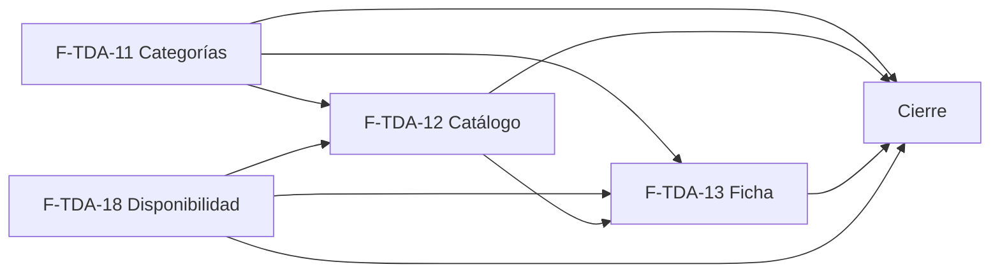

# Tasks: Tiendas online · Tienda catálogo y ficha

**Input**: `specs/20261023-120000-tienda-catalogo-y-ficha/` (spec.md, plan.md, contracts/tienda-publica.md)

**Formato**: `- [ ] T### [P] [F-TDA-xx][USy] descripción`. **[P]** = paralelizable (archivos distintos, sin dependencia; las [P] del mismo grupo van en paralelo); sin [P] = secuencial. Las dependencias de cada tarea son solo dentro de su historia. Regla del proyecto: ninguna tarea queda `[ ]` al cierre — se hace con evidencia o se cierra con `[x]` + `Desvío:` y seguimiento trazado.

**Delivery scope**: `refine`, `supabase`

## Matriz de trazabilidad Jira ↔ US ↔ tasks

| Jira | Historia | FR / SC (dueño único) | Tasks |
|------|----------|-----------------------|-------|
| F-TDA-11 (clave Jira: la asigna el orquestador) | US1 Navegación por categorías | FR-001…FR-008, FR-060, SC-001, SC-002, SC-003 | T001–T009 |
| F-TDA-18 | US4 Disponibilidad visible | FR-020…FR-023, SC-009 | T020–T024 |
| F-TDA-12 | US2 Catálogo con filtros y orden | FR-030…FR-041, SC-004, SC-005, SC-006 | T030–T041 |
| F-TDA-13 | US3 Ficha de producto | FR-050…FR-056, SC-007, SC-008 | T050–T059 |
| Tarea de cierre (label cierre) | Documentación, rendimiento, gates y roadmap | SC-010, SC-011, SC-012, SC-013 | T070–T073 |

### Dueño único por requisito

| Requisito | Tarea dueña | | Requisito | Tarea dueña |
|---|---|---|---|---|
| FR-001, FR-002 | T001 | | FR-035 | T034 |
| FR-007 | T002 | | FR-036 | T033 |
| FR-003 | T003 | | FR-037 | T035 |
| FR-004, FR-008 | T004 | | FR-038 | T037 |
| FR-005 | T005 | | FR-039 | T036 |
| FR-006 | T006 | | FR-040, FR-041 | T038 |
| FR-060 | T007 | | FR-050 | T050 |
| SC-001 | T007 | | FR-051 | T051 |
| SC-002 | T008 | | FR-052 | T052 |
| SC-003 | T009 | | FR-053 | T053 |
| FR-020, FR-021, FR-023 | T020 | | FR-054 | T054 |
| FR-022 | T021 | | FR-055 | T055 |
| SC-009 | T024 | | FR-056 | T056 |
| FR-030 | T030 | | SC-007 | T057 |
| FR-031 | T031 | | SC-008 | T059 |
| FR-032, FR-033, FR-034 | T032 | | SC-004, SC-005, SC-006 | T039, T040, T041 |
| SC-010 | T071 | | SC-011 | T073 |
| SC-012 | T070 | | SC-013 | T072 |

Toda tarea declara los requisitos que implementa (**FR/SC**) o verifica (**Verifica**); la verificación de cada FR está en la tabla «Verificación por requisito» de la spec.

---

## Fase 1 — F-TDA-11 · Navegación por categorías (US1)

**Esquemas (Principio VII, re-verificado)**: sin tablas; `publico.categorias_por_dominio` → `publico` (función).

- [ ] T001 [F-TDA-11][US1] Migración `supabase/migrations/20261023120000_tienda_categorias_publicas.sql`: `publico.categorias_por_dominio(host)` (`SECURITY DEFINER`, `stable`, `search_path = ''`, normaliza el host, filtra por `empresa.activa`, categorías visibles = la categoría y su padre, orden de Catálogo, conteo de productos efectivamente visibles vía `private.catalogo_tienda_efectivo`; mismo `null` para host desconocido y empresa desactivada; lista blanca); `revoke … from public`, `grant execute … to anon, authenticated`; reversión en el encabezado. **FR-001, FR-002**.
- [ ] T002 [P] [F-TDA-11][US1] `apps/web/src/pages/tienda-publica/PaginaNoEncontrada.tsx`: 404 amable reutilizable (mensaje, enlace a catálogo/inicio, sin revelar si el recurso existe). **FR-007**.
- [ ] T003 [P] [F-TDA-11][US1] Enrutador del front público: `rutas/` registradas por `import.meta.glob('./rutas/*.tsx')` (cada ruta con `lazy`), `layout/LayoutTienda.tsx` (encabezado con marca de MSF-147, zona de menú, contenido y zona de pie), ruta `*` → `PaginaNoEncontrada`, integración con `index.tsx` conservando «Volvemos pronto» y el error de red; estados de carga y error del kit. **FR-003**.
- [ ] T004 [F-TDA-11][US1] Hook `useCategoriasTienda` (cliente de la RPC) y menú del encabezado: «Inicio» + una entrada por categoría visible, la ruta actual marcada, teclado; tienda sin categorías → solo «Inicio» sin error. **FR-004, FR-008**.
- [ ] T005 [F-TDA-11][US1] Pie con la columna «Categorías» (mismas entradas y enlaces) en `layout/`. **FR-005**.
- [ ] T006 [F-TDA-11][US1] `rutas/categoria.tsx`: resuelve `/categoria/:categoriaId` contra las categorías visibles; migas «Inicio / <Categoría>», título con el nombre y zona del listado cargada desde `secciones-catalogo/*.tsx` (la aporta F-TDA-12; vacía mientras no exista); categoría inexistente, oculta, ajena o id inválido → `PaginaNoEncontrada`. **FR-006**.
- [ ] T007 [F-TDA-11][US1] pgTAP `supabase/tests/database/tienda_categorias_publicas.test.sql`: dos tiendas del seed, solo categorías visibles del host, conteos efectivos, `null` idéntico para desconocido/desactivado, sin columnas internas, `anon` ejecuta la función y `publico` sin tablas. **SC-001, FR-060**. Verifica FR-001, FR-002.
- [ ] T008 [F-TDA-11][US1] Vitest + axe: layout, menú (activo, teclado, sin categorías), pie, página de categoría y 404 a 320/768/1440 px. **SC-002**. Verifica FR-003…FR-008.
- [ ] T009 [F-TDA-11][US1] E2E `apps/web/e2e/tienda-categorias.e2e.ts` con las dos tiendas del seed: el menú de cada una lista solo sus categorías; una categoría oculta o de la otra tienda muestra la 404. **SC-003**. Verifica FR-002, FR-004, FR-007.

**Checkpoint F-TDA-11**: `pnpm test` (pgTAP + Vitest), `pnpm lint`, `pnpm build`.

---

## Fase 2 — F-TDA-18 · Disponibilidad visible (US4)

**Esquemas (re-verificado)**: sin tablas; `private.disponible_publico` → `private` (función interna).

- [ ] T020 [F-TDA-18][US4] Migración `supabase/migrations/20261023120100_tienda_disponibilidad_publica.sql`: `private.disponible_publico(p_producto)` (`SECURITY DEFINER`, booleano, `existencias.cantidad > 0` con el mismo criterio que `private.productos_con_stock()`, sin sesión, ignora `disponibilidad_manual`, reservado fuera de la cuenta y definición en un solo lugar); `revoke execute … from public, anon, authenticated`; reversión en el encabezado. **FR-020, FR-021, FR-023**.
- [ ] T021 [P] [F-TDA-18][US4] `apps/web/src/pages/tienda-publica/disponibilidad/EtiquetaDisponibilidad.tsx`: textos «Disponible» y «Sin stock», comunicada con texto (no solo color) y legible por lector de pantalla; sin cantidades. **FR-022**.
- [ ] T022 [F-TDA-18][US4] pgTAP `supabase/tests/database/tienda_disponibilidad_publica.test.sql`: paridad con `private.productos_con_stock()` bajo sesión de la organización, producto sin existencias, `anon`/`authenticated` sin `execute`, y que ninguna función `publico` expone cantidades. Verifica FR-020, FR-021, FR-023.
- [ ] T023 [P] [F-TDA-18][US4] Vitest + axe de `EtiquetaDisponibilidad` (ambos estados, nombre accesible, contraste). Verifica FR-022.
- [ ] T024 [F-TDA-18][US4] E2E `apps/web/e2e/tienda-disponibilidad.e2e.ts` con las dos tiendas: producto con stock «Disponible», producto sin stock «Sin stock» en tarjeta y ficha, y ningún número de stock en la página. **SC-009**. Verifica FR-020…FR-023.

**Checkpoint F-TDA-18**: pgTAP + Vitest de la historia verdes.

---

## Fase 3 — F-TDA-12 · Catálogo con filtros y orden (US2)

**Esquemas (re-verificado)**: sin tablas; funciones en `private` y `publico`; política de `storage.objects` para `anon` acotada por `private.imagen_publica`.

- [ ] T030 [F-TDA-12][US2] Migración `supabase/migrations/20261023120200_tienda_catalogo_publico.sql` — `private.precio_final_publico(producto, empresa)`: `a_pesos` → `aplicar_regla_precio` → `aplicar_iva` con `private.alicuota_producto`, pesos enteros, `null` si no es calculable, sin guardia de sesión; `revoke … from public, anon, authenticated`. **FR-030**.
- [ ] T031 [F-TDA-12][US2] Misma migración (secuencial tras T030) — `private.imagen_publica(ruta)` y política `SELECT` de `anon` sobre `storage.objects` del bucket `productos-imagenes` acotada a imágenes de productos efectivamente visibles de tiendas activas (supuesto D1); reversión documentada. **FR-031**.
- [ ] T032 [F-TDA-12][US2] Misma migración (secuencial tras T031) — `publico.catalogo_pagina_por_dominio(host, categoria, solo_con_stock, precio_max, orden, pagina)`: usa `private.disponible_publico`, tamaño 24 (constante única), orden relevancia/precio_asc/precio_desc con desempate estable y sin precio al final, normalización de parámetros, categorías con conteo, lista blanca, mismo `null`; `grant execute … to anon, authenticated`. **FR-032, FR-033, FR-034**.
- [ ] T033 [P] [F-TDA-12][US2] `lib/tiendaListado.ts` (cliente de la RPC), `lib/imagenProducto.ts` (`urlImagenProducto`, D1) y parser/serializador de la query (`categoria`, `stock`, `max`, `orden`, `pagina`; valores inválidos ignorados; cambiar un filtro vuelve a la página 1). **FR-036**.
- [ ] T034 [P] [F-TDA-12][US2] `catalogo/PanelFiltros.tsx` y `catalogo/Ordenar.tsx`: título y migas «Inicio / Todos los productos», panel «Categorías» (con «Todos los productos» y conteos), «Disponibilidad» · «Solo con stock», «Precio máximo» ($ / «Sin límite»), «Limpiar filtros», contador «N productos» y «Ordenar por» (Más relevantes / Menor precio / Mayor precio). **FR-035**.
- [ ] T035 [P] [F-TDA-12][US2] `catalogo/TarjetaProducto.tsx`: imagen o «Sin imagen», nombre, precio es-AR sin decimales, `EtiquetaDisponibilidad`, estilo «Sin stock», tarjeta entera enlaza a la ficha; texto escapado. **FR-037**.
- [ ] T036 [P] [F-TDA-12][US2] `catalogo/Paginacion.tsx`: control accesible de páginas de a 24 con el total del servidor. **FR-039**.
- [ ] T037 [P] [F-TDA-12][US2] `catalogo/EstadoVacio.tsx`: «No encontramos productos», sugerencia «Probá con otra categoría o quitá el filtro de stock.» y «Limpiar filtros». **FR-038**.
- [ ] T038 [F-TDA-12][US2] `secciones-catalogo/ListadoProductos.tsx` (ensambla T033–T037, estados carga/vacío/error del kit, sin recargar la página al filtrar), `rutas/catalogo.tsx` y registro del listado en `/categoria/:categoriaId` con la categoría preseleccionada; teclado, lector de pantalla, 320/768/1440. **FR-040, FR-041**.
- [ ] T039 [F-TDA-12][US2] pgTAP `supabase/tests/database/tienda_catalogo_publico.test.sql`: filtros, tres órdenes, paginación de 24, normalización de parámetros, paridad `precio_final_publico` ↔ `precio_para(...).final` en los productos del seed, sin precio al final, aislamiento entre tiendas, lista blanca de columnas (sin costos, existencias, proveedor ni `organizacion_id`), política de imágenes, `anon` sin `execute` sobre las funciones `private`. **SC-004**. Verifica FR-030…FR-034.
- [ ] T040 [F-TDA-12][US2] Vitest + axe: restauración desde la URL, vuelta a página 1, valores inválidos ignorados, estado vacío, tarjeta «Sin imagen», paginación, ordenar y filtrar, 320/768/1440. **SC-005**. Verifica FR-035…FR-041.
- [ ] T041 [F-TDA-12][US2] E2E `apps/web/e2e/tienda-catalogo.e2e.ts` con las dos tiendas: menú → categoría, filtros, orden, paginación y URL compartible (abrir la URL copiada da el mismo resultado). **SC-006**. Verifica FR-035, FR-036, FR-040.

**Checkpoint F-TDA-12**: pgTAP + Vitest + E2E de la historia verdes; `pnpm lint`, `pnpm build`.

---

## Fase 4 — F-TDA-13 · Ficha de producto (US3)

**Esquemas (re-verificado)**: sin tablas; `publico.producto_por_dominio` → `publico` (función).

- [ ] T050 [F-TDA-13][US3] Migración `supabase/migrations/20261023120300_tienda_ficha_publica.sql`: `publico.producto_por_dominio(host, producto)` con la lista blanca del contrato (nombre, descripción, SKU, categoría, precio final, disponible, compatibilidad como texto, imágenes por posición), `null` idéntico para inexistente / inactivo / oculto / categoría oculta / otra empresa; `grant execute … to anon, authenticated`; reversión en el encabezado. **FR-050**.
- [ ] T051 [P] [F-TDA-13][US3] `lib/tiendaFicha.ts` (cliente de la RPC) y `rutas/producto.tsx`: ruta `/producto/:productoId`, id inválido o `null` → `PaginaNoEncontrada`, estados carga/error. **FR-051**.
- [ ] T052 [P] [F-TDA-13][US3] `ficha/Galeria.tsx`: imagen principal (menor posición), hasta 4 miniaturas con la seleccionada marcada, cambio por clic y teclado, «Sin imagen» si no hay. **FR-052**.
- [ ] T053 [F-TDA-13][US3] `ficha/Ampliacion.tsx`: diálogo con la imagen ampliada, cierre por botón y Esc, foco gestionado, texto alternativo; se integra en la galería (secuencial tras T052). **FR-053**.
- [ ] T054 [P] [F-TDA-13][US3] `ficha/DatosProducto.tsx`: migas «Inicio / Todos los productos / <Producto>», nombre, categoría, precio, `EtiquetaDisponibilidad`, descripción, bloque «SKU» / «Categoría» / «Disponibilidad», nota «Precios y disponibilidad sujetos a cambios.» y botón «Ver más productos» (a `/catalogo`). **FR-054**.
- [ ] T055 [P] [F-TDA-13][US3] `ficha/Compatibilidad.tsx`: bloque con rótulo y valores unidos con coma, que no se renderiza si no hay datos. **FR-055**.
- [ ] T056 [F-TDA-13][US3] Ensamblado de la ficha en `rutas/producto.tsx`: estados de carga y error del kit, imágenes con `loading="lazy"`, texto escapado, teclado, lector de pantalla, 320/768/1440. **FR-056**.
- [ ] T057 [F-TDA-13][US3] pgTAP `supabase/tests/database/tienda_ficha_publica.test.sql`: columnas expuestas, el `null` idéntico en los cinco casos, compatibilidad opcional, precio igual a `precio_para(...).final`, aislamiento entre tiendas y sin costos/existencias/proveedor/códigos internos. **SC-007**. Verifica FR-050, FR-055.
- [ ] T058 [F-TDA-13][US3] Vitest + axe: galería (selección, «Sin imagen»), ampliación (Esc, foco), datos, compatibilidad opcional, 404 y texto con HTML/script literal. Verifica FR-051…FR-056.
- [ ] T059 [F-TDA-13][US3] E2E `apps/web/e2e/tienda-ficha.e2e.ts` con las dos tiendas: ficha con galería y ampliación, precio de la empresa, 404 de producto oculto y de otra tienda. **SC-008**. Verifica FR-051…FR-054.

**Checkpoint F-TDA-13**: pgTAP + Vitest + E2E de la historia verdes; `pnpm lint`, `pnpm build`.

---

## Fase 5 — Cierre (integración, documentación y roadmap)

- [ ] T070 [CIERRE] Documentación: ampliar `docs/tiendas-online.md` (rutas, funciones públicas, filtros y URL, disponibilidad, D1 y demás decisiones con su supuesto, nota de contradicciones para el PR); enlazar desde `docs/precios.md` y `docs/stock.md` donde corresponda. **SC-012**.
- [ ] T071 [CIERRE] Medición de rendimiento en celular del catálogo y la ficha (dos tiendas del seed, perfil móvil) y registro del resultado en `docs/tiendas-online.md`; si el tamaño de página 24 o la consulta por precio no cumple, anotar el ajuste (D3). **SC-010**.
- [ ] T072 [CIERRE] Actualizar la fila de la épica en `docs/roadmap-template.md` (estado, link a la spec, horizonte) al mergear el PR; paso manual con criterio. **SC-013**.
- [ ] T073 [CIERRE] Gates finales: `pnpm lint`, `pnpm build`, `pnpm infra:config`, `pnpm test`, `pnpm prototipo:check`, `pnpm matriz:check`, `pnpm docs:check` verdes y evidencia en el PR. **SC-011**.

---

## Plan de ejecución (historias)

| Historia | Depende de | Grupo |
|---|---|---|
| F-TDA-11 | — | 1 |
| F-TDA-18 | — | 1 |
| F-TDA-12 | F-TDA-11, F-TDA-18 | 2 |
| F-TDA-13 | F-TDA-11, F-TDA-12, F-TDA-18 | 3 |
| [Cierre] | F-TDA-11, F-TDA-12, F-TDA-13, F-TDA-18 | 4 |

F-TDA-11 y F-TDA-18 son independientes (archivos, migraciones y funciones distintos) y van en paralelo. F-TDA-12 usa el enrutador / layout / 404 de F-TDA-11 y `disponible_publico` de F-TDA-18. F-TDA-13 usa además `precio_final_publico` y el acceso a imágenes de F-TDA-12; por eso va después (dependencia real, no de más).

